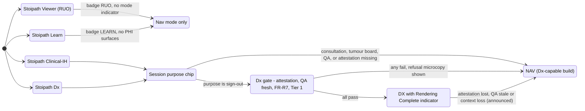
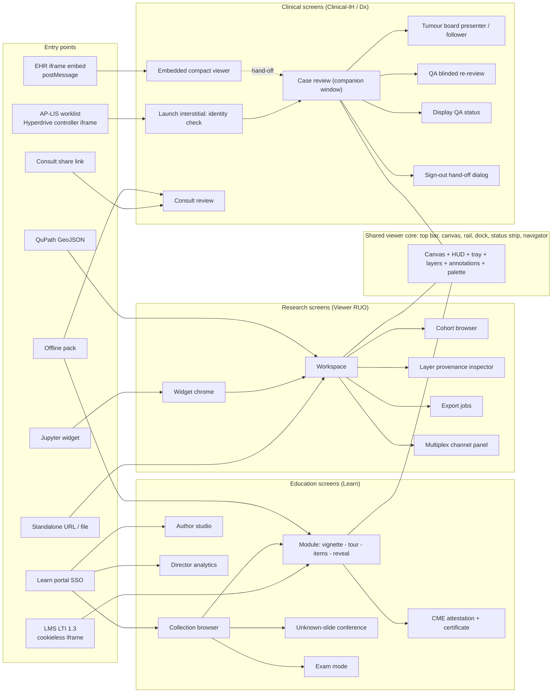
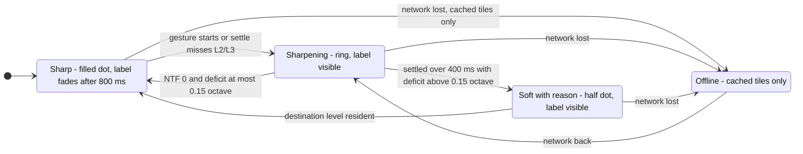

# Stoipath viewer: design principles and information architecture

Design phase document 1 · Stoipath WSI viewer · 2026-10-25 · status: draft for the UX/UI review on Thu 2026-10-29.

**Inputs.** Plan sections 01 (personas §3, goals §4, non-goals §5), 02 (functional requirements §2, NFR-A §3.6, fidelity tiers §5.1, user stories §6), 04 (§8 SDK surfaces, §9 layers, §10 multi-slide sync), 06 (§1 tiers, §3 platform matrix, §4 shells), 12 (pillar workflows, §1.1 engine contracts, §2 four build artefacts); research notes 11-gap-1 (navigation dynamics), 11-gap-6 (education UX, accessibility, LMS), 11-gap-7 (LIS launch, sign-out). `design/research/ux-conventions.md` (UX conventions of digital-pathology viewers and adjacent expert tools, 2026-10-25) landed while this was being drafted and has been reconciled into §3.1, §4, §5 and §11; where this document departs from a surveyed convention it says so and why.

**Authority.** The plan is the source of truth. Where this document had to choose between two plan statements, or fills a gap the plan leaves open, the choice is marked **Design note** and collected in §11. Terminology (L\*, NTF%, TTS, Pinned Base, Edge Translator, Dx mode, Rendering Complete, W-LAN…N-And, W+/W60/W−/N, Tier 1–3) is the plan's.

**What this document is for.** It fixes the vocabulary, screen inventory, interaction model and status language that the design system, the nine concept explorations and the three final screens must share, so that concepts are comparable and none re-decides what the plan decided.

---

## 1. Ten design principles

Each principle carries a one-line test that a reviewer can apply to a static mock or a running build without further interpretation. A concept that fails a test is not "a different style"; it is out of scope.

| # | Principle | What it means in practice | One-line test |
|---|---|---|---|
| P1 | **The slide is the interface.** | Chrome exists to frame, label and command the slide; it never competes with it. Panels dock to the edges and the centre of the canvas is never covered by anything, including dialogs, toasts and onboarding. | At rest, the slide canvas is ≥ 70 % of the viewport area on every surface, and no UI element intersects the central 50 % × 50 % of the canvas except the user's own annotations and the transient cursor loupe. |
| P2 | **Chrome costs no frames.** | Nothing in the DOM re-lays out, re-paints or animates while a gesture is in progress; overlays are GPU layers in the engine's draw list; the only DOM over the canvas is HUD text updated by `textContent`/`transform`. Panels have fixed geometry during a gesture (they may collapse *between* gestures). | A Performance trace of the golden gesture replay shows zero Layout/Paint events attributable to shell DOM during the gesture window, and the plan's NFR-P9 (no main-thread task > 8 ms) holds with the chrome mounted. |
| P3 | **Honest pixels: never blank, never pretend.** | The canvas always shows the best resident ancestor (plan FR-V2) and the HUD states the sharpness truthfully. There is no spinner over tissue, no "Loading…" plate, no fake blur-to-sharp animation. | No frame of any replay has a blank canvas pixel (NFR-P6), and the sharpness indicator reads **Sharp** only when the settled frame has NTF% = 0 and a resolution deficit ≤ 0.15 octave (NFR-P16). |
| P4 | **Product and mode are unmistakable.** | Which of the four builds this is (Viewer RUO / Learn / Clinical-IH / Dx), which render mode (Nav / Dx) and, where it matters, which fidelity tier, is readable from any screenshot at any viewport without scrolling, hovering or opening a menu. | Cover the canvas with your hand: the product badge, its full label string (or its abbreviated form plus a visible path to it) and the render-mode indicator are still visible in a fixed position, in every state including dialogs and errors. |
| P5 | **Identity before pixels.** | In the clinical builds the case and slide identity (accession, part, block, slide label text, and the Tier-2 label image) is on screen before the first tile is drawn and stays on screen at rest; a mismatch blocks (Dx) or warns (elsewhere) before anything can be interpreted (FR-R9). | In the Clinical-IH and Dx builds, the frame that draws the thumbnail already shows the accession/part/block header and the label image, and the `identityMismatch` state replaces the canvas content with the blocking plate. |
| P6 | **One hand on the mouse.** | Every action has a keyboard path that needs no modifier the browser or Epic Hyperdrive claims; zoom is anchored to the pointer (wheel, pinch, trackpad); a pathologist can screen a case without lifting a hand from the mouse or the keyboard. | Every command in the command registry has a default binding reachable in ≤ 2 keystrokes with no Ctrl/Alt/F-key, and a wheel notch leaves the slide point under the cursor within 1 CSS px of where it was. |
| P7 | **Neutral chrome, safe palette.** | Chrome adjacent to tissue is dark neutral grey with near-zero chroma so it does not shift perceived stain colour; status is carried by luminance, shape and text; the annotation palette is distinguishable under deuteranopia/protanopia simulation and against H&E hues. | No chrome colour within 32 CSS px of the canvas edge has OKLCH chroma > 0.03; every annotation class in the default palette remains pairwise distinguishable (ΔE00 ≥ 20) after deuteranopia and protanopia simulation; no state is conveyed by colour alone. |
| P8 | **Micrometres are the only truth.** | The scale bar, measurements and HPF readout are computed from µm/px; the magnification label is explicitly derived (FR-V9); the pitch source (EDID / `dx_profile.json` / unknown) is visible when it is not attested (FR-R10). | Every length or area shown is in µm, mm or mm², the scale bar snaps to 1/2/5 × 10ⁿ µm, and the magnification readout shows a tilde and a "pitch unknown" chip whenever the physical pitch is not attested. |
| P9 | **Degraded is designed, not apologised for.** | Cold 4G, W60, offline pack, missing display attestation, tile errors and a slow translator each have a named visual state and fixed microcopy (§5, §6); the tier is named only when it limits a mode. | Every row of the §6 state inventory has a rendered state in the design system and the microcopy in §5 is used verbatim; no state falls through to a generic "Something went wrong". |
| P10 | **The chrome is the accessible layer.** | The canvas is visual and is wrapped in an accessible application role with a live region; everything a learner or pathologist must *do* has a keyboard path, a 24 px target and a text alternative (NFR-A2–A5); focus order is fixed and documented (§8). | axe reports zero WCAG 2.2 AA blockers on chrome, every learner interaction completes keyboard-only in CI, and the region-marking item scores identically through its text alternative. |

Two corollaries from plan 12 §1 apply to every concept: **pillars add panels, never canvas behaviour** (the gesture model, HUD and sharpness language are identical in all four builds), and **chrome collapses before the canvas does**.

---

## 2. The product family and mode model as the user sees it

### 2.1 Four builds, one engine

The legal boundary between the pillars is a build artefact, not a flag (plan 12 §2, plan 04 §8). The UI's job is to make the running build and its claims impossible to mistake.

| Build (plan name) | Who gets it | Short badge | Full label string (controlled text; FR-R0) | What the UI must *not* contain |
|---|---|---|---|---|
| **Stoipath Viewer** (RUO distribution) | Research groups, demos, public npm/PyPI/Tauri | `RUO` | "For Research Use Only. Not for use in diagnostic procedures." (wording **[unverified, 21 CFR 809.10(c)(2)(i)]** per plan 12 §2) | No sign-out action, no LIS write-back status, no Dx mode toggle, no display-QA panel; a `product: clinical-ih` or `dx` launch is refused with the §5 microcopy |
| **Stoipath Learn** (education) | Students, faculty, LMS admins, CME offices | `LEARN` | "For educational use. Not a medical device. Contains no protected health information." | No PHI fields anywhere (no accession, no label image surface, no case header); no Dx mode |
| **Stoipath Clinical-IH** (in-house clinical) | One validating UT CLIA lab | `CLINICAL-IH` | "In-house laboratory-validated tool. Not FDA cleared. For use only within ‹laboratory name› under CLIA/CAP validation." | Nothing outside that lab; the lab name is a build-time constant shown in the string |
| **Stoipath Dx** (cleared edition) | Qualifying hospital systems, free | `Dx` | 510(k) labelling with UDI, version, `build_hash` and `pathway_hash` in About and at start-up (FR-R8); "Unverified build" banner when the hash is unregistered | Nothing that the cleared configuration does not list |

### 2.2 Render mode: Nav and Dx

`render_mode: nav | dx` is a per-session state inside the Dx-capable builds only (FR-V4).

- **Nav mode** is the default everywhere. The HUD shows the sharpness indicator (§5.3). Transients are allowed during gestures.
- **Dx mode** requires *all* of: Clinical-IH or Dx build; display attestation (`edid` from the native desktop shell, or `mdm-profile` from a hospital `dx_profile.json` in a managed browser); fresh display-QA record (FR-I10); deployment self-check passed (FR-R7); Tier 1 device. In Dx mode the HUD shows the **Rendering Complete** indicator instead of the sharpness indicator (§5.4), brightness/contrast/gamma reset to default with the adjustment indicator shown only when non-default (FR-V14), derived-tier tiles are never drawn, and AI overlays without `regulatoryStatus = validated-on-this-viewer` carry the fixed marker (FR-R11).
- Entering and leaving Dx mode are explicit commands (`Shift+D`) with a one-line confirmation of the attestation source. The mode never changes on its own except to *drop* to Nav with a stated reason (attestation lost, QA stale, context loss), announced in the live region.

### 2.3 Session purpose (Clinical-IH only)

Plan 12 §2 keeps a runtime `mode: ruo | dx` inside Clinical-IH for sessions that are not sign-out. **Design note (D1):** the UI exposes this as a *session purpose* chip beside the product badge with four fixed strings: `Sign-out`, `Consultation · preliminary only`, `Tumour board`, `QA review · blinded`. Tablets always carry `Consultation · preliminary only` (US-C2); a sign-out purpose is refused wherever Dx mode cannot be entered. The chip is absent in Viewer and Learn and never changes the legal label.

### 2.4 Fidelity tier badges

Plan 02 §5.1: the tier is computed at start-up and "shown to the user whenever it limits a mode". Rules:

- Tier 1 is never shown; a viewer that works is silent about it.
- Tier 2 shows a status-strip chip only when it limits a mode or feature: `Tier 2 · 60 Hz` (W60) or `Tier 2 · reduced memory` (W−); the chip opens a sheet stating the bounded promise in the plan's words ("never blank, ≤ 1 level soft during fast bursts, centre sharp within about half a second on a cold burst").
- Tier 3 always shows `Tier 3 · best effort`; the sheet says performance is not gated on this device.
- Dx refusal because of tier uses the §5 microcopy, not the chip.

### 2.5 Exact labelling rules

1. The **product badge** sits at the far left of the top bar on every surface, before any case or slide identity, in a fixed-width slot that no title truncation can push off screen. On phones the badge is the short form; tapping it opens the full label string and About.
2. The **full label string** is visible without interaction at ≥ 1024 px width (top bar, right of the badge, single line, truncation forbidden; the string wraps the case title before it wraps itself). Below 1024 px it is one tap away and is shown in full on the launch interstitial (§6) and in About.
3. The **render-mode indicator** (`NAV` or `DX`) is the right-most fixed element of the top bar in Dx-capable builds and is absent in Viewer and Learn. `DX` is never shown without the Rendering Complete indicator in the status strip.
4. Badge, label string and mode indicator are **outside the dismissible layer**: modals, sheets and toasts are inset so they never cover them (P4 test).
5. The RUO string also appears on the splash/launch interstitial, in the snapshot footer (burn-in on export; FR-V10) and in the SDK README, because a screenshot of the viewer must carry its claim.
6. Labels are text, never only an icon; they are localised through the plan's NFR-L1 pipeline but the RUO string is also present in English in the About panel of every locale (regulatory text).

---

## 3. Information architecture

### 3.1 Navigation model and shell anatomy

The viewer is a single-screen application with docks, not a multi-page site. Navigation *between slides* is a tray; navigation *between cases* belongs to the LIS or LMS, never to the viewer (plan 01 §5 non-goals). Six regions, named once and reused in every mock:

| Region | Name | Contents | Behaviour under P1/P2 |
|---|---|---|---|
| A | **Top bar** | Product badge, full label string, case/slide identity (clinical), module title (Learn), cohort/slide name (research), render-mode indicator, session purpose chip, overflow (About, settings, help) | Fixed height (48 px desktop, 44 px phone); never scrolls; never re-lays out during gestures |
| B | **Canvas** | The slide; GPU overlays (annotations, AI layers, label raster, multiplex channels, remote cursors); HUD text in the four corners | Dominant; receives focus; `role="application"` |
| C | **Tool rail** | Mode-specific tools (select/pan, annotate, measure, compare, layers) as 24 px-min icon buttons with labels on hover/long-press; collapses to a bottom bar on tablet portrait and phone | Fixed width; reflow only between gestures |
| D | **Context dock** | Pillar-specific panels: slide tray and case header (clinical), layers and provenance (research), module stepper and items (Learn), annotations list (all) | Right side on landscape; bottom sheet on portrait and phone; max 40 % of viewport height as a sheet; resizable by keyboard |
| E | **Status strip** | Sharpness / Rendering Complete indicator, network and tier chips, offline pack, display-QA status (clinical), message area for non-blocking notices | 28–32 px; text only; the live region's visual twin |
| F | **Navigator** | Slide thumbnail with viewport rectangle, click-to-recentre, label-image thumbnail (clinical, Tier-2 scope), pan buttons (SC 2.5.7 alternative) | Corner overlay, top-right by default (the OpenSeadragon/QuPath convention), collapsible with `O`, **never auto-fading** (a fade during a pan is a DOM animation and a loss of spatial context); never in the central 50 % |

### 3.2 The shared viewer core

Everything in this table exists in all four builds and is designed once.

| Component | Purpose | Engine contract it consumes (plan 12 §1.1) |
|---|---|---|
| Canvas + camera | Pan/zoom/rotate, pointer-anchored | `tick()`, state document, command bus |
| HUD | Magnification, scale bar, sharpness/Rendering Complete, position, adjustment indicator | Telemetry quality record, `tileSettled`, `renderingcomplete`, `adjustChanged` |
| Slide tray | Switch slides within a case/collection; thumbnails; stain labels (H&E, IHC ER/PR/HER2, Ki-67) | State document `slides[]` |
| Navigator | Overview, viewport rectangle, pan buttons, label-image thumbnail (clinical) | State document |
| Annotation tools and list | Point, polygon, polyline, rectangle, ellipse, freehand, measurement; classes; undo/redo; a real list of annotations | Annotation API (op-based), geometry services |
| Layer panel | Visibility, opacity, LUT/threshold, per-layer provenance tuple and `regulatoryStatus`; AI results default to an **outline / tissue-map presentation with heatmap on demand** (heatmaps obscure tissue and localisation trust is weak; ux-conventions §8), with a collapsible in-viewport legend and click-a-class-to-jump | Layer API with provenance and ACL |
| Compare | N-up with `lock` / `affine` / `none` sync; curtain | State document `views[]`, sync |
| Bookmarks and snapshots | Saved views with thumbnails; PNG/WebP with scale bar and label footer | State document, `snapshot()` |
| Command palette | Every command, searchable, with its shortcut | Command bus |
| Settings and About | Theme (dark neutral only on diagnostic surfaces), CVD remap, reduced motion, telemetry switch, product label, UDI/hashes, complaint intake (Dx) | Telemetry kill switch, FR-R8 |
| Status and error plates | §6 states | Event bus `error`, `identitymismatch`, `displayqa`, `dxattestation` |

### 3.3 Entry points

| Entry point | Who | What arrives | Build | First screen |
|---|---|---|---|---|
| **AP-LIS worklist launch** (IID-style URL + launch token) via the Hyperdrive controller iframe → **companion window** or Tauri shell on the diagnostic display | Sign-out pathologist | Launch context: accession, caseId, part, block, slideIds, studyUID, user, role, purposeOfUse, worklist state | Clinical-IH / Dx | Launch interstitial (identity verification, ≤ 1 frame visible on warm paths) → Case review |
| **EHR iframe embed** (postMessage JSON-RPC; no cookies, no popups, no top navigation) | Pathologist or clinician inside Hyperdrive or a portal | Same launch context; `window` is the iframe | Viewer (embedded build) or Clinical-IH as host dictates | Embedded compact viewer (Nav only; "Open on diagnostic display" hand-off button) |
| **Consult share link** (expiring, Tier 0 only) | Consulting pathologist on laptop/iPad/4G | Signed state blob, de-identified | Clinical-IH (consult purpose) or Viewer | Consult review |
| **Standalone** (paste a URL, open a local file, drag-drop) | Researcher, developer | Manifest URL or local SVS/NDPI/DICOM/OME-TIFF | Viewer | Workspace |
| **Jupyter / Colab / VS Code / marimo widget** (`sp.Viewer(...)`) | Computational pathologist | State document from Python, layers from Python | Viewer | Widget chrome (compact) |
| **QuPath-like tools** | Annotating pathologist | GeoJSON (QuPath dialect) in/out; DICOM/OME-TIFF export jobs | Viewer | Workspace with import/export |
| **LMS LTI 1.3 launch** (cookieless via Platform Storage, iframe or new window) | Student, resident, faculty | Signed state blob, roster role, assignment type (tour / quiz / case) | Learn | Module screen |
| **Learn portal** (standalone, SSO) | Faculty author, programme director, CME attendee | Collection or module id | Learn | Collection browser / Author studio |
| **Offline pack** (installed PWA, Tauri, iPad app) | Classroom, LMIC partner, iPad consult under MDM | Local pack file | Learn or Clinical-IH | Same screen as online with the offline chip |

### 3.4 Screen inventory per pillar

**Clinical (Clinical-IH; Dx later).** The viewer never owns the worklist; it shows the worklist *state* the LIS passed and hands evidence back.

| Screen | Purpose | Entry | What it adds to the core |
|---|---|---|---|
| Launch interstitial | Verify `slideIds`/`studyUID` against the Manifest before the first draw; show accession, part, block, label text, product label | LIS launch, share link | Identity header; blocking `identityMismatch` plate; "Nav mode — display not attested" line when applicable |
| Case review (companion window) | Screen, zoom, measure, annotate, bookmark; return to LIS to dictate and sign out | LIS launch → hand-off | Case header (accession AP-26-04417, parts A–C, blocks, slide labels, stain), worklist state chip (`Ready for review`, `In review`, `Reviewed`), label-image thumbnail (Tier 2 by role), display-QA chip, Dx toggle, `Request sign-out` command (emits `signoutRequested`; Clinical-IH/Dx only), AI overlay accept/reject with provenance, dictation co-existence (mic arbitration indicator) |
| Embedded compact viewer | Review inside the EHR window where no companion display exists | EHR iframe | Minimal chrome (badge, slide tray as chips, HUD); `Open on diagnostic display` hand-off; no Dx; no popups or top navigation |
| Consult review | Remote/frozen-section preliminary read on broadband, Wi-Fi or 4G | Share link, iPad | `Consultation · preliminary only` purpose chip; preliminary-note action (Clinical-IH); bandwidth chips; no label image (Tier 0) |
| Tumour board presenter / follower | One synchronised view for a room and remote attendees; H&E beside IHC; bookmarks gallery | From case review | Presenter bar (follow-me on/off, follower count), bookmark gallery, N-up sync controls, "no PHI on shared screen" enforced (label tier never in presentation scope) |
| QA blinded re-review | Blinded mode, sampling, washout tracking, discrepancy capture (v0.9 blinded; v1 full) | From worklist (QA purpose) | Blinded header (no prior diagnosis), concordance form, timer |
| Display QA status | Per-display identity, last pass, cadence, Dx gate consult | Settings / status chip | QA log table, test-pattern launcher (v1 module) |
| Sign-out hand-off dialog | Confirm what returns to the LIS: status, measurements, regions, accepted AI results | `Request sign-out` | Summary list, "Return to LIS" (closes or re-focuses the controller) |

**Research (Stoipath Viewer, RUO).**

| Screen | Purpose | Entry | What it adds to the core |
|---|---|---|---|
| Workspace | Annotate at scale, overlay model output, compare, export | Standalone, QuPath, widget | RUO badge and string; class hierarchy palette (QuPath-compatible class *names*, with on-screen colours remapped to the CVD-safe, luminance-separated palette and QuPath's own RGB restored on GeoJSON export, since Tumor-red/Stroma-green and Positive-red/Negative-violet fail the CVD and on-H&E constraints); layer provenance; `addVector` ceiling warning (> 10⁵ features → "Tiling locally…"); local tiler status |
| Cohort browser | Browse IDC/TCGA/CAMELYON or institutional collections; tags; licence | Standalone, portal | Collection grid (slide, state, annotation layers), licence chip per slide (CC-BY, CC0, institutional), open-in-workspace |
| Layer provenance inspector | Show `{producer, version, inputHash, createdAt, regulatoryStatus}`; accept/reject | Layer panel | Provenance card, accept/reject history, `research` / `unknown` status marker |
| Export jobs | Patches/labels, regions, GeoJSON/OME-TIFF/DICOM; provenance manifest | Workspace | Job list with progress, byte-identity badge, download |
| Multiplex channel panel | Window/colour/visibility for ≤ 8 channels; phone policy ≤ 3 | Workspace | Channel rows with histograms, "8-bit preview tier while moving · 16-bit at settle" status, channel cap notice per class |
| Widget chrome (Jupyter) | The same canvas and HUD inside a notebook output cell | `sp.Viewer` | Compact top bar (badge + slide name), collapsible rail, state round-trip indicator ("synced with Python") |

**Education (Stoipath Learn).**

| Screen | Purpose | Entry | What it adds to the core |
|---|---|---|---|
| Module | Vignette → tour → items → reveal → compare-to-expert | LTI assignment, portal, pack | LEARN badge and string; stepper (progress, step titles); tour player (autoplay/pause, step text, keyboard-stepped `flyTo`); item engine (MCQ, multi-select, ordering, free text, **region-marking** with text alternative); reveal control (per-layer ACL event); score return status (`Posted to gradebook`) |
| Collection browser | Curated collections by PCME objective, organ, stain, difficulty; label toggle | Portal, Deep Linking | Faceted grid, licence chips, "Start tour / Start quiz" |
| Unknown-slide conference | Weekly unknowns with hidden diagnoses; record diagnosis before reveal | Collection, phone | Diagnosis entry, reveal, learner's trace vs attending's path (heatmap) |
| Exam mode | Timed, board-style, no glass, image items (v1) | Collection | Timer, item navigator, lockdown notice, submit |
| Author studio | Record-a-tour from live navigation; item builder; convert sign-out annotations to teaching layers (via the de-identification stage); disclosure fields | Portal | Recording controls (`Start recording tour`), step editor, item editor with CVD simulation toggle, licence/determination form |
| Director analytics | Heatmap vs expert, time-to-first-zoom, dwell share; item statistics; aggregate only | Portal | Cohort charts (aggregate-only guard), export |
| CME attestation and certificate | Attestation, evaluation form, certificate PDF, record export | Module end, portal | Attestation form, disclosure display, certificate download |

---

## 4. The interaction model

The engine owns gesture semantics (FR-V1: pointer-anchored, coalesced, log-space easing 80–120 ms, inertia on release, `touch-action: none`). The shell owns bindings and must not invent a second gesture model. Everything below dispatches serialisable commands on the command bus (FR-V12) so keyboard, palette, voice, 3D mouse, remote presenter and the test harness are the same path.

### 4.1 Pointer and wheel (mouse)

| Input | Command | Notes |
|---|---|---|
| Left drag on canvas | `pan` | Inertia on release; disabled under reduced motion |
| Wheel notch | `zoom` by 1.2× per notch, anchored at the cursor (`deltaMode` read first) | A 5× burst is ≈ 9 notches (gap-1 F7); the destination predictor is the engine's business, not the UI's |
| Shift+wheel | `pan` horizontally | Trackpad users get native two-finger pan instead |
| Double-click | `zoom-in-step` (2×) at the point | Shift+double-click zooms out |
| Right-click | Context menu for annotation under cursor; on empty canvas, "Bookmark here", "Measure from here", "Copy view link" | Never a browser menu over the canvas |
| Middle drag | `rotate` about the viewport centre (optional, off by default) | Rotation snaps at 0/90/180/270 with `Shift` |
| Hover | Cursor loupe (optional) and prefetch hint; no tooltips over tissue | Loupe is a GPU layer, never DOM |
| Single click | **Never changes the camera** | OpenSeadragon's `clickToZoom` default is an anti-pattern for screening (a stray click jumps 2×); click selects, places or does nothing |
| Hover auto-pan (`Shift+L`, off by default) | `pan` toward the cursor's offset from the viewport centre, rate-limited to the engine's ceiling | The "clickless panning" / "Ergo mode" class of feature; relieves wrist load and doubles as an SC 2.5.7 drag alternative |

### 4.2 Trackpad

Trackpads are a first-class pathology input (gap-1 F8). Two-finger scroll pans with the engine's rate-limited, inertia-less pan model; pinch (reported as `ctrl+wheel`) uses its own rate-limited pinch model (FR-V1) anchored at the cursor, so the shell prevents browser zoom on Ctrl/Cmd+wheel. Three-finger gestures are left to the OS.

### 4.3 Touch

| Gesture | Command | Notes |
|---|---|---|
| One-finger drag | `pan` | 1:1 with coalesced events |
| Two-finger pinch | `zoom` anchored at the pinch centroid | Pinch rate is unmeasured for pathologists (gap-1); the shell logs it |
| Two-finger twist | `rotate` with snap at cardinal angles | Off by default on phones (accidental rotation); on by default on tablets with a lock toggle |
| Double-tap | `zoom-in-step` 2× at the point | Two-finger double-tap zooms out |
| Long-press (450 ms) | Context sheet: annotate here, measure from here, bookmark | Replaces right-click |
| Edge swipes | Reserved for the OS | The shell never binds them |

### 4.4 Pen (Apple Pencil, Android stylus, Windows pen)

Pen annotates while a finger pans (FR-V11). With a drawing tool active the pen draws with pressure (stroke width) and tilt (freehand only); otherwise it is a pointer. Pencil double-tap toggles the last drawing tool and select; Pencil Pro squeeze opens the tool palette at the pen tip (a transient, user-invoked GPU layer, exempt from the central-zone rule). Hover (M2+ iPad Pro) drives the loupe; palm rejection is the platform's. Every pen action has a finger and a keyboard equivalent (SC 2.5.7).

### 4.5 Keyboard

**Conflict rules.** (1) Inside the canvas (focused `role="application"`), bindings are unmodified keys and Shift-combinations only. (2) No F-key is ever bound (Epic Hyperdrive and browsers use F1–F12). (3) No Alt-combination (Hyperdrive activity menus, browser menu accelerators) and no Ctrl/Cmd-combination except the universal editing set `Ctrl+Z / Ctrl+Y / Ctrl+C / Ctrl+V / Ctrl+A` on annotations and `Ctrl+K` for the palette (interceptable in Chromium and Firefox; Slack-web precedent). (4) Never `Ctrl+T/W/N/L/D/F/P/S/R/+/-/0`, `Ctrl+Tab`, `Ctrl+Space` (Epic search), `Ctrl+1–9`, or the numeric keypad (Dragon Medical One push-to-talk defaults). (5) The **Hyperdrive controller iframe binds no keys at all**; the companion window owns the map. (6) `Tab`/`Shift+Tab` always move focus; `Esc` always cancels the current tool or closes the top-most sheet; `?` opens the shortcut sheet. (7) All bindings are rebindable and exported with the command registry. (8) Three named presets ship: the default below, a mirrored **left-hand cluster** and a **right-hand cluster** (the one clinical vendor that documents customisable shortcuts gives left-handed clustering as its reason); the keys and microphone states Dragon Medical One or VoiceOver PRO reserve at the pilot site are recorded in the preset and shown greyed in the shortcut sheet (FR-I9). (9) Shortcuts work whenever the viewer window has focus, not only the canvas (the QuPath/OpenSeadragon focus bug); the focus ring shows where keys will land.

**Default map A: navigation and sign-out (all builds; clinical actions where marked).**

| Key | Command | Key | Command |
|---|---|---|---|
| `←↑↓→` or `W A S D` | Pan 10 % of viewport (held = continuous) | `Shift+←↑↓→` | Pan one full viewport (systematic coverage stepping) |
| `+` / `=` | Zoom in 2× (one level) | `-` | Zoom out 2× |
| `Shift++` / `Shift+-` | Zoom in/out 1.2× (fine) | `0` or `Home` | Fit whole slide (overview) |
| `1 2 3 4 5 6` | Jump to 1.25× / 2.5× / 5× / 10× / 20× / 40× (objective-equivalent, derived) | `Z` | Toggle between the last two magnifications |
| `R` / `Shift+R` | Rotate 90° clockwise / anticlockwise | `Shift+0` | Reset rotation |
| `]` / `[` | Next / previous slide in the case or collection | `}` / `{` | Next / previous part or block (clinical) |
| `O` | Toggle navigator | `L` | Toggle label image (clinical, Tier-2 scope) |
| `B` | Bookmark current view | `Shift+B` | Open bookmark gallery |
| `Shift+S` | Snapshot (PNG with scale bar and footer) | `H` | Hide / show all overlays |
| `Shift+H` | Toggle AI overlay only | `,` / `.` | Overlay opacity down / up |
| `/` | Curtain compare on / off | `C` | Compare (N-up) panel |
| `G` | Grid / HPF reticle toggle | `I` | Identity and case panel (clinical) |
| `Shift+L` | Hover auto-pan on / off | `Space` (held, drawing tool active) | Temporary pan while a drawing tool is active (QuPath / Figma / Photoshop habit) |
| `Shift+D` | Enter / leave Dx mode (Dx-capable builds; confirms attestation) | `Shift+Enter` | Request sign-out (Clinical-IH / Dx only; always opens the hand-off dialog; ignored while a drawing tool is in progress) |
| `J` | Brightness / contrast / gamma panel (FR-V14) | `Shift+J` | Reset adjustments to default (logged in Dx) |
| `Shift+A` | Accept AI result under focus; `Shift+X` reject | `Ctrl+K` | Command palette |
| `?` or `Ctrl+/` | Shortcut sheet (names the active preset and the reserved dictation keys) | `Esc` | Cancel tool / close sheet |

**Default map B: annotation (all builds).**

| Key | Command | Key | Command |
|---|---|---|---|
| `V` | Select / pan tool | `P` | Polygon (click to place vertices; `Enter` closes, `Backspace` removes last) |
| `F` | Freehand (pen pressure) | `Y` | Polyline |
| `X` | Rectangle | `E` | Ellipse |
| `T` | Point marker | `M` | Measure length (two clicks) |
| `Shift+M` | Measure area | `Shift+T` | Count tool (increments on click) |
| `Q` | Class picker (then `1–9` picks class, `Esc` cancels) | `Shift+Q` | Toggle class legend |
| `Enter` | Commit | `Delete` / `Backspace` | Delete selected annotation |
| `Ctrl+Z` / `Ctrl+Y` | Undo / redo | `Ctrl+C` / `Ctrl+V` | Copy / paste annotation (same slide) |
| `Tab` (in list) | Move through annotations as a real list | `Space` | Fly to the focused annotation |

**Learn additions:** `N` / `Shift+N` next / previous tour step or item; `Space` play/pause tour; `Shift+Enter` open the region-marking text alternative (§8.2; Learn has no sign-out, so the key is free in that build); `Shift+R` reveal (after answer is committed).

Departures from surveyed keymaps are recorded as Design note D15.

### 4.6 Command palette

`Ctrl+K` (Cmd+K) opens a palette anchored to the top bar, never over the canvas centre: fuzzy search across every registered command, slide (by label text or stain), bookmark, annotation class and module step, each row showing its shortcut; `Enter` runs, `Esc` closes. It is the discoverability layer for the keymap, the only home a rarely used command needs (which keeps the rail small), and the same registry the voice engine and the test harness drive.

### 4.7 Control surfaces and voice

3D mice, shuttle controllers, trackballs and gamepads map to `pan`, `zoom`, `rotate` and `next/previous slide` on the command bus under the engine's rate ceiling (≤ 1 viewport per 500 ms). They ship as presets, not afterthoughts: Rogers 2025 (38 pathologists and trainees; ux-conventions §6) found 63 % would need an alternative to click-and-drag for sign-out, and Molin 2015 found the touchpad the highest-workload device. With hover auto-pan they are also the SC 2.5.7 path. Dictation co-existence (FR-I9) shows a mic-arbitration chip (`Mic: dictation` / `Mic: navigation`); the viewer never records audio.

---

## 5. Canvas HUD and status language

### 5.1 HUD anatomy

HUD elements are lightweight text in the canvas corners, each with a quiet neutral backdrop, never inside the central 50 % × 50 %, never animated during gestures beyond `textContent` changes:

- **Bottom-left:** scale bar and its label; below it the position readout (`x 42.18 mm · y 18.03 mm`, optional).
- **Bottom-right:** magnification readout (clicking it, or pressing `Enter` on it, opens a **typed zoom field** accepting `×` or µm/px, the Figma/Photoshop habit pathology viewers lack); adjustment indicator when non-default (`B/C/γ adjusted`).
- **Top-left of canvas (clinical):** slide identity line (`A1-1 · H&E · AP-26-04417`) when the top bar is compact; remote participants' names in presenter mode sit under it.
- **Top-right of canvas:** the navigator (region F).

The status strip (region E) carries the sharpness / Rendering Complete indicator, network and tier chips, offline, display QA and the notice area; it is the visual twin of the ARIA live region (§8.4).

### 5.2 Magnification and scale bar

The magnification label is derived from µm/px and the display pitch and says so: `20×` with a secondary line `0.50 µm/px · pitch EDID` (clinical) or `0.50 µm/px` (elsewhere). When the pitch is unknown the readout becomes `~20×` with the chip `Pitch unknown`, and Dx is refused (FR-R10). `HPF` readout (calibrated field area in mm², Kim 2020) is available from `G`. The scale bar snaps to 1/2/5 × 10ⁿ µm, is 80–200 CSS px long, is drawn as a GPU HUD layer with glyph-atlas numerals (never into tiles, never as DOM that re-lays out during a gesture; Design note D11), labelled `200 µm` / `1 mm`, and is burned into snapshots with the product footer. Objective-equivalent presets are jump targets, not the semantics: a wheel burst may snap to the nearest preset on release so the destination level is the one the scheduler prefetched (an engine policy option, ux-conventions opportunity 2).

### 5.3 Sharpness / sync indicator (Nav mode)

A single glyph plus a short label, driven by the quality record (NTF%, resolution deficit, upload age, network state). It is subtle at rest and only speaks when the pixels are not what they look like.

Exact labels: `Sharp`; `Sharpening…`; `Soft — slow link`; `Soft — level not yet available` (sparse pyramid, NFR-P18); `Soft — low memory`; `Offline — cached tiles only`; `Syncing with Python…` (widget, state round-trip pending); `Following presenter` (tumour board follower). The glyph never uses red or green; it uses luminance (filled / ring / half) and the text.

### 5.4 Rendering Complete (Dx mode)

In Dx mode the strip shows one of exactly three strings, set only by the Class C verifier's flag, never by scheduler bookkeeping: `Rendering Complete` (check glyph); `Rendering…` (ring) while the flag is not asserted; `Not complete — do not interpret` when the frame has been settled for more than 2 s without the flag (fault, stale or derived-tier tile injected; FR-V4). Dx entry and refusal strings:

| Situation | Exact microcopy |
|---|---|
| Dx entered | `Dx mode · display attested (EDID · Barco MDPC-8127) · QA passed 3 days ago` |
| Refused: no attestation | `Dx mode unavailable: this display cannot be attested. Viewing in Nav mode.` |
| Refused: iframe | `Dx mode unavailable inside an embedded window. Open on the diagnostic display to continue.` |
| Refused: tablet / Tier 2 | `Dx mode unavailable on this device (Tier 2). Consultation · preliminary only.` |
| Refused: RUO build | `This is Stoipath Viewer, for research use only. Diagnostic mode is not part of this build.` |
| Refused: QA stale | `Dx mode unavailable: display QA overdue (last pass 34 days ago). Ask your display administrator.` |
| Refused: self-check | `Dx mode unavailable: deployment check failed (unregistered build hash). Nav mode only.` |
| Dropped to Nav | `Dx mode ended: display attestation lost. Viewing in Nav mode.` (assertive live region) |
| Adjustment in Dx | `Brightness/contrast adjusted — not the reference rendering. Reset (Shift+J)` |
| AI overlay not validated | `Not validated for diagnostic use on this viewer` (fixed marker on the layer and in the legend) |

### 5.5 Network, tier and offline

| Situation | Exact microcopy (status strip chip; sheet on tap) |
|---|---|
| ≥ 20 Mbps | No chip |
| 8–20 Mbps | `Link OK (12 Mbps)` shown only while a cold fill is in progress |
| < 8 Mbps (NFR-B4) | `Slow link (6 Mbps) — reduced detail while moving` |
| Metered | `Metered connection — case download paused` with `Download anyway` |
| Case pre-download | `Downloading case · 3 of 5 slides ready` |
| Offline pack | `Offline pack · Lymph node unknowns, week 43 · saved 2026-10-20` |
| Offline, no pack | `Offline — showing cached tiles only` |
| Tier 2 limiting | `Tier 2 · 60 Hz` or `Tier 2 · reduced memory` |
| Tier 3 | `Tier 3 · best effort` |
| Translator slow | `Server slow (p95 1.2 s) — prefetch paused` |
| Classroom bottleneck | `Shared Wi-Fi busy — following the instructor may lag` |

### 5.6 Errors

| Situation | Exact microcopy | Where |
|---|---|---|
| Some tiles failed | `3 tiles could not be loaded — retrying` | Strip; failed tiles keep the ancestor (never blank) |
| Tile server unreachable | `Tile server unreachable — showing cached tiles. Retry` | Strip + notice |
| Manifest failed | `This slide could not be opened (HTTP 503 from the tile server). Retry · Report a problem` | Plate over the canvas area with the thumbnail if any |
| Token expired | `Your session has expired. Sign in again to continue viewing AP-26-04417.` | Blocking plate; identity header stays |
| Identity mismatch (Dx/Clinical-IH) | `Slide identity mismatch. The launch context (AP-26-04417 · A1-1) does not match this slide's manifest. Viewing is blocked. Report to the laboratory.` | Blocking plate; audit event |
| Identity mismatch (elsewhere) | `Warning: launch context and slide manifest disagree (AP-26-04417 · A1-1). Check the slide label before using this view.` | Non-blocking banner under the top bar |
| Launch refused (wrong product) | `This launch asked for Stoipath Clinical-IH but this is Stoipath Viewer (research use only). Nothing was opened.` | Plate |
| Vector layer too large | `1,240,000 features — tiling locally so zoom stays smooth` | Strip notice (research) |
| LTI launch failed | `Your course could not start this assignment (cookies blocked and platform storage unavailable). Open in a new window.` | Plate with the fallback button |
| Context loss / memory | `Graphics memory was reset — restoring the view` (never blank: L1/L2 rebuild) | Strip |

---

## 6. State and empty / loading / error states inventory

| # | State | Trigger | Canvas | Chrome | Microcopy ref |
|---|---|---|---|---|---|
| S1 | Launching (identity) | Launch context received | Dark neutral; identity header already drawn | Product label, case header | §5.6 identity |
| S2 | First frame | Thumbnail + levels ≤ 1024 px (TTFF) | Thumbnail scaled, soft | Full chrome; `Sharpening…` | §5.3 |
| S3 | Sharpening (cold fill) | Settle misses L2/L3 | Best ancestor, fading in | `Sharpening…` | §5.3 |
| S4 | Settled sharp | NTF 0, deficit ≤ 0.15 | L\* | `Sharp` then quiet | §5.3 |
| S5 | Settled soft | Deficit > 0.15 for > 400 ms | Ancestor | `Soft — reason` | §5.3 |
| S6 | Slow link | < 8 Mbps | Moving tier (H&E only) | Chip | §5.5 |
| S7 | Metered | `saveData` / metered | Normal | Chip + action | §5.5 |
| S8 | Offline with pack | No network, pack present | Normal from pack | Chip | §5.5 |
| S9 | Offline without pack | No network | Cached tiles only | Chip + `Offline` indicator | §5.5 |
| S10 | Tier 2 / 3 limiting | Start-up tier | Normal, DPR 2 cap | Chip | §2.4 |
| S11 | Dx refused | Any gate fails | Normal (Nav) | Strip notice + `NAV` | §5.4 |
| S12 | Dx active | All gates pass | Deterministic | `DX` + Rendering Complete | §5.4 |
| S13 | Dx dropped | Attestation lost | Normal (Nav) | Assertive notice | §5.4 |
| S14 | Tile errors | Fetch/decode failures | Ancestors kept | Retry chip | §5.6 |
| S15 | Manifest / server error | Open fails | Thumbnail or neutral plate | Plate with retry | §5.6 |
| S16 | Session expired | Token refresh fails | Last frame dimmed 40 % | Blocking plate | §5.6 |
| S17 | Identity mismatch | Check fails | Blocked (Dx) / banner (else) | Plate or banner | §5.6 |
| S18 | Translator slow | Server-Timing p95 high | Normal | Chip | §5.5 |
| S19 | Empty: no slides in case | Launch with 0 slides | Neutral plate: `No slides are attached to AP-26-04417 yet. The LIS will update this case when scanning completes.` | Header only | — |
| S20 | Empty: no annotations | New slide | Canvas normal | Dock: `No annotations yet. Press P to draw a polygon or M to measure.` | — |
| S21 | Empty: no layers | No overlays | Normal | Dock: `No overlays. Drop a label pyramid, GeoJSON or Parquet file here, or add one from Python.` (research) | — |
| S22 | Empty: collection | No slides match filter | — | `No slides match these filters.` + clear filters | — |
| S23 | Module not started | LTI launch to a tour | Slide at step 0 view | Stepper: `Step 1 of 9 · Press Space to start the tour` | — |
| S24 | Item awaiting answer | Region-marking item | Canvas normal | Item card: `Mark the metastatic focus. Zoom to at least 20× to earn full credit. Text alternative: Shift+Enter` | §8.2 |
| S25 | Answer committed, reveal pending | Learner answered | Normal | `Answer saved. Press Shift+R to reveal.` | — |
| S26 | Revealed | Reveal event | Answer-key layer visible | `Revealed · your mark overlapped the lesion by 62 % (IoU) · 1 / 1` | — |
| S27 | Score posted | AGS success | — | `Posted to gradebook` / `Could not post to gradebook — your answer is saved; we will retry.` | — |
| S28 | Presenter following | Follow-me on | Normal | `Following presenter · Dr Example` (synthetic name) + `Stop following` | §5.3 |
| S29 | Context loss | GPU reset | Rebuilt from L1/L2 | Strip notice | §5.6 |
| S30 | Unverified build (Dx) | Hash unregistered | Normal | Persistent banner `Unverified build — not for clinical use` | FR-R8 |

---

## 7. Responsive strategy per surface

One file per screen; media queries on width, height, orientation, `pointer: coarse` and `prefers-reduced-motion`; the canvas is the flex-grow element and chrome collapses in a fixed order: (1) full label string → tap-to-reveal, (2) dock → drawer, (3) drawer → bottom sheet, (4) tool rail → bottom bar, (5) navigator → behind `O`, (6) HUD secondary lines → hidden, (7) drawing tools → point marking only (phone). The canvas never collapses.

| Surface and viewport | Layout | Canvas share at rest | What collapses | Input defaults |
|---|---|---|---|---|
| **4K sign-out, 3840 × 2160, DPR 1** (W-LAN / N-Desk gate viewport) | Top bar 48 · rail 56 · dock 400 (resizable 320–520) · strip 32; navigator 320 px | ≈ 84 % | Nothing; full label string, case header, label image, display-QA chip all visible | Mouse + keyboard; 3D mouse |
| **Desktop 1920 × 1080** | Same, dock 320 | ≈ 74 % | Dock still open; HUD secondary lines kept | Mouse + keyboard |
| **Laptop 1440 × 900** (W-BB) | Dock becomes a drawer, closed by default, opens over the canvas edge (not the centre) | 87 % closed / 74 % open | Full label string stays (≥ 1024 px); navigator 240 px | Trackpad model active |
| **Tablet landscape 1366 × 1024** (W-iPad / N-iPad) | Rail 64 (pen-friendly, 44 px targets) · dock drawer · strip 32 | ≈ 88 % | Case header compacts to one line; label string one tap away on < 1024 | Pen draws, finger pans; pinch |
| **Tablet portrait 1024 × 1366** | Top bar 48 · canvas full width · tool bar 72 at bottom · dock as bottom sheet ≤ 40 % height | ≈ 82 % (sheet closed) | Rail → bottom bar; navigator smaller; HUD keeps mag + scale bar | Pen + touch |
| **Phone 390 × 844** (W-4G) | Top bar 44 (badge + case or module id) · canvas · bottom bar 56 with five 48 px targets · sheets | ≈ 85 % | Label string behind the badge tap; drawing tools reduced to point marker and measure; navigator hidden; HUD = mag + scale bar + sharpness dot; Learn item card as a sheet | Touch; DPR capped 2 by the engine |
| **Embedded iframe (EHR)**, any size | Compact top bar 40 (badge, slide chips, hand-off button) · canvas · strip 24 | ≥ 85 % | Everything but tray chips and HUD; no Dx; no popups | Host's pointer |
| **Jupyter widget**, cell width × 480–720 px | Compact top bar 36 · canvas · collapsible rail | ≥ 80 % | Dock collapsed to a toggle; state sync indicator | Mouse |

Density: text 13–14 px in chrome on desktop, 15–16 px on touch; icons 20 px in 24 px targets (44 px on touch). Dark neutral theme only on diagnostic surfaces; Learn may offer a light theme for the chrome (never for the canvas backdrop, which stays neutral grey around tissue).

---

## 8. Accessibility architecture

### 8.1 What is accessible: chrome versus canvas

The canvas is a visual instrument and is not expected to render tissue to a screen reader. It is exposed as `role="application"` with an `aria-label` (`Slide canvas, A1-1 H&E, 20 times, use arrow keys to pan and plus or minus to zoom`) and `aria-describedby` pointing at the live region. Every *decision* is available through chrome: annotation and layer lists are real lists, the slide tray is a tab list, items are forms, bookmarks are buttons with text. HUD values (magnification, scale, position, sharpness) are mirrored into the live region.

### 8.2 The region-marking alternative

The signature education item ("mark the metastatic focus on this CAMELYON lymph node") must be completable without a pointer and must score identically (NFR-A5). Two paths, designed together with the pointer path:

1. **Keyboard marking.** With the item active, `Shift+Enter` opens a dialog listing the author's *candidate regions* (A–F), each with a short text description written by the author in the item editor ("subcapsular sinus, right pole, ~1 mm cluster of large cells") and a `Fly there` button that moves the view (keyboard-reachable zoom to ≥ 20× satisfies the zoom gate). Choosing a candidate places the learner's mark on that region's hidden geometry; scoring uses the same IoU/point-in-polygon service.
2. **Text alternative.** Where the author provides no candidates, the dialog offers a structured text answer (location by compartment, approximate size, feature) scored against the author's rubric; the score is recorded with `modality: text` and is never discounted for modality.

Authors see both alternatives in the editor and cannot publish a region item without at least one; the item engine's CI runs the keyboard path.

### 8.3 Focus order and traps

Document order matches visual order: top bar (badge → label → case/module identity → mode indicator → overflow) → canvas → tool rail → context dock → status strip → navigator. A `Skip to slide` link comes first. Dialogs and touch sheets trap focus and return it. Focus is always visible (2 px outline, ≥ 3:1 against neutral chrome) and nothing steals it during a gesture.

### 8.4 Live regions

Two live regions sit at the end of the DOM: a **polite** region for position, magnification, selection and sharpness changes, debounced to one announcement per 500 ms and spoken at settle rather than during gestures; an **assertive** region for identity mismatch, Dx dropped, session expired and score-posting failures. The live region speaks the §5 microcopy verbatim; there is no second wording.

### 8.5 Motion, contrast, colour

`prefers-reduced-motion` disables inertia, `flyTo` easing (instant jump) and cross-fades between levels without slowing content (NFR-A4). Chrome text contrast ≥ 4.5:1 on the neutral greys; non-text UI ≥ 3:1. Colour never carries meaning alone: correct/incorrect feedback uses glyph + text; AI validation status uses the fixed text marker; annotation classes carry pattern or label in the legend. The CVD remap (Dalton 2026 YCbCr transform, FR-V8) is a per-user setting applied in the shader to tissue, and an author-side deuteranopia/protanopia simulation toggle lives in the Learn editor and the research class palette so nobody encodes meaning in red-versus-green. Targets are ≥ 24 × 24 CSS px everywhere and ≥ 44 px on touch; every drag has a single-pointer alternative (pan buttons in the navigator, tap-to-centre, click-to-place vertices, two-click measurements).

---

## 9. Telemetry hooks the UI must emit, and privacy rules

The event bus is the engine's (FR-I12; plan 12 §1.1; web component events in plan 04 §8). The shell emits UI-originated events into the same bus so that audit, xAPI and research exports share one schema. Names in the first table are the plan's; the second table lists shell events this document **proposes** (Design note D4): they must be filed against the core backlog with `FR-` IDs before any pillar relies on them.

| Event (plan) | When the UI causes or displays it | Consumer |
|---|---|---|
| `slideOpened` / `stoi:slideopened` | Tray switch, launch | Audit, xAPI launch statement |
| `viewChanged` / `stoi:viewchanged` (rAF-sampled) | Every camera change; sampled ≥ 20 Hz for learner traces (FR-E10), sampled trail for audit | Viewing-trace datasets, heatmap vs expert |
| `tileSettled` / `stoi:tilesettled` | Drives the sharpness indicator | Quality record, TTS |
| `stoi:renderingcomplete` | Drives the Dx indicator | Dx evidence |
| `annotationCreated/Updated/Selected`, `measurementCreated` | Tools and lists | ANN/SR export, xAPI, labels |
| `aiResultArrived/Accepted/Rejected` | Layer panel accept/reject | Write-back (Clinical-IH/Dx), active learning |
| `caseStatusChanged`, `signoutRequested` | Worklist chip, sign-out dialog (Clinical-IH/Dx only) | LIS status write-back |
| `shareCreated` | Share link / consult | Audit |
| `displayQaStatus` / `stoi:displayqa`, `stoi:dxattestation` | Display QA chip, Dx entry | Dx gate, audit |
| `identityMismatch` / `stoi:identitymismatch` | Blocking plate or banner | `AuditEvent` |
| `adjustChanged` | Brightness/contrast/gamma indicator | Quality record, audit on Dx reset |
| `itemAnswered` | Item engine | xAPI result, gradebook (AGS) |
| `stoi:error` | §5.6 plates and chips | Support, dashboards |

| Proposed shell event | Payload (PHI-free) | Purpose |
|---|---|---|
| `commandInvoked` | command id, source (`keyboard` / `palette` / `pointer` / `touch` / `pen` / `voice` / `surface`), build, surface class | Shortcut usage, discoverability, human-factors formative data |
| `hudStateChanged` | `sharp` / `sharpening` / `soft:<reason>` / `offline`, duration | Validates the indicator against NTF/deficit; complaint correlation |
| `dxRefused` | reason code | Deployment and display-QA analytics |
| `tierShown` | tier, reason | Tier-2 UX tracking |
| `panelToggled` | region id, open/closed, surface | Layout decisions per surface |
| `tourStepShown`, `revealShown` | module id, step index | xAPI `experienced`/`completed` mapping |
| `gestureSample` (touch only, sampled) | pinch rate (levels/s), pan velocity (px/s), burst duration, device class | The pathologist pinch/pan dataset gap-1 says does not exist |

**Privacy rules the UI enforces, not just the backend.**

1. No PHI in any event: no accession, patient identifiers, label-image pixels, free text or file names; slide IDs are linkable and hashed where the pipeline requires. Free-text item answers are learner records in the LMS/LRS, never telemetry.
2. The **telemetry switch** (on / off / air-gap) is in Settings and About in every build and is honoured by the shell before any network call (FR-R4, NFR-S7); air-gap also suppresses fonts, IdP and update calls.
3. Learner data is **learner-visible** and **aggregate-only** in cohort views (FR-E10); no director view shows an individual without the learner's consent flow.
4. The sampled viewport trail for clinical audit is disclosed in About ("This session records where you looked, for the laboratory's quality record"); break-glass sessions show a persistent chip.
5. Command telemetry records command *names*, never key text; the shell logs no keystrokes.
6. Snapshots and share links are Tier 0 unless the role grants Tier 2; a `Label image included` chip shows which tier a snapshot carries before export.

---

## 10. Screen-by-screen briefs for the three concept screens

Every concept must show every element in its list, at the named viewports, in the same realistic content, so that concepts are comparable. Content: CAMELYON-style sentinel lymph node with a metastasis; case `AP-26-04417`; parts A–C; slides `A1-1 H&E`, `A1-2 CK AE1/AE3 (IHC)`, `A2-1 H&E`; patient placeholder `DOE, JANE · 1958 · synthetic`; scanner 0.25 µm/px; display Barco MDPC-8127 (clinical). Mark every element that would be live in the product with the design system's `live` marker.

### 10.1 Clinical sign-out (`clinical-signout`)

Build Stoipath Clinical-IH, companion window on a 3840 × 2160 DPR 1 diagnostic display, also shown at 1440 × 900 (laptop) and in the EHR iframe compact form. Must show: `CLINICAL-IH` badge and full label string with the lab name; case header (accession, parts/blocks, slide labels, stain, worklist state `In review`); label-image thumbnail (Tier 2) and the identity line on the canvas; `DX` indicator with `Rendering Complete`, and a second state with the refusal `Dx mode unavailable: this display cannot be attested`; magnification `20×` with `0.50 µm/px · pitch EDID`; scale bar `200 µm`; navigator with viewport rectangle; slide tray with three slides and stain chips; the open-state preset (first slide fit-to-slide, stains in the lab's configured order: the radiology hanging-protocol analogue, so the reader never arranges the case by hand); measurement (`2.3 mm` metastatic focus) and one polygon annotation in a CVD-safe class colour; AI overlay layer row with provenance tuple and the `Not validated for diagnostic use on this viewer` marker, shown as an outline by default with a heatmap toggle; accept/reject controls; display-QA chip `QA passed 3 days ago`; `Request sign-out` command and the hand-off dialog; dictation mic chip; bookmark gallery entry; the shortcut sheet open in one variant (`?`); keyboard focus visible on one element; status strip with `Sharp`; a phone variant is **not** required for this screen (sign-out is not a phone task) but the consult variant on an iPad with `Consultation · preliminary only` is.

### 10.2 Research annotation (`research-annotation`)

Build Stoipath Viewer, standalone workspace at 1920 × 1080 and as the Jupyter widget chrome (cell 1200 × 640), plus tablet landscape with pen. Must show: `RUO` badge and the full RUO string; cohort/slide name (`CAMELYON16 · tumor_014`) with licence chip `CC0`; class palette with QuPath-compatible names (`Tumor`, `Stroma`, `Lymphocytes`, `Necrosis`, `Other`) in a CVD-safe palette with a deuteranopia simulation toggle; the annotation list as a real list with counts; a dense detection layer (≥ 10⁵ objects) with centroid LOD at low power and the notice `1,240,000 features — tiling locally so zoom stays smooth`; a label raster or probability overlay with opacity slider and provenance `{producer: unet, version 1.3, inputHash …, research}`; curtain compare on an IHC pair with `affine` sync; multiplex channel panel variant (6 of 8 channels, `8-bit preview tier while moving · 16-bit at settle`); export jobs panel with a provenance manifest and byte-identity badge; GeoJSON import/export actions; pen drawing a freehand region with a finger pan in the tablet variant; `Syncing with Python…` state in the widget variant; the sharpness indicator in the `Soft — level not yet available` state in one variant.

### 10.3 Education module (`education-module`)

Build Stoipath Learn, launched from Canvas via LTI 1.3 in an iframe at 1024 × 1366 (iPad portrait), also at 1366 × 1024 landscape and at 390 × 844 (phone, unknown-slide conference variant). Must show: `LEARN` badge and the full Learn string; module title and stepper (`Step 4 of 9 · Identify the metastasis`); tour player controls (play/pause, previous/next, step text with keyboard hints); the **region-marking item** card with the zoom-gate hint (`Zoom to at least 20×`), the learner's mark, and the keyboard alternative dialog listing candidate regions A–F with `Fly there`; the committed-answer and reveal states (`Revealed · IoU 62 % · 1 / 1`) with the answer-key layer visible; `Posted to gradebook` status and its failure variant; a hidden-diagnosis unknown-slide variant on the phone with `Record your diagnosis before the reveal`; the learner's viewing trace heatmap against the attending's path (director variant may be a thumbnail); the CVD remap setting; `Tier 2 · 60 Hz` chip on the iPad variant; offline pack chip `Offline pack · Lymph node unknowns, week 43`; keyboard focus visible, 44 px touch targets, and a reduced-motion variant with no fly-to animation noted.

---

## 11. Design notes: conflicts flagged and choices made

| ID | Topic | Plan statements | Choice here |
|---|---|---|---|
| D1 | Launch-context `mode` | Plan 12 §1.1 and gap-7 §3 carry `mode: dx\|ruo\|edu`; plan 04 §8 and FR-I1 carry `product: viewer-ruo\|learn\|clinical-ih\|dx` plus `render_mode: nav\|dx` | The UI follows plan 04/FR-I1: product badge from `product`, mode indicator from `render_mode`; plan 12's runtime `ruo` inside Clinical-IH is surfaced as the *session purpose* chip (§2.3). No new legal label is implied |
| D2 | RUO wording | Marked **[unverified wording, 21 CFR 809.10(c)(2)(i)]** in plans 12 and 13 | Used verbatim as the controlled string; the design system must treat it as a single token so counsel's final text replaces it in one place |
| D3 | Keyboard baseline | NFR-A3 fixes arrows, `+/−/0`, `Home`, `R` | Adopted and extended (§4.5); the extensions avoid Ctrl/Alt/F-keys so the Hyperdrive rule is met by construction |
| D4 | Shell telemetry events | FR-I12 lists engine events only | Seven shell events proposed (§9) for filing against the core backlog with `FR-` IDs, per plan 12 §1.1's rule that pillar needs go through the core backlog |
| D5 | Sharpness indicator | Plan has the quality record and a developer HUD (FR-V13) but no user-facing indicator | Defined (§5.3) as a three-state glyph driven by NTF%/deficit thresholds from NFR-P16; thresholds (400 ms, 800 ms) are design values to be tested in the gap-1 F9 study arm |
| D6 | Dx "Not complete" timeout | FR-V4 defines the flag, not a UI timeout | 2 s settled-without-flag shows `Not complete — do not interpret`; a Class C review must confirm this does not weaken the flag's meaning |
| D7 | EHR iframe viewing | Plan 12 §3.3 makes the Hyperdrive iframe a thin controller that hands off; the task also requires an embedded in-EHR viewer | Both exist: the embedded compact viewer is Nav-only and always offers hand-off; Dx never inside an iframe (plan 06 §4.5) |
| D8 | Magnification presets | Plan derives magnification from µm/px and never trusts "40×" | Preset keys `1–6` jump to objective-equivalent µm/px values and are labelled derived (`20×` with the µm/px line); the ladder itself is a design choice |
| D9 | Phone drawing tools | NFR-A2 and FR-V11 require pen and touch annotation; phones are the W-4G class | Phones default to point marking and measurement; full drawing stays available through the palette, so no capability is removed, only de-emphasised |
| D10 | `ux-conventions.md` | Landed during drafting | Reconciled: WASD aliases, `Space` temporary pan, top-right navigator, typed zoom field, outline-first AI presentation, QuPath colour remap on screen only, controller presets and the keep/break lists are adopted; departures are stated in §4.5 |
| D11 | Scale bar home | FR-V9 "drawn in the UI layer"; NFR-L2 allows glyph-atlas numerals in the GPU canvas; the hard constraint allows only lightweight HUD text in DOM | GPU HUD layer with glyph-atlas numerals so nothing re-lays out during a gesture; the design system records the ADR (ux-conventions §2 recommends the same) |
| D12 | Navigator | Convention: top-right, auto-fading (OpenSeadragon default) | Top-right kept; auto-fade broken deliberately (P2 and spatial context); collapsible with `O`; may hide by default on phones only |
| D13 | Label image visibility | FR-R9: shown "by default" in Clinical-IH and Dx; Sectra shows it on demand (`Q`) | Visible on open in the navigator/tray; collapsible to a chip with `L` in Nav mode; **never collapsible in Dx mode**; owner to confirm (ux-conventions open question 6) |
| D14 | Chrome luminance | Hard constraint: neutral dark grey, no saturated colour beside tissue; radiology defaults to black | Not black: a neutral grey around L\* 20–25 (OKLCH chroma ≤ 0.03) tuned against the reading-room ambient light; the exact token is the design system's, confirmed on the lab's displays (ux-conventions §12, open question 5) |
| D15 | Keymap departures from surveyed tools | Techcyte `X`/`Z` zoom; OpenSeadragon `K`/`J` next/previous image; QuPath `R`/`O`/`L` tool letters | `+`/`-` are the universal zoom keys, so `X` stays the rectangle tool and `Z` the magnification toggle; `]`/`[` replace `K`/`J`; `R` rotates and `O`/`L` toggle navigator and label image because pathologists reach for those more often than for a rectangle; all three are recoverable through the preset mechanism |

**Out of scope for this document (owned elsewhere):** the colour tokens and type scale (`design-system/tokens.css`), component states (component sheets), the concept explorations themselves, and the handoff spec. Nothing here decides a visual style; it decides what every style must contain.

---

## References

Plan: `docs/plan/01-vision-goals-metrics.md` §3–§5; `docs/plan/02-requirements.md` §2.1–§2.6, §3.3 (NFR-B4), §3.6 (NFR-A1–A5), §5.1 (tiers), §6 (US-C1–C3, US-R1–R3, US-E1–E3); `docs/plan/04-system-architecture.md` §8 (State Document, Launch Context, web component events, iframe JSON-RPC, companion window), §9 (layer kinds, provenance, ACL), §10 (sync modes); `docs/plan/06-cross-platform-delivery.md` §1 (tiers), §3 (platform matrix), §4.1–§4.5 (shells, input), §10; `docs/plan/12-product-pillars-clinical-research-education.md` §1.1 (contracts), §2 (four builds, labelling), §3.1/§4.1/§5.1 (personas), §3.3 (companion window), §5.2–§5.3 (Learn, cookieless LTI). Design research: `design/research/ux-conventions.md` §1–§3 (archetypes, magnification, navigators), §5–§8 (keymaps, input, palettes, AI labelling), §11–§13 (pen/touch, dark chrome, accessibility), §15 (LIS/EHR), the keep/break lists, the ten opportunities and the open questions for the owner. Research: `docs/research/11-gap-1-pathologist-human-factors.md` F1, F4, F7, F8, Implications; `docs/research/11-gap-6-education-modules.md` F4, F5, F8, Implications, Recommendations; `docs/research/11-gap-7-clinical-integration.md` F1, F2, F4, §3, §4. External conventions cited through the plan: WCAG 2.2 SC 2.5.7 and 2.5.8; Dalton, Ellis & Rakha 2026 (CVD-friendly H&E transform); Kim 2020 (HPF area varies with display); Brunyé 2023 (zoom bursts); Kayser 2009 and Molin 2015 (panning); Vodovnik 2015 and Rao 2021 (bandwidth thresholds).
