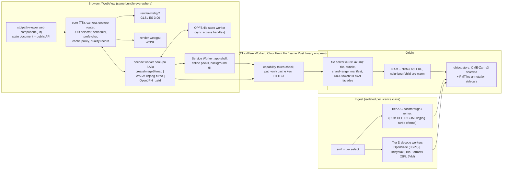

# Proposal A — Web-first custom engine

Stoipath WSI viewer architecture proposal. Date: 2026-10-24. Angle: a TypeScript-first, purpose-built renderer (WebGPU with WebGL2 fallback), worker-based decode, local tile cache, shipped as a PWA and a web component; desktop and mobile apps wrap the same engine (Tauri 2 / Capacitor 8); a Rust tile server reads OME-Zarr v3 / DICOM / native TIFF-JPEG. Evidence is cited to the research corpus (`research/NN-*.md`) and primary sources; anything the corpus left unverified is marked **[unverified]**.

## 1. Thesis

Every published cause of "blurry then pop" in a WSI viewer is a *policy* failure, not a GPU-API failure: the target level is not resident, the level swap is hard, minified tiles are not mipmapped, or decode/upload stalls the main thread (03 §3, 04 F7). A ~10 kLOC TypeScript engine that fixes all four, with a WebGL2 baseline that reaches 97% of browsers and a WebGPU path as a measured enhancement, meets the instant-zoom bar on the devices that actually define the floor (A12 iPad at 60 Hz, Mali-G5x Android, Samsung Xclipse without WebGPU) — and it does so with ~0.3 MB of code, zero WASM start-up for the renderer, and browser-native JPEG decoders that are verifiably libjpeg-turbo in Chromium and Firefox (11-gap-2 §2.3). The same bundle is the PWA, the `<stoipath-viewer>` element, the Jupyter widget and the UI of the Tauri/Capacitor apps, so one team ships every platform in goal 2 within a year. The price, stated up front: no 120 Hz on iPad, WebKit's memory and storage ceilings, no GPU-surface SDK for native hosts, and a two-dialect shader set. Where the Rust/wgpu proposals buy pixel identity and 120 Hz with 2–3 extra engineering disciplines, this proposal buys reach and velocity and accepts a documented ceiling on iPad.

## 2. Component architecture

**Client engine (TypeScript, Apache-2.0).** `core` is an allocation-free state machine driven from one `requestAnimationFrame`: `tick(now, inputs) → {drawList, requests, evictions}`. It owns the log-space camera (pinch 1:1 with coalesced events; wheel normalised by `deltaMode` and eased with an 80–120 ms log-space time constant, 04 F6), the LOD selector, the priority scheduler, the prefetcher and the cache policy. Two renderers implement one draw-list contract: `render-webgl2` (baseline; first-class on Xclipse, Firefox Linux, WebKitGTK and compat-mode devices) and `render-webgpu` (Chrome 113+/Android 121+, Safari 26+, Firefox 141+/145+). Both keep the GPU tile cache in `TEXTURE_2D_ARRAY`s of ≤256 layers × 512² RGBA8, draw one instanced call per resident level fed from vertex buffers (compat mode forbids large UBOs and partial array views, 11-gap-3), and blend two adjacent pyramid levels by fractional LOD so the pyramid is the mip chain. Shaders are authored once in WGSL; GLSL ES 3.00 is generated at build time with `naga-cli`, hand-patched where needed, and golden-tested against the WebGPU output (≤1 LSB), the discipline deck.gl uses (03 §2.9).

**Decode pipeline.** `clamp(hardwareConcurrency − 1, 1, 3)` Web Workers on phones (up to 6 on desktop), each with its own decoder, exchanging transferable `ArrayBuffer`/`ImageBitmap` only — no `SharedArrayBuffer`, no COOP/COEP, so the component embeds in any page, iframe or Android WebView (03 §2.4). Per tile: `fetch` → decode → transfer → `texSubImage3D`/`copyExternalImageToTexture` into a fenced array layer under a per-frame upload budget. Decoders: (a) `createImageBitmap(blob, {colorSpaceConversion:'none', premultiplyAlpha:'none'})` on browser builds that self-certify bit-identity against three golden tiles at start-up — Chromium/Skia and Firefox both use libjpeg-turbo with fancy upsampling and `JDCT_ISLOW` (verified from source); Safari's ImageIO is a black box and never passes in Dx mode (11-gap-2 §4.3); (b) our Emscripten libjpeg-turbo (SIMD, no pthreads, ~60 KB gz) as the reference and the Safari path — 2.1–2.9× slower than native on x86, bit-identical with and without SIMD; (c) OpenJPH WASM (~90 KB gz) for HTJ2K and 16-bit; (d) zstd/bitshuffle WASM for 16-bit Zarr chunks; (e) WebCodecs `ImageDecoder` as an opt-in non-Dx accelerator on Chromium/Firefox (absent from shipping Safari).

**Cache hierarchy** (05 F7, 11-gap-3): L0 GPU texture arrays — 128 MiB phone, 256 MiB iPad, 512 MiB–1 GiB desktop, never evicting ancestors of the visible region; L1 decoded `ImageBitmap` LRU ≤64 MiB on mobile; L2 OPFS encoded-tile store in a worker via `FileSystemSyncAccessHandle` (Chrome 102, Firefox 111, Safari 15.2), 300–500 MB phone / 1–4 GB desktop, cheap to refill because Safari's ITP deletes OPFS and Cache API data after 7 days without interaction and `persist()` does not exempt it; L3 Service Worker — **off the hot path** (50/250 ms cold start desktop/mobile), used only for the app shell, explicit offline packs and background fill; L4 browser HTTP cache (`immutable`, content-addressed URLs); L5 CDN edge with the capability token validated and stripped from a path-only cache key (09 F5); L6 origin RAM/NVMe hot cache; L7 object store.

**Scheduler.** Priority key `(tier, |level − L*|, distance to focus)`, focus = pinch centroid or cursor; all tier-0 (visible target) requests issued in the first frame; ~24 in flight on phones / 64 on desktop; `fetch` `priority` hints (Chrome 101, Firefox 132, Safari 17.2); `AbortController` cancel below 30% of bytes received; promise-level de-duplication; the 4–9 centre tiles coalesced into one `/b/` bundle or one shard range (04 F4, 05 F5).

**Tile server and storage (Rust).** `axum`/`tokio` origin speaking HTTP/2 to the edge; HTTP/3 and 0-RTT terminate at Cloudflare/CloudFront or Caddy/nginx-quic on-prem, and HTTP/2 stays first-class because Samsung Internet has no HTTP/3. Canonical store: OME-Zarr v0.5 (Zarr v3 `sharding_indexed`), 512² inner chunks, 8×8 chunks per shard aligned to 1 MiB, index at end; brightfield as JPEG q85–90 4:4:4 (verbatim vendor tiles when the grid allows), fluorescence as uint16 bitshuffle+zstd with an HTJ2K delivery variant (02 R2, R4). Endpoints: immutable `/t/{hash}/{ver}/{codec}/{z}/{x}/{y}`; `/b/` length-prefixed bundle; raw shard byte ranges for desktop/Python clients; a ≤100 KB manifest (geometry, MPP, ICC, channels, levels ≤4096 px bundled); DICOMweb façade (QIDO-RS, WADO-RS `/frames/{list}`, ANN bulk data); IIIF Image 3.0 and DZI façades. Native DICOM WSI (`TILED_FULL`) and TIFF-JPEG files (SVS, Philips TIFF, SCN, OME-TIFF) are served by passthrough with lazily synthesised intermediate levels, so first view is seconds after upload (01 R(b), 02 R1). Target p99 ≤10 ms service time on a RAM hit; MSK's 108 ms/FOV native-block serving is the published bar (05 F3).

**Ingest.** Sniff → tier: A/B byte passthrough (own Rust TIFF/BigTIFF/DICOM parsers, `JPEGTables` splice); C lossless NDPI re-mux via libjpeg-turbo transforms; D decode-once in licence-isolated containers (OpenSlide 4.0.1 LGPL-2.1-only; libisyntax BSD-2; slideio/libCZI for CZI; Bio-Formats GPL in its own JVM) (01 R(a)). Levels ≤4096 px are built synchronously in seconds; the base level materialises in shard order in the background while a lazy tiler answers misses write-through (02 R1). Label, macro, barcode and free text go under a separate ACL that never reaches the CDN (09 F4). Annotations become GeoArrow-shaped columns cut into vector tiles on the pixel grid (PMTiles-style sidecar) plus optional label-raster pyramids (08 F2).

**SDK surfaces.** `<stoipath-viewer>` custom element (Lit 3.3) whose attributes and events are the versioned state document; `<iframe>` + `postMessage` JSON-RPC; ESM package on npm; `anywidget` wrapping the same bundle for Jupyter/Colab/VS Code/marimo, with a PyO3 wheel of the tile server for local files; Tauri 2 apps for Windows/macOS/Linux with the tile server in-process; Capacitor 8 (or Tauri 2 mobile) apps for iOS/Android; OpenSeadragon `TileSource`, OpenLayers `Source` and deck.gl layer adapters (07 R2). Native hosts (Qt, C++, Swift, Kotlin) get a webview-hosted component, not a GPU surface — see §9.

## 3. Instant blur-free zoom, end to end

**Frame loop.** Pointer events only write a target transform. Each rAF: `core.tick` advances the presented transform (pinch/drag 1:1, wheel eased in log space), computes L* at *device-pixel* scale, builds the draw list from resident tiles (target tile if resident, else the nearest resident ancestor clipped to its footprint with resident descendants overlaid — never a blank), emits tier-0 requests, and the renderer issues one instanced draw per level with the cross-level blend. Uploads are capped per frame (≤2–4 MiB phones, ≤16 MiB desktop) and timed with `EXT_disjoint_timer_query_webgl2` / WebGPU `timestamp-query` where available (coarse on Chrome, fine on Apple silicon; 11-gap-3). The main thread never decodes, never allocates per tile per frame and never waits on the network.

**LOD and transition policy** (04 F2/F7, 11-gap-1 F7):
- Target level L* has s ∈ [0.5, 1.0] device pixels per texel; switch finer when s > 1.0, coarser only when s < 0.5 (one full level of hysteresis, no timers). Nothing is ever shown magnified *at rest*.
- Pinned base: at open, the whole pyramid down to the first level ≤4096 px (≈64 tiles, 1–2 MB) plus the thumbnail, never evicted; worst case anywhere on the slide is bounded blur, never blank.
- Trilinear sampling within tiles plus fractional-LOD blend between adjacent levels removes minification aliasing and the 2× pop; a ≤100 ms cross-fade covers the moment a late tile lands. Transients use bicubic magnification; no sharpening on settled tiles (unproven with pathologists; 11-gap-1 F7).
- Settle contract: after the last input, the frame must consist only of L* tiles within the time-to-sharp budget below; a late tile keeps its ancestor on screen and its request at top priority.
- Dx mode: explicit "rendering complete" state, deterministic resampler, browser decoders disabled unless self-certified (09 R5).

**Prefetch policy** (04 F3, 05 F6, 11-gap-1 F7): ring of 1 tile at L* (direction-weighted on cellular); pan cone from a One-Euro/Kalman velocity at τ = 100/250/500 ms, capped at one viewport per 500 ms and extended along the dominant direction (paths are near-linear, 3-point linearity 0.85); zoom-intent prefetch from the first wheel notch or pinch sample in a ±300 device-px window around the cursor/centroid at L*+1 *and* L*+2, with the destination level predicted from burst amplitude (66% of pathologist zoom bursts span ≥2.3 levels, so intermediates are skipped); hover/touch-down prefetch of L*+1; idle fan-out of L*+1 only on Wi-Fi/Ethernet; at slide open, levels ≥4 of every slide in the case (~10 MB/slide) plus two finer levels under the three most tissue-dense ROI candidates, inside the 4.5 s experts spend on the overview; worklist warm-up of the next case. Prefetch takes ≤50% of measured bandwidth and ≤25% of request slots; Stage-1 acceptance is ≤50% waste (the only measured naive policy wasted 74%). On cellular: render DPR capped at 2 and an H&E-only moving tier (q75 4:2:0, refined to q90 4:4:4 on settle; IHC and cytology skip it).

**Latency budget, input to photon.** Reference devices: desktop Chrome, 60 Hz 1080p, hospital LAN with a local tile server; laptop Chrome/Safari, 60 Hz, 100/20 Mbps broadband with a CDN edge hit; mid-range Android (4 cores, Mali-G57/Adreno 610, DPR 3 capped to 2, 60 Hz) on 4G (RTT 35 ms, 25 Mbps p50 / 5 Mbps p95). Inputs from 02 F9, 04 F1/F5, 05 F2, 11-gap-2 §2.3; **[model]** throughout, recalibrated by the M0 harness.

| Stage | Desktop LAN | Laptop broadband (CDN edge) | Mid-range Android 4G |
|---|---|---|---|
| Input sampling → JS handler | 1–8 ms (mouse 125–1000 Hz) | 4–16 ms (trackpad/touch) | 4–16 ms (touch 60–120 Hz) |
| `core.tick` (camera, LOD, scheduler) | ≤1 ms | ≤1 ms | ≤2 ms |
| Draw, two levels blended, ~20–24 tiles | ≤1.5 ms | ≤2 ms | ≤4 ms |
| Upload (within per-frame cap) | ≤2 ms (≤16 MiB) | ≤2 ms | ≤4 ms (≤4 MiB) |
| Compositor + vsync + scan-out (browser floor, ≈2 vsyncs) | 17–33 ms | 17–33 ms | 17–33 ms |
| **Warm path total (tiles resident)** | **≈25–45 ms** | **≈30–50 ms** | **≈35–55 ms** |
| Browser floor on same device (trivial CSS-transform page) | ≈20–40 ms | ≈25–45 ms | ≈30–50 ms |
| Cold tile: queue → first byte (OPFS hit / network p50 / p95) | 2 / 4 / 12 ms | 3 / 19 / 58 ms | 5 / 57 / 226 ms |
| Cold viewport transfer, ~20 tiles ≈ 1.2 MB (p50 / p95 bandwidth) | 10 / 20 ms | 100 / 400 ms | 400 / 1,900 ms (DPR-2 and moving tier: 150 / 700 ms) |
| Decode, 20 tiles, worker pool | 6–10 ms (native, 4–6 workers) | 8–15 ms (native; Safari WASM 20–40 ms) | 60–100 ms wall (3 workers; WASM 2–3× slower than native) |
| Upload spread across frames | 1–2 frames | 1–2 frames | 3–6 frames (2–4 tiles/frame) |
| Prefetch lead available before s crosses 1.0 | ≈155 ms (pinch) / ≥196 ms (wheel burst gap) | same | same |
| **Time-to-sharp after settle, target p50 / p95** | **≤50 / ≤100 ms** | **≤100 / ≤300 ms** | **≤250 / ≤700 ms** |
| Blur-free *during* the gesture at p95? | yes | yes at p50, bounded ≤1 level at p95 | no at p95 (bounded ≤1–2 levels; destination-level residency at burst end is the gate) |

Reading the table: the warm path adds no frame of our own to the browser floor, the only lever a web viewer has (04 F1). The cold path is won by prefetch lead plus hit rate (≥95% of tiles resident at settle, 05 F1): on LAN and broadband-edge the destination level arrives inside the 155–196 ms lead at p95 and p50 respectively; on 4G it does not at p95, so the contract there is "never blank, ≤1 level soft during the burst, sharp within 700 ms", enforced by the DPR cap, the moving tier and destination-skipping prefetch. The targets are 2–3× better than MSK's published 108–238 ms/FOV median, with a p99 nobody has reported (05 F3).

## 4. Platform coverage

| Platform | Delivery | GPU path | Decode | Expected fidelity |
|---|---|---|---|---|
| Web desktop — Chrome/Edge 113+ | PWA / web component | WebGPU; WebGL2 fallback | `createImageBitmap` (self-certified) or WASM; `ImageDecoder` opt-in | Full: 60–144 Hz follows display; warm ≈ floor + 0 frames; 512 MiB–1 GiB GPU cache |
| Web desktop — Firefox 141+/145+ (Win, Apple-silicon Mac); Firefox Linux | same | WebGPU on Win/Mac; **WebGL2 on Linux** (Nightly-only WebGPU) | `createImageBitmap` (libjpeg-turbo, serve untagged tiles) | Full |
| Web desktop — Safari 27 (macOS) | same | **WebGL2 default**, WebGPU allow-listed per major after soak (rerun precedent) | WASM libjpeg-turbo always in Dx; `createImageBitmap` non-Dx | Full at 60 Hz (120 Hz only if user flips the Safari flag) |
| Web mobile — Chrome Android 121+ (ARM/Qualcomm/Intel GPUs) | PWA | WebGPU, compat mode on GLES 3.1 devices (Chrome 146+), WebGL2 fallback | `createImageBitmap` self-certified | Good: rAF follows display mode (60–120 Hz, OS policy); 128 MiB GPU cache; 4G path per §3 |
| Web mobile — Samsung Internet 30 / Exynos-Xclipse Galaxy; Android 11 devices | PWA | **WebGL2 only** (Xclipse blocklisted; no `featureLevel`; no HTTP/3) | same | Good at 60 Hz; HTTP/2 path; this is the design floor, tested first |
| Web mobile — iOS/iPadOS Safari 26/27 (PWA) | PWA (Home-Screen install gets ~60% disk quota) | **WebGL2 default for us**; WebGPU allow-listed (default-on since 26); 16.7 Mpx canvas cap | WASM libjpeg-turbo | **Capped: 60 Hz rAF**; undocumented WebContent jetsam (~1.25–2 GB observed); 256 MiB GPU cache; ITP 7-day storage deletion |
| Windows desktop app | Tauri 2 (WebView2 Evergreen tracks Edge Stable → WebGPU expected **[unverified]**); tile server in-process for local SVS/DICOM/OME-TIFF; OpenSlide sidecar (LGPL, dynamically linked) for Tier D | WebGPU/WebGL2 | `createImageBitmap` | Full; installer <30 MB |
| macOS desktop app | Tauri 2 (WKWebView) | WebGL2 default; WebGPU on macOS 26+ allow-list | WASM in Dx | Full at 60 Hz; 120 Hz on ProMotion MacBooks **not** available (WKWebView) |
| Linux desktop app | Tauri 2 (WebKitGTK: **no WebGPU, built out**) or Electron 45 fallback (100–200 MB) if WebKitGTK WebGL2 proves inadequate | WebGL2 | `createImageBitmap` | Good; decision gate at Stage 2 planning |
| iOS/iPadOS app | Capacitor 8 or Tauri 2 mobile (WKWebView; Tauri 2 stable since 2024-10-02 with iOS/Android targets, 2026 mobile parity **[unverified]**); native plugins for Files, share, MDM, offline packs | WebGL2 (WebGPU iOS 26+) | WASM libjpeg-turbo | **Capped**: 60 Hz, no `predictedTouches`/Pencil hover, ~15% disk quota, invisible jetsam budget; App Store 4.2 risk unless native value is added; consultation/education/RUO, not primary Dx |
| Android app | Capacitor 8 / Tauri 2 (Android WebView 156; WebGPU disputed between caniuse and Chromium source; **no SharedArrayBuffer**) | WebGL2 baseline, WebGPU opportunistic | `createImageBitmap` self-certified | Good at display rate; HTTP cache not partitioned in WebView |
| Embeddable SDKs | `<stoipath-viewer>` (any origin, no COOP/COEP); iframe + postMessage; npm ESM; anywidget + PyO3 local server; OSD/OpenLayers/deck.gl adapters; React/Vue/Angular thin wrappers | per host | per host | Full inside browsers and WebView2/WKWebView/Android WebView hosts; **native GPU-surface SDK (C ABI, Swift/Kotlin view, Qt widget) not provided** |

## 5. Versatility fit

**Fluorescence / multichannel.** Per-channel 16-bit textures (`R16UI` with manual 4-tap bilinear in WebGL2; `r16unorm` where Chrome WebGPU `texture-formats-tier1` exists), per-channel window/gamma/colour/visibility uniforms, additive or max blend, ≤8 channels per pass with multi-pass accumulation, colormaps and lens — Viv 0.23's MIT shader semantics ported, with deck.gl kept out of the hot path (08 F4). Bandwidth is held by the server's channel-group bundle (all enabled channels of a tile or shard range in one request), enabled-channels-only fetching and an 8-bit windowed first paint refined to 16-bit zstd on settle; HTJ2K stays archive/interchange until WASM decode on low-end Android measures <10 ms (05 F9). Settings round-trip to OME-Zarr `omero` and DICOM Optical Path metadata; only visible channels are resident, which keeps a 10-channel view inside the 256 MiB iPad budget.

**Annotations at scale.** GeoArrow-shaped columnar model with a packed Hilbert R-tree (flatbush) built in a worker; vector tiles cut at ingest on the pixel pyramid grid (MVT, 4096 extent, 64-unit buffer) in a PMTiles-style sidecar; per-level representation switching (instanced centroids below ~10×, simplified polygons mid, full polygons at ≥20×); raster label pyramids with a 64 K-entry LUT texture as the primary form of AI segmentation and the fallback for the densest layers. Overlays use the *same* scheduler and tile key as pixels and are degraded first when the frame budget is exceeded (08 F2). Adapters: QuPath GeoJSON (canonical exchange), DICOM ANN (Sup 222), SR TID 1500 for clinical ROIs, W3C Web Annotation for IIIF/Annotorious, SpatialData/GeoParquet read. 1 M-nucleus layers fit the budget on desktop; 3 GB Android is forced to the centroid LOD below ~10×.

**Standards.** OME-Zarr v0.5 is the pixel store, readable directly by zarrita.js, Viv, QuPath and Python; DICOM WSI/DICOMweb is both a façade over the store and a first-class source (the client talks WADO-RS `/frames/{list}` directly, with a same-origin proxy mode because `Authorization` headers cost a CORS preflight per tile URL; 09 F5), with a published PS3.2 conformance statement; IIIF Image 3.0 and DZI are read adapters and served façades; an Iris façade is cheap to add (07 R4). Multi-slide sync uses per-layer affine from day one, with a displacement-texture slot reserved for non-rigid registration (08 F6). Collaboration later via Yjs; WCAG 2.2 SC 2.5.7/2.5.8 (single-pointer alternatives, 24 px targets) in the component from MVP.

## 6. Technology stack

| Layer | Choice | Licence | Note |
|---|---|---|---|
| Language / build | TypeScript 5.x, Vite + Rollup, pnpm 12 + Turborepo 2.11, Cargo workspace | Apache-2.0 / MIT | Repo option A from 10 F2 |
| Web component | Lit 3.3 | BSD-3 | Thin; the engine has no framework dependency |
| Renderer | own WebGL2 + WebGPU code; `naga-cli` for WGSL→GLSL at build | MIT/Apache-2.0 (naga) | No three.js/deck.gl in the raster hot path |
| JPEG decode | libjpeg-turbo 3.x via Emscripten (SIMD, no pthreads) | IJG + BSD-3 + zlib; Emscripten MIT | Reference decoder on every platform; `createImageBitmap` gated by self-certification |
| HTJ2K / 16-bit | OpenJPH (WASM, pinned version), zstd WASM, bitshuffle | BSD-2; BSD-3 | `@cornerstonejs/codec-openjph`-style build (MIT) |
| Format clients | zarrita.js, geotiff.js, dicomweb-client, dcmjs, dicom-microscopy-viewer parsers (not its OpenLayers renderer), pmtiles | MIT (all); pmtiles BSD-3 | Active within the last 60 days (07 F3) |
| Overlay geometry | flatbush, earcut, geojson-vt | ISC | Mapbox-lineage, tiny |
| Perf/telemetry | web-vitals 6.2, own quality record, Event Timing API | Apache-2.0 | `Timing-Allow-Origin` + `Server-Timing` on tiles |
| Collaboration (later) | Yjs | MIT | yrs on the server if needed |
| Desktop shell | Tauri 2.12 (WRY: WebView2 / WKWebView / WebKitGTK) | MIT/Apache-2.0 | Electron 45 (MIT) only as a Linux fallback |
| Mobile shell | Capacitor 8.5 (or Tauri 2 mobile) | MIT | WKWebView / Android WebView |
| Jupyter | anywidget 0.11 + PyO3/maturin wheel of the tile server | MIT; Apache-2.0 | vizarr pattern |
| Tile server | Rust: axum, tokio, hyper, zarrs, tiff, dicom-rs, turbojpeg (libjpeg-turbo FFI), OpenJPH FFI, moka | MIT/Apache-2.0; OpenJPH BSD-2 | Go was considered; its tiled-TIFF/JPEG-transform/Zarr-v3 library depth is thinner **[unverified]**, and sharing libjpeg-turbo and OpenJPH FFI with ingest favours Rust |
| Edge | Cloudflare Workers / CloudFront Functions, or the same Rust binary in edge mode (nginx/Caddy for HTTP/3 on-prem) | — | Token validation, path-only cache key, 1 MiB-aligned ranges |
| Storage | Cloudflare R2 (zero egress) / S3 / MinIO on-prem | — | OME-Zarr v3 sharded; vendor originals in cold storage |
| Ingest | own Rust parsers; OpenSlide 4.0.1; libvips 8.18; wsidicomizer/wsidicom/opentile; tifffile; libisyntax; slideio; Bio-Formats (`formats-gpl`) in its own JVM container; cuCIM optional for J2K-heavy archives | LGPL-2.1-only; LGPL-2.1+; Apache-2.0; BSD-3; BSD-2; BSD-3; GPL-2+; Apache-2.0 | One container image per licence class; nothing copyleft ships in the client |
| Project licence | Apache-2.0 + DCO; Dx edition and enterprise edge commercial | — | Patent grant matters in this field (09 F9) |

## 7. Effort and team

Person-months by workstream. MVP = web viewer (desktop and mobile browsers) with brightfield, basic annotations, DICOMweb/OME-Zarr/IIIF/DZI sources, web component + anywidget, tile server and ingest for the passthrough tier plus OpenSlide fallback, perf harness and gates M0–M2 (10 §6). v1 = everything in §4–§5: fluorescence, annotations at scale, DICOM ANN/SEG/SR, multi-slide sync, Tauri desktop on three OSes, iOS/Android apps, Python package, full façades, Dx-mode plumbing (design controls, not the 510(k)). Assumes engineers who have shipped a GPU streaming renderer or a map engine; ±30%.

| Workstream | MVP pm | v1 pm (cumulative) |
|---|---|---|
| Core engine (camera, gestures, LOD, scheduler, prefetch, cache policy, quality record) | 6 | 10 |
| Renderers WebGL2 + WebGPU (texture arrays, blend, 16-bit, LUTs, overlays, context loss) | 6 | 10 |
| Decode pipeline (worker pool, Emscripten libjpeg-turbo build, OpenJPH/zstd, self-certification) | 3 | 5 |
| Web component, PWA, viewer UI, state document, iframe API, a11y, i18n | 5 | 10 |
| Tile server + edge (Zarr/DICOM/TIFF passthrough, bundles, façades, tokens, hot cache, Helm) | 6 | 11 |
| Ingest (tiering, converters, isolated workers, PHI tiering, synthetic-slide generator) | 5 | 10 |
| Annotations and overlays (model, vector-tile cutter, label rasters, tools, GeoJSON/ANN/SR/W3C) | 3 | 9 |
| Fluorescence / multichannel | 2 | 5 |
| Standards adapters (DICOMweb client + proxy, IIIF/DZI, OME-Zarr reader, OSD/OL/deck adapters, conformance statement) | 2 | 5 |
| Desktop apps (Tauri 2 × 3 OS, local files, signing, updater, Linux decision) | 1 | 5 |
| Mobile apps (Capacitor/Tauri iOS + Android, stores, MDM, offline packs) | 0 | 6 |
| Python / Jupyter (anywidget, local-server wheel) | 1 | 3 |
| Perf/QA harness, device lab, CI matrix, goldens, fuzzing | 4 | 9 |
| Security, compliance, ops (tokens, SBOM, telemetry, IaC, design-control traceability) | 2 | 6 |
| Architecture, PM, design, docs, DevRel, pathologist advisor | 3 | 8 |
| **Total** | **49** | **112** |

Team: 9 FTE to MVP in ~6 months (tech lead/architect; 2 graphics-leaning and 2 platform TypeScript engineers; 2 Rust engineers for server and ingest; 1 performance/QA engineer owning the lab and gates; 0.5 PM/designer; 0.5 practising pathologist). v1 adds a desktop/mobile shell generalist (Swift/Kotlin plugins, store ops), a standards/annotations engineer and 0.5 DevRel, landing at ~14–15 months. Against a Rust/wgpu-core plan (10 F1: ~8 → ~13 FTE) this needs no Metal/Vulkan, SwiftUI or Compose specialists — that is where the velocity comes from.

## 8. Top risks and mitigations

| Risk | Why it matters | Mitigation |
|---|---|---|
| WebKit ceilings: 60 Hz rAF (`PreferPageRenderingUpdatesNear60FPSEnabled: true`, no WKWebView override), undocumented jetsam budget, ITP 7-day deletion of OPFS/Cache, no `ImageDecoder`, ImageIO black box | iPad is a primary pathology device | Accept 60 Hz and say so; WebGL2 default with per-major WebGPU allow-list; 256 MiB GPU budget with eviction before jetsam, verified by a 30-min soak gate (10 §6 M2); manifest re-validation and cheap OPFS refill; WASM libjpeg-turbo on Safari; a native-Metal viewport shell stays a Stage-4 option outside this proposal |
| Android fragmentation: Xclipse blocklisted, compat-mode limits (4096² textures, 16 KiB UBO, whole-array views), WebView WebGPU disputed, Samsung Internet without HTTP/3 | These are the floor devices | WebGL2 renderer first-class and tested first; instanced draws from vertex buffers; ≤4096 textures; HTTP/2 at equal priority; lab: Exynos Galaxy, Mali-G52, Adreno 610, Android 11 |
| Shader dialect drift (GLSL ES vs WGSL) | Pixel identity between backends is a product promise | WGSL authored once, GLSL generated by naga-cli at build, golden-image CI on SwiftShader/lavapipe and real GPUs (10 F9) |
| Decode CPU on low-end Android (WASM 2–3× native; 60–100 ms wall per viewport) | Blur during zoom bursts on 4G | Prefetch lead and destination prediction; DPR cap 2; moving tier; `createImageBitmap` on self-certified Chromium (native SIMD, out of process); M2 gate: deficit = 0 warm, TTS p50 ≤150 ms |
| Dx-mode determinism | A later 510(k)/IVDR needs a frozen pixel pathway | libjpeg-turbo reference everywhere (bit-identical across SIMD/non-SIMD, measured); start-up self-certification; server-baked ICC; "rendering complete" state; versioned pathway with golden tiles from day one |
| Embedding constraints (no SAB, partitioned caches, third-party cookies) | Goal 2 means dropping into LIS/PACS pages | No-SAB executor; prefix-scoped capability tokens in the query, stripped from the cache key; component-owned OPFS cache; bundle ≤300 KB gz core + 60–90 KB gz per decoder |
| Passthrough edge cases (NDPI JPEG XR levels, Philips sparse tiles, 4× SVS pyramids, DICOM concatenations) | Lazy serving is the "seconds to first view" feature | Level synthesis from the nearest finer level; differential tests against tifffile/opentile/wsidicom; cargo-fuzz + ClusterFuzzLite on every parser; OpenSlide sidecar as escape hatch |
| JS GC and worker messaging | A GC pause mid-pinch is a dropped frame | Allocation-free loop (preallocated typed arrays, packed integer keys); transferables only (0.3–0.5 ms/tile measured); CI gate: no main-thread task >8 ms during gestures |
| Thin-wrapper store rejection (App Store 4.2) and ~15% WKWebView quota | The iOS "app" story | Native value in the shell (Files, Pencil shortcuts, MDM, encrypted offline packs); the PWA is the default iPad route |
| WebGPU implementation churn (Safari limit regressions, compat mode) | Renderer breakage on browser updates | Feature-detect per capability, never per browser; weekly canaries on Chrome/Safari/Firefox betas |

## 9. What this architecture cannot do or does poorly

- **No 120 Hz on iPad inside a webview.** WebKit renders pages near 60 fps by default and WKWebView has no public override; the browser pipeline adds ~2 vsyncs, so direct-touch input-to-photon is ≈35–55 ms against an 11 ms JND for direct dragging (04 F1, 11-gap-3). Only a native Metal shell reaches the 16.7–25 ms iPad floor (11-gap-4); this proposal does not build one.
- **No native GPU-surface SDK.** Qt/C++ hosts (napari, Slicer, vendor PACS), QuPath, Swift and Kotlin apps get a webview-hosted component or a sidecar, not a texture or a C ABI. If goal 2's "native SDK" means that, this proposal fails it.
- **Pixel identity on Safari costs speed.** Dx mode on iPad decodes every tile in WASM libjpeg-turbo (2–3× slower than native); non-Dx Safari uses ImageIO, whose output cannot be certified.
- **iOS memory and storage are governed by the host.** Undocumented, device-dependent jetsam; ~15% of disk in WKWebView; ITP deletes the OPFS cache after 7 days without interaction. Large offline slide packs on iPad are approximated (explicit download + `persist()` + re-validation), not guaranteed.
- **Two renderer dialects and a JS runtime.** Generated GLSL still needs hand-maintenance; GC pauses are mitigated, not eliminated; there are no threads, only workers at 0.3–0.5 ms messaging per tile.
- **No compute shaders on the floor path.** WebGL2 has no compute, so colour deconvolution, 3D-LUT precomputation and heavy fluorescence compositing stay fragment-only or CPU-side on the devices that need them most.
- **Mobile stays bandwidth-bound.** A cold 4G viewport is 0.4–1.9 s of transfer at 512 px/DPR 3, 150–700 ms with the DPR-2 cap and moving tier; the transient is bounded, not hidden.
- **Vendor formats are server-only.** No SVS/NDPI/MRXS/iSyntax reading in the client (no LGPL in the bundle, no WASM OpenSlide); the desktop app covers the TIFF-JPEG/DICOM tier in-process and needs an OpenSlide sidecar for the rest.
- **Linux desktop is second-class** (WebKitGTK has no WebGPU), and Edge/Samsung Internet lack JPEG XL, so JXL is an archive codec and an `Accept`-negotiated option, never a hot-path dependency.
- **Thin mobile wrappers** carry store and quota risk and cannot use UIKit predicted touches, Pencil hover `zOffset`, Android `MotionEventPredictor` or front-buffered ink; tablet stylus annotation is adequate, not best-in-class.
- **Out of scope:** pixel streaming, 3D z-stack volume rendering, server GPU compositing; z-stacks are planes with z±1 prefetch.

## References

Research corpus: `/tmp/claude-0/-home-user-Stoipath/c92ade85-68e3-5745-aae9-ca65fc534b98/scratchpad/wsi-plan/research/01-formats-readers.md` through `11-gap-4-native-mobile-render-pipeline.md` (cited above as 01–10, 11-gap-1..4).

Primary sources relied on (all fetched by the corpus on 2026-10-24 unless noted):
- gpuweb Implementation Status: https://github.com/gpuweb/gpuweb/wiki/Implementation-Status ; Compatibility Mode proposal: https://github.com/gpuweb/gpuweb/blob/main/proposals/compatibility-mode.md ; Chromium WebGPU blocklist: https://github.com/chromium/chromium/blob/main/gpu/config/webgpu_blocklist_impl.cc
- WebKit preferences (60 fps cap, WebGPU gating, ITP data types): https://github.com/WebKit/WebKit/blob/main/Source/WTF/Scripts/Preferences/UnifiedWebPreferences.yaml ; https://github.com/WebKit/WebKit/blob/main/Source/WebKit/NetworkProcess/Classifier/WebResourceLoadStatisticsStore.cpp ; https://bugs.webkit.org/show_bug.cgi?id=294338
- MDN browser-compat-data (ImageDecoder, OffscreenCanvas, FileSystemSyncAccessHandle, Request priority, Priority header, SharedArrayBuffer, GPU): https://github.com/mdn/browser-compat-data ; caniuse data: https://github.com/Fyrd/caniuse/tree/main/features-json ; storage quotas: https://developer.mozilla.org/docs/Web/API/Storage_API/Storage_quotas_and_eviction_criteria
- Service-worker start-up cost: https://web.dev/blog/navigation-preload ; fetch priority: https://web.dev/articles/fetch-priority ; Fetch standard (preflight cache, safelisted headers): https://fetch.spec.whatwg.org/#cors-preflight-cache
- Decoder sources: Firefox https://github.com/mozilla/gecko-dev/blob/master/image/decoders/nsJPEGDecoder.cpp ; Skia https://github.com/google/skia/blob/main/src/codec/SkJpegCodec.cpp ; WebKit CG https://github.com/WebKit/WebKit/blob/main/Source/WebCore/platform/graphics/cg/ImageDecoderCG.cpp ; libjpeg-turbo https://github.com/libjpeg-turbo/libjpeg-turbo ; OpenJPH https://github.com/aous72/OpenJPH ; openjphjs https://github.com/chafey/openjphjs
- Zarr v3 sharding: https://github.com/zarr-developers/zarr-specs/blob/main/docs/v3/codecs/sharding-indexed/index.rst ; OME-NGFF RFC-2: https://ngff.openmicroscopy.org/rfc/2/ ; PMTiles v3: https://github.com/protomaps/PMTiles/blob/main/spec/v3/spec.md ; DICOM Sup 235 (HTJ2K): https://www.dicomstandard.org/News-dir/ftsup/docs/sups/sup235.pdf ; WADO-RS frames: https://dicom.nema.org/medical/dicom/2019a/output/chtml/part18/sect_6.5.html
- Cloudflare range/caching: https://developers.cloudflare.com/cache/reference/range-requests/ ; https://developers.cloudflare.com/cache/how-to/cache-keys/ ; R2 pricing: https://developers.cloudflare.com/r2/pricing/
- Libraries: Lit https://www.npmjs.com/package/lit ; zarrita.js https://github.com/manzt/zarrita.js ; geotiff.js https://github.com/geotiffjs/geotiff.js ; dicomweb-client https://github.com/ImagingDataCommons/dicomweb-client ; dcmjs https://github.com/dcmjs-org/dcmjs ; dicom-microscopy-viewer https://github.com/ImagingDataCommons/dicom-microscopy-viewer ; Viv https://github.com/hms-dbmi/viv ; anywidget https://github.com/manzt/anywidget ; flatbush https://github.com/mourner/flatbush ; earcut https://github.com/mapbox/earcut ; geojson-vt https://github.com/mapbox/geojson-vt ; Yjs https://github.com/yjs/yjs ; web-vitals https://github.com/GoogleChrome/web-vitals ; naga https://github.com/gfx-rs/wgpu/tree/trunk/naga
- Shells: Tauri 2 https://github.com/tauri-apps/tauri/releases (stable 2024-10-02; iOS/Android targets per https://en.wikipedia.org/wiki/Tauri_(software_framework) and https://v2.tauri.app/blog/roadmap-to-tauri-2-0/ ; the RC post https://v2.tauri.app/es/blog/tauri-2-0-0-release-candidate/ said mobile was "not yet on par with desktop" — current parity **[unverified]**) ; Capacitor https://github.com/ionic-team/capacitor ; WebView2 Evergreen tracks Edge Stable: https://learn.microsoft.com/lb-lu/microsoft-edge/webview2/ and https://blogs.windows.com/msedgedev/edge-webview2-general-availability (WebGPU in WebView2 **[unverified]**) ; Electron https://github.com/electron/electron/releases ; App Store Review Guidelines 2.5.6/4.2: https://developer.apple.com/app-store/review/guidelines/
- Server/ingest: OpenSlide CHANGELOG https://github.com/openslide/openslide/blob/main/CHANGELOG.md ; libvips https://github.com/libvips/libvips ; wsidicom/wsidicomizer/opentile https://github.com/imi-bigpicture ; tifffile https://pypi.org/project/tifffile/ ; libisyntax https://github.com/amspath/libisyntax ; Bio-Formats licences https://github.com/ome/bioformats ; zarrs https://crates.io/crates/zarrs ; dicom-rs https://github.com/Enet4/dicom-rs ; axum https://github.com/tokio-rs/axum
- Evidence for targets: Schüffler et al., Arch Pathol Lab Med 2022 https://doi.org/10.5858/arpa.2021-0197-OA ; Brunyé et al., PLoS One 2023 https://doi.org/10.1371/journal.pone.0282616 ; Wienert/Kayser et al., Diagn Pathol 2009 https://doi.org/10.1186/1746-1596-4-3 ; Raghunath et al., JPI 2012 https://doi.org/10.4103/2153-3539.104905 ; Deber et al., CHI 2015 https://doi.org/10.1145/2702123.2702300 (secondary, unverified by the corpus) ; OpenSeadragon #2906 https://github.com/openseadragon/openseadragon/issues/2906
