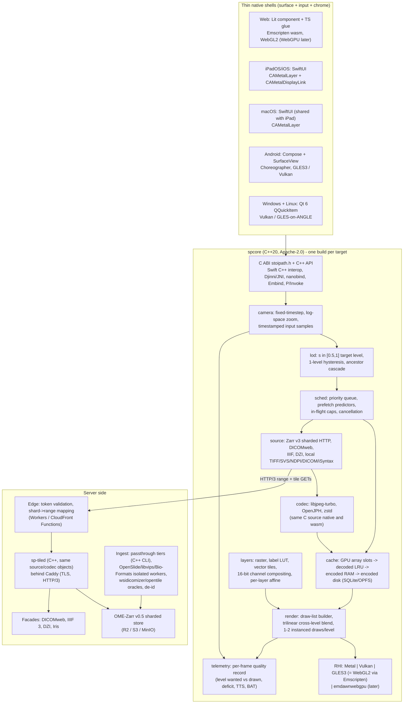

# Proposal D — Native-per-platform shells over a shared C++ core

Architecture proposal for the Stoipath WSI viewer. Date: 2026-10-24. Angle: the MapLibre Native / Google Maps SDK shape — one C++ engine, native UI per platform, web via Emscripten. Written against the 14 research notes in `../research/`; facts verified today beyond those notes are marked **[verified today]**, engineering arithmetic **[estimate]**, anything else inherited from the notes carries their tags.

## 1. Thesis

Everything that decides whether a zoom is blur-free — camera physics, level-of-detail policy, predictive scheduler, cache hierarchy, decoder, and the draw path — lives in one C++20 library (`spcore`, ~40 kLOC at v1) that compiles to arm64/x86-64 for iOS, Android, macOS, Windows, Linux and to wasm32 via Emscripten. It renders through a deliberately thin render-hardware interface (RHI, ~6 kLOC) with three backends we own — Metal, Vulkan, OpenGL ES 3.0 — where the GLES backend is also the web backend (Emscripten's GLES3→WebGL2 translation is the same path Unity/Godot/Unreal web exports have shipped on for a decade) and WebGPU (via Dawn's `emdawnwebgpu`) is a later enhancement, not a dependency. Five thin shells own only the surface, the input device and platform chrome: SwiftUI (iPadOS/iOS), SwiftUI (macOS, sharing ~80 % with the iPad shell), Jetpack Compose (Android), Qt 6 (Windows + Linux desktop, which doubles as the Qt host SDK) and a Lit web component (TypeScript). The bet is twofold. First, the levers that set the latency floor on the devices that matter — `CAMetalDisplayLink` with a two-drawable swapchain, unified-memory texture writes, purgeable textures, `AHardwareBuffer`, `postVsyncCallback` frame timelines, predicted touches, 120 Hz requests — are reachable only from native code and are hidden by every portable abstraction (wgpu has no `presentedTime`, no `AHardwareBuffer` import, no purgeable state; note 11-gap-4 §2.8). Second, the pathology format and codec ecosystem is C: libjpeg-turbo, OpenJPH, libtiff, libdicom, libisyntax, zstd, OpenSlide, libCZI, cuCIM. A C++ core links the permissive ones directly, with no FFI layer, and the server's readers are the same object files as the desktop app's. The honest price: web is first-class in reach (it ships first, runs the same core) but second-class in ceiling (60 Hz Safari, single-threaded core, 2–3× WASM decode, a 1–1.6 MB gz download); five shells cost ~36 person-months to v1 and a permanent feature-parity tax; and memory safety in parsers of untrusted slide bytes is ours to prove with sandboxing and fuzzing rather than a language guarantee.

## 2. Component architecture

**Client engine.** `spcore` is a pure state machine: `tick(now_ns) -> actions`, `on_input(sample)`, `on_bytes(req_id, buf)`, `on_decoded(req_id, slot)`, `on_memory_budget(bytes)`. It never owns threads or sockets. Native shells drive it from a `std::thread` pool (decode) plus the display-link thread (tick + render); the web shell drives it single-threaded from `requestAnimationFrame` and runs decode in Web Workers. Because the same compiled logic produces the same `(level, x, y)` request sequence for the same gesture on every platform, the "one zoom behaviour everywhere" claim is testable: CI replays recorded gestures through the core on all targets and diffs the request and draw lists (semantic goldens, note 10 F9).

**RHI and renderer.** The renderer needs: 2D-array textures (≤ 256 layers × 512² RGBA8 / R16UI, several arrays), sampler, two uniform buffers, one vertex buffer of per-tile instances, two pipelines (brightfield; multichannel), fences, timestamps, swapchain. That is small enough to write three times well: Metal (Apple), Vulkan 1.1 (Windows, Linux, Android opt-in), GLES 3.0 (Android default, Linux fallback, Windows via ANGLE on D3D11, web via Emscripten → WebGL2). Shaders are authored once in GLSL 4.5 and compiled at build time with glslang → SPIR-V → SPIRV-Cross to MSL and GLSL ES 3.00 (SPIRV-Cross is Khronos-maintained and emits "readable, usable and efficient" GLSL/MSL/HLSL **[verified today]**); the WebGPU variant (WGSL via Tint) is produced only when the `emdawnwebgpu` backend is built. GLES 3.0 / WebGL2 / WebGPU-compat constraints shape the design floor: no compute, textures ≤ 4096² in compat mode, whole-array views, instance data in vertex buffers not a large UBO (note 11-gap-3 compat table). D3D12 is deferred: Vulkan covers NVIDIA/AMD/Intel Gen9+ on Windows and ANGLE (GLES3→D3D11, the backend Chrome and Firefox use for WebGL on Windows **[verified today]**) covers the rest.

**Decode pipeline.** libjpeg-turbo (`JDCT_ISLOW`, fancy upsampling) is the only decoder in Dx mode on every platform; it is bit-identical across x86 SIMD, wasm SIMD and wasm scalar (0 differing pixels, note 11-gap-2 §2.3) and NEON is expected identical (G7 in the spike). Hardware JPEG decode is **not** a lever: Android's `ImageDecoder` is Skia → jpeglib, `MediaFormat` exposes only HEIC/AVIF hardware codecs, and Apple documents no hardware JPEG path (note 11-gap-4 §1.3). Native shells run `cores − 1` decode threads at gesture QoS; the web shell runs `clamp(hardwareConcurrency − 1, 1, 3)` workers each holding a 60–90 KB gz libjpeg-turbo module (jSquash's mozjpeg build is 60 KB gz; ours will be the same source, `-msimd128`, no pthreads). OpenJPH handles HTJ2K (DICOM .201–.203, 16-bit fluorescence); zstd handles OME-Zarr 16-bit chunks. Browser-native `createImageBitmap` is a Chromium/Firefox accelerator enabled only after per-browser self-certification against the reference decoder; never on Safari in Dx mode.

**Cache hierarchy.** L0 GPU texture arrays (budget from shell: 1–2 GiB on 8–16 GB iPads, 256–384 MiB on 3–4 GB Android, 128 MiB web phone, 512 MiB–1 GiB desktop); L1 decoded CPU LRU ≤ 25 % of L0 (mostly bypassed natively by writing straight into shared-storage textures); L2 encoded bytes in RAM; L3 encoded on disk — SQLite blob store natively, OPFS via Emscripten's WasmFS OPFS backend on the web (treated as a refillable cache because Safari's 7-day ITP deletion covers OPFS, note 11-gap-3 #8); L4 CDN edge; L5 origin RAM; L6 object store. Eviction never touches ancestors of visible tiles or the pinned ≤ 4096² base. On iOS the LRU tail of L0 is set `volatile` so it stops counting toward the jetsam footprint; on Android `onTrimMemory` halves L0.

**Scheduler.** Priority key `(tier, |level − L*|, distance to focus)`; tier 0 = target tiles missing from the current frame, tier 1 = predicted viewport, tier 2 = idle fan-out. All tier-0 requests are issued in the first tick, in-flight caps 24 (phone) / 64 (desktop), cancellation when a tile leaves viewport + ring with < 30 % of bytes received, promise-level de-duplication, centre tiles coalesced into one 1 MiB-aligned shard range (Cloudflare's origin fetch unit), edge tiles as separate cancellable GETs.

**Tile server and storage.** Canonical store OME-Zarr v0.5 (Zarr v3 `sharding_indexed`, 512² inner chunks, 8×8 shards, Morton order, index at end), JPEG chunks for 8-bit RGB, zstd + HTJ2K variants for 16-bit (note 02 R2). `sp-tiled` is a C++ service linking the same `source`/`codec` objects as the client (this is the one place the shared-core bet pays on the server: lossless NDPI strip→tile remux, TIFF `JPEGTables` splicing and DICOM frame extraction are written once). It speaks HTTP/1.1–2 behind Caddy for TLS and HTTP/3 (writing QUIC in C++ is not where effort belongs); the Iris RESTful Server shows a Boost.Beast C++ tile server reaching 5,061 req/s and 21 ms median on Pi-class hardware (note 07 F6). Edge: prefix-scoped capability token in the query, validated at the edge and stripped from the cache key, `Origin` excluded from the key, immutable content-addressed URLs (note 09 F5). Façades: DICOMweb (QIDO/WADO-RS with multi-frame retrieve), IIIF Image 3.0, DZI, Iris.

**Ingest.** Passthrough tiers A–C (DICOM, SVS-JPEG, Philips TIFF, SCN, NDPI remux) run in the C++ CLI (`sp-ingest`), which is literally the client reader library plus a Zarr writer. Tier D (MRXS, BIF, CZI, svslide, VMU) runs OpenSlide 4.0.1 (LGPL-2.1, dynamically linked, separate container), libvips, libCZI (LGPL-3) and Bio-Formats (GPL-2, separate JVM) as isolated workers; iSyntax via libisyntax (BSD-2, C — linkable in the desktop app after legal review) with the Philips SDK as a sealed oracle. wsidicomizer/opentile/tifffile are CI oracles for byte-identical tiles. Coarse levels (≤ 4096²) are built synchronously so first view is seconds after upload; the rest materialises in the background. De-identification is a pipeline stage producing a new object with three PHI tiers.

**SDK surfaces.** One C ABI (`stoipath.h`, semver, cbindgen-equivalent hand-written) under everything. Apple shell uses Swift↔C++ interop directly (supported since Swift 5.9; C++ exceptions cannot cross into Swift, so the ABI is `noexcept` by construction) **[verified today]**; third-party Swift consumers get an XCFramework via SwiftPM `binaryTarget`. Android: AAR with per-ABI `.so` and Kotlin bindings generated by Djinni (Snap's maintained fork, Apache-2.0, Bazel/C++20; last public push seen by an aggregator 2025-05, so we keep a hand-written JNI fallback **[verified today, recency low confidence]**). Python: nanobind wheel for headless decode/tiling plus an anywidget that wraps the web bundle for Jupyter/Colab/VS Code/marimo. JS/TS: Embind + Lit `<stoipath-viewer>` web component and an iframe/postMessage API for hosts that cannot be cross-origin isolated. .NET: P/Invoke on the C ABI. Java (QuPath): Panama FFM on the C ABI with an offscreen render target — honestly a sidecar, not an in-process viewer. Qt/C++ hosts (napari, Slicer, vendor clients): the Linux/Windows shell *is* a `QQuickItem`, so it ships as the SDK.

## 3. How instant blur-free zoom is achieved end to end

The mechanism is residency plus policy, not bandwidth (notes 04, 05). Concretely:

1. **Residency invariant.** At slide open the whole pyramid down to the first level ≤ 4096 px per side (≈ 1–2 MB) plus thumbnail is fetched and pinned for the session; ancestors of any visible tile are never evicted. Worst case anywhere on a 100k² slide is a bounded ≈ 25× blur, never a blank.
2. **LOD policy.** Target level L* has s ∈ [0.5, 1.0] device pixels per texel (DPR-aware; DPR capped at 2 on cellular). Switch finer when s would exceed 1.0, coarser only when s drops below 0.5 — one level of log-space hysteresis, no timers. Per frame: draw each target tile if resident, else its nearest resident ancestor clipped to the footprint plus any resident descendants. Sample the two adjacent levels and blend by fractional LOD (the pyramid is the mip chain, so no `generateMipmap`), which removes minification aliasing and the 2× pop; a ≤ 100 ms cross-fade covers late arrivals. Settle contract: after the last input, the frame must consist of L* tiles only within the per-network budget; a late tile keeps its ancestor on screen at top priority rather than lowering the target.
3. **Prefetch policy, calibrated to pathologists.** Zoom events are bursts: 66 % change magnification by ≥ 5× (≥ 2.3 levels), minimum inter-burst gap 196 ms, 90 % followed by another within 5 s (Brunyé 2023, note 11-gap-1). So the predictor estimates the *destination* level from the first 1–2 notches/pinch samples and fetches it directly, skipping intermediates when amplitude ≥ 2 levels. Zoom prefetch is anchored on a ±300 device-px window around the cursor/pinch centroid (gaze stays within ≈ 300 px of the cursor, Raghunath 2012) at L*+1 and L*+2. Pan cone from a One-Euro/Kalman velocity at τ = 100/250/500 ms, capped at one viewport per 500 ms, biased along the dominant direction (3-point linearity 0.85). Ring of 1 tile on cellular, 2 on wired. Idle fan-out (L*+1 for the whole viewport) gated on `saveData`/metered. Slide open: L*+1 and L*+2 under the three most likely ROIs (tissue-density heuristic) inside the 4.5 s expert first-zoom window. Hover/pointer-down prefetch buys 100–300 ms before any motion. Stage-1 acceptance for waste is ≤ 50 % (the only measurement, Kayser 2009, found 74 % under naive prefetch).
4. **Transport.** HTTP/3 with 0-RTT for tile GETs (Chrome applies it to safe methods, note 11-gap-3 #10a), HTTPS RR `alpn=h3`, preconnect at case open, HTTP/2 fallback first-class (Samsung Internet). Native shells use libcurl with ngtcp2/nghttp3; the web shell uses `fetch` with `priority: 'high'|'low'` (Safari 17.2+, Firefox 132+).
5. **Decode.** libjpeg-turbo, ~1 ms per 512² tile on a desktop core, ~1.5–2.5 ms on a 2023 mid-range Arm big core, ~3–5 ms on a Cortex-A55 **[estimate from note 04 F5]**; 2.1–2.9× slower in wasm (note 11-gap-2). A 20-tile viewport is 10–25 ms wall natively on 2–4 cores, 60–100 ms wall in three web workers on a low-end phone — in both cases longer than a frame, which is why residency does the work.
6. **Upload.** Native: Apple unified memory, `storageModeShared` 2D-array textures, `replace(region:slice:)` from the decode thread into fenced slots (`MTLSharedEvent`), `allowGPUOptimizedContents = false`, no staging copy; Android: decode into an `AHardwareBuffer` and bind via `EGLImage` (our GLES backend controls this; wgpu cannot import AHBs), or `glTexSubImage3D` from a staging buffer when AHB is unavailable. Budgets ≤ 8 MiB per interval on phones, ≤ 32 MiB on iPad Pro/desktop, measured with `gpuStartTime/gpuEndTime` and Vulkan timestamps. Web: `texSubImage3D` from the wasm heap (or from an `ImageBitmap` through an `EM_JS` shim) ≤ 2–4 MB per frame.
7. **Present.** iPad: `CAMetalDisplayLink` with `preferredFrameLatency = 1`, `maximumDrawableCount = 2`, `framebufferOnly`, `presentsWithTransaction = false` (overlays are drawn in the same Metal frame), `CAFrameRateRange(80,120,120)` requested only during gesture/inertia. Android: `SurfaceView`, `postVsyncCallback` rendering to the *preferred* timeline, two-image swapchain, `setFrameRate(120, ONLY_IF_SEAMLESS)` during gestures, `requestUnbufferedDispatch`. Windows/Linux: Vulkan FIFO with a two-image swapchain (DXGI flip model underneath on Windows). Input prediction (`predictedTouches`, `MotionEventPredictor`) feeds the *camera target* only, never tile requests.

### Latency budget: input to photon

Warm = target tiles resident (the designed common case, ≥ 95 % of tiles at settle). Cold tail = 1–3 target tiles missing at burst end. "Whole level cold" is shown to make the point that no transport closes that gap. Per-tile network figures are note 02 F9 (p50/p95); present-path floors are note 11-gap-4 §2.9 (model, to be measured against a reference quad app in Stage 0). Values in ms, p50 (p95).

| Stage | Desktop LAN: Windows workstation, Qt shell, Vulkan, 60 Hz medical display, mouse, on-prem tile server | Laptop broadband: MacBook Pro, SwiftUI shell, Metal, 120 Hz ProMotion, trackpad, CDN edge | Mid-range Android on 4G: Snapdragon 7-class, 6 GB, 120 Hz panel, Compose shell, GLES3, pinch | Same laptop, **web build** in Safari (for honesty) |
|---|---|---|---|---|
| Input sample → shell callback | 4 (8) mouse 125–1000 Hz | 4 (8) | 4 (8) with unbuffered dispatch; 8 (16) batched | 8 (16), Pointer Events at 60 Hz page cadence |
| Core tick (camera, LOD, scheduler, cache lookup) | 0.3 (0.5) | 0.3 (0.5) | 0.7 (1.2) | 0.6 (1.5) wasm, main thread |
| Draw-list + RHI encode | 0.3 | 0.3 | 0.5 | 0.5 + GL JS-glue ≈ 0.1 |
| GPU render (2 instanced draws/level, trilinear) | 0.5 (1.5) at 4K | 0.5 (1) | 1.5 (3) at DPR 2 | 1 (2) |
| Present path (vsync wait + queue + scan-out) | 1 interval queue + scan-out: 17 (33) | floor 2 intervals 16.7, typical 3: 25 (33) | floor 3 intervals 25, typical 4: 33 (42) | browser compositor 2–3 vsyncs at 60 Hz: 33 (50) |
| **Warm input-to-photon** | **≈ 22 (43)**; ≈ 12 (20) on a 144 Hz display | **≈ 30 (43)** | **≈ 40 (55)**; ≈ 65 (90) if the OEM holds 60 Hz | **≈ 43 (70)** |
| Perceptual reference (note 04 F1, secondary) | indirect drag JND 55 ms → inside | direct-ish trackpad: 11–55 ms → at the edge; 120 Hz is what keeps it inside | direct touch JND 11 ms → everyone, including the OS, is above it; floor+0 is the only defensible target | — |
| Cold tail: 1–3 tiles missing at burst end (fetch + decode + upload + next interval) | 4 (12) + 1 + 0.3 + 17 → **TTS ≈ 22 (30)** | 19 (58) + 1 + 0.2 + 8 → **TTS ≈ 28 (67)** | 57 (226) + 2.5 + 0.5 + 8 → **TTS ≈ 68 (237)** | 19 (58) + 3 (worker) + 1 + 17 → ≈ 40 (80) |
| Whole destination level cold (20 tiles ≈ 2.2 MB) | 12 + 20 tiles over 7 threads 3 + upload 3 + 17 → ≈ 35 (60) | RTT 19 + 2.2 MB at 100 Mbps 176 + 10 + 8 → ≈ 215 (330) | 57 + 2.2 MB at 25 Mbps 700 + 25 + 8 → ≈ 800 (1,400) | ≈ 240 (380) |
| Budget vs targets (note 04 F8 / 11-gap-1 F7) | TTS ≤ 100 p50 met even fully cold; destination resident before burst end at p95 | TTS ≤ 100 p50 requires ≥ 80 % of destination tiles prefetched (hover/pointer-down + burst prediction); cold-tail p95 67 fits the 196 ms inter-burst gap | bounded-transient contract: ≤ 1 level during gesture, TTS ≤ 700 p95; slide-open pre-download of levels ≤ 4096² plus L*+1 under 3 ROIs is mandatory; moving-tier q75 for H&E only | 60 Hz cap adds ≈ 1 frame everywhere; otherwise same policy |

Two honest readings. The native shells buy 1–2 display intervals and 2–3× decode over the web build, which is exactly the difference between "inside the indirect-drag JND" and "at the edge of it" on a laptop, and between 120 Hz and 60 Hz on iPad — but nothing in any column puts a direct-touch pinch below the 11 ms JND; the OS pipeline alone is above it. Second, the only cold case the network can ever win is LAN; everywhere else the policy in §3.1–3.3 is the product.

## 4. Platform coverage matrix

Fidelity tiers: **A** = full contract (120 Hz where the panel allows, native memory budgets, threads, zero-copy upload); **B** = full visual contract at 60 Hz, browser memory budget, single-threaded core; **C** = bounded-transient contract (radio or constrained GPU).

| Target | Delivery mechanism | GPU backend | Decode | Memory budget (L0 GPU) | Fidelity | Caveats |
|---|---|---|---|---|---|---|
| Web desktop: Chrome/Edge 113+, Firefox 141+/145+, Safari 26/27 | PWA + `<stoipath-viewer>` (npm, ESM, 1.0–1.6 MB gz **[estimate]**: core + GLES renderer ≈ 0.7–1.1, sources/JSON ≈ 0.2–0.3, decoder worker 60–90 KB separate) | GLES3→WebGL2 via Emscripten; `emdawnwebgpu` WebGPU v1.x after G10-style golden parity | wasm libjpeg-turbo in ≤ 3 workers; `createImageBitmap` accelerator on Chromium/Firefox after self-certification | 512 MiB–1 GiB | **B** (Chrome/Firefox follow display rate; Safari 60 Hz) | No SAB/pthreads (third-party embedding, Android WebView); Firefox Linux and WebKitGTK have no WebGPU — WebGL2 is the floor, not a fallback |
| Web mobile: Chrome Android 121+, Samsung Internet 30, Firefox Android | Same bundle; DPR cap 2 on cellular | WebGL2 (Xclipse is WebGPU-blocklisted in all Chromium browsers, note 11-gap-3 #3a) | wasm libjpeg-turbo, 2–3 workers | 128 MiB phone / 256 MiB tablet | **C** on 4G, **B** on Wi-Fi | Samsung Internet: no HTTP/3, no JXL; Chrome Android rAF follows OEM display policy |
| Web iOS/iPadOS Safari 17–27, WKWebView | Same bundle; home-screen PWA recommended | WebGL2 (ANGLE-on-Metal); WebGPU allow-listed per Safari major | wasm libjpeg-turbo always (ImageIO is a black box) | 256 MiB; heap ≤ 512 MB (`MAXIMUM_MEMORY`) | **B at 60 Hz** | 60 fps cap unless the user flips a flag; WKWebView never 120 Hz; OPFS and Cache API evicted after 7 days of no interaction; jetsam ≈ 1.25–2 GB WebContent |
| Windows 10/11 x64, arm64 | Qt 6 app (MSIX/installer, ≈ 30–40 MB with Qt runtime) and `QQuickItem` SDK; optional WinUI 3 shell later | Vulkan 1.1 (NVIDIA/AMD/Intel Gen9+); GLES3-on-ANGLE/D3D11 fallback for older iGPUs | libjpeg-turbo, `cores − 1` threads | 512 MiB–2 GiB | **A** (60 Hz panels dominate hospital fleets; 120–144 Hz where present) | Pen via Qt `QTabletEvent` (no Windows Ink prediction unless WinUI shell is built); D3D12 deferred |
| macOS 14+ (Apple silicon, Intel) | SwiftUI app (notarised DMG / Mac App Store) sharing ~80 % with iPad shell; XCFramework SDK | Metal | libjpeg-turbo | 1–4 GiB | **A** (120 Hz ProMotion MacBook Pro) | Intel Macs: no `timestamp-query`-class telemetry, fine otherwise |
| Linux x64/arm64 (Ubuntu/Fedora LTS) | Same Qt 6 app (AppImage/Flatpak/deb) | Vulkan; GLES3 fallback | libjpeg-turbo | 512 MiB–2 GiB | **A** | Lowest-priority shell; Wayland/X11 frame pacing varies |
| iPadOS/iOS 17+ | SwiftUI app + XCFramework via SwiftPM | Metal, `CAMetalDisplayLink` latency 1 | libjpeg-turbo NEON, `activeProcessorCount − 1` | 1–2 GiB (8–16 GB iPads), 512 MiB–1 GiB iPhone; dynamic from `os_proc_available_memory`, LRU tail `volatile` | **A** (floor 2 intervals, typical 3 at 120 Hz) | Pencil hover `zOffset`, squeeze, 240 Hz coalesced ink; 120 Hz withdrawn in Low Power/thermal; tablet is not a validated Dx display (RUO/consult) |
| Android 10+ (API 29) | Compose app + AAR (arm64-v8a, armeabi-v7a, x86_64) | GLES 3.0 default; Vulkan opt-in by device allow-list (Adreno 7xx, Mali Valhall+, Xclipse) with GLES retry on `VK_ERROR_DEVICE_LOST` | libjpeg-turbo NEON | 256–384 MiB on 3–4 GB, 1 GiB+ on 8 GB; dynamic from `availMem`, `onTrimMemory` | **A** on 120 Hz flagships (floor 3, typical 4 intervals); **B/C** on 60 Hz low-end | Driver fragmentation is ours (MapLibre's Adreno 3xx/600 workarounds are the cost evidence); `isLowRamDevice` is useless for 3–4 GB phones |
| Embeddable: web component / iframe | npm ESM; iframe + postMessage for non-isolated hosts | as web | as web | host-dependent | B/C | Component owns its cache (Chrome partitions HTTP cache per top-level site) |
| Embeddable: Swift package, Kotlin AAR | SwiftPM binaryTarget XCFramework; Maven Central AAR | Metal / GLES-Vulkan | native | app-dependent | A | Semver lockstep across channels |
| Embeddable: Python / Jupyter | nanobind wheels (manylinux/macOS/Windows) for headless; anywidget wrapping the web bundle for notebooks | web | web | notebook | B | Zero renderer code in Python |
| Embeddable: Qt/C++ hosts (napari, 3D Slicer, vendor PACS) | `QQuickItem`/`QWidget` from the desktop shell; plain C ABI for non-Qt C++ | Vulkan/GLES | native | host | A | Qt LGPL-3 dynamic linking or commercial |
| Embeddable: Java (QuPath), .NET (LIS/PACS WPF) | Panama FFM / P/Invoke on C ABI; offscreen target blitted into host | native | native | host | A for pixels, sidecar UX | QuPath keeps its own viewer; our value is tiles and annotations |

## 5. Versatility fit

**Fluorescence / multichannel.** Per-channel `R16UI` textures (GLES 3.0 guarantees `R16UI` + `texelFetch`; bilinear done manually from four fetches), per-channel window/gamma/colour/visibility uniforms, additive or max blend, ≤ 8 channels per pass with multi-pass accumulation for 40-plex, Viv's shader semantics ported to GLSL (MIT). Channel-group bundles return all enabled channels for a shard range in one request; 8-bit windowed previews first, 16-bit on settle; zstd chunks decode at memcpy speed, HTJ2K via OpenJPH for DICOM sources. Only visible channels are resident (10 channels × 60 tiles × 512 KiB ≈ 300 MiB exceeds the iPad web budget, fits native). Brightfield is a 3-channel composite with identity transfer, so one renderer path.

**Annotations at scale.** Internal model is GeoArrow-shaped (flat coordinate buffers, ring offsets, typed columns, packed Hilbert R-tree) in C++; QuPath GeoJSON, DICOM ANN (bulk simple annotations), SR TID 1500, W3C Web Annotation and SpatialData are adapters. A 1 M-nucleus layer is ~22 M triangles — over any mobile frame budget — so vector overlays are cut at ingest into MVT-style tiles on the pixel pyramid grid (4096 extent, 64-unit buffer) with per-level representation switching (instanced centroids → simplified → full polygons) and served from a PMTiles-style range-readable sidecar; label rasters with a 65,536-entry LUT texture are the primary form of AI segmentation and the fallback for the densest layers. All overlays carry the same `(layer, level, x, y, z, t, c)` key and go through the same scheduler; the frame budget is partitioned 60/25/15 (pixels/overlays/UI) and overlays degrade first. The vector-tile cutter is C++ shared between `sp-ingest` and the desktop app (local GeoJSON import).

**Standards.** DICOM WSI via libdicom (C, MIT) locally and our DICOMweb client (QIDO/WADO-RS multi-frame, bulk data, STOW-RS for SR/ANN) remotely, with a same-origin proxy mode for bearer-token archives and a published conformance statement; OME-Zarr v0.4/v0.5 via our Zarr v3 client (sharding, blosc/zstd, JPEG/HTJ2K image codecs); IIIF Image 3.0 and DZI as trivial tile-source adapters and server façades; Iris as a façade and benchmark peer. One µm slide frame with per-layer affine from MVP and a displacement-texture slot reserved for non-rigid registration (VALIS/wsireg → NGFF RFC-5 transforms). Z and T are tile-key dimensions; focus scrolling prefetches z ± 1. Multi-slide sync is a camera transform per view. State document (slides, views, channels, overlays, sync) is the public API across web component, postMessage, anywidget, Swift, Kotlin and C.

## 6. Technology stack

| Layer | Choice | Licence | Notes |
|---|---|---|---|
| Core language / toolchains | C++20; Apple clang (Xcode 16/17), NDK r27+ clang, MSVC 2022 / clang-cl, Emscripten 6.0.13 (2026-10-19) | — | `-fno-exceptions` at the ABI boundary, libc++ hardened mode; Emscripten `-Os --closure=1`, `-pthread` **not** used in the shipped web build (no SAB) |
| Build | CMake 3.30+ + vcpkg (or Conan 2) + Ninja; Gradle/AGP; Xcode/SwiftPM; Bazel only if the repo grows past ~3 teams | — | Hermetic containers per target; Bazel kept possible (Djinni already requires Bazel) |
| RHI backends | Metal; Vulkan 1.1 (Vulkan-Headers, volk, VMA); OpenGL ES 3.0 (GLES3 on Android/Linux, WebGL2 via Emscripten, D3D11 via ANGLE on Windows) | Apache-2.0 / MIT (Khronos, VMA); ANGLE BSD-3 | Own code ≈ 6 kLOC; `emdawnwebgpu` (Dawn, BSD-3) as the web WebGPU backend in v1.x — Emscripten removed `-sUSE_WEBGPU` in 4.0.18 in favour of `--use-port=emdawnwebgpu` **[verified today]** |
| Shader toolchain | GLSL 4.5 source → glslang → SPIR-V → SPIRV-Cross (MSL, GLSL ES 3.00, HLSL); Tint → WGSL for WebGPU builds | glslang Apache-2.0/BSD-3 mix; SPIRV-Cross Apache-2.0 or MIT; Tint BSD-3 | Offline at build time; shaders embedded; golden-image parity across backends |
| Codecs (client) | libjpeg-turbo 3.x; OpenJPH 0.3x; zstd; libspng; optional libjxl, libwebp, libavif | IJG+BSD-3+zlib; BSD-2; BSD-3/GPL dual; BSD-2; BSD-3 (+patent grants) | Same C sources compiled natively and with `-msimd128` for the decode-worker wasm module |
| Formats (client) | libtiff 4.7; libdicom (C, MIT); own Zarr v3 client (+ c-blosc2); libisyntax (BSD-2); simdjson for Zarr/DICOM JSON | libtiff; MIT; BSD-3; BSD-2; Apache-2.0 | libisyntax requires IP review before shipping in a client |
| Formats (server-only, isolated) | OpenSlide 4.0.1 (dynamic), libvips 8.18, libCZI, Bio-Formats 8.5/9.0 (JVM), cuCIM 26.10 (GPU ingest), wsidicomizer/opentile/tifffile (oracles) | LGPL-2.1; LGPL-2.1+; LGPL-3/commercial; GPL-2 (`formats-gpl`); Apache-2.0; Apache-2.0/BSD-3 | Never in a client SDK (static linking/App Store, note 09 F9) |
| Networking | libcurl 8.x with ngtcp2 + nghttp3 (HTTP/3), BoringSSL/OpenSSL 3; Emscripten `fetch` via Embind | curl; MIT; Apache-2.0 | 0-RTT for GET only |
| Local storage | SQLite (encoded tile cache + metadata) natively; WasmFS OPFS backend on web | public domain; MIT | Same content-addressed key scheme everywhere |
| Annotations/geometry | own GeoArrow-shaped columns; earcut.hpp; flatbush-style packed R-tree (own) | ISC; own | GEOS (LGPL) only server-side |
| Bindings | Swift↔C++ interop (Swift 5.9+/6.x) for the Apple shell; C ABI `stoipath.h`; Djinni (Snap fork) or hand JNI for Kotlin; nanobind for Python; Embind for JS; P/Invoke; Java FFM | Apache-2.0 (Djinni); BSD-3 (nanobind); MIT/UIUC (Emscripten) | C ABI is the only frozen surface; everything else regenerates from it |
| Shells | SwiftUI (iOS 17+, macOS 14+); Jetpack Compose + `SurfaceView`; Qt 6.8 LTS Quick (Windows/Linux); Lit 3 web component; optional WinUI 3 | Apple SDK; Apache-2.0 (Compose); LGPL-3 dynamic or commercial (Qt); BSD-3 (Lit); MIT (WinUI) | Qt LGPL-3 is acceptable for desktop dynamic linking; never on mobile |
| Server | `sp-tiled` C++ (Boost.Beast or Drogon) behind Caddy (TLS, HTTP/3); edge in Cloudflare Workers / CloudFront Functions (TS); Valkey/Redis hot cache; OME-Zarr on R2/S3/MinIO | BSL-1.0 / MIT; Apache-2.0; BSD-3 | Egress-free storage (R2) makes prefetch and cache warming free |
| Collaboration (later) | yrs via `yffi` C ABI; awareness for cursors/viewports | MIT | Annotations as CRDT ops from MVP so the transport is a swap |
| QA / tooling | GoogleTest/Catch2; libFuzzer + ASan/UBSan/MSan + ClusterFuzzLite/OSS-Fuzz; `insta`-style semantic goldens via JSON snapshots; RenderDoc, Xcode GPU capture, AGI, Perfetto; Playwright (3 engines); XCUITest/Macrobenchmark; WALT photodiode rig; CodSpeed-style instruction-count benchmarks | BSD-3 / Apache-2.0 | Renderer quality record is the primary instrument (note 10) |
| Project licence | Apache-2.0 core, SDKs and shells; DCO; Dx edition and enterprise edge commercial | — | Patent grant matters in a field with active scanner/codec patents |

## 7. Effort and team

MVP (month ≈ 9): core + RHI (Metal, GLES3/WebGL2) + web component + iPadOS/macOS SwiftUI shell + tile server/edge + ingest for DICOM/SVS/NDPI/OME-Zarr + brightfield, basic multichannel, ROI annotations + perf harness and device lab. v1 (month ≈ 20): + Vulkan, Android, Qt desktop (Windows/Linux), all SDK channels, fluorescence at scale, vector-tile annotations and label rasters, DICOM ANN/SEG/SR, multi-slide sync, Iris/IIIF/DZI façades, RUO release with Dx-mode design controls.

| Workstream | To MVP (pm) | To v1 (pm, cumulative) | Notes |
|---|---|---|---|
| Core engine: camera, LOD, scheduler/predictors, cache tiers, telemetry record, executor abstraction | 10 | 16 | The product; two senior C++ engineers from week 1 |
| RHI + renderer: Metal, GLES3/WebGL2, Vulkan; shader toolchain; golden-image suite | 9 | 16 | Metal + GLES3 by MVP; Vulkan and `emdawnwebgpu` by v1 |
| Codecs, tile sources, local readers: libjpeg-turbo native + wasm module, OpenJPH, zstd, Zarr v3, DICOMweb, IIIF/DZI, TIFF/SVS/NDPI remux, libdicom, libisyntax | 7 | 15 | Fuzz target per reader before merge |
| Web shell: Emscripten build, Embind, Lit component, worker pool, OPFS, iframe API, anywidget | 6 | 10 | Ships first |
| Apple shell: SwiftUI iPad/iPhone/macOS, `CAMetalDisplayLink`, Pencil, memory budget, XCFramework | 6 | 10 | ~80 % shared between iPad and Mac |
| Android shell: Compose, `SurfaceView`, Choreographer timelines, GLES→Vulkan allow-list, `MotionEventPredictor`, AAR | 0 | 8 | Starts month 9 |
| Desktop shell: Qt 6 Quick for Windows + Linux (also the Qt SDK) | 0 | 6 | WinUI 3 variant +4 pm if demanded |
| Bindings/SDKs: C ABI, Djinni/JNI, nanobind wheels, Embind, .NET, Java FFM, semver lockstep | 2 | 8 | |
| Tile server, edge, storage: OME-Zarr sharded writer, `sp-tiled`, token auth, façades | 6 | 12 | |
| Ingest: passthrough tiers, isolated LGPL/GPL workers, level synthesis, de-identification, vector-tile cutter | 5 | 12 | |
| Overlays and versatility: annotation model/tools, vector tiles, label rasters, fluorescence compositing, multi-slide, registration import | 4 | 14 | |
| Performance/QA: harness tiers 0–4, device lab (~14 devices, WALT), synthetic slides, fuzzing, reader study support | 6 | 13 | Dedicated engineer from M0 |
| Build/release engineering: CMake/vcpkg across 6 toolchains, 7 publish channels, SBOM, signing, notarisation | 4 | 8 | The C++ tax relative to cargo: roughly +3 pm |
| Product, UX, pathologist advisor, docs, DevRel | 3 | 8 | |
| **Total** | **≈ 68** | **≈ 158 (range 130–200)** | |

**Shell cost, quantified.** The five shells (web 10, Apple 10, Android 8, Qt desktop 6, plus ~2 of bindings glue) are ≈ 36 pm ≈ 23 % of v1. Afterwards every viewer-visible feature costs 1× in the core plus 0.2–0.5× per shell for surface and chrome, so shell-side features carry a 2–2.5× tax relative to a single web UI. Mitigation is structural: shells are ≤ 3–5 kLOC each, every state machine (tools, annotation editing, layer panel model, channel settings) is a core view-model exposed through the C ABI, and non-viewport chrome (worklists, reports, login) may use a shared web view inside the native shell where native fidelity does not matter.

**Team shape.** Phase A (M0–M9, 8–9 FTE): tech lead/architect who has shipped a GPU streaming renderer; 2 graphics engineers (Metal; GLES/Vulkan/ANGLE); 2 systems C++ engineers (scheduler, codecs, formats, Emscripten); 1 web/TS engineer; 1 iOS/Swift engineer; 1 backend/infra; 1 performance/QA engineer; 0.3 practising pathologist. Phase B (M9–M20, 13–14 FTE): add Android (Kotlin/NDK), Qt desktop, bindings/SDK, ingest, overlays/fluorescence, DevRel; 0.5 RA/QA if a Dx edition is pursued. Hiring reality: C++ engineers with Metal *and* Vulkan *and* driver-debugging experience are the scarcest role; plan to grow one of the two graphics seats internally.

## 8. Top risks and mitigations

| Risk | Likelihood / impact | Mitigation | Trigger metric |
|---|---|---|---|
| Five-shell feature drift and UX inconsistency (the Dropbox shared-C++ failure mode) | High / High | Shells are surfaces only; all behaviour in core view-models; one state document as API; cross-shell UI spec tests; shared web view for non-viewport chrome | Any shell > 5 kLOC or a feature shipping on < 3 shells for > 1 release |
| Memory-safety bugs in parsers of untrusted slide bytes (OpenSlide shipped two CVEs in 4.0.1) | Medium / High (§524B, CRA, hospital security review) | Readers run sandboxed: wasm on the web by construction; separate process on desktop; ASan/UBSan/MSan CI; libFuzzer + `arbitrary`-style structure-aware generators; libc++ hardened mode; `-fbounds-safety` where the toolchain supports it; differential tests vs tifffile/wsidicom/OpenSlide | 24 h fuzz with zero crashes before any reader ships; SBOM in every release |
| Web build loses to a TS/Rust competitor on bundle size and iteration speed | Medium / Medium | `-Os --closure=1 -fno-exceptions -fno-rtti`, decoder in a separate 60–90 KB module, WebGPU-only variant later (Ruffle's dual-wasm pattern), DWARF debugging in Chrome; measure G1/G2-style gates (≤ 1.6 MB gz, ≤ 300 ms cold start on floor Android) | Bundle or cold-start gate fails in Stage 0 |
| Owning Android GPU driver bugs (MapLibre still adds Adreno 600 `VK_ERROR_DEVICE_LOST` workarounds in 2026) | High / Medium | GLES3 default on Android (same backend as web, highest test coverage); Vulkan behind a device allow-list with GLES retry; golden suite on Adreno 6xx/7xx, Mali G5x/G7x, Xclipse, PowerVR before each release | Device-loss or wrong-pixel rate in telemetry > 0.1 % of sessions on any GPU family |
| Toolchain and release complexity across six compilers and seven channels | High / Medium | Hermetic per-target containers, vcpkg lockfiles, OIDC publishing (npm `trust`, PyPI trusted publishers), lockstep semver, install-from-registry smoke tests | Release day > 1 engineer-day |
| Expected "hardware JPEG decode" never materialises; low-end Android decode too slow | Certain / Medium | Design assumes libjpeg-turbo NEON only; DPR cap 2 on cellular; residency policy; moving-tier q75 for H&E; measure A55-class throughput in Stage 0 | Decode p95 > 5 ms per tile on the floor device |
| iOS footprint kills with GB-class caches; iPad web jetsam | Medium / High | Dynamic budget from `os_proc_available_memory`, `volatile` LRU tail, `recommendedMaxWorkingSetSize` cap, web heap ≤ 512 MB; soak tests with JetsamEvent logs | Any termination in a 2 h soak on the 3 GB iPad |
| Qt LGPL-3 / commercial terms, or Qt look rejected by Windows LIS customers | Low / Medium | Dynamic linking only; budgeted WinUI 3 alternative (+4 pm); the C ABI makes the shell replaceable | Customer procurement objection |
| Swift C++ interop or Djinni regressions block an SDK release | Medium / Low | C ABI is the frozen surface; Swift and Kotlin bindings regenerate; hand-written JNI fallback exists | Binding build breaks on a toolchain update |
| Regulatory: approximate rendering without a "rendering complete" state blocks a Dx edition | Medium / High | Deterministic pixel pathway (one libjpeg-turbo build, pinned OpenJPH, versioned resampling), explicit rendering-complete flag, requirement IDs on tests from M0 | Design-history gap found at first RA review |
| Key-person risk in a small C++ graphics team | Medium / High | Two engineers per backend family, backend code reviews across the Metal/GLES/Vulkan seats, RHI kept ≤ 6 kLOC | Single-owner backend for > 1 quarter |

## 9. What this architecture cannot do, or does poorly

- **It does not make the web fast beyond the browser's floor.** iPad Safari and WKWebView stay at 60 Hz; the web core is single-threaded; wasm decode is 2.1–2.9× slower than native; the download is ~1–1.6 MB gz, too heavy for a script tag that loads on every page view of a third-party site. The web build meets the visual contract (no blank, ≤ 1-level transient, trilinear blend) but not the native latency tier, and this proposal does not pretend otherwise.
- **Five shells mean five release trains for UI.** Even with core view-models, platform chrome lags: the Linux shell will trail, the macOS shell inherits iPad decisions, and a feature that needs new native UI ships on the web first and on Qt last. Teams that want one UX on day one should prefer a web-UI-everywhere proposal.
- **No pixel-streaming / thin-client mode in v1.** Devices below the WebGL2 floor or 40-plex fluorescence on a 3 GB phone are out of scope until a WebRTC mode exists.
- **No hardware JPEG decode anywhere**, no D3D12 in v1, WebGPU on the web only as a later enhancement, no Vulkan-by-default on Android. These are deliberate but they cap the "maximum raw native performance" rhetoric: the native win is present-path control, threads and zero-copy upload, not a faster codec or GPU API.
- **Memory safety is procedural, not guaranteed.** The core parses attacker-controlled TIFF/DICOM/Zarr/iSyntax bytes in C++. Sandboxing, fuzzing and sanitizers are mandatory recurring cost (≈ 1 FTE-equivalent spread across the team) and a Rust proposal will legitimately claim a stronger story under §524B and the CRA.
- **Driver bugs are ours.** Unlike wgpu (whose GLES/Vulkan workarounds are maintained by Firefox's team), every Adreno/Mali/PowerVR/Xclipse quirk in our Vulkan and GLES backends is our bug to find and carry.
- **Build and hiring friction.** CMake + vcpkg across Xcode, NDK, MSVC and Emscripten is heavier than cargo; C++ engineers with Metal and Vulkan depth are scarce; onboarding a web engineer to debug an Emscripten frame is slower than onboarding to TypeScript.
- **Format readers in clients are limited to permissive C libraries.** MRXS, BIF, CZI-JXR, VSI and anything needing OpenSlide, libCZI or Bio-Formats must be ingested server-side (true of every architecture, but a desktop app that cannot open a local MRXS without a converter will disappoint research users).
- **Tablets are RUO/consultation devices**: no validated display, so the iPad shell's 120 Hz is a research and tumour-board advantage, not a primary-diagnosis claim, until a display-agnostic clearance exists.
- **Offline on the web is a cache, not a store**: Safari deletes OPFS after seven days without interaction; true offline slide packs exist only in the native shells.
- **Time to first revenue is slower than a web-first plan**: MVP at ≈ 9 months with two shells, v1 at ≈ 20 months, versus a single web UI that could demo in 5–6 months.

## References

Research corpus: `../research/01-formats-readers.md` through `11-gap-4-native-mobile-render-pipeline.md` (all numbers tagged above as inherited). Primary sources checked today for this proposal:

- Emscripten ChangeLog (6.0.13 released 2026-10-19; `-sUSE_WEBGPU` deprecated in 4.0.10, removed in 4.0.18 in favour of `--use-port=emdawnwebgpu`; `-sUSE_PTHREADS` → `-pthread`): https://github.com/emscripten-core/emscripten/blob/main/ChangeLog.md
- Emdawnwebgpu (Dawn's `webgpu.h` for Emscripten, cross-browser, `--closure=1` advice): https://github.com/google/dawn/blob/main/src/emdawnwebgpu/pkg/README.md ; build notes: https://github.com/google/dawn/blob/main/src/emdawnwebgpu/README.md
- Swift C++ interoperability status (bidirectional since Swift 5.9; exceptions do not cross): https://www.swift.org/documentation/cxx-interop/status/ ; https://github.com/swiftlang/swift/blob/main/docs/CppInteroperability/CppInteroperabilityStatus.md
- Djinni, Snap-maintained fork (Bazel 8.5+, C++20, Swift bridge, WASM examples): https://github.com/Snapchat/djinni ; Snap engineering note: https://eng.snap.com/improving_djinni ; aggregator last-push 2025-05-05 (unverified recency): https://awesome.ecosyste.ms/projects/github.com%2Fsnapchat%2Fdjinni
- SPIRV-Cross (SPIR-V → GLSL/MSL/HLSL): https://github.com/KhronosGroup/SPIRV-Cross
- ANGLE (GLES 2.0/3.0/3.1 → D3D11, Vulkan, Metal, GL; Chrome/Firefox WebGL backend on Windows): https://github.com/google/angle
- bgfx (BSD-2; D3D11/12, Metal, Vulkan, WebGL 2.0, WebGPU Dawn-native only) — evaluated and not adopted: https://github.com/bkaradzic/bgfx
- Filament v1.79.0 (GL 4.1+, GLES 3.0+, Metal, Vulkan, WebGPU native, WebGL 2.0) — evaluated and not adopted: https://github.com/google/filament
- nanobind (C++/Python bindings): https://github.com/wjakob/nanobind
- libdicom (C, MIT, DICOM WSI): https://github.com/ImagingDataCommons/libdicom ; libisyntax (BSD-2): https://github.com/amspath/libisyntax
- MapLibre Native (shared C++ core precedent; Android/iOS changelogs with Adreno/ProMotion workarounds): https://github.com/maplibre/maplibre-native
- Apple: `CAMetalDisplayLink.preferredFrameLatency`, `CAMetalLayer.maximumDrawableCount`, `MTLTexture.replace(region:slice:)`, `setPurgeableState`, `os_proc_available_memory`, `predictedTouches(for:)` — https://developer.apple.com/documentation/ (via note 11-gap-4)
- Android: `Choreographer.postVsyncCallback`, `Surface.setFrameRate`, `AHardwareBuffer`, `MotionEventPredictor`, `ImageDecoder`/`MediaFormat` (no hardware JPEG) — https://developer.android.com/ (via note 11-gap-4)
- Perceptual thresholds and pathologist dynamics: Deber et al. CHI 2015 (secondary, unverified) https://doi.org/10.1145/2702123.2702300 ; Brunyé et al. 2023 https://doi.org/10.1371/journal.pone.0282616 ; Kayser/Wienert 2009 https://doi.org/10.1186/1746-1596-4-3 ; Schüffler et al. 2022 https://doi.org/10.5858/arpa.2021-0197-OA
- Iris RESTful Server (C++/Boost.Beast tile server performance): https://doi.org/10.1016/j.jpi.2025.100530
