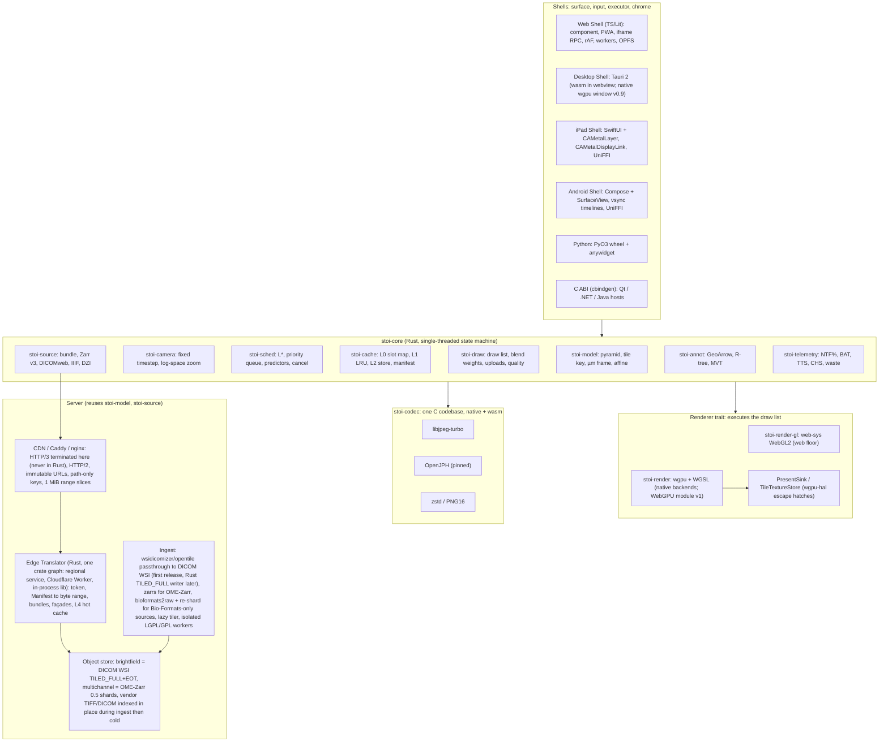

# Recommended architecture — Stoipath WSI viewer

Synthesis of proposals A–E (`arch/`), the judge panel (`judge/ranking.json`, `judge/judgments.json`) and research notes 01–11 (`research/`). Date 2026-10-24. Tags as in the corpus: **[measured]**, **[model]**, **[estimate]**, **[unverified]**. The figures and names in §4–§5 are canonical for every later plan section.

> **Amendment 2026-10-24 (gap-5).** Research note `11-gap-5` (canonical-store feasibility; tile-server build-vs-adopt) arrived after this synthesis was written. Targeted changes only: (1) §2 — a provenance row crediting proposal C, and item 6 rewritten: the canonical pixel store is **dual-standard, single-copy** — DICOM WSI `TILED_FULL`+EOT for brightfield, OME-Zarr 0.5 (Zarr v3 sharded, core codecs only) for multichannel/16-bit — behind the one Manifest, because no image codec is registered for Zarr v3 and no mainstream reader decodes JPEG chunks; (2) §3 — diagram labels, and a new **§3.1** holding the store decision and rationale, the ingest pipeline, the Edge Translator build-vs-adopt verdict with crate list, deployment/edge topology and the standards/QuPath implications; (3) §5 — the Manifest value tuple gains `codec, provenance`; new terms *brightfield canonical*, *multichannel canonical*, *offline pack*; L3–L5 reworded; (4) §7 — ingest and server rows re-pinned to 2026-10-24 versions, `jpegxl-rs` (GPL-3.0-or-later, verified today) moved to the GPL-isolated class, HTTP/3 never terminated in-process; (5) §8 — server rows for MVP/v0.9/v1; (6) §9 — "two canonical pixel stores" re-scoped to two *copies*, six rows added including OME-Zarr-with-JPEG-chunks as canonical and its reopen conditions; (7) §10 — risks 10–16. No §4 latency or memory figure changed; one new server-side target is added (Edge Translator p99 ≤ 10 ms hot service time per container path).

## 1. Thesis

The panel ranked B (one Rust engine everywhere) 7.09, A (web-first TypeScript engine) 7.07, D (C++ native core) 6.62, C (OpenSeadragon adopt-then-replace) 5.93, E (server render + video) 4.38. The B–A margin is noise; the shape of the disagreement is not. All three judges accepted the same *policy* (note 04's LOD, prefetch, eviction and blend rules) and the same *server* (C's passthrough pyramid, manifest, path-only cache keys); they disagreed only on where the policy runs and how the web floor draws.

The recommendation: **B's Rust core, compiled to wasm and native, is the single home of the policy. On the web floor the core's draw list is executed by a hand-written direct-WebGL2 renderer (gap-2 "option C"), not by wgpu's best-effort WebGL2 backend; wgpu is native-only until a WebGPU web module is allow-listed in v1.** Native shells exist because the browser's ≈2-vsync compositor floor and WebKit's 60 Hz cap are the only latency terms the engine cannot remove; the iPad shell moves to month 12, not B's month 18–20. Server work comes first (months 0–3) because the only deployed latency data (MSK, +130 ms/FOV from transcoding) blames the server.

Instant zoom is then a residency problem solved once: one `tick()` decides what to draw, fetch and evict; one libjpeg-turbo build decodes [measured bit-identical native/wasm-SIMD/wasm-scalar, gap-2 §2.3]; one WGSL set blends. A recorded gesture replayed with its byte-arrival times must yield an identical request sequence and draw list on every platform; that golden replay is the operational definition of goal 1 across goal 2.

## 2. Provenance and resolved disagreements

| Adopted | From | Why |
|---|---|---|
| Engine contract (`tick`/`on_bytes`/`on_decoded`/`set_budget`), single-threaded state machine, golden gesture replay; `PresentSink`/`TileTextureStore` traits, dynamic memory budgets, Safari allow-list, wgpu vendored and pinned | B | Only testable "one behaviour everywhere"; one Dx pathway; D's levers with driver bugs kept upstream |
| libjpeg-turbo (C) as sole Dx decoder; `createImageBitmap` only as self-certified accelerator, never on Safari in Dx | B, A, gap-2 | Measured identity; Rust decoders differ 10–38 %; ImageIO unknowable |
| Direct WebGL2 draw path on the web floor; wgpu off the web critical path | A, gap-2 option C, delivery and perf judges | gap-2 scored C 82 vs B 78; removes wgpu #4081/#3735/#10460 and 0.68 MB gz from floor devices |
| Embed budget, no SharedArrayBuffer/COOP/COEP, Service Worker off hot path, OPFS as refillable L2, path-only cache key, moving tier and DPR cap; WGSL once, GLSL via naga-cli, ≤1 LSB goldens | A | Embedding and floor devices decide reach; one shader set |
| Months 0–3 server-first: passthrough pyramid, level synthesis, two-pass ingest, ≤100 KB manifest, stateless edge, DICOMweb `frames/{list}`, PHI-tier bucket; replacement triggers as named metrics on named floor devices; OSD as compatibility `TileSource` and perf comparator | C | Best-evidenced claim in any proposal; measurement before opinion |
| Native present recipe, shared-storage/purgeable textures, predicted input to camera only, reference quad apps, 60/25/15 frame partition, fuzz-first readers, Qt `QQuickItem` as SDK sample | D | gap-4 verified; only route under the browser floor; as thin shells over the Rust C ABI |
| Dx = deterministic settled frame with Rendering Complete flag; moving image is navigation; frame-id echo + photodiode rig; streaming as a later mode | E | Regulatory framing (PCoIP precedent) |
| Four arithmetic corrections (§4.2) | perf judge | Budgets must close on a 128 MiB phone |
| Dual-standard, single-copy canonical store — DICOM WSI `TILED_FULL`+EOT for brightfield, OME-Zarr 0.5 sharded for multichannel — behind one `TileIndex → byte range` Manifest (amendment gap-5) | C | gap-5 F5 scores it the only option with no disqualifying mark: every pixel stored once *and* each container readable by its community's standard tools; the pre-amendment single-container plan (OME-Zarr with JPEG chunks) is readable only by our own code |

Where the judges disagreed:

1. **B or A.** B: A's ceiling (no GPU surface, no C ABI, 60 Hz iPad for ever, a second engine on any native need) is the dead end; every B risk has a priced exit.
2. **Spike first (gap-2, product) or option C now (delivery, perf).** Now: ~2–3 kLOC and +3 PM is cheaper than one failed spike cycle on floor devices.
3. **Web floor renderer in TypeScript (perf) or Rust `web-sys` (delivery, gap-2).** Rust `web-sys` in the core module, so draw lists and uploads never cross the wasm boundary; TypeScript is the recorded exit if Stage 0 shows trampoline or debuggability cost (expected <0.2 ms/frame [estimate]).
4. **iPad shell at month 9 (D), 12 (product), 18–20 (B).** Beta at month 12 after M2; GA in v1.
5. **Desktop: Tauri native-wgpu window (B) or Qt (D).** Tauri 2: wasm in the webview at MVP, native wgpu window at v0.9 once WRY's wgpu-plus-webview layering (example exists; hit-testing [unverified]) passes Stage 2; Qt is an SDK sample over the C ABI.
6. **One canonical store (A/B/D) or two (C).** *Amended 2026-10-24 (gap-5).* One canonical **index** (the Manifest) over **two standard containers chosen by pixel class** — C's stance: brightfield 8-bit RGB is written as DICOM WSI `TILED_FULL` with JPEG-baseline frames copied byte-for-byte from the vendor file (HTJ2K only for >8-bit sources), Extended Offset Table, one SOP instance per level, Concatenation when a level exceeds 4 GB; multichannel/16-bit is written as OME-Zarr 0.5 (Zarr v3 `sharding_indexed`, 512² inner chunks, core `zstd`/`bytes` codecs only). Vendor TIFF-JPEG and DICOM uploads are still indexed in place and served by passthrough during ingest (§3.1), so DICOMweb is true at launch without a second pixel copy. The original wording ("conversions written as OME-Zarr v0.5 sharded", i.e. with JPEG chunks) is withdrawn: no image codec is registered for Zarr v3 and no mainstream reader can decode JPEG chunks, so that store would have been readable only by our own code (§3.1, §9).
7. **Effort.** The delivery judge's synthesis numbers (§8).

## 3. Component architecture

**Engine contract**: `tick(now_ns, inputs, viewport) -> FrameOut { draw_list, requests, cancels, uploads, quality }`, `on_bytes(id, bytes)`, `on_decoded(id, tile)`, `set_budget(b)`. The core owns no threads, sockets or DOM. The Web Shell drives it from one `requestAnimationFrame` with `clamp(hardwareConcurrency − 1, 1, 3)` decode workers (transferables only; ≈0.5 ms per tile, 2.2× on three workers [measured]); native shells drive it from the display-link thread with a rayon pool. Shells create the surface and hand it to the `Renderer`.

### 3.1 Canonical pixel store, ingest and Edge Translator (amended 2026-10-24, gap-5)

**Decision: dual-standard, single-copy** — gap-5 F5 option B, the only option with no disqualifying score, and proposal C's storage stance. It replaces note 02 R2 and the pre-amendment wording of §2 item 6.

| Pixel class | Canonical container | Layout | Why this and not OME-Zarr for the class |
|---|---|---|---|
| Brightfield 8-bit RGB (>90 % of pathology volume) | **DICOM WSI**, `TILED_FULL`, one SOP instance per level | JPEG-baseline frames copied byte-for-byte from SVS/NDPI/Philips-TIFF (NDPI via opentile's DCT-domain re-mux, tier C); HTJ2K only for >8-bit sources; **Extended Offset Table** (BOT and fragment lengths are 32-bit, so a >4 GB level is unaddressable by BOT); **Concatenation** when a level exceeds 4 GB — a q85 100k² base is ≈3–4 GB, so ingest decides per level | Zarr v3 has **no registered image codec**: `zarr-extensions/codecs` lists 17 codecs, none JPEG/J2K/HTJ2K/JXL, and `imagecodecs_jpeg` is an unregistered raw name (ZEP 9 non-conformant). zarr-python (default), zarrs, zarrita.js, tensorstore, Viv, vizarr and zarr-java/bioformats2raw cannot decode JPEG chunks, and QuPath 0.7 reads no Zarr v3 at all, so a JPEG-chunk store is readable only by our code. A `TILED_FULL`+EOT instance is itself a range-addressable tile archive (frame i → EOT[i]) readable by every clinical viewer and VNA |
| Multichannel / 16-bit (fluorescence, multiplex, spatial omics) | **OME-Zarr 0.5** on Zarr v3 | `sharding_indexed`, 512² inner chunks, 8×8 chunks per shard by default (≈3.8 MB, 1,028 B index at the end with crc32c), shards 1 MiB-aligned, core `zstd` + `bytes` codecs only; all channels of a tile in one shard (`(c=all, y=4, x=4)` for ≤8 channels), z-planes in separate shards; geometry is a per-level parameter fixed by the M0–M1 prototype, not by this document | This side *is* OME-Zarr. Sharded v3 with core codecs reads today in zarr-python 3.4.1, zarrs 0.23.14, zarrita 0.7.5, tensorstore 0.1.85, zarr-java, Viv 0.23.0, vizarr 0.3.0, ome-zarr-py 0.21.0 / napari-ome-zarr 0.11.0; DICOM's 16-bit optical paths have thin tooling. OME-NGFF 0.6 (released 2026-09-14, RFC-5 coordinate systems) is adopted for metadata once Viv/vizarr/ome-zarr-py read it; the pixel layout is identical |

Every pixel is stored once. Vendor originals go cold once the canonical copy is written and its frame bytes hash-match the source (passthrough is a byte copy, so the check is exact). The other standard is an on-demand export job (DICOM ↔ OME-Zarr, OME-TIFF), never a mirror. A PMTiles-style single-file bundle is an optional *derived* **offline pack** (iPad, desktop, classroom), never canonical.

**Goal 1 is unaffected.** Both containers are byte passthrough behind a small index, which is all §4 assumes: 512² tiles, 1 MiB-aligned layout (Cloudflare fetches and caches origin ranges in 1 MiB slices; CloudFront caches requested parts), centre-of-viewport bundles coalesced into ≤4 contiguous ranges, the L4 hot cache. The container decision is about interoperability and ingest cost; no §4 figure changes. The indices differ only in bytes at open — ~1 KB per 8×8 Zarr shard versus one EOT per DICOM level (51k frames × 16 B ≈ 0.8 MB at the base) — and browsers and native shells load neither: they read the ≤100 KB Manifest. Only client-direct readers of raw files (desktop, Python) pay it; if the M1 prototype shows >1 RTT at open, the Manifest is published beside the instances (gap-5 F5 condition 4).

**Manifest: one abstraction, two sources.** `TileIndex(layer, level, x, y, [z, t, c]) → (object, offset, length, codec, provenance)`, built at ingest from DICOM EOTs, Zarr shard indices and TIFF IFDs (in-place vendor files), immutable, cached at the edge. The DICOMweb façade over the Zarr side and the IIIF/DZI/Iris-shaped façades over both are stateless translations of it. **The client never needs a Zarr JPEG codec**: it fetches tiles from the translator (immutable URLs, bundles) or reads the standards directly (WADO-RS frames; OME-Zarr core codecs via `zarrs` natively and zarrita on the web).

**Ingest (two-pass, amended).**

1. *Index in place, serve now.* Vendor TIFF-JPEG (SVS, NDPI, Philips, generic BigTIFF) and DICOM uploads are indexed into the Manifest without touching pixels (tiers A–C; `JPEGTables` splice for TIFF); the slide is viewable seconds after upload.
2. *Write the canonical copy.* Brightfield: **wsidicomizer 0.31.0** (`--format jpeg`, `--offset-table extended`, `--add-missing-levels`, `--concatenate-frames`/`--concatenate-bytes` above 4 GB; sources via opentile/tiffslide/openslide/czi/isyntax/bioformats) is the first-release converter *and* the behavioural oracle for the Rust `TILED_FULL`+EOT writer on `dicom-object` 0.10 (HTJ2K through the pinned OpenJPH FFI, since dicom-rs 0.10 does not encode it) that replaces it when throughput demands; wsidicom 0.36.1 `save()` never concatenates, so it is an oracle only below 4 GB. Multichannel: Rust direct via `zarrs` for OME-TIFF/QPTIFF sources (own `tiff` reader); `bioformats2raw ≥0.12 --ngff-version 0.5` followed by a `zarrs` re-shard (bioformats2raw documents no sharding option) for sources only Bio-Formats reads, inside the GPL-isolated worker. Missing pyramid levels become new DICOM instances (one per level) or new shards; a lazy-tiler miss never appends into a live object on S3/R2 (no atomic append): it writes a new object and swaps the Manifest pointer.
3. *Verify, swap, cool.* Frame-byte hash identity against the vendor tiles; third-party-reader smoke tests in CI (wsidicom, pydicom, Orthanc and dcm4chee STOW/WADO on the DICOM side; zarr-python, zarrs, zarrita/vizarr, tensorstore on the Zarr side); Manifest pointer swap; vendor original to cold storage. "Readable by community tools" is thereby a CI assertion an agent can run, not a claim — the machine-checkable form the programme context requires.

**Edge Translator: build in Rust from crates; adopt no server, fork none.** No surveyed server (Iris RESTful, Google Digital Pathology DICOM Proxy, Orthanc WSI 3.2/3.3, large_image 1.35, IIPImage, Cantaloupe 6, Microsoft dicom-server — archived) serves Zarr shards *and* DICOM frames by byte passthrough with tile-list bundles. Iris proves the latency class (21 ms median at 5k req/s on an RK3588) but serves only its IFE format over GET; Google's proxy quotes ~150 ms/frame; IIPImage and Cantaloupe re-encode; large_image decodes to numpy. The hot path is ~300 lines of offset arithmetic per container plus what nobody ships: prefix-token auth with a stable path-only cache key, bundles, neighbour pre-warm, DICOMweb/IIIF/DZI/Iris façades. Forking Iris buys a Beast loop and loses the Rust ecosystem; forking Orthanc WSI couples us to its database. **Target: p99 ≤ 10 ms hot service time per container path** (Zarr shard range, DICOM EOT frame, 15-tile bundle) on a 2-vCPU container and in a Worker — measured in M0–M1, a gate from M1. Three builds from one crate graph: regional service, Cloudflare Worker (`worker` 0.8.7, axum handlers unchanged), in-process library for Tauri and the PyO3 wheel.

| Concern | Crate (crates.io, 2026-10-24) | Licence |
|---|---|---|
| Zarr v3 read/write, partial shard decode, OME-Zarr hierarchy | `zarrs` 0.23.14; `zarrs_object_store` 0.7.0 / `zarrs_opendal` 0.14.0 / `zarrs_http` 0.3.1 / `zarrs_filesystem` 0.3.14; a codec plugin for the JPEG experiment | MIT OR Apache-2.0 |
| DICOM Part-10, `TILED_FULL`/EOT frame indexer (ours), transcoding | `dicom-object` / `dicom-pixeldata` 0.10.0 | MIT OR Apache-2.0 |
| TIFF/BigTIFF/NDPI passthrough | `tiff` 0.11.3 + own IFD/`JPEGTables` code | MIT |
| JPEG header splice, decode, re-encode | `turbojpeg` 1.5.1 (libjpeg-turbo — the client's codebase, so G7 identity holds server-side too); `mozjpeg` 0.10.13 for high-quality re-encode of synthesised levels; `zune-jpeg` **not** used on pixel paths (§9) | Unlicense OR MIT; IJG |
| HTJ2K | OpenJPH via C++ FFI, the one pinned version of §7; no mature Rust crate | BSD-2 |
| JPEG XL | `jpegxl-rs` 0.16.0 is **GPL-3.0-or-later [verified crates.io 2026-10-24]** → GPL-isolated ingest worker only; own libjxl 0.12 FFI (BSD-3) if JXL ever reaches the translator | GPL-3.0+ / BSD-3 |
| HTTP server | `axum` 0.8.9, `hyper` 1.12.0, `hyper-util` 0.1.21, `tower` 0.5.3, `tower-http` 0.7.1 — HTTP/1.1 + HTTP/2 in-process | MIT |
| HTTP/3 | **none in-process**: `h3` is 0.0.8 (2025-05-06, pre-1.0); QUIC terminates at Cloudflare / CloudFront / Caddy | — |
| Hot cache (L4) | `moka` 0.12.16 (RAM, TinyLFU) or `foyer` 0.22.6 (hybrid RAM + NVMe) | MIT/Apache-2.0; Apache-2.0 |
| Object storage (L5) | `object_store` 0.14.2 or `opendal` 0.59.5 — S3 / R2 / GCS / Azure / MinIO / local | MIT/Apache-2.0; Apache-2.0 |
| Cloudflare Workers build | `worker` 0.8.7 (workers-rs, `http` feature) — wasm32 target, same crate graph minus tokio I/O | Apache-2.0 |

**Deployment and edge** (amends note 02 R7's AWS variant; the hosting default is unchanged).

| Target | Translator placement | Constraints and evidence |
|---|---|---|
| Cloudflare (first-class) | **Worker** + Cloudflare cache; R2 `get(key, {range})` same-network, zero egress | Paid plan: 128 MB per isolate, 30 s CPU default, 10,000 subrequests, **6 simultaneous outgoing connections per request** (whether this counts R2-binding calls is open). A tile = 1 cached index lookup + 1 R2 range; a 15-tile bundle = ≤4 shard ranges. Origin range fetches are **1 MiB-aligned** and cached as slices → shards 1 MiB-aligned; cacheable object ≤512 MB (Enterprise 5 GB) |
| AWS | **Regional service** (Fargate/EC2) behind CloudFront with immutable per-tile URLs, `foyer` RAM + NVMe hot cache, S3 ranges on miss | CloudFront Functions cannot host it (2 MB, 10 KB code, no network); Lambda@Edge offers Node.js/Python only [unverified for custom runtimes] plus cold starts — note 02 R7's Lambda@Edge / CloudFront-Functions variant is withdrawn. CloudFront caches range parts, may fetch more than requested, 30 GB max object |
| On-prem / hospital | Same binary behind Caddy or nginx (TLS and HTTP/3 there), MinIO or a local object store | Identical code path to the hosted service — the in-house-runnable stack the TSP abstract rests on |
| In-process | Same crates linked into Tauri and the PyO3 wheel | Local files, no server |

**Standards and versatility implications.** *Clinical:* brightfield is DICOM from the first byte, so DICOMweb (`frames/{list}`, `transfer-syntax=*`), VNA co-existence and STOW into a customer archive need no conversion; archives that decompress despite `transfer-syntax=*` (dcm4chee 5.31, reported inconsistent) are proxied through the translator; managed stores (Google Healthcare API, AWS HealthImaging) return stored-syntax frames and serve as a system of record behind the translator, never as the hot tier (~150 ms/frame class; price is not the issue). *Research:* the multichannel side is plain OME-Zarr 0.5 with core codecs — napari, Viv/vizarr, tensorstore, zarr-python and `zarrs` read it unchanged; the Python API reads both stores directly (wsidicom, zarr-python). **QuPath interoperability goes through DICOM and OME-TIFF export, not OME-Zarr**: QuPath 0.7.0's OMEZarrReader (Bio-Formats 8.4.0) depends on jzarr 0.4.2, a Zarr v2 library, so it opens no OME-Zarr 0.5, sharded or not, and the same blocker applies to OMERO; the fix is upstream (OMEZarrReader → zarr-java), which this project funds. *Education:* the derived offline pack is the low-bandwidth classroom artefact. *Upstream programme* (gap-5 F8, small items first): register `jpeg`/`htj2k`/`jpegxl` in `zarr-extensions` with a chunk-layout spec; a `zarrs` JPEG codec plugin (the translator needs it anyway); a zarrita codec over `ImageDecoder`/wasm; an NGFF RFC on lossy codecs per level and ICC placement; Bio-Formats → zarr-java; a published `TILED_FULL`+EOT / sharded-0.5 conformance corpus. The JPEG-chunk Zarr layout stays a feature-flagged experiment under the URI codec id `https://stoipath.dev/zarr/codecs/jpeg`, holds no customer data, and is re-decided at the first annual review (§9 lists the flip conditions).

## 4. Instant zoom, end to end

### 4.1 Policy (inside `tick`, identical everywhere)

- **L\*** = level with s ∈ [0.5, 1.0] device px per texel; finer above 1.0, coarser only below 0.5; no timers; DPR capped at 2 on metered links.
- **Never blank**: nearest resident ancestor clipped to the footprint, resident descendants overlaid; ancestors of visible tiles and the Pinned Base never evicted.
- **Never magnify at rest**: after the last input the frame must be L\*-only within the TTS budget; late tiles keep top priority over a visible ancestor.
- **No aliasing, no pop**: fractional-LOD blend between L\* and parent (the pyramid is the mip chain); ≤100 ms cross-fade; bicubic transients, no sharpening at rest (gap-1 F7).
- **Prefetch**: at open, Base Bundle + levels ≥4 + L\*+1/L\*+2 under three tissue-dense ROIs; at gesture start, L\*+1 in a ±300 px window at the cursor from the first sample, the predicted destination only when confident (§4.2); One-Euro pan cone at τ = 100/250/500 ms; ring 1 cellular / 2 wired; idle fan-out on unmetered links only; ≤50 % of bandwidth, ≤25 % of slots.
- **Scheduling**: priority `(tier, |level − L*|, focus distance)`; all tier-0 in the first frame; 24/64 in flight; cancel below 30 % bytes; centre tiles coalesced into one bundle or shard range; HTTP/3 0-RTT, HTTP/2 first-class.

### 4.2 Corrections to arithmetic every proposal inherited

1. **Pinned base.** "≤4096² pinned on GPU" is 70–85 tiles ≈ 70–85 MiB RGBA8, 55–66 % of a 128 MiB phone L0. Canonical: **Pinned Base** = levels ≤2048 px, GPU-resident (≈23 MiB); **Base Bundle** = levels ≤4096 px as 2–5 MB of JPEG (not 1–2 MB) in L1/L2, GPU-pinned only when L0 ≥ 512 MiB; ASTC is a Stage-3 experiment.
2. **Upload budget.** At 2–4 MiB/frame a cold 20-tile level (20 MiB) takes 5–10 frames = 83–167 ms at 60 Hz with zero network latency. It is a table row and part of the M2 gate; mitigations: centre-first upload order, online budget from timer queries, shared-storage writes natively.
3. **Texture arrays.** B's "256 layers × 512² = 64 MiB" is 4× low. Canonical: ≤64 layers × 512² RGBA8 = 64 MiB per array, no mips; a 128 MiB phone holds two.
4. **Destination predictor.** 34 % of pathologist zoom bursts span <2.3 levels (Brunyé 2023), so a mis-predicted skip leaves nothing resident. Destination fetch requires ≥2 consistent samples above a confidence threshold; predicted-vs-actual and waste logged from M0; Stage-1 acceptance ≤50 % waste.

### 4.3 Canonical device and network classes

| Class | Device / runtime | Display | Network (RTT p50/p95; bandwidth p50/p95-low) | L0 |
|---|---|---|---|---|
| **W-LAN** | Desktop, Chrome, WebGL2 | 60 Hz (120–144 variant) | On-prem edge <1/3 ms; 1 GbE | 512 MiB–1 GiB |
| **W-BB** | Laptop, Chrome/Safari | 60 Hz | CDN edge 25/50 ms; 100/20 Mbps | 512 MiB |
| **W-4G** | Android 3–4 GB, Mali-G52/G57 or Adreno 610, Chrome WebGL2, DPR 3→2 | 60 Hz | 45/200 ms; 25/5 Mbps | 128 MiB |
| **W-iPad** | 2020 iPad (A12), Safari/WKWebView | 60 Hz (WebKit cap) | Wi-Fi 25/50 ms; 100/20 Mbps | 256 MiB |
| **N-Desk** | Workstation, Tauri native wgpu | 120 Hz | LAN | 2–4 GiB |
| **N-iPad** | iPad Pro, SwiftUI shell, wgpu Metal | 120 Hz | Wi-Fi 25/50 ms; 100/20 Mbps | 1–2 GiB dynamic |
| **N-And** | Android 6 GB, Compose shell, wgpu Vulkan/GLES | 120 Hz (60 if OEM holds) | 4G 45/200 ms; 25/5 Mbps | 256 MiB–1 GiB dynamic |

Inputs: notes 02 F9 and 05 F2, gap-4 §2.9, gap-2 (ARM decode factor [estimate]). Destination fill = 20 tiles × ~80 KB (JPEG q85–90 4:4:4) ≈ 1.6 MB; the cellular **moving tier** (q75 4:2:0, H&E only, q90 at settle) with the DPR-2 cap ≈ 1.0 MB.

### 4.4 Canonical latency budget (ms, p50 / p95, [model] unless marked)

| Stage | W-LAN | W-BB | W-4G | W-iPad |
|---|---|---|---|---|
| Input sample → `tick`, incl. `tick` (wasm ≤1–3) | 4–8 | 4–16 | 8–16 | 8–16 |
| Present path, resident tiles (compositor ≈2 vsyncs) | 33 **[unverified; Stage 0]** | 33 | 33 | 33 |
| **Warm input-to-photon** (gate ≤ REF + 1 frame at p95) | **40 / 50** | **40 / 50** | **45 / 55** | **45 / 55** |
| First byte (edge hit); transfer destination level (1.6 MB; moving 1.0 MB; centre 9 tiles 0.5 MB) | 4 / 12; 13 / 25 | 19 / 58; 130 / 650 | 57 / 226; 510 / 2,600 (moving 320 / 1,600; centre 160 / 800) | 19 / 58; 130 / 650 |
| Decode 20 tiles, wall | 8–15 | 8–15 (Safari WASM 20–40) | 100–150 WASM; 30–50 self-certified `createImageBitmap` | 60–100 WASM |
| Upload 20 MiB RGBA8 at budget | ≤16 MiB/frame: 2 frames, 33 | 2 frames, 33 | ≤2–4 MiB/frame: 5–10 frames, 83–167 (hidden under transfer) | ≤4 MiB/frame: 5 frames, 83 |
| **Cold destination fill, first input → all 20 sharp** | **≈85 / 150** | **≈230 / 650** | **≈650 / 3,000; mitigated ≈450 / 2,000** | **≈250 / 800** |
| **TTS target (gate)** | **≤50 / ≤100** | **≤100 / ≤300** | **≤250 / ≤700** | **≤100 / ≤300** |
| **NTF% during gesture (gate)** | ≤5 %, ≤1 level | ≤20 %, ≤1 level | ≤50 %, ≤2 levels (≥2 at ≥20× logged) | ≤20 %, ≤1 level |

| Stage | N-Desk | N-iPad | N-And |
|---|---|---|---|
| Input sample → `tick`, incl. `tick` | 2–8 | 0–8 (predicted touches to camera only) | 4–8 (unbuffered dispatch) |
| Present path, resident tiles | 1–2 intervals, 8–17 | floor 2 / typical 3 intervals, 17 / 25 | floor 3 / typical 4, 25 / 33 |
| **Warm input-to-photon** (gate ≤ REF-quad + 1 interval) | **20 / 30** | **25 / 33** | **40 / 55** (65 / 90 at 60 Hz) |
| First byte; transfer 1.6 MB (moving 1.0 MB) | 4 / 12; 13 / 25 | 19 / 58; 130 / 650 | 57 / 226; 510 / 2,600 (moving 320 / 1,600) |
| Decode 20 tiles, native pool; upload 20 MiB | ≈4; ≤32 MiB/interval, 1 interval | 6–10; shared storage, 1 interval | 10–25; ≤8 MiB/interval staging copy (no AHB import via wgpu), 3 intervals |
| **Cold destination fill** | **≈40 / 70** | **≈190 / 600** | **≈600 / 2,900; mitigated ≈400 / 1,900** |
| **TTS target (gate)** | **≤50 / ≤100** | **≤100 / ≤300** | **≤250 / ≤700** |
| **NTF% during gesture (gate)** | ≤5 %, ≤1 level | ≤20 %, ≤1 level | ≤50 %, ≤2 levels |

Reading: the warm path adds nothing of ours to the platform floor, and the floor is the only term the native shells change (≈45 → ≈25 ms on iPad, plus threads and GB-class caches). The cold path is won by residency and the ≈155 ms pinch / ≥196 ms inter-burst prefetch lead: on W-LAN and N-Desk a cold level lands inside the gap; on W-BB, W-iPad and N-iPad it lands at p50 and the ≤1-level transient covers p95; on radio the promise is "never blank, ≤1 level soft during fast bursts, centre sharp ≈300 ms after burst end, full viewport ≤700 ms p50, zoom-out and revisits instant", and no architecture improves it. The compositor floor, iOS Safari/Mali-G52 upload cost (WebKit 234920/260460 open) and A55 WASM decode are **unmeasured**; Stage 0 measures them first.

## 5. Canonical terminology

- **Components**: as named in §3; **Renderer** = draw-list executor; **Edge Translator** = the Rust tile server in its three builds (regional service, Cloudflare Worker, in-process library); **Manifest** = ≤100 KB immutable index keyed by **TileIndex** (layer, level, x, y, [z, t, c]) → (object, offset, length, codec, provenance), built from DICOM EOTs, Zarr shard indices and TIFF IFDs (gap-5); **brightfield canonical** = DICOM WSI `TILED_FULL`+EOT, one instance per level; **multichannel canonical** = OME-Zarr 0.5 on Zarr v3, sharded, core codecs; **offline pack** = derived single-file bundle, never canonical.
- **Cache layers**: **L0** GPU slot map (≤64-layer 512² arrays); **L1** decoded CPU LRU (≤25 % of L0); **L2** encoded local store (OPFS / SQLite, refillable); **L3** CDN edge (1 MiB range slices); **L4** translator hot cache (RAM LRU/TinyLFU, RAM + NVMe at a regional origin); **L5** object store (DICOM WSI instances and 1 MiB-aligned OME-Zarr shards; vendor originals cold).
- **Pyramid**: **s**; **L\***; **ancestor cascade**; **Pinned Base** (≤2048², GPU); **Base Bundle** (≤4096², encoded); **destination level**; **moving tier**.
- **Metrics** (from `stoi-telemetry`, per frame): **NTF%** non-target-level frame fraction (during gesture / after last input); **BAT** blur-area-time (level·s); **resolution deficit** (octaves, area-weighted); **TTS** time-to-sharp (last input → first frame with NTF = 0; the corpus's "time-to-settle"); **blank-pixel frames** (must be 0); **pop-in count**; **CHS** cache-hit-at-settle; **BER** burst-end residency; **prefetch waste**; **I2P** input-to-photon; **REF** reference floor (CSS-transform page on web, raw Metal/Vulkan quad natively, same device and firmware).
- **Modes**: **Nav mode**; **Dx mode** (pinned libjpeg-turbo/OpenJPH, fixed resampler, server-baked ICC, **Rendering Complete** flag). **Fidelity tiers**: **N**, **W+**, **W60**, **W−**. **Gates**: **G1–G13** Stage 0; **M0–M5** milestones (note 10 §6 with this document's figures).

## 6. Platform delivery

| Platform | Delivery | Renderer / decode | Tier | Stage |
|---|---|---|---|---|
| Web desktop (Chrome/Edge/Firefox; Safari) | PWA, `<stoipath-viewer>`, iframe RPC | `stoi-render-gl`; WebGPU module v1 (Safari: allow-listed per major after soak); WASM workers + self-certified `createImageBitmap` (Safari: WASM in Dx) | W+ (Safari W60) | MVP |
| Web Android (Chrome, Samsung Internet, Firefox) | same | WebGL2 (Xclipse blocklisted); compat-mode WebGPU later | W+/W− | MVP |
| Web iOS/iPadOS Safari, WKWebView | PWA / embed | WebGL2; WASM always | W60 | MVP |
| Windows / macOS / Linux | Tauri 2: wasm in webview → native wgpu window + TS chrome | `stoi-render`, native decode | W+ → N | MVP → v0.9 |
| iPadOS/iOS 17+ | XCFramework (SwiftPM binaryTarget, UniFFI Swift) + reference SwiftUI app; D's present recipe | `stoi-render` Metal + escape hatches; NEON | N | beta month 12, GA v1 |
| Android 10+ | AAR (cargo-ndk, UniFFI Kotlin) + reference Compose app; allow-listed Vulkan, GLES retry | `stoi-render`; native | N | v1 |
| Jupyter / Colab / VS Code / marimo | `pip install stoipath`: anywidget over the web bundle + PyO3 wheel | host browser | W+/W60 | MVP |
| Qt / C++ / .NET / Java hosts | `stoipath.h` C ABI into a host surface; Qt `QQuickItem` sample; Panama / P/Invoke | `stoi-render`; native | N | v1 |

## 7. Technology stack and licences (versions as of 2026-10 per B and gap-2; re-pin at Stage 0)

| Layer | Choice | Licence |
|---|---|---|
| Core | Rust 1.99 stable, wasm32-unknown-unknown, wasm-bindgen, wasm-opt; no nightly, atomics or SAB | MIT/Apache-2.0 |
| Web floor renderer | `stoi-render-gl` on `web-sys` WebGL2; GLSL ES 3.00 generated from WGSL by naga-cli | MIT/Apache-2.0 |
| Native / WebGPU renderer | wgpu 30.x + naga, vendored, pinned per release train; `webgl` feature not built | MIT OR Apache-2.0 |
| JPEG | libjpeg-turbo 3.2 (`turbojpeg` crate natively; Emscripten `-msimd128`, no pthreads, ~60 KB gz on web) | IJG + BSD-3 + zlib |
| HTJ2K / 16-bit | OpenJPH 0.28+ (one pinned version), zstd, PNG16; lossy HTJ2K out of Dx until identity verified | BSD-2; BSD-3; MIT |
| Formats and annotations | `tiff` 0.11, `dicom-rs` 0.10, `zarrs` 0.23; arrow-rs, geo/geozero, earcutr, prost (MVT), own Hilbert R-tree; permissive only in the client | MIT / Apache-2.0; ISC |
| Ingest workers (server, isolated per licence class) | **wsidicomizer 0.31.0 / opentile 0.26.0 as the first-release brightfield converter and oracle** (JPEG passthrough → DICOM WSI `TILED_FULL`, EOT, `--add-missing-levels`, concatenation above 4 GB); wsidicom 0.36.1 / tifffile as byte-identity oracles; OpenSlide 4.0.1; libvips 8.18; libisyntax (IP review pending); slideio; Bio-Formats `formats-gpl` + bioformats2raw ≥0.12 (`--ngff-version 0.5`, then `zarrs` re-shard) for Bio-Formats-only multichannel sources; `jpegxl-rs` 0.16 (GPL-3.0-or-later) only in this class | Apache-2.0; Apache-2.0; BSD-3; LGPL-2.1; LGPL-2.1+; BSD-2; BSD-3; GPL-2+; GPL-3.0+ |
| Bindings | UniFFI 0.32, cbindgen, PyO3 0.30 + maturin, anywidget 0.11 (MPL tooling does not encumber generated code) | MPL-2.0; MPL-2.0; MIT/Apache-2.0; MIT |
| Shells | TypeScript + Lit 3.3 + Vite; Tauri 2.12 (WRY); SwiftUI/UIKit; Kotlin/Compose; cargo-ndk; JNA ≥5.12 | BSD-3/MIT; MIT/Apache-2.0; platform SDK terms; Apache-2.0 |
| Server (Edge Translator, §3.1) | tokio + `axum` 0.8.9 / `hyper` 1.12.0 / `tower-http` 0.7.1; `zarrs` 0.23.14 (+ `zarrs_object_store` 0.7.0 / `zarrs_opendal` 0.14.0); `dicom-object`/`dicom-pixeldata` 0.10.0; `tiff` 0.11.3; `turbojpeg` 1.5.1; `moka` 0.12.16 or `foyer` 0.22.6 hot cache; `object_store` 0.14.2 or `opendal` 0.59.5; `worker` 0.8.7 (workers-rs) for the Cloudflare build; the same binary behind Caddy/nginx on-prem or on Fargate/EC2 behind CloudFront on AWS; **HTTP/3 terminated at the CDN/Caddy, never in-process** (`h3` 0.0.8, pre-1.0); R2/S3/GCS/Azure/MinIO | MIT / Apache-2.0 (turbojpeg: Unlicense OR MIT) |
| QA and project | cargo-nextest, insta, Criterion, cargo-fuzz, ASan/UBSan, Playwright, Macrobenchmark/MetricKit, WALT rig; Apache-2.0 + DCO core and SDKs, Dx edition and enterprise edge commercial | permissive; Apache-2.0 |

## 8. Staging

**Stage 0 (weeks 0–2, first funded milestone).** gap-2's gates re-targeted at our renderer: G1 floor module ≤1.0 MB gz (target 0.6), full ≤1.3 MB; G2 cold compile + first frame ≤300 ms floor Android / ≤150 ms iPhone 12; G3/G4 frame p99 ≤16.7 ms and 1…64-layer array correctness for `stoi-render-gl` on the W-4G and W-iPad devices plus Xclipse and Firefox Linux; G5 ≤2 ms per 512² upload, no main-thread stall >8 ms; G6 Safari soak, 0 kills; G7 1,000/1,000 decoder hash identity incl. arm64; G8 `createImageBitmap` self-cert matrix; G9 worker pool ≥1.8×; G10 WebGPU-vs-WebGL2 goldens ≤1 LSB; **G11** REF floors with the photodiode/240 fps rig (CSS-transform page; raw Metal and Vulkan+SurfaceView quads); **G12** per-tile upload cost on iOS Safari and Mali-G52; **G13** WASM libjpeg-turbo on an A55 core. G7 failure stops the plan; G3–G5 failures are renderer bugs, not architecture exits.

| Area | MVP (month 6–7, ≈55–65 PM) | v0.9 (month 12) | v1 (month 18–20, ≈150–170 PM) |
|---|---|---|---|
| Server | Months 0–3: passthrough tiers A–C; two-pass ingest writing **DICOM WSI `TILED_FULL`+EOT via wsidicomizer passthrough** (brightfield) and **OME-Zarr 0.5 sharded zstd** (multichannel); level synthesis as new instances/shards; Manifest; Edge Translator as regional binary **and** Cloudflare Worker from one crate graph; bundles; OpenSlide worker; DICOMweb/IIIF/DZI façades; gap-5 F9 prototypes in M0–M1 (translator p99 ≤ 10 ms hot per container path, shard geometry under replayed navigation traces, EOT-at-open cost, S3/R2 cold first-byte for 1 MiB-aligned ranges, HTJ2K browser decode on the W-4G device); third-party-reader CI smoke tests | On-prem edge binary, Iris façade; Rust `TILED_FULL`+EOT writer replaces wsidicomizer when throughput demands; EOT-vs-concatenation default fixed from VNA tests | Conformance suite incl. a published `TILED_FULL`+EOT / sharded-0.5 corpus, offline packs (derived single-file bundle), all topologies, de-id tiers; upstream programme (gap-5 F8) under way |
| Core + web | Full policy, `stoi-render-gl`, WASM decode + self-cert, OPFS L2, telemetry, PWA, component, anywidget; brightfield + ≤8-channel fluorescence; QuPath GeoJSON | WebGPU module allow-listed; vector-tile annotations | 10⁶-object layers, DICOM ANN/SEG/SR, multi-slide affine sync, z/t, ICC |
| Desktop | Tauri, wasm in webview; local TIFF-JPEG/DICOM via in-process core | Native wgpu window, 120 Hz | Signed, auto-updating, three OSes |
| iPad / Android | Spike only | iPad shell beta | iPad GA; Android shell + AAR |
| SDKs, gates, regulatory | npm, PyPI; M0–M2; RUO with the Dx pathway versioned from day one | XCFramework beta; M3 (iPad); design controls start | C ABI, Qt sample, Maven, OSD/OpenLayers/deck.gl adapters; M3 (Android), M4, M5; Dx design history ready |

Team: 9 FTE at MVP (tech lead who has shipped a GPU streaming or map engine, 2 Rust/graphics, 2 Rust systems, 2 web/TS, 1 backend, 1 performance/QA) + 0.5 pathologist; 12–13 by v1 (+iOS, +Android, +Rust systems, +0.5 DevRel, +0.5 RA/QA). Effort ≈55–65 PM to MVP, ≈150–170 PM to v1 (delivery judge).

## 9. Rejected alternatives

| Alternative | Reason | Reopens when |
|---|---|---|
| E: server GPU render + video as the viewer | Sharp photon ≥ RTT + codec; zoom is near-intra; no client cache for revisits; 50–500× cost; no offline; UDP blocked in hospitals | As a **mode** on the same core: thin clients below the WebGL2 floor, 40-plex fluorescence on phones, z-stack volumes, SFU tumour-board fan-out |
| C: OpenSeadragon as the engine | Per-tile textures, no mips, 2D-canvas composite (#2906), private-API scheduler; blur-then-sharp for ~a year; the ladder rebuilds A's engine inside OSD | Never as engine; OSD-config stopgap only if graphics hires slip >3 months |
| D: C++ core, own Metal/Vulkan/GLES | Driver bugs become ours (MapLibre 2026 changelog); procedural memory safety under §524B/CRA; scarcest hires; five shells | A required host that cannot consume a C ABI (none known), or wgpu drops a backend we ship |
| A: TypeScript scheduler and renderer | Two schedulers break the golden replay; no GPU surface or C ABI; second engine on any native need | TS as **web floor renderer language only** if Stage 0 shows trampoline/debug cost >0.5 ms/frame |
| wgpu WebGL2 backend on the web | Best-effort; #4081 on texture arrays; +0.68 MB gz | wgpu promotes WebGL2 to supported and closes #4081, and `stoi-render-gl` costs >1 PM/year |
| **OME-Zarr v3 with JPEG/HTJ2K chunks as the brightfield canonical** (this document's pre-amendment plan; note 02 R2) | `zarr-extensions/codecs` registers 17 codecs and no image codec; `imagecodecs_jpeg` is an unregistered raw name (ZEP 9 non-conformant); zarr-python (default), zarrs, zarrita.js, tensorstore, Viv, vizarr, zarr-java/bioformats2raw have no JPEG chunk codec and QuPath 0.7 has no Zarr v3 at all — the store would be readable only by our own code; a lossless-plus-JPEG dual array costs 4–5× storage | Kept as a feature-flagged experiment under the URI codec id `https://stoipath.dev/zarr/codecs/jpeg`, no customer data. Returns as canonical only when **all** hold: a `jpeg`/`htj2k` codec is registered in `zarr-extensions` **and** shipped in zarr-python, zarrs and zarrita **and** QuPath reads Zarr v3 (Bio-Formats on zarr-java). Re-decided at the first annual review; the translator makes the migration a background job |
| Two pixel *copies* (DICOM canonical + full OME-Zarr brightfield mirror, or lossless Zarr + derived JPEG pyramid) | 4–5× storage for the asset that is >90 % of volume (100k² H&E ≈ 10–15 GB zstd vs 3–4 GB JPEG); two encodes per slide. Two canonical *containers* with one copy each (§3.1) is not this | A regulator or VNA demands DICOM files *and* a research group demands OME-Zarr brightfield: the export job becomes a cost line, not an architecture change |
| DICOM WSI for everything, including 16-bit multiplex | 16-bit optical-path tooling is thin (few writers); napari/Viv/vizarr would need a DICOM reader | Early customers >90 % clinical, fluorescence <5 % of slides, and wsidicomizer/highdicom 16-bit optical paths prove adequate |
| PMTiles-style internal archive as the canonical store | No pixel-type/colour/ICC/multichannel model, no bio ecosystem, read-only | Never canonical; it is the derived offline pack |
| Adopt or fork an existing tile server (Iris RESTful, Google DICOM proxy, Orthanc WSI, large_image, IIPImage, Cantaloupe, Microsoft dicom-server) | None serves Zarr shards *and* DICOM frames by byte passthrough with bundles; Iris is IFE-only and GET-only, Google's proxy ~150 ms/frame, IIPImage/Cantaloupe re-encode, large_image decodes to numpy, dicom-server archived; forking Iris loses the Rust crate ecosystem, forking Orthanc couples to its database | A maintained server ships Zarr v3 shard + DICOM EOT passthrough and bundles with a published p99 ≤ 10 ms |
| Managed DICOM store (Google Healthcare API, AWS HealthImaging) as the hot tile tier | ~150 ms/frame class (Google's own proxy README); a caching proxy is needed anyway; price is irrelevant (≈$58/yr at 15M frames) | Fine as a customer's system of record behind the translator (stored-syntax frames via `transfer-syntax=*`); never the hot tier |
| HTTP/3 in the Rust process; CloudFront Functions or Lambda@Edge as the translator | `h3` 0.0.8 pre-1.0; CloudFront Functions: 2 MB, 10 KB code, no network; Lambda@Edge: Node.js/Python only [unverified for custom runtimes], cold starts | `h3` 1.0 and an on-prem topology with nothing in front; AWS ships a Rust edge runtime with a measured win over the regional origin |
| Rust JPEG decoders | 10–38 % differing pixels [measured] | One passes G7 on all targets |
| wasm threads/SAB; Service Worker on the hot path; OffscreenCanvas-in-worker core | COOP/COEP breaks embeds and WebView, atomics unstable; SW 50/250 ms cold start; worker hop hurts I2P | Stable atomics with a measured same-origin win (never for embeds); SW never; worker core only if M1 shows irreducible >8 ms main-thread tasks |
| Direct Metal + Vulkan backends (gap-4 option D) | 2.5× effort, three shader sets, driver burden | Only the **Metal** piece (gap-4 option C) if N-iPad misses "≤ REF-quad + 1 interval" and profiling blames wgpu's present/upload path |
| Capacitor/Tauri-mobile webview apps | 60 Hz cap, ~15 % disk, App Store 4.2, no predicted touches | Never; the PWA covers mobile web until native shells ship |

## 10. Top risks

| # | Risk | L / I | Mitigation and trigger |
|---|---|---|---|
| 1 | Compositor floor, upload cost and A55 decode unmeasured; tables may be a frame optimistic | Med / High | G11–G13; no external latency claim before WALT/camera numbers; recalibrate at M0 |
| 2 | Phone memory does not close at DPR 2 with two resident levels, ring and prefetch | Med / High | §4.2 corrections; eviction before pressure; M2: peak ≤60 % of measured kill threshold, 30 min soak without jetsam |
| 3 | Bundle and cold start on floor Android for third-party embeds | Med / Med | G1 ≤1.0 MB gz floor module, separate decoder modules, streaming compile; dual-wasm if customers object |
| 4 | Destination prediction wastes metered bandwidth or mis-predicts | Med / Med | Confidence gating, L\*+1 window first, waste logged from M0, ≤50 % at Stage 1, reader study (gap-1 F9) |
| 5 | wgpu quarterly majors; Safari WebGPU regressions | High / Med | wgpu native-only until v1; vendored and pinned; upgrade window gated on G3/G4/G10; Safari WebGL2 default, per-major allow-list, "Restart with WebGL2" |
| 6 | Shell/FFI cost and hiring across Rust, WGSL, Swift, Kotlin, TS | Med / High | Share engine not UI; UniFFI; shells ≤3–5 kLOC over core view-models; graphics seniors first; iPad before Android |
| 7 | Android native driver fragmentation | High / Med | wgpu/Firefox workarounds upstream; GLES retry on `VK_ERROR_DEVICE_LOST`; device allow/deny list; golden suite on four GPU families per wgpu bump |
| 8 | Dx determinism undermined by browser decoders or lossy HTJ2K | Low / High | libjpeg-turbo everywhere, G7/G8, pinned OpenJPH, reversible HTJ2K in Dx, Rendering Complete flag from day one |
| 9 | Licensing/IP (LGPL in static builds, GPL Bio-Formats, iSyntax patents) | Low / High | Permissive-only client core; LGPL/GPL server-isolated; counsel review before libisyntax or GPL extras ship |
| 10 | >4 GB DICOM levels: EOT / Concatenation support uneven across VNAs (Sectra, Philips, Roche, dcm4chee); dcm4chee 5.31 reported to decompress despite `transfer-syntax=*` | Med / Med | Per-level EOT-vs-concatenation decision at ingest (wsidicomizer 0.30+ offers both); fallback split levels into ≤2 GB instances; customer archives proxied through the translator; VNA matrix tested at M1, conformance corpus published |
| 11 | Per-level EOT (≈0.8 MB at the base) slows client-direct range readers (desktop, Python) at slide open vs the ~1 KB Zarr shard index | Low / Med | Browsers and native shells never load it (Manifest); publish the ≤100 KB Manifest beside the instances if the M1 prototype shows a >1 RTT penalty at open |
| 12 | QuPath — and every Bio-Formats consumer, incl. OMERO — cannot read Zarr v3, so the multichannel canonical is invisible to the dominant desktop research tool | High / Med | QuPath interop via DICOM and an OME-TIFF export job at MVP; fund Bio-Formats OMEZarrReader → zarr-java upstream (gap-5 F8 item 6); track QuPath 0.8 |
| 13 | Codec-namespace fragmentation (unregistered `imagecodecs_*`; `nd-image-codecs`/`ndic-zarr` and `jp15` HTJ2K codecs mutually incompatible); the upstream programme takes 12–24 months | Med / Low | Registration PR in `zarr-extensions` first, URI codec id meanwhile, the experiment never holds customer data |
| 14 | Lazy-tiler write-through into a live shard or instance on S3/R2 (no atomic append) corrupts concurrent reads | Med / Med | Write-new-object + Manifest pointer swap; synthesised DICOM levels are new instances; proven in the F9 prototype before lazy ingest ships |
| 15 | HTJ2K DICOM frames decode too slowly on low-end Android browsers (openjphjs / `@cornerstonejs/codec-openjph` 2.4.11) or not at all in customers' cleared viewers | Med / Med | JPEG baseline stays the brightfield default; translator transcodes HTJ2K→JPEG for W-4G/W-iPad and for archives that need it; decided by the M0–M1 prototype on the W-4G device |
| 16 | Edge fan-out limits: Cloudflare 6 simultaneous outgoing connections per request (R2-binding applicability open); 1 MiB-aligned origin ranges amplify small reads | Low / Med | Bundles coalesce to ≤4 shard ranges; shards 1 MiB-aligned; regional-origin fallback; measured in M0 |

## References

Proposals `arch/A`–`E`; `judge/ranking.json`, `judge/judgments.json`; corpus `research/02` (F9), `04` (F1, F2, F7, F8), `05` (F1, F2, F6), `07` (F7), `09`, `10` (§6), `11-gap-1` (F1, F3, F7), `11-gap-2` (§2.3, §4), `11-gap-3`, `11-gap-4` (§2.9, §2.10, §4), `11-gap-5` (F1–F9; amendment 2026-10-24). Primary sources carried from those files: wgpu #4081/#3735/#10460/#9856 https://github.com/gfx-rs/wgpu ; WebKit 60 fps preference https://github.com/WebKit/WebKit/blob/main/Source/WTF/Scripts/Preferences/UnifiedWebPreferences.yaml ; libjpeg-turbo https://github.com/libjpeg-turbo/libjpeg-turbo ; OpenJPH https://github.com/aous72/OpenJPH ; Zarr v3 sharding https://github.com/zarr-developers/zarr-specs/blob/main/docs/v3/codecs/sharding-indexed/index.rst ; OpenSeadragon #2906 https://github.com/openseadragon/openseadragon/issues/2906 ; CAMetalDisplayLink https://developer.apple.com/documentation/quartzcore/cametaldisplaylink ; UniFFI https://github.com/mozilla/uniffi-rs ; Tauri/WRY https://github.com/tauri-apps/tauri ; Schüffler et al. 2022 https://doi.org/10.5858/arpa.2021-0197-OA ; Brunyé et al. 2023 https://doi.org/10.1371/journal.pone.0282616 ; WALT https://github.com/google/walt . Carried from `11-gap-5` (all read 2026-10-24): zarr-extensions codec registry https://github.com/zarr-developers/zarr-extensions/tree/main/codecs ; ZEP 9 (draft) https://raw.githubusercontent.com/zarr-developers/zeps/main/draft/ZEP0009.md ; OME-NGFF version history (0.6, 2026-09-14) https://raw.githubusercontent.com/ome/ngff-spec/main/version_history.md ; wsidicomizer 0.31.0 https://raw.githubusercontent.com/imi-bigpicture/wsidicomizer/main/README.md ; OMEZarrReader pom (jzarr 0.4.2) https://raw.githubusercontent.com/ome/ZarrReader/main/pom.xml ; QuPath 0.7.0 changelog https://raw.githubusercontent.com/qupath/qupath/main/CHANGELOG.md ; Iris RESTful Server https://raw.githubusercontent.com/IrisDigitalPathology/Iris-RESTful-Server/main/README.md and https://doi.org/10.1016/j.jpi.2025.100530 ; Google Digital Pathology DICOM Proxy https://raw.githubusercontent.com/GoogleCloudPlatform/medical-imaging/main/pathology/dicom_proxy/README.md ; Cloudflare Workers limits https://raw.githubusercontent.com/cloudflare/cloudflare-docs/production/src/content/docs/workers/platform/limits.mdx ; Cloudflare range requests https://raw.githubusercontent.com/cloudflare/cloudflare-docs/production/src/content/docs/cache/reference/range-requests.mdx ; workers-rs 0.8.7 https://raw.githubusercontent.com/cloudflare/workers-rs/main/README.md ; CloudFront range GETs https://raw.githubusercontent.com/awsdocs/amazon-cloudfront-developer-guide/main/doc_source/RangeGETs.md ; crates.io licence check 2026-10-24 (jpegxl-rs 0.16.0 GPL-3.0-or-later; turbojpeg 1.5.1 Unlicense OR MIT) https://crates.io/api/v1/crates/jpegxl-rs/versions .
