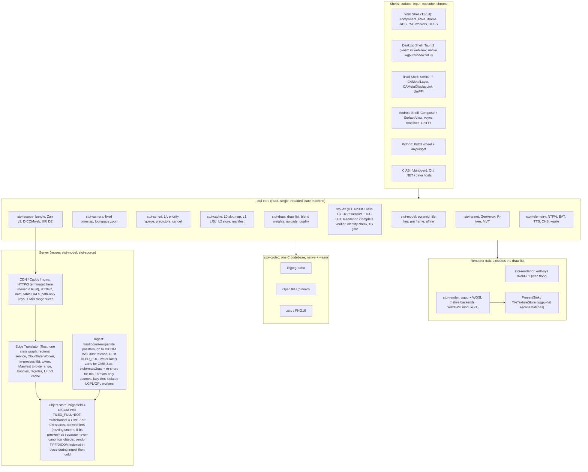

# Recommended architecture — Stoipath WSI viewer

Synthesis of proposals A–E (`arch/`), the judge panel (`judge/ranking.json`, `judge/judgments.json`) and research notes 01–11 (`research/`). Date 2026-10-24; amended 2026-10-24 (gap-5) and 2026-10-25 (critique + verification). Tags as in the corpus: **[measured]**, **[model]**, **[estimate]**, **[unverified]**. The figures and names in §4–§5 are canonical for every later plan section.

> **Amendment 2026-10-24 (gap-5).** Research note `11-gap-5` (canonical-store feasibility; tile-server build-vs-adopt) arrived after this synthesis was written. Targeted changes only: (1) §2 — a provenance row crediting proposal C, and item 6 rewritten: the canonical pixel store is **dual-standard, single-copy** — DICOM WSI `TILED_FULL`+EOT for brightfield, OME-Zarr 0.5 (Zarr v3 sharded, core codecs only) for multichannel/16-bit — behind the one Manifest, because no image codec is registered for Zarr v3 and no mainstream reader decodes JPEG chunks; (2) §3 — diagram labels, and a new **§3.1** holding the store decision and rationale, the ingest pipeline, the Edge Translator build-vs-adopt verdict with crate list, deployment/edge topology and the standards/QuPath implications; (3) §5 — the Manifest value tuple gains `codec, provenance`; new terms *brightfield canonical*, *multichannel canonical*, *offline pack*; L3–L5 reworded; (4) §7 — ingest and server rows re-pinned to 2026-10-24 versions, `jpegxl-rs` (GPL-3.0-or-later, verified today) moved to the GPL-isolated class, HTTP/3 never terminated in-process; (5) §8 — server rows for MVP/v0.9/v1; (6) §9 — "two canonical pixel stores" re-scoped to two *copies*, six rows added including OME-Zarr-with-JPEG-chunks as canonical and its reopen conditions; (7) §10 — risks 10–16. No §4 latency or memory figure changed; one new server-side target is added (Edge Translator p99 ≤ 10 ms hot service time per container path).

> **Amendment 2026-10-25 (critique + verification).** Inputs: `critique/issues.json` (89 issues from four critics; every cross-cutting entry and every entry naming this document applied), `verify/README.md` and `verify/required-changes.json` — published in the repository as `docs/verification/` (`../verification/README.md`, `../verification/required-changes.json`, experiment scripts and raw results under `../verification/artifacts/`) — (24 load-bearing claims: 4 supported, 16 adjusted, 4 contested, 0 refuted; every change naming this document or a number it states applied — corrected numbers are marked "(adjusted after verification: was X)", confirmed ones "(verified)"), `plan/13-regulatory-pathway-and-free-distribution.md` and `research/11-gap-8`. **No finding overturns the architecture** (Rust/wasm core, `web-sys` WebGL2 floor renderer, wgpu native, Edge Translator over the dual-standard store, OSD as comparator) or the relative gates (warm I2P ≤ REF + 1 frame; ≤ REF-quad + 1 interval). What changed and why: (1) §1–§2 — MSK attribution (+59–100 ms/FOV, not +130), decoder-identity and Rust-decoder figures, wgpu WebGL-interop status (unreleased), floor-renderer effort (3–5 kLOC), WRY X11-only layering, OSD comparator protocol. (2) §3 — one decode-pool rule (3 workers on phones/tablets, 6 on desktop; the plan had two) and the **four product builds** (Stoipath Viewer RUO / Learn / in-house clinical / Dx) replacing a runtime `mode` flag as the legal boundary. (3) §3.1 — **Manifest + Range Index** (one ≤100 KB Manifest holding every tile range was arithmetically impossible), per-level content hashes and a `slideId` resolver, the **512² logical grid vs 240/256² vendor frames** decision (Tier B four-range entries; Tier C lossless re-mux with a decoded-pixel oracle), **derived tiers written at ingest only** (moving tier off by default with a Stage-1 kill condition; 8-bit preview tier) so the translator never re-encodes at request time, Cloudflare facts (R2 calls count but queue; 1 MiB slicing only for raw proxied ranges; >512 MB instances uncacheable below Enterprise), the translator gate's load statement and the bundle-path finding, the IIIF slow path without libvips, and **TX-RAMP** with the UT-operated topology as the pilot and Dx 1.0 default. (4) New **§3.2** — IEC 62304 **Class C** as a crate boundary (`stoi-codec`, `stoi-dx`) with the independent Rendering Complete verifier that makes sched/cache Class B valid, two-level `pathway_hash`/`build_hash` identity, Dx delivery surfaces (native desktop shell or MDM-managed browser), Dx 1.0 scope, product code **QKQ** (not PSY), the wrong-slide hazard, design controls from week 0. (5) §4.1–§4.2 — L0-keyed DPR cap, full ancestor chain, 16-layer arrays with a `cooling` state (TBDR ghost-copy jank, cause #38), **bandwidth-delay-product pacing** replacing slot caps, the prefetch lead as a distribution (p25 75 ms), bilinear transients on the floor, fade and TTS redefinition, sparse-pyramid L\* rule, upload budget `min(byte cap, time box ÷ per-tile cost)` with G5 at ≤1.2 ms/tile, Pinned Base 11–22 tiles and Base Bundle ≤8–10 MB worst case off the first-frame path. (6) §4.3–§4.4 — **per-level byte model** (95/117 KB dense tissue tiles at q85/q90 4:4:4; 20-tile fill 1.85–2.29 MB, not 1.6 MB), one network input set (first byte 32/83 and 67/306 ms), a slow-start term, a gate viewport per class (4K for W-LAN/N-Desk), W-iPad L0 192 MiB, typical warm-I2P rows (≈48/61 desktop, ≈55–65/70–78 phone, wheel ≈60), N-iPad typical 33/42 if UIKit delivers at 60 Hz, recomputed cold fills, and the **split gate** (warm-settle TTS, cold-fill gate, CHS floor, BER) replacing the single '≤250 / ≤700' row that no cold fill could meet at p95. (7) New **§4.5** — multichannel residency and bandwidth model (channel caps per class, ingest-derived 8-bit tier, M5 restated). (8) §5 — Manifest/Range Index, derived tier, `stoi-dx`, cache-layer facts (OPFS shard file, ITP 30 operating days, quota semantics), metric definitions (TTS at fade start, deficit incl. blend weight, TTFF/TTLS as the one pair of open metrics), Dx colour as a server-computed, client-applied LUT, fidelity-tier definitions, Stages 0–3, gate ownership in `gates/*.json`. (9) §6–§7 — tiers per plan 02 §5.1, Tauri/WRY versions and the Wayland note, a Dx 1.0 row, re-verified versions, lossy HTJ2K out of Dx permanently, **'Dx edition and enterprise edge commercial' → free regulated-release channel under Apache-2.0 + DCO**, campus OTC approval by Sprint 1. (10) §8 — **Stage 0 = weeks 0–6** (plan 10's sprint calendar, M0 = 2026-12-05) with a dated device-procurement list, re-targeted G1/G2/G3/G5/G6/G7/G8/G9/G11/G12/G13, **MVP re-scoped to M2 + what M2 needs** (multichannel, Worker build, Tauri, PyO3 wheel, IIIF/DZI/Iris, OpenSlide worker moved to v0.7–v0.9), regulatory items from week 0, the programme-total effort baseline, RA/QA from Sprint 1. (11) §9 — ten rejected alternatives added, three rows revised. (12) §10 — risks 1–3, 5, 8, 9, 15, 16 revised; risks 17–26 added. **Rule (plan 11 A6):** any later divergence from this document is an ADR that supersedes the relevant section, never a reviewer note in a plan section; every [model] figure is re-pinned at M1 from measured per-level bytes and the D8 network percentiles.

## 1. Thesis

The panel ranked B (one Rust engine everywhere) 7.09, A (web-first TypeScript engine) 7.07, D (C++ native core) 6.62, C (OpenSeadragon adopt-then-replace) 5.93, E (server render + video) 4.38. The B–A margin is noise; the shape of the disagreement is not. All three judges accepted the same *policy* (note 04's LOD, prefetch, eviction and blend rules) and the same *server* (C's passthrough pyramid, manifest, path-only cache keys); they disagreed only on where the policy runs and how the web floor draws.

The recommendation: **B's Rust core, compiled to wasm and native, is the single home of the policy. On the web floor the core's draw list is executed by a hand-written direct-WebGL2 renderer (gap-2 "option C"), not by wgpu's best-effort WebGL2 backend; wgpu is native-only until a WebGPU web module is allow-listed in v1.** Native shells exist because the browser's ≈2-vsync compositor floor and WebKit's 60 Hz cap are the only latency terms the engine cannot remove; the iPad shell moves to month 12, not B's month 18–20. Server work comes first (months 0–3) because the only deployed latency data (MSK, Schüffler 2022) blames server-side decode/re-encode: the paper's own same-vendor comparison puts the penalty at +59–100 ms/FOV (adjusted after verification: was "+130 ms/FOV from transcoding"; the +130 ms Philips gap is confounded by iSyntax SDK decoding, 128-px blocks and sequential serving).

Instant zoom is then a residency problem solved once: one `tick()` decides what to draw, fetch and evict; one libjpeg-turbo build decodes [measured bit-identical native/wasm-SIMD/wasm-scalar, gap-2 §2.3; verified on 695/695 JPEGs (139 tiles × 5 tiers) across x86 SIMD/scalar, aarch64 NEON/scalar under qemu, jSquash and wasm-vips — real arm64 hardware is still required for DHF evidence (G7)]; one WGSL set blends. A recorded gesture replayed with its byte-arrival times must yield an identical request sequence and draw list on every platform; that golden replay is the operational definition of goal 1 across goal 2.

## 2. Provenance and resolved disagreements

| Adopted | From | Why |
|---|---|---|
| Engine contract (`tick`/`on_bytes`/`on_decoded`/`set_budget`), single-threaded state machine, golden gesture replay; `PresentSink`/`TileTextureStore` traits, dynamic memory budgets, Safari allow-list, wgpu vendored and pinned | B | Only testable "one behaviour everywhere"; one Dx pathway; D's levers with driver bugs kept upstream |
| libjpeg-turbo (C) as sole Dx decoder; `createImageBitmap` only as self-certified accelerator, never on Safari in Dx | B, A, gap-2 | Measured identity (verified: 695/695 incl. aarch64 under qemu); Rust decoders differ 10–38 % of pixels at 4:2:0 and 0.6–5.7 % (max 2–3 LSB) at the canonical q85–90 4:4:4 tier (adjusted after verification) — still non-zero, rejection stands; WebCodecs `ImageDecoder` differed on 660/695 tiles and is excluded from the self-certification allow-list; ImageIO unknowable |
| Direct WebGL2 draw path on the web floor; wgpu off the web critical path | A, gap-2 option C, delivery and perf judges | gap-2 scored C 82 vs B 78 (verified recompute); removes wgpu #4081/#3735/#10460 (issue states per gap-2's same-day read, not re-verified) and 0.73–0.77 MB gz from floor devices (adjusted after verification: was 0.68, the WebGL2-only minus WebGPU-only pair; deployable post-wasm-bindgen sizes: dual 0.80 MB gz, WebGL2-only 0.77, WebGPU-only 34 KB; a `web-sys` WebGL2 floor renderer is 13.7 KB gz) |
| Embed budget, no SharedArrayBuffer/COOP/COEP, Service Worker off hot path, OPFS as refillable L2, path-only cache key, moving tier and DPR cap; WGSL once, GLSL via naga-cli, ≤1 LSB goldens | A | Embedding and floor devices decide reach; one shader set |
| Months 0–3 server-first: passthrough pyramid, level synthesis, two-pass ingest, ≤100 KB Manifest plus an edge-resident Range Index (amendment 2), stateless edge, DICOMweb `frames/{list}`, PHI-tier bucket; replacement triggers as named metrics on named floor devices; OSD as compatibility `TileSource` and perf comparator | C | Best-evidenced claim in any proposal; measurement before opinion. OSD comparator protocol (verified on 6.1.1): tuned profile (`maxTilesPerFrame` 100, `immediateRender` true, raised `imageLoaderLimit`), cold and warm frames reported separately, WebGL and canvas drawers separately — default settings measure request rationing (10, 5, 3, 2, 1 tiles/frame) and the 1.2 s spring, not rendering; C's own R2 trigger ("> 2 ms/frame on floor Android") sat below C's MVP model and is restated as "> 2 ms p50 end-state or > 8 ms p90 animating" |
| Native present recipe, shared-storage/purgeable textures, predicted input to camera only, reference quad apps, 60/25/15 frame partition, fuzz-first readers, Qt `QQuickItem` as SDK sample | D | gap-4 verified; only route under the browser floor; as thin shells over the Rust C ABI |
| Dx = deterministic settled frame with Rendering Complete flag; moving image is navigation; frame-id echo + photodiode rig; streaming as a later mode | E | Regulatory framing (PCoIP precedent) |
| Four arithmetic corrections (§4.2) | perf judge | Budgets must close on a 128 MiB phone |
| Dual-standard, single-copy canonical store — DICOM WSI `TILED_FULL`+EOT for brightfield, OME-Zarr 0.5 sharded for multichannel — behind one `TileIndex → byte range` Manifest (amendment gap-5) | C | gap-5 F5 scores it the only option with no disqualifying mark: every pixel stored once *and* each container readable by its community's standard tools; the pre-amendment single-container plan (OME-Zarr with JPEG chunks) is readable only by our own code |

Where the judges disagreed:

1. **B or A.** B: A's ceiling (no GPU surface, no C ABI, 60 Hz iPad for ever, a second engine on any native need) is the dead end; every B risk has a priced exit.
2. **Spike first (gap-2, product) or option C now (delivery, perf).** Now: 3–5 kLOC with +3 PM as a floor (adjusted after verification: was ~2–3 kLOC; OpenSeadragon's WebGL drawer is 1.3–2.1 kLOC, Aladin Lite's al-core wrapper 5.1 kLOC) is cheaper than one failed spike cycle on floor devices. B's priced exit (wgpu `create_texture_from_webgl_handle` interop) is unreleased trunk code, absent from wgpu 30.0.1 (2026-08-22) — expect v31 ≈ Q4 2026 at the observed 77–104-day cadence — so the B→C hatch is not an additive step today (adjusted after verification).
3. **Web floor renderer in TypeScript (perf) or Rust `web-sys` (delivery, gap-2).** Rust `web-sys` in the core module, so draw lists and uploads never cross the wasm boundary; TypeScript is the recorded exit if Stage 0 shows trampoline or debuggability cost (expected <0.2 ms/frame [estimate]).
4. **iPad shell at month 9 (D), 12 (product), 18–20 (B).** Beta at month 12 after M2; GA in v1.
5. **Desktop: Tauri native-wgpu window (B) or Qt (D).** Tauri 2 (2.12.5 / WRY 0.57.1, verified 2026-10-25): wasm in the webview at v0.7 (moved out of MVP, amendment 2), native wgpu window at v0.9 — now a **Dx prerequisite**, not a cut (§3.2) — once WRY's wgpu-plus-webview layering passes Stage 2. WRY child-webview layering is supported on macOS, Windows and Linux X11 only (no Wayland path: Ubuntu/Fedora default sessions need XWayland or a different composition) (adjusted after verification); a full-window transparent webview that forwards input over IPC adds ≈8–17 ms, so the Stage-2 I2P test runs with the chrome overlay present; hit-testing through transparent regions stays [unverified]. Qt is an SDK sample over the C ABI.
6. **One canonical store (A/B/D) or two (C).** *Amended 2026-10-24 (gap-5).* One canonical **index** (the Manifest) over **two standard containers chosen by pixel class** — C's stance: brightfield 8-bit RGB is written as DICOM WSI `TILED_FULL` with JPEG-baseline frames copied byte-for-byte from the vendor file (HTJ2K only for >8-bit sources), Extended Offset Table, one SOP instance per level, Concatenation when a level exceeds 4 GB; multichannel/16-bit is written as OME-Zarr 0.5 (Zarr v3 `sharding_indexed`, 512² inner chunks, core `zstd`/`bytes` codecs only). Vendor TIFF-JPEG and DICOM uploads are still indexed in place and served by passthrough during ingest (§3.1), so DICOMweb is true at launch without a second pixel copy. The original wording ("conversions written as OME-Zarr v0.5 sharded", i.e. with JPEG chunks) is withdrawn: no image codec is registered for Zarr v3 and no mainstream reader can decode JPEG chunks, so that store would have been readable only by our own code (§3.1, §9).
7. **Effort.** The delivery judge's synthesis numbers (§8).

## 3. Component architecture

**Engine contract**: `tick(now_ns, inputs, viewport) -> FrameOut { draw_list, requests, cancels, uploads, quality }`, `on_bytes(id, bytes)`, `on_decoded(id, tile)`, `set_budget(b)`. The core owns no threads, sockets or DOM. The Web Shell drives it from one `requestAnimationFrame` with `clamp(hardwareConcurrency − 1, 1, 3)` decode workers on phone and tablet classes (W-4G, W-iPad; Safari reports `hardwareConcurrency` 4 or 8, so always 3 there; `hc = 2` yields one worker = main-thread offload only) and `clamp(hardwareConcurrency − 1, 1, 6)` on desktop classes (W-LAN, W-BB) — one rule, stated here and nowhere else (amendment 2; the plan previously carried two). Transferables only; transfer tax 0.1–0.2 ms per tile in real Web Workers (verified; the 0.5 ms figure was conservative); pool speed-up 2.2× on three workers idle [measured] but 1.2–1.6× under core contention (adjusted after verification), which is why G9 is at risk and the 20-tile wall-time budget, not per-worker speed-up, is the gate that matters. Native shells drive it from the display-link thread with a rayon pool. Shells create the surface and hand it to the `Renderer`.

**Product builds (amendment 2; plan §13 Decision 3 as amended by its critics).** One commit set produces four artefacts that differ in build features, name, labelling and claims — not a runtime flag: **Stoipath Viewer** (RUO distribution build: no LIS/HL7 write-back, no sign-out events, no Dx gate; the RUO string asserted by CI), **Stoipath Learn** (education; no PHI by construction), the **in-house clinical build** for the validating UT CLIA lab(s) (Dx-pathway capable; labelled "in-house laboratory-validated tool, not FDA cleared"; the only pre-clearance build with HL7/FHIR write-back and sign-out events; distributed to no other institution; CLIN-1 and CAP-1 run on it) and **Stoipath Dx** (the cleared, signed, reproducible build). The launch-context `mode` field is a product identifier that must match the running build (the RUO build refuses `dx`); a build-feature matrix test is the machine check. Whether a flag could ever satisfy FDA's RUO totality-of-circumstances test is an open question for counsel; the architecture does not depend on the answer.

### 3.1 Canonical pixel store, ingest and Edge Translator (amended 2026-10-24, gap-5)

**Decision: dual-standard, single-copy** — gap-5 F5 option B, the only option with no disqualifying score, and proposal C's storage stance. It replaces note 02 R2 and the pre-amendment wording of §2 item 6.

| Pixel class | Canonical container | Layout | Why this and not OME-Zarr for the class |
|---|---|---|---|
| Brightfield 8-bit RGB (>90 % of pathology volume) | **DICOM WSI**, `TILED_FULL`, one SOP instance per level | JPEG-baseline frames copied byte-for-byte from SVS/NDPI/Philips-TIFF (NDPI via opentile's DCT-domain re-mux, tier C); HTJ2K only for >8-bit sources; **Extended Offset Table** (BOT and fragment lengths are 32-bit, so a >4 GB level is unaddressable by BOT); **Concatenation** when a level exceeds 4 GB — a q85 100k² base is ≈3–4 GB, so ingest decides per level | Zarr v3 has **no registered image codec**: `zarr-extensions/codecs` lists 17 codecs, none JPEG/J2K/HTJ2K/JXL, and `imagecodecs_jpeg` is an unregistered raw name (ZEP 9 non-conformant). zarr-python (default), zarrs, zarrita.js, tensorstore, Viv, vizarr and zarr-java/bioformats2raw cannot decode JPEG chunks, and QuPath 0.7 reads no Zarr v3 at all, so a JPEG-chunk store is readable only by our code. A `TILED_FULL`+EOT instance is itself a range-addressable tile archive (frame i → EOT[i]) readable by every clinical viewer and VNA |
| Multichannel / 16-bit (fluorescence, multiplex, spatial omics) | **OME-Zarr 0.5** on Zarr v3 | `sharding_indexed`, 512² inner chunks, 8×8 chunks per shard by default (≈3.8 MB, 1,028 B index at the end with crc32c), shards 1 MiB-aligned, core `zstd` + `bytes` codecs only; all channels of a tile in one shard (`(c=all, y=4, x=4)` for ≤8 channels), z-planes in separate shards; geometry is a per-level parameter fixed by the M0–M1 prototype, not by this document | This side *is* OME-Zarr. Sharded v3 with core codecs reads today in zarr-python 3.4.1, zarrs 0.23.14, zarrita 0.7.5, tensorstore 0.1.85, zarr-java, Viv 0.23.0, vizarr 0.3.0, ome-zarr-py 0.21.0 / napari-ome-zarr 0.11.0; DICOM's 16-bit optical paths have thin tooling. OME-NGFF 0.6 (released 2026-09-14, RFC-5 coordinate systems) is adopted for metadata once Viv/vizarr/ome-zarr-py read it; the pixel layout is identical |

Every pixel is stored once. Vendor originals go cold once the canonical copy is written and its frame bytes hash-match the source (passthrough is a byte copy, so the check is exact). The other standard is an on-demand export job (DICOM ↔ OME-Zarr, OME-TIFF), never a mirror. A PMTiles-style single-file bundle is an optional *derived* **offline pack** (iPad, desktop, classroom), never canonical.

**Goal 1 is unaffected.** Both containers are byte passthrough behind a small index, which is all §4 assumes: 512² logical tiles (256² vendor frames as four ranges per logical tile, see below), 1 MiB-aligned shard layout (relevant only to raw proxied ranges — Cloudflare caches those in 1 MiB slices and CloudFront caches requested parts; the Worker + R2 hot path returns exact ranges), centre-of-viewport bundles coalesced into one range per shard (≤4 for viewports ≤8 tiles wide), the L4 hot cache. The container decision is about interoperability and ingest cost; no §4 figure changes. The indices differ only in bytes at open — ~1 KB per 8×8 Zarr shard versus one EOT per DICOM level (51k frames × 16 B ≈ 0.8 MB at the base) — and browsers and native shells load neither: they read the ≤100 KB Manifest. Only client-direct readers of raw files (desktop, Python) pay it; if the M1 prototype shows >1 RTT at open, the Manifest is published beside the instances (gap-5 F5 condition 4).

**Manifest + Range Index: one abstraction, two sources, two objects (amended 2026-10-25).** The pre-amendment definition — one ≤100 KB Manifest holding `TileIndex → (object, offset, length, codec, provenance)` for every tile — was arithmetically impossible: a 100k² slide has ≈51k tiles across levels, ≈0.8 MB at 16 B each (the EOT figure this section already quoted). Canonical now: (1) the **Manifest** (≤100 KB, immutable, versioned, cached at the edge and fetched by every client at open): geometry; per-layer `tile` size (256 / 512 / 1024, see the grid decision below); per-level object references **and per-level content hashes**, so a synthesised or re-written level bumps `pyramid_version` and invalidates only that level's tile URLs, never the slide's whole L2/L3 state (a short-TTL `GET /v1/slides/{slideId}` resolver maps the launch-context `slideId` to the current Manifest); `codec` and `provenance` per level (`canonical` | `derived`); the per-level byte model `bytes.perLevelMedian` (§4.3); Pinned Base and Base Bundle offsets; the derived-tier catalogue. (2) The **Range Index** (edge-resident, never fetched by browsers or native shells): `TileIndex(layer, level, x, y, [z, t, c]) → ≤4 × (object, offset, length)`, 16–64 B per tile, ≈0.8–3 MB per 100k² slide, built at ingest from DICOM EOTs, Zarr shard indices and TIFF IFDs (in-place vendor files). Both JSON Schemas are published under `api/`. Browsers and native shells fetch tiles and bundles by immutable URL from the translator; client-direct readers (desktop, Python) read the Range Index or the standards' own indices (EOT, shard index). The DICOMweb façade over the Zarr side and the IIIF/DZI/Iris-shaped façades over both are stateless translations of the Range Index. **The client never needs a Zarr JPEG codec**: it fetches tiles from the translator (immutable URLs, bundles) or reads the standards directly (WADO-RS frames; OME-Zarr core codecs via `zarrs` natively and zarrita on the web).

**Logical 512² grid versus vendor frame size (decided 2026-10-25; was reconciled nowhere).** Classic Aperio SVS stores 240² frames, the GT 450 / GT 450 DX 256², NDPI restart-marker strips, Philips TIFF and DICOM scanners mostly 512² or 256². The engine's `TileKey` stays 512² everywhere; the Manifest carries `tile` per layer. **Tier B** (byte passthrough) covers vendor frames whose size divides 512: a 256² source yields a Range Index entry of four byte ranges per logical tile (2 × 2 frames); each frame is served, hashed and decoded exactly as the vendor wrote it — the byte-identity assertion (FR-S2) is **per vendor frame** — and the L0 slot receives four 256² sub-uploads (`texSubImage3D` with offsets). **Tier C** (lossless DCT-domain re-mux, opentile-style) covers 240² SVS, NDPI strips and any frame size that does not divide 512: frames are re-grouped into 512² JPEG frames at ingest without re-quantisation (MCU-aligned: 240 = 15 × 16, 512 = 32 × 16); the identity oracle is **decoded-pixel identity against the vendor frames through the G7 reference decoder**, not a vendor-byte hash, and the vendor-hash claim is withdrawn for Tier C wherever it appears (02 FR-S2 and §4.1, 04 §5/§7, US-R1, plan §13 §2.4's PCCP protocol). Costs: four frames per logical tile cost ≈1.3× the decode time (per-image overhead) and 4× the upload calls at identical bytes; G12 and G13 measure the 4 × 256² variant on the W-4G device and §4.4 carries it as a footnote until measured. The canonical DICOM frame size follows the vendor frame for Tier B (256²) and is 512² after a Tier-C re-mux; the Pinned Base contiguity claim (§4.2) holds after the canonical write, not during index-in-place serving. Packing 240² frames into 512² L0 layers (≈78 % of a layer wasted) is rejected. "View while scanning" is scoped honestly: TIFF-family scanners write the IFD at file close, so the promise is "viewable seconds after file close"; only DICOM-output scanners (GT 450 DX) deliver instances or Concatenation fragments incrementally.

**Ingest (two-pass, amended).**

1. *Index in place, serve now.* Vendor TIFF-JPEG (SVS, NDPI, Philips, generic BigTIFF) and DICOM uploads are indexed into the Manifest without touching pixels (tiers A–C; `JPEGTables` splice for TIFF); the slide is viewable seconds after upload.
2. *Write the canonical copy.* Brightfield: **wsidicomizer 0.31.0** (`--format jpeg`, `--offset-table extended`, `--add-missing-levels`, `--concatenate-frames`/`--concatenate-bytes` above 4 GB; sources via opentile/tiffslide/openslide/czi/isyntax/bioformats) is the first-release converter *and* the behavioural oracle for the Rust `TILED_FULL`+EOT writer on `dicom-object` 0.10 (HTJ2K through the pinned OpenJPH FFI, since dicom-rs 0.10 does not encode it) that replaces it when throughput demands; wsidicom 0.36.1 `save()` never concatenates, so it is an oracle only below 4 GB. Multichannel: Rust direct via `zarrs` for OME-TIFF/QPTIFF sources (own `tiff` reader); `bioformats2raw ≥0.12 --ngff-version 0.5` followed by a `zarrs` re-shard (bioformats2raw documents no sharding option) for sources only Bio-Formats reads, inside the GPL-isolated worker. Missing pyramid levels become new DICOM instances (one per level) or new shards; a lazy-tiler miss never appends into a live object on S3/R2 (no atomic append): it writes a new object and swaps the Manifest pointer (per-level hash, so only that level's URLs change). **Derived tiers are written here too, never at request time** (decided 2026-10-25): the translator never re-encodes pixels on any request path, so plan 01 §1's "no request-time transcoding, ever" stays literally true and the p99 gate has no transcode row. The brightfield **moving tier** (`enc=m`, q75 4:2:0, H&E only, levels finer than the Base Bundle) costs ≈0.55–0.68× of the settled bytes in storage — ≈+2 GB per 3–4 GB slide — and is therefore **off by default**, enabled per deployment where radio classes (W-4G, N-And) are expected (education, telepathology), with a Stage-1 kill condition: it is dropped if bytes per gesture with refine-at-settle (every level the user stops on is fetched twice, ≈+60 %) exceed settled-only bytes for the measured burst-amplitude distribution (verification item D9); moving-tier bytes count in the waste and bytes-per-gesture metrics. The **8-bit preview tier** for >8-bit brightfield and multichannel sources (per-channel 8-bit windowed grayscale JPEG from the `omero` default windows, encoded with libjpeg-turbo so G7 identity holds; §4.5) replaces the former HTJ2K→JPEG request-time fallback (§10 risk 15). Every derived object carries `provenance: derived` in the Manifest and **Dx mode refuses it**.
3. *Verify, swap, cool.* Frame-byte hash identity against the vendor frames for Tier A/B; decoded-pixel identity through the G7 reference decoder for Tier C re-muxed formats (NDPI, 240² SVS); third-party-reader smoke tests in CI (wsidicom, pydicom, Orthanc and dcm4chee STOW/WADO on the DICOM side; zarr-python, zarrs, zarrita/vizarr, tensorstore on the Zarr side); Manifest pointer swap; vendor original to cold storage. "Readable by community tools" is thereby a CI assertion an agent can run, not a claim — the machine-checkable form the programme context requires.

**Edge Translator: build in Rust from crates; adopt no server, fork none.** No surveyed server (Iris RESTful, Google Digital Pathology DICOM Proxy, Orthanc WSI 3.2/3.3, large_image 1.35, IIPImage, Cantaloupe 6, Microsoft dicom-server — archived) serves Zarr shards *and* DICOM frames by byte passthrough with tile-list bundles. Iris proves the latency class (21 ms median at >5,000 req/s on an RK3588 in the arXiv paper; its README now states <35 ms median at >7,500 req/s — a loaded latency, ≈105 requests in flight by Little's law) (adjusted after verification) but serves only its IFE format over GET; Google's proxy quotes ~150 ms/frame (verified verbatim); IIPImage and Cantaloupe re-encode; large_image decodes to numpy. The hot path is ~300 lines of offset arithmetic per container plus what nobody ships: prefix-token auth with a stable path-only cache key, bundles, neighbour pre-warm, DICOMweb/IIIF/DZI/Iris façades. Forking Iris buys a Beast loop and loses the Rust ecosystem; forking Orthanc WSI couples us to its database. **Target: p99 ≤ 10 ms hot service time per container path at a stated load of ≤50 % utilisation** (Zarr shard range, DICOM EOT frame, 15-tile bundle) on a 2-vCPU container and in a Worker — measured in M0–M1, a gate from M1 (the load statement was added after verification: an M/M/1 bound puts p99 ≤ 10 ms at ρ ≤ 25–50 % for 1–2 ms service times). Verified on x86 with an axum 0.8.9 server pinned to two cores (64 shards × 64 tiles, 272 MB store): Zarr tile p99 0.09 ms unloaded / 1.3–1.4 ms at 5.6–6.4k req/s; DICOM frame p99 0.11–0.17 / 0.4–0.8 ms at 8.2k req/s; the 15-tile bundle **fails the gate when implemented naively** (coalesce-read-slice-copy with one range per shard: p99 8.7–9.2 ms, p999 14–48 ms, 24–45 ms saturated) and passes with per-row ranges (p99 1.6–3.6 ms) — so the bundle path uses pooled buffers and per-tile `pread` with vectored writes / `sendfile` (an M1 item), and the 2-vCPU ARM container and the Worker build are measured in Stage 0 (verification item D11). In the Worker build the "hot hit" is a Cache API hit, not an L4 RAM hit (no persistent RAM across isolates). The IIIF off-grid slow path (arbitrary regions and sizes) resamples with a permissive Rust resampler on the translator's rate-limited slow path; libvips (LGPL) never enters the translator's crate graph (plan 09 §5.2's permissive-only class, enforced by `cargo deny`) — it stays in the isolated ingest worker. S3 first byte is 100–200 ms per AWS's own guide (adjusted after verification: was 50–200), so the L4 hot cache is mandatory on AWS. Three builds from one crate graph: regional service, Cloudflare Worker (`worker` 0.8.7, axum handlers unchanged), in-process library for Tauri and the PyO3 wheel.

| Concern | Crate (crates.io, 2026-10-24) | Licence |
|---|---|---|
| Zarr v3 read/write, partial shard decode, OME-Zarr hierarchy | `zarrs` 0.23.14; `zarrs_object_store` 0.7.0 / `zarrs_opendal` 0.14.0 / `zarrs_http` 0.3.1 / `zarrs_filesystem` 0.3.14; a codec plugin for the JPEG experiment | MIT OR Apache-2.0 |
| DICOM Part-10, `TILED_FULL`/EOT frame indexer (ours), transcoding | `dicom-object` / `dicom-pixeldata` 0.10.0 | MIT OR Apache-2.0 |
| TIFF/BigTIFF/NDPI passthrough | `tiff` 0.11.3 + own IFD/`JPEGTables` code | MIT |
| JPEG header splice, decode, re-encode | `turbojpeg` 1.5.1 (libjpeg-turbo — the client's codebase, so G7 identity holds server-side too); `mozjpeg` 0.10.13 for high-quality re-encode of synthesised levels; `zune-jpeg` **not** used on pixel paths (§9) | Unlicense OR MIT; IJG |
| HTJ2K | OpenJPH via C++ FFI, the one pinned version of §7; no mature Rust crate | BSD-2 |
| JPEG XL | `jpegxl-rs` 0.16.0 is **GPL-3.0-or-later [verified crates.io 2026-10-24]** → GPL-isolated ingest worker only; own libjxl 0.12 FFI (BSD-3) if JXL ever reaches the translator | GPL-3.0+ / BSD-3 |
| HTTP server | `axum` 0.8.9, `hyper` 1.12.0, `hyper-util` 0.1.21, `tower` 0.5.3, `tower-http` 0.7.1 — HTTP/1.1 + HTTP/2 in-process | MIT |
| HTTP/3 | **none in-process**: `h3` is 0.0.8 (2025-05-06, pre-1.0); QUIC terminates at Cloudflare / CloudFront / Caddy | — |
| Hot cache (L4) | `moka` 0.12.16 (RAM, TinyLFU) or `foyer` 0.22.6 (hybrid RAM + NVMe) | MIT/Apache-2.0; Apache-2.0 |
| Object storage (L5) | `object_store` 0.14.2 or `opendal` 0.59.5 — S3 / R2 / GCS / Azure / MinIO / local | MIT/Apache-2.0; Apache-2.0 |
| Cloudflare Workers build | `worker` 0.8.7 (workers-rs, `http` feature) — wasm32 target, same crate graph minus tokio I/O | Apache-2.0 |
| IIIF off-grid resampling (rate-limited slow path) | `fast_image_resize` or `image` (permissive; version pinned at Stage 0) — never libvips inside the translator | MIT OR Apache-2.0 |

**Deployment and edge** (amends note 02 R7's AWS variant; the hosting default is unchanged).

| Target | Translator placement | Constraints and evidence |
|---|---|---|
| Cloudflare (first-class hosted target; **not** the default for Texas public institutions — see TX-RAMP below) | **Worker** + Cloudflare cache; R2 `get(key, {range})` same-network, zero egress | Paid plan: 128 MB per isolate, 30 s CPU default, 10,000 subrequests, **6 simultaneous outgoing connections per request** — R2 `get`/`head`/`list`/`put`/`delete` **do count** while awaiting response headers, but a seventh call is queued (+1 R2 header RTT), it does not fail or stall (verified from `workers/platform/limits.mdx`; closes the open question). A tile = 1 cached index lookup + 1 R2 range; a 15-tile bundle = ≤4 shard ranges for bundles ≤8 tiles wide (5×3 viewport: mean 1.9, max 4; a 4K DPR-1 viewport reaches 6), so the Worker coalesces to one range per shard (over-read ≈1.3–1.4×). **1 MiB origin-range alignment and slice caching apply only to raw Range requests proxied to an origin**; on the Worker + R2 hot path R2 returns exact ranges and L3 caches per-tile/bundle responses as whole objects, so shard alignment is irrelevant to the hot path (adjusted after verification). The cacheable-size cap (512 MB; Enterprise 5 GB) is checked against the complete `Content-Range` size, so **raw range reads of one-instance-per-level DICOM bases (3–4 GB) and level 1 (0.75–1 GB) do not cache below Enterprise** (adjusted after verification; contradicts gap-5 F5's "DICOM range reads cache like any file") — the hot path never issues them, so this touches only client-direct readers; Concatenation at ≤512 MB instead of 4 GB is the option for Cloudflare-hosted deployments, decided at M1 with the VNA matrix |
| AWS | **Regional service** (Fargate/EC2) behind CloudFront with immutable per-tile URLs, `foyer` RAM + NVMe hot cache, S3 ranges on miss | CloudFront Functions cannot host it (2 MB, 10 KB code, no network); Lambda@Edge offers Node.js/Python only [unverified for custom runtimes] plus cold starts — note 02 R7's Lambda@Edge / CloudFront-Functions variant is withdrawn. CloudFront caches range parts, may fetch more than requested, 30 GB max object |
| On-prem / hospital / **UT-operated** (default for UT pilots and for Dx 1.0) | Same binary behind Caddy or nginx (TLS and HTTP/3 there), MinIO or a local object store; packaged at **MVP**, not v0.9 (amendment 2) | Identical code path to the hosted service — the in-house-runnable stack the TSP abstract rests on. **TX-RAMP** (added after critique): Texas Government Code §2054.0593 lets institutions of higher education contract only for cloud services that are TX-RAMP certified (Level 2 for PHI/FERPA data; 18-month provisional path), so a Cloudflare or AWS topology used by a UT institution needs certification or provisional status (filed by M2 if any UT site uses one, applicability confirmed with the UT ISO before M1); the UT-operated topology (this row on UT VMs and object store) is the default for EDU-1, CLIN-1 and FREE-1 so that TX-RAMP does not apply, and Dx 1.0 is labelled for this topology only — the others enter through the PCCP "Deployment" category (plan §13) |
| In-process | Same crates linked into Tauri and the PyO3 wheel | Local files, no server |

**Standards and versatility implications.** *Clinical:* brightfield is DICOM from the first byte, so DICOMweb (`frames/{list}`, `transfer-syntax=*`), VNA co-existence and STOW into a customer archive need no conversion; archives that decompress despite `transfer-syntax=*` (dcm4chee 5.31, reported inconsistent) are proxied through the translator; managed stores (Google Healthcare API, AWS HealthImaging) return stored-syntax frames and serve as a system of record behind the translator, never as the hot tier (~150 ms/frame class; price is not the issue). *Research:* the multichannel side is plain OME-Zarr 0.5 with core codecs — napari, Viv/vizarr, tensorstore, zarr-python and `zarrs` read it unchanged; the Python API reads both stores directly (wsidicom, zarr-python). **QuPath interoperability goes through DICOM and OME-TIFF export, not OME-Zarr**: QuPath 0.7.0's OMEZarrReader (Bio-Formats 8.4.0) depends on jzarr 0.4.2, a Zarr v2 library, so it opens no OME-Zarr 0.5, sharded or not, and the same blocker applies to OMERO; the fix is upstream (OMEZarrReader → zarr-java), which this project funds. *Education:* the derived offline pack is the low-bandwidth classroom artefact; on iPad it is viable inside an installed Home-Screen PWA, which WebKit exempts from ITP script-storage deletion (ordinary origins lose it after 30 operating days without interaction, 7 only for link-decoration-flagged origins — adjusted after verification: was "7 days"; Safari 27 runtime behaviour unconfirmed, MDN still says seven). *Upstream programme* (gap-5 F8, small items first): register `jpeg`/`htj2k`/`jpegxl` in `zarr-extensions` with a chunk-layout spec; a `zarrs` JPEG codec plugin (the translator needs it anyway); a zarrita codec over `ImageDecoder`/wasm; an NGFF RFC on lossy codecs per level and ICC placement; Bio-Formats → zarr-java; a published `TILED_FULL`+EOT / sharded-0.5 conformance corpus. The JPEG-chunk Zarr layout stays a feature-flagged experiment under the URI codec id `https://stoipath.dev/zarr/codecs/jpeg`, holds no customer data, and is re-decided at the first annual review (§9 lists the flip conditions).

### 3.2 Safety classification, segregation and the Dx boundary (added 2026-10-25; aligns with plan §13 Decisions 1–4 and 8 and research 11-gap-8 F3–F4)

**Device and pathway.** The cleared edition is a Class II device under 21 CFR 864.3700, product code **QKQ** (software-only digital pathology image viewing and management software; **not PSY**, the scanner-inclusive code — adjusted after critique), Traditional 510(k) with a viewer predicate (PathPresenter K250968 or Paige FullFocus K241273) and a PCCP for scanners, formats and displays from the first submission. A frozen-section Dx claim is a separate indication (K250968's cleared intended use excludes frozen sections and cytology); the clinical pillar's frozen-section work runs on the in-house clinical build under the lab's CLIA/CAP validation until then.

**IEC 62304 class.** Class **C** for the pixel pathway and case/slide identity (a silent rendering fault at high power can contribute to a missed carcinoma; glass is by design not re-reviewed; the pathologist is the user, not an external risk control), FDA documentation level Enhanced; Class B/A for everything else behind a §4.3 segregation that is an architectural fact a reviewer can see. The pre-amendment "Class B assumed" baseline (01 §7.5, 02 NFR-D6, 08 §11, 09 ADR-0014, 11 A10) is withdrawn (adjusted after critique); the regulatory effort line is re-estimated by plan §13 (detailed design and unit-level verification records for the Class C crates: ≈6–10 PM one-off plus ≈1–2 PM per Dx train [estimate, plan §13 §7.3]).

**The boundary is a crate boundary, enforced by the layering test (plan 10 §1) and `cargo deny` features.** Class C crates: `stoi-codec` (libjpeg-turbo, the pinned OpenJPH reversible path, zstd/PNG16) and **`stoi-dx`** (split out of `stoi-draw`/`stoi-render`: the Dx settled-frame path — fixed resampler, application of the server-computed ICC→sRGB LUT, gamma-space `Rgba8Unorm` filtering; the **Rendering Complete verifier**; the **case/slide identity check**; the **Dx gate**). Everything else — `stoi-camera`, `stoi-sched`, `stoi-cache`, `stoi-draw`'s navigation path, both renderers' navigation paths, the shells, `stoi-annot`, `stoi-telemetry`, education and research packages, server management — is Class B or A. This narrow boundary is valid **only because of an independent check** (adjusted after critique: `stoi-sched` and `stoi-cache` cause HAZ-1 "magnified or stale tile presented as final", and a Class B item whose failure causes a Class C hazard must itself be Class C unless the Class C item verifies its output): **Rendering Complete is asserted only after `stoi-dx` recomputes, from the camera scale and each drawn tile's self-identifying metadata (level, x, y and slide hash carried in the decoded tile's header and checked against the Manifest — never from scheduler bookkeeping), that every visible pixel is sampled at L\* with canonical provenance.** The verifier is a requirement with a fault-injection test: a wrong-level, stale or wrong-slide tile injected into the draw list must suppress the flag. Fallback (i), recorded as the alternative in the ADR: if the segregation review or Pre-Sub feedback rejects the narrow boundary, the whole deterministic engine core (`stoi-core`) becomes Class C and the documentation estimate rises accordingly; shells, annotation display, education, research adapters, telemetry and server management stay B/A either way.

**Pixel-pathway identity.** Two hashes: **`pathway_hash`** over the Class C set (codec binaries, resampler, LUT application, verifier, identity, gate) and **`build_hash`** over the whole artefact. The Dx gate requires a registered `build_hash`; the cleared-configuration register and a site's CAP revalidation trigger key on `pathway_hash` (unchanged pathway = letter-to-file and no revalidation; changed pathway = new register entry, site notice, revalidation recommended); forced security updates never change `pathway_hash`, and CI fails a Dx-train release whose `pathway_hash` changed without a signed change-assessment memo. `pathway_hash` is frozen at v1 (W84), the UI at the Dx 1.0 RC freeze (≈W96).

**Dx delivery surfaces.** A browser cannot identify the physical display (no EDID; the Window Management API is Chromium-only, permission-gated and unavailable inside a third-party iframe), so Dx mode exists only where the display can be attested: (a) the native desktop shell (EDID/monitor enumeration + ICC) and (b) MDM-managed browser sessions whose `dx_profile.json` (validated scanner formats and display identities, delivered by the hospital) is present — with the attestation source recorded in the quality record. Gate inputs, one vocabulary for every section: `build_hash` in the cleared-configuration register; `dx_profile.json`; display-QA record freshness; render `mode ∈ {nav, dx}` as a per-session render mode inside the Dx-capable builds only. The v0.9 native wgpu desktop window is therefore a Dx prerequisite, not a roadmap cut. Because a sign-out pathologist keeps the LIS on one monitor and the slide on the diagnostic display, the Hyperdrive activity hosts a thin controller iframe that opens or hands off to the viewer in a top-level window or the Tauri shell on the diagnostic display, kept in sync through the launch-context token and the event bus (an iframe cannot leave the Hyperdrive window).

**Dx 1.0 scope** (plan §13 §2.7 as its critics require): one platform family (signed Tauri native desktop installer on Windows 11, wgpu DX12 or Vulkan, EDID display identity), one topology (on-prem Edge Translator behind Caddy/nginx), two scanners (Hamamatsu NanoZoomer S360MD, Leica Aperio GT 450 DX), two displays (Barco MDPC-8127 and a second ≥8 MP medical display); the installer is verified by OS code-signing, served bundles by Translator-side signed manifests (a served page cannot trust itself). Everything else — macOS, browsers, cloud topology, air-gapped media — enters through the PCCP "Deployment" category or letter-to-file. The PCCP scanner protocol is format-specific: byte identity where the vendor frame is served unchanged (Tier A/B), decoded-pixel identity through the G7 reference pathway plus a lossless re-tiling proof for Tier C; only reversible HTJ2K through the pinned OpenJPH build is inside the PCCP.

**Hazards whose controls this document owns.** *Wrong slide or patient displayed* (the number-one clinical-viewer hazard, absent from every pre-amendment hazard list): clinical and Dx builds display the Tier-2 label image and the launch-context identifiers (accession, part, block, slide label text) by default via the `/assoc/label` token scope; the shell verifies `LaunchContext.slideIds` / `studyUID` against the Manifest's slide hash and DICOM UIDs before drawing and emits `identityMismatch`; a contract test uses mismatched launch/manifest pairs. *Magnified or stale tile presented as final*: the verifier above. *Colour*: the per-slide server-computed LUT, versioned in the Dx pathway (§5). *Brightness/contrast/gamma* (every cleared QKQ viewer exposes it): a 1-D LUT uniform, one-frame update without refetch, on-screen indicator when non-default, recorded in the quality record and State Document, reset on Dx-mode entry and logged. *AI overlays in Dx mode* render only for algorithms whose vendor has validated Stoipath Dx as a compatible viewer; otherwise the layer carries a "not validated for diagnostic use on this viewer" marker or is suppressed. *Gate or registry outage*: gate decisions are cached locally for ≥30 days and the labelling names the glass fallback.

**Design controls from week 0** (plan §13 Decision 5): REQ IDs on tests, a risk register seeded in Sprint 1 (10 S1-12) and baselined at M1, SBOM and signed evidence archives on every channel; the formal IEC 62304 process document, ISO 14971 file and IEC 62366 file are written at v0.9 on those artefacts; agents are untrusted generators whose output is verified by qualified deterministic checks (goldens, replay, G7, trace gate), with model and prompt identity recorded for reproducibility only. Plan §13 owns the regulatory programme (QMS, Pre-Sub, validation, manufacturer entity, licence channel, qualification criteria, funding); this section states only what the architecture must satisfy.

## 4. Instant zoom, end to end

### 4.1 Policy (inside `tick`, identical everywhere)

- **L\*** = level with s ∈ [0.5, 1.0] device px per texel (a partition with an ε = 0.03 octave guard band, not a dead band); finer above 1.0, coarser only below 0.5; no timers. **DPR cap keyed to the L0 budget, not the network class** (amended 2026-10-25): the shell picks the largest DPR for which the un-evictable set (Pinned Base + the full ancestor chain of visible tiles) plus the working set (L\*, parent, ring, window) fits ≤ ~60 % of L0 slots — DPR 2 on a 128 MiB L0 on any link (DPR 3 is ≈100–110 of 128 slots before a single revisit tile; the pre-amendment "capped on metered links only" left the education pillar's main configuration — a 3 GB phone on classroom Wi-Fi — unprotected), DPR 3 only from 256 MiB; the metered-link rule stays as a bandwidth saving on top. **Sparse vendor pyramids** (SVS/SCN step 4× between native levels): until the intermediate level is synthesised, L\* draws the finer native level minified up to 4× with the blend spanning two octaves (never the coarser level magnified >2×); the ≤4096-px levels are synthesised at index time and the ROI's intermediate level synchronously on the frozen-section path; a "first view after ingest" row is gated separately from TTS.
- **Never blank**: nearest resident ancestor clipped to the footprint, resident descendants overlaid; `ancestor_of_visible` means the **full chain** from each visible tile up to the Pinned Base (10–13 slots at high power on a 100k² slide), and that chain and the Pinned Base are never evicted — so the W-4G DPR-2 un-evictable + working set is ≈88 slots with worst-case tile counts (a 780 × 1,688 px viewport spans up to 3 × 5 = 15 L\* tiles), not the 59 the pre-amendment budget counted with averages and the parent alone (adjusted after critique); a proptest "working set on a 128 MiB L0 at DPR 2 ≤ 85 % of slots" sits in the engine tests and a W-4G-on-Wi-Fi lab profile in M2.
- **Never magnify at rest**: after the last input the frame must be L\*-only within the TTS budget; late tiles keep top priority over a visible ancestor.
- **No aliasing, no pop**: fractional-LOD blend between L\* and parent (the pyramid is the mip chain); one landing rule — any change of drawn level at a pixel after the last input is faded, ≤3 frames (50 ms) on a settled frame and ≤100 ms during gestures, the fade excluded from TTS and counted in BAT (adjusted after critique: "a tile landing into a fractional-blend slot needs no fade" could not occur, because while the child was missing the parent was drawn at weight 1); **bicubic (Catmull-Rom) transients only on W+ and N classes, bilinear on W-4G and W-iPad** — a 9-tap kernel at DPR-3 geometry costs 8–15 ms on a Mali-G52 (≈3.4 Gtexel/s), not the 0.3–1 ms the plan budgeted (adjusted after critique; shaders are budgeted by texel rate per class and G3 gets a transients-active variant); no sharpening at rest (gap-1 F7). The at-rest softness of the trilinear blend is bounded by the resolution-deficit gate (§5), not hidden by NTF%; blending only below s ≈ 0.75 is the recorded fallback if the gap-1 F9 reader study finds the softness perceptible.
- **Prefetch**: at open, thumbnail + levels ≤1024 px first (≈5 tiles, ≈0.5 MB — the only first-frame dependency), then the rest of the Pinned Base, then the Base Bundle (metered-link-gated, decoded lazily by ROI on phones — 64 tiles at 10–24 ms each across three workers is 190–320 ms on an A55, not "one decode round") and L\*+1/L\*+2 under three tissue-dense ROIs; when a launch context lands at high power, the L\* viewport tiles are ordered before the remaining base. At gesture start, L\*+1 in a ±300 px window at the cursor from the first sample, the predicted destination only when confident (§4.2); One-Euro pan cone at τ = 100/250/500 ms; ring 1 cellular / 2 wired; idle fan-out on unmetered links only. The **prefetch lead is a distribution, not 155 ms** (adjusted after verification): at 3.33 levels/s and a log-uniform start scale it is ≈U(0, 300) ms — p25 75 / p50 155 / p75 225 ms — and ≈85 ms median at a plausible phone pinch rate of 6 levels/s, so Stage-1 prefetch is sized to the **p25 lead (≈75 ms)**, and roughly a third of W-BB pinches begin with a ≤1-level transient whatever the prefetch quality; hover/pointer-down prefetch is the mitigation and its hit rate is logged. Budgets are **paced by bytes, not slots** (see Scheduling); the old "≤50 % of bandwidth, ≤25 % of slots" is withdrawn.
- **Scheduling**: priority `(tier, |level − L*|, focus distance)`; all tier-0 in the first frame. **Bandwidth-delay-product pacing** (adjusted after critique: the 24/64 slot caps self-inflicted the queueing they were meant to prevent — 24 slots ≈ 1.9 MB ≈ 14 BDP ≈ 600 ms of bytes ahead of any new tier-0 request on W-4G, and the 0.5·bw·0.5 s prefetch budget was ≈250 ms of queue): total in flight ≤ ≈2 × BDP (`bw_ewma × rtt_p50`, both already tracked), prefetch ≤ ≈1 BDP, tier-0 always admitted; BDP ≈ 140 KB (≈1.5 tiles) on W-4G, ≈310 KB (≈3 tiles) on W-BB, ≈125 KB on W-LAN; the 24/64 slot caps remain only as secondary ceilings; ring, window and cone set sizes are derived per class from the byte budget and the burst-end-residency gate (BER, §4.4), not from fixed fractions. `AbortController` cancel below 30 % bytes stops the server, not the bytes already in the socket and radio queue, and Safari sends no priority signal — hence pacing first, h2/h3 priorities second; a Tier-2 test asserts that a tier-0 request issued while prefetch saturates the budget sees first byte within RTT + 1 BDP on the W-4G and W-BB profiles. Centre tiles coalesced into one bundle or shard range; HTTP/2 first-class, HTTP/3 where the CDN terminates it (0-RTT only for idempotent requests; Chromium's TLS 1.3 early data is disabled by default). **Uploads never target an array referenced by the last 2–3 frames' draws** (amendment 2, jank cause #38): on tile-based deferred renderers (Mali, Adreno, Apple GPUs through ANGLE-Metal in Safari) `texSubImage3D` into a texture that in-flight draws still reference forces the driver to ghost-copy the whole resource or insert a pipeline bubble — a 64 MiB memcpy or a lost frame per upload — so slots carry a `cooling` state, uploads rotate across arrays, arrays are 16 layers (16 MiB) so any ghost copy is cheap, and `texStorage3D` + fence-gated writes are used where available; the frame-time controller logs per-upload GPU-side cost as the production detector.

### 4.2 Corrections to arithmetic every proposal inherited

1. **Pinned base.** "≤4096² pinned on GPU" is 35–85 tiles = 35–85 MiB RGBA8 — 70 for a 100k² square slide, 85 worst case, 32 (25 % of a 128 MiB L0) for the 2.2:1 CAMELYON16 tumor_014 (adjusted after verification: was "70–85 tiles, 55–66 %", true for square slides only); the level criterion is `max(w, h) ≤ 2048 / 4096 px` (a short-side reading gives 44 tiles). Canonical: **Pinned Base** = levels with `max(w, h) ≤ 2048 px`, GPU-resident, 11–22 tiles ≈ 11–22 MiB (≈23 MiB only for a square slide — adjusted after verification), 0.9–2.4 MB encoded (0.86 MB tumor_014; ≈2.4 MB on the 95 %-tissue Stage-0 pyramid); **Base Bundle** = levels `≤ 4096 px` as JPEG in L1/L2: ≈1 MB for a typical 2:1 slide, 2–3 MB for a square biopsy, ≤5 MB at ≤55 % tissue, 6.5–8 MB modelled and **9.5 MB measured** for a tissue-dense square slide (85 tiles, q85 4:2:0, Stage-0 pyramid; coarse levels 1–4 are heavier per tile than level 0) — so **slide-open prefetch is budgeted at ≤8–10 MB worst case, measured per level at M0, and the Base Bundle is off the first-frame path** (adjusted after verification and critique: was "2–5 MB"); GPU-pinned only when L0 ≥ 512 MiB; the pre-amendment "≈64 tiles, 1–2 MB" for GPU bytes stays refuted (it was 32–85 MiB); ASTC is a Stage-3 experiment.
2. **Upload budget.** The effective per-frame upload is `min(byte cap, time box ÷ measured per-tile cost)`, not the byte cap alone (adjusted after critique). At the pre-amendment G5 ceiling (2 ms per 512² tile) a 3 ms time box admits **one** tile per frame, so a cold 20-tile level takes 20 frames = 333 ms, not the 5–10 frames = 83–167 ms the byte cap (2–4 MiB/frame) implied; the arithmetic "20 MiB at 2–4 MiB/frame = 83–167 ms" is correct (verified) but binds only if ≥2 tiles fit the box. Canonical: G5 = **≤1.2 ms per tile p95 into an in-use array on the floor phone** (≥2 tiles per 3 ms box → 10 frames = 167 ms for 20 tiles, 6 frames ≈ 100 ms for the 11-tile DPR-2 fill); on W-iPad the one public measurement (WebKit bug 260460: iPad 9th gen A13, iOS 16.6, ≈2.25 ms/MiB via `texSubImage2D(ImageBitmap)` ⇒ ≈2.3 ms per tile) says G5 is marginal-to-failing on the 2020 A12 device, so the W-iPad time box widens to 4.5 ms by shrinking the overlay/UI partition explicitly, and G12 measures per source type (ArrayBuffer / ImageData / ImageBitmap / canvas differ 0.1–3.7 ms wall per tile even on x86; WebGPU `copyExternalImageToTexture(ImageBitmap)` was a 25–31 ms blit on SwiftShader) into (a) an idle array and (b) an array bound by the previous frame's draw, gating on (b). The desktop "16 MiB/frame" is GPU-dependent, not a 3 ms fact (16 tiles in 3 ms = 0.19 ms/tile, 3–5× faster than Chrome's renderer→GPU-process copy typically allows on an Intel iGPU): W-LAN/W-BB upload throughput is **measured at M0** and planned at 4–8 tiles/frame until then. Consequence for "zoom-out and revisits instant": a 20-tile L1→L0 re-upload is 167–333 ms on a phone, so revisit-instant requires **L0 residency**, which the DPR-2 cap and 16-layer arrays buy. Attribution fixed: "14 ms per upload call" is WebKit 234920 (iPhone 12 Pro, iOS 15.2), "72 ms per frame" is 235043; 294602 is verifiable as open only to Nov 2025. It is a table row and part of the M2 gate; mitigations: centre-first upload order, frame-time AIMD controller (timer queries as telemetry only — the plan's "online budget from timer queries" wording is superseded), shared-storage writes natively.
3. **Texture arrays.** B's "256 layers × 512² = 64 MiB" is 4× low (256 × 512² RGBA8 = 256 MiB, 341 MiB with mips; 64 MiB is 64 layers) (verified). Canonical: 1 MiB per 512² RGBA8 layer, no mips; **arrays of 16 layers = 16 MiB are the default allocation unit**, ≤64 layers the upper bound (adjusted after critique and verification: two 64-layer arrays = 128 MiB allocated at either DPR left zero headroom for the revisit cache, in-flight uploads or the cross-fade duplicates — +11–20 MiB transient — and a ghost copy of a 64 MiB array on a TBDR GPU is a 64 MiB memcpy); a 128 MiB phone L0 holds eight 16-layer arrays, drawn with ≤8 instanced calls per level. **L0 counts tile slots only**: canvas backbuffers (≈10–34 MiB), LUTs and overlay layers add ≈35–40 MiB of GPU memory outside L0 and are counted in the risk-2 kill-threshold budget (verified). The G4 layer-count sweep (1…64, 128, 256) passed with 0 bad layers on ANGLE/SwiftShader WebGL2 and WebGPU (GLES 3.0 guarantees ≥256 layers, compat mode does not lower it); the wgpu #4081 multiple-of-16 effect is Mali/Adreno-only and stays a device test. Process RSS is 1.3–1.8× nominal texture bytes (ANGLE/SwiftShader: 128 MiB nominal cost 215–235 MiB), `texStorage3D` commits lazily (+7 MiB until filled), and each ImageBitmap L1 tile costs ≈1.08 MiB of renderer RSS invisible to `performance.memory` — so soak tests fill layers and budgets are kept in measured per-process RSS.
4. **Destination predictor.** 34 % of pathologist zoom bursts span <2.3 levels (Brunyé 2023 — 89 pathologists, 21,416 events, 100 ms–20.7 s durations, 66.4 % of magnification-change events ≥5×, minimum inter-zoom gap 196 ms, 90.4 % within 5 s — verified verbatim; the viewer was a mouse-wheel DeepZoom viewer, so pinch kinematics stay [unverified] until Stage-1 gesture logging), so a mis-predicted skip leaves nothing resident. "196 ms" is a dataset minimum used as a deadline, not a typical lead. Destination fetch requires ≥2 consistent samples above a confidence threshold; predicted-vs-actual and waste logged from M0; Stage-1 acceptance ≤50 % waste (Kayser/Wienert 2009 measured 74.1 % waste with naive prefetch — verified).

### 4.3 Canonical device and network classes

| Class | Device / runtime | Display | Gate viewport (tiles per level) — added after critique | Network (RTT p50/p95; bandwidth p50/p95-low; first byte p50/p95 — one input set, adjusted after verification) | L0 (tile slots only) |
|---|---|---|---|---|---|
| **W-LAN** | Desktop, Chrome, WebGL2 | 60 Hz (120–144 variant) | 3840 × 2160 DPR 1 (44–54 tiles — the sign-out persona's 27″ 4K display); 1080p (20) recorded as the secondary geometry | On-prem edge <1/3 ms; 1 GbE; first byte 4 / 12 (verified arithmetic) | 512 MiB–1 GiB |
| **W-BB** | Laptop, Chrome/Safari | 60 Hz | 1920 × 1080 DPR 1 (20 tiles); 4K recorded | CDN edge 25/50 ms; 100/20 Mbps; first byte **32 / 83** (adjusted after verification: was 19/58, which sat below the 25 ms RTT and came from a 12/30 ms input set) | 512 MiB |
| **W-4G** | Android 3–4 GB, Mali-G52/G57 or Adreno 610, Chrome WebGL2, **DPR 2 always** (L0-keyed cap; DPR 3 never fits a 128 MiB L0) | 60 Hz | ≈360 × 780 CSS px at DPR 2 (≈11 tiles); the 20-tile DPR-3 figure is kept only as an uncapped reference | 45/200 ms; 25/5 Mbps (the p95 values are [unverified assumptions]; verification item D8 replaces them); first byte **67 / 306** (adjusted after verification: was 57/226, computed from a 35/120 ms input set) | 128 MiB = 8 × 16-layer arrays; ≈88 slots un-evictable + working set at DPR 2 |
| **W-iPad** | 2020 iPad (A12), Safari/WKWebView | 60 Hz (WebKit cap, verified in trunk source; Web Animations timelines can raise and GPU-canvas pacing can only lower the rendering-update rate, neither lifts a per-frame redrawn WebGL/WebGPU canvas above 60 Hz: 120→60, 90→90, 144→72) | 2160 × 1620 DPR 2 (≈22 tiles; 20 used in §4.4) | Wi-Fi 25/50 ms; 100/20 Mbps; first byte **32 / 83** (adjusted after verification: was 19/58) | **192 MiB** (adjusted after verification: was 256 MiB — L0 256 + L1 64 = 320 MiB already exceeded the old G6 footprint gate; G6 now measures GPU Process + WebContent, because iOS runs WebGL in the GPU Process) |
| **N-Desk** | Workstation, Tauri native wgpu (Windows 11 first — the Dx 1.0 platform) | 120 Hz | 3840 × 2160 DPR 1 (44–54 tiles) | LAN; first byte 4 / 12 | 2–4 GiB |
| **N-iPad** | iPad Pro, SwiftUI shell, wgpu Metal | 120 Hz | 2732 × 2048 DPR 2 (≈30 tiles) | Wi-Fi 25/50 ms; 100/20 Mbps; first byte 32 / 83 | 1–2 GiB dynamic |
| **N-And** | Android 6 GB, Compose shell, wgpu Vulkan/GLES | 120 Hz (60 if OEM holds) | 1080 × 2400 at the DPR-2 cap (≈11–15 tiles) | 4G 45/200 ms; 25/5 Mbps; first byte 67 / 306 | 256 MiB–1 GiB dynamic |

Inputs: notes 02 F9 and 05 F2, gap-4 §2.9, gap-2 (ARM decode factor [estimate]), verify C14/C15. **Byte model (adjusted after verification: the flat "20 tiles × ~80 KB ≈ 1.6 MB" is withdrawn — the stated codec tier does not produce 80 KB tiles).** Dense H&E tissue 512² tiles, CAMELYON16 tumor_014, 150 real viewports: **95 KB p50 at q85 4:4:4** (90 KB Huffman-optimised), **117 KB at q90 4:4:4** (102 KB optimised); 76 KB at q85 4:2:0 and for vendor q80 4:2:0 passthrough; levels 1–4 (the magnifications pathologists spend most time at) run heavier per tissue tile (103–123 KB at q85 4:2:0 on the 95 %-tissue Stage-0 pyramid) and levels ≥5 lighter (25–38 KB, glass-dominated). Hence: **20-tile destination fill 1.85 / 1.95 MB p50/p90 at q85 4:4:4, 2.29 / 2.40 MB at q90 4:4:4** (1.49 MB at q85 4:2:0); **11-tile DPR-2 fill ≈1.0–1.3 MB**; 4K 44–54 tiles ≈4.2–6.3 MB; the **moving tier** (q75 4:2:0, 64 KB/tile) is 0.55–0.68× of the settled tier (adjusted after verification: was 0.88×, computed against a q80 4:2:0 baseline) — ≈0.69 MB at the DPR-2 cap, 1.25–1.28 MB at 20 tiles; centre 9 tiles 0.85–1.05 MB settled, 0.58 MB moving (adjusted after verification: was ≈0.5 MB). Huffman optimisation (−4.6 % at q85, −12.5 % at q90) is a free ingest saving. The model is carried per level in the Manifest (`bytes.perLevelMedian`, separately for q85 4:2:0 and q90 4:4:4) and re-fitted from the quality record's "bytes per tile at L\*" field; no section may quote a flat per-tile figure. A **TCP slow-start term** is modelled (adjusted after verification: it was absent): with IW10 and `tcp_slow_start_after_idle = 1` across the 0.5–2 s inter-burst gaps, ≈+85–110 ms per burst at the W-BB/W-4G p50 conditions and ≈+450 ms at the W-4G p95 condition, unless the server disables slow-start-after-idle or QUIC preserves cwnd. Vodovnik 2015: 20 Mbps "instant", 8 Mbps acceptable, <8 Mbps "considerable delay" (verified; was "8–10 Mbps"). Literature anchors confirmed: Helin 2018 q80 ≈20:1 at 33.4 dB; Schüffler 2022 60 kB per 512² block at q70. Every [model] cell below sums input→tick + first byte + slow start + bytes ÷ bandwidth + the decode and upload tails that are not hidden under transfer; cells carry both the pre-amendment value and the verification's own re-sum where they differ.

### 4.4 Canonical latency budget (ms, p50 / p95, [model] unless marked)

| Stage | W-LAN | W-BB | W-4G | W-iPad |
|---|---|---|---|---|
| Input sample → `tick`, incl. `tick` (wasm ≤1–3) — pointer input with a rAF pending (floor configuration) | 4–8 | 4–16 | 8–16 | 8–16 |
| Wheel input → `tick` — Chromium delivers non-passive wheel events rAF-aligned (`RendererCompositorToMain` 16 ms p50, measured on Chromium 153); added after verification | ≈27 | ≈27 | n/a (touch) | n/a (touch) |
| Present path, resident tiles (compositor ≈2 vsyncs = the designed low-latency path = floor configuration; typical 3 vsyncs incl. the OS-compositor latch ≈50; Chromium's high-latency mode adds one vsync at p95) | 33 **[unverified; Stage 0 G11 photodiode rig]** | 33 | 33 | 33 |
| **Warm input-to-photon** (gate ≤ REF + 1 frame at p95 — unchanged; verified that the viewer adds nothing: REF vs GL-in-rAF differed by 3 ms p50) | floor configuration **40 / 50** (verified as a floor); **typical ≈48 / 61** (adjusted after verification); wheel ≈60 p50 | floor **40 / 50**; **typical ≈48 / 61**; wheel ≈60 p50 | floor **45 / 55**; **typical ≈55–65 / 70–78** (adjusted after verification; every public browser touch-to-photon figure is ≥55 ms) | floor **45 / 55**; **typical ≈55–65 / 70–78** |
| First byte (edge hit) + slow start; transfer of the gate-viewport fill (bytes per §4.3) | 4 / 12; +0; 1080p 1.85–2.29 MB **15–18 / 25**, 4K 4.2–6.3 MB 34–50 / 60 | 32 / 83; +85 / 110; 1.85–2.29 MB **150–185 / 740–920** (adjusted after verification: was 130 / 650 at 1.6 MB; 196 ms measured for 1.6 MB at the p50 condition) | 67 / 306; +100 / 450; DPR-2 settled 1.0–1.26 MB **330–400 / 1,650–2,000**; moving 0.69 MB 220 / 1,100; centre 9 settled 0.85–1.05 MB 270–340 / 1,360–1,680; 20-tile DPR-3 reference 590–730 / 2,960–3,660 (adjusted after verification: was 510 / 2,600 for 1.6 MB, moving 320 / 1,600, centre 160 / 800) | 32 / 83; +85 / 110; 1.85–2.29 MB 150–185 / 740–920 (was 130 / 650) |
| Decode the fill, wall (pipelined with transfer; only the tail lands on the cold-fill sum) | 8–15 only with ≥8 free cores — carry **15–30** (adjusted after verification: 20 `createImageBitmap` took 31.7 ms at load ≈5 on four x86 cores); 4K ≈2.5× | 15–30 (Safari WASM 20–40) | WASM **130–240** for 20 tiles, ≈70–130 for 11 (adjusted after verification: was 100–150); self-certified `createImageBitmap` **45–80** (was 30–50); A55 10–24 ms/tile [estimate; no primary A55 source; G13]; 4 × 256² frames ≈1.3× | WASM **31–62** on the A12 (adjusted after verification: the 60–100 row was conservative) |
| Upload the fill at the effective budget `min(byte cap, 3 ms box ÷ per-tile cost)` | **measured at M0**; planned 4–8 tiles/frame → 20 tiles in 3–5 frames **50–83** (adjusted after critique: was "≤16 MiB/frame: 2 frames, 33"); 4K 44–54 tiles 7–14 frames 113–225 | as W-LAN | ≤1.2 ms/tile (G5) → 2 tiles/frame → 11 tiles in 6 frames ≈100, 20 tiles in 10 frames 167; at 2 ms/tile 1 tile/frame → 183 / 333 (adjusted after critique: was "5–10 frames, 83–167"); hidden under transfer except the tail | ≈2.3 ms/tile (WebKit 260460, A13) → 1 tile/frame in a 3 ms box → 20 frames **333**; 2 tiles/frame with the box widened to 4.5 ms → 167 (adjusted after verification: was "≤4 MiB/frame: 5 frames, 83"); G5 at risk, G12 measures |
| **Cold destination fill, first input → every L\* tile sharp** ([model]; L2/L3 miss; class p50/p95 network) | 1080p **≈90–120 / 150–200** (adjusted after verification and critique: was ≈85 / 150; 99–121 ms transfer-only measured on x86 under load, so ≈85 was not demonstrated); 4K **≈170–200 / 300–350**, upload-bound | **≈300–350 / 1,000–1,200** (adjusted after verification: was ≈230 / 650 — the 650 cell was the transfer term alone; the verification's re-sum at 1.6 MB gave ≈200–230 / 770–800 and fetch→decode→upload of real q85 tiles measured 340 ms p50) | DPR-2 settled **≈600 / 2,700**; with the moving tier **≈430 / 1,900**; centre 9 sharp ≈540 / 2,400 settled, ≈400 / 1,650 moving; 20-tile DPR-3 reference ≈900 / 4,200 (adjusted after verification and critique: was ≈650 / 3,000, mitigated ≈450 / 2,000 — the headline cells reproduced within 10–15 % at the old 1.6 MB input (613 / 2,808 ms measured; 650–700 / 3,000 re-summed, ≈840 p50 at q90), but the tile input, the first-byte row and the missing slow start were wrong) | **≈320–470 / 1,100–1,250** (adjusted after verification: was ≈250 / 800; the verification's re-sum gave ≈250–330 / 850–930 before the upload finding; the upper bound is the 1-tile-per-frame upload case) |
| **Warm-settle TTS gate** (settles that hit L0/L1 — the CHS population; the pre-amendment single row re-scoped) | **≤50 / ≤100** | **≤100 / ≤300** | **≤250 / ≤700** | **≤100 / ≤300** |
| **Cold-fill gate** (settles that miss L2/L3, measured at the class p50/p95 network) — added after verification and critique: a single "≤250 / ≤700" row under a p50/p95 header was unreachable for any cold fill at the p95 network (centre 9 tiles alone 1.0–1.3 s) and contradicted the prose and note 04 F8 | ≤130 / ≤220 (1080p); ≤220 / ≤380 (4K) | ≤380 / ≤1,300 | ≤650 / ≤2,900 (DPR-2 settled); centre 9 ≤600 / ≤2,600 | ≤500 / ≤1,300 |
| **CHS floor** (02 NFR-P7) and **BER** (burst-end residency of the L\*+1 window, 02 NFR-P8) — gates, values owned by 02 | CHS ≥95 %; BER ≥95 % | CHS ≥95 %; BER ≥90 % | CHS ≥85 %; BER ≥70 % | CHS ≥90 %; BER ≥90 % |
| Overall TTS over all settles — reported, not gated | ≈ warm | ≈ warm + 5 % cold | p95 ≈1.0–1.3 s with 15 % cold (the honest radio number: the overall p95 sits at the ≈67th percentile of the cold-fill distribution) | p95 ≈0.4–0.6 s with 10 % cold |
| **NTF% during gesture (gate)** | ≤5 %, ≤1 level | ≤20 %, ≤1 level | ≤50 %, ≤2 levels (≥2 at ≥20× logged) | ≤20 %, ≤1 level |
| Slow-pan bandwidth at the pathologist ceiling (1 viewport / 500 ms; 02 NFR-P14 edge pop-in = 0) — added after critique | 1080p 30–37 Mbps, 4K 67–82 Mbps: holds | 1080p 30–37 Mbps: holds at p50 (100 Mbps), **not at the 20 Mbps p95-low**; 4K 67–82 Mbps: NFR-P14's W-BB clause is 1080p-only | not claimed | 1080p-class: holds at p50 only |

| Stage | N-Desk | N-iPad | N-And |
|---|---|---|---|
| Input sample → `tick`, incl. `tick` | 2–8 | 0–8 with predicted touches to camera only (API-floor configuration); **0–17 if UIKit delivers touches at ~60 Hz** (Apple: "UIKit usually delivers touches to your app at around 60 Hz", up to 240 Hz on some devices) — G11 measures the delivery rate (adjusted after verification) | 4–8 (unbuffered dispatch) |
| Present path, resident tiles | 1–2 intervals, 8–17 | floor 2 / typical 3 intervals, 17 / 25 (API facts verified: `preferredFrameLatency` 1.0 or 2.0 only; `maximumDrawableCount` 2 or 3, default 3; `displaySyncEnabled` macOS/Catalyst only) | floor 3 / typical 4, 25 / 33 (the extra queued frame confirmed in Android's frame-pacing docs) |
| **Warm input-to-photon** (gate ≤ REF-quad + 1 interval — unchanged) | **20 / 30** (verified arithmetic; assumes pointer input reaches the wgpu window directly — a full-window transparent webview forwarding input over IPC would add ≈8–17 ms and push this to ≈30–45, so the Stage-2 test runs with the overlay present) | **25 / 33** API-floor configuration; **typical ≈33 / 42 if UIKit delivers at 60 Hz** (adjusted after verification); strict floor ≈11 ms; the plan's floor values are ≈p25 of the stage model | **40 / 55** (65 / 90 at 60 Hz); strict floor ≈19 ms |
| First byte + slow start; transfer of the gate-viewport fill | 4 / 12; 1080p 15–18 / 25, 4K 34–50 / 60 | 32 / 83; +85 / 110; ≈30 tiles 2.85–3.5 MB **230–280 / 1,140–1,400** (adjusted after verification: was 130 / 650 at 20 tiles × 80 KB) | 67 / 306; +100 / 450; DPR-2 11–15 tiles 1.0–1.75 MB 330–560 / 1,650–2,800 (moving 0.69–0.96 MB 220–310 / 1,100–1,540) |
| Decode, native pool; upload | ≈4 (1080p) / ≈10 (4K); ≤32 MiB/interval → 1 interval at 1080p, 2 intervals (54 MiB) at 4K | 6–10; shared storage, 1 interval | 10–25; ≤8 MiB/interval staging copy (no AHB import via wgpu) → 2 intervals at DPR 2 |
| **Cold destination fill** ([model]) | 1080p **≈40 / 70** (unchanged); 4K **≈80 / 120** | **≈400 / 1,500** (adjusted after verification and critique: was ≈190 / 600 for 20 tiles × 80 KB; the N-iPad viewport is ≈30 tiles) | **≈560 / 2,600**; with the moving tier **≈410 / 1,800** (adjusted after verification: was ≈600 / 2,900, mitigated ≈400 / 1,900) |
| **Warm-settle TTS gate** | **≤50 / ≤100** | **≤100 / ≤300** | **≤250 / ≤700** |
| **Cold-fill gate** | ≤50 / ≤80 (1080p); ≤90 / ≤130 (4K) | ≤450 / ≤1,650 | ≤620 / ≤2,850 |
| **CHS floor / BER** (02 NFR-P7 / NFR-P8) | ≥95 % / ≥95 % | ≥90 % / ≥90 % | ≥85 % / ≥70 % |
| **NTF% during gesture (gate)** | ≤5 %, ≤1 level | ≤20 %, ≤1 level | ≤50 %, ≤2 levels |

Reading: the warm path adds nothing of ours to the platform floor (verified: REF vs GL-in-rAF differed by 3 ms p50 in Chromium EventLatency traces), and the floor is the only term the native shells change — **web ≈55–65 → native ≈25–33 ms p50 on iPad** (adjusted after verification: was "≈45 → ≈25"; the corrected web→native gain is ≈25–35 ms, or ≈12 ms if UIKit delivers touches at 60 Hz, which G11 decides — the iPad-shell case survives because the web rows rose more than the native gain fell), plus threads and GB-class caches. Doubling the refresh rate saves N × 8.33 ms for an N-vsync pipeline — 16.7–25 ms, two to three Deber JNDs, not "exactly one" (the 8.3 ms coincidence argument is deleted wherever it appears; the 100 ms TTS p50 target itself has no pathology evidence and the gap-1 F9 reader study is its only refutation path). The cold path is won by residency and prefetch, but **only the centre bundle / ±300 px L\*+1 window (≈90–160 ms) lands inside the ≈U(0, 300) ms lead at p50; the full 20-tile level (≈180–230 ms at 1.6 MB, ≈260–275 ms at measured q85 4:4:4 tissue tiles, before decode and upload) does not** (adjusted after verification: the pre-amendment reading was inherited from proposal A's 1.2 MB input and never updated) and is covered by the ≤1-level transient; on W-LAN and N-Desk the gap suffices at 1080p and the fill is upload-bound at 4K. On radio the promise is "never blank, ≤1 level soft during fast bursts, centre sharp ≈400–550 ms after the first input of a cold burst (≈300 ms after burst end when the fetch was issued at gesture start), full viewport ≈600 ms p50 at the DPR-2 cap, zoom-out and revisits instant from L0, and an overall TTS p95 of ≈1.0–1.3 s because ≈15 % of settles are cold" — and no architecture improves it. **Viewport geometry is part of every gate**: W-LAN and N-Desk are evaluated on the 4K/DPR-1 workstation, W-BB on 1080p (4K recorded), phones at their DPR-2 cap; a 30-seat classroom or follow-me tumour board (30 × ≈2.5 MB per synchronised zoom ≈ 75 MB per instructor gesture ≈ 6 s on a 100 Mbps access point) is a shared-bottleneck profile in Tier 2/3, and presenter-driven pre-push of the presenter's prefetch list is a policy feature with its own waste accounting. The compositor floor, iOS Safari/Mali-G52 upload cost into an in-use array (WebKit 234920/235043/260460), UIKit touch-delivery rate and A55 WASM decode are **unmeasured**; Stage 0 measures them first (verification items D1–D7). All [model] cells are re-pinned at M1 from measured per-level bytes and the D8 network percentiles; the golden gesture replay records every `set_budget` / upload-per-frame change with its timestamp, and the cross-platform assertion is on policy-level fields (TileKey, level, blend weight, request/cancel order), with slot ids as a per-platform snapshot only.

### 4.5 Multichannel residency and bandwidth model (added 2026-10-25)

The 16-bit multichannel path had no residency or bandwidth model, yet the plan gated "8-channel 16-bit fluorescence meets the M1/M2 gates on the same devices" (adjusted after critique). Arithmetic: 8 × R16 × 512² = **4 MiB of GPU memory per tile position** — a 20-tile viewport is 80 MiB, its parents 20 MiB and a 21-tile Pinned Base 84 MiB, so the pinned set alone does not fit the 128 MiB W-4G L0 and not comfortably the 192 MiB W-iPad L0; bytes: 16-bit zstd core codecs (bitshuffle + zstd ≈52 % of raw, note 02) are ≈100–270 KB per channel-tile, so six visible channels over 20 tiles are **≈12–32 MB per destination fill** — 1–2.6 s on W-BB p50, 4–10 s on W-4G — 25× brightfield. The former "8-bit windowed first paint then 16-bit at settle" had no source: a server-side windowed preview is either request-time transcoding (excluded) or a second pixel copy (excluded). Canonical:

| Class | Visible channels | Moving / first-paint tier | At settle | L0 format | Fill bytes [estimate; measured at M0 on the multichannel fixture] |
|---|---|---|---|---|---|
| W-4G, N-And | ≤3 | ingest-derived 8-bit tier (per-channel windowed grayscale JPEG from the `omero` default windows, libjpeg-turbo; ≈25–45 KB per channel-tile) composited in-shader | same 8-bit tier; 16-bit never on phones | one RGBA8 slot per tile (composite) | 11 tiles × 3 ch × 25–45 KB ≈ 0.8–1.5 MB — brightfield-class |
| W-iPad | ≤4 | 8-bit tier | 16-bit zstd for the centre tiles only, in analysis contexts | RGBA8 composite slots + R16 per-channel 16-layer arrays for the centre | ≈1.1–2 MB 8-bit; +4 MiB GPU per 16-bit centre tile |
| W-LAN, W-BB, N-Desk, N-iPad | 8 | 8-bit tier for the first paint of a gesture | 16-bit zstd for all visible channels | R16 per-channel 16-layer arrays (16 MiB each, one array set per channel) | 20 × 8 × 100–270 KB = 16–43 MB → W-BB 1.3–3.5 s p50 — a settle-only cost, never on the gesture path |

The multichannel **Pinned Base is the ingest-derived 8-bit composite** (provenance `derived`), never the 16-bit stack. N visible channels are N texture fetches per fragment, so the compositing pass is budgeted by texel rate per class like the transient kernels. The M5 gate is restated (adjusted after critique: was "same devices"): ≤3 visible channels at the 8-bit tier meet the M2 gates on W-4G/N-And and ≤4 on W-iPad; 8-channel 16-bit meets the M1/M2 gates on W-LAN, W-BB, N-Desk and N-iPad only. The 12-bit AVIF variant (note 02 measured ≈4 % of raw, ≈21 KB per channel-tile) stays an experiment until a wasm AV1 decoder is timed on the W-4G device. Fluorescence sits outside the Dx label (FFPE brightfield); the research pillar owns it, and the 8-bit tier is refused in Dx mode like every derived object.

## 5. Canonical terminology

- **Components**: as named in §3; **Renderer** = draw-list executor; **Edge Translator** = the Rust tile server in its three builds (regional service, Cloudflare Worker, in-process library); **Manifest** = ≤100 KB immutable, versioned slide index (geometry, per-layer `tile`, per-level object references and content hashes, codec, provenance, per-level byte model, derived-tier catalogue) fetched by every client; **Range Index** = edge-resident `TileIndex(layer, level, x, y, [z, t, c]) → ≤4 × (object, offset, length)`, built from DICOM EOTs, Zarr shard indices and TIFF IFDs, never fetched by browsers or native shells (amendment 2; gap-5); **derived tier** = ingest-written, never-canonical pixel variant (`enc=m` moving tier, 8-bit preview) carrying `provenance: derived`, refused in Dx mode; **`stoi-dx`** = the IEC 62304 Class C crate (§3.2); **Tier B / Tier C** = byte passthrough of vendor frames that divide 512 / lossless DCT-domain re-mux of those that do not (§3.1); **brightfield canonical** = DICOM WSI `TILED_FULL`+EOT, one instance per level; **multichannel canonical** = OME-Zarr 0.5 on Zarr v3, sharded, core codecs; **offline pack** = derived single-file bundle, never canonical.
- **Cache layers**: **L0** GPU slot map (tile slots only; 16-layer 512² RGBA8 arrays by default, ≤64; backbuffers, LUTs and overlays ≈35–40 MiB sit outside L0 but inside the kill-threshold budget); **L1** decoded CPU LRU (≤25 % of L0; ImageBitmaps cost ≈1.08 MiB of renderer RSS each, invisible to `performance.memory`); **L2** encoded local store — OPFS as **one shard file per slide with kept-open `FileSystemSyncAccessHandle`s** (reads p50 ≤0.2 ms vs 1.0–1.2 ms open+read+close; writes 0.1–1.1 ms vs 2–3 ms one-file-per-tile — verified) or SQLite natively; refillable; Chromium's `navigator.storage.estimate().quota` reports usage + 10 GiB, not the enforced 60 % of disk, so L2 sizing never reads it as a disk share; Safari ITP deletes it after 30 operating days without interaction (7 only for link-decoration-flagged origins; `persist()` is not consulted on the ITP path), installed Home-Screen PWAs exempt (adjusted after verification); **L3** CDN edge (per-tile and bundle responses cached as whole objects; 1 MiB range slices only for raw proxied ranges); **L4** translator hot cache (RAM LRU/TinyLFU, RAM + NVMe at a regional origin; a Cache API hit in the Worker build); **L5** object store (DICOM WSI instances and 1 MiB-aligned OME-Zarr shards; derived tiers as separate objects; vendor originals cold).
- **Pyramid**: **s**; **L\*** (a partition with an ε = 0.03 octave guard band); **ancestor cascade** = the full chain to the Pinned Base, never evicted; **Pinned Base** (`max(w, h) ≤ 2048 px`, GPU, 11–22 tiles); **Base Bundle** (`≤ 4096 px`, encoded, ≈1–3 MB typical, ≤8–10 MB worst case, off the first-frame path); **destination level**; **moving tier** (derived, `enc=m`, off by default); **gate viewport** (per class, §4.3); **per-level byte model** (`bytes.perLevelMedian`); **BDP** (`bw_ewma × rtt_p50`, the pacing unit).
- **Metrics** (from `stoi-telemetry`, per frame): **NTF%** non-target-level frame fraction (during gesture / after last input; a pixel sampled from the blended parent at its fractional weight is *not* NTF — the blend's softness is measured by the deficit, below); **BAT** blur-area-time (level·s, fade time included); **resolution deficit** (octaves, area-weighted, **including the blend weight** `f · log2 s_parent`; at-rest gate ≤0.15 octave — added after critique, measured on the Siemens-star goldens and in a gap-1 F9 reader-study arm); **TTS** time-to-sharp = last input → first frame in which every visible pixel is sampled from L\* or its blended parent, i.e. **at fade start** (adjusted after critique: "NTF = 0 and no fade in progress" made the ≤50 ms W-LAN gate unreachable whenever any tile landed after the last input), reported as **warm-settle TTS** (CHS-hit population), **cold-fill TTS** and overall (§4.4); the corpus's "time-to-settle"; **blank-pixel frames** (must be 0); **pop-in count** (any unfaded change of drawn level after the last input); **CHS** cache-hit-at-settle; **BER** burst-end residency of the L\*+1 window; **prefetch waste** (moving-tier bytes included); **bytes per gesture** and **bytes per tile at L\*** (re-fits the byte model); **TTFF** time-to-first-frame = URL/launch → first frame drawing thumbnail + levels ≤1024 px with input accepted: W-LAN ≤0.4 / 0.8 s, W-BB and W-iPad ≤0.8 / 1.5 s, W-4G ≤1.5 / 3.0 s with the module code-cached and ≤3 / 6 s cold [model] — added after critique as the one open metric, replacing 01's TTFI, 02's TTFSV and 12's launch metric, which disagreed; **TTLS** time-to-launch-sharp = worklist click incl. token exchange → first L\*-sharp frame at the launch viewport: W-LAN/W-BB ≤1.5 / 3.0 s, W-4G ≤3 / 6 s [model; re-pinned at M1 from measured per-level bytes]; both are M1/M2 gate rows; **I2P** input-to-photon, pointer and wheel reported separately; **REF** reference floor (CSS-transform page on web, raw Metal/Vulkan quad natively, same device and firmware).
- **Modes**: **Nav mode**; **Dx mode** (pinned libjpeg-turbo; reversible HTJ2K only, through the pinned OpenJPH — lossy HTJ2K differs x86 vs aarch64 in 3 pixels / 1 LSB and is out of Dx permanently (verified); fixed resampler; **server-computed, client-applied per-slide ICC→sRGB 33³ LUT in one shader** with gamma-space `Rgba8Unorm` filtering, both recorded in the Dx pathway version — adjusted after critique: "server-baked ICC" is impossible for byte-passthrough tiles without breaking byte identity and reintroducing a second copy, so baking applies only to re-encoded or synthesised levels and the level-boundary ΔE between passthrough and synthesised levels is a test; canonical-provenance tiles only; **Rendering Complete** flag recomputed by the Class C verifier in `stoi-dx`, §3.2). **Product builds**: Stoipath Viewer (RUO), Stoipath Learn, the in-house clinical build, Stoipath Dx (§3). **Pixel-pathway identity**: `pathway_hash` (the frozen Class C set) and `build_hash` (whole artefact); the Dx gate requires a registered `build_hash`, the cleared-configuration register and CAP revalidation key on `pathway_hash`, security updates never change `pathway_hash` (§3.2). **Fidelity tiers** (plan 02 §5.1's definitions, canonical here — adjusted after critique, 02 and 06 disagreed): **N** native shells; **W+** 60 Hz web with L0 ≥ 512 MiB and ≥4 GB RAM (Firefox desktop included); **W60** Safari/WKWebView on every Apple platform including macOS (60 Hz cap, WASM-only Dx decode, 192 MiB L0 on the 2020 iPad; the v0.9 Tauri native window is the macOS Dx path); **W−** floor Android 3–4 GB (128 MiB L0, DPR-2 cap, bilinear transients — Chrome on Mali-G52 / Adreno 610 is W−, not W+); WebGPU availability is an enhancement, never a tier criterion. **Stages** (defined here for the first time; the plan used them undefined): **Stage 0** = G1–G13 (weeks 0–6: three two-week sprints 2026-10-26 → 2026-12-04, M0 scorecard 2026-12-05); **Stage 1** = the M1→M2 window (reader study gap-1 F9, gesture logging, prefetch-waste acceptance ≤50 %, moving-tier kill decision, byte-model re-fit); **Stage 2** = the native-desktop-window gate before v0.9 (WRY layering, overlay-present I2P, Wayland fallback); **Stage 3** = M3 native shells (iPad beta month 12, Android v1; the direct-Metal revisit at Stage 3 month 3). **Gates**: **G1–G13** Stage 0; **M0–M5** milestones — M0 is defined once, in plan 08 §9, as G1–G13 on the floor devices + the renderer/policy criteria (desktop, Tier 0–1) + the translator p99 recorded, encoded as `gates/m0.json`; **R0–R7** regulatory gates owned by plan §13; every gate value lives in `gates/*.json`, from which the tables in plan 01/02/05/08/12 are generated, so the four constants the critics found drifting (upload controller wording, M0 main-thread task limit 8 ms, BER W-4G ≥70 %, the 10⁶-object layer gate on N-Desk and W-LAN with centroid LOD elsewhere) resolve to 02's and 05's values.

## 6. Platform delivery

| Platform | Delivery | Renderer / decode | Tier | Stage |
|---|---|---|---|---|
| Web desktop (Chrome/Edge/Firefox; Safari) | PWA, `<stoipath-viewer>`, iframe RPC; no fetch handler in the service worker (or Chrome 123+ `addRoutes` to bypass it for tile hosts) | `stoi-render-gl`; WebGPU module v1 (Safari: allow-listed per major after soak); WASM workers + self-certified `createImageBitmap` (Safari: WASM in Dx; WebCodecs excluded) | W+ (Firefox incl.; Safari W60); Dx mode only in MDM-managed sessions with a hospital-pushed `dx_profile.json` (§3.2) | MVP |
| Web Android (Chrome, Samsung Internet, Firefox) | same | WebGL2 (Xclipse blocklisted; Samsung Internet's WebGPU applies to Snapdragon only); compat-mode WebGPU later | W− on 3–4 GB (the W-4G class), W+ on ≥4 GB with L0 ≥ 512 MiB (adjusted after critique: was "W+/W−") | MVP |
| Web iOS/iPadOS Safari, WKWebView | PWA / embed; installed Home-Screen PWA for classroom offline packs (ITP-exempt) | WebGL2; WASM always; 192 MiB L0 | W60 | MVP |
| Windows / macOS / Linux | Tauri 2.12.5 / WRY 0.57.1: wasm in webview (v0.7) → native wgpu window + TS chrome (v0.9, **Dx prerequisite**; WRY child-webview layering is X11-only on Linux — the Wayland fallback is documented at Stage 2; the Stage-2 I2P test runs with the chrome overlay present) | `stoi-render`, native decode; EDID/monitor enumeration + ICC for display attestation | W+ (macOS WKWebView W60) → N | v0.7 → v0.9 (adjusted after critique: was MVP → v0.9) |
| iPadOS/iOS 17+ | XCFramework (SwiftPM binaryTarget, UniFFI Swift) + reference SwiftUI app; D's present recipe | `stoi-render` Metal + escape hatches; NEON | N | beta month 12, GA v1 |
| Android 10+ | AAR (cargo-ndk, UniFFI Kotlin) + reference Compose app; allow-listed Vulkan, GLES retry | `stoi-render`; native | N | v1 |
| Jupyter / Colab / VS Code / marimo | `pip install stoipath`: anywidget over the web bundle (MVP) + PyO3 wheel with the in-process translator and a local GeoArrow/GeoParquet → MVT tiler using the ingest cutter crate (v0.9; untiled-buffer ceiling ≈10⁵ features with a hard warning; acceptance: 1 M detections from a local Parquet render within the frame budget without a server job) | host browser | W+/W60 | MVP (widget) → v0.9 (wheel) (adjusted after critique: sections disagreed MVP/v0.9/v1) |
| Qt / C++ / .NET / Java hosts | `stoipath.h` C ABI into a host surface; Qt `QQuickItem` sample; Panama / P/Invoke | `stoi-render`; native | N | v1 |
| **Dx 1.0 (cleared edition) scope** — added 2026-10-25 | Signed Tauri native desktop installer, Windows 11, wgpu DX12 or Vulkan; on-prem Edge Translator behind Caddy/nginx; two scanners (S360MD, GT 450 DX), two displays; OS code-signing verifies the installer, Translator-side signed manifests verify served bundles | `stoi-render` + `stoi-dx` | N | DX-1 (plan §13 §7); macOS, browsers, cloud topology and air-gapped media follow through the PCCP "Deployment" category |

## 7. Technology stack and licences (versions as of 2026-10 per B and gap-2, re-verified 2026-10-25 where marked; re-pin at Stage 0)

| Layer | Choice | Licence |
|---|---|---|
| Core | Rust 1.99 stable (1.99.1, 2026-10-15; wasm `atomics` still Unstable — verified), wasm32-unknown-unknown, wasm-bindgen 0.2.129, wasm-opt -Os; no nightly, atomics or SAB (wgpu's `fragile-send-sync-non-atomic-wasm` feature is the one exception to "!Send + !Sync" and is not enabled) | MIT/Apache-2.0 |
| Web floor renderer | `stoi-render-gl` on `web-sys` WebGL2; GLSL ES 3.00 generated from WGSL by naga-cli | MIT/Apache-2.0 |
| Native / WebGPU renderer | wgpu 30.0.1 (2026-08-22; v31 expected ≈Q4 2026 at the 77–104-day cadence — verified) + naga, vendored, pinned per release train; `webgl` feature not built; the WebGL-interop API (`create_texture_from_webgl_handle`) is unreleased trunk code (verified) | MIT OR Apache-2.0 |
| JPEG | libjpeg-turbo 3.2.0 (`turbojpeg` crate natively; Emscripten `-msimd128`, no pthreads, ~60 KB gz on web; the SIMD wasm build is unmeasured until G13 — like-for-like libjpeg-turbo-family wasm measured 2.9–4.4× native, adjusted after verification: the 2.1–2.9× range belonged to the rejected jpeg-decoder-rs) | IJG + BSD-3 + zlib |
| HTJ2K / 16-bit | OpenJPH 0.28+ (one pinned version), zstd, PNG16; **lossy HTJ2K out of Dx permanently** — not hash-identical across ISAs (3 pixels / 1 LSB x86 vs aarch64, verified); reversible HTJ2K identical and the only HTJ2K inside the PCCP | BSD-2; BSD-3; MIT |
| Formats and annotations | `tiff` 0.11, `dicom-rs` 0.10, `zarrs` 0.23; arrow-rs, geo/geozero, earcutr, prost (MVT), own Hilbert R-tree; permissive only in the client | MIT / Apache-2.0; ISC |
| Ingest workers (server, isolated per licence class) | **wsidicomizer 0.31.0 / opentile 0.26.0 as the first-release brightfield converter and oracle** (JPEG passthrough → DICOM WSI `TILED_FULL`, EOT, `--add-missing-levels`, concatenation above 4 GB); wsidicom 0.36.1 / tifffile as byte-identity oracles; OpenSlide 4.0.1; libvips 8.18; libisyntax (IP review pending); slideio; Bio-Formats `formats-gpl` + bioformats2raw ≥0.12 (`--ngff-version 0.5`, then `zarrs` re-shard) for Bio-Formats-only multichannel sources; `jpegxl-rs` 0.16 (GPL-3.0-or-later) only in this class | Apache-2.0; Apache-2.0; BSD-3; LGPL-2.1; LGPL-2.1+; BSD-2; BSD-3; GPL-2+; GPL-3.0+ |
| Bindings | UniFFI 0.32, cbindgen, PyO3 0.30 + maturin, anywidget 0.11 (MPL tooling does not encumber generated code) | MPL-2.0; MPL-2.0; MIT/Apache-2.0; MIT |
| Shells | TypeScript + Lit 3.3 + Vite; Tauri 2.12.5 (WRY 0.57.1; verified 2026-10-25); SwiftUI/UIKit; Kotlin/Compose; cargo-ndk; JNA ≥5.12 | BSD-3/MIT; MIT/Apache-2.0; platform SDK terms; Apache-2.0 |
| Server (Edge Translator, §3.1) | tokio + `axum` 0.8.9 / `hyper` 1.12.0 / `tower-http` 0.7.1; `zarrs` 0.23.14 (+ `zarrs_object_store` 0.7.0 / `zarrs_opendal` 0.14.0); `dicom-object`/`dicom-pixeldata` 0.10.0; `tiff` 0.11.3; `turbojpeg` 1.5.1; `moka` 0.12.16 or `foyer` 0.22.6 hot cache; `object_store` 0.14.2 or `opendal` 0.59.5; `worker` 0.8.7 (workers-rs) for the Cloudflare build; the same binary behind Caddy/nginx on-prem or on Fargate/EC2 behind CloudFront on AWS; **HTTP/3 terminated at the CDN/Caddy, never in-process** (`h3` 0.0.8, pre-1.0); R2/S3/GCS/Azure/MinIO; **no request-time re-encode path** (derived tiers are ingest objects); IIIF off-grid slow path on a permissive Rust resampler, libvips never in the translator's crate graph | MIT / Apache-2.0 (turbojpeg: Unlicense OR MIT) |
| QA and project | cargo-nextest, insta, Criterion, cargo-fuzz, ASan/UBSan, Playwright, Macrobenchmark/MetricKit, WALT rig; **Apache-2.0 + DCO throughout (ADR-0010)** — the cleared Stoipath Dx edition is distributed **free of charge through a regulated-release channel** to health systems that meet plan §13 §6.1's qualification criteria (CLIA certificate and CAP or equivalent accreditation, CAP WSI validation with a summary returned, cleared or PCCP pairings only, display-QA programme, IT-security and identity attestation, training, a signed agreement with complaint and adverse-event reporting; no payment, size or affiliation test); commercial terms exist only as an optional funding line for OEM embedding or non-qualifying systems (adjusted after critique: was "Dx edition and enterprise edge commercial"; plan 10's register carries the same wording under ADR-0010); hospitals may fork and modify everything except the Dx build they use clinically (doing so makes them the manufacturer of a new device); the regulated-release agreement allocates risk the way CAP already does — the laboratory validates and is responsible for its use, the manufacturer for the cleared build's conformity to its labelling — and it cannot promise indemnification while a UT institution is the manufacturer (Tex. Const. art. III §49; gap-8 §1.4), which is one reason the UT-affiliated 501(c)(3) steward signs the agreements and carries the insurance; campus OTC approval of the open-source release (Regents' Rule 90101) is due by the end of Sprint 1 (2026-11-07) and gates every public registry publish, the public dashboard and the repository's public visibility | permissive; Apache-2.0 |

## 8. Staging

**Stage 0 (weeks 0–6: three two-week sprints — S1 2026-10-26 → 11-06, S2 11-09 → 11-20, S3 11-23 → 12-04; M0 scorecard reviewed Fri 2026-12-04 and dated 2026-12-05; first funded milestone).** Adjusted after critique: "weeks 0–2" was one of three incompatible calendars and the only one that did not account for `stoi-render-gl` not existing; plan 10's sprint calendar is canonical, and plan 07 keeps **M1 = 2027-01-29** with Phase 1 cut to what M1 needs; the shift of Phase 1 to weeks 6–16 (M1 → 2027-02-19) is the fallback pre-authorised at M0 and recorded as an ADR if taken — a recorded decision, not a drift. **Device procurement is a week-0 purchase**, not an M1 one: floor Android (Mali-G52/G57 or Adreno 610, 3–4 GB) and a 240 fps camera before 2026-10-28; 2020 iPad (A12), iPhone 12, an Xclipse Galaxy and the photodiode rig before 2026-11-24 (G11); WALT by M1. The gates, re-targeted at our renderer and at the verification: **G1** floor module ≤1.0 MB gz — decimal MB, stated explicitly (1,028,041 B passes 1.0 MiB by 2 % and fails 1.0 MB by 2.8 %) — target 0.6 (the deployable post-wasm-bindgen WebGL2-only module measured 0.77 MB gz and the dual build 0.80, so the target is reachable and governed by the core/format crates; adjusted after verification: the corpus sizes were pre-wasm-bindgen and in MiB), full ≤1.3 MB; **G2** cold compile + first frame ≤300 ms floor Android / ≤150 ms iPhone 12, reporting lazy vs eager compilation of the shipping engine (at risk: eager Liftoff of a ≈3 MB raw module is 87–118 ms single-thread on x86 → 180–1,200 ms phone estimate, and lazy mode moves the cost into the first frame — adjusted after verification: was "50–100 ms phone"); **G3/G4** frame p99 ≤16.7 ms and 1…64-layer array correctness for `stoi-render-gl` on the W-4G and W-iPad devices plus Xclipse and Firefox Linux, with a G3 variant in which ancestor magnification covers 50 % of the viewport (transients active), not only 60 blended tiles (the G4 sweep passed on ANGLE/SwiftShader — verified; Mali/Adreno remain the test); **G5** ≤1.2 ms per 512² upload p95 into an in-use array on the floor phone, per named source type (ArrayBuffer / ImageData / ImageBitmap / canvas), no main-thread stall >8 ms (adjusted after critique and verification: was ≤2 ms, which admits one tile per 3 ms box; marginal-to-failing on A12/A13 per WebKit 260460); **G6** Safari soak, 0 kills, measuring **GPU Process + WebContent** footprint with layers filled rather than allocated, peak ≤60 % of the measured kill threshold per process (adjusted after verification: "WebContent RSS ≤300 MB" measured the wrong process — iOS runs WebGL in the GPU Process — and was already exceeded by L0 + L1; the old canvas caps of 224/256/288 MB were iOS-12-era and removed in 2023, the 1.25 GB iPad Air 3 kill was a canvas-resize leak fixed in iOS 14.3, and "384 MB iOS 15" is unsourced — dropped); **G7** 1,000/1,000 decoder hash identity on real arm64 hardware (695/695 verified incl. aarch64 NEON under qemu; hardware required for DHF evidence); **G8** `createImageBitmap` self-cert matrix with WebCodecs `ImageDecoder` excluded (differed on 660/695; `createImageBitmap` with and without `colorSpaceConversion: none` and HTMLImageElement→canvas matched 695/695 on Chromium 153); **G9** worker pool ≥1.8× **under page load** on the floor phone with ≤2–3 ms/tile overhead (adjusted after verification: 2.2× was idle, 1.2–1.6× under contention — at genuine risk; the gate that matters is the 20-tile wall time, and a G9 miss lowers the pool target, not the architecture); **G10** WebGPU-vs-WebGL2 goldens ≤1 LSB; **G11** REF floors with the photodiode/240 fps rig (CSS-transform page; raw Metal and Vulkan+SurfaceView quads), pointer and wheel separately, plus the UIKit touch-delivery rate (60 vs 120 Hz) on ProMotion, which decides whether the native-over-web iPad gain is ≈12 or ≈25–35 ms; **G12** per-tile upload cost on iOS Safari and Mali-G52 / Adreno 610 into (a) an idle array and (b) an array bound by the previous frame's draw, gate on (b), incl. the 4 × 256² frames-per-tile variant; **G13** `-msimd128` libjpeg-turbo decode-only module on an A55 core with dense H&E q85/q90 4:4:4 tiles (estimate band 10–24 ms/tile), 1/2/3 workers while the page animates, incl. the 4 × 256² variant. G7 failure stops the plan; G3–G5 failures are renderer bugs, not architecture exits. The T0 evidence pack for the TSP abstract reports input-to-swap / I2FC proxies on the devices actually on the bench, never I2P, with REF measured on the same device the same day.

| Area | MVP 0.5 (month 6–7; **= M2 + what M2 needs**, re-scoped 2026-10-25 — the pre-amendment MVP carried 32 Must requirements that did not serve the one milestone validating goal 1 on real devices; platform ≈45–55 PM [estimate, re-estimate at M1]) | v0.7 → v0.9 (months 9–12) | v1 (month 18–20) |
|---|---|---|---|
| Server | Months 0–3: passthrough tiers A–C (Tier B 256² four-range entries; Tier C 240²/NDPI re-mux with the decoded-pixel oracle); two-pass ingest writing **DICOM WSI `TILED_FULL`+EOT via wsidicomizer passthrough** (brightfield); level synthesis as new instances; **Manifest + Range Index** (schemas under `api/`); Edge Translator as the **regional / on-prem binary** (packaged behind Caddy/nginx at MVP; UT-operated topology for pilots); bundles on the pooled per-tile `pread` path; prefix-token auth; PHI-tier bucket; **DICOMweb façade**; gap-5 F9 prototypes in M0–M1 (translator p99 ≤ 10 ms at ≤50 % utilisation per container path, shard geometry under replayed navigation traces, EOT-at-open cost, S3/R2 cold first byte, 4 × 256² vs 1 × 512² decode + upload on the W-4G device); third-party-reader CI smoke tests on the DICOM side | **OME-Zarr 0.5 sharded zstd** multichannel canonical + the derived 8-bit tier + Zarr-side reader CI (v0.7); Cloudflare Worker build from the same crate graph (v0.7; TX-RAMP or UT-operated for UT sites); IIIF/DZI façades (v0.7), Iris façade (v0.9); OpenSlide worker (v0.7); the moving-tier derived pyramid behind its deployment switch (v0.7; kill decision at Stage 1); Rust `TILED_FULL`+EOT writer replaces wsidicomizer when throughput demands; EOT-vs-concatenation default fixed from VNA tests (v0.9) | Conformance suite incl. a published `TILED_FULL`+EOT / sharded-0.5 corpus, offline packs (derived single-file bundle), all topologies, de-id tiers; upstream programme (gap-5 F8) under way |
| Core + web | Full policy (BDP pacing, L0-keyed DPR cap, 16-layer arrays with the `cooling` state, full ancestor chain), `stoi-render-gl`, WASM decode + self-cert (WebCodecs excluded), OPFS shard-file L2, telemetry incl. the quality record and its bytes-per-tile field, PWA, component, anywidget, golden gesture replay with the `set_budget` timeline recorded; **brightfield only**; QuPath GeoJSON import/export; launch-context contract v1 (mock-verified, Hyperdrive-compatible by construction); raster overlay layers; `stoi-dx` Class C crate with the Rendering Complete verifier and the identity check | ≤8-channel fluorescence on the §4.5 residency model (v0.7); vector-tile annotations with the local tiler (v0.9); WebGPU module allow-listed (v0.9) | 10⁶-object layers, DICOM ANN/SEG/SR, multi-slide affine sync, z/t, ICC pipeline hardening |
| Desktop | — (local TIFF-JPEG/DICOM through the in-process core is exercised from the Python widget and the tests only) | Tauri wasm-in-webview (v0.7); native wgpu window, 120 Hz, EDID display attestation (v0.9 — Dx prerequisite) | Signed, auto-updating, three OSes; the Dx 1.0 installer (Windows 11 first) |
| iPad / Android | Spike only | iPad shell beta (month 12) | iPad GA; Android shell + AAR |
| SDKs, gates, regulatory | npm + anywidget; M0–M2; **design controls from week 0** (REQ IDs on tests, risk register seeded in Sprint 1 and baselined at M1, SBOM and signed evidence on every channel); campus OTC open-source release approval by Sprint 1 end; the manufacturer-model ADR and a named faculty co-owner at M1 (default: UT component institution holds the 510(k), a UT-affiliated 501(c)(3) stewards the code); QMS SOP set A (document, design and software-development control) approved by M1; the RUO build **Stoipath Viewer** with the build-feature matrix test and the four-artefact split in CI; Pre-Sub drafted at M2 | PyO3 wheel (v0.9); XCFramework beta; M3 (iPad); Pre-Sub submitted ≤ 2027-06-30 so feedback precedes the 62304/14971/62366 formalisation at v0.9; scanner corpus / loaner agreements and the Barco MDPC-8127 by v0.9; the in-house clinical build for CLIN-1 | C ABI, Qt sample, Maven, OSD/OpenLayers/deck.gl adapters; M3 (Android), M4, M5; DHF generator output passes an independent RA audit; QMS operating from v1; Dx 1.0 RC freeze ≈W96 and DX-1 per plan §13 §7 (release tags for pillar features — HL7/SMART, display QA, CAP tooling, LTI certification — are owned by plan 07's milestone table and plan 02's Release column, not by this table) |

Team: 9 FTE at MVP (tech lead who has shipped a GPU streaming or map engine, 2 Rust/graphics, 2 Rust systems, 2 web/TS, 1 backend, 1 performance/QA) + 0.5 pathologist + **RA/QA 0.2 FTE from Sprint 1 plus a 20–40 h regulatory consultant** (adjusted after critique: was "+0.5 RA/QA by v1", while Sprint-1 items already named RA as owner) + a named faculty PI / medical director as co-owner and ISO 13485 management representative by M1 (the owner is a resident whose training ends inside the horizon); 12–13 by v1 (+iOS **from W26**, not W34; +Android, +Rust systems, +0.5 DevRel; RA 1.0 + QA 0.5 + cybersecurity 0.5 from v1 per plan §13 §7). Effort ≈55–65 PM platform-only to MVP as originally scoped (≈45–55 PM after the 2026-10-25 re-scope [estimate]), ≈150–170 PM platform-only to v1 (delivery judge); **the programme baseline for any cost comparison, including the TSP abstract, is plan 07 §9's total — ≈55–70 PM to MVP and ≈200–230 PM to v1 after the MVP re-scope (platform + education + clinical integration + regulatory + reader study) — with the platform figure (≈45–55 / ≈150–170 PM) as a sub-line** (adjusted after critique: 01/09/11 cited the platform figure as the programme). Whether the programme runs as (A) the funded reference team or (B) owner-plus-agents with borrowed devices is an M0 human decision recorded in plan 07; this document's figures assume (A); under (B) Stage 0, M0, the golden replay and a desktop web alpha are reachable, while the device lab, reader study, clinical pilot, QMS and native shells are not. Agent compute carries a per-phase token cap and a per-PR hard cap (plan 11 A5), reported weekly against the cap, with cost-per-gate-pass as a metric.

## 9. Rejected alternatives

| Alternative | Reason | Reopens when |
|---|---|---|
| E: server GPU render + video as the viewer | Sharp photon ≥ RTT + codec; zoom is near-intra; no client cache for revisits; 50–500× cost; no offline; UDP blocked in hospitals | As a **mode** on the same core: thin clients below the WebGL2 floor, 40-plex fluorescence on phones, z-stack volumes, SFU tumour-board fan-out |
| C: OpenSeadragon as the engine | Per-tile textures, no mips, 2D-canvas composite (#2906), private-API scheduler; blur-then-sharp for ~a year; the ladder rebuilds A's engine inside OSD. Verified on 6.1.1: end-state World.update ≈0.005 ms + draw 0.3–0.5 ms per frame at 24 tiles (C's 0.5–2 ms holds); animating frames 4–5 ms p99 unthrottled and 32 ms p99 at 4× CPU throttle (the 6–12 ms figure is an animating p90-class cost on slow CPUs — two phases, not a contradiction); default `maxTilesPerFrame = 1` rations 10, 5, 3, 2, 1 tiles/frame (54 tiles in 38 frames = 633 ms) and the 1.2 s spring settles 90 % at 425 ms | Never as engine; OSD-config stopgap only if graphics hires slip >3 months; as **comparator** always with the tuned profile and per-phase reporting |
| D: C++ core, own Metal/Vulkan/GLES | Driver bugs become ours (MapLibre 2026 changelog); procedural memory safety under §524B/CRA; scarcest hires; five shells | A required host that cannot consume a C ABI (none known), or wgpu drops a backend we ship |
| A: TypeScript scheduler and renderer | Two schedulers break the golden replay; no GPU surface or C ABI; second engine on any native need | TS as **web floor renderer language only** if Stage 0 shows trampoline/debug cost >0.5 ms/frame |
| wgpu WebGL2 backend on the web | Best-effort; #4081 on texture arrays; +0.73–0.77 MB gz (adjusted after verification: was 0.68) | wgpu promotes WebGL2 to supported and closes #4081, and `stoi-render-gl` costs >1 PM/year |
| **OME-Zarr v3 with JPEG/HTJ2K chunks as the brightfield canonical** (this document's pre-amendment plan; note 02 R2) | `zarr-extensions/codecs` registers 17 codecs and no image codec; `imagecodecs_jpeg` is an unregistered raw name (ZEP 9 non-conformant); zarr-python (default), zarrs, zarrita.js, tensorstore, Viv, vizarr, zarr-java/bioformats2raw have no JPEG chunk codec and QuPath 0.7 has no Zarr v3 at all — the store would be readable only by our own code; a lossless-plus-JPEG dual array costs 4–5× storage | Kept as a feature-flagged experiment under the URI codec id `https://stoipath.dev/zarr/codecs/jpeg`, no customer data. Returns as canonical only when **all** hold: a `jpeg`/`htj2k` codec is registered in `zarr-extensions` **and** shipped in zarr-python, zarrs and zarrita **and** QuPath reads Zarr v3 (Bio-Formats on zarr-java). Re-decided at the first annual review; the translator makes the migration a background job |
| Two pixel *copies* (DICOM canonical + full OME-Zarr brightfield mirror, or lossless Zarr + derived JPEG pyramid) | 4–5× storage for the asset that is >90 % of volume (100k² H&E ≈ 10–15 GB zstd vs 3–4 GB JPEG); two encodes per slide. Two canonical *containers* with one copy each (§3.1) is not this | A regulator or VNA demands DICOM files *and* a research group demands OME-Zarr brightfield: the export job becomes a cost line, not an architecture change |
| DICOM WSI for everything, including 16-bit multiplex | 16-bit optical-path tooling is thin (few writers); napari/Viv/vizarr would need a DICOM reader | Early customers >90 % clinical, fluorescence <5 % of slides, and wsidicomizer/highdicom 16-bit optical paths prove adequate |
| PMTiles-style internal archive as the canonical store | No pixel-type/colour/ICC/multichannel model, no bio ecosystem, read-only | Never canonical; it is the derived offline pack |
| Adopt or fork an existing tile server (Iris RESTful, Google DICOM proxy, Orthanc WSI, large_image, IIPImage, Cantaloupe, Microsoft dicom-server) | None serves Zarr shards *and* DICOM frames by byte passthrough with bundles; Iris is IFE-only and GET-only, Google's proxy ~150 ms/frame, IIPImage/Cantaloupe re-encode, large_image decodes to numpy, dicom-server archived; forking Iris loses the Rust crate ecosystem, forking Orthanc couples to its database | A maintained server ships Zarr v3 shard + DICOM EOT passthrough and bundles with a published p99 ≤ 10 ms |
| Managed DICOM store (Google Healthcare API, AWS HealthImaging) as the hot tile tier | ~150 ms/frame class (Google's own proxy README); a caching proxy is needed anyway; price is irrelevant (≈$58/yr at 15M frames) | Fine as a customer's system of record behind the translator (stored-syntax frames via `transfer-syntax=*`); never the hot tier |
| HTTP/3 in the Rust process; CloudFront Functions or Lambda@Edge as the translator | `h3` 0.0.8 pre-1.0; CloudFront Functions: 2 MB, 10 KB code, no network; Lambda@Edge: Node.js/Python only [unverified for custom runtimes], cold starts | `h3` 1.0 and an on-prem topology with nothing in front; AWS ships a Rust edge runtime with a measured win over the regional origin |
| Rust JPEG decoders | 10–38 % differing pixels [measured] | One passes G7 on all targets |
| wasm threads/SAB; Service Worker on the hot path; OffscreenCanvas-in-worker core | COOP/COEP breaks embeds and WebView (verified: an isolated page inside a plain host loses SAB; a plain iframe inside a COEP host is blocked), atomics Unstable at 1.99.1; a PWA service worker with a fetch handler intercepts every fetch incl. cross-origin tile hosts, so "off the hot path" needs a mechanism — **no fetch handler in the SW at all** (app shell via HTTP caching and the manifest) or Chrome 123+'s Static Routing API (`addRoutes`, source `network`) where available, with a Tier-2 assertion that no tile request carries a service-worker timing span (jank cause #39); SW cold start measured 12 ms on x86 (the 50/250 ms figures are 2017 Chrome numbers; a 2024+ phone is plausibly 30–60 ms — adjusted after verification); the worker hop hurts I2P | Stable atomics with a measured same-origin win (never for embeds); an SW fetch handler never on tile hosts; worker core only if M1 shows irreducible >8 ms main-thread tasks |
| Direct Metal + Vulkan backends (gap-4 option D) | 2.5× effort, three shader sets, driver burden | Only the **Metal** piece (gap-4 option C) if N-iPad misses "≤ REF-quad + 1 interval" and profiling blames wgpu's present/upload path |
| Capacitor/Tauri-mobile webview apps | 60 Hz cap, ~15 % disk, App Store 4.2, no predicted touches | Never; the PWA covers mobile web until native shells ship |
| **Request-time transcoding** (moving tier, HTJ2K→JPEG fallback, 8-bit multichannel preview generated on request) — added 2026-10-25 | Breaks "no request-time transcoding, ever"; a 9-tile decode + re-encode is ≈45–90 ms on one core against a p99 ≤ 10 ms gate; an L4-only variant puts a JPEG encode on the cold path. Derived tiers are ingest objects instead (§3.1) | Never on the Dx path; on the Nav path only if the ingest-derived tiers' storage (≈+0.6× brightfield) proves unacceptable **and** the Stage-1 gesture model shows the tier pays — then L4/L3-cached on first request with a separate "transcode" gate row |
| **One ≤100 KB Manifest holding every tile's byte range** (the pre-amendment definition) | ≈51k tiles × 16 B ≈ 0.8 MB per 100k² slide — arithmetically impossible; Manifest + edge-resident Range Index instead (§3.1) | Never; a per-slide index that small does not exist |
| **Flat per-tile byte model and a single 512² tile-size assumption** | Dense tissue tiles at the stated tier are 95–117 KB, not 80 KB; coarse levels differ 3×; SVS frames are 240²/256². The per-level byte model and per-layer `tile` replace both (§3.1, §4.3) | Never |
| **Slot-count in-flight and prefetch budgets** (24/64 slots, ≤25 % of slots, 0.5·bw·0.5 s) | 24 slots ≈ 14 BDP on W-4G: self-inflicted queueing ahead of every tier-0 request, while the slot share could not carry the 40–50 tier-1 wants per frame. BDP pacing instead (§4.1) | Never as primary; slot caps stay as secondary ceilings |
| **64-layer arrays as the allocation unit on a 128 MiB L0** | Two arrays allocate the whole budget at either DPR (zero headroom) and a TBDR ghost copy is 64 MiB; 16-layer arrays instead (§4.2) | On L0 ≥ 512 MiB where allocation granularity is irrelevant and draw-call count matters |
| **Runtime `mode: dx \| ruo \| edu` flag as the legal and pillar boundary** (one build) | FDA judges RUO on the totality of circumstances; a build labelled "Not for use in diagnostic procedures" that issues frozen-section preliminaries and signs out cases is self-contradictory. Four builds from one commit set instead (§3) | Counsel confirms in writing that a flag satisfies the totality test — recorded as an open question, not assumed |
| **Dx mode in unmanaged browser sessions** | A browser cannot attest the physical display (no EDID; Window Management API Chromium-only, permission-gated, absent in third-party iframes), so display QA reduces to self-attestation in the tier where the clinical persona lives. Native desktop shell or MDM-managed session with `dx_profile.json` instead (§3.2) | A standardised, permissioned display-identity API ships in every supported browser |
| **One TTS gate row for warm and cold settles** ("≤250 / ≤700" under a p50/p95 header on W-4G) | Unreachable for any cold fill at the p95 network (centre 9 tiles alone 1.0–1.3 s) and, with 15 % cold settles, the overall p95 is ≈1.0–1.3 s. Split into warm-settle TTS, cold-fill gate, CHS floor and BER (§4.4) | Never; the honest overall TTS is reported alongside |
| **Cloudflare/AWS hosting as the default topology for UT pilots and Dx 1.0** | TX-RAMP (Tex. Gov't Code §2054.0593) gates every UT contract for cloud services holding PHI/FERPA data; Dx 1.0 is one topology. UT-operated on-prem binary at MVP instead (§3.1) | TX-RAMP Level 2 certification or provisional status is held for the hosted service |
| **"IEC 62304 Class B assumed" as the regulatory baseline** | gap-8 F4 and plan §13: a silent rendering fault in a primary-diagnosis viewer can contribute to a missed carcinoma; Class C for the segregated pixel pathway and identity, with the boundary as a crate boundary and an independent verifier (§3.2) | Pre-Sub feedback assigns Class B to the pathway — then the documentation set shrinks, the architecture does not change |

## 10. Top risks

| # | Risk | L / I | Mitigation and trigger |
|---|---|---|---|
| 1 | Compositor floor, upload cost and A55 decode unmeasured; the web warm-I2P rows are a floor configuration and typical values are one 60 Hz frame higher, wheel two (verified) | Med / High | G11–G13 (G11 also measures the UIKit touch-delivery rate, pointer and wheel separately; G12 uploads into in-use arrays; G13 the `-msimd128` module on an A55); no external latency claim before WALT/camera numbers — the T0 evidence pack reports input-to-swap / I2FC proxies, not I2P; recalibrate at M0 |
| 2 | Phone memory does not close: two 64-layer arrays allocated the whole 128 MiB at either DPR, the full ancestor chain was uncounted (≈88 slots at DPR 2, ≈100–110 at DPR 3), the DPR cap was keyed to the network, RSS is 1.3–1.8× nominal and iOS textures live in the GPU Process (verified) | Med / High | L0-keyed DPR cap; 16-layer arrays; L0 = slots only with backbuffers/LUTs (≈35–40 MiB) in the kill budget; per-process budgets (WebContent heap/JS/wasm; GPU Process textures) with the counter named per soak (`os_proc_available_memory`, JetsamEvent logs, `dumpsys meminfo`, Web Inspector); W-iPad L0 192 MiB; eviction before pressure; M2: peak ≤60 % of the measured kill threshold **per process**, 30 min soak without jetsam with layers filled; proptest on the DPR-2 working set; a W-4G-on-Wi-Fi lab profile |
| 3 | Cold start on floor Android: the deployable floor module is 0.77–0.80 MB gz (the bundle risk is retired — verified) but eager Liftoff of a ≈3 MB raw module is 87–118 ms single-thread on x86 → 180–1,200 ms phone estimate (adjusted after verification: was 50–100 ms), and lazy compilation moves the cost into the first frame | Med / High | G1 ≤1.0 MB gz (decimal), target 0.6; G2 reports lazy vs eager on the shipping engine; streaming compile + V8 code cache (modules >128 KB, repeat visits only); separate decoder modules (171 KB, 6–8 ms eager); keep the floor module's raw size ≤2 MB by excluding format crates from it; dual-wasm if customers object |
| 4 | Destination prediction wastes metered bandwidth or mis-predicts | Med / Med | Confidence gating, L\*+1 window first, waste logged from M0, ≤50 % at Stage 1, reader study (gap-1 F9) |
| 5 | wgpu quarterly majors (77–104-day cadence, verified); Safari WebGPU regressions (WebKit 315186, rerun's Safari 26.4 black view, is RESOLVED FIXED); the B→C escape hatch (WebGL interop) is unreleased trunk code | High / Med | wgpu native-only until v1; vendored and pinned at 30.0.1; upgrade window gated on G3/G4/G10; Safari WebGL2 default, per-major allow-list, "Restart with WebGL2"; `stoi-render-gl` stays the floor path whether or not v31 ships the interop |
| 6 | Shell/FFI cost and hiring across Rust, WGSL, Swift, Kotlin, TS | Med / High | Share engine not UI; UniFFI; shells ≤3–5 kLOC over core view-models; graphics seniors first; iPad before Android |
| 7 | Android native driver fragmentation | High / Med | wgpu/Firefox workarounds upstream; GLES retry on `VK_ERROR_DEVICE_LOST`; device allow/deny list; golden suite on four GPU families per wgpu bump |
| 8 | Dx determinism undermined by browser decoders or lossy HTJ2K (verified: WebCodecs `ImageDecoder` differs on 660/695 tiles; lossy HTJ2K differs across ISAs; fancy vs non-fancy 4:2:0 upsampling differs in 60.63 % of pixels = 38.98 % of samples — one fact, two denominators) | Low / High | libjpeg-turbo everywhere (695/695 identity incl. aarch64 under qemu; real arm64 in G7), G8 allow-list excludes WebCodecs, pinned OpenJPH, reversible HTJ2K only in Dx, Rendering Complete recomputed by the Class C verifier, `pathway_hash` frozen at v1 |
| 9 | Licensing/IP: LGPL in static builds, GPL Bio-Formats, iSyntax patents; **UT owns employee-created software (Regents' Rule 90101), and the repository, registry publishes, the public dashboard and an "open-source" abstract are distribution acts** | Med / High | Permissive-only client core and translator (libvips never in the translator); LGPL/GPL server-isolated; counsel review before libisyntax or GPL extras ship; **campus OTC written approval of the Apache-2.0 release by 2026-11-07** with the repository private and LICENSE marked "proposed" until then; the abstract says "intended for open-source release" until approval; the manufacturer/steward model decided by ADR at M1 because it determines who may sign the licence and the distribution agreement |
| 10 | >4 GB DICOM levels: EOT / Concatenation support uneven across VNAs (Sectra, Philips, Roche, dcm4chee); dcm4chee 5.31 reported to decompress despite `transfer-syntax=*` | Med / Med | Per-level EOT-vs-concatenation decision at ingest (wsidicomizer 0.30+ offers both); fallback split levels into ≤2 GB instances; customer archives proxied through the translator; VNA matrix tested at M1, conformance corpus published |
| 11 | Per-level EOT (≈0.8 MB at the base) slows client-direct range readers (desktop, Python) at slide open vs the ~1 KB Zarr shard index | Low / Med | Browsers and native shells never load it (Manifest); publish the ≤100 KB Manifest beside the instances if the M1 prototype shows a >1 RTT penalty at open |
| 12 | QuPath — and every Bio-Formats consumer, incl. OMERO — cannot read Zarr v3, so the multichannel canonical is invisible to the dominant desktop research tool | High / Med | QuPath interop via DICOM and an OME-TIFF export job at MVP; fund Bio-Formats OMEZarrReader → zarr-java upstream (gap-5 F8 item 6); track QuPath 0.8 |
| 13 | Codec-namespace fragmentation (unregistered `imagecodecs_*`; `nd-image-codecs`/`ndic-zarr` and `jp15` HTJ2K codecs mutually incompatible); the upstream programme takes 12–24 months | Med / Low | Registration PR in `zarr-extensions` first, URI codec id meanwhile, the experiment never holds customer data |
| 14 | Lazy-tiler write-through into a live shard or instance on S3/R2 (no atomic append) corrupts concurrent reads | Med / Med | Write-new-object + Manifest pointer swap; synthesised DICOM levels are new instances; proven in the F9 prototype before lazy ingest ships |
| 15 | HTJ2K DICOM frames decode too slowly on low-end Android browsers (openjphjs / `@cornerstonejs/codec-openjph` 2.4.11) or not at all in customers' cleared viewers | Med / Med | JPEG baseline stays the brightfield default; for >8-bit sources an **ingest-derived 8-bit JPEG tier** serves W-4G/W-iPad and archives that need it (adjusted after critique: there is no request-time HTJ2K→JPEG transcode); decided by the M0–M1 prototype on the W-4G device |
| 16 | Edge fan-out limits: Cloudflare 6 simultaneous outgoing connections per request (R2 calls count but queue, +1 header RTT — verified, question closed); 1 MiB slicing and read amplification apply only to raw proxied ranges; raw range reads of >512 MB DICOM instances do not cache below Enterprise | Low / Med | Bundles coalesce to one range per shard (≤4 for viewports ≤8 tiles wide; a 4K viewport reaches 6); the Worker + R2 path serves exact ranges; regional-origin fallback; Concatenation at ≤512 MB considered for Cloudflare-hosted deployments at M1; measured in M0 |
| 17 | **TBDR in-use-texture jank** (added after critique): `texSubImage3D` into an array the previous frame's draws still reference makes Mali/Adreno/Apple-through-ANGLE drivers ghost-copy the resource or stall — a 64 MiB memcpy per upload on a 3 GB phone, or a lost frame; the pre-amendment G12 measured uploads into idle textures and would not have caught it | High / High | `cooling` slot state and array rotation (no writes into an array drawn in the last 2–3 frames); 16-layer arrays; `texStorage3D` + fence-gated writes where available; G12 (b) gates on uploads into an array bound by the previous frame's draw, run on Mali-G52, Adreno 610 and A12 Safari; the frame-time controller logs per-upload GPU-side cost in production |
| 18 | **Radio-class gate honesty**: with ≈15 % cold settles the overall TTS p95 on W-4G/N-And is ≈1.0–1.3 s, not ≤700 ms, however the gate is written | High / Med | The split gate (warm-settle TTS, cold-fill gate, CHS floor, BER) in `gates/*.json`; the overall TTS reported next to it in every table and in the TSP evidence; the DPR-2 cap, L0 residency and the optional moving tier as the levers; D8 radio percentiles replace the [unverified] p95 inputs |
| 19 | **Multichannel on phones and tablets**: 8 × R16 = 4 MiB per tile position and 12–32 MB per 16-bit fill do not fit a 128–192 MiB L0 or a radio link | High / Med | §4.5 channel caps (≤3 on W-4G/N-And, ≤4 on W-iPad), ingest-derived 8-bit tier and composite Pinned Base, 16-bit only at settle on W-LAN/W-BB/N-Desk/N-iPad; M5 restated; multichannel fixture measured at M0 |
| 20 | **Stage-0 calendar and device procurement**: three incompatible calendars; G3–G6/G12 need the floor phone, 2020 iPad and iPhone 12 in November while two sections bought the lab in M1 | High / High | Plan 10's six-week calendar canonical (M0 = 2026-12-05); dated procurement list (floor phone + 240 fps camera before 2026-10-28; A12 iPad, iPhone 12, Xclipse, photodiode rig before 2026-11-24; WALT by M1); a "device lab PO issued" gate before Sprint 3; if no floor-class device is on the bench by Mon 2026-10-26 (S1-07a) the abstract reports what was measured, labelled by class |
| 21 | **Regulatory baseline**: the narrow Class C boundary is valid only with the independent verifier; the RUO totality test bites if a flag separates the pillars; product code was wrong (PSY); a frozen-section Dx claim is a separate indication | Med / High | §3.2 verifier with fault-injection test and the crate-boundary layering test; fallback (i) whole-core Class C priced in the ADR; four builds from one commit set with the build-feature matrix test; QKQ everywhere; the Pre-Sub (drafted M2, submitted ≤ 2027-06-30) asks about class, the "settled frame is the diagnostic image" framing with transient bicubic/cross-level blend outside Rendering Complete, the PCCP display class, AI-overlay compatibility and whether no-charge State distribution is "commercial distribution" |
| 22 | **TX-RAMP**: a Cloudflare/AWS topology used by a UT institution for PHI/FERPA data needs Level 2 certification; EDU-1 and CLIN-1 launch from UT systems | Med / Med | UT-operated topology (on-prem binary) is the pilot and Dx 1.0 default and is packaged at MVP; applicability confirmed with the UT ISO before M1; provisional status filed by M2 if any hosted path is used by a UT site; early warning: pilot topology not UT-hosted by W30 |
| 23 | **W-iPad upload budget**: ≈2.3 ms per tile on an A13 (WebKit 260460) means one tile per 3 ms frame — a 20-tile cold level uploads in 333 ms and a 20-tile L1→L0 revisit is not "instant" | Med / High | G5 at ≤1.2 ms/tile with the source type named; W-iPad time box widened to 4.5 ms by an explicit overlay/UI partition cut; L0 residency (192 MiB, DPR-2 cap, 16-layer arrays) so revisits never re-upload; shared-storage textures in the native shell at month 12 |
| 24 | **Moving-tier economics**: ingest-derived q75 pyramid costs ≈+0.6× brightfield storage; refine-at-settle re-fetches every stopped-on level (≈+60 % bytes); the plan's saving was computed against the wrong baseline (0.88× → 0.55–0.68×) | Med / Low | Off by default, per-deployment switch; Stage-1 kill condition on bytes per gesture against the measured burst-amplitude distribution (D9); moving-tier bytes inside waste and bytes-per-gesture; Dx refuses `enc=m` |
| 25 | **Viewport geometry**: the sign-out persona's 4K display is 44–54 tiles per level (2.7× every modelled byte, decode and upload figure); the W-LAN/N-Desk cold fill is upload-bound at 4K and a slow 4K pan needs 67–82 Mbps | Med / Med | Gate viewport per class (§4.3) with W-LAN/N-Desk evaluated at 4K; 4K columns in §4.4; W-LAN upload throughput measured at M0; NFR-P14's W-BB clause 1080p-only; the 1024-px-tile experiment re-examined for 4K at Stage 1 |
| 26 | **Vendor frame geometry**: 240²/256² SVS frames vs the 512² logical grid were frozen into the Manifest unreconciled; the byte-identity CI assertion and the "bit-identical patch export" were false for TCGA's SVS corpus as written | Med / Med | §3.1 Tier B (four ranges per TileKey) / Tier C (lossless re-mux, decoded-pixel oracle) decision before the Manifest schema freezes; a 256-px SVS fixture in the Manifest-freeze DoD (10 S2-09); 4 × 256² vs 1 × 512² measured in G12/G13 |

## References

Proposals `arch/A`–`E`; `judge/ranking.json`, `judge/judgments.json`; corpus `research/02` (F9), `04` (F1, F2, F7, F8), `05` (F1, F2, F6), `07` (F7), `09`, `10` (§6), `11-gap-1` (F1, F3, F7), `11-gap-2` (§2.3, §4), `11-gap-3`, `11-gap-4` (§2.9, §2.10, §4), `11-gap-5` (F1–F9; amendment 2026-10-24). Primary sources carried from those files: wgpu #4081/#3735/#10460/#9856 https://github.com/gfx-rs/wgpu ; WebKit 60 fps preference https://github.com/WebKit/WebKit/blob/main/Source/WTF/Scripts/Preferences/UnifiedWebPreferences.yaml ; libjpeg-turbo https://github.com/libjpeg-turbo/libjpeg-turbo ; OpenJPH https://github.com/aous72/OpenJPH ; Zarr v3 sharding https://github.com/zarr-developers/zarr-specs/blob/main/docs/v3/codecs/sharding-indexed/index.rst ; OpenSeadragon #2906 https://github.com/openseadragon/openseadragon/issues/2906 ; CAMetalDisplayLink https://developer.apple.com/documentation/quartzcore/cametaldisplaylink ; UniFFI https://github.com/mozilla/uniffi-rs ; Tauri/WRY https://github.com/tauri-apps/tauri ; Schüffler et al. 2022 https://doi.org/10.5858/arpa.2021-0197-OA ; Brunyé et al. 2023 https://doi.org/10.1371/journal.pone.0282616 ; WALT https://github.com/google/walt . Carried from `11-gap-5` (all read 2026-10-24): zarr-extensions codec registry https://github.com/zarr-developers/zarr-extensions/tree/main/codecs ; ZEP 9 (draft) https://raw.githubusercontent.com/zarr-developers/zeps/main/draft/ZEP0009.md ; OME-NGFF version history (0.6, 2026-09-14) https://raw.githubusercontent.com/ome/ngff-spec/main/version_history.md ; wsidicomizer 0.31.0 https://raw.githubusercontent.com/imi-bigpicture/wsidicomizer/main/README.md ; OMEZarrReader pom (jzarr 0.4.2) https://raw.githubusercontent.com/ome/ZarrReader/main/pom.xml ; QuPath 0.7.0 changelog https://raw.githubusercontent.com/qupath/qupath/main/CHANGELOG.md ; Iris RESTful Server https://raw.githubusercontent.com/IrisDigitalPathology/Iris-RESTful-Server/main/README.md and https://doi.org/10.1016/j.jpi.2025.100530 ; Google Digital Pathology DICOM Proxy https://raw.githubusercontent.com/GoogleCloudPlatform/medical-imaging/main/pathology/dicom_proxy/README.md ; Cloudflare Workers limits https://raw.githubusercontent.com/cloudflare/cloudflare-docs/production/src/content/docs/workers/platform/limits.mdx ; Cloudflare range requests https://raw.githubusercontent.com/cloudflare/cloudflare-docs/production/src/content/docs/cache/reference/range-requests.mdx ; workers-rs 0.8.7 https://raw.githubusercontent.com/cloudflare/workers-rs/main/README.md ; CloudFront range GETs https://raw.githubusercontent.com/awsdocs/amazon-cloudfront-developer-guide/main/doc_source/RangeGETs.md ; crates.io licence check 2026-10-24 (jpegxl-rs 0.16.0 GPL-3.0-or-later; turbojpeg 1.5.1 Unlicense OR MIT) https://crates.io/api/v1/crates/jpegxl-rs/versions . Added 2026-10-25 (amendment 2): `critique/issues.json` (89 issues); `verify/README.md`, `verify/required-changes.json` and `verify/artifacts/` C01–C24 (re-run instructions in `verify/README.md` §5); `plan/13-regulatory-pathway-and-free-distribution.md`; `research/11-gap-8-fda-pathway-and-free-distribution.md`; FDA product code QKQ https://www.accessdata.fda.gov/scripts/cdrh/cfdocs/cfpcd/classification.cfm?id=QKQ ; PathPresenter K250968 https://fda.innolitics.com/device/K250968 ; Arm Mali GPU best practices — ghost copies of in-use resources https://documentation-service.arm.com/static/67a62b17091bfc3e0a947695 and https://developer.arm.com/community/arm-community-blogs/b/mobile-graphics-and-gaming-blog/posts/mali-performance-6-efficiently-updating-dynamic-resources ; Mali-G52 texel rate https://documentation-service.arm.com/static/620e22c90ca305732a3a5dd0 ; Chrome Service Worker Static Routing API https://developer.chrome.com/blog/service-worker-static-routing ; TX-RAMP eligibility https://dir.texas.gov/information-security/texas-risk-and-authorization-management-program-tx-ramp/tx-ramp-eligibility ; Cloudflare Workers limits (R2 calls and the 6-connection cap) https://developers.cloudflare.com/workers/platform/limits/ ; Cloudflare default cache behaviour (512 MB cap) https://developers.cloudflare.com/cache/concepts/default-cache-behavior/ ; Chromium `life_of_a_frame.md` and `how_cc_works.md` (2-vsync pipeline, high-latency mode) https://chromium.googlesource.com/chromium/src/+/main/docs/ ; Apple, "Getting high-fidelity input with coalesced touches" (UIKit delivers touches at around 60 Hz) and `CAMetalDisplayLink.preferredFrameLatency` https://developer.apple.com/documentation/ ; WebKit bugs 234920, 235043, 260460 (Safari texture-upload cost) and 195325 (canvas memory caps removed) https://bugs.webkit.org/ ; WebKit `ResourceLoadStatisticsStore.cpp` (operatingDatesWindowLong 30) https://github.com/WebKit/WebKit ; wgpu CHANGELOG "Unreleased" (`create_texture_from_webgl_handle`) https://github.com/gfx-rs/wgpu/blob/trunk/CHANGELOG.md ; WRY README (child webviews: macOS, Windows, Linux X11 only) https://github.com/tauri-apps/wry ; OpenSeadragon 6.1.1 `tiledimage.js` (`maxTilesPerFrame` rationing) https://github.com/openseadragon/openseadragon ; Brunyé et al. 2023 full text https://pmc.ncbi.nlm.nih.gov/articles/PMC9997932/ ; Kayser and Wienert 2009 https://pmc.ncbi.nlm.nih.gov/articles/PMC2654030/ ; Schüffler et al. 2022 full text (same-vendor transcoding penalty) https://pmc.ncbi.nlm.nih.gov/articles/PMC10060618/ ; Vodovnik 2015 https://pmc.ncbi.nlm.nih.gov/articles/PMC4421888/ ; Iris RESTful Server (arXiv) https://arxiv.org/abs/2508.06615 ; AWS S3 performance guide (first-byte latency) https://docs.aws.amazon.com/AmazonS3/latest/userguide/optimizing-performance.html ; Texas Government Code §2054.0593 https://statutes.capitol.texas.gov/ .
