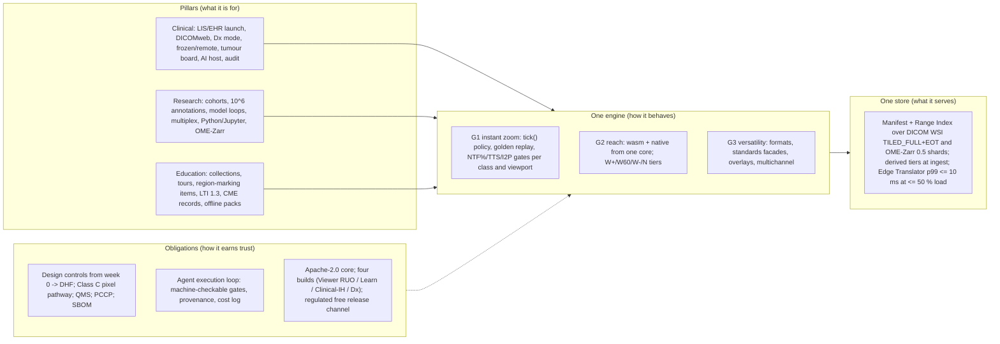

# Executive summary, vision, goals, non-goals and success metrics

Plan section 01 · Stoipath WSI viewer · 2026-10-24, revised 2026-10-25. Inputs: `arch/recommended.md` (the decided architecture, amended 2026-10-24 for gap-5 and 2026-10-25 after critique and verification), research notes 01–10 and 11-gap-1…8 (18 notes), the judge panel (`judge/ranking.json`, `judge/judgments.json`), `critique/issues.json` (every entry naming this section or cross-cutting with a subject this section states) and `verify/README.md` + `verify/required-changes.json` (24 load-bearing claims: 4 supported, 16 adjusted, 4 contested-and-resolved, 0 refuted). Evidence tags follow the corpus: **[measured]**, **[verified]** (primary source read), **[model]**, **[estimate]**, **[unverified]**; numbers touched by the verification pass are marked inline **(verified)**, **(adjusted after verification: was X)** or **(unverified – Stage 0 gate)**. Every latency, memory, byte and quality figure in §7 is the canonical figure from `recommended.md` §4 or §5 as amended; gate values are owned by `gates/*.json` and, for the requirement rows, by section 02 ("Requirements and platform matrix"); release tags are owned by section 07 ("Roadmap, milestones, team and estimates") and section 02's Release column; dates by `docs/plan/calendar.yaml` (section 10 ADR-0023: week 0 = Monday 2026-10-26, M0 = 2026-12-05); TSP facts by section 11 Part B. Where this section sets a number the corpus did not, it says "set here". Terminology (L\*, NTF%, BAT, warm-settle / cold-fill TTS, TTFF, TTLS, I2P, REF, Pinned Base, Base Bundle, Manifest, Range Index, derived tier, Edge Translator, Dx mode, `stoi-dx`, `pathway_hash`, W-LAN…N-And, W+/W60/W−/N, Stage 0–3) is that of `recommended.md` §5.

## 1. Executive summary

Stoipath is a whole-slide-imaging viewer and tile platform for gigapixel pathology slides (100k × 100k px, 1–4 GB, brightfield and multichannel fluorescence) whose defining property is that zoom and pan are perceptually instantaneous on every device a pathologist, researcher or student actually holds — a 3 GB Android phone on 4G, a 2020 iPad in Safari, a 4K sign-out workstation — with no magnified tile left on screen after the gesture ends and no pop-in. Nobody engineers for that property today. The only published deployment data (MSK, 239 pathologists, 60,080 slides) accepts 108–238 ms per field of view as "efficient" **[verified, Schüffler 2022]**, and its own same-vendor comparison attributes +59–100 ms/FOV to server-side decode and re-encode (adjusted after verification: was "+130 ms/FOV from transcoding"; the +130 ms Philips gap is confounded by iSyntax SDK decoding, 128-px blocks and sequential serving); every OpenSeadragon- and OpenLayers-based viewer inherits no-mipmap, hard-swap, main-thread-upload behaviour its own maintainers call a design flaw (OSD #2906 **[snippet; unreachable during verification]**); no commercial vendor publishes latency at all. Our bar is a **warm-settle time-to-sharp p50 ≤ 100 ms and p95 ≤ 300 ms on broadband** with a separate, published cold-fill gate and an overall p95 nobody else reports, warm input-to-photon within one frame of the platform's own floor, and zero blank or magnified pixels at rest.

The decision that makes this possible is architectural. One Rust engine, **stoi-core** — pyramid model, camera, scheduler, cache, decode, draw list — is compiled to WebAssembly for browsers and to native for desktop and mobile and driven by thin shells; a hand-written `web-sys` WebGL2 renderer executes its draw list on the web floor and wgpu does so natively. The core owns no threads, DOM or sockets, so a recorded gesture replayed with its byte-arrival times (and its `set_budget` timeline) must produce the identical request sequence and draw list on every platform: that golden replay is the operational definition of "instant everywhere". Behind the engine a server is built first (months 0–3), because the only deployed latency data blames the server: a dual-standard, single-copy canonical store (DICOM WSI `TILED_FULL`+EOT for brightfield, OME-Zarr 0.5 sharded for multichannel) behind one ≤ 100 KB **Manifest** plus an edge-resident **Range Index** (adjusted after critique: one ≤ 100 KB Manifest holding every tile's byte range was arithmetically impossible — ≈ 51k tiles × 16 B ≈ 0.8 MB), served by byte passthrough through a Rust **Edge Translator** with a p99 ≤ 10 ms hot service time at a stated load (≤ 50 % utilisation per container path; measured 0.09–0.17 ms unloaded and ≤ 1.4 ms at 6–8k req/s on two x86 cores **(verified)**). **No request-time re-encoding**: the moving tier and the 8-bit multichannel preview are *derived tiers* written at ingest, carry `provenance: derived` and are refused in Dx mode (adjusted after critique: was "no request-time transcoding, ever", which the moving tier contradicted).

The product serves three pillars from the same core. **Clinical**: LIS/EHR launch (Epic Beaker and others via IID-style context URLs, SMART on FHIR, HL7 v2/FHIR), DICOMweb and PACS/VNA co-existence, primary-diagnosis-grade display on the **RUO → in-house clinical (lab-validated) → Dx** path, frozen-section and remote consultation, tumour boards, second-opinion and QA workflows, AI overlays with provenance, synoptic hand-off, audit and PHI controls. **Research**: TCGA/IDC/CAMELYON and institutional cohorts, annotation at 10⁶ objects, model-development loops, multiplex fluorescence and spatial-omics overlays, a Python/Jupyter API, OME-Zarr/DICOM interoperability and provenance. **Education**: curated collections and virtual labs, guided tours, region-marking quizzes, case-based learning, LTI 1.3 Advantage, CME record export, WCAG 2.2 AA and offline classroom packs. The viewer is the one component all three need and none has at quality; the pillars differ in integration surfaces, not in pixels.

The long-term aim is an FDA-cleared viewing platform given free of charge to any hospital system that requests it and meets defined qualification criteria. That aim shapes the plan now, and section 13 ("Regulatory pathway to FDA clearance and the free-distribution model") owns it. The research-use-only phase runs under design controls that feed a Design History File from week 0 (requirement IDs on every test, a risk register seeded in Sprint 1 and baselined at M1, ISO 14971 file, IEC 62304 lifecycle at **Class C for the pixel pathway and case/slide identity** and A/B elsewhere behind a crate boundary the layering test enforces (adjusted after critique: was "Class B assumed"), IEC 62366 usability, §524B cybersecurity with an SBOM per release). The pixel pathway is versioned and deterministic from the first release — **Dx mode**: pinned libjpeg-turbo, fixed resampler, a *server-computed, client-applied* per-slide ICC→sRGB LUT (adjusted after critique: "server-baked ICC" is impossible for byte-passthrough tiles without breaking byte identity), a Rendering Complete flag recomputed by an independent Class C verifier, and a two-level identity (`pathway_hash` over the frozen Class C set, `build_hash` over the artefact). One commit set produces **four build artefacts, not a runtime flag**: Stoipath Viewer (RUO distribution; no LIS write-back, no sign-out events, no Dx gate), Stoipath Learn (education; no PHI by construction), the in-house clinical build (section 13: Stoipath Clinical-IH — the only pre-clearance build with HL7/FHIR write-back and sign-out, for the validating UT CLIA lab(s) only) and Stoipath Dx (the cleared, signed build). A QMS under the QMSR (21 CFR 820 incorporating ISO 13485:2016, effective 2 February 2026 **[verified, FDA]**; SOP set A approved by M1, operating from v1) and a legal manufacturer (default: a UT System component institution holds the 510(k), a UT-affiliated 501(c)(3) stewards the code and signs the agreements — ADR at M1) precede any clinical distribution. The regulatory strategy is a **Traditional 510(k) under 21 CFR 864.3700, product code QKQ** (software-only viewers; adjusted after critique: not PSY, the scanner-inclusive code) with a viewer predicate (PathPresenter K250968 or Paige FullFocus K241273) and a **Predetermined Change Control Plan** for scanners, formats, displays and topologies from the first filing — Proscia's 6 August 2026 clearance of Concentriq AP-Dx with a PCCP is the template **[verified, trade press]**; one Pre-Sub drafted at M2 and submitted by W30 (latest 2027-06-30). Dx 1.0 is minimal: one platform family (signed Tauri native desktop installer on Windows 11 with EDID display identity), one topology (on-prem Edge Translator), two scanners (Hamamatsu S360MD, Leica GT 450 DX), named displays; everything else enters by PCCP. "Free" removes the price, not the obligations: complaint handling, MDR reporting, recalls and security patching are budgeted as if the product were sold (steady state ≈ $1.2–2.0 M/yr **[model, section 13]**), and a UT manufacturer cannot indemnify (Tex. Const. art. III §49), which is one reason the 501(c)(3) signs.

The project is executed by AI coding agents with humans as reviewers and decision-makers at defined gates, so every acceptance criterion in this plan is machine-checkable: performance gates on named floor devices, golden gesture replays, byte-identity oracles against third-party readers, licence and security scans. **Stage 0 is six weeks** — three two-week sprints from 2026-10-26, **M0 = 2026-12-05** (adjusted after critique: "weeks 0–2" was one of three incompatible calendars; section 10's sprint calendar is canonical) — and measures the browser compositor floor, GPU upload cost into an in-use array and WASM decode on the floor devices before any external latency claim is repeated; the floor-class Android and a 240 fps camera are a week-0 purchase, the 2020 iPad, iPhone 12, Xclipse Galaxy and photodiode rig arrive before Sprint 3, WALT by M1. The web MVP 0.5 (= M2 + what M2 needs: brightfield, DICOM passthrough, regional translator, DICOMweb façade, npm + anywidget) lands at month 6–7 (W30), the iPad shell beta at month 12 (v0.9), v1 with native iPad and Android at month 18–20 (W78–84). The programme baseline for any cost comparison is section 07 §9's total — **≈ 55–70 PM to MVP and ≈ 200–230 PM to v1** (platform + education + clinical integration + regulatory + reader study, after the 2026-10-25 MVP re-scope; the regulatory line is section 13 §7.3's Class C estimate) — with the platform-only ≈ 45–55 / ≈ 150–170 PM as a sub-line (≈ 55–65 PM to MVP as originally scoped **[estimate]**) (adjusted after critique and at assembly: this section had cited the platform figure as the programme, then the pre-re-scope totals of ≈ 70–85 / ≈ 195–230 PM); an agent-executed programme restates it as compute, reviewer time and calendar (Reviewer note 2). Honest limits, stated once here and repeated wherever a claim is made: no architecture makes a cold 4G viewport sharp inside 100 ms — the radio promise is "never blank, ≤ 1 level soft during fast bursts, centre sharp ≈ 400–550 ms after the first input of a cold burst, full viewport ≈ 600 ms p50 at the DPR-2 cap, overall TTS p95 ≈ 1.0–1.3 s because ≈ 15 % of settles are cold"; no web build lifts iPad Safari above WebKit's 60 Hz cap **(verified in trunk source)**; tablets, phones and browsers that cannot attest the display cannot carry a primary-diagnosis claim; and a viewer by itself demonstrates cost displacement, workflow capability and measured interaction quality, not patient-care outcomes.

## 2. Product vision

**One engine, one promise, three pillars.** The promise: whatever a pathologist does to a slide — pinch, wheel, drag, fling, jump from the worklist — the image under the finger is correct *now* and sharp before they can tell it was not. Every other capability is a surface over that promise, and every surface uses the same engine, the same store and the same measurement.

| Technical goal | Clinical pillar | Research pillar | Education pillar |
|---|---|---|---|
| **G1 Instant zoom** | Sign-out speed is the efficiency argument digital pathology has never won: digital is still ≈ 19 % slower per case than glass and "navigation" is the lowest-rated element of remote sign-out (5 neutral / 3 good / 2 very good of 10) **[verified, Hanna 2019/2020]**. Deterministic settled frames (Rendering Complete, recomputed by the Class C verifier) are also what a Dx claim needs | Reading 40 slides of a cohort or scrubbing a 40-plex panel is bounded by residency and compositing; GPU-side LUTs make contrast changes one frame, not a refetch | Students "preferred certain viewers because of image loading speed" **[verified, Punjabi 2025]**; low-bandwidth classrooms get the offline pack and the same policy |
| **G2 Reach** | Epic Hyperdrive iframe (a thin controller that hands off to the viewer on the diagnostic display), consumer laptops over VPN, frozen-section approval on a tablet, Windows thick-client parity via Tauri | Jupyter/Colab/VS Code widget, PyO3 wheel, QuPath via DICOM/OME-TIFF export, napari via C ABI | Any LMS browser, phones in the unknown-slide conference, iPad with pencil for authoring |
| **G3 Versatility** | DICOM from the first byte; DICOMweb `frames/{list}`; ANN/SEG/SR overlays with provenance; VNA co-existence | OME-Zarr 0.5 with core codecs readable by napari/Viv/vizarr/zarr-python unchanged; GeoJSON (QuPath dialect), GeoArrow export, local vector tiler | Collections = ordered (slide, state, annotation-layer) sets; hidden answer-key layers; xAPI-shaped events |

## 3. Target users and personas

| Persona | Setting and devices | What "instant" must mean to them | What they need from G2/G3 | Acceptance evidence that proves it |
|---|---|---|---|---|
| **Sign-out pathologist** (attending, academic or community) | 27" 4K / ≥ 8 MP display on a LAN workstation (the W-LAN and N-Desk gate viewport: 3840 × 2160, 44–54 tiles per level, added after critique); launched from the Beaker worklist; ≈ 17 zoom bursts and ≈ 16 FOVs per slide, 66.4 % of magnification-change events ≥ 5× (≈ 2.3 levels) **[verified verbatim, Brunyé 2023; Kayser/Wienert 2009]** | Destination level sharp before the next burst (the minimum inter-burst gap of 196 ms is a dataset minimum used as a deadline, not a typical lead **(verified)**); pan edge never blank at the pathologist pan ceiling (1 viewport / 500 ms); no settled magnified tile at 20–40× where mitoses and organisms live | Context launch inside Hyperdrive without cookies; dictation co-existence; AI overlays with provenance; Dx mode only where the display can be attested (native desktop shell with EDID, or an MDM-managed browser with a hospital-pushed `dx_profile.json`) | W-LAN / N-Desk gates (§7.1) on the 4K geometry; golden replay of the pathologist path; CAP ≥ 60-case validation tooling built in |
| **Frozen-section / remote and tele-pathologist** | Home laptop with trackpad at 20 Mbps, hospital VPN 30–100 ms RTT, or a tablet for an intra-operative call; cytology excluded by CMS policy **[snippet, gap-7]**; runs on the in-house clinical build (CLIN-1), never on the RUO build | Never blank, ≤ 1 level soft during the burst, warm-settle sharp ≤ 100 / 300 ms and cold fills ≤ 380 / 1,300 ms on broadband; zoom-out and revisits instant from L0 residency (a 20-tile L1→L0 re-upload is 167–333 ms on a phone, so "instant" needs GPU residency, not a client cache **(verified arithmetic)**) | HTTP/2 fallback, capability-token tiles cacheable at the edge, case warm-up on `ready-for-review`, trackpad gesture model | W-BB and W-iPad gates; "never blank" on the cellular-poor profile; TAT logged against the 20-minute CAP frozen benchmark |
| **Tumour-board presenter and consultant** | Conference room display, Teams/Zoom, rad-path side by side; second-opinion recipients on whatever they have | Follow-me view state with no stutter for 30 viewers (30 × ≈ 2.5 MB per synchronised zoom ≈ 75 MB per presenter gesture ≈ 6 s on a 100 Mbps access point — a shared-bottleneck profile with presenter-driven pre-push, added after verification); snapshots with scale bar | Serialisable view state, de-identified share links, presenter mode | Multi-slide sync meets M1 gates with ≤ 1.5× bytes (M5) |
| **Research pathologist / computational biologist** | Workstation or laptop, often Jupyter; TCGA/IDC/CAMELYON plus institutional cohorts; multiplex IF and spatial omics | Channel toggles and contrast are uniform updates (one frame); 10⁶-object overlays do not stutter the zoom | OME-Zarr 0.5 core codecs, DICOMweb reads, GeoJSON/ANN/GeoArrow in and out, anywidget, PyO3 wheel, reproducible view state and provenance | 8-channel 16-bit blend meets M1/M2 gates on W-LAN, W-BB, N-Desk and N-iPad; ≤ 3 channels at the ingest-derived 8-bit tier on phones (adjusted after critique: was "same devices"); 1 M-object layer within frame budget on N-Desk/W-LAN; conformance suite 100 % on IDC/IIIF/OME-Zarr fixtures (M5) |
| **AI/ML engineer** | Python, GPU batch jobs, inference services; needs patches, labels and overlays round-tripped, new polygon sets every iteration | Overlay pyramids go through the same scheduler as pixels so heatmaps never cause zoom stutter | Label-image and probability-map layers, ANN/SEG/SR and QuPath GeoJSON, a local tiler in the in-process translator (PyO3 wheel, Tauri) that cuts GeoArrow/GeoParquet to vector tiles on demand with the same cutter crate as ingest (untiled buffers ≤ 10⁵ features, hard warning above), `stoi-telemetry` viewport logs for active learning, deterministic overlay rendering with `{producer, version, inputHash}` | Overlay provenance in every layer; byte-identical Dx rendering (G7 1,000/1,000 hash identity on real arm64); 1 M detections from a local Parquet render within the frame budget without a server job |
| **Integrator** (LIS/PACS/EHR analyst, hospital IT, SDK consumer) | Epic Hyperdrive (Chromium) iframe, WebView2, Sectra/Fujifilm/Pathcore archives, Cloudflare/AWS/on-prem MinIO, SOC 2 questionnaires, TX-RAMP for Texas public institutions | Must not regress the host: no COOP/COEP, no SharedArrayBuffer, ≤ 1.0 MB gz floor module, no main-thread task > 8 ms | Versioned launch-context contract, capability tokens, DICOMweb façade, conformance statement, SBOM, telemetry kill switch, one edge binary for every topology | M4 install-from-registry smoke on seven channels; iframe embed without COOP/COEP meets M1 gates; SBOM and signed releases every tag |
| **Educator and learner** (histology faculty, course directors, residency PDs; undergraduates, medical students, residents, CME attendees) | Canvas/Brightspace/Blackboard launch; classroom Wi-Fi or none; phones and tablets; screen readers and colour-vision deficiency (6–10 % of males) | Zooming to find the lesion is the task; a region-marking item with a soft tile is an unfair item | LTI 1.3 Advantage, QTI import of MCQs, xAPI export, WCAG 2.2 AA with keyboard pan/zoom, CVD remap, offline pack (viable inside an installed Home-Screen PWA on iPad, which Safari ITP exempts **(verified)**), sub-5-minute authoring | 1EdTech certification on the three UT LMSs; VPAT before any UT procurement; offline pack meets W-LAN gates from local storage |
| **Hospital system as recipient** (the "requests/qualifies" customer of the free regulated release) | CLIA lab director, CAP validation lead, IT security, clinical engineering | A validated system whose measured behaviour matches the labelling on their displays and network | Qualification criteria (section 13 §6.1: CLIA + CAP or equivalent accreditation; CAP WSI validation completed and its summary returned *before* Dx-mode activation; cleared or PCCP pairings in `dx_profile.json`; display-QA programme; downtime/glass fallback drill; IT-security and identity attestation; training; signed regulated-release agreement with complaint and adverse-event reporting; no payment, size or affiliation test), labelling, UDI, complaint channel, patch SLA, limitation of liability (no indemnification from a UT manufacturer) | Regulated release channel with DHF-backed evidence and a public cleared-configuration register keyed on `pathway_hash`; see section 13 |

## 4. Goals in priority order

The order is strict: when two goals conflict, the higher one wins and the loser is recorded as a non-goal or a deferred item with a reopen condition.

1. **G1 — Near-instantaneous zoom and pan.** No perceptible lag, no blurry or low-resolution tile visible during or after zoom, no pop-in, on every supported device including low-end Android and iPad Safari. Operationalised as the gates in §7.1 evaluated on the *weakest* named device of each class **at that class's gate viewport** (4K/DPR-1 for W-LAN and N-Desk, 1080p for W-BB, the DPR-2 cap for phones), measured relative to that device's own reference floor (REF), and as the golden gesture replay that must be identical across platforms. This goal dominates every architectural, format, transport, auth and UI decision; the corpus shows it is lost in policy (which level to draw, fetch and evict) rather than in bandwidth, so the policy lives in one place.
2. **G2 — Runs on any device, application and platform within reason.** Web (desktop and mobile browsers, PWA, `<stoipath-viewer>` component, iframe RPC), desktop (Windows/macOS/Linux via Tauri 2; the native wgpu window at v0.9 is a Dx prerequisite, not polish), iOS/iPadOS and Android native shells with pen input, and embeddable SDKs (anywidget/PyO3 for Python and Jupyter, UniFFI Swift/Kotlin, a C ABI for Qt/.NET/Java hosts, LIS/PACS launch contracts). Reach is bought by sharing the engine, never the UI, and by refusing dependencies that break embedding (COOP/COEP, cookies, Service Workers on the hot path — enforced by mechanism: no `fetch` handler, or Chromium's Static Routing API where available).
3. **G3 — Versatile.** Brightfield and 16-bit multichannel in one client; all major slide formats via lossless passthrough where possible (Tier A/B), lossless DCT-domain re-mux where the vendor frame does not divide 512 (Tier C: 240² Aperio SVS, NDPI) and decode-once ingest otherwise (Tier D); annotations, overlays and AI results at 10⁶-object scale through the same scheduler as pixels; multi-slide comparison with affine sync; standards façades (DICOM WSI and DICOMweb, OME-Zarr/OME-NGFF, OME-TIFF, IIIF Image 3.0, DeepZoom, Iris) over the canonical store. Versatility is implemented at the edges (adapters, façades, exports) so that it never touches the hot path.

Three obligations cut across all goals. They are not goals — they do not compete with G1 — but they are gates that a release cannot pass without:

- **O1 — Regulatory-ready by construction.** Design controls from week 0, a versioned deterministic pixel pathway (`pathway_hash`), IEC 62304 Class C for the pixel pathway and identity as a crate boundary, four build artefacts instead of a mode flag, PHI tiering, SBOM and vulnerability handling from the first release, so the later Dx edition is a frozen, validated build of the same core rather than a redesign (section 13 Decisions 1–8; `recommended.md` §3.2; research notes 09 and 11-gap-8).
- **O2 — Autonomous execution with human gates.** Work is picked up, implemented, verified, reviewed and merged by agents; humans decide at named gates (Stage 0 G1–G13, milestones M0–M5, regulatory gates R0–R7, licence and regulatory decisions, external claims); provenance, cost and wall time are logged per merged change; the repository is the single source of truth — section 10 owns paths, file names, ID namespaces (02's FR-/NFR- with Stage-0 gates as NFR-G1…G13), `gates/*.json`, `docs/provenance/runs.jsonl` and the ADR register; section 11 owns the roles and loop semantics (section 11 Part A).
- **O3 — Open and verifiable.** Apache-2.0 core, SDKs and Edge Translator with DCO (ADR-0010; campus OTC approval by 2026-11-07 gates every public publish); a published benchmark harness (synthetic fiducial slides, camera-path DSL, dashboard, comparator protocol) so competitors and customers can measure us with the same ruler; the cleared Stoipath Dx edition distributed through a **regulated-release channel at no charge** to health systems meeting section 13 §6.1's criteria, with commercial terms only as an optional funding line for OEM embedding or non-qualifying systems (adjusted after critique: `recommended.md` §7 and section 10's earlier register (its old ADR-0007, now ADR-0010) previously read "Dx edition and enterprise edge commercial"; Reviewer note 4).

## 5. Explicit non-goals

| Non-goal | Why | Reopens when |
|---|---|---|
| Being the scanner, the LIS, the image manager/VNA of record, or the AI algorithm | The LIS is the system of record and the only launch point that matters; archives will often not be ours; FDA reviews reading algorithms as IVDs under 864.3750 separate from image management **[snippet, gap-7/gap-8]** | Never for LIS/scanner; VNA role only if a customer has none and asks for the Edge Translator's object store to be their archive |
| A diagnostic-equivalence or patient-outcome claim | Only de-identified public slides are used; no validation study exists; mobile is "validated for diagnosis in small studies, unproven for speed" **[verified, gap-1 F5]** | A CAP-style ≥ 60-case study with ≥ 2-week washout on a named display reports (CAP-1, 2028); a prospective TAT/outcome study is designed (section 11 B10) |
| Primary diagnosis on tablets, phones, unvalidated displays or any browser that cannot attest its display | Cleared viewers are paired with named displays (PathPresenter K250968: one scanner, one Barco display **[verified]**); CAP validates the whole system incl. display; a browser has no EDID and the Window Management API is Chromium-only and unavailable in a third-party iframe, so Dx mode exists only on the native desktop shell or an MDM-managed browser with `dx_profile.json` | A display-agnostic clearance or a PCCP that admits consumer display classes; until then tablets are consultation, education, tumour board and research |
| Remote review of cytology | CMS enforcement discretion for cytology ended 2026-03-23 **[snippet, gap-7]**; K250968's cleared intended use also excludes frozen sections and cytology, so a frozen-section Dx claim is a separate indication | Rulemaking (proposed rule Oct 2026) changes the conditions; mode-specific policy engine already planned |
| Request-time re-encoding in the Edge Translator | A JPEG encode on the cold path breaks the p99 ≤ 10 ms gate and the Dx byte-identity story; derived tiers (moving tier `enc=m`, 8-bit multichannel preview) are written at ingest with quantified storage overhead and refused in Dx mode (`recommended.md` §3.1; section 10 ADR-0028) | ADR-0028 option (b) — generate on first request and cache at L4/L3 with a separate "transcode" gate row — if the ingest storage overhead of the moving tier is unacceptable at Stage 1 |
| A runtime `mode` flag as the legal boundary between RUO, education, clinical and Dx use | FDA judges RUO status on the totality of circumstances; a build that can be talked into sign-out by a launch parameter is not RUO (gap-8 F3; section 13 Decision 3) | Never; `mode ∈ {nav, dx}` survives only as a per-session render mode inside the Dx-capable builds |
| Server-side GPU rendering / pixel streaming as the viewer | Sharp photon ≥ RTT + codec; no client cache for revisits; 50–500× cost; no offline; UDP blocked in hospitals (`recommended.md` §9) | As a *mode* on the same core for thin clients below the WebGL2 floor, 40-plex fluorescence on phones, z-stack volumes, SFU tumour-board fan-out |
| OpenSeadragon, OpenLayers or deck.gl as the rendering engine | Per-tile textures, no mips, 2D-canvas composite, private-API scheduler; blur-then-sharp for ≈ a year on a replacement ladder; default settings ration tiles 10, 5, 3, 2, 1 per frame behind a 1.2 s spring **(verified from 6.1.1 source)** | Never as engine; kept as compatibility `TileSource`/`Source`/layer adapters and as the public perf comparator (tuned profile, §8) |
| A TypeScript scheduler or a second engine for any platform | Two schedulers break the golden replay; A's ceiling (no GPU surface, no C ABI, 60 Hz iPad for ever) | TypeScript only as web-floor *renderer language* if Stage 0 shows trampoline or debug cost > 0.5 ms/frame |
| OME-Zarr v3 with JPEG chunks as the brightfield canonical | No registered image codec in `zarr-extensions`; readable only by our own code; QuPath 0.7 reads no Zarr v3 **[verified, gap-5]** | Codec registered **and** shipped in zarr-python, zarrs and zarrita **and** QuPath reads Zarr v3; re-decided at the first annual review |
| Two pixel copies (DICOM + full OME-Zarr brightfield mirror) | 4–5× storage for > 90 % of volume; two encodes per slide; derived tiers are small, never canonical and not a second copy | A regulator demands DICOM files *and* a research group demands OME-Zarr brightfield: an export job, not an architecture change |
| wasm threads/SharedArrayBuffer, Service Worker on the hot path, WebTransport or WebSocket for tiles, HTTP/3 in-process | COOP/COEP breaks embeds **(verified: isolated page inside a plain host loses SAB)**; Rust wasm `atomics` still Unstable at 1.99.1 **(verified)**; SW cold start ≈ 12 ms measured on x86, plausibly 30–60 ms on a phone (adjusted after verification: the 50/250 ms figures were 2017 Chrome data) — still 100–250 % of a TTS p50 gate; WebTransport Baseline only since Safari 26.4; `h3` crate 0.0.8 pre-1.0 | Stable wasm atomics with a measured same-origin win (never for embeds); WebTransport re-evaluated 2028; `h3` 1.0 |
| Our own ACCME accreditation, our own LMS, an item-bank content business | CME is a records-and-attestation problem; joint providership with a UT CME office; faculty time, not technology, is the bottleneck **[verified, gap-6]** | Never for accreditation/LMS; content only as licensed public corpora (IDC CC-BY, CAMELYON CC0) plus institutional teaching sets |
| Supporting browsers below the WebGL2 floor, iOS < 17 natively, Android < 10 natively | WebGL2 reaches 97.13 % of users (caniuse **(verified)**); the engine is fragment-shader-only on a WebGL2/GLES 3.0 floor | A customer with a measured population below the floor funds a pixel-streaming mode |
| Shared cross-platform UI frameworks (Flutter, Compose Multiplatform, React Native Skia, .NET MAUI, Qt as the app) | Each puts a second renderer between us and the GPU or lacks a web-component/Jupyter story (research note 06) | A required host that cannot consume a C ABI or a web component (none known) |

## 6. Headline architecture decision

The panel ranked B (one Rust engine everywhere) 7.09, A (web-first TypeScript) 7.07, D (C++ native core) 6.62, C (OpenSeadragon adopt-then-replace) 5.93 and E (server render + video) 4.38 on weights zoom 0.35, reach 0.20, versatility 0.10, effort/risk/maintainability 0.10 each, cost 0.05. The B–A margin is noise; the shape of the disagreement is not: all three judges accepted the same tile *policy* (note 04's LOD, prefetch, eviction and blend rules) and the same *server* (C's passthrough pyramid, Manifest and path-only cache keys) and disagreed only on where the policy runs and how the web floor draws. The decision takes B's core as the single home of the policy — `tick(now_ns, inputs, viewport) → FrameOut{draw_list, requests, cancels, uploads, quality}`, `on_bytes`, `on_decoded`, `set_budget`; a single-threaded state machine that owns no threads, DOM or sockets — compiled to wasm32 for the web and to native for shells, and takes A's web discipline for the floor: a hand-written direct-WebGL2 renderer (`stoi-render-gl` on `web-sys`, gap-2 "option C"; 3–5 kLOC with +3 PM as a floor — adjusted after verification: was ≈ 2–3 kLOC; a minimal `web-sys` WebGL2 floor renderer measured 13.7 KB gz) executes the draw list in browsers, so floor devices never depend on wgpu's best-effort WebGL2 backend (#4081 on the texture-array primitive the cache uses; issue states per gap-2's same-day read, not re-verified) and do not pay its +0.73–0.77 MB gz (adjusted after verification: was 0.68, the WebGL2-only-minus-WebGPU-only pair); wgpu is native-only until a WebGPU web module is allow-listed per browser major (v0.9 per `recommended.md` §8, GA in v1). B's priced escape hatch — wgpu's `create_texture_from_webgl_handle` interop — is unreleased trunk code absent from wgpu 30.0.1 **(verified)**, so the B→C hatch is not an additive step today. One libjpeg-turbo build decodes everywhere — bit-identical on 695/695 JPEGs (139 tiles × 5 tiers) across x86 SIMD/scalar, aarch64 NEON/scalar under qemu, jSquash and wasm-vips **(verified)**, with real arm64 hardware still required for DHF evidence (G7); Rust decoders differ by 10–38 % of pixels at 4:2:0 and 0.6–5.7 % (max 2–3 LSB) at the canonical q85–90 4:4:4 tier (adjusted after verification) — still non-zero, rejection stands; WebCodecs `ImageDecoder` differed on 660/695 tiles and is excluded from the self-certification allow-list; lossy HTJ2K is not hash-identical across ISAs (3 pixels, 1 LSB) and is out of Dx permanently **(verified)**. One WGSL shader set is authored once and compiled to GLSL ES 3.00 by naga with ≤ 1 LSB goldens. One decode-pool rule: three workers on phones and tablets, six on desktop classes (adjusted after critique: two rules coexisted). Native shells (SwiftUI + CAMetalLayer with CAMetalDisplayLink, Compose + SurfaceView, Tauri 2) exist because the browser's ≈ 2-vsync compositor floor and WebKit's 60 Hz cap are the only latency terms the engine cannot remove; the iPad shell moves to a month-12 beta rather than B's month 18–20.

The server comes first. Months 0–3 deliver the dual-standard, single-copy canonical store — brightfield as DICOM WSI `TILED_FULL` with Extended Offset Table and JPEG frames copied byte-for-byte from the vendor file where the vendor frame divides 512 (Tier A 512², Tier B 256² as four byte ranges per logical tile) and losslessly re-muxed in the DCT domain at ingest where it does not (Tier C: 240² Aperio SVS, NDPI strips; decoded-pixel identity through the G7 reference decoder replaces frame-byte identity there — adjusted after critique: the 512² logical grid versus 240/256² vendor frames was reconciled nowhere), multichannel as OME-Zarr 0.5 (Zarr v3 `sharding_indexed`, 512² inner chunks, core `zstd`/`bytes` codecs) — behind one immutable ≤ 100 KB **Manifest** (geometry, per-layer `tile`, per-level object references and content hashes, codec, provenance, per-level byte model, derived-tier catalogue) and an edge-resident **Range Index** (`TileIndex → ≤ 4 × (object, offset, length)`, never fetched by clients), two-pass ingest (index in place and serve within seconds, then write and hash-verify the canonical copy; per-level hashes so a synthesised level never invalidates unchanged tile URLs), and the Edge Translator built in Rust from crates in three builds from one crate graph (regional/on-prem service, Cloudflare Worker, in-process library for Tauri and the PyO3 wheel) with a p99 ≤ 10 ms hot service time per container path **at ≤ 50 % utilisation** (the 15-tile bundle path needs pooled per-tile `pread` with vectored writes — naive coalesce-read-slice-copy measured p99 8.7–9.2 ms and would fail the gate on a 2-vCPU ARM container **(verified)**) and DICOMweb/IIIF/DZI/Iris façades as stateless translations of the Manifest. Instant zoom then becomes a residency problem solved once: the policy decides what to draw, fetch and evict, the store makes every tile a byte range, and the edge keeps the cache key path-only so the first viewer of a slide warms it for everyone. The IEC 62304 Class C boundary is a crate boundary (`stoi-codec`, `stoi-dx` with the independent Rendering Complete verifier and identity check per `recommended.md` §3.2; section 13 Decision 4 draws it around the whole deterministic engine core — the extent is an ADR at M1 confirmed in the Pre-Sub, Reviewer note 7). Full component architecture, the resolved disagreements, the rejected alternatives with reopen conditions and the top twenty risks are in section 04 ("System architecture") and `recommended.md` §2–§3, §9–§10; the latency and memory arithmetic, including the corrections every proposal inherited, is in section 05 ("Instant-zoom engineering design").

## 7. Success metrics

All gates are evaluated on the weakest lab device of the named class, at the class's gate viewport, on the standard synthetic fiducial slide (100k × 100k, 512 px JPEG tiles at the canonical q85–90 4:4:4 tier) and the standard pathologist path, N ≥ 10 runs, distributions compared against a per-device baseline (bootstrap CI on p95, Mann–Whitney), and never on hosted CI runners (research note 10 F3–F4). **REF** is the same metric on a trivial CSS-transform page (web) or a raw Metal/Vulkan quad app (native) on the same device and firmware, so latency gates measure *our* added latency, not the platform's. Every gate value below lives in `gates/*.json`, from which this table, 02's NFR rows and 05/08/12's tables are generated; 02 owns the requirement values (CHS, BER, pan). **Stages** (defined in `recommended.md` §5 after the critique found them undefined): Stage 0 = G1–G13 (weeks 0–6, M0 = 2026-12-05); Stage 1 = the M1→M2 window (reader study gap-1 F9, gesture logging, prefetch-waste acceptance, moving-tier kill decision, byte-model re-fit); Stage 2 = the native-desktop-window gate before v0.9; Stage 3 = M3 native shells.

### 7.1 Instant zoom (G1)

**Device and network classes** (`recommended.md` §4.3; one input set for RTT and first byte — adjusted after verification: §4.3 and §4.4 had carried two RTT sets and a 19 ms first byte below a 25 ms RTT):

| Class | Device / runtime | Display | Gate viewport (tiles per level) | Network RTT p50/p95; bandwidth p50/p95-low; first byte p50/p95 (ms) | L0 GPU tile budget (tile slots only) |
|---|---|---|---|---|---|
| **W-LAN** | Desktop, Chrome, WebGL2 | 60 Hz (120–144 variant) | 3840 × 2160 DPR 1 (44–54); 1080p (20) recorded | On-prem edge < 1 / 3 ms; 1 GbE; first byte 4 / 12 | 512 MiB–1 GiB |
| **W-BB** | Laptop, Chrome/Safari | 60 Hz | 1920 × 1080 DPR 1 (20); 4K recorded | CDN edge 25 / 50 ms; 100 / 20 Mbps; first byte 32 / 83 (adjusted after verification: was 19 / 58) | 512 MiB |
| **W-4G** | Android 3–4 GB, Mali-G52/G57 or Adreno 610, Chrome WebGL2, **DPR 2 always** (L0-keyed cap — adjusted after critique: was "DPR 3→2 on metered links"; DPR 3 never fits a 128 MiB L0) | 60 Hz | ≈ 360 × 780 CSS px at DPR 2 (≈ 11); the 20-tile DPR-3 figure kept only as an uncapped reference | 45 / 200 ms; 25 / 5 Mbps (p95 values **[unverified assumptions]**, replaced by verification item D8); first byte 67 / 306 (adjusted after verification: was 57 / 226) | 128 MiB = 8 × 16-layer arrays |
| **W-iPad** | 2020 iPad (A12), Safari/WKWebView | 60 Hz (WebKit cap **(verified in trunk source)**) | 2160 × 1620 DPR 2 (≈ 22; 20 used in the budget) | Wi-Fi 25 / 50 ms; 100 / 20 Mbps; first byte 32 / 83 | **192 MiB** (adjusted after verification: was 256 MiB — L0 256 + L1 64 MiB already exceeded the old footprint gate) |
| **N-Desk** | Workstation, Tauri native wgpu (Windows 11 first — the Dx 1.0 platform) | 120 Hz | 3840 × 2160 DPR 1 (44–54) | LAN; first byte 4 / 12 | 2–4 GiB |
| **N-iPad** | iPad Pro, SwiftUI shell, wgpu Metal | 120 Hz | 2732 × 2048 DPR 2 (≈ 30) | Wi-Fi 25 / 50 ms; 100 / 20 Mbps; first byte 32 / 83 | 1–2 GiB dynamic |
| **N-And** | Android 6 GB, Compose shell, wgpu Vulkan/GLES | 120 Hz (60 if the OEM holds it) | 1080 × 2400 at the DPR-2 cap (≈ 11–15) | 4G 45 / 200 ms; 25 / 5 Mbps; first byte 67 / 306 | 256 MiB–1 GiB dynamic |

**Byte model** (adjusted after verification: the flat "20 tiles × ~80 KB ≈ 1.6 MB" is withdrawn — the stated codec tier does not produce 80 KB tiles). Dense H&E 512² tissue tiles, CAMELYON16 tumor_014, 150 real viewports: **95 KB p50 at q85 4:4:4** (90 KB Huffman-optimised), **117 KB at q90 4:4:4**; 76 KB at q85 4:2:0 and vendor q80 4:2:0 passthrough; levels 1–4 heavier per tissue tile (103–123 KB), levels ≥ 5 lighter (25–38 KB). Hence a 20-tile destination fill is **1.85 / 1.95 MB p50/p90 at q85 4:4:4, 2.29 / 2.40 MB at q90**; the 11-tile DPR-2 phone fill ≈ 1.0–1.3 MB; the 4K workstation fill 4.2–6.3 MB; the moving tier (q75 4:2:0, 64 KB/tile) is 0.55–0.68× of settled (adjusted after verification: was 0.88×) ≈ 0.69 MB at the DPR-2 cap; centre 9 tiles 0.85–1.05 MB settled. The model is carried per level in the Manifest (`bytes.perLevelMedian`) and re-fitted from the quality record's "bytes per tile at L\*" field; a TCP slow-start term (+85–110 ms per burst at p50, +450 ms at the W-4G p95 condition) is modelled unless the server disables slow-start-after-idle or QUIC preserves cwnd (adjusted after verification: it was absent).

**Latency targets** (ms, p50 / p95; **[model]** until Stage 0 G11–G13 measure the compositor floor, upload cost into an in-use array and A55 decode (unverified – Stage 0 gate); `recommended.md` §4.4):

| Metric | W-LAN | W-BB | W-4G | W-iPad | N-Desk | N-iPad | N-And |
|---|---|---|---|---|---|---|---|
| **Warm input-to-photon (I2P)**, resident tiles — gate: p95 ≤ REF + 1 frame/interval (unchanged; the viewer adds ≈ 3 ms p50 over REF in Chromium EventLatency traces **(verified)**) | floor configuration **40 / 50** (2 present vsyncs, pointer input with a rAF pending; verified as a floor); typical ≈ 48 / 61 (adjusted after verification); wheel ≈ 60 p50 (non-passive wheel is rAF-aligned, input→tick ≈ 27 ms) | floor 40 / 50; typical ≈ 48 / 61; wheel ≈ 60 p50 | floor **45 / 55**; typical ≈ 55–65 / 70–78 (adjusted after verification; every public browser touch-to-photon figure is ≥ 55 ms) | floor 45 / 55; typical ≈ 55–65 / 70–78 | **20 / 30** (pointer input reaching the wgpu window directly; a transparent webview overlay forwarding input over IPC would add ≈ 8–17 ms, so the Stage-2 test runs with the overlay present) | **25 / 33** API-floor configuration; typical ≈ 33 / 42 if UIKit delivers touches at ~60 Hz — G11 measures the delivery rate (adjusted after verification); strict floor ≈ 11 ms | 40 / 55 (65 / 90 at 60 Hz); strict floor ≈ 19 ms |
| **Frame-time budget** during gesture — gate | p99 ≤ 16.7 ms | ≤ 16.7 | ≤ 16.7 | ≤ 16.7 | p99 ≤ 8.3 ms | ≤ 8.3 | ≤ 8.3 (16.7 at 60 Hz) |
| Dropped frames during gesture | ≤ 0.5 % | ≤ 0.5 % | ≤ 0.5 % | ≤ 0.5 % | ≤ 0.5 % | ≤ 0.5 % | ≤ 0.5 % |
| Main-thread task during gesture (web) / present-time overrun (native) — gate from M0 (the M0 limit is 8 ms, not 50 ms; adjusted after critique) | none > 8 ms | none > 8 ms | none > 8 ms | none > 8 ms | p99 ≤ 1 vsync | p99 ≤ 1 vsync | p99 ≤ 1 vsync |
| **Cold destination fill**, first input → every L\* tile sharp, L2/L3 miss at the class p50/p95 network (model, not a gate) | 1080p ≈ 90–120 / 150–200; 4K ≈ 170–200 / 300–350, upload-bound (adjusted after verification and critique: was ≈ 85 / 150; ≈ 85 was not demonstrated — 99–121 ms transfer-only measured on x86) | ≈ 300–350 / 1,000–1,200 (adjusted after verification: was ≈ 230 / 650 — the 650 cell was the transfer term alone; fetch→decode→upload of real q85 tiles measured 340 ms p50) | DPR-2 settled ≈ 600 / 2,700; with the moving tier ≈ 430 / 1,900; centre 9 sharp ≈ 540 / 2,400 settled; 20-tile DPR-3 reference ≈ 900 / 4,200 (adjusted after verification: was ≈ 650 / 3,000, mitigated ≈ 450 / 2,000 — the headline reproduced within 10–15 % at the old 1.6 MB input, 613 / 2,808 ms measured, but the tile bytes, first byte and slow start were wrong) | ≈ 320–470 / 1,100–1,250 (adjusted after verification: was ≈ 250 / 800; the upper bound is the one-tile-per-frame upload case) | 1080p ≈ 40 / 70; 4K ≈ 80 / 120 | ≈ 400 / 1,500 at the ≈ 30-tile viewport (adjusted after verification: was ≈ 190 / 600 for 20 tiles × 80 KB) | ≈ 560 / 2,600; with the moving tier ≈ 410 / 1,800 (adjusted after verification: was ≈ 600 / 2,900, mitigated ≈ 400 / 1,900) |
| **Warm-settle TTS**, last input → first frame in which every visible pixel is sampled from L\* or its blended parent (i.e. at fade start — adjusted after critique: "NTF = 0 and no fade in progress" made the ≤ 50 ms gate unreachable whenever a tile landed after the last input), over settles that hit L0/L1 — gate | ≤ 50 / ≤ 100 | ≤ 100 / ≤ 300 | ≤ 250 / ≤ 700 | ≤ 100 / ≤ 300 | ≤ 50 / ≤ 100 | ≤ 100 / ≤ 300 | ≤ 250 / ≤ 700 |
| **Cold-fill TTS**, over settles that miss L2/L3, at the class p50/p95 network — gate (added after verification and critique: the single "≤ 250 / ≤ 700" row under a p50/p95 header was unreachable for any cold fill at the p95 network — centre 9 tiles alone 1.0–1.3 s — and contradicted the prose) | ≤ 130 / ≤ 220 (1080p); ≤ 220 / ≤ 380 (4K) | ≤ 380 / ≤ 1,300 | ≤ 650 / ≤ 2,900 (DPR-2 settled); centre 9 ≤ 600 / ≤ 2,600 | ≤ 500 / ≤ 1,300 | ≤ 50 / ≤ 80 (1080p); ≤ 90 / ≤ 130 (4K) | ≤ 450 / ≤ 1,650 | ≤ 620 / ≤ 2,850 |
| Overall TTS over all settles — reported, not gated | ≈ warm | ≈ warm + 5 % cold | p95 ≈ 1.0–1.3 s with ≈ 15 % cold (the honest radio number) | p95 ≈ 0.4–0.6 s with ≈ 10 % cold | ≈ warm | ≈ warm + cold share | p95 ≈ 1.0–1.3 s |
| **NTF% during gesture** (frames with any unblended pixel from a level coarser than L\*) — gate | ≤ 5 %, ≤ 1 level | ≤ 20 %, ≤ 1 level | ≤ 50 %, ≤ 2 levels (≥ 2 at ≥ 20× logged as defects) | ≤ 20 %, ≤ 1 level | ≤ 5 %, ≤ 1 level | ≤ 20 %, ≤ 1 level | ≤ 50 %, ≤ 2 levels |
| **NTF% after TTS**; at-rest **resolution deficit** incl. the blend weight `f · log2 s_parent` (added after critique: trilinear softness at s < 1 was invisible to NTF%) | 0; ≤ 0.15 octave | 0; ≤ 0.15 | 0; ≤ 0.15 | 0; ≤ 0.15 | 0; ≤ 0.15 | 0; ≤ 0.15 | 0; ≤ 0.15 |
| **Blank-pixel frames** | 0 | 0 | 0 | 0 | 0 | 0 | 0 |
| **Pop-in count** after settle (any unfaded change of drawn level at a pixel after the last input; the fade is excluded from TTS and counted in BAT) | 0 | 0 | 0 | 0 | 0 | 0 | 0 |
| **BAT** blur-area-time per zoom interaction (level·s, fade time included) | ≤ 0.02 | ≤ 0.1 | ≤ 0.4 | ≤ 0.1 | ≤ 0.02 | ≤ 0.1 | ≤ 0.4 |
| **CHS** cache-hit-at-settle on the pathologist path (02 NFR-P7) | ≥ 95 % | ≥ 95 % | ≥ 85 % | ≥ 90 % | ≥ 95 % | ≥ 90 % (adjusted after critique: was ≥ 95 %; 02 owns) | ≥ 85 % |
| **BER** burst-end residency of the L\*+1 window (02 NFR-P8; gap-1 reframing) | ≥ 95 % | ≥ 90 % | ≥ 70 % (adjusted after critique: was ≥ 80 % within 500 ms; 02 owns) | ≥ 90 % | ≥ 95 % | ≥ 90 % | ≥ 70 % |
| **Slow-pan bandwidth** at the pathologist pan ceiling (1 viewport / 500 ms; 02 NFR-P14 edge pop-in = 0 — added after critique, Reviewer note 5) | 1080p 30–37 Mbps, 4K 67–82 Mbps: holds | 1080p 30–37 Mbps: holds at the 100 Mbps p50, not at the 20 Mbps p95-low; 4K not claimed → NFR-P14's W-BB clause is 1080p-only | not claimed | 1080p-class: holds at p50 only | holds | holds at p50 | not claimed |
| Prefetch waste (bytes prefetched and evicted unused / bytes prefetched; moving-tier bytes included) | ≤ 50 % at Stage 1, tightening toward ≤ 40 % | ≤ 50 % → ≤ 30 % | ≤ 50 % → ≤ 15 % | ≤ 50 % → ≤ 30 % | as W-LAN | as W-BB | as W-4G |
| Edge Translator hot service time (server-side, every topology) | p99 ≤ 10 ms per container path (Zarr shard range, DICOM EOT frame, 15-tile bundle on the pooled per-tile `pread` path) **at ≤ 50 % utilisation** on a 2-vCPU container and in a Worker (where the hot hit is a Cache API hit); measured 0.09–0.17 ms unloaded, ≤ 1.4 ms at 6–8k req/s, bundle path 1.6–3.6 ms per-row vs 8.7–9.2 ms naive **(verified on x86; D11 re-runs on the ARM container)** | | | | | | |

How this compares with the state of the art: MSK's deployed viewer renders an adjacent FOV in < 250 ms median with 108–238 ms streaming pace **[verified]**; Google's DICOM proxy serves ≈ 150 ms/frame from an in-memory cache **[verified]**; Iris serves 21 ms median at > 5,000 req/s on Raspberry-Pi-class hardware for its own format (arXiv 2508.06615; the README now states < 35 ms median at > 7,500 req/s on an RK3588 — adjusted after verification); OpenSeadragon's defaults (`maxTilesPerFrame: 1`, coarse-first priority, `blendTime: 0`, 1.2 s spring with stiffness 6.5 — settling 50 % at 128 ms, 90 % at 425 ms, 99 % at 850 ms) produce the blur-then-sharp staircase **(verified from 6.1.1 source)**, so any "X× faster than OpenSeadragon" statement, including the TSP abstract's, must use the *tuned* profile (`maxTilesPerFrame` 100, `immediateRender` true, raised `imageLoaderLimit`) and report cold and warm frames and the WebGL and canvas drawers separately — the defaults measure request rationing and a spring, not rendering. A warm-settle TTS p50 of ≤ 100 ms on broadband with a reported p95 is ≈ 2.5× below the only published clinical median, not parity. The **100 ms target has no pathology evidence** (it is HCI-generic: Deber 2015's 11 / 55 / 69 / 96 ms thresholds are **[secondary; primary PDF unreachable]**); the pathology literature cannot distinguish 100 ms from 250 ms perceptually because no viewer below ≈ 100 ms has existed to compare against; the Stage-1 reader study (gap-1 F9, n ≈ 8–12, 2AFC blur-ms psychometrics) is the only pathology-specific refutation path and may move the BAT, deficit and NTF constants.

**Slide open** — two metrics, one definition each (adjusted after critique: 01's TTFI, 02's TTFSV and 12's launch metric disagreed; `recommended.md` §5 now owns both and 05 §15 / 08 §9 carry them as M1/M2 gate rows). **TTFF** time-to-first-frame = URL or launch-context receipt → first frame drawing the thumbnail and the levels ≤ 1024 px (≈ 5 tiles, ≈ 0.5 MB) with input accepted; the rest of the Pinned Base follows, and when the launch context lands at high power the L\* viewport tiles are ordered before the remaining base. **TTLS** time-to-launch-sharp = worklist click incl. token exchange → first L\*-sharp frame at the launch viewport. Both **[model]** from G2 (cold compile + first frame ≤ 300 ms floor Android / ≤ 150 ms iPhone 12 — at risk: eager Liftoff compile of a ≈ 3 MB raw module is 87–118 ms single-thread on x86, ≈ 180–1,200 ms on a phone, and lazy mode moves that cost into the first frame; adjusted after verification: was "50–100 ms phone"), the ≤ 100 KB Manifest and the per-level byte model, re-pinned at M1:

| Metric | W-LAN | W-BB | W-4G | W-iPad | Native shells (warm app) | Baseline |
|---|---|---|---|---|---|---|
| TTFF, p50 / p95 | ≤ 0.4 / 0.8 s | ≤ 0.8 / 1.5 s | ≤ 1.5 / 3.0 s with the module code-cached; ≤ 3 / 6 s cold (adjusted after critique: the old "≤ 1.5 / 3.0 s cold" did not close at 5 Mbps against 1.0 MB module + 0.1 MB Manifest + ≈ 2.4 MB Pinned Base ≈ 5.6 s) | ≤ 0.8 / 1.5 s | ≤ 0.3 / 0.6 s (set here) | MSK case open 3.9 s **[verified]** |
| TTLS, p50 / p95 | ≤ 1.5 / 3.0 s | ≤ 1.5 / 3.0 s | ≤ 3 / 6 s | ≤ 1.5 / 3.0 s | ≤ 1.0 / 2.0 s (set here) | — |
| Slide switch within a case (worklist warm-up of the next slide's Pinned Base; the Base Bundle prefetch is metered-link-gated and off the first-frame path) | ≤ 0.2 s | ≤ 0.3 s | ≤ 0.5 s | ≤ 0.3 s | ≤ 0.2 s | MSK slide switch < 1 s **[verified]** |
| Module size (G1): floor ≤ 1.0 **decimal MB** gz (1,028,041 B passes 1.0 MiB by 2 % and fails 1.0 MB by 2.8 %, so the unit is stated), target 0.6; full ≤ 1.3 MB; decoders as separate 60–90 KB modules | | | | | | Deployable post-wasm-bindgen sizes: WebGL2-only 0.77 MB gz, dual 0.80, WebGPU-only 34 KB, `web-sys` floor renderer 13.7 KB gz **(verified; the corpus's 0.98 MiB was pre-wasm-bindgen)** — the target is reachable and governed by the core/format crates; the wgpu WebGL2 backend would add 0.73–0.77 MB gz (adjusted after verification: was 0.68) |

**Memory ceilings per device class** (`recommended.md` §4.2–§4.3, note 10 §6; L0 counts tile slots only — canvas backbuffers, LUTs and overlay layers add ≈ 35–40 MiB outside L0 and inside the kill-threshold budget **(verified)**; process RSS is 1.3–1.8× nominal texture bytes and soak tests fill layers rather than allocate them, since `texStorage3D` commits lazily):

| Class | L0 GPU slot map (16-layer 512² RGBA8 arrays, 16 MiB each, ≤ 64 layers — adjusted after critique: two 64-layer arrays = 128 MiB left zero headroom and a 64 MiB ghost copy on TBDR GPUs) | L1 decoded CPU LRU (≈ 1.08 MiB renderer RSS per ImageBitmap, invisible to `performance.memory`) | Pinned Base (GPU) and Base Bundle | Gate |
|---|---|---|---|---|
| W-4G | 128 MiB (8 arrays); ≈ 88 slots un-evictable (Pinned Base + full ancestor chain) + working set at DPR 2 | ≤ 25 % of L0 (32 MiB) | Pinned Base = levels with `max(w, h) ≤ 2048 px`: 11–22 tiles ≈ 11–22 MiB, 0.9–2.4 MB encoded (adjusted after verification: was "≈ 23 MiB", true only for a square slide); Base Bundle (`≤ 4096 px`) in L1/L2 only: ≈ 1 MB typical 2:1 slide, 2–3 MB square biopsy, **9.5 MB measured** for a tissue-dense square slide → slide-open prefetch budgeted at ≤ 8–10 MB worst case, measured per level at M0, off the first-frame path (adjusted after verification: was "2–5 MB") | deficit = 0 on warm cache; working set ≤ 85 % of slots at DPR 2 (proptest); 30 min soak without LMK kill; DPR 2 always |
| W-iPad | 192 MiB (12 arrays) (adjusted after verification: was 256) | ≤ 25 % of L0 (≤ 48 MiB) | as above | peak **GPU Process + WebContent** footprint ≤ 60 % of the measured kill threshold per process (adjusted after verification: "WebContent RSS ≤ 300 MB" measured the wrong process — iOS runs WebGL in the GPU Process — and the iOS-12-era canvas caps and the 1.25 GB iPad Air 3 anecdote are not live constraints); 30 min soak without jetsam (M2) |
| W-BB / W-LAN | 512 MiB / 512 MiB–1 GiB | ≤ 128–256 MiB | Base Bundle GPU-pinned when L0 ≥ 512 MiB | GPU texture memory within budget ± 0 (M0) |
| N-And | 256 MiB–1 GiB dynamic from `ActivityManager.MemoryInfo` + `onTrimMemory` | ≤ 25 % | pinned | 2 h soak without LMK; eviction before pressure |
| N-iPad | 1–2 GiB dynamic from `os_proc_available_memory`; LRU tail purgeable | ≤ 25 % | pinned | 2 h soak without jetsam; ≥ 4× web budget usable (M3) |
| N-Desk | 2–4 GiB | ≤ 25 % | pinned | — |

Upload budget is a first-class row, not a footnote, and the effective per-frame upload is **`min(byte cap, time box ÷ measured per-tile cost)`**, not the byte cap alone (adjusted after critique: at the old G5 ceiling of 2 ms per 512² tile a 3 ms time box admits one tile per frame, so a cold 20-tile level took 20 frames = 333 ms, not the "5–10 frames, 83–167 ms" the 2–4 MiB/frame byte cap implied). G5 is therefore **≤ 1.2 ms per tile p95 into an in-use array on the floor phone, per named source type** (ArrayBuffer / ImageData / ImageBitmap / canvas differ 0.1–3.7 ms wall per tile even on x86 **(verified)**), which admits two tiles per 3 ms box: the 11-tile DPR-2 fill uploads in 6 frames ≈ 100 ms, 20 tiles in 10 frames ≈ 167 ms. On W-iPad the one public measurement (WebKit bug 260460, iPad 9th gen A13: ≈ 2.25 ms/MiB ⇒ ≈ 2.3 ms per tile) says G5 is marginal-to-failing on the 2020 A12 device, so the W-iPad time box widens to 4.5 ms by shrinking the overlay/UI partition explicitly and G12 measures it (unverified – Stage 0 gate). Desktop upload throughput is measured at M0 and planned at 4–8 tiles/frame until then (the "16 MiB/frame" figure was GPU-dependent). Centre-first upload order and a frame-time AIMD controller (timer queries as telemetry only — adjusted after critique: was "online budget from timer queries") are part of the M2 gate, and uploads rotate across arrays so a layer is never written into an array drawn in the last 2–3 frames (TBDR ghost-copy jank, cause #38).

### 7.2 Platform coverage (G2)

| Metric | Target | When |
|---|---|---|
| Browser reach of the floor renderer | WebGL2: 97.13 % of global users (caniuse **(verified)**); Safari 16.4+ (15.2–16.3 best-effort Tier 3 — adjusted after critique: was "Safari 15+"; 02 §5.2), Chrome 56+, Firefox 51+, Samsung Internet, Android WebView, WKWebView | MVP |
| WebGPU enhancement reach | 85.8 % full + 3.66 % partial (caniuse **(verified)**; web3dsurvey 80.6 % on a different population) once allow-listed; Safari per-major allow-list after soak; Chrome Linux only from 144 (Intel Gen12+), Firefox Windows 141 / Apple-silicon macOS 145–147, Samsung Internet "yes" only on Snapdragon; Xclipse and Firefox Android stay on WebGL2; compat-mode limits are guaranteed minimums to design to | v0.9 allow-list, v1 GA |
| Fidelity tiers delivered (02 §5.1's definitions, canonical in `recommended.md` §5 — adjusted after critique: 02 and 06 disagreed) | **W+** (60 Hz web, L0 ≥ 512 MiB and ≥ 4 GB RAM, WebGL2 or allow-listed WebGPU; Firefox desktop included), **W60** (Safari/WKWebView on every Apple platform incl. macOS Tauri-in-WKWebView at MVP: 60 Hz cap, WASM-only Dx decode, 192 MiB L0 on the 2020 iPad), **W−** (floor Android 3–4 GB: 128 MiB L0, DPR-2 cap, bilinear transients; Chrome on Mali-G52 / Adreno 610 is W−, not W+), **N** (native shells, 120 Hz, predicted input, GB-class caches); WebGPU availability is an enhancement, never a tier criterion; every tier runs the identical policy and passes the golden replay | MVP (W+/W60/W−), v0.9–v1 (N) |
| Delivery surfaces | PWA; `<stoipath-viewer>` web component; iframe JSON-RPC without COOP/COEP; Tauri 2 Windows/macOS/Linux; XCFramework (SwiftPM binaryTarget, UniFFI Swift) + reference SwiftUI app; AAR (cargo-ndk, UniFFI Kotlin) + reference Compose app; `pip install stoipath` (anywidget + PyO3 wheel) for Jupyter/JupyterLab/Colab/VS Code/marimo; `stoipath.h` C ABI with a Qt `QQuickItem` sample; OSD/OpenLayers/deck.gl adapters | Per `recommended.md` §8 as re-scoped 2026-10-25 (MVP 0.5 = M2 + what M2 needs): **MVP** web (PWA, component, iframe), npm, anywidget · **v0.7** Tauri wasm-in-webview, Cloudflare Worker build · **v0.9** native wgpu desktop window (Dx prerequisite; EDID display attestation), XCFramework beta, PyO3 wheel, WebGPU module · **v1** iPad GA, Android AAR, C ABI, Maven, adapters — 02's Release column and 07's milestone table are regenerated from this (Reviewer note 3) |
| Native OS floors | iPadOS/iOS 17+; Android 10+ (allow-listed Vulkan, GLES retry on `VK_ERROR_DEVICE_LOST`); Windows 10 1803+ (WebView2), Windows 11 for the Dx 1.0 installer; macOS and Linux current LTS (WRY child-webview layering is X11-only on Linux — Wayland sessions need XWayland or another composition **(verified)**) | v1 |
| "One behaviour everywhere" | Golden gesture replay: identical request sequence and draw list on every platform in CI, asserted on policy-level fields (TileKey, level, blend weight, request/cancel order) with the `set_budget`/upload-per-frame timeline recorded in the `.sgr` and slot ids as a per-platform snapshot (adjusted after critique: the AIMD controller made slot-level identity platform-dependent); WebGPU-vs-WebGL2 and native-vs-web pixel goldens ≤ 1 LSB | M0 onward, every PR |
| Pen and touch input | Pinch 1:1 with coalesced events; Pencil/stylus pressure and hover reflected within 1 frame (M3); predicted input to camera only | M2 (web), M3 (native) |
| Release channels | npm, crates.io, PyPI, SwiftPM, Maven Central, NuGet (on demand), OCI; lockstep SDK semver; OIDC trusted publishing; install-from-registry smoke on every channel before announcement | M4 |
| Embedding cost to hosts | No SharedArrayBuffer, cookies, custom request headers or Service Worker required; floor module ≤ 1.0 MB gz; `Timing-Allow-Origin`/`Server-Timing` on tiles so hosts can attribute latency; Tier-2 assertion that no tile request shows a service-worker timing span | MVP |

### 7.3 Versatility (G3)

| Metric | Target | When |
|---|---|---|
| Format coverage by passthrough tier (research note 01 F1; `recommended.md` §3.1 decided 2026-10-25) | Tier A (serve as-is, 512² frames) and Tier B (byte passthrough of 256² frames as four byte ranges per logical tile; `JPEGTables` splice for TIFF): Philips TIFF, Leica GT 450 / GT 450 DX SVS, DICOM WSI, generic tiled TIFF/BigTIFF and OME-TIFF whose frames divide 512, Huron/Motic/Mikroscan/ARGOS per frame size; Tier C (lossless DCT-domain re-mux at ingest, MCU-aligned, no re-quantisation): 240² classic Aperio SVS, Hamamatsu NDPI, any frame size that does not divide 512; Tier D (decode-once at ingest, isolated LGPL/GPL workers): iSyntax (pending IP review), MRXS, CZI, BIF, VSI, Sakura, Trestle, J2K-SVS, Bio-Formats-only multichannel via bioformats2raw + re-shard | A–C and OpenSlide-backed D at MVP (brightfield); full D incl. Bio-Formats path by v1 |
| Reader correctness | 100 % of the OpenSlide test-data corpus and CAMELYON samples open; tile bytes byte-identical to the vendor frames for Tier A/B (frame-byte hash); **decoded-pixel identity through the G7 reference decoder plus a lossless re-tiling proof for Tier C** (adjusted after critique: a 240² SVS frame cannot be byte-identical to a 512² tile); differential tests vs OpenSlide 4.0.1 / tifffile / wsidicom; 24 h zero-crash fuzz before any reader ships; the 4 × 256² vs 1 × 512² decode + upload cost measured on the W-4G device in Stage 0 (ADR-0027) | M1 onward |
| Canonical store readable by community tools (CI assertion, not a claim) | DICOM side: wsidicom, pydicom, Orthanc and dcm4chee STOW/WADO smoke tests; Zarr side: zarr-python 3.4, zarrs 0.23, zarrita/vizarr, tensorstore, Viv; QuPath via DICOM and OME-TIFF export | MVP (DICOM side), v0.7 (Zarr side, with the multichannel canonical) |
| Standards façades and conformance | DICOMweb QIDO/WADO-RS incl. `frames/{list}` and `transfer-syntax=*`, STOW-RS for ANN/SEG/SR, published PS3.2 conformance statement; OME-Zarr 0.4/0.5 read and 0.5 write (0.6 metadata when readers land); IIIF Image 3.0 (grid-aligned fast path, off-grid slow path on a permissive Rust resampler — libvips never in the translator's crate graph; documented compliance level); DZI; Iris façade; conformance suite 100 % on IDC DICOMweb, IIIF 3 validators and OME-Zarr v3 fixtures; a published `TILED_FULL`+EOT / sharded-0.5 corpus | MVP (client and DICOMweb façade), v0.7 (IIIF/DZI), v0.9 (Iris), M5 (suite 100 %) — Reviewer note 8 |
| Multichannel (`recommended.md` §4.5, added after critique: the 16-bit path had no residency or bandwidth model — 8 × R16 × 512² = 4 MiB per tile position; six visible 16-bit channels over 20 tiles are ≈ 12–32 MB per fill) | 16-bit per-channel textures (R16 16-layer arrays), ≤ 8 channels per pass with additive multi-pass beyond, per-channel window/colour/visibility as a uniform update; an **ingest-derived 8-bit tier** (per-channel windowed grayscale JPEG from the `omero` default windows, ≈ 25–45 KB per channel-tile, `provenance: derived`) is the first-paint tier everywhere and the only tier on phones; the multichannel Pinned Base is the derived 8-bit composite; policy by class: W-4G/N-And ≤ 3 visible channels at the 8-bit tier, W-iPad ≤ 4 with 16-bit centre tiles on settle in analysis contexts, W-LAN/W-BB/N-Desk/N-iPad 8 channels with 16-bit zstd at settle | v0.7 (multichannel canonical + 8-bit tier + ≤ 8 ch); M5 gate: ≤ 3 channels meet the M2 gates on W-4G/N-And, ≤ 4 on W-iPad, 8-channel 16-bit meets M1/M2 on W-LAN, W-BB, N-Desk and N-iPad only (adjusted after critique: was "same devices") |
| Annotations and overlays | Internal GeoArrow-shaped model; QuPath GeoJSON dialect, DICOM ANN/SEG (incl. LABELMAP)/SR TID 1500, W3C Web Annotation adapters; vector tiles on the pixel grid with centroid LOD, cut at ingest **and** by a local tiler in the in-process translator (PyO3 wheel, Tauri; untiled buffers ≤ 10⁵ features); 1 M-object layer renders within the 25 % overlay partition of the 60/25/15 frame budget on N-Desk and W-LAN, degrades to centroid LOD elsewhere and never stalls pixels (02 NFR-P15 — adjusted after critique: 12 had it on W-4G/N-iPad); label/probability rasters as first-class tile layers with provenance `{producer, version, inputHash, regulatoryStatus}` | MVP (model + GeoJSON + raster overlay layers), v0.9 (vector tiles + local tiler), v1 (DICOM ANN/SEG/SR), M5 (10⁶ gate) |
| Multi-slide and dimensions | N-up with lock / affine-offset sync (≤ 1.5× bytes at M1 gates); registration import (VALIS/wsireg → RFC-5 affine); z/t in the tile key, EDF default, z±1 prefetch | v1 |
| Colour (ADR-0026; adjusted after critique: "server-baked ICC" was specified for tiles that are byte-passthrough and cannot be baked) | Untagged passthrough tiles + a versioned, **server-computed per-slide ICC→sRGB 33³ LUT applied in one shader** (MVP, since > 90 % of volume is passthrough); baking only for re-encoded or synthesised levels, with the passthrough/synthesised level-boundary ΔE as a test; gamma-space `Rgba8Unorm` filtering; shader 3D-LUT for raw multichannel sources; Display-P3 output where `drawingBufferColorSpace` exists; both the LUT version and the filtering space are part of `pathway_hash` in Dx mode | MVP (LUT path), v1 (hardening) |
| Offline | Derived single-file offline pack (iPad, desktop, classroom); encrypted device storage with MDM wipe; meets W-LAN gates from local storage; viable inside an installed Home-Screen PWA on iPad because ITP exempts it **(verified)** | v1 |

### 7.4 Pillar metrics

Releases are owned by section 02's Release column (requirement IDs below) and section 07's milestone table; this table cites them and does not set them (the five items on which the two owners disagreed were reconciled at assembly; Reviewer note 3).

| Pillar | Metric | Requirement / release |
|---|---|---|
| Clinical | Launch inside Epic Hyperdrive via a thin controller iframe with IID-style context URL + SSO, no third-party cookies, that opens or hands off to the viewer on the diagnostic display (an iframe cannot leave the Hyperdrive window and cannot attest a display); instant-zoom gates met in the hosted viewer | FR-I1; MVP launch-context contract v1 (mock-verified); prove G1 inside Hyperdrive before any HL7 work |
| Clinical | HL7 v2 status sync used as a performance feature: Pinned Base warmed on `ready-for-review` so the next case opens at TTFF ≤ 0.3 s | FR-I6; v1, pulled to v0.9 only if the CLIN-0 interface-engine work order is signed by M2 (02 §7 item 2; 07 §3) |
| Clinical | SMART App Launch 2.2 adapter; FHIR façade (`ImagingStudy`, `ImagingSelection`, `AuditEvent`); STOW-RS write-back; IHE PaLM DPIA Image Display actor at a 2027 connectathon; write-back and sign-out surfaces exist only in the in-house clinical build and Stoipath Dx (CI build-flag matrix) | FR-I6/FR-I7; v1 (v0.9 only under the same CLIN-0 condition); FHIR façade, STOW-RS write-back and the connectathon at v1 |
| Clinical | Dx mode: pinned decoders, fixed resampler, server-computed client-applied ICC LUT, Rendering Complete recomputed by the Class C verifier from each drawn tile's self-identifying metadata; 1,000/1,000 decoder hash identity on real arm64 (G7, plan-stopping if failed; 695/695 verified incl. aarch64 under qemu); Dx only on the native desktop shell (EDID) or an MDM-managed browser with `dx_profile.json`; display-QA logging with per-display identity (FR-I10a; the full display-QA module, FR-I10b, at v1); registered `build_hash` required | FR-V4/FR-I10/FR-R3; Stage 0 (G7), v0.9 (native window + display-QA logging, which CLIN-1 depends on), v1 (display-QA module) |
| Clinical | CAP validation tooling in the product: blinded re-review mode, case sampling, washout tracking, concordance export, so a UT lab can run its own ≥ 60-case study (CAP-1 on the in-house clinical build) | FR-R1; blinded re-review mode v0.9 (the reader-study instrument CLIN-1 pilots), full CAP-study tooling v1 (before CAP-1 at W87) |
| Clinical | Audit: token issuance, session open/close and a sampled viewport trail as FHIR `AuditEvent`/ATNA; PHI tiers (label/macro/barcode never at the CDN); **slide identity**: clinical and Dx builds show the Tier-2 label image and the launch-context identifiers (accession, part, block, label text) by default and verify `LaunchContext.slideIds`/`studyUID` against the Manifest slide hash and DICOM UIDs before drawing, emitting `identityMismatch` (added after critique: the wrong-slide hazard was absent) | FR-S5/FR-I1; MVP |
| Research | `pip install stoipath`: anywidget over the web bundle plus PyO3 wheel reading both canonical stores directly; GeoJSON/ANN/GeoArrow round-trip; local vector tiler; de-identified export | FR-I3; MVP (widget), v0.9 (wheel, export) |
| Research | Viewport telemetry at ≥ 20 Hz (x, y, w, h, level, device, gesture phase, bytes per tile at L\*), experience-stratified, exportable as xAPI-shaped records; first published pathologist touch/pinch dynamics dataset (pinch rate **[unverified]** until Stage-1 gesture logging — the only data is mouse-wheel) | FR-V13; Stage 1 reader study |
| Research | OME-Zarr 0.5 output opens unchanged in napari-ome-zarr 0.11, Viv 0.23, vizarr 0.3, zarr-python 3.4 (CI) | FR-S3; v0.7 (multichannel canonical) |
| Education | LTI 1.3 Advantage (Deep Linking, AGS, NRPS) on Canvas (UTHealth, UTHSA, UT Austin), Brightspace (UTSW) and Blackboard Ultra (UTMB); region-marking item scored by µm-aware geometry with keyboard and text alternatives | FR-E4; LTI 1.3 launch + AGS at Stoipath Learn's first release (v0.7), conformance-tested against the 1EdTech reference platform; certification filed by EDU-1 (W44) and complete by v0.9; 1EdTech membership budgeted (07 §9) |
| Education | WCAG 2.2 AA incl. SC 2.5.7/2.5.8, CVD-friendly remap, third-party VPAT before any UT procurement | FR-E9; AA in product with the package, VPAT by EDU-1 |
| Education | CME: attestation, evaluation, certificate with activity ID, 6-year record export (CSV/xAPI), joint providership with a UT CME office; SCORM 1.2 wrapper export | FR-E9 (records), FR-E5 (SCORM); v1 — the certificate PDF / PARS export is on the Roadmap's add-back list (07 §10 cut #8) |
| Education | Faculty authoring ≤ 5 minutes per case (record-a-tour, one-click conversion of sign-out annotations through the teaching-set ingest stage that strips Tier 2, CSV/QTI import) | FR-E12; v1 |

### 7.5 Programme and regulatory-readiness metrics

| Metric | Target |
|---|---|
| Traceability and safety class | 100 % of tests carry requirement IDs; evidence archived per release from M0 (≈ 10 % overhead); **IEC 62304 Class C for the pixel pathway and case/slide identity, A/B elsewhere**, with the crate boundary as the §4.3 segregation and the layering test as the check; the Class C delta (detailed design and unit-level verification records) is ≈ 6–10 PM one-off plus ≈ 1–2 PM per Dx train **[estimate, section 13 §7.3]** (adjusted after critique: was "IEC 62304 Class B assumption"); FDA documentation level Enhanced |
| Risk and usability | ISO 14971 risk register seeded in Sprint 1 (10 S1-12), baselined at M1, the formal file and IEC 62366 use-specification written at v0.9; hazards each with a verification test: **wrong slide or patient displayed** (label image + launch-context identifiers shown, identity check against the Manifest before drawing, `identityMismatch` contract test with mismatched pairs — added after critique), "magnified or stale tile presented as final" (fault-injection: a wrong-level, stale or wrong-slide tile injected into the draw list must suppress Rendering Complete), "wrong tile identity under slow network", "overlay misregistration", colour (LUT version in `pathway_hash`), brightness/contrast/gamma indicator, gate or registry outage (decisions cached ≥ 30 days, glass fallback in the labelling) |
| Security | SPDX/CycloneDX SBOM in CI for every artefact; OSV monitoring on every dependency; signed releases and update channel; sandboxed parsers (wasm on the client, gVisor/Firecracker on ingest); `cargo deny` licence policy: permissive-only in the client core and the Edge Translator, LGPL/GPL only in isolated server workers; `jpegxl-rs` (GPL-3.0-or-later **[verified, crates.io]**) confined to the GPL-isolated worker; TX-RAMP for any hosted topology serving Texas public institutions; §524B cybersecurity file and the February 2026 premarket guidance per section 13 §3.6 |
| Fuzzing | cargo-fuzz target per reader; 60 s per PR; 24 h nightly; zero crashes before any reader ships |
| Agent execution | Every merged change records agent/model identity, prompt and spec hashes, tokens, cost and wall time (`docs/provenance/runs.jsonl` + per-PR roll-up, section 10); every gate run records device, firmware, build hash and raw distributions; human decisions limited to the named gates; waivers appear on the public dashboard; agent compute carries a per-phase token cap and a per-PR hard cap (section 11 A5) |
| Determinism | Golden replay (policy-level fields, `set_budget` timeline recorded) and ≤ 1 LSB pixel goldens on every PR; semantic goldens (draw lists) on every platform; G7 decoder identity on real arm64 before any Dx artefact |
| Regulatory posture (section 13 Decisions 1–10) | **Four build artefacts from one commit set** — Stoipath Viewer (RUO: "For Research Use Only. Not for use in diagnostic procedures."; no LIS write-back, no sign-out events, no Dx gate; RUO string and surface absence asserted by the CI build-flag matrix), Stoipath Learn (not a device, no PHI by construction), the in-house clinical build (Stoipath Clinical-IH: lab-validated labelling for the validating UT CLIA lab(s) only; CLIN-1 and CAP-1 run on it) and Stoipath Dx (adjusted after critique: was "RUO labelling on every artefact until a Dx edition exists", which the clinical pillar then used for frozen-section preliminaries); Traditional 510(k) under 864.3700 / **QKQ** with a viewer predicate and a PCCP from the first filing; Pre-Sub drafted at M2, submitted by W30 (latest 2027-06-30); SOP set A approved by M1, QMS operating from v1 (W84), internal audit at DX-0; manufacturer ADR at M1 (UT component institution as specification developer; UT-affiliated 501(c)(3) steward formed W52–60); campus OTC approval of the open-source release by 2026-11-07; Dx 1.0 scope fixed (§1); UDI, complaint handling, MDR reporting, recall and patch SLAs in the regulated-release agreement; **DX-0 gate: committed funding for ≥ 24 months of the fixed post-market cost, or no filing**; no diagnostic-equivalence claim without the validation study |

## 8. How the numbers are measured

Goal 1 cannot be proved from the outside on iPad Safari or a 3 GB Android phone — no GPU timers, no frame readback, lossy capture — so the renderer reports its own quality: `stoi-telemetry` emits a per-frame **quality record** (per drawn tile: level wanted vs level drawn, blend weight, upload age, bytes at L\*; per frame: input and present timestamps, upload budget in force) on every platform, from which NTF%, resolution deficit, BAT, warm-settle and cold-fill TTS, blank-pixel frames, pop-in count, CHS and BER are computed exactly and at zero cost. External instruments calibrate and spot-check it: Tier 1 deterministic headless-Chrome frames on synthetic fiducial slides prove the record is honest (a screenshot decodes to exactly which level was drawn where); Tier 2 Chromium traces with `gpuBenchmarking.pinchBy` and `EventLatency` give input-to-swap, pointer and wheel separately; Tier 3 Macrobenchmark/MetricKit/EGL present timestamps on lab devices; Tier 4 the photodiode rig (Sprint 3) and WALT (by M1) give input-to-photon ground truth and the REF floors. No latency claim leaves the repository before Tier 4 numbers exist for the device class named, and every evidence pack states which device was measured and that REF was measured on it the same day (risk 1 in `recommended.md` §10). The harness, synthetic slides, camera-path DSL and dashboard are published so that OpenSeadragon 6.1.1 (tuned profile and default, canvas and WebGL drawers, cold and warm frames reported separately — `recommended.md` §2), Slim, the Google viewer, Avivator and Iris are measured with the same ruler; verification items D1–D12 in `verify/README.md` §4 are the Stage-0 lab protocol.

## 9. Earliest demonstrable milestone and the TSP abstract

**TSP facts** (section 11 B1 owns them; verified by the owner on texpath.org on 2026-10-24): the 2027 competition is the **41st Annual John R. Rainey, MD Residents'/Fellows' Seminar** at the **106th TSP Annual Meeting, 22–24 January 2027, Hyatt Regency Austin**; abstract deadline **Friday 30 October 2026, 17:00 CT**; website submission only; maximum **350 words**; **no author, co-author or institution names in the abstract file**; a resident or fellow may be first author on one submission; **the owner is an eligible resident and will submit as first author**. Thursday 29 October 2026 is the programme's internal submit-one-day-early target (section 07 T0), not the deadline (adjusted after critique: this section had called 29 October the working deadline and questioned eligibility).

The earliest demonstration in time is **T0 (2026-10-29)**: what exists by then — the Stage-0 prototype (synthetic pyramid, WebGL2 client, tile protocol) measured on the Tier-1 deterministic headless harness and on whichever floor-class phone and iPad are on the bench, with the quality record, warm-settle and cold-fill TTS p50/p95, NTF% and blank-frame counts, the OpenSeadragon 6.1.1 comparator in both profiles on the same tiles, and the provenance and cost ledger of the plan and prototype themselves (evidence table in section 11 B5; input-to-photon is *not* claimed before the photodiode rig). The earliest *honest* demonstration of the architecture is **M0 (2026-12-05, end of the six-week Stage 0)**: G1–G13 each with a result file on the named devices — G7 decoder identity on real arm64, G11 REF floors with the photodiode/240 fps rig, G12/G13 upload and A55 decode — plus the Tier-2 nightly trend from M0 to the **presentation data freeze T1 = 2027-01-15 (week 11, seven days before the meeting)**. **M1 (web alpha, 2027-01-29, week 13) falls after the meeting, so no M1 figure can be presented in January** (adjusted after critique: the earlier draft put the meeting in February and the data freeze at M1); M1 and M2 evidence go to the follow-up (TSP 2028 or a journal). An abstract written now reports T0 measurements and the method; it cannot report pathologist outcomes.

What an abstract arguing that AI-built, in-house-verifiable open tooling lets a health system invest in care rather than subscriptions needs as evidence: (1) **measurements** — warm-settle and cold-fill TTS, NTF%, I2P (when the rig exists) and TTFF distributions versus named baselines on named devices and network profiles, with the harness public and the OSD comparator in its tuned profile; (2) **provenance and cost accounting** — the per-change log of agent compute, reviewer hours and wall time against the programme baseline of **≈ 55–70 PM to MVP and ≈ 200–230 PM to v1** (section 07 §9 after the 2026-10-25 MVP re-scope, platform-only ≈ 45–55 / ≈ 150–170 PM as the sub-line — adjusted after critique: this section had cited the platform figure as the programme), and the verification evidence (24 load-bearing claims checked by three lenses with 0 refuted, goldens, fuzz hours, third-party-reader CI) that makes "in-house verifiable" literal; (3) **comparison baselines** — the IMS/viewer/collaboration/AI-host licence lines an in-house viewer replaces and the lines it does not (scanners, LIS, interface labour, validated displays, 24/7 support, the post-market service entity), using gap-7 F7's framing and note 09's unit prices, without claiming savings on what it cannot replace; (4) **honest scope** — only de-identified public slides (CAMELYON16 CC0, IDC CC-BY, OpenSlide test data), the RUO build, no diagnostic-equivalence claim, and the statement that interaction latency is a measured efficiency variable whose link to accuracy is, in the literature, weaker than scanning behaviour's (gap-1 F1). What a viewer alone cannot show about patient care, and the prospective in-laboratory study that could, is section 11 B10.

## 10. Reviewer notes

1. **Withdrawn.** The first draft's note 1 stated that research note `11-gap-8-fda-pathway-and-free-distribution` did not exist; it does (written 2026-10-24 19:58, after this section) and section 13 ("Regulatory pathway to FDA clearance and the free-distribution model") now owns the regulatory programme. This section's §1, §4 O1, §5 and §7.5 follow section 13 Decisions 1–10 and `recommended.md` §3.2: product code QKQ (the first draft left the QKQ/PSY conflict open — FDA's classification database lists K250968 under QKQ), Class C, four builds, Pre-Sub and QMS timing, manufacturer model, qualification criteria, funding gate.
2. **Effort is stated in human person-months; the programme is agent-executed.** The comparison baseline is section 07 §9's programme total (≈ 55–70 PM to MVP, ≈ 200–230 PM to v1 after the 2026-10-25 MVP re-scope, with section 13 §7.3's regulatory line replacing 07's Class-B estimate), the platform-only figure a sub-line. The cost unit for the agent-executed programme — compute per merged change, reviewer minutes per gate, calendar time, cost per gate pass — is defined in section 11 Part A and recalibrated at M0 and M1; the PM figures stay as the baseline the TSP abstract needs. Whether the programme runs as the funded reference team or as owner-plus-agents with borrowed devices is an M0 human decision recorded in section 07.
3. **Release tags of pillar features.** This section no longer sets releases (§7.4 cites 02's requirement IDs). The five items that differed between 02's Release column, 07's milestone table and 12 were reconciled at assembly (2026-10-25) to 02 §7 item 2 and 07 §3: HL7 status sync + SMART at v1, pulled to v0.9 only if CLIN-0 is signed by M2; display-QA logging at v0.9 (CLIN-1 depends on it) and the full module at v1; CAP tooling blinded re-review at v0.9 and the full study tooling at v1; PyO3 wheel at v0.9; LTI launch + AGS at v0.7 with certification filed by EDU-1 (W44) and complete by v0.9; education features at v0.7 with the API freeze at MVP 0.5. The 2026-10-25 MVP re-scope in `recommended.md` §8 (Tauri, Worker, multichannel, IIIF/DZI to v0.7; wheel, Iris, vector tiles, WebGPU to v0.9) is reflected in all three.
4. **Licence wording.** Resolved: `recommended.md` §7 and section 10 ADR-0010 now read "Apache-2.0 + DCO; the Dx edition distributed through a regulated-release channel at no charge to qualifying health systems; commercial terms only as an optional funding line". One constraint the first draft missed: a UT institution as manufacturer cannot indemnify (Tex. Const. art. III §49, gap-8 §1.4), so the agreement allocates risk the way CAP already does (the laboratory validates and is responsible for its use; the manufacturer for the cleared build's conformity to its labelling) and the 501(c)(3) steward signs and carries the insurance.
5. **Pan has the same gates as zoom.** Resolved: 02 NFR-P8 (BER) and NFR-P14 (edge pop-in during slow pans) are gated, `recommended.md` §4.4 carries the slow-pan bandwidth row this section repeats, and 05 §15 / 08 §9 carry both in the M1/M2 rows. The honest finding is that NFR-P14's W-BB clause holds only at 1080p and at the 100 Mbps p50, not at the 20 Mbps p95-low.
6. **The 60 Hz-is-sufficient stance of the display literature** (Xiong & Sirintrapun 2026, "60 Hz would be sufficient" for static viewing **(verified)**) will be used against the 120 Hz native-shell investment. The plan's answer is measurement (photodiode I2P and pan smoothness on N-iPad vs W-iPad at Stage 2/M3), not assertion — and the arithmetic is on the shells' side: doubling the refresh rate saves N × 8.33 ms for an N-vsync pipeline, 16.7–25 ms at the plan's 2–3-vsync floors, two to three Deber JNDs, not "exactly one" (the 8.3 ms coincidence argument is deleted wherever it appeared — adjusted after verification). The web→native iPad gain is ≈ 25–35 ms p50, or ≈ 12 ms if UIKit delivers touches at 60 Hz, which G11 decides.
7. **Extent of the Class C boundary is open.** `recommended.md` §3.2 draws it narrowly (`stoi-codec` + `stoi-dx`, valid only because the Rendering Complete verifier recomputes sharpness and identity independently of the scheduler) with the whole `stoi-core` as the recorded fallback; section 13 Decision 4 draws it around the whole deterministic engine core. Either is Class C for everything this section calls the pixel pathway; the choice changes documentation volume (≈ 6–10 PM vs more), not architecture, and is an ADR at M1 confirmed in the Pre-Sub.
8. **Reviewer note on critique item #86** (IIIF/DZI façades at MVP): the critic was right that the first draft's "MVP (client), v1 (façades)" contradicted FR-S8, but the recommended fix (all three façades at MVP) was overtaken the same day by the MVP re-scope in `recommended.md` §8, which keeps the DICOMweb façade at MVP and moves IIIF/DZI to v0.7 and Iris to v0.9; §7.3 follows the architecture and 02 FR-S8's Release column should be regenerated to match.

## References

Corpus: `arch/recommended.md` (§1–§10, amendments gap-5 and 2026-10-25); `arch/A-web-core.md` … `arch/E-server-render-stream.md`; `judge/ranking.json`, `judge/judgments.json`; `critique/issues.json`; `verify/README.md`, `verify/required-changes.json`, `verify/artifacts/*`; research notes `01-formats-readers.md` (F1), `02-pyramid-storage-serving.md`, `03-client-rendering.md` (§2.1, §2.8), `04-instant-zoom-client.md` (F1–F8), `05-instant-zoom-systems.md` (F1–F3), `06-cross-platform.md` (§2.3, §4), `07-sota-survey.md` (F6–F7), `08-features-versatility.md`, `09-compliance-security-ops.md` (F1, F5, F9, §5), `10-dev-process-testing.md` (F4, §6), `11-gap-1-pathologist-human-factors.md` (F1, F7–F9), `11-gap-2`…`11-gap-5`, `11-gap-6-education-modules.md`, `11-gap-7-clinical-integration.md`, `11-gap-8-fda-pathway-and-free-distribution.md` (F1–F8, §1.4, §4); plan sections 02 (§5.1–§5.2, NFR-P7/P8/P14/P15, FR-S8), 07 (§3, §9), 10 (ADR register, §8), 11 (Part A, Part B B1/B5/B7/B10), 13 (Decisions 1–10, §2.5, §2.7, §3.4, §6.1, §7.3).

External sources relied on in this section:

- Schüffler PJ et al., Efficient visualization of whole slide images in web-based viewers, Arch Pathol Lab Med 2022 — https://doi.org/10.5858/arpa.2021-0197-OA (same-vendor decode/re-encode penalty +59–100 ms/FOV; PMC10060618)
- Brunyé TT et al., Zoom behavior during visual search, PLoS One 2023 — https://doi.org/10.1371/journal.pone.0282616 (PMC9997932; 89 pathologists, 21,416 events, 66.4 % ≥ 5×, minimum gap 196 ms)
- Hanna MG et al., WSI equivalency and efficiency study, Mod Pathol 2019 — https://doi.org/10.1038/s41379-019-0205-0 ; remote review validation, Mod Pathol 2020 — https://doi.org/10.1038/s41379-020-0601-5
- Wienert S et al. (Kayser group), navigation-path statistics, Diagn Pathol 2009 — https://doi.org/10.1186/1746-1596-4-3 (PMC2654030)
- Drew T et al., scanning vs zooming and accuracy, J Vis 2021 — https://doi.org/10.1167/jov.21.11.7
- Xiong & Sirintrapun, display refresh rate for digital pathology, 2026 (via gap-1 and verification C23)
- Landvater RE et al., Iris RESTful Server, J Pathol Inform 2025 — https://doi.org/10.1016/j.jpi.2025.100530 ; arXiv 2508.06615 (21 ms median at > 5,000 req/s); README (< 35 ms at > 7,500 req/s, RK3588) — https://github.com/IrisDigitalPathology
- Google Digital Pathology DICOM Proxy README (~150 ms/frame) — https://github.com/GoogleCloudPlatform/medical-imaging/blob/main/pathology/dicom_proxy/README.md
- OpenSeadragon 6.1.1 source (defaults verified: `springStiffness` 6.5, `animationTime` 1.2, `blendTime` 0, `immediateRender` false, `maxTilesPerFrame` 1, `imageLoaderLimit` 0) — https://github.com/openseadragon/openseadragon ; issue #2906 (WebGL drawer design flaw; unreachable during verification) — https://github.com/openseadragon/openseadragon/issues/2906
- WebKit 60 fps preference (`PreferPageRenderingUpdatesNear60FPSEnabled`, `AnimationFrameRate.cpp` 120→60, 90→90, 144→72) — https://github.com/WebKit/WebKit/blob/main/Source/WTF/Scripts/Preferences/UnifiedWebPreferences.yaml ; WebKit bug 294338 — https://bugs.webkit.org/show_bug.cgi?id=294338 ; WebKit bug 260460 (iPad A13 texSubImage2D ≈ 2.25 ms/MiB) — https://bugs.webkit.org/show_bug.cgi?id=260460 ; bugs 234920 / 235043 (upload-call and per-frame costs, iOS 15.2)
- Chromium rendering pipeline docs (`life_of_a_frame.md`, `how_cc_works.md`; `RendererCompositorQueueingDelay`, high-latency mode) — https://chromium.googlesource.com/chromium/src/+/main/docs/
- Apple, UIKit touch delivery ("usually … around 60 Hz, up to 240 Hz") — https://developer.apple.com/documentation/uikit/touches_presses_and_gestures ; `CAMetalDisplayLink.preferredFrameLatency`, `maximumDrawableCount` — https://developer.apple.com/documentation/quartzcore/
- wgpu issue #4081 (WebGL2 texture arrays) — https://github.com/gfx-rs/wgpu/issues/4081 ; wgpu CHANGELOG "Unreleased" (`create_texture_from_webgl_handle`) and v30.0.1 (2026-08-22) — https://github.com/gfx-rs/wgpu/blob/trunk/CHANGELOG.md ; https://crates.io/crates/wgpu/versions
- Rust `target_features.rs` (wasm `atomics` Unstable, 1.99.1) — https://github.com/rust-lang/rust/blob/master/compiler/rustc_target/src/target_features.rs
- Zarr v3 `sharding_indexed` — https://github.com/zarr-developers/zarr-specs/blob/main/docs/v3/codecs/sharding-indexed/index.rst ; `zarr-extensions` codec registry — https://github.com/zarr-developers/zarr-extensions/tree/main/codecs
- wsidicomizer — https://github.com/imi-bigpicture/wsidicomizer ; opentile (DCT-domain re-mux) — https://github.com/imi-bigpicture/opentile ; QuPath changelog (0.7.0, Zarr v3 status) — https://github.com/qupath/qupath/blob/main/CHANGELOG.md
- CAMELYON16 tumor_014 (CC0; byte model, Pinned Base and Base Bundle measurements in `verify/artifacts/C07`, `C14`) — https://camelyon16.grand-challenge.org/
- FDA, Quality Management System Regulation (effective 2 Feb 2026) — https://www.fda.gov/quality-systems-regulation
- FDA product code QKQ, 21 CFR 864.3700 — https://www.accessdata.fda.gov/scripts/cdrh/cfdocs/cfpcd/classification.cfm?id=QKQ ; 510(k) K250968, PathPresenter Clinical Viewer (20 Jun 2025; Hamamatsu S360MD + Barco MDPC-8127; excludes frozen sections and cytology) — https://www.accessdata.fda.gov/cdrh_docs/reviews/K250968.pdf ; https://fda.innolitics.com/device/K250968 ; K241273 Paige FullFocus (9 Jan 2025)
- Proscia, new 510(k) clearance for Concentriq AP-Dx with PCCP (6 Aug 2026) — https://proscia.com/press-release/proscia-receives-new-fda-510-k-clearance-for-concentriq-ap-dx ; https://www.captodayonline.com/proscia-gets-new-clearance-for-concentriq-ap-dx/
- FDA, Cybersecurity in Medical Devices: Quality System Considerations and Content of Premarket Submissions (February 2026 revision per section 13 §3.6) — https://www.fda.gov/regulatory-information/search-fda-guidance-documents/cybersecurity-medical-devices-quality-system-considerations-and-content-premarket-submissions
- FDA, Distribution of In Vitro Diagnostic Products Labeled for Research Use Only or Investigational Use Only (totality of circumstances) — https://www.fda.gov/regulatory-information/search-fda-guidance-documents/distribution-in-vitro-diagnostic-products-labeled-research-use-only-or-investigational-use-only
- Texas Constitution art. III §49 (no state debt / indemnification constraint; via gap-8 §1.4) — https://statutes.capitol.texas.gov/Docs/CN/htm/CN.3.htm
- CMS QSO-23-15-CLIA (revised 2025-09-23) — https://www.cms.gov/files/document/qso-23-15-clia-revised-2025-09-23.pdf
- CAP, Validating WSI for diagnostic purposes (Evans et al. 2021/2022) — https://www.cap.org/protocols-and-guidelines/cap-guidelines/current-cap-guidelines/validating-whole-slide-imaging-for-diagnostic-purposes-in-pathology
- Texas Society of Pathologists — annual meeting and abstract competition (owner-verified 2026-10-24; unreachable from this sandbox) — https://www.texpath.org/ ; rules page — https://imis.texmed.org/AMSiMis/TSPI/Events/Annual_Meeting/Abstract_Competition.aspx
- caniuse WebGL2 (97.13 %) / WebGPU (85.8 % + 3.66 %) — https://caniuse.com/webgl2 ; https://caniuse.com/webgpu ; gpuweb implementation status — https://github.com/gpuweb/gpuweb/wiki/Implementation-Status
- WALT latency timer — https://github.com/google/walt
- crates.io licence check (jpegxl-rs 0.16.0 GPL-3.0-or-later) — https://crates.io/api/v1/crates/jpegxl-rs/versions
- 1EdTech LTI 1.3 / LTI Advantage — https://www.1edtech.org/standards/lti ; WCAG 2.2 SC 2.5.7 / 2.5.8 — https://www.w3.org/WAI/WCAG22/Understanding/
