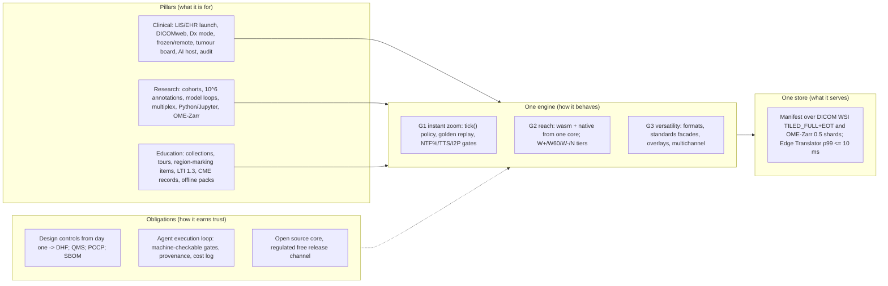

# Executive summary, vision, goals, non-goals and success metrics

Plan section 01 · Stoipath WSI viewer · 2026-10-24. Inputs: `arch/recommended.md` (the decided architecture, amended for gap-5), research notes 01–10 and 11-gap-1…7, the judge panel (`judge/ranking.json`, `judge/judgments.json`) and five web checks made today. Evidence tags follow the corpus: **[measured]**, **[verified]** (primary source read on 2026-10-24), **[model]**, **[estimate]**, **[unverified]**. Every latency, memory and quality figure in §7 is the canonical figure from `recommended.md` §4 or research note 10 §6; where this section sets a number the corpus did not, it says "set here". Terminology (L\*, NTF%, BAT, TTS, I2P, REF, Pinned Base, Base Bundle, Manifest, Edge Translator, Dx mode, W-LAN…N-And) is that of `recommended.md` §5.

## 1. Executive summary

Stoipath is a whole-slide-imaging viewer and tile platform for gigapixel pathology slides (100k × 100k px, 1–4 GB, brightfield and multichannel fluorescence) whose defining property is that zoom and pan are perceptually instantaneous on every device a pathologist, researcher or student actually holds — a 3 GB Android phone on 4G, a 2020 iPad in Safari, a 4K sign-out workstation — with no magnified tile left on screen after the gesture ends and no pop-in. Nobody engineers for that property today. The only published deployment data (MSK, 239 pathologists, 60,080 slides) accepts 108–238 ms per field of view as "efficient" **[verified, Schüffler 2022]**; every OpenSeadragon- and OpenLayers-based viewer inherits no-mipmap, hard-swap, main-thread-upload behaviour its own maintainers call a design flaw (OSD #2906, open) **[verified]**; no commercial vendor publishes latency at all. Our bar is time-to-sharp p50 ≤ 100 ms and p95 ≤ 300 ms on broadband with a published p95 nobody else reports, warm input-to-photon within one frame of the platform's own floor, and zero blank or magnified pixels at rest.

The decision that makes this possible is architectural. One Rust engine, **stoi-core** — pyramid model, camera, scheduler, cache, decode, draw list — is compiled to WebAssembly for browsers and to native for desktop and mobile and driven by thin shells; a hand-written WebGL2 renderer executes its draw list on the web floor and wgpu does so natively. The core owns no threads, DOM or sockets, so a recorded gesture replayed with its byte-arrival times must produce the identical request sequence and draw list on every platform: that golden replay is the operational definition of "instant everywhere". Behind the engine a server is built first (months 0–3), because the only deployed latency data blames the server (+130 ms/FOV from transcoding): a dual-standard, single-copy canonical store (DICOM WSI `TILED_FULL`+EOT for brightfield, OME-Zarr 0.5 sharded for multichannel) behind one ≤ 100 KB Manifest, served by byte passthrough through a Rust **Edge Translator** with a p99 ≤ 10 ms hot service time. No request-time transcoding, ever.

The product serves three pillars from the same core. **Clinical**: LIS/EHR launch (Epic Beaker and others via IID-style context URLs, SMART on FHIR, HL7 v2/FHIR), DICOMweb and PACS/VNA co-existence, primary-diagnosis-grade display on the RUO-then-Dx path, frozen-section and remote consultation, tumour boards, second-opinion and QA workflows, AI overlays with provenance, synoptic hand-off, audit and PHI controls. **Research**: TCGA/IDC/CAMELYON and institutional cohorts, annotation at 10⁶ objects, model-development loops, multiplex fluorescence and spatial-omics overlays, a Python/Jupyter API, OME-Zarr/DICOM interoperability and provenance. **Education**: curated collections and virtual labs, guided tours, region-marking quizzes, case-based learning, LTI 1.3 Advantage, CME record export, WCAG 2.2 AA and offline classroom packs. The viewer is the one component all three need and none has at quality; the pillars differ in integration surfaces, not in pixels.

The long-term aim is an FDA-cleared viewing platform given free of charge to any hospital system that requests it and meets defined qualification criteria. That aim shapes the plan now. The research-use-only phase runs under design controls that can feed a Design History File (requirement IDs on every test, ISO 14971 risk file, IEC 62304 lifecycle, IEC 62366 usability, §524B cybersecurity with an SBOM per release); the pixel pathway is versioned and deterministic from the first release (**Dx mode**: pinned libjpeg-turbo, fixed resampler, server-baked ICC, a Rendering Complete flag); a QMS under the QMSR (21 CFR 820 incorporating ISO 13485:2016, effective 2 February 2026 **[verified today, FDA]**) and a legal manufacturer entity precede any clinical distribution; and the regulatory strategy attacks the scanner/display pairing problem with a Predetermined Change Control Plan, for which Proscia's 6 August 2026 clearance of Concentriq AP-Dx with a PCCP covering new scanners, formats and displays is the template **[verified today]**. "Free" removes the price, not the obligations: complaint handling, MDR reporting, recalls and security patching are budgeted as if the product were sold.

The project is executed by AI coding agents with humans as reviewers and decision-makers at defined gates, so every acceptance criterion in this plan is machine-checkable: performance gates on named floor devices, golden gesture replays, byte-identity oracles against third-party readers, licence and security scans. Stage 0 (weeks 0–2) measures the browser compositor floor, GPU upload cost and WASM decode on the floor devices before any external latency claim is repeated; the web MVP lands at month 6–7, the iPad shell beta at month 12, v1 with native iPad and Android at month 18–20. The corpus prices this at ≈ 55–65 person-months to MVP and ≈ 150–170 to v1 for a nine-to-thirteen-person human team; an agent-executed programme must restate that as compute and reviewer time (Reviewer note 2). Honest limits, stated once here and repeated wherever a claim is made: no architecture makes a cold 4G viewport sharp inside 100 ms; no web build lifts iPad Safari above WebKit's 60 Hz cap; tablets and phones cannot carry a primary-diagnosis claim until a display-agnostic clearance exists; and a viewer by itself demonstrates cost displacement, workflow capability and measured interaction quality, not patient-care outcomes.

## 2. Product vision

**One engine, one promise, three pillars.** The promise: whatever a pathologist does to a slide — pinch, wheel, drag, fling, jump from the worklist — the image under the finger is correct *now* and sharp before they can tell it was not. Every other capability is a surface over that promise, and every surface uses the same engine, the same store and the same measurement.

| Technical goal | Clinical pillar | Research pillar | Education pillar |
|---|---|---|---|
| **G1 Instant zoom** | Sign-out speed is the efficiency argument digital pathology has never won: digital is still ≈ 19 % slower per case than glass and "navigation" is the lowest-rated element of remote sign-out **[verified, Hanna 2019/2020]**. Deterministic settled frames (Rendering Complete) are also what a Dx claim needs | Reading 40 slides of a cohort or scrubbing a 40-plex panel is bounded by residency and compositing; GPU-side LUTs make contrast changes one frame, not a refetch | Students "preferred certain viewers because of image loading speed" **[verified, Punjabi 2025]**; low-bandwidth classrooms get the offline pack and the same policy |
| **G2 Reach** | Epic Hyperdrive iframe, consumer laptops over VPN, frozen-section approval on a tablet, Windows thick-client parity via Tauri | Jupyter/Colab/VS Code widget, PyO3 wheel, QuPath via DICOM/OME-TIFF export, napari via C ABI | Any LMS browser, phones in the unknown-slide conference, iPad with pencil for authoring |
| **G3 Versatility** | DICOM from the first byte; DICOMweb `frames/{list}`; ANN/SEG/SR overlays with provenance; VNA co-existence | OME-Zarr 0.5 with core codecs readable by napari/Viv/vizarr/zarr-python unchanged; GeoJSON (QuPath dialect), GeoArrow export | Collections = ordered (slide, state, annotation-layer) sets; hidden answer-key layers; xAPI-shaped events |

## 3. Target users and personas

| Persona | Setting and devices | What "instant" must mean to them | What they need from G2/G3 | Acceptance evidence that proves it |
|---|---|---|---|---|
| **Sign-out pathologist** (attending, academic or community) | 27" 4K / ≥ 8 MP display on a LAN workstation; launched from the Beaker worklist; ≈ 17 zoom bursts and ≈ 16 FOVs per slide, two thirds of bursts ≥ 2.3 levels **[verified, Brunyé 2023; Kayser 2009]** | Destination level sharp before the next burst (minimum inter-burst gap 196 ms); pan edge never blank; no settled magnified tile at 20–40× where mitoses and organisms live | Context launch inside Hyperdrive without cookies; dictation co-existence; AI overlays with provenance; Dx mode on a validated display | W-LAN / N-Desk gates (§7.1); golden replay of the pathologist path; CAP ≥ 60-case validation tooling built in |
| **Frozen-section / remote and tele-pathologist** | Home laptop with trackpad at 20 Mbps, hospital VPN 30–100 ms RTT, or a tablet for an intra-operative call; cytology excluded by CMS policy **[snippet, gap-7]** | Never blank, ≤ 1 level soft during the burst, sharp ≤ 300 ms p95 on broadband; zoom-out and revisits instant from the client cache | HTTP/2 fallback, capability-token tiles cacheable at the edge, case warm-up on `ready-for-review`, trackpad gesture model | W-BB and W-iPad gates; "never blank" on the cellular-poor profile; TAT logged against the 20-minute CAP frozen benchmark |
| **Tumour-board presenter and consultant** | Conference room display, Teams/Zoom, rad-path side by side; second-opinion recipients on whatever they have | Follow-me view state with no stutter for 30 viewers; snapshots with scale bar | Serialisable view state, de-identified share links, presenter mode | Multi-slide sync meets M1 gates with ≤ 1.5× bytes (M5) |
| **Research pathologist / computational biologist** | Workstation or laptop, often Jupyter; TCGA/IDC/CAMELYON plus institutional cohorts; multiplex IF and spatial omics | Channel toggles and contrast are uniform updates (one frame); 10⁶-object overlays do not stutter the zoom | OME-Zarr 0.5 core codecs, DICOMweb reads, GeoJSON/ANN/GeoArrow in and out, anywidget, PyO3 wheel, reproducible view state and provenance | 8-channel 16-bit blend meets M1/M2 gates; 1 M-object layer within frame budget; conformance suite 100 % on IDC/IIIF/OME-Zarr fixtures (M5) |
| **AI/ML engineer** | Python, GPU batch jobs, inference services; needs patches, labels and overlays round-tripped | Overlay pyramids go through the same scheduler as pixels so heatmaps never cause zoom stutter | Label-image and probability-map layers, ANN/SEG/SR and QuPath GeoJSON, `stoi-telemetry` viewport logs for active learning, deterministic overlay rendering with `{producer, version, inputHash}` | Overlay provenance in every layer; byte-identical Dx rendering (G7 1,000/1,000 hash identity) |
| **Integrator** (LIS/PACS/EHR analyst, hospital IT, SDK consumer) | Epic Hyperdrive (Chromium) iframe, WebView2, Sectra/Fujifilm/Pathcore archives, Cloudflare/AWS/on-prem MinIO, SOC 2 questionnaires | Must not regress the host: no COOP/COEP, no SharedArrayBuffer, ≤ 1.0 MB gz floor module, no main-thread task > 8 ms | Versioned launch-context contract, capability tokens, DICOMweb façade, conformance statement, SBOM, telemetry kill switch, one edge binary for every topology | M4 install-from-registry smoke on seven channels; iframe embed without COOP/COEP meets M1 gates; SBOM and signed releases every tag |
| **Educator and learner** (histology faculty, course directors, residency PDs; undergraduates, medical students, residents, CME attendees) | Canvas/Brightspace/Blackboard launch; classroom Wi-Fi or none; phones and tablets; screen readers and colour-vision deficiency (6–10 % of males) | Zooming to find the lesion is the task; a region-marking item with a soft tile is an unfair item | LTI 1.3 Advantage, QTI import of MCQs, xAPI export, WCAG 2.2 AA with keyboard pan/zoom, CVD remap, offline pack, sub-5-minute authoring | 1EdTech certification on the three UT LMSs; VPAT before any UT procurement; offline pack meets W-LAN gates from local storage |
| **Hospital system as recipient** (the "requests/qualifies" customer of the free regulated release) | CLIA lab director, CAP validation lead, IT security, clinical engineering | A validated system whose measured behaviour matches the labelling on their displays and network | Qualification criteria (CAP ≥ 60-case capability, display QA, security posture, training), labelling, UDI, complaint channel, patch SLA | Regulated release channel with DHF-backed evidence; see the *Regulatory strategy, QMS and free distribution* section |

## 4. Goals in priority order

The order is strict: when two goals conflict, the higher one wins and the loser is recorded as a non-goal or a deferred item with a reopen condition.

1. **G1 — Near-instantaneous zoom and pan.** No perceptible lag, no blurry or low-resolution tile visible during or after zoom, no pop-in, on every supported device including low-end Android and iPad Safari. Operationalised as the gates in §7.1 evaluated on the *weakest* named device of each class, measured relative to that device's own reference floor (REF), and as the golden gesture replay that must be identical across platforms. This goal dominates every architectural, format, transport, auth and UI decision; the corpus shows it is lost in policy (which level to draw, fetch and evict) rather than in bandwidth, so the policy lives in one place.
2. **G2 — Runs on any device, application and platform within reason.** Web (desktop and mobile browsers, PWA, `<stoipath-viewer>` component, iframe RPC), desktop (Windows/macOS/Linux via Tauri 2, native wgpu window at v0.9), iOS/iPadOS and Android native shells with pen input, and embeddable SDKs (anywidget/PyO3 for Python and Jupyter, UniFFI Swift/Kotlin, a C ABI for Qt/.NET/Java hosts, LIS/PACS launch contracts). Reach is bought by sharing the engine, never the UI, and by refusing dependencies that break embedding (COOP/COEP, cookies, Service Workers on the hot path).
3. **G3 — Versatile.** Brightfield and 16-bit multichannel in one client; all major slide formats via lossless passthrough where possible and decode-once ingest otherwise; annotations, overlays and AI results at 10⁶-object scale through the same scheduler as pixels; multi-slide comparison with affine sync; standards façades (DICOM WSI and DICOMweb, OME-Zarr/OME-NGFF, OME-TIFF, IIIF Image 3.0, DeepZoom, Iris) over the canonical store. Versatility is implemented at the edges (adapters, façades, exports) so that it never touches the hot path.

Three obligations cut across all goals. They are not goals — they do not compete with G1 — but they are gates that a release cannot pass without:

- **O1 — Regulatory-ready by construction.** Design controls, a versioned deterministic pixel pathway, PHI tiering, SBOM and vulnerability handling from the first release, so the later Dx edition is a frozen, validated build of the same core rather than a redesign (research note 09 R5; the *Regulatory strategy, QMS and free distribution* section).
- **O2 — Autonomous execution with human gates.** Work is picked up, implemented, verified, reviewed and merged by agents; humans decide at named gates (Stage 0 G1–G13, milestones M0–M5, licence and regulatory decisions, external claims); provenance, cost and wall time are logged per merged change; the repository is the single source of truth (the *Agent execution loop and repository governance* section).
- **O3 — Open and verifiable.** Apache-2.0 core and SDKs with DCO; published benchmark harness (synthetic fiducial slides, camera-path DSL, dashboard) so competitors and customers can measure us with the same ruler; a regulated release channel for qualifying hospital systems at no charge (Reviewer note 4 on the licence wording).

## 5. Explicit non-goals

| Non-goal | Why | Reopens when |
|---|---|---|
| Being the scanner, the LIS, the image manager/VNA of record, or the AI algorithm | The LIS is the system of record and the only launch point that matters; archives will often not be ours; FDA reviews reading algorithms as IVDs separate from image management **[snippet, gap-7]** | Never for LIS/scanner; VNA role only if a customer has none and asks for the Edge Translator's object store to be their archive |
| A diagnostic-equivalence or patient-outcome claim | Only de-identified public slides are used; no validation study exists; mobile is "validated for diagnosis in small studies, unproven for speed" **[verified, gap-1 F5]** | A CAP-style ≥ 60-case study with ≥ 2-week washout on a named display reports; a prospective TAT/outcome study is designed |
| Primary diagnosis on tablets, phones or unvalidated displays | Cleared viewers are paired with named displays (PathPresenter K250968: one scanner, one Barco display **[verified today]**); CAP validates the whole system incl. display | A display-agnostic clearance or a PCCP that admits consumer display classes; until then tablets are consultation, education, tumour board and research |
| Remote review of cytology | CMS enforcement discretion for cytology ended 2026-03-23 **[snippet, gap-7]** | Rulemaking (proposed rule Oct 2026) changes the conditions; mode-specific policy engine already planned |
| Server-side GPU rendering / pixel streaming as the viewer | Sharp photon ≥ RTT + codec; no client cache for revisits; 50–500× cost; no offline; UDP blocked in hospitals (`recommended.md` §9) | As a *mode* on the same core for thin clients below the WebGL2 floor, 40-plex fluorescence on phones, z-stack volumes, SFU tumour-board fan-out |
| OpenSeadragon, OpenLayers or deck.gl as the rendering engine | Per-tile textures, no mips, 2D-canvas composite, private-API scheduler; blur-then-sharp for ≈ a year on a replacement ladder | Never as engine; kept as compatibility `TileSource`/`Source`/layer adapters and as the public perf comparator |
| A TypeScript scheduler or a second engine for any platform | Two schedulers break the golden replay; A's ceiling (no GPU surface, no C ABI, 60 Hz iPad for ever) | TypeScript only as web-floor *renderer language* if Stage 0 shows trampoline or debug cost > 0.5 ms/frame |
| OME-Zarr v3 with JPEG chunks as the brightfield canonical | No registered image codec in `zarr-extensions`; readable only by our own code; QuPath 0.7 reads no Zarr v3 **[verified, gap-5]** | Codec registered **and** shipped in zarr-python, zarrs and zarrita **and** QuPath reads Zarr v3; re-decided at the first annual review |
| Two pixel copies (DICOM + full OME-Zarr brightfield mirror) | 4–5× storage for > 90 % of volume; two encodes per slide | A regulator demands DICOM files *and* a research group demands OME-Zarr brightfield: an export job, not an architecture change |
| wasm threads/SharedArrayBuffer, Service Worker on the hot path, WebTransport or WebSocket for tiles, HTTP/3 in-process | COOP/COEP breaks embeds; SW cold start 50/250 ms; WebTransport Baseline only since Safari 26.4; `h3` crate pre-1.0 | Stable wasm atomics with a measured same-origin win (never for embeds); WebTransport re-evaluated 2028; `h3` 1.0 |
| Our own ACCME accreditation, our own LMS, an item-bank content business | CME is a records-and-attestation problem; joint providership with a UT CME office; faculty time, not technology, is the bottleneck **[verified, gap-6]** | Never for accreditation/LMS; content only as licensed public corpora (IDC CC-BY, CAMELYON CC0) plus institutional teaching sets |
| Supporting browsers below the WebGL2 floor, iOS < 17 natively, Android < 10 natively | WebGL2 reaches ≈ 97 % of users; the engine is fragment-shader-only on a WebGL2/GLES 3.0 floor | A customer with a measured population below the floor funds a pixel-streaming mode |
| Shared cross-platform UI frameworks (Flutter, Compose Multiplatform, React Native Skia, .NET MAUI, Qt as the app) | Each puts a second renderer between us and the GPU or lacks a web-component/Jupyter story (research note 06) | A required host that cannot consume a C ABI or a web component (none known) |

## 6. Headline architecture decision

The panel ranked B (one Rust engine everywhere) 7.09, A (web-first TypeScript) 7.07, D (C++ native core) 6.62, C (OpenSeadragon adopt-then-replace) 5.93 and E (server render + video) 4.38 on weights zoom 0.35, reach 0.20, versatility 0.10, effort/risk/maintainability 0.10 each, cost 0.05. The B–A margin is noise; the shape of the disagreement is not: all three judges accepted the same tile *policy* (note 04's LOD, prefetch, eviction and blend rules) and the same *server* (C's passthrough pyramid, Manifest and path-only cache keys) and disagreed only on where the policy runs and how the web floor draws. The decision takes B's core as the single home of the policy — `tick(now_ns, inputs, viewport) → FrameOut{draw_list, requests, cancels, uploads, quality}`, `on_bytes`, `on_decoded`, `set_budget`; a single-threaded state machine that owns no threads, DOM or sockets — compiled to wasm32 for the web and to native for shells, and takes A's web discipline for the floor: a hand-written direct-WebGL2 renderer (`stoi-render-gl`, gap-2 "option C") executes the draw list in browsers, so floor devices never depend on wgpu's best-effort WebGL2 backend (#4081 on the texture-array primitive the cache uses); wgpu is native-only until a WebGPU web module is allow-listed in v1. One libjpeg-turbo build decodes everywhere (bit-identical native/wasm-SIMD/wasm-scalar **[measured, gap-2]**; Rust decoders differ by 10–38 % of pixels and are rejected); one WGSL shader set is authored once and compiled to GLSL ES 3.00 by naga with ≤ 1 LSB goldens. Native shells (SwiftUI + CAMetalLayer with CAMetalDisplayLink, Compose + SurfaceView, Tauri 2) exist because the browser's ≈ 2-vsync compositor floor and WebKit's 60 Hz cap are the only latency terms the engine cannot remove; the iPad shell moves to a month-12 beta rather than B's month 18–20.

The server comes first. Months 0–3 deliver the dual-standard, single-copy canonical store — brightfield as DICOM WSI `TILED_FULL` with Extended Offset Table and JPEG frames copied byte-for-byte from the vendor file, multichannel as OME-Zarr 0.5 (Zarr v3 `sharding_indexed`, 512² inner chunks, core `zstd`/`bytes` codecs) — behind one immutable ≤ 100 KB Manifest (`TileIndex → (object, offset, length, codec, provenance)`), two-pass ingest (index in place and serve within seconds, then write and hash-verify the canonical copy), and the Edge Translator built in Rust from crates in three builds from one crate graph (regional service, Cloudflare Worker, in-process library for Tauri and the PyO3 wheel) with a p99 ≤ 10 ms hot service time per container path and DICOMweb/IIIF/DZI/Iris façades as stateless translations of the Manifest. Instant zoom then becomes a residency problem solved once: the policy decides what to draw, fetch and evict, the store makes every tile a byte range, and the edge keeps the cache key path-only so the first viewer of a slide warms it for everyone. Full component architecture, the resolved disagreements, the rejected alternatives with reopen conditions and the top sixteen risks are in the *Architecture* section (`arch/recommended.md` §2–§3, §9–§10); the latency and memory arithmetic, including the four corrections every proposal inherited, is in the *Instant-zoom engineering and performance gates* section.

## 7. Success metrics

All gates are evaluated on the weakest lab device of the named class, on the standard synthetic fiducial slide (100k × 100k, 512 px JPEG q85 tiles) and the standard pathologist path, N ≥ 10 runs, distributions compared against a per-device baseline (bootstrap CI on p95, Mann–Whitney), and never on hosted CI runners (research note 10 F3–F4). **REF** is the same metric on a trivial CSS-transform page (web) or a raw Metal/Vulkan quad app (native) on the same device and firmware, so latency gates measure *our* added latency, not the platform's.

### 7.1 Instant zoom (G1)

**Device and network classes** (`recommended.md` §4.3):

| Class | Device / runtime | Display | Network RTT p50/p95; bandwidth p50/p95-low | L0 GPU tile budget |
|---|---|---|---|---|
| **W-LAN** | Desktop, Chrome, WebGL2 | 60 Hz (120–144 variant) | On-prem edge < 1 / 3 ms; 1 GbE | 512 MiB–1 GiB |
| **W-BB** | Laptop, Chrome/Safari | 60 Hz | CDN edge 25 / 50 ms; 100 / 20 Mbps | 512 MiB |
| **W-4G** | Android 3–4 GB, Mali-G52/G57 or Adreno 610, Chrome WebGL2, DPR 3→2 | 60 Hz | 45 / 200 ms; 25 / 5 Mbps | 128 MiB |
| **W-iPad** | 2020 iPad (A12), Safari/WKWebView | 60 Hz (WebKit cap) | Wi-Fi 25 / 50 ms; 100 / 20 Mbps | 256 MiB |
| **N-Desk** | Workstation, Tauri native wgpu | 120 Hz | LAN | 2–4 GiB |
| **N-iPad** | iPad Pro, SwiftUI shell, wgpu Metal | 120 Hz | Wi-Fi 25 / 50 ms; 100 / 20 Mbps | 1–2 GiB dynamic |
| **N-And** | Android 6 GB, Compose shell, wgpu Vulkan/GLES | 120 Hz (60 if the OEM holds it) | 4G 45 / 200 ms; 25 / 5 Mbps | 256 MiB–1 GiB dynamic |

**Latency targets** (ms, p50 / p95; **[model]** until Stage 0 G11–G13 measure the compositor floor, upload cost and A55 decode; `recommended.md` §4.4):

| Metric | W-LAN | W-BB | W-4G | W-iPad | N-Desk | N-iPad | N-And |
|---|---|---|---|---|---|---|---|
| **Warm input-to-photon (I2P)**, resident tiles — gate: p95 ≤ REF + 1 frame/interval | 40 / 50 | 40 / 50 | 45 / 55 | 45 / 55 | 20 / 30 | 25 / 33 | 40 / 55 (65 / 90 at 60 Hz) |
| **Frame-time budget** during gesture — gate | p99 ≤ 16.7 ms | ≤ 16.7 | ≤ 16.7 | ≤ 16.7 | p99 ≤ 8.3 ms | ≤ 8.3 | ≤ 8.3 (16.7 at 60 Hz) |
| Dropped frames during gesture | ≤ 0.5 % | ≤ 0.5 % | ≤ 0.5 % | ≤ 0.5 % | ≤ 0.5 % | ≤ 0.5 % | ≤ 0.5 % |
| Main-thread task during gesture (web) / present-time overrun (native) | none > 8 ms | none > 8 ms | none > 8 ms | none > 8 ms | p99 ≤ 1 vsync | p99 ≤ 1 vsync | p99 ≤ 1 vsync |
| **Cold destination fill**, first input → all 20 tiles sharp (model, not a gate) | ≈ 85 / 150 | ≈ 230 / 650 | ≈ 650 / 3,000; mitigated ≈ 450 / 2,000 | ≈ 250 / 800 | ≈ 40 / 70 | ≈ 190 / 600 | ≈ 600 / 2,900; mitigated ≈ 400 / 1,900 |
| **Time-to-sharp (TTS)**, last input → first frame with NTF = 0 — gate | ≤ 50 / ≤ 100 | ≤ 100 / ≤ 300 | ≤ 250 / ≤ 700 | ≤ 100 / ≤ 300 | ≤ 50 / ≤ 100 | ≤ 100 / ≤ 300 | ≤ 250 / ≤ 700 |
| **NTF% during gesture** (frames with any pixel from a level coarser than L\*) — gate | ≤ 5 %, ≤ 1 level | ≤ 20 %, ≤ 1 level | ≤ 50 %, ≤ 2 levels (≥ 2 at ≥ 20× logged as defects) | ≤ 20 %, ≤ 1 level | ≤ 5 %, ≤ 1 level | ≤ 20 %, ≤ 1 level | ≤ 50 %, ≤ 2 levels |
| **NTF% after TTS** | 0 | 0 | 0 | 0 | 0 | 0 | 0 |
| **Blank-pixel frames** | 0 | 0 | 0 | 0 | 0 | 0 | 0 |
| **Pop-in count** after settle (level change ≥ 1 without ≥ 100 ms cross-fade) | 0 | 0 | 0 | 0 | 0 | 0 | 0 |
| **BAT** blur-area-time per zoom interaction (level·s) | ≤ 0.02 | ≤ 0.1 | ≤ 0.4 | ≤ 0.1 | ≤ 0.02 | ≤ 0.1 | ≤ 0.4 |
| **CHS** cache-hit-at-settle on the pathologist path | ≥ 95 % | ≥ 95 % | ≥ 85 % | ≥ 90 % | ≥ 95 % | ≥ 95 % | ≥ 85 % |
| **BER** burst-end residency of the destination level (gap-1 reframing) | ≥ 95 % within 150 ms p95 | ≥ 90 % within 300 ms p95 | ≥ 80 % within 500 ms p95 | ≥ 90 % within 300 ms p95 | as W-LAN | as W-BB | as W-4G |
| Prefetch waste (bytes prefetched and evicted unused / bytes prefetched) | ≤ 50 % at Stage 1, tightening toward ≤ 40 % | ≤ 50 % → ≤ 30 % | ≤ 50 % → ≤ 15 % | ≤ 50 % → ≤ 30 % | as W-LAN | as W-BB | as W-4G |
| Edge Translator hot service time (server-side, every topology) | p99 ≤ 10 ms per container path (Zarr shard range, DICOM EOT frame, 15-tile bundle) on a 2-vCPU container and in a Worker | | | | | | |

How this compares with the state of the art: MSK's deployed viewer renders an adjacent FOV in < 250 ms median with 108–238 ms streaming pace **[verified]**; Google's DICOM proxy serves ≈ 150 ms/frame from an in-memory cache **[verified]**; Iris serves 21 ms median on Raspberry-Pi-class hardware for its own format **[verified]**; OpenSeadragon's defaults (`maxTilesPerFrame: 1`, coarse-first priority, `blendTime: 0`, 1.2 s spring) produce the blur-then-sharp staircase **[verified from source]**. A TTS p50 of ≤ 100 ms on broadband with a reported p95 is 2–3× beyond the published bar, not parity. The pathology literature cannot distinguish 100 ms from 250 ms perceptually because no viewer below ≈ 100 ms has existed to compare against; the Stage-1 reader study (gap-1 F9, n ≈ 8–12, 2AFC blur-ms psychometrics) replaces the HCI-generic justification with pathology evidence and may move the BAT and NTF constants.

**Time-to-first-interaction (TTFI)** — launch (URL or launch-context receipt) → first frame drawing the Pinned Base at the requested view with input accepted. Set here **[model]** from G2 (cold compile + first frame ≤ 300 ms floor Android / ≤ 150 ms iPhone 12), the ≤ 100 KB Manifest and a 0.5–1.5 MB Pinned Base fetch; to be ratified by the *Instant-zoom engineering and performance gates* section at M1:

| Metric | W-LAN | W-BB | W-4G | W-iPad | Native shells (warm app) | Baseline |
|---|---|---|---|---|---|---|
| TTFI, cold module, p50 / p95 | ≤ 0.4 / 0.8 s | ≤ 0.8 / 1.5 s | ≤ 1.5 / 3.0 s | ≤ 0.8 / 1.5 s | ≤ 0.3 / 0.6 s | MSK case open 3.9 s **[verified]** |
| Slide switch within a case (worklist warm-up of the next slide's Base Bundle) | ≤ 0.2 s | ≤ 0.3 s | ≤ 0.5 s | ≤ 0.3 s | ≤ 0.2 s | MSK slide switch < 1 s **[verified]** |
| Module size (G1): floor ≤ 1.0 MB gz (target 0.6), full ≤ 1.3 MB; decoders as separate 60–90 KB modules | | | | | | wgpu WebGL2 path would add 0.68 MB gz |

**Memory ceilings per device class** (`recommended.md` §4.2–§4.3, note 10 §6):

| Class | L0 GPU slot map (≤ 64-layer 512² RGBA8 arrays, 64 MiB each) | L1 decoded CPU LRU | Pinned Base (GPU) | Gate |
|---|---|---|---|---|
| W-4G | 128 MiB (two arrays) | ≤ 25 % of L0 (32 MiB) | levels ≤ 2048 px ≈ 23 MiB; Base Bundle (≤ 4096 px, 2–5 MB JPEG) in L1/L2 only | deficit = 0 on warm cache; 30 min soak without LMK kill; DPR capped at 2 on metered links |
| W-iPad | 256 MiB | ≤ 64 MiB | as above | peak ≤ 60 % of the measured WebContent kill threshold; 30 min soak without jetsam (M2) |
| W-BB / W-LAN | 512 MiB / 512 MiB–1 GiB | ≤ 128–256 MiB | Base Bundle GPU-pinned when L0 ≥ 512 MiB | GPU texture memory within budget ± 0 (M0) |
| N-And | 256 MiB–1 GiB dynamic from `ActivityManager.MemoryInfo` + `onTrimMemory` | ≤ 25 % | pinned | 2 h soak without LMK; eviction before pressure |
| N-iPad | 1–2 GiB dynamic from `os_proc_available_memory`; LRU tail purgeable | ≤ 25 % | pinned | 2 h soak without jetsam; ≥ 4× web budget usable (M3) |
| N-Desk | 2–4 GiB | ≤ 25 % | pinned | — |

Upload budget is a first-class row, not a footnote: at ≤ 2–4 MiB/frame a cold 20-tile level needs 5–10 frames (83–167 ms at 60 Hz) on a phone with zero network latency, so centre-first upload order and an online budget from timer queries are part of the M2 gate.

### 7.2 Platform coverage (G2)

| Metric | Target | When |
|---|---|---|
| Browser reach of the floor renderer | WebGL2: ≈ 97 % of global users; Safari 15+, Chrome 56+, Firefox 51+, Samsung Internet, Android WebView, WKWebView | MVP |
| WebGPU enhancement reach | ≈ 86 % full + 4 % partial (caniuse) once allow-listed; Safari per-major allow-list after soak; Xclipse and Firefox Android stay on WebGL2 | v1 |
| Fidelity tiers delivered | **W+** (web, full policy, WebGL2/WebGPU), **W60** (iPad Safari, 60 Hz cap), **W−** (floor Android, DPR 2, moving tier), **N** (native shells, 120 Hz, predicted input, GB-class caches) — every tier runs the identical policy and passes the golden replay | MVP (W+/W60/W−), v0.9–v1 (N) |
| Delivery surfaces | PWA; `<stoipath-viewer>` web component; iframe JSON-RPC without COOP/COEP; Tauri 2 Windows/macOS/Linux; XCFramework (SwiftPM binaryTarget, UniFFI Swift) + reference SwiftUI app; AAR (cargo-ndk, UniFFI Kotlin) + reference Compose app; `pip install stoipath` (anywidget + PyO3 wheel) for Jupyter/JupyterLab/Colab/VS Code/marimo; `stoipath.h` C ABI with a Qt `QQuickItem` sample; OSD/OpenLayers/deck.gl adapters | MVP: web, Tauri (wasm in webview), npm, PyPI · v0.9: native wgpu desktop window, XCFramework beta · v1: iPad GA, Android AAR, C ABI, Maven, adapters |
| Native OS floors | iPadOS/iOS 17+; Android 10+ (allow-listed Vulkan, GLES retry on `VK_ERROR_DEVICE_LOST`); Windows 10 1803+ (WebView2); macOS and Linux current LTS | v1 |
| "One behaviour everywhere" | Golden gesture replay: identical request sequence and draw list on every platform in CI; WebGPU-vs-WebGL2 and native-vs-web goldens ≤ 1 LSB | M0 onward, every PR |
| Pen and touch input | Pinch 1:1 with coalesced events; Pencil/stylus pressure and hover reflected within 1 frame (M3); predicted input to camera only | M2 (web), M3 (native) |
| Release channels | npm, crates.io, PyPI, SwiftPM, Maven Central, NuGet (on demand), OCI; lockstep SDK semver; OIDC trusted publishing; install-from-registry smoke on every channel before announcement | M4 |
| Embedding cost to hosts | No SharedArrayBuffer, cookies, custom request headers or Service Worker required; floor module ≤ 1.0 MB gz; `Timing-Allow-Origin`/`Server-Timing` on tiles so hosts can attribute latency | MVP |

### 7.3 Versatility (G3)

| Metric | Target | When |
|---|---|---|
| Format coverage by passthrough tier (research note 01 F1) | Tier A/B (serve as-is or header splice): Aperio SVS-JPEG, Philips TIFF, Leica SCN, Huron/Motic/Mikroscan/ARGOS, generic tiled TIFF/BigTIFF, OME-TIFF, DICOM WSI; Tier C (lossless DCT-domain re-mux): Hamamatsu NDPI; Tier D (decode-once at ingest, isolated LGPL/GPL workers): iSyntax (pending IP review), MRXS, CZI, BIF, VSI, Sakura, Trestle, J2K-SVS, Bio-Formats-only multichannel via bioformats2raw + re-shard | A–C and OpenSlide-backed D at MVP; full D incl. Bio-Formats path by v1 |
| Reader correctness | 100 % of the OpenSlide test-data corpus and CAMELYON samples open; tile bytes byte-identical to the vendor file for passthrough tiers (frame-byte hash); differential tests vs OpenSlide 4.0.1 / tifffile / wsidicom; 24 h zero-crash fuzz before any reader ships | M1 onward |
| Canonical store readable by community tools (CI assertion, not a claim) | DICOM side: wsidicom, pydicom, Orthanc and dcm4chee STOW/WADO smoke tests; Zarr side: zarr-python 3.4, zarrs 0.23, zarrita/vizarr, tensorstore, Viv; QuPath via DICOM and OME-TIFF export | MVP |
| Standards façades and conformance | DICOMweb QIDO/WADO-RS incl. `frames/{list}` and `transfer-syntax=*`, STOW-RS for ANN/SEG/SR, published PS3.2 conformance statement; OME-Zarr 0.4/0.5 read and 0.5 write (0.6 metadata when readers land); IIIF Image 3.0 (grid-aligned fast path, documented compliance level); DZI; Iris façade; conformance suite 100 % on IDC DICOMweb, IIIF 3 validators and OME-Zarr v3 fixtures; a published `TILED_FULL`+EOT / sharded-0.5 corpus | MVP (client), v1 (façades), M5 (suite 100 %) |
| Multichannel | 16-bit per-channel textures, ≤ 8 channels per pass with additive multi-pass beyond, per-channel window/colour/visibility as a uniform update; 8-channel 16-bit blend meets M1/M2 gates on the same devices | MVP (≤ 8 ch), M5 gate |
| Annotations and overlays | Internal GeoArrow-shaped model; QuPath GeoJSON dialect, DICOM ANN/SEG (incl. LABELMAP)/SR TID 1500, W3C Web Annotation adapters; vector tiles on the pixel grid with centroid LOD; 1 M-object layer renders within the 60/25/15 frame partition; label/probability rasters as first-class tile layers with provenance `{producer, version, inputHash, regulatoryStatus}` | MVP (model + GeoJSON), v1 (DICOM), M5 (10⁶ gate) |
| Multi-slide and dimensions | N-up with lock / affine-offset sync (≤ 1.5× bytes at M1 gates); registration import (VALIS/wsireg → RFC-5 affine); z/t in the tile key, EDF default, z±1 prefetch | v1 |
| Colour | Server-baked scanner ICC → sRGB for the JPEG path (deterministic, cacheable); shader 3D-LUT for raw sources; Display-P3 output where `drawingBufferColorSpace` exists; Dx mode fixed | MVP (server), v1 (LUT) |
| Offline | Derived single-file offline pack (iPad, desktop, classroom); encrypted device storage with MDM wipe; meets W-LAN gates from local storage | v1 |

### 7.4 Pillar metrics

| Pillar | Metric | Target and when |
|---|---|---|
| Clinical | Launch inside Epic Hyperdrive as an iframe with IID-style context URL + SSO, no third-party cookies; instant-zoom gates met inside the iframe | MVP: launch; prove G1 inside Hyperdrive before any HL7 work |
| Clinical | HL7 v2 status sync used as a performance feature: Base Bundle warmed on `ready-for-review` so the next case opens at TTFI ≤ 0.3 s | v1 |
| Clinical | SMART App Launch 2.2 adapter; FHIR façade (`ImagingStudy`, `ImagingSelection`, `AuditEvent`); STOW-RS write-back; IHE PaLM DPIA Image Display actor at a 2027 connectathon | v1 |
| Clinical | Dx mode: pinned decoders, fixed resampler, server-baked ICC, Rendering Complete flag; 1,000/1,000 decoder hash identity incl. arm64 (G7, plan-stopping if failed); display-QA module with logged status | Stage 0 (G7), v1 (display QA) |
| Clinical | CAP validation tooling in the product: blinded re-review mode, case sampling, washout tracking, concordance export, so a UT lab can run its own ≥ 60-case study | v1 |
| Clinical | Audit: token issuance, session open/close and a sampled viewport trail as FHIR `AuditEvent`/ATNA; PHI tiers (label/macro/barcode never at the CDN) | MVP |
| Research | `pip install stoipath`: anywidget over the web bundle plus PyO3 wheel reading both canonical stores directly; GeoJSON/ANN/GeoArrow round-trip; de-identified export | MVP (widget), v1 (wheel, export) |
| Research | Viewport telemetry at ≥ 20 Hz (x, y, w, h, level, device, gesture phase), experience-stratified, exportable as xAPI-shaped records; first published pathologist touch/pinch dynamics dataset | Stage 1 reader study |
| Research | OME-Zarr 0.5 output opens unchanged in napari-ome-zarr 0.11, Viv 0.23, vizarr 0.3, zarr-python 3.4 (CI) | MVP |
| Education | LTI 1.3 Advantage (Deep Linking, AGS, NRPS) certified on Canvas (UTHealth, UTHSA, UT Austin), Brightspace (UTSW) and Blackboard Ultra (UTMB); region-marking item scored by µm-aware geometry with keyboard and text alternatives | MVP (one placement type), v1 (certification) |
| Education | WCAG 2.2 AA incl. SC 2.5.7/2.5.8, CVD-friendly remap, third-party VPAT before any UT procurement | MVP (AA in product), v1 (VPAT) |
| Education | CME: attestation, evaluation, certificate with activity ID, 6-year record export (CSV/xAPI), joint providership with a UT CME office; SCORM 1.2 wrapper export | v1 |
| Education | Faculty authoring ≤ 5 minutes per case (record-a-tour, one-click conversion of sign-out annotations, CSV/QTI import) | v1 |

### 7.5 Programme and regulatory-readiness metrics

| Metric | Target |
|---|---|
| Traceability | 100 % of tests carry requirement IDs; evidence archived per release (≈ 10 % overhead, IEC 62304 Class B assumption) from M0 |
| Risk and usability | ISO 14971 risk file and IEC 62366 use-specification started at M1; hazards for "magnified tile at rest", "wrong tile identity under slow network" and "overlay misregistration" each have a verification test |
| Security | SPDX/CycloneDX SBOM in CI for every artefact; OSV monitoring on every dependency; signed releases and update channel; sandboxed parsers (wasm on the client, gVisor/Firecracker on ingest); `cargo deny` licence policy: permissive-only in the client core, LGPL/GPL only in isolated server workers; `jpegxl-rs` (GPL-3.0-or-later **[verified today, crates.io]**) confined to the GPL-isolated worker |
| Fuzzing | cargo-fuzz target per reader; 60 s per PR; 24 h nightly; zero crashes before any reader ships |
| Agent execution | Every merged change records agent/model identity, prompt and spec hashes, tokens, cost and wall time; every gate run records device, firmware, build hash and raw distributions; human decisions limited to the named gates; waivers appear on the public dashboard |
| Determinism | Golden replay and ≤ 1 LSB pixel goldens on every PR; semantic goldens (draw lists) on every platform |
| Regulatory posture | RUO labelling on every artefact until a Dx edition exists; QMS (QMSR/ISO 13485) and a legal manufacturer entity established before clinical distribution; PCCP drafted alongside the first 510(k) strategy; UDI, complaint handling, MDR reporting, recall and patch SLAs defined in the free-distribution agreement; no diagnostic-equivalence claim without the validation study |

## 8. How the numbers are measured

Goal 1 cannot be proved from the outside on iPad Safari or a 3 GB Android phone — no GPU timers, no frame readback, lossy capture — so the renderer reports its own quality: `stoi-telemetry` emits a per-frame **quality record** (per drawn tile: level wanted vs level drawn, blend weight, upload age; per frame: input and present timestamps) on every platform, from which NTF%, BAT, TTS, blank-pixel frames, pop-in count, CHS and BER are computed exactly and at zero cost. External instruments calibrate and spot-check it: Tier 1 deterministic headless-Chrome frames on synthetic fiducial slides prove the record is honest (a screenshot decodes to exactly which level was drawn where); Tier 2 Chromium traces with `gpuBenchmarking.pinchBy` give input-to-swap; Tier 3 Macrobenchmark/MetricKit/EGL present timestamps on lab devices; Tier 4 WALT photodiode or 240 fps camera gives input-to-photon ground truth and the REF floors. No latency claim leaves the repository before Tier 4 numbers exist for the device class named (risk 1 in `recommended.md` §10). The harness, synthetic slides, camera-path DSL and dashboard are published so that OpenSeadragon 6, Slim, the Google viewer, Avivator and Iris are measured with the same ruler.

## 9. Earliest demonstrable milestone and the TSP abstract

The earliest honest demonstration is **M1 (web alpha, desktop Chrome/Edge/Firefox/Safari, ≈ month 3–4)**: on de-identified public slides (IDC CC-BY, CAMELYON CC0, OpenSlide test data) served by the passthrough Edge Translator, a side-by-side against OpenSeadragon 6 and Slim on the same throttled network with the quality record, TTS p50/p95, NTF% and blank-frame counts on screen, plus WALT input-to-photon on at least one named device. Before that, **Stage 0 (weeks 0–2)** yields the first publishable numbers: REF floors (G11), per-tile upload cost on iOS Safari and Mali-G52 (G12), WASM libjpeg-turbo decode on an A55 core (G13) and decoder identity (G7). An abstract written before M1 can report those measurements and the method; it cannot report pathologist outcomes.

What an abstract arguing that AI-built, in-house-verifiable open tooling lets a health system invest in care rather than subscriptions needs as evidence: (1) **measurements** — TTS, NTF%, I2P and TTFI distributions versus named baselines on named devices and network profiles, with the harness public; (2) **provenance and cost accounting** — the per-change log of agent compute, reviewer hours and wall time against the corpus's ≈ 55–65 person-month MVP estimate, and the verification evidence (goldens, fuzz hours, third-party-reader CI) that makes "in-house verifiable" literal; (3) **comparison baselines** — the IMS/viewer/collaboration/AI-host licence lines an in-house viewer replaces and the lines it does not (scanners, LIS, interface labour, validated displays, 24/7 support), using gap-7 F7's framing and note 09's unit prices, without claiming savings on what it cannot replace; (4) **honest scope** — only de-identified public slides, RUO labelling, no diagnostic-equivalence claim, and the statement that interaction latency is a measured efficiency variable whose link to accuracy is, in the literature, weaker than scanning behaviour's (gap-1 F1). The programme's working deadline for the abstract is 29 October 2026 (task 7); the TSP competition page is proxy-blocked from this environment and the 2024 cycle it last showed was the John R. Rainey Residents'/Fellows' Seminar, open to residents and fellows in Texas training programmes **[search summary; unverified for 2027]** — see Reviewer note 3.

## 10. Reviewer notes

1. **Research note `11-gap-8-fda-pathway-and-free-distribution` does not exist in the corpus** (directory listing and filename search on 2026-10-24). The regulatory and distribution statements in §1, §4 O1, §5 and §7.5 therefore rest on note 09 (whose FDA/EU dates are all tagged **[unverified]**), gap-7 F6 (**[snippet]**) and three web checks made today (QMSR effective 2 Feb 2026; Proscia Concentriq AP-Dx 510(k) with PCCP, 6 Aug 2026; PathPresenter K250968 pairing, 20 Jun 2025). The *Regulatory strategy, QMS and free distribution* section must either produce gap-8 or verify: 21 CFR 864.3700 special controls and the viewer product code (K250968 is listed as QKQ "Digital Pathology Image Viewing and Management Software" by a third-party database, which conflicts with note 09's recollection that QKQ is the 864.3750 algorithm code); the current FDA premarket cybersecurity guidance date (2023 final; a 2026 update is reported only by a vendor summary; note 09's "June 2025" is unverified); the CMS QSO-23-15-CLIA revision and the Oct 2026 proposed rule; the LDT rule rescission.

2. **Effort is stated in human person-months; the programme is agent-executed.** `recommended.md` §8 carries ≈ 55–65 PM to MVP and ≈ 150–170 PM to v1 with a 9→12–13 FTE team. This section does not contradict those numbers but they cannot be the plan's cost metric. The *Agent execution loop and repository governance* section should define the cost unit (agent compute per merged change, reviewer hours per gate, calendar time) and keep the PM figures as the comparison baseline the TSP abstract needs.

3. **TSP abstract eligibility.** The only competition text reachable today (via search summary) describes a residents'/fellows' seminar. If that holds for the 2027 call, the submission needs a trainee first author from a Texas programme, or a different TSP track; the owner should confirm with the society before 29 Oct.

4. **Licence wording versus the free-distribution aim.** `recommended.md` §7 (QA/project row) and note 09 R1 say "Dx edition and enterprise edge features commercial". The owner's stated aim is that the cleared platform is *given free of charge* to qualifying hospital systems. I have not changed the architecture, but the plan should restate the regulated release channel as a separate, controlled distribution under a qualification agreement at no charge (with liability, indemnification, support and funding terms), and reserve "commercial" only for optional services, if any. Open-source Apache-2.0 for the core is compatible with both; the DHF-backed Dx build is what is controlled, not priced.

5. **Pan deserves the same gates as zoom.** Gap-1 F8 shows slow systematic panning is the most common action (30 %) and that scanning rate, not zoom rate, predicts accuracy. §7.1 inherits the corpus's zoom-centred metric names; the *Instant-zoom engineering and performance gates* section should add pan-specific rows (edge pop-in count, cone-miss rate, flick settle) with the same p95 discipline.

6. **The 60 Hz-is-sufficient stance of the display literature** (Xiong 2026) will be used against the 120 Hz native-shell investment. The plan's answer is measurement (WALT I2P and pan smoothness on N-iPad vs W-iPad), not assertion; §7.2 marks N-tier benefits as gates to be demonstrated at M3.

## References

Corpus: `arch/recommended.md` (§1–§10, amendment gap-5); `arch/A-web-core.md` … `arch/E-server-render-stream.md`; `judge/ranking.json`, `judge/judgments.json`; research notes `01-formats-readers.md` (F1), `02-pyramid-storage-serving.md`, `03-client-rendering.md` (§2.1), `04-instant-zoom-client.md` (F1–F8), `05-instant-zoom-systems.md` (F1–F3), `06-cross-platform.md` (§2.3, §4), `07-sota-survey.md` (F6–F7), `08-features-versatility.md`, `09-compliance-security-ops.md` (F1, F5, F9, §5), `10-dev-process-testing.md` (F4, §6), `11-gap-1-pathologist-human-factors.md` (F1, F7–F9), `11-gap-2`…`11-gap-5`, `11-gap-6-education-modules.md`, `11-gap-7-clinical-integration.md`.

External sources relied on in this section:

- Schüffler PJ et al., Efficient visualization of whole slide images in web-based viewers, Arch Pathol Lab Med 2022 — https://doi.org/10.5858/arpa.2021-0197-OA
- Brunyé TT et al., Zoom behavior during visual search, PLoS One 2023 — https://doi.org/10.1371/journal.pone.0282616
- Hanna MG et al., WSI equivalency and efficiency study, Mod Pathol 2019 — https://doi.org/10.1038/s41379-019-0205-0 ; remote review validation, Mod Pathol 2020 — https://doi.org/10.1038/s41379-020-0601-5
- Wienert S et al. (Kayser group), navigation-path statistics, Diagn Pathol 2009 — https://doi.org/10.1186/1746-1596-4-3
- Drew T et al., scanning vs zooming and accuracy, J Vis 2021 — https://doi.org/10.1167/jov.21.11.7
- Landvater RE et al., Iris RESTful Server, J Pathol Inform 2025 — https://doi.org/10.1016/j.jpi.2025.100530
- Google Digital Pathology DICOM Proxy README (~150 ms/frame) — https://github.com/GoogleCloudPlatform/medical-imaging/blob/main/pathology/dicom_proxy/README.md
- OpenSeadragon issue #2906 (WebGL drawer design flaw) — https://github.com/openseadragon/openseadragon/issues/2906
- WebKit 60 fps preference (`PreferPageRenderingUpdatesNear60FPSEnabled`) — https://github.com/WebKit/WebKit/blob/main/Source/WTF/Scripts/Preferences/UnifiedWebPreferences.yaml ; WebKit bug 294338 — https://bugs.webkit.org/show_bug.cgi?id=294338
- wgpu issue #4081 (WebGL2 texture arrays) — https://github.com/gfx-rs/wgpu/issues/4081
- Zarr v3 `sharding_indexed` — https://github.com/zarr-developers/zarr-specs/blob/main/docs/v3/codecs/sharding-indexed/index.rst ; `zarr-extensions` codec registry — https://github.com/zarr-developers/zarr-extensions/tree/main/codecs
- wsidicomizer — https://github.com/imi-bigpicture/wsidicomizer ; QuPath changelog (0.7.0, Zarr v3 status) — https://github.com/qupath/qupath/blob/main/CHANGELOG.md
- FDA, Quality Management System Regulation (effective 2 Feb 2026) — https://www.fda.gov/quality-systems-regulation
- Proscia, new 510(k) clearance for Concentriq AP-Dx with PCCP (6 Aug 2026) — https://proscia.com/press-release/proscia-receives-new-fda-510-k-clearance-for-concentriq-ap-dx ; https://www.captodayonline.com/proscia-gets-new-clearance-for-concentriq-ap-dx/
- FDA 510(k) K250968, PathPresenter Clinical Viewer (20 Jun 2025; Hamamatsu S360MD + Barco MDPC-8127) — https://www.accessdata.fda.gov/cdrh_docs/reviews/K250968.pdf ; https://fda.innolitics.com/device/K250968
- FDA, Cybersecurity in Medical Devices: Quality System Considerations and Content of Premarket Submissions (final 2023; later update date unverified) — https://www.fda.gov/regulatory-information/search-fda-guidance-documents/cybersecurity-medical-devices-quality-system-considerations-and-content-premarket-submissions ; §524B summary — https://bluegoatcyber.com/guides/section-524b-fdc-act
- CMS QSO-23-15-CLIA (revised 2025-09-23) — https://www.cms.gov/files/document/qso-23-15-clia-revised-2025-09-23.pdf
- CAP, Validating WSI for diagnostic purposes (Evans et al. 2021/2022) — https://www.cap.org/protocols-and-guidelines/cap-guidelines/current-cap-guidelines/validating-whole-slide-imaging-for-diagnostic-purposes-in-pathology
- Texas Society of Pathologists, Abstract Competition page (proxy-blocked today; search summary only) — https://imis.texmed.org/AMSiMis/TSPI/Events/Annual_Meeting/Abstract_Competition.aspx
- caniuse WebGL2 / WebGPU reach — https://caniuse.com/webgl2 ; https://caniuse.com/webgpu ; gpuweb implementation status — https://github.com/gpuweb/gpuweb/wiki/Implementation-Status
- WALT latency timer — https://github.com/google/walt
- crates.io licence check (jpegxl-rs 0.16.0 GPL-3.0-or-later) — https://crates.io/api/v1/crates/jpegxl-rs/versions
- 1EdTech LTI 1.3 / LTI Advantage — https://www.1edtech.org/standards/lti ; WCAG 2.2 SC 2.5.7 / 2.5.8 — https://www.w3.org/WAI/WCAG22/Understanding/
