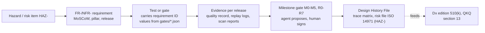
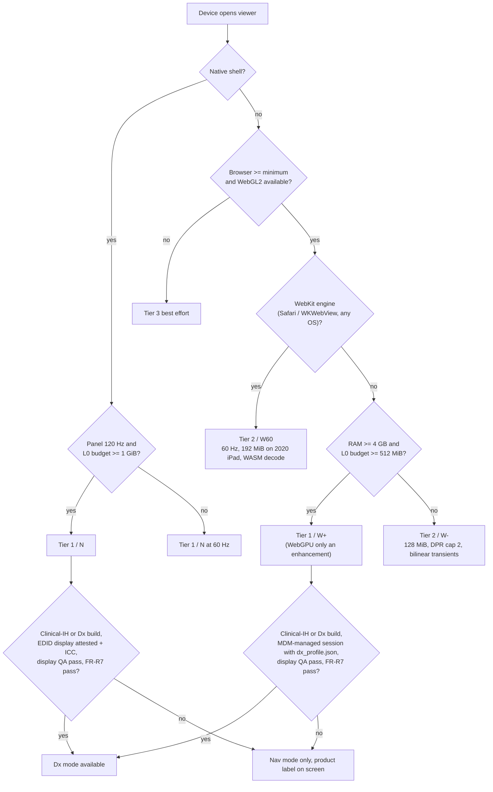

# Requirements and platform matrix

Plan section for the Stoipath WSI viewer, 2026-10-24, revised 2026-10-25 against the four-critic review (`critique/issues.json`) and the claims-verification report (`verify/README.md`, `verify/required-changes.json`). It turns the decided architecture (`arch/recommended.md` as amended 2026-10-25, hereafter "Recommended architecture", carried into the plan as "System architecture") and the research corpus (`research/01`–`11-gap-8`) into numbered, MoSCoW-prioritised, pillar-tagged requirements with a verification method each, a formats/standards matrix, a device/browser matrix with fidelity tiers, and user stories for the top workflows. Terminology, device classes (W-LAN, W-BB, W-4G, W-iPad, N-Desk, N-iPad, N-And), metrics (I2P, TTS, NTF%, BAT, BER, CHS, TTFF, TTLS, resolution deficit), cache layers (L0–L5), gates (G1–G13, M0–M5, R0–R7) and the four product builds (Stoipath Viewer = RUO, Stoipath Learn, the in-house clinical build "Clinical-IH", Stoipath Dx) are those of Recommended architecture §3.2, §4–§5 and plan section 13, and are not redefined here. Corrections carried from the verification pass are marked inline **(verified)**, **(adjusted after verification: was X)** or **(unverified – Stage 0 gate)**; corrections from the critique are marked **(adjusted after critique)**.

**Ownership.** This section is the **requirement authority**: its IDs, MoSCoW classes and **Release column** are canonical for the whole plan (Recommended architecture §8 and plan 12 §3/§5 defer to it for pillar-feature release tags). Dates are not written here: the calendar is `docs/plan/calendar.yaml` (ADR-0023: week 0 = Monday 2026-10-26; Stage 0 = three two-week sprints; **M0 = 2026-12-05**), and the dates of M1, M2, MVP 0.5, v0.7, v0.9, v1, CLIN-1, CAP-1 and DX-0/1 are owned by "Roadmap, milestones, team and estimates" §3. Gate *values* live in `gates/*.json` (regulatory gates in `gates/reg/r*.json`), from which the tables in sections 01/02/05/08/12 are generated; where a value below differs from `gates/*.json`, the JSON wins and this text is regenerated. The success metrics these requirements serve are set in "Executive summary, vision, goals, non-goals and success metrics"; how each verification method is run is in "Quality, testing and performance QA"; the pillar workflows are expanded in "Product pillars"; the regulatory programme (QMS, Pre-Sub, validation, manufacturer, licence channel, qualification) is owned by "Regulatory pathway to FDA clearance and the free-distribution model" (section 13), from which FR-R0 and FR-R7–FR-R11 below are taken verbatim in substance.

> **Reviewer note (corpus).** The first draft said research note `11-gap-8-fda-pathway-and-free-distribution` did not exist and left FR-R7/FR-R8 as placeholders. The note exists (`research/11-gap-8-…`, written after the first drafts) and section 13 now owns the regulatory programme; the placeholders are replaced below (§2.6) and every "gap-8 absent" caveat is withdrawn **(adjusted after critique)**.

## 1. Conventions and traceability

Every requirement has an ID (`FR-` functional, `NFR-` non-functional; **one namespace for the whole plan**, with the Stage-0 gates registered as `NFR-G1…G13` — the `REQ-*` spellings in earlier drafts of sections 08/10/11 are withdrawn **(adjusted after critique)**), a MoSCoW class (**M**ust / **S**hould / **C**ould / **W**on't-in-v1), pillar tags (**[C]** clinical, **[R]** research, **[E]** education, **[All]**), a target release and a verification method. Releases, in order: **MVP 0.5** (= M2 + what M2 needs: the web viewer on W+/W60/W−, brightfield DICOM passthrough canonical + regional/on-prem translator, Manifest + Range Index, bundles, tokens, npm + anywidget, launch-context contract v1 mock-verified, GeoJSON, quality record + dashboard — re-scoped 2026-10-25 **(adjusted after critique)**), **v0.7** (research cohorts and export jobs, Tauri wasm-in-webview, OME-Zarr multichannel and ≤8-channel fluorescence, IIIF/DZI façades, OpenSlide worker, education package first usable), **v0.9** (iPad shell beta, native wgpu desktop window, WebGPU module, PyO3 wheel, Iris façade, display-QA logging, blinded re-review, LTI certification, Clinical-IH for CLIN-1), **v1** (native shells GA, versatility set M5, DHF-ready), then the Dx edition through section 13's R-gates. **Stages** (Recommended architecture §5; the first draft used them undefined **(adjusted after critique)**): Stage 0 = G1–G13 (M0); Stage 1 = the M1→M2 window (reader study gap-1 F9, gesture logging, prefetch-waste acceptance, moving-tier kill decision, byte-model re-fit); Stage 2 = the native-desktop-window gate before v0.9; Stage 3 = M3 native shells. Verification methods are the machine-checkable kinds the programme context demands; the one that needs a human is marked:

| Code | Verification | Where it runs |
|---|---|---|
| `replay` | Golden gesture replay: a recorded gesture with byte-arrival times **and every `set_budget` / upload-per-frame change with its timestamp** through `tick()` yields an identical request sequence and draw list on every platform; the cross-platform assertion is on policy-level fields (TileKey, level, blend weight, request/cancel order), slot ids are a per-platform snapshot only **(adjusted after critique: the AIMD upload controller made slot-level identity platform-dependent)** | PR CI (Tier 1 headless), nightly on lab devices |
| `gate` | Numeric device-lab gate on the weakest device of the named class at the class's **gate viewport** (§3.1), N ≥ 10 runs (≥5 cold runs for cold-fill rows), distribution test vs baseline (note 10 §4, §6); values from `gates/*.json` | Nightly / pre-release, self-hosted lab |
| `golden` | Semantic draw-list goldens everywhere; exact pixels on SwiftShader/lavapipe/WARP; ≤1 LSB WebGPU-vs-WebGL2 | PR CI |
| `fault` | Fault injection against the Class C verifier and identity check: a wrong-level, stale, derived-tier or wrong-slide tile injected into the draw list must suppress Rendering Complete; mismatched launch/manifest pairs must raise `identityMismatch` **(new; section 13 §3.9)** | PR CI |
| `conf` | Conformance CI: third-party readers (wsidicom, pydicom, Orthanc, dcm4chee; zarr-python, zarrs, zarrita, tensorstore), IIIF validator, DICOMweb against IDC, LTI/QTI fixtures | PR subset, nightly full |
| `fuzz` | cargo-fuzz + ASan/UBSan, 24 h zero-crash before a reader ships; differential vs OpenSlide/tifffile/wsidicom | PR 60 s, nightly 24 h |
| `contract` | Contract tests against recorded LIS/EHR/LMS messages (Beaker sandbox, SMART launch, LTI 1.3 reference platform incl. a cookieless-WebKit launch) | PR |
| `a11y` | axe + keyboard-only pan/zoom test + 24 px target lint + reduced-motion test | PR |
| `scan` | SBOM (SPDX/CycloneDX), OSV, `cargo-deny` licence classes and Class C crate features, cosign signatures, **build-flag matrix** (product ↔ features) | PR + release |
| `human` | Pathologist reader study, counsel review, 1EdTech certification, VPAT audit, CAP validation study | Gate decision by a named human |

Requirement IDs are carried on tests (`docs/design-controls/requirements.yaml` holds the register; `xtask trace` generates the matrix) and on the per-release evidence archive from the first commit, because IEC 62304 traceability cannot be reconstructed later (note 10 §1.10, note 09 §4.5; section 13 §3.2). The flow:



An agent picking up work cites the FR/NFR ID in the branch and PR (`Backlog:` trailer, section 10 §4); CI maps the ID to its verification code; a PR that changes a Must without a passing verification of that kind cannot merge; any change to a Dx-pathway requirement (FR-V4, NFR-D2, FR-R7–FR-R11) or to a gate threshold is an ADR and a human decision (gate class H1/H2), not an agent one. The agent execution loop is specified in "Autonomous execution model and dissemination plan"; paths, filenames and the ADR register (0001–0030) are owned by "Repository structure, developer environment and first sprints" §1 and §6 and are cited here by number.

## 2. Functional requirements

Must requirements are those without which goal 1 is unmeasurable, goal 2 is unreachable on a listed platform, or a pillar's entry workflow (§6) cannot run; everything a Must depends on is itself a Must. Items the corpus marks "design in from day one" (tile key with z/t/c, per-layer `tile` size, per-layer affine, provenance fields, per-layer ACL, event bus, state document, the Class C crate boundary) are placed at MVP 0.5 even where their user-visible feature arrives later, because retrofitting them touches the scheduler, the LOD selector or the segregation. After the 2026-10-25 re-scope, **30 Must rows carry an MVP 0.5 component, 14 of them design-in items with no user-visible feature** (FR-V4 flag, FR-V13, FR-A5 fields, FR-A6, FR-S4 grid, FR-S5 tiers, FR-S9 statement, FR-I1, FR-I12, FR-R0, FR-R2 events, FR-R3 split, FR-R5, FR-R9 check), leaving 16 feature rows against the critique's ~15 target; the first draft had 32 Must rows including fluorescence, the multichannel canonical, the vector-tile path, desktop local files and six education features, now at v0.7/v0.9 **(adjusted after critique)**. Pillar tags record who the requirement serves, not who pays for it.

### 2.1 Viewing core

| ID | Requirement | MoSCoW | Pillar | Release | Verify |
|---|---|---|---|---|---|
| FR-V1 | Continuous pointer-anchored pan/zoom/rotate: pinch and drag 1:1 with coalesced events; wheel accumulated and normalised (read `deltaMode` first), log-space critically-damped easing 80–120 ms; trackpad pinch (ctrl+wheel) has its own rate-limited model; inertia on release; `touch-action: none`. Pointer and wheel I2P are reported separately (Chromium delivers non-passive wheel events rAF-aligned, input→`tick` ≈27 ms **(verified)**) | M | All | MVP 0.5 | replay, gate |
| FR-V2 | LOD policy of Recommended architecture §4.1: L\* with s ∈ [0.5, 1.0] as a partition with an ε = 0.03 octave guard band (not a dead band); never blank (ancestor cascade = the **full chain** to the Pinned Base, never evicted; Pinned Base `max(w,h) ≤ 2048 px` GPU-resident); never magnify at rest; fractional-LOD blend between adjacent levels; **one landing rule**: any change of drawn level at a pixel after the last input is faded — ≤3 frames (50 ms) on a settled frame, ≤100 ms during gestures — the fade excluded from TTS and counted in BAT; bicubic (Catmull-Rom) transients on W+/N only, **bilinear on W-4G and W-iPad** (a 9-tap kernel at phone geometry is 8–15 ms on a Mali-G52, not 0.3–1 ms); no sharpening at rest; at-rest softness bounded by NFR-P16, not hidden by NTF%; **DPR cap keyed to the L0 budget, not the network class** (DPR 2 on a 128 MiB L0 on any link, DPR 3 only from 256 MiB; the metered-link rule is a bandwidth saving on top); **sparse vendor pyramids** (SVS/SCN step 4×): until the intermediate level is synthesised, draw the finer native level minified up to 4× with the blend spanning two octaves, never the coarser level magnified >2× **(adjusted after critique)** | M | All | MVP 0.5 | replay, golden, gate |
| FR-V3 | Prefetch and scheduling: at open, thumbnail + levels ≤1024 px first (≈5 tiles, ≈0.5 MB — **the only first-frame dependency**), then the rest of the Pinned Base (11–22 tiles), then the Base Bundle (`≤4096 px`, ≈1 MB for a 2:1 slide, 2–3 MB square biopsy, **≤8–10 MB worst case** — 9.5 MB measured on the tissue-dense Stage-0 pyramid — metered-link-gated and decoded lazily by ROI on phones; **(adjusted after verification: was "2–5 MB" and on the first-frame path)**); when a launch context lands at high power the L\* viewport tiles are ordered before the remaining base. At gesture start, L\*+1 in a ±300 px window at the cursor from the first input sample; destination predictor only after ≥2 consistent samples above a confidence threshold; Stage-1 prefetch sized to the **p25 prefetch lead ≈75 ms** (the lead is ≈U(0, 300) ms at 3.33 levels/s, p50 155 ms; ≈85 ms median at a plausible 6 levels/s phone pinch **(adjusted after verification: was a 155 ms point value)**); hover/pointer-down prefetch with its hit rate logged; One-Euro pan cone τ = 100/250/500 ms capped at 1 viewport/500 ms; ring 1 cellular / 2 wired; idle fan-out unmetered only; priority (tier, abs(level − L\*), focus distance), tier-0 always admitted; **bandwidth-delay-product pacing**: total in flight ≤ ≈2 × BDP (`bw_ewma × rtt_p50`), prefetch ≤ ≈1 BDP (BDP ≈140 KB W-4G, ≈310 KB W-BB, ≈125 KB W-LAN), the 24/64 slot caps only as secondary ceilings **(adjusted after critique: fixed slot caps self-inflicted ≈250–600 ms of queueing ahead of tier-0 on W-4G)**; cancel below 30 % bytes (stops the server, not bytes already in the radio queue — pacing first, h2/h3 priorities second); centre tiles coalesced into one bundle or one range per shard (≤4 ranges for viewports ≤8 tiles wide) | M | All | MVP 0.5 | replay, gate |
| FR-V4 | Two render modes from day one. **Nav mode**: moving image, transients allowed. **Dx mode**: deterministic settled frame with a **Rendering Complete** flag asserted only after the Class C verifier in `stoi-dx` recomputes L\* from the camera and matches each drawn slot's (TileKey, source-byte hash) to the Manifest — never from scheduler bookkeeping; pinned libjpeg-turbo and the pinned OpenJPH **reversible** path only; fixed resampler; colour through the **server-computed, client-applied per-slide ICC→sRGB LUT** (FR-V8), gamma-space `Rgba8Unorm` filtering; no sharpening; settled frames contain **no derived-tier tiles** (`enc=m` moving tier, HTJ2K→JPEG fallback, 8-bit multichannel preview); refuses surfaces without display attestation (FR-I10/FR-R7) and all Tier 2/3 devices (§5); exists only in the Clinical-IH and Stoipath Dx builds **(adjusted after critique: section 13 §3.9 amendment; "server-baked ICC" withdrawn)** | M | C | MVP 0.5 (flag), v0.9 (verifier), Dx edition | golden, gate, fault, human |
| FR-V5 | Multi-slide N-up with sync modes (locked, affine offset, independent), registration import (VALIS/wsireg → NGFF RFC-5 affine), curtain/overlay compare; per-view camera transform exists from MVP 0.5 | S | C, R | v1 | replay, golden |
| FR-V6 | Z-stack focus scrolling with pre-computed EDF default and z±1 prefetch; time series playback ≤10 fps; tile key carries z, t | S | C (cytology), R | v1 | replay |
| FR-V7 | Multichannel fluorescence on the residency model of Recommended architecture §4.5: per-channel 16-bit textures (`r16uint`/`r16float`, 16-layer arrays per channel) with per-channel window/gamma/colour/visibility, additive and max blend, ≤8 channels per pass with multipass beyond, colormaps; **an ingest-derived 8-bit tier** (per-channel windowed grayscale JPEG from the `omero` default windows, provenance `derived`, refused in Dx) is the first-paint tier everywhere and the only tier on phones; **per class: W-4G/N-And ≤3 visible channels at the 8-bit tier; W-iPad ≤4, 16-bit for the centre tiles only in analysis contexts; W-LAN/W-BB/N-Desk/N-iPad 8 channels, 16-bit at settle** (six 16-bit channels over 20 tiles are 12–32 MB per fill — a settle-only cost, never on the gesture path); the multichannel Pinned Base is the 8-bit composite; settings round-trip to OME `omero` and DICOM Optical Path **(adjusted after critique: "8-bit first paint then 16-bit on settle" had no source tier and the 16-bit stack did not fit a phone L0)** | M (≤8 ch), S (40-plex) | R, C | **v0.7** (≤8 ch; moved out of MVP 0.5), v1 (40-plex) | golden, gate |
| FR-V8 | Colour (ADR-0026): **untagged passthrough tiles + a versioned, server-computed per-slide ICC→sRGB 33³ LUT applied in one shader** for every passthrough level from MVP 0.5 (>90 % of volume; baking the ICC into pixels is impossible for byte-passthrough tiles without breaking FR-S2 identity); baking only for re-encoded or synthesised levels, with the passthrough/synthesised level-boundary ΔE as a golden; LUT generator version and `Rgba8Unorm` filtering recorded in `pathway_hash` (NFR-D2); Display-P3 output where `drawingBufferColorSpace` exists; per-user colour-vision-deficiency remap LUT (Dalton 2026 YCbCr transform) **(adjusted after critique: was "scanner ICC → sRGB baked server-side for JPEG tiles" at MVP and the shader LUT at v1)** | M (LUT), S (P3, CVD) | C, E | MVP 0.5 (LUT), v1 (P3, CVD) | golden, a11y |
| FR-V9 | µm/px is the only authority: derived magnification label, calibrated HPF area readout (Kim 2020), scale bar snapping to 1/2/5 × 10ⁿ µm drawn in the UI layer; length/area/perimeter/angle/count in slide µm; physical accuracy per display class is FR-R10 | M | All | MVP 0.5 | golden |
| FR-V10 | View state is the API: serialisable `{slides[], views[]: {slide, centre_um, scale, rotation, z, t, channels[], adjust, overlays[], sync}}`, compact URL form, bookmarks with thumbnails, viewport snapshot (PNG/WebP with scale bar and optional annotation burn-in), full-resolution region export as a server job (OME-TIFF/PNG) | M | All | MVP 0.5 (state, snapshot), v0.7 (export jobs) | contract, golden |
| FR-V11 | Input: pointer, touch, pen (pressure, tilt), keyboard; pen annotates while a finger pans; predicted input feeds the camera target only, never tile requests; gamepad/stage controllers | M; C (gamepad) | All | MVP 0.5; later | replay, a11y |
| FR-V12 | Command bus: serialisable commands shared by keyboard, control surfaces, voice, remote collaborators and the test harness | S | C, E | v1 | contract |
| FR-V13 | Per-frame quality record (level wanted vs drawn per tile, blend weight, resolution deficit, upload age, **bytes per tile at L\***, input and present timestamps, display attestation source) and a performance HUD exposing NTF%, BAT, TTS (warm-settle / cold-fill / overall), CHS, BER, bytes; opt-in PHI-free RUM export; the byte model (NFR-B1) is re-fitted from this record | M | All | MVP 0.5 (M0) | gate |
| FR-V14 | **Brightfield image adjustment** (new **(adjusted after critique)**): per-view brightness/contrast/gamma as a 1-D LUT uniform (one-frame update, no refetch), named presets ("glass-like"), visible on-screen indicator when non-default, recorded in the quality record and State Document (`adjust`), reset to default on Dx-mode entry and logged in the `AuditEvent`; every cleared QKQ viewer exposes this and the clinical persona had no requirement | M | C, E, R | v0.7 | golden, contract |

### 2.2 Annotations, overlays and AI results

| ID | Requirement | MoSCoW | Pillar | Release | Verify |
|---|---|---|---|---|---|
| FR-A1 | Annotation core: point, polygon, polyline, rectangle, ellipse, freehand; classes with colour; measurements; undo/redo; stable versioned IDs; per-layer ACL (hidden, reveal-on-event, author-only); op-based edits so CRDT is a transport swap | M | All | MVP 0.5 | golden, contract |
| FR-A2 | Exchange: GeoJSON QuPath dialect import/export with property names verbatim; W3C Web Annotation import; DICOM Microscopy Bulk Simple Annotations (ANN) and SR TID 1500 read/write; GeoParquet 2.0 / SpatialData read | M (GeoJSON), S (DICOM), C (SpatialData) | All; C; R | MVP 0.5; v1; v1 | conf |
| FR-A3 | Massive-annotation path: ingest → vector tiles on the pixel pyramid grid (4096 extent, 64-unit buffer), per-level representation (centroids → simplified → full polygons), PMTiles-style range archive beside the pixels, packed Hilbert R-tree shipped with the tile; **a local tiler in the in-process translator (PyO3 wheel, Tauri) cuts GeoArrow/GeoParquet to MVT on demand with the ingest cutter crate**, and the untiled-buffer ceiling of `layers.addVector({buffers})` is ≤10⁵ features with a hard warning **(adjusted after critique: the model-development loop must not round-trip every run through server ingest)**; 10⁶ objects within the frame budget | M | R, C | **v0.9** (path + local tiler; moved out of MVP 0.5), v1 (10⁶ gate) | gate, golden |
| FR-A4 | Raster overlays as first-class tile layers: integer label pyramids (OME-Zarr `labels`, DICOM SEG BINARY/FRACTIONAL/LABELMAP), probability/parametric maps (uint8/float16, DICOM Parametric Map); nearest sampling + LUT for labels, bilinear + colormap/threshold for maps; picking by label read; mode/stride downsampling only | M | R, C | MVP 0.5 (layers), v1 (DICOM adapters) | golden, conf |
| FR-A5 | Every overlay carries provenance `{producer, version, inputHash, createdAt, regulatoryStatus}` with `regulatoryStatus ∈ {validated-on-this-viewer, research, unknown}` (FR-R11); Dx mode renders overlays deterministically; accept/reject state with write-back (FR-I6) | M | C, R | MVP 0.5 (fields), v1 (write-back) | golden, contract |
| FR-A6 | Frame-budget partition 60/25/15 (pixels/overlays/UI); overlays degrade first (centroid LOD, skip label raster), pixels never; on W-iPad the upload time box widens to 4.5 ms by shrinking the overlay/UI partition explicitly (NFR-M3) | M | All | MVP 0.5 | gate |
| FR-A7 | Collaboration: annotation documents as Yjs/yrs CRDTs; viewport, cursor, selection and follow-me as ephemeral awareness; presenter mode for conferences with presenter-driven pre-push of the prefetch list to followers (its waste accounted separately) | S | E, C | v1 (presenter), later (full CRDT) | contract |

### 2.3 Sources, formats and ingest

| ID | Requirement | MoSCoW | Pillar | Release | Verify |
|---|---|---|---|---|---|
| FR-S1 | Client tile sources: Stoipath Manifest/bundle protocol (MVP 0.5); DICOMweb QIDO/WADO-RS frames incl. `frames/{list}` and `transfer-syntax=*` (MVP 0.5); OME-Zarr 0.4 and 0.5 (0.6 metadata once Viv/vizarr/ome-zarr-py read it), IIIF Image 3.0, DZI (v0.7) | M | All | MVP 0.5 / v0.7 | conf |
| FR-S2 | Ingest tiers A–D, lossless-first (note 01 F1): index-in-place and serve within seconds **of file close** for TIFF-family scanners, and **as each DICOM instance/concatenation arrives** (C-STORE/STOW-RS) for DICOM-output scanners — the TIFF IFD is written at finalisation, so no partially written vendor file has an index **(adjusted after critique)**; canonical copy written in pass two; identity **per vendor frame** for Tier A/B (frame-byte hash) and **decoded-pixel identity through the G7 reference decoder** for Tier C re-muxed formats (NDPI, 240² SVS); per-tile provenance flag (passthrough vs re-muxed vs re-encoded); third-party-reader smoke tests in CI | M | All | MVP 0.5 (A–C), v0.7 (OpenSlide D worker), v0.9 (iSyntax after counsel), v1 (long tail) | conf, fuzz |
| FR-S3 | Dual-standard single-copy canonical store (Recommended architecture §3.1): brightfield = DICOM WSI `TILED_FULL` + EOT, one instance per level, concatenation above 4 GB (MVP 0.5); multichannel/16-bit = OME-Zarr 0.5 sharded, core codecs (v0.7). **Manifest + Range Index** (ADR-0025 **(adjusted after critique: the single ≤100 KB "TileIndex for every tile" was arithmetically impossible — ≈51k tiles ≈0.8 MB)**): the **Manifest** (≤100 KB, immutable, versioned, fetched by every client at open) holds geometry, per-layer `tile` size, per-level object references **and per-level content hashes** (a synthesised level bumps `pyramid_version` and invalidates only that level's URLs), codec, provenance, the per-level byte model and the derived-tier catalogue; the edge-resident **Range Index** `TileIndex(layer, level, x, y, [z, t, c]) → ≤4 × (object, offset, length)` is built from DICOM EOTs, Zarr shard indices and TIFF IFDs and never fetched by a browser or shell; a short-TTL `GET /v1/slides/{slideId}` resolver maps launch-context `slideId` to the current `sid`/Manifest; both JSON Schemas under `api/`; the other standard and OME-TIFF (for QuPath) as on-demand export jobs | M | All | MVP 0.5 (brightfield), v0.7 (multichannel) | conf |
| FR-S4 | Full 2× pyramid to ≤1 k top level with synthesised levels as new instances/shards (never appended into live objects; the ≤4096-px levels at index time, the ROI's intermediate level synchronously on the frozen-section path); **logical 512² `TileKey` everywhere with per-layer `tile` in the Manifest** (ADR-0027): **Tier B** byte passthrough for vendor frames whose size divides 512 (256² GT 450/DICOM → four byte ranges per logical tile, four 256² sub-uploads), **Tier C** lossless DCT-domain re-mux for 240² classic SVS and NDPI strips; whether 4 × 256² sub-uploads or a 1 × 512² re-mux is cheaper on the W-4G device is measured at S1-09/S1-10 and closes ADR-0027 **(unverified – Stage 0 gate)**; settled JPEG q85–90 4:4:4 (or vendor passthrough; Huffman-optimised at ingest, −4.6 %/−12.5 %); the **moving tier** (q75 4:2:0, 64 KB/tile, H&E only, never IHC or cytology) is a **derived object** (`enc=m`, provenance `derived`) generated at ingest or on first request and cached at L4/L3 (ADR-0028), off by default behind a deployment switch, kill decision at Stage 1 from measured bytes per gesture, refused in Dx; "no request-time transcoding" holds for the settled/Dx path **(adjusted after critique)** | M | All | MVP 0.5 (grid, synthesis), v0.7 (moving tier) | conf, gate, human (q policy, gap-1 F9) |
| FR-S5 | De-identification as an ingest stage producing new objects: PHI Tier 2 (label, macro, barcode, filename, free text) in a separate bucket/ACL never cached at the CDN, served only under the `/assoc/label` token scope (FR-R9); Tier 1 (dates, serials, operator) shifted/truncated on export; Tier 0 pyramid only at the edge; teaching-set stage adds narrative review, year-only dates, logged determination and a withdrawal hook | M | C, R, E | MVP 0.5 (tiers), v0.7 (teaching-set stage) | conf, scan |
| FR-S6 | Derived single-file **offline pack** (pixels + annotations + items + media), never canonical; encrypted at rest on devices; identical key scheme to L2 so a pack is a copy, not a conversion | S | E, C | v1 | conf |
| FR-S7 | Local-file open in desktop and Python through the in-process core: TIFF-JPEG and DICOM directly; other vendors through an isolated LGPL/GPL worker; no copyleft code in any client SDK | M | R | v0.7 (Tauri desktop; **(adjusted after critique: was MVP)**), v0.9 (wheel) | scan, fuzz |
| FR-S8 | Façades on the Edge Translator: DICOMweb over the Zarr side (MVP 0.5); IIIF/DZI over both (v0.7), Iris-shaped (v0.9); off-grid IIIF regions on a rate-limited slow path resampled with a permissive Rust crate (`fast_image_resize`/`image`) — **never libvips inside the translator** (ADR-0011) **(adjusted after critique)**; first-party clients only ever request grid-aligned tiles; the regional/on-prem binary behind Caddy/nginx is packaged at MVP 0.5 (UT-operated topology for pilots), the Cloudflare Worker build at v0.7 | M (DICOMweb; on-prem binary), S (IIIF/DZI), S (Iris) | All | MVP 0.5; v0.7; v0.9 | conf, gate |
| FR-S9 | Published DICOM PS3.2 conformance statement with the first DICOMweb release; DICOM WG-26 WSI connectathon within 12 months of it; published `TILED_FULL`+EOT and sharded-0.5 conformance corpus | M | C | MVP 0.5; v1 | conf, human |

### 2.4 Integration and embedding

| ID | Requirement | MoSCoW | Pillar | Release | Verify |
|---|---|---|---|---|---|
| FR-I1 | Versioned launch-context contract `{accession, caseId, part, block, slideIds[], studyUID, seriesUIDs[], user, role, purposeOfUse, breakGlass, locale, product: dx / clinical-ih / ruo / edu}` reachable by IID-style URL, `postMessage`, SMART adapter and native call; `product` is a **product identifier that must match the running build** (the RUO build refuses `dx` and `clinical-ih`), not a mode switch **(adjusted after critique: section 13 Decision 3)**; the shell verifies `slideIds`/`studyUID` against the Manifest before the first draw (FR-R9); everything LIS-specific stays in an integration service | M | C, E | MVP 0.5 | contract, fault |
| FR-I2 | Embedding that survives Epic Hyperdrive and third-party pages: `<stoipath-viewer>` custom element, iframe JSON-RPC with origin allow-list, no COOP/COEP, no SharedArrayBuffer, no third-party cookies; **Service Worker off the tile hot path by mechanism** — no `fetch` handler at all, or Chromium's Static Routing API (`addRoutes`, source `network`) where available — with a Tier-2 assertion that no tile request shows a service-worker timing span (ADR-0024 **(adjusted after critique: a fetch handler intercepts cross-origin tile requests too)**); **companion-window pattern**: the Hyperdrive activity hosts a thin controller iframe that opens or hands off to the viewer in a top-level window or the Tauri shell on the diagnostic display, kept in sync through the launch-context token and the event bus (an iframe cannot leave the Hyperdrive window) | M | All | MVP 0.5 (element, iframe, SW rule; Hyperdrive-compatible by construction, mock-verified), v0.9 (companion window; real Hyperdrive sandbox once CLIN-0 holds) | contract, gate (M4) |
| FR-I3 | `pip install stoipath`: anywidget over the web bundle (Jupyter, JupyterLab, Colab, VS Code, marimo) + PyO3 wheel for headless tiles, numpy arrays, GeoJSON/ANN/GeoArrow in and out, direct reads of both canonical stores, the local vector tiler (FR-A3) | M | R | MVP 0.5 (widget), v0.9 (wheel) | contract |
| FR-I4 | Native SDKs: XCFramework via SwiftPM `binaryTarget` with UniFFI Swift and a reference SwiftUI app; AAR via cargo-ndk with UniFFI Kotlin and a reference Compose app; `stoipath.h` C ABI (cbindgen) with a Qt `QQuickItem` sample, Panama and P/Invoke; shells ≤3–5 kLOC over core view-models | M | All | v0.9 (iPad beta), v1 | golden, gate (M3) |
| FR-I5 | Compatibility adapters: OpenSeadragon `TileSource`, OpenLayers `Source`, deck.gl layer wrapper | S | R | v1 | conf |
| FR-I6 | HL7 v2 case/status sync (ORM/OML, ORU, ADT) through the integration service, used to pre-warm the edge on `ready-for-review`; FHIR façade (`ImagingStudy`, `ImagingSelection`, `AuditEvent`, `Observation`); STOW-RS write-back of ANN/SEG/SR; UPS-RS task queue for AI. Write-back and sign-out surfaces exist **only in the Clinical-IH and Dx builds** (build-flag matrix, FR-R0) | S | C | **v1; pulled to v0.9 only if the CLIN-0 preconditions (named UT site, site agreement, IT security review, interface-engine work order) are signed by M2** — the single resolution of the v0.7/v0.9/v1 disagreement between sections 07/12/02 **(adjusted after critique)** | contract, scan |
| FR-I7 | SMART App Launch 2.2 adapter (EHR embedded launch; backend services for prefetch and write-back) exchanging the SMART token for a capability token | S | C | v1 (v0.9 under the FR-I6 condition) | contract |
| FR-I8 | IHE: DPIA Image Display actor, IID launch, IUA token acceptance, ATNA/FHIR `AuditEvent` export; CDS Hooks cards for AI flags | S; C | C | v1; later | conf, human (connectathon) |
| FR-I9 | Dictation co-existence (Dragon Medical One, VoiceOver PRO): text insertion, focus handling, microphone arbitration between dictation and voice navigation | S | C | v1 | contract |
| FR-I10 | Display QA: **(a) logging** — `displayQaStatus` event, per-display identity, logged pass/fail (v0.9, needed by CLIN-1); **(b) module** — per-display ICC, test pattern, QA cadence, and the Dx-mode gate consulting it (v1, needed by Dx). **Display attestation source**: EDID/monitor enumeration + ICC in the native desktop shell, or a hospital-delivered `dx_profile.json` (validated scanner formats and display identities, pushed by MDM) in a managed browser session; a browser alone cannot identify the physical display (no EDID; Window Management API Chromium-only, permission-gated, unavailable in a third-party iframe), so no other surface offers Dx mode **(adjusted after critique)** | M (for CLIN-1 / Dx) | C | **v0.9 (logging), v1 (module)** — section 13's propagation list asked "v0.9" for the whole row; this split delivers at v0.9 exactly what CLIN-1 needs (Reviewer note, §7) | gate, contract, human |
| FR-I11 | Cloud DICOM store adapters (Google Healthcare API, AWS HealthImaging, Azure) as systems of record behind the Edge Translator, never as the hot tier | S | C, R | v1 | conf |
| FR-I12 | Typed, batched, versioned event bus: `slideOpened`, `viewChanged` (rAF-throttled), `tileSettled`, `annotationCreated/Updated/Selected`, `measurementCreated`, `aiResultArrived/Accepted/Rejected`, `caseStatusChanged`, `signoutRequested`, `shareCreated`, `displayQaStatus`, `identityMismatch`, `adjustChanged`; events map 1:1 to xAPI statements and `AuditEvent`s; no subscriber blocks a frame | M | All | MVP 0.5 | contract, gate |
| FR-I13 | Plugin API v1: tile source, raster/vector layer (GPU-ready buffers only), tool, panel, command; manifest-declared (OHIF/npe2 model); no plugin callback inside the render loop; EMPAIA EAD and MONAI Label as AI-hosting targets | S | R, C | v1 | contract, gate |

### 2.5 Education

Education ships as **Stoipath Learn**, a separate package and product name over the public core APIs (ADR-0019), with the API freeze at MVP 0.5 and the package first usable at **v0.7**; the first draft's "MVP" tags on FR-E1–E3/E7/E8/E12 are re-tagged accordingly (plan 12 §5 reconciliation item) **(adjusted after critique)**. Learners use phones, so M2 (the W-4G/W-iPad gates) is the real gate for every row below.

| ID | Requirement | MoSCoW | Pillar | Release | Verify |
|---|---|---|---|---|---|
| FR-E1 | Curated collections: ordered sets of (slide, view state, annotation layers); tags from PCME objectives, organ, stain, difficulty; licence registry per slide (licence, consent basis, de-identification record, withdrawal hook) | M | E | v0.7 | contract |
| FR-E2 | Guided tours: step = view state + highlighted annotation + text/audio/video; autoplay with pause; branching; **record-a-tour** from live navigation | M | E | v0.7 | contract, a11y |
| FR-E3 | Items: MCQ, multi-select, ordering, free text with rubric, and the signature **region-marking item** scored by µm-aware geometry (point-in-polygon, IoU threshold, nearest distance, zoom-gated credit) with keyboard and text alternatives; item statistics; QTI 3.0 import/export of MCQs | M (items), S (QTI) | E | v0.7; v1 | contract, a11y |
| FR-E4 | LTI 1.3 + LTI Advantage (Deep Linking, Assignment and Grade Services, Names and Roles), Dynamic Registration where supported, one "assignment" placement holding a tour, quiz or case; targets Canvas, Brightspace, Blackboard Ultra; **launches must succeed with third-party cookies blocked (Safari/iPad, Chrome partitioned cookies) via LTI Platform Storage (postMessage), with a same-window/new-window fallback where the platform lacks it; `ltijs` platform-storage support verified before it is adopted** **(adjusted after critique)**; 1EdTech certification (membership budgeted) | M | E | v0.7 (launch, AGS, NRPS; conformance tests against the 1EdTech reference platform), **v0.9 (certification filed)** | contract, human |
| FR-E5 | xAPI (IEEE 9274.1.1-2023) statements generated from the event bus; SCORM 1.2 wrapper export for CME shops; cmi5 later | S | E | v1; later | contract |
| FR-E6 | Spaced-retrieval scheduler (FSRS/SM-2 class) prioritising confidently-wrong items; confidence rating per answer; mastery per tag; Anki export | S | E | v1 | contract |
| FR-E7 | Case-based modules (vignette → gross → H&E → IHC → report) with reveal stepping, hidden answer-key layers and compare-to-expert report | M | E | v0.7 | contract |
| FR-E8 | Unknown-slide conference archive (RecutClub pattern) with hidden diagnoses; **virtual microscopy exam mode** mimicking the ABPath/RISE experience (timed, image items, no glass) | M (archive), S (exam mode) | E | v0.7; v1 | contract |
| FR-E9 | CME records without own accreditation: attestation, evaluation form (ACCME Criterion 11), faculty disclosure fields (Standards for Integrity and Independence), certificate PDF with activity ID, credit hours and topic tags (ethics, opioid), 6-year record export (CSV/xAPI), PARS-compatible CSV for the joint provider | M | E | v1 | contract, human (joint-provider agreement) |
| FR-E10 | Learning analytics: heatmap vs expert path, time-to-first-zoom, dwell on critical ROI, cohort vs expert overlay; anonymised xAPI research export; learner-visible data, aggregate-only cohort views | S | E, R | v1 | contract |
| FR-E11 | Classroom offline/low-bandwidth: offline pack (FR-S6) plus a classroom edge cache; low-resolution-first; multilingual narration tracks; a 30-seat classroom behind a 100 Mbps access point is a shared-bottleneck lab profile (≈75 MB per synchronised instructor gesture ≈ 6 s) **(adjusted after critique)**; on iPad the pack lives inside the installed Home-Screen PWA, which ITP exempts from storage deletion (NFR-O1) | S | E | v1 | gate (classroom profile) |
| FR-E12 | Faculty authoring ≤5 min per case: one-click sign-out annotations → teaching layers; CSV/QTI bulk import; AI-drafted distractors with mandatory faculty review | M | E | v0.7 (conversion), v1 (bulk, drafts) | contract, human |

### 2.6 Regulatory, quality and operations tooling

These rows implement section 13 (Decisions 3–5, §2.4, §3.9, §6.1) and Recommended architecture §3.2; section 13 owns the rationale, this section owns the IDs and verification **(adjusted after critique: FR-R7/FR-R8 were placeholders)**.

| ID | Requirement | MoSCoW | Pillar | Release | Verify |
|---|---|---|---|---|---|
| FR-R0 | **Product identity and labelling**: intended-use statements for Stoipath Dx, Clinical-IH, Stoipath Viewer (RUO) and Stoipath Learn are controlled requirements; every artefact ships the statement of its product; the CI **build-flag matrix** asserts product ↔ features (Viewer and Learn: no LIS write-back, no `signoutRequested` consumers, no `dx` render mode, RUO string asserted; Clinical-IH: Dx-capable, labelled "in-house laboratory-validated tool, not FDA cleared, for use only within <lab> under CLIA/CAP validation", distributed to no other institution; Dx: cleared label) | M | All | MVP 0.5 | scan, golden, human |
| FR-R1 | CAP validation tooling in the product: **(a) blinded re-review mode** (v0.9; doubles as the Stage-1 reader-study harness, gap-1 F9, and serves CLIN-1 QA workflows); **(b) full CAP-study tooling** — random case sampling from the LIS, washout tracking, intra-observer concordance export (≥60 cases, ≥2-week washout, per application) — at v1, before CAP-1 **(adjusted after critique: 12 said MVP, 07 v1; section 13 asked v0.9 for the whole row — see Reviewer note, §7)** | S (a), M (b, for CAP-1) | C | v0.9 (a); v1 (b) | contract, human |
| FR-R2 | Audit: token issuance, session open/close, sampled viewport trail, break-glass events, `identityMismatch`, adjustment resets as FHIR `AuditEvent`/ATNA; CDN logs token-scrubbed and never the audit trail | M | C | MVP 0.5 (events), v1 (export) | contract, scan |
| FR-R3 | **Four build artefacts from one commit set, not a flag** (section 13 Decision 3, ADR-0014): Stoipath Viewer (RUO distribution build: "Not for use in diagnostic procedures", no LIS sign-out integration, no Dx gating, distinct name), Stoipath Learn (education, no PHI), **Clinical-IH** (the in-house clinical build the validating UT lab uses for CLIN-1 and CAP-1 under the lab's validated-system labelling and CLIA/CAP; the only pre-clearance build with HL7/FHIR write-back and sign-out events), Stoipath Dx (cleared). Dx mode refuses unattested displays and Tier 2/3 devices; an intended-use statement ships with every SDK **(adjusted after critique: "every build labelled RUO until a Dx edition exists" put frozen-section preliminaries and sign-out under an RUO label, which fails the RUO totality test — gap-8 F3)** | M | C | MVP 0.5 (Viewer, Learn split), v0.9 (Clinical-IH), Dx edition | golden, scan, human |
| FR-R4 | Telemetry kill switch and air-gap mode (no external fonts, IdP, telemetry or update calls) | M | C | v0.7 | contract |
| FR-R5 | Release hygiene: SBOM, signed artefacts, SLSA provenance, OIDC publishing, lockstep SDK semver, `build_hash` and `pathway_hash` (NFR-D2) and UDI-ready identifiers on every artefact | M | All | MVP 0.5 | scan |
| FR-R6 | Deterministic replay harness with simulated network for the Stage-1 pathologist reader study (note 11-gap-1 F9), reusing the blinded re-review mode (FR-R1a) | S | All | Stage 1 (M1→M2) | replay, human |
| FR-R7 | **Deployment self-check gating Dx-mode activation**: registered `build_hash` and matching `pathway_hash` (cleared-configuration register, or a signed offline activation file bound to the configuration hash for air-gapped sites), site `dx_profile.json` (scanner formats, display IDs, lab identity) signed by the site administrator, display-QA record freshness (FR-I10), display attestation source (`edid` or `mdm-profile`), IdP reachability, telemetry endpoint or kill-switch state, PHI-tier configuration, training record (Stoipath Learn attestation); gate decisions cached ≥30 days so a gate or registry outage never blocks clinical use (glass fallback named in labelling); result logged PHI-free. The hospital-side qualification criteria it checks are section 13 §6.1 (CLIA/CAP accreditation, CAP WSI validation per application before activation, pairings, display QA, downtime procedure, IT security attestation, training, signed regulated-release agreement; **not** payment, size, affiliation or state) | M (for Dx) | C | v0.9 (Clinical-IH subset), v1 (Dx channel) | contract, gate |
| FR-R8 | **Post-market hooks that survive a free licence**: UDI, version and both hashes in plain text at start-up and in About; PHI-free start-up attestation to the installed-base registry (signed export at each update for air-gapped sites) and an "unverified build" banner when the hash is unregistered; complaint intake (PHI-free form) from About; field-notice display keyed to `build_hash`/`pathway_hash`; signed forced-update channel for security patches (which never change `pathway_hash`); end-of-support enforcement after a grace period; version inventory per site | M (for Dx) | C | v1 | contract, scan |
| FR-R9 | **Slide/case identity echo** (HAZ: wrong slide or patient displayed — absent from every first-draft hazard list): Clinical-IH and Dx builds display the Tier-2 label image and the launch-context identifiers (accession, part, block, slide label text) by default through the `/assoc/label` token scope; the shell verifies `LaunchContext.slideIds`/`studyUID` against the Manifest `sid` and DICOM UIDs before the first draw and emits `identityMismatch` (blocking in Dx, warning elsewhere) as an `AuditEvent`; contract test with mismatched launch/manifest pairs | M | C | MVP 0.5 (check + event), v0.9 (blocking, label echo) | contract, fault, golden |
| FR-R10 | **Scale-bar and µm accuracy per display class**: physical pitch from EDID or `dx_profile.json`; measurement error ≤1 % at every level; on-screen indicator when the pitch source is unknown (no Dx) | M (for Dx) | C | v0.9 | golden, gate |
| FR-R11 | **AI-overlay regulatory status**: Dx mode renders overlays only for algorithms whose vendor has validated Stoipath Dx as a compatible viewer (`regulatoryStatus = validated-on-this-viewer`); anything else is suppressed or carries the fixed labelling marker "not validated for diagnostic use on this viewer" | M (for Dx) | C | v0.9 | golden, contract |

## 3. Non-functional requirements

Non-functional requirements are written as gates on named device classes **at a named gate viewport** rather than as averages, because the failure a pathologist notices is the p95 tile that lands late at the end of a zoom burst, not the median (note 02, note 11-gap-1 F2). Four conventions apply throughout. Latency gates are relative to the platform floor (REF) measured with the photodiode rig on the same device, so the viewer is held to "adds nothing of its own" rather than to a number the browser compositor cannot reach; the verification pass confirmed the contract (REF vs GL-in-rAF differed by 3 ms p50 in Chromium EventLatency traces **(verified)**). Every figure tagged [model] is a planning value that Stage 0 (G1–G13), M0–M2 and the D1–D12 verification items replace with measurements; the gate, not the model, is the requirement, and a measurement outside a threshold is a threshold-change ADR before the gating milestone, never a waiver at the milestone. Settle latency is gated as **two populations** — warm-settle TTS on settles that hit L0/L1 (the CHS population) and a **cold-fill gate** on settles that miss L2/L3 — with the CHS floor bounding the cold share; the first draft's single "≤250 / ≤700 ms" row under a p50/p95 header was unreachable for any cold fill at the p95 radio network (the centre 9 tiles alone are 1.0–1.3 s) and contradicted its own prose **(adjusted after verification, C04)**. Tier 2 classes receive bounded-transient promises, never "instant", and the UI states the tier when it limits a mode. The 100 ms TTS p50 target has no pathology-specific evidence (HCI-generic; Deber 2015 and Jota 2013 are [secondary]); the gap-1 F9 reader study is its only refutation path, and Brunyé 2023's 196 ms minimum inter-zoom gap is a dataset floor used as a deadline, not a typical lead **(verified)**.

### 3.1 Performance per device class (NFR-P)

The warm path adds nothing of ours to the platform floor; the cold path is won by residency (Recommended architecture §4.4). Gates are relative to **REF** (CSS-transform page on web, raw Metal/Vulkan quad natively) on the same device and firmware. **Gate viewport per class (new; (adjusted after critique: "20 tiles" was a 1080p laptop viewport while the sign-out persona sits at 27″ 4K = 44–54 tiles per level)):** W-LAN and N-Desk 3840 × 2160 DPR 1 (44–54 tiles; 1080p recorded as secondary), W-BB 1920 × 1080 DPR 1 (20 tiles; 4K recorded), W-4G ≈360 × 780 CSS px at the DPR-2 cap (≈11 tiles; the 20-tile DPR-3 figure only as an uncapped reference), W-iPad 2160 × 1620 DPR 2 (≈22 tiles), N-iPad 2732 × 2048 DPR 2 (≈30 tiles), N-And 1080 × 2400 at DPR 2 (≈11–15 tiles). Network inputs (one set for the class table and the first-byte rows **(adjusted after verification, C15)**): W-LAN first byte 4/12 ms; W-BB and W-iPad RTT 25/50 ms, 100/20 Mbps, first byte 32/83 ms (was 19/58, which sat below the RTT); W-4G and N-And RTT 45/200 ms, 25/5 Mbps, first byte 67/306 ms (was 57/226); the p95 RTTs and the 5 Mbps p95-low are **[unverified assumptions]** until verification item D8 (radio measurements) replaces them; a TCP slow-start term (+85–110 ms per burst at p50, +450 ms at the W-4G p95 condition, from IW10 after a 0.5–2 s idle gap) is modelled unless the server disables `tcp_slow_start_after_idle` or QUIC preserves cwnd. All values p50 / p95 in ms unless stated; sources: Recommended architecture §4.3–§4.4, `verify/README.md` C01–C15.

| ID | Metric | W-LAN | W-BB | W-4G | W-iPad | N-Desk | N-iPad | N-And |
|---|---|---|---|---|---|---|---|---|
| NFR-P1 | Warm I2P, pinch/drag — **gate: ≤ REF + 1 frame at p95 (web), ≤ REF-quad + 1 interval (native)**, unchanged; model values below | floor configuration **40/50** (2 present vsyncs, pointer input with rAF pending — **verified as a floor, not a typical**); **typical ≈48/61** (3 vsyncs incl. OS-compositor latch) **(adjusted after verification)**; wheel ≈60 p50 | floor 40/50; typical ≈48/61; wheel ≈60 p50 | floor 45/55; **typical ≈55–65 / 70–78** (every public browser touch-to-photon figure is ≥55 ms) | floor 45/55; typical ≈55–65 / 70–78 | **20/30** (verified arithmetic; assumes pointer input reaches the wgpu window directly — a full-window transparent webview forwarding input adds ≈8–17 ms, so the Stage-2 test runs with the chrome overlay present) | **25/33 API-floor configuration**; **typical ≈33/42 if UIKit delivers touches at ~60 Hz** (Apple: "around 60 Hz"; G11 measures the delivery rate) **(adjusted after verification)**; strict floor ≈11 | **40/55** (65/90 at 60 Hz); strict floor ≈19 |
| NFR-P2 | **Warm-settle TTS** after last input, CHS-hit population — gate | ≤50 / ≤100 | ≤100 / ≤300 | ≤250 / ≤700 | ≤100 / ≤300 | ≤50 / ≤100 | ≤100 / ≤300 | ≤250 / ≤700 |
| NFR-P3 | NTF% during gesture — gate (a pixel sampled from the blended parent at its fractional weight is not NTF; see NFR-P16) | ≤5 %, ≤1 level | ≤20 %, ≤1 level | ≤50 %, ≤2 levels (≥2 at ≥20× logged) | ≤20 %, ≤1 level | ≤5 %, ≤1 level | ≤20 %, ≤1 level | ≤50 %, ≤2 levels |
| NFR-P4 | **Cold-fill gate**: first input → every L\* tile of the gate viewport sharp, settles that miss L2/L3, measured at the class p50/p95 network **(new gate row, adjusted after verification C04/C05)** | ≤130 / ≤220 (1080p); ≤220 / ≤380 (4K) | ≤380 / ≤1,300 | ≤650 / ≤2,900 (DPR-2 settled); centre 9 tiles ≤600 / ≤2,600 | ≤500 / ≤1,300 | ≤50 / ≤80 (1080p); ≤90 / ≤130 (4K) | ≤450 / ≤1,650 | ≤620 / ≤2,850 |
| NFR-P4m | Cold destination fill — [model, informational; re-pinned at M1 from measured per-level bytes and D8] | ≈90–120 / 150–200 (1080p) **(adjusted after verification: was ≈85 / 150; 99–121 ms transfer-only was measured on x86)**; 4K ≈170–200 / 300–350, upload-bound | **≈300–350 / 1,000–1,200** **(adjusted after verification: was ≈230 / 650 — the 650 cell was the transfer term alone at an 80 KB tile)** | DPR-2 settled **≈600 / 2,700**; with the moving tier ≈430 / 1,900; centre 9 sharp ≈540 / 2,400 settled; 20-tile DPR-3 reference ≈900 / 4,200 **(adjusted after verification: was ≈650 / 3,000, mitigated ≈450 / 2,000 — cells reproduced within 10–15 % at the old 1.6 MB input, but the tile bytes, first byte and slow start were wrong)** | **≈320–470 / 1,100–1,250** **(adjusted after verification: was ≈250 / 800)** | ≈40 / 70 (1080p); 4K ≈80 / 120 | **≈400 / 1,500** **(adjusted after verification: was ≈190 / 600 for 20 × 80 KB; the N-iPad viewport is ≈30 tiles)** | **≈560 / 2,600**; moving ≈410 / 1,800 **(adjusted after verification: was ≈600 / 2,900, mitigated ≈400 / 1,900)** |
| NFR-P5 | Frame time p99 during gesture | ≤16.7 (≤8.3 on 120 Hz panels) | ≤16.7 | ≤16.7 | ≤16.7 | ≤8.3 | ≤8.3 | ≤8.3 (≤16.7 at 60 Hz) |
| NFR-P6 | Blank-pixel frames; pop-in after settle (pop-in = any unfaded change of drawn level after the last input) | 0; 0 | 0; 0 | 0; 0 | 0; 0 | 0; 0 | 0; 0 | 0; 0 |
| NFR-P7 | CHS (cache hit at settle) on the pathologist path — floor; canonical values (01 aligns to these) | ≥95 % | ≥95 % | ≥85 % | ≥90 % | ≥95 % | ≥90 % | ≥85 % |
| NFR-P8 | BER (destination-level residency of the L\*+1 window at burst end, gap-1) — gate; canonical values (01's "≥80 % within 500 ms" on W-4G is withdrawn in favour of these) | ≥95 % | ≥90 % | ≥70 % | ≥90 % | ≥95 % | ≥90 % | ≥70 % |
| NFR-P-overall | Overall TTS over all settles — **reported, not gated** | ≈ warm | ≈ warm + 5 % cold | p95 ≈1.0–1.3 s with 15 % cold (the overall p95 sits at the ≈67th percentile of the cold-fill distribution — the honest radio number) | p95 ≈0.4–0.6 s with 10 % cold | ≈ warm | ≈ warm | p95 ≈1.0–1.3 s |

Cross-cutting performance requirements:

| ID | Requirement | Value | Verify |
|---|---|---|---|
| NFR-P9 | Main-thread task during gestures | none > 8 ms (web) at every milestone incl. M0 (the 50 ms M0 figure in an earlier draft of section 08 is withdrawn **(adjusted after critique)**); no `tick()` > 3 ms wasm | gate |
| NFR-P10 | Decode and upload per 512² tile on the floor phone | **Decode gate is relative to the Stage-0 measurement**: per-worker p95 ≤1.2× the G13 p95 measured on the W-4G device with the shipped `-msimd128` libjpeg-turbo module (ratio to x86 recorded), and the wall time for the gate-viewport fill across the pool is the gate that matters **(adjusted after verification C11: the absolute "≤4 ms per worker" was impossible — like-for-like libjpeg-turbo wasm is 2.9–4.4× native, dense H&E at q85–90 4:4:4 decodes in 1.5–1.6 ms native, so an A55 is 10–24 ms/tile [estimate; no primary A55 source])**; planning values: 20 tiles WASM 130–240 ms (≈70–130 ms for the 11-tile DPR-2 fill), self-certified `createImageBitmap` 45–80 ms; W-iPad A12 WASM 31–62 ms; worker pool `clamp(hardwareConcurrency−1, 1, 3)` on phone classes (Safari reports 4 or 8 so the clamp is always 3 there; hc = 2 yields 1 worker = offload only; the desktop exception is ADR-0029) — measured 2.2× idle but **1.2–1.6× under core contention**, so G9 "≥1.8× on three workers" is at genuine risk and its overhead criterion is ≤2–3 ms/tile (was ≤1 ms) **(verified)**; **upload (G5) ≤1.2 ms per tile p95 into an in-use array on the floor phone, per named source type** (ArrayBuffer / ImageData / ImageBitmap / canvas differ 0.1–3.7 ms wall per tile even on x86), no main-thread stall > 8 ms **(adjusted after verification C10: was ≤2 ms, which admits one tile per 3 ms box; the one public iOS data point — WebKit bug 260460, iPad 9th gen A13 — is ≈2.3 ms per tile, so G5 is marginal-to-failing on the 2020 A12 and G12 measures per path, into (a) an idle array and (b) an array bound by the previous frame's draw, gating on (b))** | gate |
| NFR-P11 | Web module size and start | floor module **≤1.0 MB gz in decimal MB, stated explicitly** (1,028,041 B passes 1.0 MiB by 2 % and fails 1.0 MB by 2.8 %), target 0.6; deployable post-wasm-bindgen sizes: WebGL2-only 0.77 MB gz, dual 0.80, WebGPU-only 34 KB gz, the `web-sys` WebGL2 floor renderer 13.7 KB gz (+4.8 KB glue) — the budget is governed by the core/format crates and the 0.6 target is reachable **(adjusted after verification C13: the corpus sizes were raw cargo output before wasm-bindgen, in MiB, and the WebGPU-only figure was 6.5× too high)**; full ≤1.3 MB; **G2 cold compile + first frame ≤300 ms floor Android, ≤150 ms iPhone 12 — at risk**: eager Liftoff of a ≈3 MB raw module is 87–118 ms single-thread on x86 → **180–1,200 ms phone estimate**, and lazy compilation moves the cost into the first frame, so G2 reports lazy vs eager behaviour of the shipping engine **(adjusted after verification: was "5–8 ms → 50–100 ms phone", which was V8 lazy validation only)**; decoders as separate worker modules (171 KB raw, eager compile ≈30–80 ms phone) | gate |
| NFR-P12 | Slide open — **two metrics replacing TTFSV/TTFI/"launch metric" that disagreed across 01/02/12 (adjusted after critique)**: **TTFF** (time-to-first-frame: URL/launch → first frame drawing thumbnail + levels ≤1024 px with input accepted) W-LAN ≤0.4 / 0.8 s, W-BB and W-iPad ≤0.8 / 1.5 s, W-4G ≤1.5 / 3.0 s with the module code-cached and ≤3 / 6 s cold [model]; **TTLS** (time-to-launch-sharp: worklist click incl. token exchange → first L\*-sharp frame at the launch viewport) W-LAN/W-BB ≤1.5 / 3.0 s, W-4G ≤3 / 6 s [model; re-pinned at M1 from measured per-level bytes]; Manifest ≤100 KB; the Base Bundle is **off** the first-frame path (FR-V3); MSK baseline 3.9 s case open (Schüffler 2022) | gate (M1/M2 rows) |
| NFR-P13 | Edge Translator hot service time | p99 ≤10 ms per container path (Zarr shard range, DICOM EOT frame, 15-tile bundle) **at a stated load ≤50 % utilisation** on a 2-vCPU container and in a Worker (where the hot hit is a Cache API hit, not an L4 RAM hit); measured on two pinned x86 cores: p99 0.09–0.17 ms unloaded, ≤1.4 ms at 6–8k req/s for tile and frame paths; the **bundle path must use pooled buffers and per-tile `pread` with vectored writes** — naive coalesce-read-slice-copy gave p99 8.7–9.2 ms (p999 14–48 ms) and would fail on a 2-vCPU ARM container **(verified, C22)** | gate (M1; re-run on the ARM target, D11) |
| NFR-P14 | Pan quality (gap-1 F8: pan co-equal with zoom) | edge pop-in during slow pans = 0 at ≤1 viewport/500 ms **on W-LAN (1080p and 4K: 30–37 / 67–82 Mbps, holds) and on W-BB at 1080p only** (holds at the 100 Mbps p50, not at the 20 Mbps p95-low; a 4K pan needs 67–82 Mbps) **(adjusted after critique: the unqualified W-BB clause could not hold for the remote 4K reporter)**; not claimed on radio classes; pan-only requests logged separately | replay, gate |
| NFR-P15 | Annotation layers | 1 M-object layer within the 25 % overlay frame budget on N-Desk and W-LAN; degrades to centroid LOD elsewhere, never stalls pixels (canonical; 12's "W-4G and N-iPad" wording is withdrawn) | gate (M5) |
| NFR-P16 | **Resolution deficit at rest** (new **(adjusted after critique)**): area-weighted deficit in octaves **including the blend weight** `f · log2 s_parent` ≤0.15 octave on every settled frame, alongside NTF% = 0 for unblended coarse pixels; measured on the Siemens-star goldens and in a gap-1 F9 reader-study arm; blending only below s ≈ 0.75 is the recorded fallback if the softness is perceptible | golden, gate, human |
| NFR-P17 | **Queueing behind own prefetch** (new **(adjusted after critique)**): a tier-0 request issued while prefetch saturates the byte budget sees first byte within RTT + 1 BDP on the W-4G and W-BB profiles | gate (Tier 2) |
| NFR-P18 | **First view after ingest / sparse pyramid** (new **(adjusted after critique)**): the first view of a slide whose intermediate levels are not yet synthesised is gated separately from TTS (FR-V2 sparse-pyramid policy; ROI level synthesised synchronously on the frozen-section path, +25–120 ms server-side per tile [model]) | gate (ingest harness) |

### 3.2 Memory (NFR-M)

| ID | Requirement | Verify |
|---|---|---|
| NFR-M1 | L0 budgets per class — **tile slots only** (canvas backbuffers ≈10–34 MiB, LUTs and overlay layers add ≈35–40 MiB of GPU memory outside L0 but inside the kill-threshold budget **(verified, C08)**): W-LAN 512 MiB–1 GiB, W-BB 512 MiB, W-4G 128 MiB, **W-iPad 192 MiB (adjusted after verification: was 256 MiB — L0 256 + L1 64 = 320 MiB already exceeded the 300 MB footprint gate)**, N-Desk 2–4 GiB, N-iPad 1–2 GiB dynamic, N-And 256 MiB–1 GiB dynamic; L1 ≤25 % of L0 (ImageBitmap L1 tiles cost ≈1.08 MiB of renderer RSS each, invisible to `performance.memory`); the DPR cap is chosen from the L0 budget (FR-V2); native budgets from `os_proc_available_memory` / `ActivityManager.MemoryInfo` + `onTrimMemory`, never `isLowRamDevice` | gate |
| NFR-M2 | Pinned Base `max(w,h) ≤ 2048 px` GPU-resident: **11–22 tiles ≈ 11–22 MiB (≈23 MiB only for a square slide) (adjusted after verification: was "≈23 MiB"; the short-side reading gives 44 tiles)**; Base Bundle encoded in L1/L2, GPU-pinned only when L0 ≥512 MiB; **texture arrays of 16 layers × 512² RGBA8 (16 MiB) are the default allocation unit, ≤64 layers the upper bound, no mips** — a 128 MiB phone L0 holds eight 16-layer arrays drawn with ≤8 instanced calls per level **(adjusted after critique and verification: two 64-layer arrays = 128 MiB allocated at either DPR left zero headroom for the revisit cache, in-flight uploads and the cross-fade duplicates (+11–20 MiB transient), and a ghost copy of a 64 MiB array on a tile-based GPU is a 64 MiB memcpy)**; slots carry a `cooling` state and **uploads never target an array referenced by the last 2–3 frames' draws** (jank cause #38 on Mali/Adreno/Apple TBDR through ANGLE-Metal); W-4G un-evictable set + working set ≈88 slots at DPR 2 with worst-case tile counts and the full ancestor chain (was 59 with averages and the parent alone), checked by a proptest "working set on a 128 MiB L0 at DPR 2 ≤ 85 % of slots"; the G4 layer-count sweep 1…64 (+128, 256) passed with 0 bad layers on ANGLE/SwiftShader WebGL2 and WebGPU **(verified)**, Mali/Adreno (wgpu #4081) remain a device test | gate, golden |
| NFR-M3 | Upload budget per frame = **`min(byte cap, time box ÷ measured per-tile cost)`** **(adjusted after critique: the byte cap alone implied 5–10 frames for a 20-tile level while a 3 ms box at 2 ms/tile admits one tile per frame = 20 frames)**: byte caps ≤2–4 MiB web phones, ≤8 MiB per interval native phones, ≤32 MiB iPad Pro/M-series; time box 3 ms (4.5 ms on W-iPad by shrinking the overlay/UI partition, FR-A6); **W-LAN/W-BB upload throughput is measured at M0 and planned at 4–8 tiles/frame until then** (the "16 MiB/frame" desktop figure is GPU-dependent, not a 3 ms fact); centre-first order; **frame-time AIMD controller with GPU timer queries as telemetry only** (the "online budget from timer queries" wording in 01/08 is superseded **(adjusted after critique)**); "zoom-out and revisits instant" therefore requires **L0 residency**, which the DPR-2 cap and 16-layer arrays buy — a 20-tile L1→L0 re-upload is 167–333 ms on a phone | gate |
| NFR-M4 | Footprint budgeted **per process in measured RSS**: on iOS WebGL textures live in the GPU Process (`ENABLE_GPU_PROCESS_WEBGL_BY_DEFAULT`), so G6 and the M2 soak measure **GPU Process + WebContent** (or total) with layers **filled, not merely allocated** (`texStorage3D` commits lazily, +7 MiB until filled); peak ≤60 % of the measured kill threshold **for each process**; process RSS is 1.3–1.8× nominal texture bytes (128 MiB nominal cost 215–235 MiB on ANGLE/SwiftShader) **(adjusted after verification C09: "JS heap ≤300 MB on iOS web" measured the wrong process and the W-iPad L0 + L1 alone exceeded it)**; 30 min pan/zoom soak + 500 reloads without jetsam/LMK (M2); 2 h random-walk soak natively (M3); a W-4G-on-Wi-Fi profile (DPR cap must still hold) in M2; the iOS canvas caps quoted in the corpus (224/256/288 MB) were removed in June 2023 and are not a live constraint | gate |
| NFR-M5 | Multichannel: only visible channels resident; the 8-bit composite is the first-paint and Pinned-Base tier; channel-count-aware budget per class (FR-V7: ≤3 visible on W-4G/N-And, ≤4 on W-iPad, 8 on W+/N); 8 × R16 × 512² = 4 MiB of GPU memory per 16-bit tile position, so the 16-bit stack never targets a phone L0; 16-bit label LUT (256 KB) instead of RGBA label textures **(adjusted after critique)** | gate |
| NFR-M6 | Context loss, visibility change and memory warnings rebuild L0 from L1/L2 without a blank frame | replay, gate |

### 3.3 Bandwidth and network (NFR-B)

| ID | Requirement | Verify |
|---|---|---|
| NFR-B1 | **Per-level byte model, never a flat per-tile figure** **(adjusted after verification C14: "20 tiles × ~80 KB ≈ 1.6 MB" is withdrawn — the stated codec tier does not produce 80 KB tiles)**: dense H&E 512² tissue tiles (CAMELYON16 tumor_014, 150 real viewports) are **95 KB p50 at q85 4:4:4** (90 KB Huffman-optimised), **117 KB at q90 4:4:4** (102 KB optimised), 76 KB at q85 4:2:0 and for vendor q80 4:2:0 passthrough; levels 1–4 run heavier per tissue tile (103–123 KB), levels ≥5 lighter (25–38 KB); hence the 20-tile fill is **1.85 / 1.95 MB p50/p90 at q85 4:4:4, 2.29 / 2.40 MB at q90** (1.49 MB at q85 4:2:0), the 11-tile DPR-2 fill ≈1.0–1.3 MB, a 4K fill 4.2–6.3 MB; the **moving tier** (64 KB/tile) is **0.55–0.68× of settled** (was 0.88×, computed against a q80 baseline) ≈0.69 MB at the DPR-2 cap; **centre 9 tiles 0.85–1.05 MB settled, 0.58 MB moving** (was ≈0.5 MB); **DPR capped at 2 on every 128 MiB-L0 device regardless of link** (the "DPR 2 on metered links" rule stays as an additional saving via `saveData`/`effectiveType`); the model is carried per level in the Manifest (`bytes.perLevelMedian`, separately for q85 4:2:0 and q90 4:4:4) and re-fitted from the quality record's "bytes per tile at L\*" field | gate |
| NFR-B2 | Prefetch paced by bytes (FR-V3): prefetch ≤ ≈1 BDP, total in flight ≤ ≈2 BDP, tier-0 always admitted (the "≤50 % of bandwidth, ≤25 % of request slots" rule is withdrawn **(adjusted after critique)**); prefetch sized to the p25 lead; waste ≤50 % at Stage 1 **with moving-tier bytes included** (Kayser 2009 measured 74 % naive **(verified)**), tightening to 15–40 % with destination prediction; bytes per gesture modelled with and without the moving tier against the Brunyé burst-amplitude distribution before the tier ships | gate |
| NFR-B3 | Transport: HTTP/3 where the CDN terminates it, 0-RTT only for idempotent tile GETs (Chromium's TLS 1.3 early data is disabled by default **(verified)**), `HTTPS` RR `alpn=h3`; HTTP/2 first-class (Samsung Internet has no HTTP/3); HTTP/1.1 is Tier 3; immutable path-only tile URLs, `Cache-Control: immutable`, no custom request headers on the tile path (no `Authorization`, no `traceparent`), `Timing-Allow-Origin` + `Server-Timing` on every tile; the server disables `tcp_slow_start_after_idle` (or QUIC preserves cwnd) and the lab records the setting in the device fingerprint | conf, gate |
| NFR-B4 | Bandwidth floors communicated in the UI: **≥20 Mbps "instant"; 8 Mbps acceptable at low traffic; <8 Mbps "considerable delay" warns the user** (Vodovnik 2015, Rao 2021) **(adjusted after verification: was "8–10 Mbps degraded")**; below 8 Mbps the viewer switches to ring 1 + moving tier | gate (netem profiles) |
| NFR-B5 | Per-session bytes, bytes per gesture and bytes per tile at L\* instrumented from M0 to replace the 100–120 MB/session planning assumption and to re-fit NFR-B1 at M1 | gate |

### 3.4 Offline and local-first (NFR-O)

| ID | Requirement | Verify |
|---|---|---|
| NFR-O1 | L2 (OPFS in a worker / SQLite natively) is a refillable cache: **one shard file per slide with kept-open `FileSystemSyncAccessHandle`s** (reads p50 ≤0.2 ms vs 1.0–1.2 ms open+read+close; writes 0.1–1.1 ms vs 2–3 ms one-file-per-tile **(verified)**); Safari ITP deletes script-writable storage **after 30 operating days (days of Safari use) without user interaction for an ordinary first-party origin — 7 only for origins flagged by link decoration from a prevalent domain (WebKit trunk; MDN still says seven days and shipping Safari 27 behaviour is unconfirmed)**, regardless of `persist()` (not consulted on the ITP path — confirmed), **with installed Home-Screen web apps, app-bound and managed domains exempt** **(adjusted after verification C17: was "after 7 days")**; Chromium's `navigator.storage.estimate().quota` reports usage + 10 GiB, not the enforced 60 % of disk, so L2 sizing never reads it as a disk share; Manifest re-validation by version, never trust local presence | gate (Safari) |
| NFR-O2 | Case open pre-downloads the Base Bundle class of every slide in the case (levels `≤4096 px`: ≈1–3 MB typical, ≤8–10 MB tissue-dense worst case — **re-derived from measured per-level sizes at M0 (adjusted after verification: was "levels ≥4 ≈10 MB/slide" from the 80 KB model)**), metered-link-gated; broadband adds the next level in the background; explicit "download case" (1–4 GB/slide) with progress and `navigator.storage.persist()` | gate |
| NFR-O3 | Offline pack opens with zero network on desktop, iPad (inside the installed PWA, which ITP exempts) and classroom edge; identical key scheme on disk and web so packs are a copy, not a conversion | conf, gate |
| NFR-O4 | Air-gapped topology: no dependency on external fonts, telemetry, IdP or update servers; local OIDC; media-based updates; signed offline Dx activation file and signed attestation export (FR-R7/FR-R8) | contract |
| NFR-O5 | Device storage encrypted at rest with MDM wipe for any PHI-bearing offline content (HIPAA breach safe harbour) | scan, human |

### 3.5 Security and privacy (NFR-S)

| ID | Requirement | Verify |
|---|---|---|
| NFR-S1 | Tile authorisation: prefix-scoped capability token in the query (ES256 JWT or macaroon), TTL 5–15 min with silent refresh, validated at the edge, stripped from a path-only cache key with `Origin` excluded; `Referrer-Policy: no-referrer`; tokens scrubbed from logs; no PHI in any URL path | conf, scan |
| NFR-S2 | Identity: OIDC with externally supplied tokens (hospital IdP, SMART launch, IHE IUA); RBAC/ABAC decided at token issuance (slide/study/collection grain); break-glass flag mirrored from the EHR; MFA via the IdP | contract |
| NFR-S3 | PHI tiers as in FR-S5; label/overview/barcode never reach a CDN and are served only under the `/assoc/label` scope; de-identified exports shift dates and serials | conf |
| NFR-S4 | Supply chain: SBOM (SPDX and CycloneDX) per release, OSV monitoring, cosign-signed artefacts and update channel, SLSA provenance, OIDC trusted publishing on npm/PyPI/crates.io, `cargo-deny` enforcing permissive-only client and translator dependencies (LGPL/GPL only in process-isolated server-side workers, incl. any libvips use — ADR-0011) and the Class C crate feature boundary | scan |
| NFR-S5 | Parsers of untrusted slide bytes sandboxed (wasm on web, separate process on desktop/server, gVisor/Firecracker in ingest) and fuzzed 24 h with zero crashes before shipping (OpenSlide 4.0.1 fixed two parser CVEs) | fuzz |
| NFR-S6 | Encryption in transit (TLS 1.3, QUIC) and at rest; 72-hour restore drill; annual penetration test on two topologies; `security.txt` and coordinated disclosure; structured to the FDA §524B deliverables — SBOM, vulnerability plan, secure-development evidence, threat model per architecture view, security risk assessment separate from safety risk, patch-cadence commitment — under the guidance "Cybersecurity in Medical Devices: Quality Management System Considerations and Content of Premarket Submissions" (3 Feb 2026) **[snippet-level, gap-8 F4]** and the EU CRA, which covers an RUO viewer **[CRA dates unverified]** | scan, human |
| NFR-S7 | Telemetry PHI-free by construction; slide IDs treated as linkable; RUM vendor under BAA or self-hosted; kill switch (FR-R4) | contract, scan |

### 3.6 Accessibility (NFR-A)

| ID | Requirement | Verify |
|---|---|---|
| NFR-A1 | WCAG 2.2 AA for every surface; a VPAT from a third-party audit before any UT procurement (ADA Title II WCAG 2.1 AA for public entities; Texas TAC 206/213 **[deadline status unverified]**) | a11y, human |
| NFR-A2 | SC 2.5.7: single-pointer alternative to every drag (pan buttons, tap-to-centre, click-to-place vertices); SC 2.5.8: 24×24 CSS px targets | a11y |
| NFR-A3 | Keyboard: arrows pan, +/−/0 zoom, Home overview, R rotate; visible focus; canvas `role="application"` with a live region announcing position, magnification and selection; annotation lists are real lists | a11y |
| NFR-A4 | `prefers-reduced-motion` disables inertia and cross-fades without slowing content; 4.5:1 UI contrast; no meaning by colour alone (legends with patterns and labels); CVD remap (FR-V8) and author-side deuteranopia/protanopia simulation | a11y, golden |
| NFR-A5 | Every graphical assessment item (FR-E3) has a keyboard path and a text alternative; score is never withheld for input modality | a11y, contract |

### 3.7 Internationalisation (NFR-L)

| ID | Requirement | Verify |
|---|---|---|
| NFR-L1 | All UI strings via ICU MessageFormat/Fluent; `Intl` for numbers, dates, plurals and units (µm, mm²); RTL layout; locale-aware measurement units with ASCII fallback where fonts lack µ | contract |
| NFR-L2 | No text rasterised into the GPU canvas except scale-bar numerals from a glyph atlas; annotations and UI composited in slide coordinates above the image | golden |
| NFR-L3 | Tours carry per-language narration and caption tracks; DICOM character sets declared in the conformance statement; UTF-8 everywhere else | conf |

### 3.8 Determinism, reliability and maintainability (NFR-D)

| ID | Requirement | Verify |
|---|---|---|
| NFR-D1 | Golden gesture replay yields identical request sequences and draw lists (policy-level fields) on every platform; **decoder identity: 695/695 JPEGs (139 tiles × 5 tiers) SHA-256-identical across libjpeg-turbo 3.2.0 x86 SIMD, x86 scalar, aarch64 NEON and aarch64 scalar (qemu-user), jSquash/mozjpeg wasm and wasm-vips (verified — the corpus's "1,000/1,000" target is met in kind on 695 files)**; G7 still requires the shipped `-msimd128` module on real arm64 hardware (verification item D7) for DHF evidence; a G7 failure stops the plan | replay, golden |
| NFR-D2 | Dx pathway versioned as **`pathway_hash`** = hash of the Class C crates' pinned versions (`stoi-codec`, `stoi-dx`), resampler, ICC-LUT generator version, blend policy, filtering space (`Rgba8Unorm`) and shader constants, plus **`build_hash`** over the whole artefact; any `pathway_hash` change is a re-verification event with golden re-runs and, on the Dx train, requires a signed change-assessment memo (CI-enforced); the Dx gate requires a registered `build_hash`, the cleared-configuration register and site CAP revalidation key on `pathway_hash`, security patches never change it; browser `createImageBitmap` only after per-build self-certification (G8), never on Safari in Dx; **WebCodecs `ImageDecoder` excluded from the allow-list (differed on 660/695 tiles)**; `createImageBitmap` and HTMLImageElement→canvas matched 695/695 on Chromium 153, Blink's decoder settings (JDCT_ISLOW + fancy upsampling + block smoothing) now verified; **lossy HTJ2K differs x86 vs aarch64 (3 pixels, 1 LSB) and is out of Dx permanently; reversible HTJ2K through the pinned OpenJPH is identical** **(verified, C12; section 13 §3.9 amendment)** | golden, gate, scan |
| NFR-D3 | WebGPU vs WebGL2 vs native goldens ≤1 LSB per channel; texture-array correctness for every layer count 1…64 (G4; passed on ANGLE/SwiftShader for 1…64, 128, 256 **(verified)**; Mali-G52, Adreno 610 and A12 Safari remain the device test) | golden |
| NFR-D4 | wgpu vendored and pinned per release train (`=30.0.1`; the WebGL interop API `create_texture_from_webgl_handle` is unreleased trunk code as of 2026-10-25 **(verified)**, so the B→C escape hatch waits for v31); upgrade window two weeks gated on G3/G4/G10; Safari WebGL2 default with per-major WebGPU allow-list and "Restart with WebGL2"; WebGPU availability is an enhancement, never a tier criterion | golden, gate |
| NFR-D5 | Lockstep SDK semver across npm/crates/PyPI/SwiftPM/Maven; `cargo-semver-checks` and api-extractor as PR gates; C ABI frozen at 1.0; MSRV N−2 | scan |
| NFR-D6 | Requirement IDs on every test; evidence archived per release; **IEC 62304 Class C for the pixel pathway and case/slide identity (`stoi-codec`, `stoi-dx`: Dx settled-frame path, LUT application, Rendering Complete verifier, identity check, Dx gate), Class A/B for everything else, with the crate boundary enforced by the layering test and `cargo deny` features as the IEC 62304 §4.3 segregation (ADR-0014; FDA documentation level Enhanced); the narrow boundary is valid only because the Class C verifier independently recomputes Rendering Complete from each tile's self-identifying metadata rather than from `stoi-sched`/`stoi-cache` bookkeeping, and the recorded fallback is the whole `stoi-core` at Class C** **(adjusted after critique: "Class B assumed" withdrawn per gap-8 F4 and section 13 §3.4)**; a waiver on any gate metric is explicit, reviewed by a human and shown on the public dashboard | scan, fault, human |

## 4. Supported formats and standards matrix

Passthrough tiers from note 01 F1 as refined by Recommended architecture §3.1: **A** bytes served as-is, **B** header splice with the vendor frame served unchanged (frame size divides 512: 256² GT 450 / DICOM → four ranges per logical 512² tile), **C** lossless DCT-domain re-mux into 512² frames (240² classic SVS, NDPI restart-marker strips), **D** decode once at ingest. "Lossless" means the scanner's compressed bytes are preserved exactly (A/B, identity per vendor frame) or losslessly re-grouped (C, identity proven on decoded pixels through the G7 reference decoder); the per-tile provenance flag (FR-S2) records which tier applied **(adjusted after critique: the first draft classified 240² SVS as Tier B and asserted vendor-tile hash identity, which a 512² grid cannot satisfy)**.

Priority order follows expected volume and passthrough fidelity (note 01 §a.5): DICOM, SVS-JPEG, NDPI and Philips TIFF first, because they are lossless and cover the FDA-cleared scanner estate (the Dx 1.0 pairings are the Hamamatsu NanoZoomer S360MD and the Leica Aperio GT 450 DX, section 13 §2.7) and TCGA; MRXS, BIF and iSyntax second, because they need decode-once and, for iSyntax, IP review; CZI, VSI and OME-Zarr with the fluorescence roadmap (v0.7); legacy formats last. Vendor originals go cold once the canonical copy's identity check passes. A Tier D re-encode is recorded as one lossy generation in provenance so an AI consumer (which needs PSNR ≥40 dB for feature stability, Chen 2020) can exclude or weight it.

### 4.1 Slide formats (input)

| Format | Tier | Ingest path (licence class) | Fidelity | Release | Pillar |
|---|---|---|---|---|---|
| DICOM WSI, JPEG baseline (GT 450 DX, IMS exports, IDC) | A / B (256² frames as four ranges) | own `dicom-rs` indexer; wsidicom oracle | lossless | MVP 0.5 | C, R, E |
| DICOM WSI, HTJ2K / J2K / JPEG-LS / JXL frames | A | served as-is; WASM decode (OpenJPH) or translator transcode to JPEG for W-4G/W-iPad (Nav only; refused in Dx) | lossless (transcode optional, derived) | MVP 0.5 (reversible HTJ2K), v0.9 (lossy HTJ2K, **Nav mode only — never Dx, verified cross-ISA difference**) | C, R |
| Aperio SVS, JPEG — GT 450 (256²) | B | own TIFF/`JPEGTables` splice; opentile/tifffile oracles | lossless | MVP 0.5 | C, R, E |
| Aperio SVS, JPEG — classic (240²) | **C** | own lossless DCT re-mux to 512² (opentile pattern); decoded-pixel identity oracle vs tifffile **(adjusted after critique: was B)** | lossless (re-grouped) | MVP 0.5 | C, R, E |
| Aperio SVS, JPEG 2000 (TCGA-era) | A bytes, not browser-decodable | transcode once: J2K → reversible HTJ2K where tooling proves it, else JPEG q≥90; cuCIM for batch | one generation (JPEG) or lossless (HTJ2K) | MVP 0.5 | R |
| Hamamatsu NDPI (S360MD) | C (JPEG levels), D (JPEG XR levels) | opentile re-mux via libjpeg-turbo transforms; OpenSlide for JXR levels | lossless (re-grouped) / one generation | MVP 0.5 | C, R |
| Philips TIFF export | B | own TIFF; blank-tile synthesis for sparse tiles | lossless | MVP 0.5 | C |
| Philips iSyntax | D | libisyntax (BSD-2) in an isolated worker after IP counsel; Philips SDK as sealed oracle only | one generation | v0.9 | C |
| 3DHISTECH MRXS | D | OpenSlide 4.0.1 (LGPL, isolated worker, v0.7) | one generation | v0.9 | C, R |
| Roche/Ventana BIF | D at level 0 | OpenSlide 4.0.1 (isolated) | one generation | v0.9 | C |
| Leica SCN (brightfield / fluorescence) | B per region / D | own TIFF per region; Bio-Formats (GPL, isolated) for fluorescence | lossless / one generation | v0.9 / v1 | C, R |
| OME-TIFF, QPTIFF (Akoya), generic tiled TIFF/BigTIFF | A/B (JPEG/WebP/JXL tiles), D (LZW/zstd raw → Zarr) | own `tiff` reader → OME-Zarr 0.5 for multichannel | lossless | v0.7 **(adjusted after critique: was MVP)** | R |
| OME-Zarr 0.4 / 0.5 (0.6 metadata) | A | `zarrs` / zarrita; re-shard to 512² 8×8 if needed | lossless | v0.7 / v1 | R |
| Zeiss CZI (JPEG XR, zstd) | D | libCZI (LGPL-3, server only) / slideio / bioformats2raw ≥0.12 + `zarrs` re-shard | one generation | v1 | R |
| Olympus/Evident VSI | D | slideio / Bio-Formats (isolated) | one generation | v1 | R |
| Huron, Motic, Mikroscan, ARGOS AVS | B / C by frame size | own TIFF; opentile oracle | lossless | v0.9 | C |
| Sakura svslide, Trestle, VMS/VMU | D | OpenSlide (isolated) | one generation | v1 | legacy |
| DZI, IIIF Image 3.0 (as sources) | A | client adapters | as published | v0.7 | E, R |

### 4.2 Codecs

| Codec | Role | Platforms | Dx mode | Evidence |
|---|---|---|---|---|
| JPEG baseline (libjpeg-turbo 3.2.0) | sole hot-path brightfield codec; settled q85–90 4:4:4 (dense H&E 95–117 KB per 512² tile p50 **(verified)**); moving q75 4:2:0 (64 KB) H&E only, derived tier | all; one C codebase native + wasm `-msimd128` | yes — bit-identical on 695/695 files across x86 SIMD/scalar, aarch64 NEON/scalar (emulated), jSquash and wasm-vips **(verified)**; real-arm64 run at G7 | note 02 F3, gap-2 §2.3, verify C12 |
| HTJ2K (OpenJPH, one pinned version) | 16-bit, DICOM .201/.202/.203, archive | all via WASM/FFI | **reversible only; lossy HTJ2K is out of Dx permanently** (3 pixels / 1 LSB x86 vs aarch64 **(verified)**) | gap-2 §2.3, verify C12 |
| zstd + bitshuffle, PNG16 | multichannel 16-bit in OME-Zarr core codecs (≈52 % of raw; 100–270 KB per channel-tile) | all | yes | note 02 F3 |
| 8-bit multichannel preview (libjpeg-turbo grayscale) | ingest-derived per-channel windowed tier from `omero` defaults (≈25–45 KB per channel-tile) | all | no (derived) | Recommended architecture §4.5 |
| JPEG 2000 Part 1 | ingest transcode only (12–20 ms/tile native) | server | no | note 02 F3 |
| JPEG XL | archive tier benchmark (lossless JPEG recompression); opt-in `Accept`-negotiated delivery on Chrome 155+/Firefox 158+/Safari 17+ (stills only); never Edge/Samsung Internet | capable browsers only | no | gap-3 §1a–1d |
| WebP, AVIF | opt-in bandwidth variants on ≥4 performance cores; never W−; 12-bit AVIF multichannel (≈4 % of raw) stays an experiment until a wasm AV1 decoder is timed on the W-4G device | capable | no | note 02 F3 |
| JPEG XR, iSyntax wavelet | ingest only | server | no | note 01 F2 |

### 4.3 Standards and protocols

| Standard | Our role | Release | Pillar | Evidence of conformance |
|---|---|---|---|---|
| DICOM WSI (Sup 145) `TILED_FULL` + EOT, Concatenation; Sup 235 HTJ2K; Sup 232 JXL | writer (canonical), reader | MVP 0.5 | C, R | wsidicom/pydicom/Orthanc/dcm4chee CI; PS3.2 conformance statement; WG-26 connectathon |
| DICOMweb QIDO-RS, WADO-RS (`frames/{list}`, `transfer-syntax=*`), STOW-RS, UPS-RS | client MVP 0.5; façade MVP 0.5; STOW/UPS v1 | MVP 0.5 / v1 | C, R | IDC and Google/AWS/Azure store tests |
| DICOM ANN (Sup 222), SEG incl. LABELMAP (Sup 243), Parametric Map, SR TID 1500 | read/write | v1 | C, R | highdicom round-trip |
| OME-Zarr 0.4, 0.5 (Zarr v3 `sharding_indexed`), 0.6 metadata | writer (canonical multichannel), reader | v0.7 / v1 | R | zarr-python, zarrs, zarrita, tensorstore, Viv/vizarr CI |
| OME-TIFF | export job (QuPath interop) | v0.7 | R | Bio-Formats read |
| IIIF Image API 3.0 (`info.json`, grid-aligned fast path, off-grid slow path on a permissive Rust resampler); IIIF Content State | server façade, client source | v0.7 | E, R | IIIF validator |
| DeepZoom DZI | façade, source | v0.7 | E | OSD smoke (tuned profile) |
| Iris RESTful API shape | façade | v0.9 | R | IrisTileSource smoke |
| GeoJSON (QuPath dialect), W3C Web Annotation, GeoParquet 2.0 / GeoArrow, SpatialData | import/export | MVP 0.5 / v1 | R, E | Paquo, Annotorious, scverse fixtures |
| HL7 v2.5.1 ORM/OML/ORU/ADT; IHE PaLM DPIA Rev 1.4 (Image Display), DPOW when final; IHE RAD IID; IHE ITI IUA, ATNA | integration service | v1 (v0.9 under the FR-I6 condition) | C | contract tests, connectathon |
| HL7 FHIR R4/R5 (`ImagingStudy`, `ImagingSelection`, `DiagnosticReport`, `Observation`, `AuditEvent`, `Task`); SMART App Launch 2.2; CDS Hooks 2.0.1 | façade and adapters | v1 / later | C | Inferno-style validators |
| LTI 1.3 + Advantage (DL, AGS, NRPS), Dynamic Registration, LTI Platform Storage | tool | v0.7 → v0.9 certified | E | 1EdTech reference platform (incl. cookieless launch), certification |
| QTI 3.0 (MCQ interchange), xAPI IEEE 9274.1.1-2023, SCORM 1.2, cmi5 | import/export | v1 / later | E | fixture round-trip |
| WCAG 2.2 AA; ICC v4 scanner profiles; OIDC/OAuth 2.0 PKCE | all surfaces | MVP 0.5 | All | axe, VPAT, LUT goldens |
| 21 CFR 864.3700 (QKQ), IEC 62304, ISO 14971, IEC 62366-1, §524B, UDI | Dx edition (section 13) | R0–R7 | C | `gates/reg/r*.json` |

## 5. Device, platform and browser support matrix

### 5.1 Fidelity tiers

The task's three tiers map onto Recommended architecture §5's fidelity tiers **N / W+ / W60 / W−**; both labels are used so that gates and marketing speak the same language, and **this section's definitions are canonical** (section 06 §1 is reconciled to them: WebGPU availability is an enhancement, never a tier criterion; Firefox desktop is W+; Chrome Android on a 3–4 GB Mali/Adreno phone is W−; every WKWebView, including Safari macOS and Tauri-in-WKWebView on macOS, is W60 **(adjusted after critique)**). A tier is assigned by measured device class — cadence, granted L0 budget, RAM — not by brand or version: the same Chrome build is Tier 1 on a 4 GB Pixel and Tier 2 on a 3 GB Mali-G52 phone, and Safari is Tier 2 on every Apple platform until the native shell makes the same hardware Tier 1. The tier is computed at start-up from the renderer backend, the granted memory budget and the measured frame cadence, is logged in telemetry, and is shown to the user whenever it limits a mode.

| Tier | Maps to | Definition | Gates applied | Dx mode |
|---|---|---|---|---|
| **Tier 1 — full fidelity** | **N** (native shells) and **W+** (web at display rate with WebGL2 — WebGPU when allow-listed — L0 ≥512 MiB, ≥4 GB RAM) | Classes W-LAN, W-BB, N-Desk, N-iPad, N-And ≥6 GB; 120 Hz where the panel allows; GB-class or ≥512 MiB L0; threads or 3 decode workers | All of §3.1 at the class values and gate viewport; §3.2 budgets | **Only on surfaces that can attest the display** (section 13 §2.4, Recommended architecture §3.2): (a) the native desktop shell (EDID/monitor enumeration + ICC) — the Dx 1.0 platform is the signed Tauri Windows 11 installer — or (b) an MDM-managed browser session on W-LAN/W-BB with a hospital-delivered `dx_profile.json`; in the Clinical-IH and Dx builds only; with FR-I10 pass and FR-R7 pass; never on tablets/phones until a display-agnostic clearance exists **(adjusted after critique: "Dx on W-LAN/W-BB with a validated display" reduced to self-attestation in a browser)** |
| **Tier 2 — degraded, bounded** | **W60** (Safari/WKWebView on every Apple platform incl. macOS: 60 Hz cap — verified in WebKit trunk source — WASM decode always in Dx-capable builds, WebGL2 default, 192 MiB L0 on the 2020 iPad) and **W−** (floor Android 3–4 GB, Mali-G52/G57, Adreno 610, Xclipse; WebGL2; 128 MiB L0; DPR-2 cap; bilinear transients) | Classes W-iPad, W-4G; DPR 2 always on a 128 MiB L0; moving tier; ≤2-level transient on radio | NFR-P2/P3/P4/P6/P7/P8/P16 at class values; the radio promise: "never blank, ≤1 level soft during fast bursts, centre sharp ≈400–550 ms after the first input of a cold burst (≈300 ms after burst end when the fetch was issued at gesture start), full viewport ≈600 ms p50 at the DPR-2 cap, zoom-out and revisits instant from L0, overall TTS p95 ≈1.0–1.3 s because ≈15 % of settles are cold" **(adjusted after verification)**; M2 soak | No |
| **Tier 3 — best effort** | below the floor | iOS/iPadOS 15.2–16.3 Safari (no WASM SIMD → scalar decoder); Android 9/API 28 with GLES 3.0 WebGL2; ≤2 GB / Android Go; HTTP/1.1-only proxies; remote desktop (Citrix/VDI); Firefox ESR older than 111; armeabi-v7a native | Functional E2E only, no performance gate; same correctness goldens; telemetry labels the tier | No |



### 5.2 Browsers (web shell, PWA, embeds)

Minimum = the oldest version that has WebGL2, wasm SIMD and OPFS sync access handles (MDN BCD, caniuse, note 06 §2.1, gap-3). Below minimum is Tier 3 if WebGL2 exists at all. Versions current on 2026-10-24: Chrome 156, Firefox 158, Safari 27, Samsung Internet 30 (Chromium-143 base, shipped 2026-05-11), Android WebView 156 **(verified against BCD/caniuse, C16)**.

| Browser | Minimum (Tier 2 or better) | Renderer | Decode | Tier ceiling | Notes |
|---|---|---|---|---|---|
| Chrome / Edge desktop (Windows x64/arm64, macOS, Linux, ChromeOS) | 102 | WebGL2 floor; WebGPU 113+ as enhancement (Linux only from 144, Intel Gen12+ **(verified)**) | WASM libjpeg-turbo; `createImageBitmap` after G8 self-certification; WebCodecs `ImageDecoder` excluded | Tier 1 / W+ | Windows arm64 WebGPU behind flag → WebGL2 |
| Chrome Android, Android WebView | 109 | WebGL2 floor; WebGPU 121+ (Android 12+, ARM/Qualcomm/Intel), compat mode 146+ (Android 10+ GLES 3.1); Xclipse blocklisted → WebGL2 | as above | Tier 1 / W+ on ≥4 GB; **Tier 2 / W− on 3–4 GB Mali-G52/G57 and Adreno 610** | WebView: no SharedArrayBuffer (we never need it); WebGPU disputed → WebGL2 |
| Samsung Internet | Chromium-143 base (SI 30) or later | WebGL2 (Exynos/Xclipse always); WebGPU on Snapdragon only (caniuse 'y' applies to Snapdragon; Xclipse/AMD 0x1002 falls to limited support **(verified)**) | WASM | Tier 2 / W− typical | No HTTP/3, no JXL; reference devices: one Exynos and one Snapdragon Galaxy |
| Firefox desktop | 111 | WebGL2 floor; WebGPU 141 (Windows), 145 (Apple-silicon macOS 26), 147 (older macOS on Apple silicon); no Intel Mac, Linux early-beta/Nightly only → WebGL2 **(verified)** | WASM; `createImageBitmap` after G8 (libjpeg-turbo, fancy/ISLOW — Gecko settings verified) | Tier 1 / W+ (incl. Linux WebGL2-only) | `deltaMode` read-order rule (FR-V1) |
| Firefox Android | 111 | WebGL2 | WASM; `ImageDecoder` probably exposed — verify on device | Tier 2 / W− | — |
| Safari macOS | 16.4 | WebGL2 default; WebGPU 26+ allow-listed per major after soak | WASM always in Dx-capable builds; `createImageBitmap` allowed in Nav after G5/G8 | **Tier 2 / W60** (60 Hz cap; 120 Hz only if the user flips the Safari flag) **(adjusted after critique: was "Tier 1 / W+ at 60 Hz", contradicting §5.1)**; the macOS Dx path is the v0.9 Tauri native window | ITP deletion after 30 operating days (NFR-O1) |
| Safari iOS / iPadOS, WKWebView, Home-Screen PWA | 16.4 (15.2–16.3 Tier 3) | WebGL2; WKWebView never 120 Hz (verified in trunk; neither Web Animations timelines nor canvas pacing lift a redrawn canvas above 60 Hz) | WASM always | Tier 2 / W60 | **192 MiB L0**; GPU Process + WebContent jetsam; `persist()` does not exempt ITP; installed PWA exempt from ITP deletion |
| Epic Hyperdrive (Chromium) iframe, WebView2 Evergreen | tracks Edge/Chromium stable | as Chrome desktop | as Chrome | Tier 1 / W+ (controller iframe; viewer in a companion window or the Tauri shell, FR-I2) | iframe-safe, no cookies, capability token (FR-I2); WebView2 WebGPU exposure [unverified] |
| JavaFX WebView (QuPath), Electron-hosted LIS clients | n/a | no WebGL assumed | — | Tier 3 / not supported | QuPath interop via DICOM/OME-TIFF export and the C ABI, not the web component |

### 5.3 Operating systems, shells and SDK hosts

| Platform | Minimum | Delivery | Renderer / decode | Tier | Release |
|---|---|---|---|---|---|
| iPadOS / iOS native | 17 (CAMetalDisplayLink); 15–16 degraded via CADisplayLink; Metal `apple5` (A12) or later | XCFramework (SwiftPM `binaryTarget`, UniFFI Swift) + reference SwiftUI app | wgpu Metal with `PresentSink`/`TileTextureStore` escape hatches; libjpeg-turbo NEON | Tier 1 / N (API floor 2 intervals, typical 3 at 120 Hz; **N-iPad 25/33 is the API-floor row, ≈33/42 if UIKit delivers touches at 60 Hz — G11 decides (adjusted after verification)**) | beta v0.9, GA v1 |
| Android native | 10 / API 29; arm64-v8a (armeabi-v7a Tier 3); Vulkan 1.1 with GLES retry; device allow/deny list | AAR (cargo-ndk, UniFFI Kotlin, JNA ≥5.12) + reference Compose app | wgpu Vulkan/GLES; SurfaceView; `postVsyncCallback` on API 33+ | Tier 1 / N on ≥6 GB; Tier 2 on 3–4 GB | v1 |
| Windows | 10 1803+ (WebView2 Evergreen), x64 and arm64; **Windows 11 for the Dx 1.0 signed installer** | Tauri 2.12.5 / WRY 0.57.1 (signed MSIX/NSIS) | wasm in webview (v0.7) → native wgpu window + TS chrome (v0.9, **Dx prerequisite**: EDID display attestation; the Stage-2 I2P test runs with the chrome overlay present) | Tier 1 / W+ → N | **v0.7 → v0.9 (adjusted after critique: was MVP → v0.9)** |
| macOS | 12+ [estimate; Tauri 2 supports 10.15+] | Tauri 2 (notarised) | wasm in WKWebView (v0.7) → native wgpu window (v0.9) | **Tier 2 / W60 → Tier 1 / N at v0.9** (the macOS Dx path is the native window **(adjusted after critique: was Tier 1 at MVP)**) | v0.7 → v0.9 |
| Linux | current Ubuntu LTS / Fedora with WebKitGTK ≥2.40 [unverified]; AppImage/Flatpak | Tauri 2 | WebKitGTK has no WebGPU → WebGL2; native wgpu window at v0.9 — **WRY child-webview layering is X11-only (no Wayland path; Ubuntu/Fedora default sessions need XWayland or a different composition, documented at Stage 2) (verified)** | Tier 2 → Tier 1 at v0.9 | v0.7 → v0.9 |
| Python / Jupyter | CPython 3.10+ abi3 wheels (manylinux_2_28 x64/arm64, macOS, Windows); anywidget 0.11 in JupyterLab 4, Notebook 7, Colab, VS Code, marimo | `pip install stoipath` | host browser (tier of the host browser) + PyO3 in-process core incl. the local vector tiler | tier of host | MVP 0.5 (widget), v0.9 (wheel) |
| Qt / C++ / .NET / Java hosts | Qt 6; .NET 8; Java 21 (Panama) | `stoipath.h` C ABI, `QQuickItem` sample, Maven/NuGet | wgpu into a host surface | Tier 1 / N | v1 |
| Edge Translator | regional/on-prem Rust binary behind Caddy/nginx (MVP 0.5; **the UT-operated topology is the default for UT pilots** — a hosted service for a Texas public institution needs TX-RAMP, owned by sections 09/12), Cloudflare Worker (128 MB, Paid plan; R2 calls count toward the 6-connection cap but queue rather than fail **(verified)**) and regional Fargate/EC2 behind CloudFront (v0.7), in-process library | one crate graph, three builds | — | NFR-P13 | MVP 0.5 / v0.7 |

### 5.4 Reference device lab (every gate names one of these; procurement dates per section 10 §8, S1-00)

| Class | Device (replace models as the market moves; note 10 F6) | Tier | On the bench by |
|---|---|---|---|
| W-4G floor | 3 GB Android 11–12, Mali-G52 or Adreno 610, 60 Hz (whatever is on hand for S1-07a; a purchased floor-class device for S1-07b/G12/G13); plus an Android 11 device without WebGPU | Tier 2 / W− | 2026-10-26 (on hand) / 2026-11-06 (purchased) |
| W-4G Exynos | Galaxy S24 EU / S23 FE (Xclipse, WebGL2 only) and a Snapdragon Galaxy | Tier 2 / W− | 2026-11-23 (Sprint 3) |
| W-iPad floor | iPad 8th gen (A12, 3 GB, 60 Hz) on current iPadOS; iPhone 12; an iPad on iPadOS 17/18 (pre-WebGPU Safari) | Tier 2 / W60 | 2026-11-23 |
| W-BB / W-LAN | Intel iGPU Windows laptop; Windows arm64 laptop; MacBook Air; Linux box with AMD/NVIDIA GPU (Firefox Linux, Wayland and X11); **27″ 4K 120 Hz desktop — the W-LAN gate viewport** | Tier 1 / W+ (MacBook Safari W60) | week 0 |
| N-iPad | iPad Pro M-series 120 Hz with Apple Pencil | Tier 1 / N | M2 (reference Metal quad, G11 touch-delivery rate) |
| N-And | mid-range 120 Hz Android; Pixel 8/9 (Perfetto, Macrobenchmark reference) | Tier 1 / N | M2 |
| N-Desk | workstation with a validated display (Barco MDPC-8127 class or CAP-validated COTS 27″ 4K ≥300 cd/m², ≥100 % sRGB); Barco MDPC-8127 purchased or loaned by v0.9 (section 13 R2) | Tier 1 / N, Dx | M2 / v0.9 |
| Instruments | photodiode rig (Teensy + photodiode) and 240 fps camera (G11; photodiode by 2026-11-23, camera on hand week 0); WALT by M1 (M2 latest); netem bridge on a real kernel TCP stack (so slow start is exercised, `tcp_slow_start_after_idle` recorded) with profiles **matching the class inputs of §3.1**: LAN 1 ms/1 Gbps; W-BB p50 25 ms/100 Mbps and p95 50 ms/20 Mbps; W-4G p50 45 ms/25 Mbps and p95 200 ms/5 Mbps/1 % loss; far-origin 150 ms/50 Mbps; a shared-bottleneck profile (N clients behind 100/300 Mbps) for classroom and follow-me scenarios **(adjusted after critique: the first draft's "4G-good 40±10 ms/30 Mbps" did not match the class definition)** | — | per row |

## 6. User stories for the top workflows

Each story names the pillar, the earliest release in which it is demonstrable, the build it runs on, the requirements it exercises, and machine-checkable acceptance criteria. None claims diagnostic equivalence; clinical stories run on the Clinical-IH build under the lab's CLIA/CAP validation (CLIN-1, CAP-1) until the cleared Dx edition, never on the RUO Stoipath Viewer **(adjusted after critique)**.

The stories also mark the honest limit of what this plan can demonstrate. A viewer can show measured navigation latency, residency, bytes, annotation interoperability and authoring time on public de-identified slides; it cannot by itself show diagnostic accuracy, turnaround or cost of care. Those need the CAP study (FR-R1), site-level turnaround data through FR-I6 and the cost and provenance accounting the agent loop logs ("Autonomous execution model and dissemination plan"). The TSP abstract (facts owned by section 11 B1: 106th TSP Annual Meeting 22–24 January 2027, Hyatt Regency Austin; 41st Annual John R. Rainey, MD Residents'/Fellows' Seminar; deadline Friday 30 October 2026 17:00 CT, website submission, ≤350 words, no author/institution names; internal submit target Thursday 29 October) is therefore scoped to measurements, provenance and comparison baselines rather than patient outcomes; its earliest demonstrable milestone is S1-07a (device runs 26–27 October, freeze 28 October 18:00 CT), the January presentation carries M0 plus the Tier-2 nightly trend (data freeze ≈2027-01-15) and M1 only if green by then, and any "X× faster than OpenSeadragon" statement uses OSD 6.1.1 in the **tuned profile** (`maxTilesPerFrame 100`, `imageLoaderLimit` raised, `immediateRender true`), because the defaults ration 10, 5, 3, 2, 1… tiles per frame behind a 1.2 s spring and would measure OSD's rationing, not rendering **(verified, C24)**.

### US-C1 Screening and signing out a case launched from the LIS (clinical, v1 on Clinical-IH; launch + viewing MVP 0.5)

A pathologist on Epic Beaker's worklist opens a case; a thin controller iframe inside Hyperdrive hands the viewer to a top-level window or the Tauri shell on the diagnostic display with the case context, slides already warm at the edge, the slide label and accession echoed on screen; she screens, annotates, measures and returns to the LIS to dictate and sign out.

```mermaid
sequenceDiagram
  participant LIS as AP-LIS worklist
  participant INT as Integration service
  participant ET as Edge Translator
  participant V as Viewer (Clinical-IH build) on the diagnostic display
  LIS->>INT: HL7 ORU status ready-for-review (FR-I6)
  INT->>ET: pre-warm Pinned Base + Base Bundle class for case slides
  LIS->>V: IID-style launch URL + launch token via the Hyperdrive controller iframe (FR-I1, FR-I2)
  V->>INT: exchange launch token for capability token (NFR-S1)
  V->>ET: resolve slideId -> Manifest (<= 100 KB); thumbnail + levels <= 1024 px (~0.5 MB) first
  V->>V: verify slideIds/studyUID vs Manifest sid, echo label + accession (FR-R9)
  ET-->>V: edge hits (pre-warmed); Pinned Base, then Base Bundle (~1-3 MB typical, <= 8-10 MB worst)
  V->>V: screen at 4x, zoom bursts to 20x/40x, measure, annotate
  V->>INT: events: slideOpened, viewChanged, measurementCreated, signoutRequested (FR-I12)
  INT->>LIS: STOW-RS ANN/SR + ORU status (FR-I6)
```

| Acceptance | Check |
|---|---|
| TTFF ≤0.4 / 0.8 s and TTLS ≤1.5 / 3.0 s on W-LAN with pre-warm (NFR-P12) | `gate` on N-Desk and the Intel-iGPU laptop at the 4K gate viewport |
| Zoom bursts (5× amplitude, Brunyé-shaped path) meet NFR-P1–P4, P6–P8, P16 for the class | `replay` + `gate` |
| Controller iframe works with no cookies and no COOP/COEP; companion window opens on the diagnostic display | `contract` FR-I2 against a Hyperdrive-like harness (mock-verified at MVP 0.5; real Hyperdrive sandbox once CLIN-0 holds) |
| Slide identity: label image and accession/part/block echoed; a mismatched launch/manifest pair raises `identityMismatch` and blocks in Dx | `contract`, `fault` FR-R9 |
| Annotations round-trip to DICOM ANN/SR and GeoJSON; status write-back acknowledged | `conf`, `contract` FR-A2, FR-I6 |
| Audit events emitted for open, viewport samples, adjustment reset, sign-out request | `contract` FR-R2 |
| Dx mode available only on an attested display with FR-I10 and FR-R7 pass, in the Clinical-IH/Dx build; the RUO Viewer build has no `signoutRequested` consumer and refuses `product: clinical-ih` | `golden`, `scan` FR-R0, FR-R3 |

### US-C2 Frozen-section remote consult (clinical consultation, v0.9 = CLIN-1, Clinical-IH build)

The OR scans a frozen; the on-call pathologist on home broadband (or an iPad on Wi-Fi) is paged, opens the slide as soon as it is indexed, gives a preliminary, and the preliminary note lands in the LIS. Cytology is excluded (CMS QSO-23-15-CLIA, revised 2025-09-23; cytology discretion ended 2026-03-23 **[snippet-level verification]**); a frozen-section Dx claim is a separate indication (K250968's cleared intended use excludes frozen sections), so this remains an in-house lab-validated consultation workflow until a dedicated validation (section 13 §2.5).

| Acceptance | Check |
|---|---|
| **Index-in-place latency scoped by scanner family (adjusted after critique)**: TIFF-family scanners (SVS, NDPI, Philips) — slide viewable ≤30 s after the vendor **file closes** (the IFD is written at finalisation); DICOM-output scanners (GT 450 DX) — each instance/concatenation viewable as it arrives by C-STORE/STOW-RS; no "level 0 of the region" claim without a scanner API (gap-7 found none) | `gate` FR-S2 on the ingest harness |
| First view after ingest (intermediate levels not yet synthesised) meets NFR-P18, gated separately; the ROI's level is synthesised synchronously | `gate` NFR-P18, FR-V2 |
| W-BB and W-iPad meet the warm-settle TTS (≤100/≤300 ms, NFR-P2), the cold-fill gate (NFR-P4) and never blank (NFR-P6) on the W-BB profile | `gate` |
| Bandwidth floor UI: below 8 Mbps the viewer warns and switches to ring 1 + moving tier (NFR-B4) | `gate` on the W-4G p95 profile |
| Preliminary note delivered as HL7 ORU / FHIR `Observation` with the viewing evidence (regions, measurements) — Clinical-IH build only | `contract` FR-I6, `scan` FR-R0 |
| Tablet surface labelled "consultation / preliminary only"; Dx mode refused (FR-R3, no display attestation) | `golden` |
| Turnaround logged against the CAP 20-minute frozen target (Kaushal 2023 found 27 min from home) | `contract` FR-R1 export |

### US-C3 Tumour board (clinical, v1)

A presenter drives one synchronised view for a room and remote attendees: H&E beside IHC with affine sync, AI heatmap toggled, radiology launched side by side on the same accession, bookmarks galleried; no PHI label images on the shared screen.

| Acceptance | Check |
|---|---|
| Presenter mode: followers see the same view state within 200 ms on LAN, awareness-only (no document state); presenter-driven pre-push keeps 30 followers behind a 100 Mbps access point inside the shared-bottleneck profile | `contract` FR-A7, FR-V10; `gate` (shared-bottleneck profile) |
| Two-slide synchronised view meets M1 gates with ≤1.5× bytes (M5) | `gate` FR-V5 |
| AI overlay carries provenance incl. `regulatoryStatus` and renders identically on presenter and followers; in Dx mode only `validated-on-this-viewer` overlays render unmarked | `golden` FR-A5, FR-R11 |
| Label/macro tier never delivered to the presentation token scope | `conf` FR-S5, NFR-S3 |
| Rad-path launch by accession via IID (later) does not block v1 | `contract` FR-I8 |

### US-R1 Annotating a cohort and exporting patches (research, MVP 0.5; wheel and dense layers v0.9)

A computational pathologist opens a CAMELYON/TCGA cohort from Jupyter, draws tumour regions on 200 slides with QuPath-compatible classes, and exports GeoJSON plus patch/label pairs at fixed µm/px.

| Acceptance | Check |
|---|---|
| `pip install stoipath`; anywidget opens IDC DICOMweb sources without a server (MVP 0.5) and OME-Zarr sources (v0.7) | `contract` FR-I3, FR-S1 |
| GeoJSON export opens in QuPath 0.7 with classes and measurements intact; ANN export opens in Slim (v1) | `conf` FR-A2 |
| Patch export (server job at v0.7, PyO3 wheel at v0.9) yields deterministic pixels (hash-stable across runs and machines, NFR-D1) at requested µm/px with provenance (slide hash, level, codec, tier — passthrough / re-muxed / re-encoded) | `golden`, `conf` FR-V10, FR-S2 |
| Annotation at 40× on W-BB meets NFR-P2 while a 10⁵-object detection layer is visible (v0.9, FR-A3 path) | `gate` FR-A3 |

### US-R2 Overlaying model output (research, MVP 0.5 raster; vector/local tiler v0.9; DICOM adapters v1)

A model developer drops a probability pyramid and a label image onto a slide, compares to ground truth with curtain/opacity, inspects per-cell scores by colour, and corrects labels that feed active learning.

| Acceptance | Check |
|---|---|
| OME-Zarr `labels` and a uint8 probability pyramid load as tile layers through the same scheduler; LUT/opacity/threshold changes are one-frame uniform updates (no refetch) | `golden`, `gate` FR-A4 |
| Overlay layers never push pixel NTF% above the class gate (60/25/15 partition) | `gate` FR-A6 |
| **1 M detections from a local GeoParquet render in Jupyter within the frame budget without a server job** (local tiler; the untiled-buffer path warns above 10⁵ features) **(adjusted after critique)**; 10⁶ detections render via centroid LOD below 10× | `gate` FR-A3, NFR-P15 (v0.9 path, v1 gate) |
| Corrections emitted as op-based annotation events with provenance of the originating model | `contract` FR-A5, FR-I12 |
| DICOM SEG LABELMAP / Parametric Map read in v1 | `conf` FR-A4 |

### US-R3 40-channel multiplex fluorescence (research, ≤8 ch v0.7; 40-plex v1)

A spatial-biology researcher opens a CyCIF OME-Zarr with 40 channels on a laptop, enables six, windows them, switches colormaps, and compares to the H&E of the same section with an affine registration.

| Acceptance | Check |
|---|---|
| Only enabled channels fetched (channel-group bundle, one range per tile for ≤8 channels); the ingest-derived 8-bit tier paints first, 16-bit zstd at settle on W-LAN/W-BB/N-Desk/N-iPad | `gate` NFR-M5, FR-V7 |
| Window/colour change is a uniform update (≤1 frame); **8-channel 16-bit meets the M1/M2 gates on W-LAN, W-BB, N-Desk and N-iPad; W-iPad meets them with ≤4 visible channels at the 8-bit tier (16-bit centre tiles only); W-4G/N-And with ≤3** — the M5 gate as restated **(adjusted after critique: "same devices" did not fit a phone L0 or a radio link)** | `gate` M5 |
| Settings round-trip to `omero` metadata and are reloaded identically | `conf` FR-V7 |
| napari/Viv/vizarr open the same store unchanged (core codecs only; the 8-bit tier is a separate derived object they may ignore) | `conf` FR-S3 |
| On W-4G the viewer degrades to ≤3 visible channels at the 8-bit tier without blank frames; server-composite mode is a later fallback, not required | `gate` NFR-P6 |

### US-E1 A medical student works through a guided case with a quiz (education, v0.7 on Stoipath Learn)

From Canvas on an iPad, a student launches an assignment: vignette, guided tour over a de-identified slide with hotspots, then five items including a region-marking question; the score returns to the gradebook.

| Acceptance | Check |
|---|---|
| LTI 1.3 launch from the 1EdTech reference platform and Canvas test instance **with third-party cookies blocked (Platform Storage)**; AGS score posted; NRPS roster read | `contract` FR-E4 |
| Tour steps replay as view states with warm-settle TTS ≤100 ms on W-BB; keyboard-only completion possible | `replay`, `a11y` FR-E2, NFR-A2/A3 |
| Region-marking item scored by IoU ≥0.5 with zoom-gated credit; text alternative scored equivalently | `contract`, `a11y` FR-E3, NFR-A5 |
| Slide carries a licence record (CC-BY IDC / CC0 CAMELYON / institutional teaching set) and no Tier-2 PHI | `conf` FR-E1, FR-S5 |
| xAPI statements for launch, tour step, item result | `contract` FR-E5 |

### US-E2 A resident in an unknown-slide session (education, v0.7; exam mode v1)

Residents open the week's unknowns on phones, tablets and laptops, record a diagnosis before the reveal, and the programme director sees viewing traces against the attending's path.

| Acceptance | Check |
|---|---|
| Diagnoses hidden by per-layer ACL until reveal; reveal is an event, not a reload | `contract` FR-A1, FR-E8 |
| Phone (W-4G) and iPad (W-iPad) meet their Tier 2 gates: never blank, centre sharp ≈400–550 ms after the first input of a cold burst on the W-4G p50 profile, full viewport ≈600 ms p50 at the DPR-2 cap, warm-settle TTS within NFR-P2 **(adjusted after verification: was "centre sharp ≈300 ms after burst end")** | `gate` NFR-P2/P3/P4/P6 |
| 30 residents following the attending in a classroom meet the shared-bottleneck profile | `gate` FR-E11 |
| Viewing trace (≥20 Hz viewport, level, device, gesture phase) captured and shown as heatmap vs attending; learner-visible; aggregate-only cohort view | `contract` FR-E10, FR-V13 |
| Exam mode (v1): timed, no glass, image items; sessions exportable for a pre-registered study | `contract` FR-E8 |
| External claim limited to "validated for diagnosis on tablets in the literature, unproven for speed" until our own timing data exist (gap-1 F5) | `human` |

### US-E3 Faculty author a module and claim CME (education, v0.7 authoring; CME v1)

A faculty member converts yesterday's sign-out annotations into a teaching case in under five minutes, records a tour, builds a quiz, attaches disclosure, publishes to the department's enduring-material activity, completes it herself and downloads a certificate; the CME office exports PARS records.

| Acceptance | Check |
|---|---|
| Sign-out annotation set → teaching layers in one action (through the teaching-set de-identification stage, since the source is the Clinical-IH build and the target is Stoipath Learn); tour recorded from live navigation; total authoring ≤5 min on the reference case | `contract` FR-E12, FR-E2, FR-S5; `human` usability check |
| Disclosure fields, evaluation form and attestation present; certificate PDF carries activity ID, credit hours, topic tags | `contract` FR-E9 |
| 6-year record export (CSV, xAPI) and PARS-compatible CSV validated against the provider's template | `contract` FR-E9 |
| Teaching-set pipeline applied: year-only dates, narrative reviewed, determination logged, withdrawal hook works | `conf` FR-S5 |
| SCORM 1.2 wrapper launches the module from a third-party CME LMS (v1) | `contract` FR-E5 |

## 7. Open items and reviewer notes

1. **gap-8 and section 13 (resolved).** FR-R0 and FR-R7–FR-R11, the four build artefacts (FR-R3), the Dx surfaces (§5.1), the Class C boundary (NFR-D6) and the FR-V4/NFR-D2 amendments are taken from section 13 §2.4–§2.7, §3.9 and §6.1; the qualification criteria for "requests/qualifies" are 13 §6.1 and are checked by FR-R7. Open with counsel: OQ-01/OQ-03 (no-charge distribution, lab-tool analogy) are explicit predecessors of CAP-1; the manufacturer-model ADR defaults at M1.
2. **Release-tag reconciliation (this section is the authority).** HL7 sync and SMART (FR-I6/FR-I7): v1, pulled to v0.9 only if CLIN-0 is signed by M2. Display QA (FR-I10): logging v0.9, module v1. CAP tooling (FR-R1): blinded re-review v0.9, full study tooling v1 (before CAP-1 at W87–104). PyO3 wheel (FR-I3/FR-S7): v0.9. LTI (FR-E4): launch + AGS v0.7, certification filed v0.9. Education features: v0.7 (API freeze at MVP 0.5). Tauri desktop: v0.7 (wasm) → v0.9 (native window, Dx prerequisite). Fluorescence (FR-V7), OME-Zarr canonical, IIIF/DZI façades, OpenSlide worker, vector-tile path: out of MVP 0.5 (v0.7/v0.9). **Reviewer note:** section 13's propagation list asks for FR-I10 and FR-R1 "at v0.9"; the split above delivers at v0.9 exactly what CLIN-1 (W52) consumes — display-QA *logging* and the *blinded re-review* mode — while the full display-QA module (needed only by Dx mode, after CAP-1) and the full CAP sampling/washout/concordance tooling (needed by CAP-1, which starts at W87, after v1 at W84) stay at v1; section 13's R2 gate text should read "display-QA logging and blinded re-review released" and R3 "display-QA module and CAP tooling released". Sections 07 and 12 regenerate their release columns from this list.
3. **Tier naming.** Recommended architecture uses N / W+ / W60 / W−; the task asks for Tier 1/2/3. §5.1 defines the mapping and is canonical for section 06 as well.
4. **Pan is co-equal with zoom.** NFR-P8 (BER) and NFR-P14 (pan pop-in) are gated metrics with this section's values; "Instant-zoom engineering design" §15 and "Quality, testing and performance QA" §9 carry both in their M1/M2 rows from `gates/*.json`, so the gate set is identical across sections.
5. **Embed weight.** The product judge proposed ≤300 KB gz for third-party script-tag embeds; G1 stays at ≤1.0 MB gz (decimal) with target 0.6 for the full floor module. Deployable post-wasm-bindgen measurements make the embed target credible — WebGPU-only module 34 KB gz, `web-sys` WebGL2 floor renderer 13.7 KB gz + 4.8 KB glue, so an embed build is governed by the core/format crates **(adjusted after verification: the first draft quoted a 0.21 MB gz WebGPU-only module, which was pre-wasm-bindgen)**. Decision at M1.
6. **Unverified regulatory dates.** HIPAA Security Rule NPRM status, CRA applicability dates, ADA Title II deadline extension and Texas TAC version are unverified in the corpus (notes 09, 11-gap-6); the FDA cybersecurity guidance date (3 Feb 2026) and §524B scope are snippet-level (gap-8 F4). NFR-S6 and NFR-A1 are designed to the stricter reading; counsel must confirm before external use. TX-RAMP applicability to any hosted topology used by a UT institution is an open question owned by sections 09/12; the UT-operated on-prem binary is the pilot default.
7. **Mobile claims and the TSP abstract.** Every tablet/phone requirement is Nav mode; no diagnostic-equivalence claim is made without the FR-R1 study; TSP facts are owned by section 11 B1 (restated in §6) and this section makes no inference about dates or eligibility; the evidence pack reports input-to-swap/I2FC proxies, not I2P, until the photodiode rig exists (Sprint 3), and uses the tuned OSD profile as comparator.
8. **ADR-0027 (tile geometry) is open until measured.** Whether a Tier B 256² source is served as four ranges and four sub-uploads per logical tile or re-muxed to 512² at ingest is decided from the S1-09/S1-10 measurement of 4 × 256² vs 1 × 512² decode + upload on the W-4G device; FR-S2/FR-S4 and §4.1 are written to admit either outcome **(unverified – Stage 0 gate)**.
9. **Formats needing counsel before shipping.** iSyntax via libisyntax (patent/EULA exposure), Bio-Formats GPL process boundary in on-prem bundles, libCZI LGPL-3; the campus OTC's written approval of the Apache-2.0 release (Regents' Rule 90101) is due by Sprint 1 end and gates any registry publish (section 09 OQ-00, section 13 R0).
10. **Model values versus gates.** Every [model] cell in §3.1 is re-pinned at M1 from measured per-level bytes (NFR-B1), the D8 network percentiles and the G11–G13 device measurements; the warm-I2P "typical" rows (C01/C02) are the planning values, the "floor configuration" rows the best case, and the relative gates are unchanged by either.

## References

Corpus: `arch/recommended.md` (§3.1, §3.2, §4, §5, §6, §8, §10, as amended 2026-10-25); `verify/README.md` and `verify/required-changes.json` (C01–C24); `critique/issues.json`; plan section 13 (§2.4–§2.7, §3.9, §6.1, Propagation list) and section 10 (§1, §6 ADR register, §8 calendar); `research/01` (F1–F5), `02` (F3, F4, F9), `03` (§2.1, §2.7), `04` (F1–F8), `05` (F1, F2, F7, F9), `06` (§2.1, §2.5, §4.2), `07` (F6, F7), `08` (F1–F12), `09` (F1–F9, §4), `10` (F3–F6, §5, §6), `11-gap-1` (F2, F3, F5, F7, F8, F9), `11-gap-2` (§2.3, §4.2, §4.3), `11-gap-3` (verdict table), `11-gap-4` (§2.9, §4), `11-gap-5` (F3, F5, F6), `11-gap-6` (F4–F8), `11-gap-7` (F2, F4, F6, §3, §4), `11-gap-8` (F1, F3, F4, F7, F8, §4); `judge/ranking.json`, `judge/judgments.json` (graft ideas).

External sources relied on above (as cited in the corpus and the verification report; those not fetched are marked unverified there):

- WCAG 2.2 Understanding SC 2.5.7 Dragging Movements and SC 2.5.8 Target Size: https://github.com/w3c/wcag/tree/main/understanding/22
- MDN browser-compat-data (WebGL2, `FileSystemSyncAccessHandle`, wasm SIMD, `ImageDecoder`, `GPU`, `Priority`): https://github.com/mdn/browser-compat-data ; caniuse feature data: https://github.com/Fyrd/caniuse/tree/main/features-json
- gpuweb Implementation Status and Compatibility Mode: https://github.com/gpuweb/gpuweb/wiki/Implementation-Status ; https://github.com/gpuweb/gpuweb/blob/main/proposals/compatibility-mode.md
- Chromium WebGPU blocklist (Xclipse) and frame pipeline docs: https://github.com/chromium/chromium/blob/main/gpu/config/webgpu_blocklist_impl.cc ; https://chromium.googlesource.com/chromium/src/+/main/docs/speed/graphics/life_of_a_frame.md
- WebKit 60 fps preference, GPU-process WebGL, ITP storage deletion: https://github.com/WebKit/WebKit/blob/main/Source/WTF/Scripts/Preferences/UnifiedWebPreferences.yaml ; https://github.com/WebKit/WebKit/blob/main/Source/WTF/wtf/PlatformEnableCocoa.h ; https://github.com/WebKit/WebKit/blob/main/Source/WebKit/NetworkProcess/Classifier/ResourceLoadStatisticsStore.cpp
- WebKit bugs 234920, 235043, 260460 (iOS texture upload cost): https://bugs.webkit.org/show_bug.cgi?id=260460
- Arm GPU Best Practices (updating in-use resources on tile-based renderers): https://documentation-service.arm.com/static/67a62b17091bfc3e0a947695 ; https://developer.arm.com/community/arm-community-blogs/b/mobile-graphics-and-gaming-blog/posts/mali-performance-6-efficiently-updating-dynamic-resources
- Chrome Service Worker Static Routing API: https://developer.chrome.com/blog/service-worker-static-routing
- WHATWG Fetch (preflight cache keyed per URL; `Authorization` not safelisted): https://fetch.spec.whatwg.org/#cors-preflight-cache
- Cloudflare range requests, cache limits and Workers limits: https://developers.cloudflare.com/cache/reference/range-requests/ ; https://developers.cloudflare.com/workers/platform/limits/
- wgpu (README tiers, CHANGELOG "Unreleased" WebGL interop, #4081, #3735, #10460, #9856): https://github.com/gfx-rs/wgpu ; Rust wasm32 atomics unstable: https://github.com/rust-lang/rust/blob/master/compiler/rustc_target/src/target_features.rs
- libjpeg-turbo: https://github.com/libjpeg-turbo/libjpeg-turbo ; OpenJPH: https://github.com/aous72/OpenJPH ; Blink JPEG decoder settings: https://source.chromium.org/chromium/chromium/src/+/main:third_party/blink/renderer/platform/image-decoders/jpeg/jpeg_image_decoder.cc
- Apple `CAMetalDisplayLink.preferredFrameLatency`, ProMotion guidance (UIKit touch delivery "around 60 Hz"), `os_proc_available_memory`: https://developer.apple.com/documentation/quartzcore/cametaldisplaylink/preferredframelatency ; https://developer.apple.com/documentation/quartzcore/optimizing-iphone-and-ipad-apps-to-support-promotion-displays ; https://developer.apple.com/documentation/os/os_proc_available_memory
- Android frame rate, `Choreographer.postVsyncCallback`, `ActivityManager.MemoryInfo`: https://developer.android.com/media/optimize/performance/frame-rate ; https://developer.android.com/reference/android/view/Choreographer ; https://developer.android.com/reference/android/app/ActivityManager.MemoryInfo
- Tauri 2 / WRY (child-webview layering X11-only): https://github.com/tauri-apps/wry/blob/dev/README.md ; https://github.com/tauri-apps/wry/blob/dev/examples/wgpu.rs
- Zarr v3 sharding; zarr-extensions codec registry (no image codec); OME-NGFF version history (0.6, 2026-09-14): https://github.com/zarr-developers/zarr-specs/blob/main/docs/v3/codecs/sharding-indexed/index.rst ; https://github.com/zarr-developers/zarr-extensions/tree/main/codecs ; https://raw.githubusercontent.com/ome/ngff-spec/main/version_history.md
- wsidicomizer 0.31.0 / wsidicom 0.36.1 / opentile 0.26.0: https://github.com/imi-bigpicture/wsidicomizer ; https://github.com/imi-bigpicture/wsidicom ; https://pypi.org/project/opentile/
- DICOM Sup 145/222/235/232; PS3.18 WADO-RS: https://www.dicomstandard.org/ ; https://dicom.nema.org/medical/dicom/current/output/chtml/part18/PS3.18.html (not re-fetched in corpus)
- highdicom ANN/SEG; dicom-microscopy-viewer; Slim: https://github.com/ImagingDataCommons/highdicom ; https://github.com/ImagingDataCommons/dicom-microscopy-viewer ; https://github.com/ImagingDataCommons/slim
- QuPath 0.7.0 changelog and GeoJSON serialisation: https://github.com/qupath/qupath/blob/main/CHANGELOG.md ; https://github.com/qupath/qupath/blob/main/qupath-core/src/main/java/qupath/lib/io/GsonTools.java
- Viv 0.23.0 (MAX_CHANNELS, texture formats): https://github.com/hms-dbmi/viv ; anywidget: https://github.com/manzt/anywidget ; vizarr: https://github.com/hms-dbmi/vizarr
- Mapbox Vector Tile 2.1; PMTiles v3; flatbush: https://github.com/mapbox/vector-tile-spec/blob/master/2.1/README.md ; https://github.com/protomaps/PMTiles ; https://github.com/mourner/flatbush
- OpenSeadragon 6.1.1 defaults (`maxTilesPerFrame`, spring): https://github.com/openseadragon/openseadragon
- OpenSlide 4.0.1 CHANGELOG (CVE-2026-48977, CVE-2026-54604; LGPL-2.1-only): https://github.com/openslide/openslide/blob/main/CHANGELOG.md ; Bio-Formats licences: https://github.com/ome/bioformats
- IHE PaLM DPIA Rev 1.4 TI (2026-03-06); IHE RAD IID; SMART App Launch 2.2.0; CDS Hooks 2.0.1; FHIR `ImagingSelection`: https://www.ihe.net/uploadedFiles/Documents/PaLM/IHE_PaLM_Suppl_DPIA_Rev1-4_TI_2026-03-06.pdf ; https://www.ihe.net/Technical_Framework/upload/IHE_RAD_Suppl_IID_Rev1-1_TI_2013-06-11.pdf ; https://www.hl7.org/fhir/smart-app-launch/ ; https://cds-hooks.hl7.org/ ; https://hl7.org/fhir/imagingselection.html
- 1EdTech LTI 1.3 / LTI Advantage, LTI Platform Storage; QTI 3.0; xAPI IEEE 9274.1.1-2023; ACCME PARS: https://www.imsglobal.org/activity/learning-tools-interoperability ; https://www.imsglobal.org/spec/lti-cs-pm/v0p1 ; https://www.imsglobal.org/spec/qti/v3p0/ ; https://ieeexplore.ieee.org/document/10271508 ; https://www.accme.org/ (unreachable from sandbox; see note 11-gap-6)
- CMS QSO-23-15-CLIA (rev. 2025-09-23) and CAP WSI validation guideline (Evans et al. 2021/22), CAP FAQ GEN.52900/52920: https://www.cms.gov/files/document/qso-23-15-clia-revised-2025-09-23.pdf ; https://meridian.allenpress.com/aplm/article-pdf/146/4/440/3030324/i1543-2165-146-4-440.pdf ; https://documents.cap.org/documents/validating-whole-slide-imaging-faq.pdf
- 21 CFR 864.3700; product code QKQ; FDA Technical Performance Assessment of WSI devices (2016); FDA cybersecurity guidance (3 Feb 2026); QMSR: https://www.ecfr.gov/current/title-21/chapter-I/subchapter-H/part-864/subpart-D/section-864.3700 ; https://www.accessdata.fda.gov/scripts/cdrh/cfdocs/cfpcd/classification.cfm?id=QKQ ; https://www.fda.gov/regulatory-information/search-fda-guidance-documents/technical-performance-assessment-digital-pathology-whole-slide-imaging-devices ; https://www.fda.gov/regulatory-information/search-fda-guidance-documents/cybersecurity-medical-devices-quality-system-considerations-and-content-premarket-submissions
- PathPresenter K250968 (QKQ; intended use excludes frozen sections and cytology); Paige FullFocus K241273; Proscia Concentriq AP-Dx 510(k) with PCCP (Aug 2026, press release); Barco MDPC-8127: https://fda.innolitics.com/device/K250968 ; https://www.biospace.com/press-releases/proscia-receives-new-fda-510k-clearance-for-concentriq-ap-dx-with-predetermined-change-control-plan ; https://assets.barco.com/m/f0419eda2f78645/original/MDPC-8127-en-Spec-sheet.pdf
- REDCap consortium licence (eligibility template): https://projectredcap.org/about/faq/ ; TX-RAMP: https://dir.texas.gov/information-security/texas-risk-and-authorization-management-program-tx-ramp/tx-ramp-eligibility
- Texas Society of Pathologists, 106th Annual Meeting and Rainey Residents'/Fellows' Seminar (facts as verified by the owner 2026-10-24; owned by section 11 B1): https://www.texpath.org/
- Schüffler et al. 2022 (MSK viewer, 108–238 ms/FOV; same-vendor transcoding penalty +59–100 ms): https://doi.org/10.5858/arpa.2021-0197-OA ; Brunyé et al. 2023 (zoom bursts): https://doi.org/10.1371/journal.pone.0282616 ; Wienert/Kayser 2009 (prefetch waste, cache): https://doi.org/10.1186/1746-1596-4-3 ; Vodovnik 2015 (20 / 8 Mbps thresholds): https://doi.org/10.4103/2153-3539.156168 ; Rao 2021: https://doi.org/10.4103/jpi.jpi_72_20 ; Kaushal 2023 (frozen from home): https://doi.org/10.1016/j.jpi.2023.100312
- Krupinski 2012 (compression knee): https://doi.org/10.4103/2153-3539.95129 ; Helin 2018 (JPEG q80 floor): https://doi.org/10.4103/jpi.jpi_69_17 ; Chen 2020 (AI PSNR ≥40 dB): https://doi.org/10.1200/CCI.19.00068
- Kim 2020 (HPF definition): https://doi.org/10.4103/jpi.jpi_48_20 ; Xiong & Sirintrapun 2026 (display standards): https://doi.org/10.1016/j.jpi.2026.100670 ; Dalton, Ellis & Rakha 2026 (CVD transform): https://doi.org/10.1016/j.jpi.2026.100646
- Marletta 2022 (tablet CAP validation): https://doi.org/10.1016/j.acpath.2022.100047 ; Walkowski 2014 (view-path tracking): https://doi.org/10.1186/s13000-014-0208-6 ; Christensen 2017 (RecutClub): https://doi.org/10.4103/jpi.jpi_72_16
- Deber et al. CHI 2015 latency JNDs [secondary; primary unreachable]: https://doi.org/10.1145/2702123.2702300 ; WALT latency timer: https://github.com/google/walt
