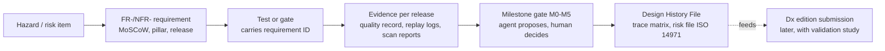
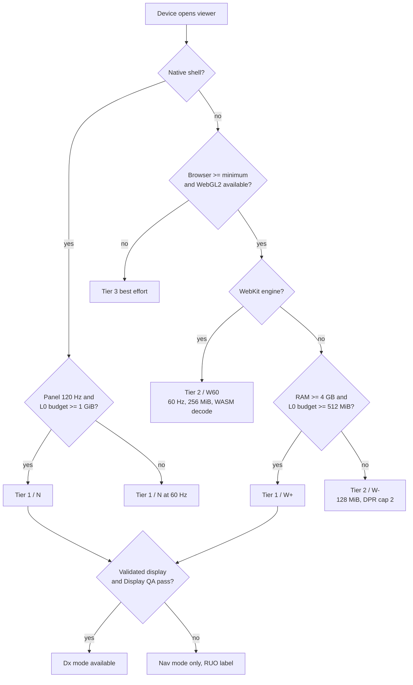
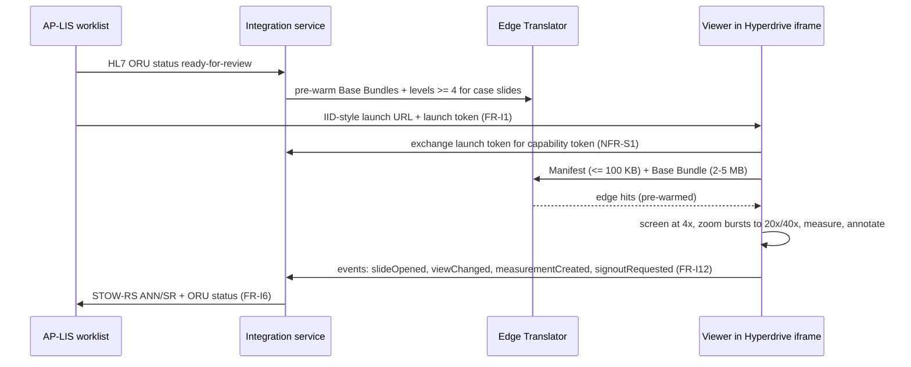

# Requirements and platform matrix

Plan section for the Stoipath WSI viewer, 2026-10-24. It turns the decided architecture (`arch/recommended.md`, hereafter "Recommended architecture", carried into the plan as "System architecture") and the research corpus (`research/01`–`11-gap-7`) into numbered, MoSCoW-prioritised, pillar-tagged requirements with a verification method each, a formats/standards matrix, a device/browser matrix with fidelity tiers, and user stories for the top workflows. Terminology, device classes (W-LAN, W-BB, W-4G, W-iPad, N-Desk, N-iPad, N-And), metrics (I2P, TTS, NTF%, BAT, BER, CHS), cache layers (L0–L5) and gates (G1–G13, M0–M5) are those of Recommended architecture §4–§5 and are not redefined here. The success metrics these requirements serve are set in "Executive summary, vision, goals, non-goals and success metrics"; release dates come from "Roadmap, milestones, team and estimates"; how each verification method is run is in "Quality, testing and performance QA"; the pillar workflows are expanded in "Product pillars: clinical use, research and education". Evidence tags follow the corpus: **[measured]**, **[model]**, **[estimate]**, **[verified]**, **[unverified]**.

> **Reviewer note (corpus gap).** The task cites a research note `11-gap-8-fda-pathway-and-free-distribution`. It does not exist in `research/` (17 notes, gap-1…gap-7). Regulatory, distribution and qualification requirements below are therefore derived from notes 09 and 11-gap-7 only, and FR-R7/FR-R8 are placeholders that "Risks, compliance, security, licensing and open questions" must complete once that note or regulatory counsel input exists.

## 1. Conventions and traceability

Every requirement has an ID (`FR-` functional, `NFR-` non-functional), a MoSCoW class (**M**ust / **S**hould / **C**ould / **W**on't-in-v1), pillar tags (**[C]** clinical, **[R]** research, **[E]** education, **[All]**), a target release (MVP month 6–7, v0.9 month 12, v1 month 18–20, later; Recommended architecture §8) and a verification method. Verification methods are the machine-checkable kinds the programme context demands; the two that need a human are marked:

| Code | Verification | Where it runs |
|---|---|---|
| `replay` | Golden gesture replay: a recorded gesture with byte-arrival times through `tick()` yields an identical request sequence and draw list on every platform (Recommended architecture §1) | PR CI (Tier 1 headless), nightly on lab devices |
| `gate` | Numeric device-lab gate on the weakest device of the named class, N ≥ 10 runs, distribution test vs baseline (note 10 §4, §6) | Nightly / pre-release, self-hosted lab |
| `golden` | Semantic draw-list goldens everywhere; exact pixels on SwiftShader/lavapipe/WARP; ≤1 LSB WebGPU-vs-WebGL2 | PR CI |
| `conf` | Conformance CI: third-party readers (wsidicom, pydicom, Orthanc, dcm4chee; zarr-python, zarrs, zarrita, tensorstore), IIIF validator, DICOMweb against IDC, LTI/QTI fixtures | PR subset, nightly full |
| `fuzz` | cargo-fuzz + ASan/UBSan, 24 h zero-crash before a reader ships; differential vs OpenSlide/tifffile/wsidicom | PR 60 s, nightly 24 h |
| `contract` | Contract tests against recorded LIS/EHR/LMS messages (Beaker sandbox, SMART launch, LTI 1.3 reference platform) | PR |
| `a11y` | axe + keyboard-only pan/zoom test + 24 px target lint + reduced-motion test | PR |
| `scan` | SBOM (SPDX/CycloneDX), OSV, `cargo-deny` licence classes, cosign signatures | PR + release |
| `human` | Pathologist reader study, counsel review, 1EdTech certification, VPAT audit, CAP validation study | Gate decision by a named human |

Requirement IDs are carried on tests and on the per-release evidence archive from the first commit, because IEC 62304 traceability cannot be reconstructed later (note 10 §1.10, note 09 §4.5). The flow:

An agent picking up work cites the FR/NFR ID in the branch and PR; CI maps the ID to its verification code; a PR that changes a Must without a passing verification of that kind cannot merge; any change to a Dx-pathway requirement (NFR-D2) is a human decision, not an agent one. The agent execution loop itself is specified in "Autonomous execution model and dissemination plan"; the repository layout that holds the IDs, tests and evidence is in "Repository structure, developer environment and first sprints".

## 2. Functional requirements

Must requirements are those without which goal 1 is unmeasurable, goal 2 is unreachable on a listed platform, or a pillar's entry workflow (§6) cannot run; everything a Must depends on is itself a Must. Items the corpus marks "design in from day one" (tile key with z/t/c, per-layer affine, provenance fields, per-layer ACL, event bus, state document) are placed at MVP even where their user-visible feature arrives later, because retrofitting them touches the scheduler and the LOD selector. Pillar tags record who the requirement serves, not who pays for it: the clinical launch contract, for example, is also how an LMS reaches the viewer.

### 2.1 Viewing core

| ID | Requirement | MoSCoW | Pillar | Release | Verify |
|---|---|---|---|---|---|
| FR-V1 | Continuous pointer-anchored pan/zoom/rotate: pinch and drag 1:1 with coalesced events; wheel accumulated and normalised (read `deltaMode` first), log-space critically-damped easing 80–120 ms; trackpad pinch (ctrl+wheel) has its own rate-limited model; inertia on release; `touch-action: none` | M | All | MVP | replay, gate |
| FR-V2 | LOD policy of Recommended architecture §4.1: L\* with s ∈ [0.5, 1.0], one-level log hysteresis, never blank (ancestor cascade, Pinned Base ≤2048² GPU-resident), never magnify at rest, fractional-LOD blend between adjacent levels, ≤100 ms cross-fade, bicubic transients, no sharpening at rest | M | All | MVP | replay, golden, gate |
| FR-V3 | Prefetch and scheduling: Base Bundle (≤4096², 2–5 MB) at open; L\*+1 in a ±300 px window at the cursor from the first input sample; destination predictor only after ≥2 consistent samples; One-Euro pan cone τ = 100/250/500 ms capped at 1 viewport/500 ms; ring 1 cellular / 2 wired; idle fan-out unmetered only; priority (tier, abs(level − L\*), focus distance); 24/64 in flight; cancel below 30 % bytes; centre tiles coalesced into ≤4 ranges | M | All | MVP | replay, gate |
| FR-V4 | Two render modes from day one. **Nav mode**: moving image, transients allowed. **Dx mode**: deterministic settled frame with a **Rendering Complete** flag, pinned libjpeg-turbo/OpenJPH, fixed resampler, server-baked ICC, no sharpening, refuses unvalidated displays and all Tier 2/3 devices (§5) | M | C | MVP (flag), Dx edition later | golden, gate, human |
| FR-V5 | Multi-slide N-up with sync modes (locked, affine offset, independent), registration import (VALIS/wsireg → NGFF RFC-5 affine), curtain/overlay compare; per-view camera transform exists from MVP | S | C, R | v1 | replay, golden |
| FR-V6 | Z-stack focus scrolling with pre-computed EDF default and z±1 prefetch; time series playback ≤10 fps; tile key carries z, t | S | C (cytology), R | v1 | replay |
| FR-V7 | Multichannel fluorescence: per-channel 16-bit textures (`r16uint`/`r16float`), per-channel window/gamma/colour/visibility, additive and max blend, ≤8 channels per pass with multipass beyond, colormaps, 8-bit windowed first paint then 16-bit on settle, only visible channels resident; settings round-trip to OME `omero` and DICOM Optical Path | M (≤8 ch), S (40-plex) | R, C | MVP / v1 | golden, gate |
| FR-V8 | Colour: scanner ICC → sRGB baked server-side for JPEG tiles; 33³ 3D-LUT in shader for raw sources; Display-P3 output where `drawingBufferColorSpace` exists; per-user colour-vision-deficiency remap LUT (Dalton 2026 YCbCr transform) | S | C, E | MVP (server ICC), v1 (LUT, P3, CVD) | golden, a11y |
| FR-V9 | µm/px is the only authority: derived magnification label, calibrated HPF area readout (Kim 2020), scale bar snapping to 1/2/5 × 10ⁿ µm drawn in the UI layer; length/area/perimeter/angle/count in slide µm | M | All | MVP | golden |
| FR-V10 | View state is the API: serialisable `{slides[], views[]: {slide, centre_um, scale, rotation, z, t, channels[], overlays[], sync}}`, compact URL form, bookmarks with thumbnails, viewport snapshot (PNG/WebP with scale bar and optional annotation burn-in), full-resolution region export as a server job (OME-TIFF/PNG) | M | All | MVP (state, snapshot), v1 (export) | contract, golden |
| FR-V11 | Input: pointer, touch, pen (pressure, tilt), keyboard; pen annotates while a finger pans; predicted input feeds the camera target only, never tile requests; gamepad/stage controllers | M; C (gamepad) | All | MVP; later | replay, a11y |
| FR-V12 | Command bus: serialisable commands shared by keyboard, control surfaces, voice, remote collaborators and the test harness | S | C, E | v1 | contract |
| FR-V13 | Per-frame quality record (level wanted vs drawn per tile, blend weight, upload age, input and present timestamps) and a performance HUD exposing NTF%, BAT, TTS, CHS, bytes; opt-in PHI-free RUM export | M | All | MVP (M0) | gate |

### 2.2 Annotations, overlays and AI results

| ID | Requirement | MoSCoW | Pillar | Release | Verify |
|---|---|---|---|---|---|
| FR-A1 | Annotation core: point, polygon, polyline, rectangle, ellipse, freehand; classes with colour; measurements; undo/redo; stable versioned IDs; per-layer ACL (hidden, reveal-on-event, author-only); op-based edits so CRDT is a transport swap | M | All | MVP | golden, contract |
| FR-A2 | Exchange: GeoJSON QuPath dialect import/export with property names verbatim; W3C Web Annotation import; DICOM Microscopy Bulk Simple Annotations (ANN) and SR TID 1500 read/write; GeoParquet 2.0 / SpatialData read | M (GeoJSON), S (DICOM), C (SpatialData) | All; C; R | MVP; v1; v1 | conf |
| FR-A3 | Massive-annotation path: ingest → vector tiles on the pixel pyramid grid (4096 extent, 64-unit buffer), per-level representation (centroids → simplified → full polygons), PMTiles-style range archive beside the pixels, packed Hilbert R-tree shipped with the tile; 10⁶ objects within the frame budget | M | R, C | MVP (path), v1 (10⁶ gate) | gate, golden |
| FR-A4 | Raster overlays as first-class tile layers: integer label pyramids (OME-Zarr `labels`, DICOM SEG BINARY/FRACTIONAL/LABELMAP), probability/parametric maps (uint8/float16, DICOM Parametric Map); nearest sampling + LUT for labels, bilinear + colormap/threshold for maps; picking by label read; mode/stride downsampling only | M | R, C | MVP (layers), v1 (DICOM adapters) | golden, conf |
| FR-A5 | Every overlay carries provenance `{producer, version, inputHash, createdAt, regulatoryStatus}`; Dx mode renders overlays deterministically; accept/reject state with write-back (FR-I6) | M | C, R | MVP (fields), v1 (write-back) | golden, contract |
| FR-A6 | Frame-budget partition 60/25/15 (pixels/overlays/UI); overlays degrade first (centroid LOD, skip label raster), pixels never | M | All | MVP | gate |
| FR-A7 | Collaboration: annotation documents as Yjs/yrs CRDTs; viewport, cursor, selection and follow-me as ephemeral awareness; presenter mode for conferences | S | E, C | v1 (presenter), later (full CRDT) | contract |

### 2.3 Sources, formats and ingest

| ID | Requirement | MoSCoW | Pillar | Release | Verify |
|---|---|---|---|---|---|
| FR-S1 | Client tile sources: Stoipath Manifest/bundle protocol; DICOMweb QIDO/WADO-RS frames incl. `frames/{list}` and `transfer-syntax=*`; OME-Zarr 0.4 and 0.5 (0.6 metadata once Viv/vizarr/ome-zarr-py read it); IIIF Image 3.0; DZI | M | All | MVP | conf |
| FR-S2 | Ingest tiers A–D, lossless-first (note 01 F1): index-in-place and serve within seconds; canonical copy written in pass two; frame-byte hash identity against vendor tiles; per-tile provenance flag (passthrough vs re-encoded); third-party-reader smoke tests in CI | M | All | MVP (A–C, OpenSlide D), v0.9 (iSyntax after counsel), v1 (long tail) | conf, fuzz |
| FR-S3 | Dual-standard single-copy canonical store (Recommended architecture §3.1): brightfield = DICOM WSI `TILED_FULL` + EOT, one instance per level, concatenation above 4 GB; multichannel/16-bit = OME-Zarr 0.5 sharded, core codecs; one Manifest `TileIndex → (object, offset, length, codec, provenance)` ≤100 KB; the other standard and OME-TIFF (for QuPath) as on-demand export jobs | M | All | MVP | conf |
| FR-S4 | Full 2× pyramid to ≤1 k top level with synthesised levels as new instances/shards (never appended into live objects); 512² grid; settled JPEG q85–90 4:4:4 (or vendor passthrough); moving tier q75 4:2:0 for H&E only, never IHC or cytology | M | All | MVP | conf, human (q policy, gap-1 F9) |
| FR-S5 | De-identification as an ingest stage producing new objects: PHI Tier 2 (label, macro, barcode, filename, free text) in a separate bucket/ACL never cached at the CDN; Tier 1 (dates, serials, operator) shifted/truncated on export; Tier 0 pyramid only at the edge; teaching-set stage adds narrative review, year-only dates, logged determination and a withdrawal hook | M | C, R, E | MVP (tiers), v1 (teaching-set stage) | conf, scan |
| FR-S6 | Derived single-file **offline pack** (pixels + annotations + items + media), never canonical; encrypted at rest on devices | S | E, C | v1 | conf |
| FR-S7 | Local-file open in desktop and Python through the in-process core: TIFF-JPEG and DICOM directly; other vendors through an isolated LGPL/GPL worker; no copyleft code in any client SDK | M | R | MVP (desktop), v0.9 (wheel) | scan, fuzz |
| FR-S8 | Façades on the Edge Translator: DICOMweb over the Zarr side; IIIF/DZI/Iris-shaped over both; off-grid IIIF regions on a rate-limited slow path; first-party clients only ever request grid-aligned tiles | M (DICOMweb/IIIF/DZI), S (Iris) | All | MVP; v0.9 | conf, gate |
| FR-S9 | Published DICOM PS3.2 conformance statement with the first DICOMweb release; DICOM WG-26 WSI connectathon within 12 months; published `TILED_FULL`+EOT and sharded-0.5 conformance corpus | M | C | MVP; v1 | conf, human |

### 2.4 Integration and embedding

| ID | Requirement | MoSCoW | Pillar | Release | Verify |
|---|---|---|---|---|---|
| FR-I1 | Versioned launch-context contract `{accession, caseId, part, block, slideIds[], studyUID, seriesUIDs[], user, role, purposeOfUse, breakGlass, locale, mode: dx / ruo / edu}` reachable by IID-style URL, `postMessage`, SMART adapter and native call; everything LIS-specific stays in an integration service | M | C, E | MVP | contract |
| FR-I2 | Embedding that survives Epic Hyperdrive and third-party pages: `<stoipath-viewer>` custom element, iframe JSON-RPC with origin allow-list, no COOP/COEP, no SharedArrayBuffer, no third-party cookies, Service Worker off the hot path | M | All | MVP | contract, gate (M4) |
| FR-I3 | `pip install stoipath`: anywidget over the web bundle (Jupyter, JupyterLab, Colab, VS Code, marimo) + PyO3 wheel for headless tiles, numpy arrays, GeoJSON/ANN/GeoArrow in and out, direct reads of both canonical stores | M | R | MVP (widget), v0.9 (wheel) | contract |
| FR-I4 | Native SDKs: XCFramework via SwiftPM `binaryTarget` with UniFFI Swift and a reference SwiftUI app; AAR via cargo-ndk with UniFFI Kotlin and a reference Compose app; `stoipath.h` C ABI (cbindgen) with a Qt `QQuickItem` sample, Panama and P/Invoke; shells ≤3–5 kLOC over core view-models | M | All | v0.9 (iPad beta), v1 | golden, gate (M3) |
| FR-I5 | Compatibility adapters: OpenSeadragon `TileSource`, OpenLayers `Source`, deck.gl layer wrapper | S | R | v1 | conf |
| FR-I6 | HL7 v2 case/status sync (ORM/OML, ORU, ADT) through the integration service, used to pre-warm the edge on `ready-for-review`; FHIR façade (`ImagingStudy`, `ImagingSelection`, `AuditEvent`, `Observation`); STOW-RS write-back of ANN/SEG/SR; UPS-RS task queue for AI | S | C | v1 | contract |
| FR-I7 | SMART App Launch 2.2 adapter (EHR embedded launch; backend services for prefetch and write-back) exchanging the SMART token for a capability token | S | C | v1 | contract |
| FR-I8 | IHE: DPIA Image Display actor, IID launch, IUA token acceptance, ATNA/FHIR `AuditEvent` export; CDS Hooks cards for AI flags | S; C | C | v1; later | conf, human (connectathon) |
| FR-I9 | Dictation co-existence (Dragon Medical One, VoiceOver PRO): text insertion, focus handling, microphone arbitration between dictation and voice navigation | S | C | v1 | contract |
| FR-I10 | Display QA module: per-display ICC, test pattern, logged pass/fail status; Dx mode consults it | M (for Dx) | C | v1 | gate, human |
| FR-I11 | Cloud DICOM store adapters (Google Healthcare API, AWS HealthImaging, Azure) as systems of record behind the Edge Translator, never as the hot tier | S | C, R | v1 | conf |
| FR-I12 | Typed, batched, versioned event bus: `slideOpened`, `viewChanged` (rAF-throttled), `tileSettled`, `annotationCreated/Updated/Selected`, `measurementCreated`, `aiResultArrived/Accepted/Rejected`, `caseStatusChanged`, `signoutRequested`, `shareCreated`, `displayQaStatus`; events map 1:1 to xAPI statements and `AuditEvent`s; no subscriber blocks a frame | M | All | MVP | contract, gate |
| FR-I13 | Plugin API v1: tile source, raster/vector layer (GPU-ready buffers only), tool, panel, command; manifest-declared (OHIF/npe2 model); no plugin callback inside the render loop; EMPAIA EAD and MONAI Label as AI-hosting targets | S | R, C | v1 | contract, gate |

### 2.5 Education

| ID | Requirement | MoSCoW | Pillar | Release | Verify |
|---|---|---|---|---|---|
| FR-E1 | Curated collections: ordered sets of (slide, view state, annotation layers); tags from PCME objectives, organ, stain, difficulty; licence registry per slide (licence, consent basis, de-identification record, withdrawal hook) | M | E | MVP | contract |
| FR-E2 | Guided tours: step = view state + highlighted annotation + text/audio/video; autoplay with pause; branching; **record-a-tour** from live navigation | M | E | MVP | contract, a11y |
| FR-E3 | Items: MCQ, multi-select, ordering, free text with rubric, and the signature **region-marking item** scored by µm-aware geometry (point-in-polygon, IoU threshold, nearest distance, zoom-gated credit) with keyboard and text alternatives; item statistics; QTI 3.0 import/export of MCQs | M (items), S (QTI) | E | MVP; v1 | contract, a11y |
| FR-E4 | LTI 1.3 + LTI Advantage (Deep Linking, Assignment and Grade Services, Names and Roles), Dynamic Registration where supported, one "assignment" placement holding a tour, quiz or case; targets Canvas, Brightspace, Blackboard Ultra; 1EdTech certification | M | E | MVP (launch, AGS), v1 (certified) | contract, human |
| FR-E5 | xAPI (IEEE 9274.1.1-2023) statements generated from the event bus; SCORM 1.2 wrapper export for CME shops; cmi5 later | S | E | v1; later | contract |
| FR-E6 | Spaced-retrieval scheduler (FSRS/SM-2 class) prioritising confidently-wrong items; confidence rating per answer; mastery per tag; Anki export | S | E | v1 | contract |
| FR-E7 | Case-based modules (vignette → gross → H&E → IHC → report) with reveal stepping, hidden answer-key layers and compare-to-expert report | M | E | MVP | contract |
| FR-E8 | Unknown-slide conference archive (RecutClub pattern) with hidden diagnoses; **virtual microscopy exam mode** mimicking the ABPath/RISE experience (timed, image items, no glass) | M (archive), S (exam mode) | E | MVP; v1 | contract |
| FR-E9 | CME records without own accreditation: attestation, evaluation form (ACCME Criterion 11), faculty disclosure fields (Standards for Integrity and Independence), certificate PDF with activity ID, credit hours and topic tags (ethics, opioid), 6-year record export (CSV/xAPI), PARS-compatible CSV for the joint provider | M | E | v1 | contract, human (joint-provider agreement) |
| FR-E10 | Learning analytics: heatmap vs expert path, time-to-first-zoom, dwell on critical ROI, cohort vs expert overlay; anonymised xAPI research export; learner-visible data, aggregate-only cohort views | S | E, R | v1 | contract |
| FR-E11 | Classroom offline/low-bandwidth: offline pack (FR-S6) plus a classroom edge cache; low-resolution-first; multilingual narration tracks | S | E | v1 | gate (classroom profile) |
| FR-E12 | Faculty authoring ≤5 min per case: one-click sign-out annotations → teaching layers; CSV/QTI bulk import; AI-drafted distractors with mandatory faculty review | M | E | MVP (conversion), v1 (bulk, drafts) | contract, human |

### 2.6 Regulatory, quality and operations tooling

| ID | Requirement | MoSCoW | Pillar | Release | Verify |
|---|---|---|---|---|---|
| FR-R1 | CAP validation tooling in the product: blinded re-review mode, random case sampling from the LIS, washout tracking, intra-observer concordance export (≥60 cases, ≥2-week washout, per application) | M | C | v1 | contract, human |
| FR-R2 | Audit: token issuance, session open/close, sampled viewport trail, break-glass events as FHIR `AuditEvent`/ATNA; CDN logs token-scrubbed and never the audit trail | M | C | MVP (events), v1 (export) | contract, scan |
| FR-R3 | Labelling and mode enforcement: every build labelled RUO until a Dx edition exists; Dx mode refuses unvalidated displays and Tier 2/3 devices; intended-use statement shipped with every SDK | M | C | MVP | golden, human |
| FR-R4 | Telemetry kill switch and air-gap mode (no external fonts, IdP, telemetry or update calls) | M | C | MVP | contract |
| FR-R5 | Release hygiene: SBOM, signed artefacts, OIDC publishing, lockstep SDK semver, version/UDI-ready identifiers on every artefact | M | All | MVP | scan |
| FR-R6 | Deterministic replay harness with simulated network for the Stage-1 pathologist reader study (note 11-gap-1 F9) | S | All | Stage 1 | replay, human |
| FR-R7 | *Placeholder.* Deployment qualification self-check gating Dx-edition activation: display QA pass (FR-I10), CAP validation capability (FR-R1), IT security attestation, training completion. Criteria to be defined in "Risks, compliance, security, licensing and open questions" | M (for Dx) | C | v1 | contract, human |
| FR-R8 | *Placeholder.* Post-market hooks that survive a free licence: complaint intake, field-notice distribution, forced-update channel for security patches, version inventory per site | M (for Dx) | C | v1 | contract, scan |

## 3. Non-functional requirements

Non-functional requirements are written as gates on named device classes rather than as averages, because the failure a pathologist notices is the p95 tile that lands late at the end of a zoom burst, not the median (note 02, note 11-gap-1 F2). Three conventions apply throughout. Latency gates are relative to the platform floor (REF) measured with the photodiode rig on the same device, so the viewer is held to "adds nothing of its own" rather than to a number the browser compositor cannot reach. Every figure tagged [model] is a planning value that Stage 0 (G11–G13) and the M0–M2 gates replace with measurements; the gate, not the model, is the requirement. Tier 2 classes receive bounded-transient promises, never "instant", and the UI states the tier when it limits a mode.

### 3.1 Performance per device class (NFR-P)

The warm path adds nothing of ours to the platform floor; the cold path is won by residency (Recommended architecture §4.4). Gates are relative to **REF** (CSS-transform page on web, raw Metal/Vulkan quad natively) on the same device and firmware, because the compositor floors are models until G11 measures them. All values p50 / p95 in ms unless stated; sources: Recommended architecture §4.4 [model], note 10 §6, note 04 F8.

| ID | Metric | W-LAN | W-BB | W-4G | W-iPad | N-Desk | N-iPad | N-And |
|---|---|---|---|---|---|---|---|---|
| NFR-P1 | Warm I2P, pinch/drag, gate | ≤ REF + 1 frame (model 40/50) | 40/50 | 45/55 | 45/55 | ≤ REF-quad + 1 interval (20/30) | 25/33 | 40/55 (65/90 at 60 Hz) |
| NFR-P2 | TTS after last input, gate | ≤50 / ≤100 | ≤100 / ≤300 | ≤250 / ≤700 | ≤100 / ≤300 | ≤50 / ≤100 | ≤100 / ≤300 | ≤250 / ≤700 |
| NFR-P3 | NTF% during gesture, gate | ≤5 %, ≤1 level | ≤20 %, ≤1 level | ≤50 %, ≤2 levels (≥2 at ≥20× logged) | ≤20 %, ≤1 level | ≤5 %, ≤1 level | ≤20 %, ≤1 level | ≤50 %, ≤2 levels |
| NFR-P4 | Cold destination fill, 20 tiles sharp [model, informational] | ≈85 / 150 | ≈230 / 650 | ≈650 / 3,000 (mitigated 450 / 2,000) | ≈250 / 800 | ≈40 / 70 | ≈190 / 600 | ≈600 / 2,900 (mitigated 400 / 1,900) |
| NFR-P5 | Frame time p99 during gesture | ≤16.7 (≤8.3 on 120 Hz panels) | ≤16.7 | ≤16.7 | ≤16.7 | ≤8.3 | ≤8.3 | ≤8.3 (≤16.7 at 60 Hz) |
| NFR-P6 | Blank-pixel frames; pop-in after settle | 0; 0 | 0; 0 | 0; 0 | 0; 0 | 0; 0 | 0; 0 | 0; 0 |
| NFR-P7 | CHS (cache hit at settle) on the pathologist path | ≥95 % | ≥95 % | ≥85 % | ≥90 % | ≥95 % | ≥90 % | ≥85 % |
| NFR-P8 | BER (destination-level residency at burst end, gap-1) | ≥95 % | ≥90 % | ≥70 % | ≥90 % | ≥95 % | ≥90 % | ≥70 % |

Cross-cutting performance requirements:

| ID | Requirement | Value | Verify |
|---|---|---|---|
| NFR-P9 | Main-thread task during gestures | none > 8 ms (web); no `tick()` > 3 ms wasm | gate |
| NFR-P10 | Decode + upload per 512² tile on the floor phone | decode p95 ≤ 4 ms per worker (WASM libjpeg-turbo, measured at G13); upload ≤ 2 ms (G5) | gate |
| NFR-P11 | Web module size and start | floor module ≤1.0 MB gz (target 0.6), full ≤1.3 MB (G1); cold compile + first frame ≤300 ms floor Android, ≤150 ms iPhone 12 (G2); decoders as separate 60–90 KB gz worker modules | gate |
| NFR-P12 | Slide open to first pixels (TTFSV) | ≤1 s W-LAN/W-BB, ≤3 s W-4G, with Manifest ≤100 KB and Base Bundle 2–5 MB [estimate; MSK baseline 3.9 s case open] | gate |
| NFR-P13 | Edge Translator hot service time | p99 ≤10 ms per container path (Zarr shard range, DICOM EOT frame, 15-tile bundle) on a 2-vCPU container and in a Worker | gate (M1) |
| NFR-P14 | Pan quality (gap-1 F8: pan co-equal with zoom) | edge pop-in during slow pans = 0 at ≤1 viewport/500 ms on W-LAN/W-BB; pan-only requests logged separately | replay, gate |
| NFR-P15 | Annotation layers | 1 M-object layer within the 25 % overlay frame budget on N-Desk and W-LAN; degrades to centroid LOD elsewhere, never stalls pixels | gate (M5) |

### 3.2 Memory (NFR-M)

| ID | Requirement | Verify |
|---|---|---|
| NFR-M1 | L0 budgets per class: W-LAN 512 MiB–1 GiB, W-BB 512 MiB, W-4G 128 MiB, W-iPad 256 MiB, N-Desk 2–4 GiB, N-iPad 1–2 GiB dynamic, N-And 256 MiB–1 GiB dynamic; L1 ≤25 % of L0; native budgets from `os_proc_available_memory` / `ActivityManager.MemoryInfo` + `onTrimMemory`, never `isLowRamDevice` | gate |
| NFR-M2 | Pinned Base ≤2048² GPU-resident (≈23 MiB); Base Bundle encoded in L1/L2, GPU-pinned only when L0 ≥512 MiB; texture arrays ≤64 layers × 512² RGBA8 (64 MiB each), no mips, so a 128 MiB phone holds two | gate, golden |
| NFR-M3 | Upload budget per frame: ≤2–4 MiB web phones, ≤16 MiB web desktop, ≤8 MiB per interval native phones, ≤32 MiB iPad Pro/M-series; centre-first order; online budget from timer queries | gate |
| NFR-M4 | Peak footprint ≤60 % of the measured kill threshold on W-iPad and W-4G; 30 min soak without jetsam/LMK (M2); 2 h random-walk soak natively (M3); JS heap ≤300 MB on iOS web | gate |
| NFR-M5 | Fluorescence: only visible channels resident; 8-bit first paint; channel-count-aware budget; 16-bit label LUT (256 KB) instead of RGBA label textures | gate |
| NFR-M6 | Context loss, visibility change and memory warnings rebuild L0 from L1/L2 without a blank frame | replay, gate |

### 3.3 Bandwidth and network (NFR-B)

| ID | Requirement | Verify |
|---|---|---|
| NFR-B1 | Destination fill ≈1.6 MB (20 tiles × ~80 KB q85–90 4:4:4); cellular moving tier ≈1.0 MB with DPR capped at 2 on metered links (`saveData`, `effectiveType`); centre 9 tiles ≈0.5 MB coalesced | gate |
| NFR-B2 | Prefetch ≤50 % of measured bandwidth and ≤25 % of request slots; waste ≤50 % at Stage 1 (Kayser 2009 measured 74 % naive), tightening to 15–40 % with destination prediction | gate |
| NFR-B3 | Transport: HTTP/3 with 0-RTT for tile GETs and `HTTPS` RR `alpn=h3`; HTTP/2 first-class (Samsung Internet has no HTTP/3); HTTP/1.1 is Tier 3; immutable path-only tile URLs, `Cache-Control: immutable`, no custom request headers on the tile path (no `Authorization`, no `traceparent`), `Timing-Allow-Origin` + `Server-Timing` on every tile | conf, gate |
| NFR-B4 | Bandwidth floors communicated in the UI: ≥20 Mbps "instant", 8–10 Mbps degraded (moving tier, ring 1), <8 Mbps warns the user (Vodovnik 2015, Rao 2021) | gate (netem profiles) |
| NFR-B5 | Per-session bytes instrumented from M0 to replace the 100–120 MB/session planning assumption | gate |

### 3.4 Offline and local-first (NFR-O)

| ID | Requirement | Verify |
|---|---|---|
| NFR-O1 | L2 (OPFS sync access handles in a worker / SQLite natively) is a refillable cache: Safari deletes it after 7 days without interaction regardless of `persist()`; Manifest re-validation by version, never trust local presence | gate (Safari) |
| NFR-O2 | Case open pre-downloads levels ≥4 of every slide in the case (≈10 MB/slide); broadband adds level 3 in the background; explicit "download case" (1–4 GB/slide) with progress and `navigator.storage.persist()` | gate |
| NFR-O3 | Offline pack opens with zero network on desktop, iPad and classroom edge; identical key scheme on disk and web so packs are a copy, not a conversion | conf, gate |
| NFR-O4 | Air-gapped topology: no dependency on external fonts, telemetry, IdP or update servers; local OIDC; media-based updates | contract |
| NFR-O5 | Device storage encrypted at rest with MDM wipe for any PHI-bearing offline content (HIPAA breach safe harbour) | scan, human |

### 3.5 Security and privacy (NFR-S)

| ID | Requirement | Verify |
|---|---|---|
| NFR-S1 | Tile authorisation: prefix-scoped capability token in the query (ES256 JWT or macaroon), TTL 5–15 min with silent refresh, validated at the edge, stripped from a path-only cache key with `Origin` excluded; `Referrer-Policy: no-referrer`; tokens scrubbed from logs; no PHI in any URL path | conf, scan |
| NFR-S2 | Identity: OIDC with externally supplied tokens (hospital IdP, SMART launch, IHE IUA); RBAC/ABAC decided at token issuance (slide/study/collection grain); break-glass flag mirrored from the EHR; MFA via the IdP | contract |
| NFR-S3 | PHI tiers as in FR-S5; label/overview/barcode never reach a CDN; de-identified exports shift dates and serials | conf |
| NFR-S4 | Supply chain: SBOM (SPDX and CycloneDX) per release, OSV monitoring, cosign-signed artefacts and update channel, OIDC trusted publishing on npm/PyPI/crates.io, `cargo-deny` enforcing permissive-only client dependencies (LGPL/GPL isolated server-side) | scan |
| NFR-S5 | Parsers of untrusted slide bytes sandboxed (wasm on web, separate process on desktop/server, gVisor/Firecracker in ingest) and fuzzed 24 h with zero crashes before shipping (OpenSlide 4.0.1 fixed two parser CVEs) | fuzz |
| NFR-S6 | Encryption in transit (TLS 1.3, QUIC) and at rest; 72-hour restore drill; annual penetration test; `security.txt` and coordinated disclosure; structured to the FDA premarket cybersecurity guidance / §524B deliverables (SBOM, vulnerability plan, secure-development evidence) and the EU CRA, which covers an RUO viewer **[regulatory dates unverified in corpus]** | scan, human |
| NFR-S7 | Telemetry PHI-free by construction; slide IDs treated as linkable; RUM vendor under BAA or self-hosted; kill switch (FR-R4) | contract, scan |

### 3.6 Accessibility (NFR-A)

| ID | Requirement | Verify |
|---|---|---|
| NFR-A1 | WCAG 2.2 AA for every surface; a VPAT from a third-party audit before any UT procurement (ADA Title II WCAG 2.1 AA for public entities; Texas TAC 206/213 **[deadline status unverified]**) | a11y, human |
| NFR-A2 | SC 2.5.7: single-pointer alternative to every drag (pan buttons, tap-to-centre, click-to-place vertices); SC 2.5.8: 24×24 CSS px targets | a11y |
| NFR-A3 | Keyboard: arrows pan, +/−/0 zoom, Home overview, R rotate; visible focus; canvas `role="application"` with a live region announcing position, magnification and selection; annotation lists are real lists | a11y |
| NFR-A4 | `prefers-reduced-motion` disables inertia and cross-fades without slowing content; 4.5:1 UI contrast; no meaning by colour alone (legends with patterns and labels); CVD remap (FR-V8) and author-side deuteranopia/protanopia simulation | a11y, golden |
| NFR-A5 | Every graphical assessment item (FR-E3) has a keyboard path and a text alternative; score is never withheld for input modality | a11y, contract |

### 3.7 Internationalisation (NFR-L)

| ID | Requirement | Verify |
|---|---|---|
| NFR-L1 | All UI strings via ICU MessageFormat/Fluent; `Intl` for numbers, dates, plurals and units (µm, mm²); RTL layout; locale-aware measurement units with ASCII fallback where fonts lack µ | contract |
| NFR-L2 | No text rasterised into the GPU canvas except scale-bar numerals from a glyph atlas; annotations and UI composited in slide coordinates above the image | golden |
| NFR-L3 | Tours carry per-language narration and caption tracks; DICOM character sets declared in the conformance statement; UTF-8 everywhere else | conf |

### 3.8 Determinism, reliability and maintainability (NFR-D)

| ID | Requirement | Verify |
|---|---|---|
| NFR-D1 | Golden gesture replay yields identical request sequences and draw lists on every platform; decoder identity 1,000/1,000 hashes native/wasm-SIMD/wasm-scalar/arm64 (G7; failure stops the plan) | replay, golden |
| NFR-D2 | Dx pathway versioned: codec build, resampler, ICC placement, blend policy; any change is a re-verification event with golden re-runs; browser `createImageBitmap` only after per-build self-certification (G8), never on Safari in Dx | golden, gate |
| NFR-D3 | WebGPU vs WebGL2 vs native goldens ≤1 LSB per channel; texture-array correctness for every layer count 1…64 (G4) | golden |
| NFR-D4 | wgpu vendored and pinned per release train; upgrade window two weeks gated on G3/G4/G10; Safari WebGL2 default with per-major WebGPU allow-list and "Restart with WebGL2" | golden, gate |
| NFR-D5 | Lockstep SDK semver across npm/crates/PyPI/SwiftPM/Maven; `cargo-semver-checks` and api-extractor as PR gates; C ABI frozen at 1.0; MSRV N−2 | scan |
| NFR-D6 | Requirement IDs on every test; evidence archived per release; IEC 62304 Class B assumed; a waiver on any gate metric is explicit, reviewed by a human and shown on the public dashboard | scan, human |

## 4. Supported formats and standards matrix

Passthrough tiers from note 01 F1: **A** bytes served as-is, **B** header splice, **C** DCT-domain re-mux, **D** decode once at ingest. Fidelity "lossless" means the scanner's compressed bytes are preserved exactly; the per-tile provenance flag (FR-S2) records which tier applied.

Priority order follows expected volume and passthrough fidelity (note 01 §a.5): DICOM, SVS-JPEG, NDPI and Philips TIFF first, because they are lossless and cover the FDA-cleared scanner estate and TCGA; MRXS, BIF and iSyntax second, because they need decode-once and, for iSyntax, IP review; CZI, VSI and OME-Zarr with the fluorescence roadmap; legacy formats last. Vendor originals go cold once the canonical copy hash-matches the source. A Tier D re-encode is recorded as one lossy generation in provenance so an AI consumer (which needs PSNR ≥40 dB for feature stability, Chen 2020) can exclude or weight it.

### 4.1 Slide formats (input)

| Format | Tier | Ingest path (licence class) | Fidelity | Release | Pillar |
|---|---|---|---|---|---|
| DICOM WSI, JPEG baseline (GT 450 DX, IMS exports, IDC) | A | own `dicom-rs` indexer; wsidicom oracle | lossless | MVP | C, R, E |
| DICOM WSI, HTJ2K / J2K / JPEG-LS / JXL frames | A | served as-is; WASM decode (OpenJPH) or translator transcode to JPEG for W-4G/W-iPad | lossless (transcode optional) | MVP (reversible HTJ2K), v0.9 (lossy, after identity) | C, R |
| Aperio SVS, JPEG | B | own TIFF/`JPEGTables` splice; opentile/tifffile oracles | lossless | MVP | C, R, E |
| Aperio SVS, JPEG 2000 (TCGA-era) | A bytes, not browser-decodable | transcode once: J2K → HTJ2K lossless where tooling proves it, else JPEG q≥90; cuCIM for batch | one generation (JPEG) or lossless (HTJ2K) | MVP | R |
| Hamamatsu NDPI | C (JPEG levels), D (JPEG XR levels) | opentile re-mux via libjpeg-turbo transforms; OpenSlide for JXR levels | lossless / one generation | MVP | C, R |
| Philips TIFF export | B | own TIFF; blank-tile synthesis for sparse tiles | lossless | MVP | C |
| Philips iSyntax | D | libisyntax (BSD-2) in an isolated worker after IP counsel; Philips SDK as sealed oracle only | one generation | v0.9 | C |
| 3DHISTECH MRXS | D | OpenSlide 4.0.1 (LGPL, isolated) | one generation | v0.9 | C, R |
| Roche/Ventana BIF | D at level 0 | OpenSlide 4.0.1 (isolated) | one generation | v0.9 | C |
| Leica SCN (brightfield / fluorescence) | B per region / D | own TIFF per region; Bio-Formats (GPL, isolated) for fluorescence | lossless / one generation | v0.9 / v1 | C, R |
| OME-TIFF, QPTIFF (Akoya), generic tiled TIFF/BigTIFF | A/B (JPEG/WebP/JXL tiles), D (LZW/zstd raw → Zarr) | own `tiff` reader → OME-Zarr 0.5 for multichannel | lossless | MVP | R |
| OME-Zarr 0.4 / 0.5 (0.6 metadata) | A | `zarrs` / zarrita; re-shard to 512² 8×8 if needed | lossless | MVP / v1 | R |
| Zeiss CZI (JPEG XR, zstd) | D | libCZI (LGPL-3, server only) / slideio / bioformats2raw ≥0.12 + `zarrs` re-shard | one generation | v1 | R |
| Olympus/Evident VSI | D | slideio / Bio-Formats (isolated) | one generation | v1 | R |
| Huron, Motic, Mikroscan, ARGOS AVS | B | own TIFF; opentile oracle | lossless | v0.9 | C |
| Sakura svslide, Trestle, VMS/VMU | D | OpenSlide (isolated) | one generation | v1 | legacy |
| DZI, IIIF Image 3.0 (as sources) | A | client adapters | as published | MVP | E, R |

### 4.2 Codecs

| Codec | Role | Platforms | Dx mode | Evidence |
|---|---|---|---|---|
| JPEG baseline (libjpeg-turbo 3.2) | sole hot-path brightfield codec; settled q85–90 4:4:4; moving q75 4:2:0 H&E only | all; one C codebase native + wasm `-msimd128` | yes (bit-identical measured native/wasm) | note 02 F3, gap-2 §2.3 |
| HTJ2K (OpenJPH, one pinned version) | 16-bit, DICOM .201/.202/.203, archive | all via WASM/FFI | reversible only until lossy identity verified | gap-2 §2.3 |
| zstd + bitshuffle, PNG16 | multichannel 16-bit in OME-Zarr core codecs | all | yes | note 02 F3 |
| JPEG 2000 Part 1 | ingest transcode only (12–20 ms/tile native) | server | no | note 02 F3 |
| JPEG XL | archive tier benchmark (lossless JPEG recompression); opt-in `Accept`-negotiated delivery on Chrome 155+/Firefox 158+/Safari 17+ (stills only); never Edge/Samsung Internet | capable browsers only | no | gap-3 §1a–1d |
| WebP, AVIF | opt-in bandwidth variants on ≥4 performance cores; never W− | capable | no | note 02 F3 |
| JPEG XR, iSyntax wavelet | ingest only | server | no | note 01 F2 |

### 4.3 Standards and protocols

| Standard | Our role | Release | Pillar | Evidence of conformance |
|---|---|---|---|---|
| DICOM WSI (Sup 145) `TILED_FULL` + EOT, Concatenation; Sup 235 HTJ2K; Sup 232 JXL | writer (canonical), reader | MVP | C, R | wsidicom/pydicom/Orthanc/dcm4chee CI; PS3.2 conformance statement; WG-26 connectathon |
| DICOMweb QIDO-RS, WADO-RS (`frames/{list}`, `transfer-syntax=*`), STOW-RS, UPS-RS | client MVP; façade MVP; STOW/UPS v1 | MVP / v1 | C, R | IDC and Google/AWS/Azure store tests |
| DICOM ANN (Sup 222), SEG incl. LABELMAP (Sup 243), Parametric Map, SR TID 1500 | read/write | v1 | C, R | highdicom round-trip |
| OME-Zarr 0.4, 0.5 (Zarr v3 `sharding_indexed`), 0.6 metadata | writer (canonical multichannel), reader | MVP / v1 | R | zarr-python, zarrs, zarrita, tensorstore, Viv/vizarr CI |
| OME-TIFF | export job (QuPath interop) | MVP | R | Bio-Formats read |
| IIIF Image API 3.0 (`info.json`, grid-aligned fast path, off-grid slow path); IIIF Content State | server façade, client source | MVP | E, R | IIIF validator |
| DeepZoom DZI | façade, source | MVP | E | OSD smoke |
| Iris RESTful API shape | façade | v0.9 | R | IrisTileSource smoke |
| GeoJSON (QuPath dialect), W3C Web Annotation, GeoParquet 2.0 / GeoArrow, SpatialData | import/export | MVP / v1 | R, E | Paquo, Annotorious, scverse fixtures |
| HL7 v2.5.1 ORM/OML/ORU/ADT; IHE PaLM DPIA Rev 1.4 (Image Display), DPOW when final; IHE RAD IID; IHE ITI IUA, ATNA | integration service | v1 | C | contract tests, connectathon |
| HL7 FHIR R4/R5 (`ImagingStudy`, `ImagingSelection`, `DiagnosticReport`, `Observation`, `AuditEvent`, `Task`); SMART App Launch 2.2; CDS Hooks 2.0.1 | façade and adapters | v1 / later | C | Inferno-style validators |
| LTI 1.3 + Advantage (DL, AGS, NRPS), Dynamic Registration | tool | MVP → v1 certified | E | 1EdTech reference platform, certification |
| QTI 3.0 (MCQ interchange), xAPI IEEE 9274.1.1-2023, SCORM 1.2, cmi5 | import/export | v1 / later | E | fixture round-trip |
| WCAG 2.2 AA; ICC v4 scanner profiles; OIDC/OAuth 2.0 PKCE | all surfaces | MVP | All | axe, VPAT, LUT goldens |

## 5. Device, platform and browser support matrix

### 5.1 Fidelity tiers

The task's three tiers map onto Recommended architecture §5's fidelity tiers **N / W+ / W60 / W−**; both labels are used so that gates and marketing speak the same language. A tier is assigned by measured device class, not by brand or version: the same Chrome build is Tier 1 on a 4 GB Pixel and Tier 2 on a 3 GB Mali-G52 phone, and Safari is Tier 2 on every iPad until the native shell makes the same hardware Tier 1. The tier is computed at start-up from the renderer backend, the granted memory budget and the measured frame cadence, is logged in telemetry, and is shown to the user whenever it limits a mode.

| Tier | Maps to | Definition | Gates applied | Dx mode |
|---|---|---|---|---|
| **Tier 1 — full fidelity** | **N** (native shells) and **W+** (web at display rate with WebGL2 or allow-listed WebGPU, L0 ≥512 MiB) | Classes W-LAN, W-BB, N-Desk, N-iPad, N-And ≥6 GB; 120 Hz where the panel allows; GB-class or ≥512 MiB L0; threads or 3 decode workers | All of §3.1 at the class values; §3.2 budgets | Yes on N-Desk and W-LAN/W-BB with a validated display and FR-I10 pass; never on tablets/phones until a display-agnostic clearance exists |
| **Tier 2 — degraded, bounded** | **W60** (Safari/WKWebView: 60 Hz cap, 256 MiB L0, WASM decode always, WebGL2 default) and **W−** (floor Android 3–4 GB, Mali-G52/G57, Adreno 610, Xclipse, WebGL2, 128 MiB L0) | Classes W-iPad, W-4G; DPR capped at 2 on metered links; moving tier; ≤2-level transient on radio | NFR-P2/P3/P6 at class values; "never blank, zoom-out and revisits instant, centre sharp ≈300 ms after burst end on radio"; M2 soak | No |
| **Tier 3 — best effort** | below the floor | iOS/iPadOS 15.2–16.3 Safari (no WASM SIMD → scalar decoder); Android 9/API 28 with GLES 3.0 WebGL2; ≤2 GB / Android Go; HTTP/1.1-only proxies; remote desktop (Citrix/VDI); Firefox ESR older than 111; armeabi-v7a native | Functional E2E only, no performance gate; same correctness goldens; telemetry labels the tier | No |

### 5.2 Browsers (web shell, PWA, embeds)

Minimum = the oldest version that has WebGL2, wasm SIMD and OPFS sync access handles (MDN BCD, caniuse, note 06 §2.1, gap-3). Below minimum is Tier 3 if WebGL2 exists at all. Versions current on 2026-10-24: Chrome 156, Firefox 158, Safari 27, Samsung Internet 30, Android WebView 156 (gap-3).

| Browser | Minimum (Tier 2 or better) | Renderer | Decode | Tier ceiling | Notes |
|---|---|---|---|---|---|
| Chrome / Edge desktop (Windows x64/arm64, macOS, Linux, ChromeOS) | 102 | WebGL2 floor; WebGPU 113+ (Linux 144/147 per GPU) as enhancement | WASM libjpeg-turbo; `createImageBitmap` after G8 self-certification | Tier 1 / W+ | Windows arm64 WebGPU behind flag → WebGL2 |
| Chrome Android, Android WebView | 109 | WebGL2 floor; WebGPU 121+ (Android 12+, ARM/Qualcomm/Intel), compat mode 146+ (Android 10+ GLES 3.1); Xclipse blocklisted → WebGL2 | as above | Tier 1 / W+ on ≥4 GB, Tier 2 / W− on 3–4 GB | WebView: no SharedArrayBuffer (we never need it); WebGPU disputed → WebGL2 |
| Samsung Internet | Chromium-143 base (SI 30) or later | WebGL2 (Exynos/Xclipse always), WebGPU plausible on Snapdragon [unverified] | WASM | Tier 2 / W− typical | No HTTP/3, no JXL; reference devices: one Exynos and one Snapdragon Galaxy |
| Firefox desktop | 111 | WebGL2 floor; WebGPU 141 (Windows), 145–147 (macOS); Linux Nightly only → WebGL2 | WASM; `createImageBitmap` after G8 (libjpeg-turbo, fancy/ISLOW) | Tier 1 / W+ | `deltaMode` read-order rule (FR-V1) |
| Firefox Android | 111 | WebGL2 | WASM; `ImageDecoder` probably exposed — verify on device | Tier 2 / W− | — |
| Safari macOS | 16.4 | WebGL2 default; WebGPU 26+ allow-listed per major after soak | WASM always in Dx; `createImageBitmap` allowed in Nav after G5/G8 | Tier 1 / W+ at 60 Hz; 120 Hz only if the user flips the flag | ITP 7-day OPFS deletion (NFR-O1) |
| Safari iOS / iPadOS, WKWebView, Home-Screen PWA | 16.4 (15.2–16.3 Tier 3) | WebGL2; WKWebView never 120 Hz | WASM always | Tier 2 / W60 | 256 MiB L0; WebContent jetsam; `persist()` does not exempt ITP |
| Epic Hyperdrive (Chromium) iframe, WebView2 Evergreen | tracks Edge/Chromium stable | as Chrome desktop | as Chrome | Tier 1 / W+ | iframe-safe, no cookies, capability token (FR-I2) |
| JavaFX WebView (QuPath), Electron-hosted LIS clients | n/a | no WebGL assumed | — | Tier 3 / not supported | QuPath interop via DICOM/OME-TIFF export and the C ABI, not the web component |

### 5.3 Operating systems, shells and SDK hosts

| Platform | Minimum | Delivery | Renderer / decode | Tier | Release |
|---|---|---|---|---|---|
| iPadOS / iOS native | 17 (CAMetalDisplayLink); 15–16 degraded via CADisplayLink; Metal `apple5` (A12) or later | XCFramework (SwiftPM `binaryTarget`, UniFFI Swift) + reference SwiftUI app | wgpu Metal with `PresentSink`/`TileTextureStore` escape hatches; libjpeg-turbo NEON | Tier 1 / N (floor 2 intervals, typical 3 at 120 Hz [model]) | beta v0.9, GA v1 |
| Android native | 10 / API 29; arm64-v8a (armeabi-v7a Tier 3); Vulkan 1.1 with GLES retry; device allow/deny list | AAR (cargo-ndk, UniFFI Kotlin, JNA ≥5.12) + reference Compose app | wgpu Vulkan/GLES; SurfaceView; `postVsyncCallback` on API 33+ | Tier 1 / N on ≥6 GB; Tier 2 on 3–4 GB | v1 |
| Windows | 10 1803+ (WebView2 Evergreen), x64 and arm64 | Tauri 2 (signed MSIX/NSIS) | wasm in webview → native wgpu window at v0.9 | Tier 1 / W+ → N | MVP → v0.9 |
| macOS | 12+ [estimate; Tauri 2 supports 10.15+] | Tauri 2 (notarised) | as Windows | Tier 1 | MVP → v0.9 |
| Linux | current Ubuntu LTS / Fedora with WebKitGTK ≥2.40 [unverified]; AppImage/Flatpak | Tauri 2 | WebKitGTK has no WebGPU → WebGL2, native wgpu window at v0.9 | Tier 2 → Tier 1 at v0.9 | MVP → v0.9 |
| Python / Jupyter | CPython 3.10+ abi3 wheels (manylinux_2_28 x64/arm64, macOS, Windows); anywidget 0.11 in JupyterLab 4, Notebook 7, Colab, VS Code, marimo | `pip install stoipath` | host browser (tier of the host browser) + PyO3 in-process core | tier of host | MVP (widget), v0.9 (wheel) |
| Qt / C++ / .NET / Java hosts | Qt 6; .NET 8; Java 21 (Panama) | `stoipath.h` C ABI, `QQuickItem` sample, Maven/NuGet | wgpu into a host surface | Tier 1 / N | v1 |
| Edge Translator | Cloudflare Worker (128 MB, Paid plan), regional Fargate/EC2 behind CloudFront, on-prem binary behind Caddy/nginx, in-process library | one crate graph, three builds | — | NFR-P13 | MVP |

### 5.4 Reference device lab (every gate names one of these)

| Class | Device (replace models as the market moves; note 10 F6) | Tier |
|---|---|---|
| W-4G floor | 3 GB Android 11–12, Mali-G52 or Adreno 610, 60 Hz; plus an Android 11 device without WebGPU | Tier 2 / W− |
| W-4G Exynos | Galaxy S24 EU / S23 FE (Xclipse, WebGL2 only) and a Snapdragon Galaxy | Tier 2 / W− |
| W-iPad floor | iPad 8th gen (A12, 3 GB, 60 Hz) on current iPadOS; an iPad on iPadOS 17/18 (pre-WebGPU Safari) | Tier 2 / W60 |
| W-BB / W-LAN | Intel iGPU Windows laptop; Windows arm64 laptop; MacBook Air; Linux box with AMD/NVIDIA GPU; 4K 120 Hz desktop | Tier 1 / W+ |
| N-iPad | iPad Pro M-series 120 Hz with Apple Pencil | Tier 1 / N |
| N-And | mid-range 120 Hz Android; Pixel 8/9 (Perfetto, Macrobenchmark reference) | Tier 1 / N |
| N-Desk | workstation with a validated display (Barco MDPC-8127 class or CAP-validated COTS 27" 4K ≥300 cd/m², ≥100 % sRGB) | Tier 1 / N, Dx |
| Instruments | WALT photodiode rig, 240 fps camera, netem bridge (LAN 1 ms/1 Gbps; broadband-CDN 20 ms/100 Mbps; 4G-good 40±10 ms/30 Mbps; cellular-poor 120±40 ms/5 Mbps/1 % loss; far-origin 150 ms/50 Mbps) | — |

## 6. User stories for the top workflows

Each story names the pillar, the earliest release in which it is demonstrable, the requirements it exercises, and machine-checkable acceptance criteria. None claims diagnostic equivalence; clinical stories are RUO/consultation until the CAP validation study (FR-R1) and, for distribution, the Dx edition.

The stories also mark the honest limit of what this plan can demonstrate. A viewer can show measured navigation latency, residency, bytes, annotation interoperability and authoring time on public de-identified slides; it cannot by itself show diagnostic accuracy, turnaround or cost of care. Those need the CAP study (FR-R1), site-level turnaround data through FR-I6 and the cost and provenance accounting the agent loop logs ("Autonomous execution model and dissemination plan"), which is why the TSP abstract evidence is scoped to measurements, provenance and comparison baselines rather than patient outcomes.

### US-C1 Screening and signing out a case launched from the LIS (clinical, v1; launch + viewing MVP)

A pathologist on Epic Beaker's worklist opens a case; the viewer appears inside Hyperdrive with the case context, slides already warm at the edge, and she screens, annotates, measures and returns to the LIS to dictate and sign out.

| Acceptance | Check |
|---|---|
| Launch to first pixels ≤1 s on W-LAN with pre-warm; ≤3 s cold | `gate` NFR-P12 on N-Desk and the Intel-iGPU laptop |
| Zoom bursts (5× amplitude, Brunyé-shaped path) meet NFR-P1–P3, P6–P8 for the class | `replay` + `gate` |
| Works in an iframe with no cookies and no COOP/COEP | `contract` FR-I2 against a Hyperdrive-like harness |
| Annotations round-trip to DICOM ANN/SR and GeoJSON; status write-back acknowledged | `conf`, `contract` FR-A2, FR-I6 |
| Audit events emitted for open, viewport samples, sign-out request | `contract` FR-R2 |
| Dx mode available only with FR-I10 pass; otherwise the RUO label is on screen | `golden` FR-R3 |

### US-C2 Frozen-section remote consult (clinical consultation, v0.9)

The OR scans a frozen; the on-call pathologist on home broadband (or an iPad on Wi-Fi) is paged, opens the slide while scanning is still finishing (view-while-scanning via index-in-place), gives a preliminary, and the preliminary note lands in the LIS. Cytology is excluded (CMS QSO-23-15-CLIA, revised 2025-09-23; cytology discretion ended 2026-03-23 **[snippet-level verification]**).

| Acceptance | Check |
|---|---|
| Slide viewable ≤30 s after the scanner finishes level 0 of the region (index-in-place, lazy levels) | `gate` FR-S2 on the ingest harness |
| W-BB and W-iPad meet NFR-P2 (≤100/≤300 ms TTS) and NFR-P6 (never blank) on the broadband-CDN profile | `gate` |
| Bandwidth floor UI: below 8 Mbps the viewer warns and switches to ring 1 + moving tier (NFR-B4) | `gate` on the cellular-poor profile |
| Preliminary note delivered as HL7 ORU / FHIR `Observation` with the viewing evidence (regions, measurements) | `contract` FR-I6 |
| Tablet build labelled "consultation / preliminary only"; Dx mode refused (FR-R3) | `golden` |
| Turnaround logged against the CAP 20-minute frozen target (Kaushal 2023 found 27 min from home) | `contract` FR-R1 export |

### US-C3 Tumour board (clinical, v1)

A presenter drives one synchronised view for a room and remote attendees: H&E beside IHC with affine sync, AI heatmap toggled, radiology launched side by side on the same accession, bookmarks galleried; no PHI label images on the shared screen.

| Acceptance | Check |
|---|---|
| Presenter mode: followers see the same view state within 200 ms on LAN, awareness-only (no document state) | `contract` FR-A7, FR-V10 |
| Two-slide synchronised view meets M1 gates with ≤1.5× bytes (M5) | `gate` FR-V5 |
| AI overlay carries provenance and renders identically on presenter and followers | `golden` FR-A5 |
| Label/macro tier never delivered to the presentation token scope | `conf` FR-S5, NFR-S3 |
| Rad-path launch by accession via IID (later) does not block v1 | `contract` FR-I8 |

### US-R1 Annotating a cohort and exporting patches (research, MVP)

A computational pathologist opens a CAMELYON/TCGA cohort from Jupyter, draws tumour regions on 200 slides with QuPath-compatible classes, and exports GeoJSON plus patch/label pairs at fixed µm/px.

| Acceptance | Check |
|---|---|
| `pip install stoipath`; anywidget opens IDC DICOMweb and OME-Zarr sources without a server | `contract` FR-I3, FR-S1 |
| GeoJSON export opens in QuPath 0.7 with classes and measurements intact; ANN export opens in Slim | `conf` FR-A2 |
| Patch export (server job or PyO3 wheel) yields deterministic pixels (hash-stable across runs and machines, NFR-D1) at requested µm/px with provenance (slide hash, level, codec, tier) | `golden`, `conf` FR-V10 |
| Annotation at 40× on W-BB meets NFR-P2 while a 10⁵-object detection layer is visible | `gate` FR-A3 |

### US-R2 Overlaying model output (research, MVP; DICOM adapters v1)

A model developer drops a probability pyramid and a label image onto a slide, compares to ground truth with curtain/opacity, inspects per-cell scores by colour, and corrects labels that feed active learning.

| Acceptance | Check |
|---|---|
| OME-Zarr `labels` and a uint8 probability pyramid load as tile layers through the same scheduler; LUT/opacity/threshold changes are one-frame uniform updates (no refetch) | `golden`, `gate` FR-A4 |
| Overlay layers never push pixel NTF% above the class gate (60/25/15 partition) | `gate` FR-A6 |
| Vector cell outlines derived from the label image on demand; 10⁶ detections render via centroid LOD below 10× | `gate` FR-A3, NFR-P15 |
| Corrections emitted as op-based annotation events with provenance of the originating model | `contract` FR-A5, FR-I12 |
| DICOM SEG LABELMAP / Parametric Map read in v1 | `conf` FR-A4 |

### US-R3 40-channel multiplex fluorescence (research, ≤8 ch MVP; 40-plex v1)

A spatial-biology researcher opens a CyCIF OME-Zarr with 40 channels on a laptop, enables six, windows them, switches colormaps, and compares to the H&E of the same section with an affine registration.

| Acceptance | Check |
|---|---|
| Only enabled channels fetched (channel-group bundle, one range per tile for ≤8 channels); 8-bit first paint then 16-bit on settle | `gate` NFR-M5, FR-V7 |
| Window/colour change is a uniform update (≤1 frame); 8-channel blend meets M1/M2 gates on W-BB and W-iPad | `gate` M5 |
| Settings round-trip to `omero` metadata and are reloaded identically | `conf` FR-V7 |
| napari/Viv/vizarr open the same store unchanged (core codecs only) | `conf` FR-S3 |
| On W-4G the viewer degrades to visible-channel-only residency without blank frames; server-composite mode is a later fallback, not required | `gate` NFR-P6 |

### US-E1 A medical student works through a guided case with a quiz (education, MVP)

From Canvas, a student launches an assignment: vignette, guided tour over a de-identified slide with hotspots, then five items including a region-marking question; the score returns to the gradebook.

| Acceptance | Check |
|---|---|
| LTI 1.3 launch from the 1EdTech reference platform and Canvas test instance; AGS score posted; NRPS roster read | `contract` FR-E4 |
| Tour steps replay as view states with ≤100 ms TTS on W-BB; keyboard-only completion possible | `replay`, `a11y` FR-E2, NFR-A2/A3 |
| Region-marking item scored by IoU ≥0.5 with zoom-gated credit; text alternative scored equivalently | `contract`, `a11y` FR-E3, NFR-A5 |
| Slide carries a licence record (CC-BY IDC / CC0 CAMELYON / institutional teaching set) and no Tier-2 PHI | `conf` FR-E1, FR-S5 |
| xAPI statements for launch, tour step, item result | `contract` FR-E5 |

### US-E2 A resident in an unknown-slide session (education, MVP; exam mode v1)

Residents open the week's unknowns on phones, tablets and laptops, record a diagnosis before the reveal, and the programme director sees viewing traces against the attending's path.

| Acceptance | Check |
|---|---|
| Diagnoses hidden by per-layer ACL until reveal; reveal is an event, not a reload | `contract` FR-A1, FR-E8 |
| Phone (W-4G) and iPad (W-iPad) meet their Tier 2 gates: never blank, centre sharp ≈300 ms after burst end on 4G-good | `gate` NFR-P2/P3/P6 |
| Viewing trace (≥20 Hz viewport, level, device, gesture phase) captured and shown as heatmap vs attending; learner-visible; aggregate-only cohort view | `contract` FR-E10, FR-V13 |
| Exam mode (v1): timed, no glass, image items; sessions exportable for a pre-registered study | `contract` FR-E8 |
| External claim limited to "validated for diagnosis on tablets in the literature, unproven for speed" until our own timing data exist (gap-1 F5) | `human` |

### US-E3 Faculty author a module and claim CME (education, MVP authoring; CME v1)

A faculty member converts yesterday's sign-out annotations into a teaching case in under five minutes, records a tour, builds a quiz, attaches disclosure, publishes to the department's enduring-material activity, completes it herself and downloads a certificate; the CME office exports PARS records.

| Acceptance | Check |
|---|---|
| Sign-out annotation set → teaching layers in one action; tour recorded from live navigation; total authoring ≤5 min on the reference case | `contract` FR-E12, FR-E2; `human` usability check |
| Disclosure fields, evaluation form and attestation present; certificate PDF carries activity ID, credit hours, topic tags | `contract` FR-E9 |
| 6-year record export (CSV, xAPI) and PARS-compatible CSV validated against the provider's template | `contract` FR-E9 |
| Teaching-set pipeline applied: year-only dates, narrative reviewed, determination logged, withdrawal hook works | `conf` FR-S5 |
| SCORM 1.2 wrapper launches the module from a third-party CME LMS (v1) | `contract` FR-E5 |

## 7. Open items and reviewer notes

1. **Missing gap-8 note.** FR-R7/FR-R8 and the qualification criteria for free distribution ("requests/qualifies": CAP validation capability, display QA, IT security posture, training) are placeholders pending "Risks, compliance, security, licensing and open questions" and counsel.
2. **Tier naming.** Recommended architecture uses N / W+ / W60 / W−; the task asks for Tier 1/2/3. §5.1 defines the mapping; the plan should use both labels consistently rather than pick one.
3. **Pan is co-equal with zoom.** Recommended architecture §4.4 gates are zoom-centric. Following note 11-gap-1 F8, NFR-P8 (BER) and NFR-P14 (pan pop-in) are added as gated metrics. This extends, not contradicts, the architecture; "Instant-zoom engineering design" and "Quality, testing and performance QA" should carry the same two metrics so the gate set is identical across sections.
4. **Embed weight.** The product judge proposed ≤300 KB gz for third-party script-tag embeds; Recommended architecture sets G1 at ≤1.0 MB gz (target 0.6). NFR-P11 keeps G1 and treats the WebGPU-only dual-wasm module (0.21 MB gz measured) as the embed stretch target. Decision needed at M1.
5. **Unverified regulatory dates.** HIPAA Security Rule NPRM status, CRA applicability dates, ADA Title II deadline extension and Texas TAC version are unverified in the corpus (notes 09, 11-gap-6). NFR-S6 and NFR-A1 are designed to the stricter reading; counsel must confirm before external use.
6. **Mobile claims.** Every tablet/phone requirement is Nav mode; no diagnostic-equivalence claim is made without the FR-R1 study, and the TSP abstract evidence (viewing-trace analytics, NFR-P gates on named devices, provenance and cost accounting from FR-V13 and FR-R5) must respect that limit.
7. **Formats needing counsel before shipping.** iSyntax via libisyntax (patent/EULA exposure), Bio-Formats GPL process boundary in on-prem bundles, libCZI LGPL-3.

## References

Corpus: `arch/recommended.md` (§3.1, §4, §5, §6, §8, §10); `research/01` (F1–F5), `02` (F3, F4, F9), `03` (§2.1, §2.7), `04` (F1–F8), `05` (F1, F2, F7, F9), `06` (§2.1, §2.5, §4.2), `07` (F6, F7), `08` (F1–F12), `09` (F1–F9, §4), `10` (F3–F6, §5, §6), `11-gap-1` (F2, F3, F5, F7, F8, F9), `11-gap-2` (§2.3, §4.2, §4.3), `11-gap-3` (verdict table), `11-gap-4` (§2.9, §4), `11-gap-5` (F3, F5, F6), `11-gap-6` (F4–F8), `11-gap-7` (F2, F4, F6, §3, §4); `judge/ranking.json`, `judge/judgments.json` (graft ideas).

External sources relied on above (as cited in the corpus; those the corpus could not fetch are marked unverified there):

- WCAG 2.2 Understanding SC 2.5.7 Dragging Movements and SC 2.5.8 Target Size: https://github.com/w3c/wcag/tree/main/understanding/22
- MDN browser-compat-data (WebGL2, `FileSystemSyncAccessHandle`, wasm SIMD, `ImageDecoder`, `GPU`, `Priority`): https://github.com/mdn/browser-compat-data ; caniuse feature data: https://github.com/Fyrd/caniuse/tree/main/features-json
- gpuweb Implementation Status and Compatibility Mode: https://github.com/gpuweb/gpuweb/wiki/Implementation-Status ; https://github.com/gpuweb/gpuweb/blob/main/proposals/compatibility-mode.md
- Chromium WebGPU blocklist (Xclipse): https://github.com/chromium/chromium/blob/main/gpu/config/webgpu_blocklist_impl.cc
- WebKit 60 fps preference and ITP storage deletion: https://github.com/WebKit/WebKit/blob/main/Source/WTF/Scripts/Preferences/UnifiedWebPreferences.yaml ; https://github.com/WebKit/WebKit/blob/main/Source/WebKit/NetworkProcess/Classifier/WebResourceLoadStatisticsStore.cpp
- WHATWG Fetch (preflight cache keyed per URL; `Authorization` not safelisted): https://fetch.spec.whatwg.org/#cors-preflight-cache
- Cloudflare range requests (1 MiB-aligned origin fetches) and Workers limits: https://developers.cloudflare.com/cache/reference/range-requests/ ; https://developers.cloudflare.com/workers/platform/limits/
- wgpu (README tiers, #4081, #3735, #10460, #9856): https://github.com/gfx-rs/wgpu ; Rust wasm32 atomics unstable: https://github.com/rust-lang/rust/blob/master/compiler/rustc_target/src/target_features.rs
- libjpeg-turbo: https://github.com/libjpeg-turbo/libjpeg-turbo ; OpenJPH: https://github.com/aous72/OpenJPH
- Apple `CAMetalDisplayLink.preferredFrameLatency`, ProMotion guidance, `os_proc_available_memory`: https://developer.apple.com/documentation/quartzcore/cametaldisplaylink/preferredframelatency ; https://developer.apple.com/documentation/quartzcore/optimizing-iphone-and-ipad-apps-to-support-promotion-displays ; https://developer.apple.com/documentation/os/os_proc_available_memory
- Android frame rate, `Choreographer.postVsyncCallback`, `ActivityManager.MemoryInfo`: https://developer.android.com/media/optimize/performance/frame-rate ; https://developer.android.com/reference/android/view/Choreographer ; https://developer.android.com/reference/android/app/ActivityManager.MemoryInfo
- Zarr v3 sharding; zarr-extensions codec registry (no image codec); OME-NGFF version history (0.6, 2026-09-14): https://github.com/zarr-developers/zarr-specs/blob/main/docs/v3/codecs/sharding-indexed/index.rst ; https://github.com/zarr-developers/zarr-extensions/tree/main/codecs ; https://raw.githubusercontent.com/ome/ngff-spec/main/version_history.md
- wsidicomizer 0.31.0 / wsidicom 0.36.1 / opentile 0.26.0: https://github.com/imi-bigpicture/wsidicomizer ; https://github.com/imi-bigpicture/wsidicom ; https://pypi.org/project/opentile/
- DICOM Sup 145/222/235/232; PS3.18 WADO-RS: https://www.dicomstandard.org/ ; https://dicom.nema.org/medical/dicom/current/output/chtml/part18/PS3.18.html (not re-fetched in corpus)
- highdicom ANN/SEG; dicom-microscopy-viewer; Slim: https://github.com/ImagingDataCommons/highdicom ; https://github.com/ImagingDataCommons/dicom-microscopy-viewer ; https://github.com/ImagingDataCommons/slim
- QuPath 0.7.0 changelog and GeoJSON serialisation: https://github.com/qupath/qupath/blob/main/CHANGELOG.md ; https://github.com/qupath/qupath/blob/main/qupath-core/src/main/java/qupath/lib/io/GsonTools.java
- Viv 0.23.0 (MAX_CHANNELS, texture formats): https://github.com/hms-dbmi/viv ; anywidget: https://github.com/manzt/anywidget ; vizarr: https://github.com/hms-dbmi/vizarr
- Mapbox Vector Tile 2.1; PMTiles v3; flatbush: https://github.com/mapbox/vector-tile-spec/blob/master/2.1/README.md ; https://github.com/protomaps/PMTiles ; https://github.com/mourner/flatbush
- OpenSlide 4.0.1 CHANGELOG (CVE-2026-48977, CVE-2026-54604; LGPL-2.1-only): https://github.com/openslide/openslide/blob/main/CHANGELOG.md ; Bio-Formats licences: https://github.com/ome/bioformats
- IHE PaLM DPIA Rev 1.4 TI (2026-03-06); IHE RAD IID; SMART App Launch 2.2.0; CDS Hooks 2.0.1; FHIR `ImagingSelection`: https://www.ihe.net/uploadedFiles/Documents/PaLM/IHE_PaLM_Suppl_DPIA_Rev1-4_TI_2026-03-06.pdf ; https://www.ihe.net/Technical_Framework/upload/IHE_RAD_Suppl_IID_Rev1-1_TI_2013-06-11.pdf ; https://www.hl7.org/fhir/smart-app-launch/ ; https://cds-hooks.hl7.org/ ; https://hl7.org/fhir/imagingselection.html
- CMS QSO-23-15-CLIA (rev. 2025-09-23) and CAP WSI validation guideline (Evans et al. 2021/22), CAP FAQ GEN.52900/52920: https://www.cms.gov/files/document/qso-23-15-clia-revised-2025-09-23.pdf ; https://meridian.allenpress.com/aplm/article-pdf/146/4/440/3030324/i1543-2165-146-4-440.pdf ; https://documents.cap.org/documents/validating-whole-slide-imaging-faq.pdf
- 21 CFR 864.3700; FDA Technical Performance Assessment of WSI devices (2016); FDA premarket cybersecurity guidance; QMSR (all unverified in corpus): https://www.ecfr.gov/current/title-21/chapter-I/subchapter-H/part-864/subpart-D/section-864.3700 ; https://www.fda.gov/regulatory-information/search-fda-guidance-documents/technical-performance-assessment-digital-pathology-whole-slide-imaging-devices ; https://www.fda.gov/regulatory-information/search-fda-guidance-documents/cybersecurity-medical-devices-quality-system-considerations-and-content-premarket-submissions
- Proscia Concentriq AP-Dx 510(k) with PCCP (Aug 2026, press release); PathPresenter K250968; Barco MDPC-8127 pairings: https://www.biospace.com/press-releases/proscia-receives-new-fda-510k-clearance-for-concentriq-ap-dx-with-predetermined-change-control-plan ; https://www.510kdatabase.net/k250968/ ; https://assets.barco.com/m/f0419eda2f78645/original/MDPC-8127-en-Spec-sheet.pdf
- 1EdTech LTI 1.3 / LTI Advantage; QTI 3.0; xAPI IEEE 9274.1.1-2023; ACCME PARS and records retention: https://www.imsglobal.org/activity/learning-tools-interoperability ; https://www.imsglobal.org/spec/qti/v3p0/ ; https://ieeexplore.ieee.org/document/10271508 ; https://www.accme.org/ (unreachable from sandbox; see note 11-gap-6)
- Schüffler et al. 2022 (MSK viewer, 108–238 ms/FOV): https://doi.org/10.5858/arpa.2021-0197-OA ; Brunyé et al. 2023 (zoom bursts): https://doi.org/10.1371/journal.pone.0282616 ; Wienert/Kayser 2009 (prefetch waste, cache): https://doi.org/10.1186/1746-1596-4-3 ; Vodovnik 2015 (20 Mbps threshold): https://doi.org/10.4103/2153-3539.156168 ; Rao 2021: https://doi.org/10.4103/jpi.jpi_72_20 ; Kaushal 2023 (frozen from home): https://doi.org/10.1016/j.jpi.2023.100312
- Krupinski 2012 (compression knee): https://doi.org/10.4103/2153-3539.95129 ; Helin 2018 (JPEG q80 floor): https://doi.org/10.4103/jpi.jpi_69_17 ; Chen 2020 (AI PSNR ≥40 dB): https://doi.org/10.1200/CCI.19.00068
- Kim 2020 (HPF definition): https://doi.org/10.4103/jpi.jpi_48_20 ; Xiong & Sirintrapun 2026 (display standards): https://doi.org/10.1016/j.jpi.2026.100670 ; Dalton, Ellis & Rakha 2026 (CVD transform): https://doi.org/10.1016/j.jpi.2026.100646
- Marletta 2022 (tablet CAP validation): https://doi.org/10.1016/j.acpath.2022.100047 ; Walkowski 2014 (view-path tracking): https://doi.org/10.1186/s13000-014-0208-6 ; Christensen 2017 (RecutClub): https://doi.org/10.4103/jpi.jpi_72_16
- Deber et al. CHI 2015 latency JNDs (unverified primary in corpus): https://doi.org/10.1145/2702123.2702300 ; WALT latency timer: https://github.com/google/walt
