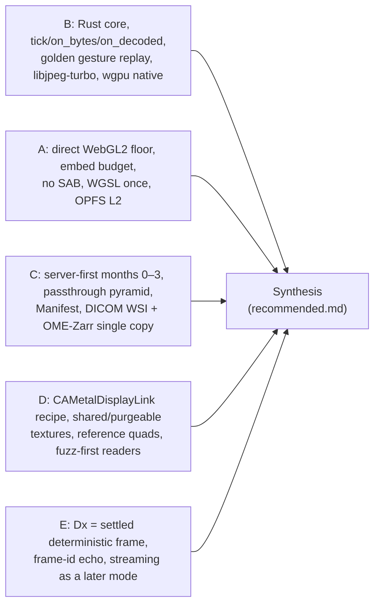

# Tradespace analysis and decisions

Stoipath WSI viewer development plan, section 3. Date 2026-10-24; revised 2026-10-25 after the four-critic review (`critique/issues.json`) and the claims-verification pass (`verify/README.md`, `verify/required-changes.json`). This section is the single place that records *why* each major technical choice was made. It consolidates the tradespaces scattered across research notes 01–11 (including gap-8, which arrived after the first draft) and the five architecture proposals (A–E) into decision matrices with one common scoring scheme, states the chosen option and the rejected alternatives, and names the condition under which each decision must be reopened. It does not restate the decided architecture (see *Recommended architecture*, `arch/recommended.md`, amendment 2 of 2026-10-25), the latency budgets and gates (see *Instant-zoom engineering design* and *Quality, testing and performance QA*) or the regulatory programme (see *Regulatory pathway to FDA clearance and the free-distribution model*); it only explains the choices those sections rely on.

> **Revision 2026-10-25.** No decision changed. What changed: (1) every number the verification pass adjusted is corrected inline and tagged **(verified)**, **(adjusted after verification: was X)** or **(unverified – Stage 0 gate)** — the MSK transcoding attribution (§3), the wgpu interop status, floor-renderer effort and bundle sizes (§2, §5.2), decoder divergence and the WASM penalty (§5.3), Pinned Base / Base Bundle / texture-array arithmetic (§8.2), the A55 decode row (§9.1), OpenSeadragon's two overhead phases (§5.1), Cloudflare facts and the translator gate's load statement (§7), ITP and Service Worker facts (§8); (2) five cross-cutting decisions the critics found unmade or contradictory are now recorded here with their ADR numbers from *Repository structure, developer environment and first sprints* §6: the 512² logical grid versus 240/256² vendor frames (§9.2, ADR-0027), Manifest + Range Index (§4, ADR-0025), derived tiers written at ingest only (§9.1, ADR-0028), the Dx colour pathway as a server-computed, client-applied LUT (§5, ADR-0026) and the IEC 62304 Class C crate boundary with four product builds instead of a mode flag (§11, ADR-0014/0019); (3) cross-references use the real section titles, the calendar and Stage labels follow ADR-0023 and *Recommended architecture* §5, and the "gap-8 does not exist" note is deleted — the note exists and section 13 owns the regulatory programme.

## 1. Method

**One scale for every matrix.** Every option is scored 1–10 (higher is better) on the seven criteria and weights the judge panel used: zoom 0.35, reach 0.20, versatility 0.10, effort 0.10, risk 0.10, maintainability 0.10, cost 0.05, so sub-decisions are commensurable with the architecture decision and goal 1 dominates everywhere. Where a research note used a 1–5 or ++/−− scale, the scores are the plan author's conversion anchored on that note's evidence; only the §2 scores are the panel's. Where a decision cannot affect zoom (container, licence) the zoom column is held equal and the other criteria decide.

**Evidence tags** follow the corpus: **[measured]**, **[verified]** (primary source read 2026-10-24), **[model]**, **[estimate]**, **[unverified]**. Numbers touched by the 2026-10-25 claims-verification pass carry **(verified)**, **(adjusted after verification: was X)** or **(unverified – Stage 0 gate)**; corrections that came from the critics rather than the verifiers carry **(adjusted after critique)**.

**Calendar and Stage labels.** Week 0 = Monday 2026-10-26; **Stage 0** = G1–G13 over three two-week sprints with the M0 scorecard on 2026-12-05 (ADR-0023; the "weeks 0–2" of the first draft is superseded); **Stage 1** = the M1→M2 window (reader study gap-1 F9, gesture logging, prefetch-waste acceptance, moving-tier kill decision, byte-model re-fit); **Stage 2** = the native-desktop-window gate before v0.9 (WRY layering, overlay-present input-to-photon, Wayland fallback); **Stage 3** = M3 native shells (iPad beta month 12, Android v1). These are *Recommended architecture* §5's definitions; this section uses no other dates, and milestone dates live only in `docs/plan/calendar.yaml`.

**Pillar test.** Each decision ends with one line on how it serves Clinical, Research and Education; a choice optimal for goal 1 that strands a pillar is not optimal.

**Revisit conditions** are named metrics on named devices or named external events, so an agent or reviewer can tell whether a trigger has fired without re-litigating the decision; they are mirrored in *Risks, compliance, security, licensing and open questions*. Where a decision is also an ADR, the register number (plan 10 §6) is given so that any later divergence is an ADR superseding it, never a reviewer note (plan 11 A6).

## 2. Architecture: judge-panel results and the synthesis

Three judges (performance/GPU, product/platform, delivery/engineering-management) scored proposals A–E independently against the weights above. Scores are reproduced verbatim from `judge/judgments.json`; weighted totals from `judge/ranking.json`.

### 2.1 Weighted ranking

| Proposal | Weighted score | perf | product | delivery |
|---|---|---|---|---|
| **B — one Rust engine everywhere** | **7.09** | 6.62 | 7.55 | 7.10 |
| A — web-first TypeScript engine | 7.07 | 6.90 | 7.20 | 7.10 |
| D — C++ native core, own Metal/Vulkan/GLES | 6.62 | 6.50 | 6.85 | 6.50 |
| C — OpenSeadragon adopt-then-replace, standards-first server | 5.93 | 5.75 | 6.15 | 5.90 |
| E — server GPU render + video streaming | 4.38 | 4.25 | 4.70 | 4.20 |

### 2.2 Per-criterion scores (perf / product / delivery; mean)

| Criterion (weight) | A | B | C | D | E |
|---|---|---|---|---|---|
| Zoom (0.35) | 7 / 7 / 7; **7.00** | 6.5 / 8 / 7; **7.17** | 5 / 5 / 5; 5.00 | 7 / 8 / 7; **7.33** | 3 / 4 / 4; 3.67 |
| Reach (0.20) | 6 / 7 / 6; 6.33 | 9 / 9 / 9; **9.00** | 5 / 6 / 5; 5.33 | 9 / 8 / 9; 8.67 | 5 / 5 / 4; 4.67 |
| Versatility (0.10) | 8 / 8 / 8; 8.00 | 8 / 9 / 8; **8.33** | 7 / 7 / 7; 7.00 | 8 / 8 / 8; 8.00 | 7 / 7 / 7; 7.00 |
| Effort (0.10) | 6 / 7 / 7; 6.67 | 3 / 4 / 4; 3.67 | 8 / 9 / 8; **8.33** | 3 / 3 / 3; 3.00 | 6 / 6 / 5; 5.67 |
| Risk (0.10) | 6 / 7 / 7; **6.67** | 4 / 5 / 5; 4.67 | 5 / 6 / 6; 5.67 | 3 / 4 / 3; 3.33 | 3 / 4 / 3; 3.33 |
| Maintainability (0.10) | 8 / 7 / 8; **7.67** | 6 / 7 / 7; 6.67 | 6 / 6 / 6; 6.00 | 4 / 5 / 4; 4.33 | 5 / 5 / 4; 4.67 |
| Cost (0.05) | 9 / 9 / 9; 9.00 | 9 / 9 / 9; 9.00 | 8 / 8 / 9; 8.33 | 9 / 9 / 9; 9.00 | 2 / 2 / 2; 2.00 |

### 2.3 Reading the panel

The 0.02 margin between B and A is noise; the shape of the disagreement is not. All three judges accepted the same *policy* (note 04's LOD, prefetch, eviction and blend rules) and the same *server* (C's passthrough pyramid, Manifest, path-only cache keys) and disagreed only on where the policy runs and how the web floor draws. The perf judge preferred A's direct WebGL2 on the floor devices because wgpu's WebGL2 backend is best-effort (#4081, open since 2023, on the texture-array primitive the cache uses — issue states per gap-2's same-day read, not re-verified: GitHub was blocked during the verification pass); the product and delivery judges preferred B because A's end state has no GPU surface, no C ABI and a 60 Hz iPad for ever, so any native requirement forces a second engine. Both B-first judges attached the same condition: take gap-2's "option C" (Rust core, hand-written WebGL2 renderer on the web) up front; gap-2's own decision table recomputes to A 72 / B 78 / C 82 (verified). The delivery judge re-estimated C's effort at 80–90 PM, not 62, because R1–R4 rebuild A's engine inside OpenSeadragon. B's priced exit from option C back to wgpu — the `create_texture_from_webgl_handle` WebGL-interop API — is **unreleased trunk code, absent from wgpu 30.0.1 (2026-08-22, the latest release); v31 is expected ≈Q4 2026 at the observed 77–104-day major cadence** (adjusted after verification: the corpus said "v30 added" it), so the B→C→B hatch is not an additive step today.

**Decision.** Adopt B's Rust core as the single home of the policy; on the web floor execute its draw list with a hand-written `web-sys` WebGL2 renderer (`stoi-render-gl`), wgpu native-only until a WebGPU web module is allow-listed in v1; graft C's server-first months 0–3 and dual-standard store, A's web discipline, D's native present recipe behind `PresentSink`/`TileTextureStore`, and E's regulatory framing (Dx = deterministic settled frame with Rendering Complete, now recomputed by the Class C verifier in `stoi-dx`, *Recommended architecture* §3.2). Provenance per component is tabulated in *Recommended architecture* §2 (ADR-0001, 0002, 0005, 0006, 0007).

**Rejected as the architecture.** E (sharp photon is RTT + codec; no client residency; 50–500× per-session cost; UDP blocked in hospitals), C's client half (blur-then-sharp for roughly a year on private OSD API), D's language (driver bugs become ours; procedural memory safety under §524B/CRA; scarcest hires), A's end state (no native path). Each remains in the design as a component or a mode, exactly as *Recommended architecture* §9 records. OpenSeadragon stays the public **comparator**, under the protocol in §5.1 (tuned profile, cold and warm frames reported separately).

**Revisit when:** (i) Stage 0 G7 fails (decoder identity) — the plan stops, not pivots; (ii) G3–G5 fail on `stoi-render-gl` — these are renderer bugs, not architecture exits; (iii) wgpu promotes WebGL2 to a supported tier, ships the WebGL-interop API in a release and closes #4081 while `stoi-render-gl` costs >1 PM/year — fold the web renderer into wgpu; (iv) Stage 0 shows wasm-bindgen trampoline or debuggability cost >0.5 ms/frame (expected <0.2 ms [estimate]) — move the web floor renderer's *language* to TypeScript, keeping the core; (v) a required host cannot consume a C ABI — none is known.

**Pillars.** Clinical: one certifiable pixel pathway (one decoder, one shader set, one scheduler, one Class C crate set) is what makes a later Dx edition a frozen build rather than a redesign. Research: PyO3 wheel and anywidget come from the same core. Education: the PWA reaches every classroom device on day one and the offline pack serves low-bandwidth teaching.

## 3. Slide readers and ingest strategy

Evidence: note 01 (F1–F5), note 05 and Schüffler 2022 (DOI 10.5858/arpa.2021-0197-OA): the paper's own same-vendor comparison puts the server-side decode/re-encode penalty at **+59 ms/FOV (Leica via OpenSlide 167 vs byte reader 108 ms) to +100 ms/FOV across all configurations (256 vs 156 ms)** — (adjusted after verification: was "+130 ms/FOV from transcoding"; the +130 ms Philips gap is confounded by iSyntax SDK decoding, 128-px blocks and sequential serving); gap-5 (wsidicomizer 0.31.0 passthrough, `--add-missing-levels`, concatenation above 4 GB), note 09 F9 (licence classes).

| Option | Zoom | Reach | Vers. | Effort | Risk | Maint. | Cost | **Weighted** |
|---|---|---|---|---|---|---|---|---|
| R1. Serve vendor files on the fly through OpenSlide, no canonical copy | 3 | 6 | 6 | 8 | 5 | 7 | 5 | 5.10 |
| **R2. Three-tier reader chain into a canonical pyramid: byte passthrough (A/B), DCT-domain re-mux (C), decode-once (D); wsidicomizer/opentile first release, Rust `TILED_FULL`+EOT writer later; vendor file indexed in place and served during ingest** | **9** | **9** | **9** | 6 | 7 | 7 | 8 | **8.25** |
| R3. Bio-Formats / bioformats2raw as the single universal converter | 7 | 8 | 9 | 7 | 5 | 6 | 6 | 7.05 |
| R4. Client-side native-format reading (openslide-js, wsi-rs) as the primary path | 4 | 4 | 5 | 7 | 3 | 5 | 9 | 4.65 |
| R5. Own Rust readers for every format from day one, including Tier D | 9 | 9 | 7 | 2 | 4 | 6 | 8 | 7.25 |

**Why R2.** Instant zoom is a property of the ingested representation, not of the reader: SVS and SCN step by 4× between levels, CZI may have no pyramid, Philips TIFF has padded geometry, NDPI "tiles" are 8-px strips, MRXS/BIF/CZI tiles overlap, J2K/JXR/iSyntax need heavy decoders (note 01 F1). R1 therefore cannot meet goal 1 (2 s+ tiles on slides without low-resolution levels; +59–100 ms/FOV measured at MSK for request-time decode/re-encode) and R4 drags LGPL and SharedArrayBuffer into the client bundle. R2 keeps the scanner's pixels byte-exact for the passthrough tier (regulatory and AI-reproducibility value), decodes exactly once for the rest, and lets the slide open seconds after upload because tiers A–C are indexed in place while the canonical copy is written (gap-5, *Recommended architecture* §3.1; honestly scoped: TIFF-family scanners write the IFD at file close, so "view while scanning" means "viewable seconds after file close" except for DICOM-output scanners). wsidicomizer/opentile/wsidicom are Apache-2.0, Sectra-funded and current (0.31.0 / 0.26.0 / 0.36.1, 2026-09-28); they are the first-release converter *and* the CI oracle for the Rust writer that replaces them when throughput demands. R3 is the catch-all for Bio-Formats-only multichannel sources but runs in the GPL-isolated worker and re-shards with `zarrs`, because bioformats2raw documents no sharding option. R5 is the end state for tiers A–C only.

**Reader chain (decided; the tier definitions follow the 2026-10-25 grid decision in §9.2).** Tier A (DICOM WSI) and **Tier B** — byte passthrough of vendor JPEG frames whose size divides 512 (GT 450 / GT 450 DX 256², Philips TIFF and most DICOM scanners 256² or 512², OME-TIFF, generic tiled TIFF with JPEG tiles, SCN, Huron/Motic/Mikroscan/ARGOS where the frame divides 512): own Rust `tiff`/`dicom-rs` indexers with `JPEGTables` splice; a 256² source yields **four byte ranges per logical 512² tile** in the Range Index and the byte-identity assertion (FR-S2) is **per vendor frame**; tifffile/opentile/wsidicom are the byte-identity oracles. **Tier C** — lossless DCT-domain re-mux (opentile-style, libjpeg-turbo lossless transforms, MCU-aligned: 240 = 15 × 16, 512 = 32 × 16) for classic Aperio SVS 240² frames, NDPI restart-marker strips and any frame size that does not divide 512; the oracle is **decoded-pixel identity against the vendor frames through the G7 reference decoder**, and the vendor-byte-hash identity claim is **withdrawn for Tier C** wherever it appears (adjusted after critique: the first draft listed SVS-JPEG as Tier B, which was false for TCGA's 240² SVS corpus). Tier D: OpenSlide 4.0.1 (LGPL-2.1), libisyntax (BSD-2, IP review pending), slideio/libCZI (LGPL-3) for CZI-JXR, Bio-Formats `formats-gpl` in its own JVM container, cuCIM for J2K-heavy archives — one container image per licence class, nothing copyleft in any client, and a per-tile provenance flag (`canonical` passthrough / re-muxed / re-encoded / `derived`) carried into the Manifest, telemetry and Dx records. Every canonical level carries a content hash so a synthesised or re-written level bumps `pyramid_version` for that level only (ADR-0025).

**Rejected.** R1 (degraded temporary mode only, never promised instant); R4 (desktop/Python nicety, never the mobile hot path).

**Revisit when:** wsi-rs passes a corpus evaluation against OpenSlide and tifffile (then own Rust readers for tiers A–C in-process for desktop and Python); Bio-Formats precompressed-tile APIs carry NDPI/DICOM losslessly (then R3 covers more of tiers A–C for multichannel); libisyntax fails IP review (then a sealed Philips-SDK worker under its own licence review); a customer inventory shows >30 % Tier D volume (then Tier-D ingest throughput, not passthrough, sets the ingest SLA).

**Pillars.** Clinical: DICOM from the first byte for brightfield; label/macro/barcode withheld to the PHI tier at ingest. Research: lossless passthrough (Tier B) or lossless re-mux (Tier C) preserves TCGA/CAMELYON pixels — bit-identical at the decoded-pixel level in both cases; Bio-Formats path covers CZI/VSI fluorescence. Education: teaching sets ingest through the same pipeline with a licence registry per slide (gap-6).

## 4. Storage container and tile protocol

Evidence: gap-5 F1–F7 (all primary sources read 2026-10-24), note 02 F2, note 05 F5, verify C21. The container decision cannot change goal 1: every surviving option is byte passthrough behind a small index, and the latency figures in *Instant-zoom engineering design* assume only 512² logical tiles (256² vendor frames as four ranges per tile), centre bundles coalesced to one range per shard, and the L4 hot cache (gap-5 "Implications" item 3). Zoom is therefore scored 8 for all range-addressable options and the decision is carried by reach, versatility, risk and cost.

| Option | Zoom | Reach | Vers. | Effort | Risk | Maint. | Cost | **Weighted** |
|---|---|---|---|---|---|---|---|---|
| A. OME-Zarr v3 sharded with JPEG/HTJ2K chunks for everything (note 02 R2, pre-amendment plan) | 8 | 5 | 4 | 7 | 3 | 5 | 9 | 6.15 |
| **B. Dual-standard, single copy: DICOM WSI `TILED_FULL`+EOT (one instance per level, concatenation >4 GB) for brightfield; OME-Zarr 0.5 (Zarr v3 `sharding_indexed`, 512² inner chunks, core `zstd`/`bytes`) for multichannel/16-bit; one Manifest over both** | 8 | **9** | **9** | 6 | 7 | 7 | 9 | **7.95** |
| C. OME-Zarr lossless everywhere plus a derived JPEG delivery pyramid | 8 | 9 | 9 | 5 | 6 | 6 | 3 | 7.35 |
| D. DICOM WSI for everything, including 16-bit multiplex | 8 | 7 | 6 | 7 | 6 | 7 | 9 | 7.25 |
| E. PMTiles-style internal archive as canonical | 9 | 4 | 3 | 7 | 4 | 6 | 9 | 6.40 |
| F. DICOM canonical plus a full OME-Zarr brightfield mirror (true dual copy) | 8 | 9 | 9 | 5 | 6 | 5 | 3 | 7.25 |
| G. Object-per-tile (DZI / IIIF level-0 static files) | 7 | 6 | 5 | 8 | 7 | 7 | 4 | 6.55 |

**Why B.** It is the only row without a disqualifying mark in gap-5's own matrix. A fails reach: the Zarr v3 codec registry lists 17 codecs and no image codec **[verified]**, `imagecodecs_jpeg` is an unregistered raw name (ZEP 9 non-conformant), no mainstream reader (zarr-python, zarrs, zarrita, tensorstore, Viv, vizarr, zarr-java) decodes JPEG chunks and QuPath 0.7 reads no Zarr v3 at all (OMEZarrReader depends on jzarr 0.4.2) — the store would be readable only by our own code, forfeiting the interoperability that justified OME-Zarr. C and F pay 4–5× storage for >90 % of volume (100k² H&E ≈ 10–15 GB zstd vs 3–4 GB JPEG). D leaves napari/Viv/vizarr needing a DICOM reader for 16-bit data whose DICOM tooling is thin. E has no pixel-type, colour, ICC or multichannel model and no ecosystem; it survives as the derived **offline pack**. G costs ~51k objects and ~$0.25/slide in PUTs, cannot coalesce and cannot be copied as one file. B stores every pixel once and each container is readable by its community's tools: a `TILED_FULL`+EOT instance is a range-addressable tile archive readable by every clinical viewer and VNA; sharded OME-Zarr 0.5 with core codecs reads today in zarr-python 3.4.1, zarrs 0.23.14, zarrita 0.7.5, tensorstore 0.1.85, zarr-java, Viv 0.23.0, vizarr 0.3.0 and ome-zarr-py 0.21.0 **[verified]** (ADR-0004).

**Index (decided 2026-10-25, ADR-0025 — Manifest + Range Index).** The first draft's single "≤100 KB Manifest holding `TileIndex → (object, offset, length, codec, provenance)` for every tile" was arithmetically impossible: a 100k² slide has ≈51k tiles across levels, ≈0.8 MB at 16 B each (adjusted after critique). Canonical now: the **Manifest** (≤100 KB, immutable, versioned, edge-cached, fetched by every client at open) holds geometry, per-layer `tile` size (256 / 512 / 1024), per-level object references **and per-level content hashes**, `codec` and `provenance` per level, the per-level byte model `bytes.perLevelMedian`, Pinned Base and Base Bundle offsets and the derived-tier catalogue; the **Range Index** (edge-resident, never fetched by browsers or native shells) holds `TileIndex(layer, level, x, y, [z, t, c]) → ≤4 × (object, offset, length)`, 16–64 B per tile, ≈0.8–3 MB per 100k² slide, built at ingest from DICOM EOTs, Zarr shard indices and TIFF IFDs. A short-TTL `GET /v1/slides/{slideId}` resolver maps the launch-context `slideId` to the current Manifest, so a synthesised level invalidates only its own tile URLs. Both JSON Schemas are published under `api/`; the Manifest-freeze definition of done (plan 10 S2-09) is "≤100 KB for the 100k² synthetic slide, Range Index size recorded, with a 256-px-tile SVS fixture".

**Tile protocol (decided, no scoring needed; options were ranked in note 05 F4–F5).**

| Element | Decision | Rejected | Reason |
|---|---|---|---|
| Client-facing tile address | Immutable `/{slide_hash}/{pyramid_version}/{codec}/{level}/{x}_{y}` with `Cache-Control: immutable`; token in query stripped from the cache key (§8); per-level `pyramid_version` so only a re-written level's URLs change | Query-string signatures in the key; per-user URLs; a slide-wide version that cools every level on pass 2 | Shared edge cache or nothing; the frozen-section "view while ingesting" path must not lose its L2/L3 state when the slide becomes canonical |
| Coalescing | Centre-of-viewport **bundle** endpoint coalesced to **one range per shard** — ≤4 shard ranges for viewports ≤8 tiles wide (5×3 viewport: mean 1.9, max 4; a 4K DPR-1 viewport reaches 6), over-read ≈1.3–1.4× (verified by exhaustive 8×8 enumeration) — plus raw shard/EOT range passthrough; DICOMweb `frames/{list}` as the standards-native form; on the server the bundle path uses pooled buffers and per-tile `pread` with vectored writes, because a naive coalesce-read-slice-copy fails the §7 gate (verified) | Multi-range `Range:` headers; WebSocket or WebTransport tile transport | CloudFront returns 200/full object on any malformed multi-range; Cloudflare multipart depends on Origin Range Requests (gap-3 11b/11c); WebSocket has TCP head-of-line blocking; WebTransport Baseline only since Safari 26.4 |
| Transport | HTTP/3 with 0-RTT for GET terminated at CDN/Caddy; HTTP/2 first-class | HTTP/3 in-process (`h3` 0.0.8, 2025-05-06, pre-1.0); HTTP/1.1 | Samsung Internet has no HTTP/3 (caniuse note dated July 2025; Samsung Internet 30 shipped 2026-05-11 — verified); Chromium's TLS 1.3 early data over TCP is `FEATURE_DISABLED_BY_DEFAULT` and QUIC 0-RTT applies only to idempotent/safe methods, so HTTP/2 never gets 0-RTT **[verified gap-3, re-read 2026-10-25]** |
| Façades | DICOMweb (QIDO/WADO-RS incl. `frames/{list}`, STOW-RS), IIIF Image 3.0 (grid-aligned fast path; off-grid regions via a **rate-limited slow path on a permissive Rust resampler** — `fast_image_resize` or `image`, pinned at Stage 0), DZI, Iris-shaped WADO-RS | Façades as the hot path for first-party clients; **libvips inside the Edge Translator** (adjusted after critique: the first draft routed off-grid IIIF to "a rate-limited libvips slow path", which would have put LGPL into the permissive-only translator crate graph that *Risks* §5.2 and `cargo deny` enforce — libvips stays in the isolated ingest worker; plan 09's separate `iiif-slow` LGPL worker image is the fallback if the Rust resampler's quality proves insufficient) | IIIF/DZI are single-tile protocols with no coalescing; Iris inherits early adopters at near-zero cost |
| Index | **Manifest + Range Index** as above (ADR-0025) | Parsing DICOM or Zarr at request time; one Manifest holding every tile range | Edge Translator never touches container metadata on the hot path; a per-slide index that small does not exist |

**Revisit when (gap-5 F5 conditions, verbatim in substance):** to A — a `jpeg`/`htj2k` codec is registered in `zarr-extensions` *and* shipped in zarr-python, zarrs and zarrita *and* QuPath reads Zarr v3; the translator then makes migration a background job. To D — early customers >90 % clinical, fluorescence <5 % of slides, and wsidicomizer/highdicom 16-bit optical paths prove adequate. To C/F — a regulator or VNA demands DICOM files *and* a research group demands OME-Zarr brightfield; this becomes an export cost line, not an architecture change. B itself is amended if EOT/concatenation breaks common VNAs for >4 GB levels (split levels into ≤2 GB instances) or if the M1 prototype shows per-level EOT loading costs client-direct readers >1 RTT at open (publish the Manifest beside the instances). **Cloudflare-hosted deployments:** the cacheable-size cap (512 MB; Enterprise 5 GB) is checked against the complete `Content-Range` size, so raw range reads of one-instance-per-level DICOM bases (3–4 GB) and level 1 (0.75–1 GB) do not cache below Enterprise (verified; contradicts gap-5 F5's "DICOM range reads cache like any file") — the hot path never issues them, so this touches only client-direct readers; Concatenation at ≤512 MB instead of 4 GB is decided at M1 with the VNA matrix. The JPEG-chunk Zarr layout stays a feature-flagged experiment under the URI codec id `https://stoipath.dev/zarr/codecs/jpeg`, never holding customer data, re-decided at the first annual review.

**Pillars.** Clinical: DICOMweb is true at launch without conversion; VNA co-existence and STOW into a customer archive need no second copy. Research: multichannel is plain OME-Zarr 0.5; QuPath interoperability goes through DICOM and OME-TIFF export until Bio-Formats moves to zarr-java, which this project funds (gap-5 F8 item 6). Education: the derived offline pack is the classroom and CME enduring-material artefact.

## 5. Client rendering stack

### 5.1 Engine: build versus adopt

Evidence: note 03 §2.2/§2.9 (engine internals verified from source), note 07 F3/F6/F7 (OpenSeadragon #2906; blur-then-pop is the norm in every OSD/OL viewer), gap-2 (wgpu web viability, measured), the panel, verify C24 (OSD 6.1.1 defaults verified from source; #2906 itself was unreachable during verification).

| Option | Zoom | Reach | Vers. | Effort | Risk | Maint. | Cost | **Weighted** |
|---|---|---|---|---|---|---|---|---|
| Adopt OpenSeadragon 6.1 + plugins | 3 | 6 | 5 | 9 | 5 | 5 | 9 | 5.10 |
| Adopt OpenLayers WebGLTile | 4 | 6 | 7 | 8 | 6 | 6 | 9 | 5.75 |
| Adopt MapLibre GL JS raster path | 6 | 7 | 4 | 6 | 6 | 7 | 9 | 6.25 |
| Adopt deck.gl + Viv layers | 5 | 6 | 9 | 7 | 6 | 6 | 9 | 6.20 |
| Fork Neuroglancer | 6 | 5 | 8 | 4 | 4 | 4 | 9 | 5.55 |
| Custom TypeScript engine (proposal A, panel means) | 7.00 | 6.33 | 8.00 | 6.67 | 6.67 | 7.67 | 9.00 | 7.07 |
| Rust core + wgpu on both web backends (proposal B as written, panel means) | 7.17 | 9.00 | 8.33 | 3.67 | 4.67 | 6.67 | 9.00 | 7.09 |
| **Rust core; `web-sys` WebGL2 renderer on the web floor; wgpu native; adapters for OSD/OL/deck.gl (the synthesis; plan author's scores)** | **8** | **9** | **9** | 4 | 6 | 7 | 9 | **7.65** |

**Why build.** No adoptable engine fixes the four causes of blur — finer level not resident, hard level swap, minification aliasing, main-thread stall during decode/upload (note 03 §3). OpenSeadragon uploads one texture per tile on the main thread (`texImage2D` per tile, no `generateMipmap`), has no mipmaps and composites through a 2D canvas, a design its maintainers call a flaw (#2906) **[verified in 6.1.1 source]**; OpenLayers has no mipmaps; MapLibre has mipmaps and cross-fade but is a Web-Mercator vector engine with WebGPU still on its roadmap; deck.gl's WebGPU is "not production ready" and its TileLayer adds per-frame framework cost. The two OSD overhead figures the perf judge found inconsistent are two phases, not a contradiction (verified): **end-state** (all visible tiles resident) `World.update` ≈0.005 ms + `World.draw` 0.3–0.5 ms per frame at 24 tiles on x86 Chromium 153 (≈0.3–2.5 ms A55-scaled; proposal C's 0.5–2 ms holds), while **animating / tile-arrival** frames cost 0.4–0.6 ms p50 / 4–5 ms p99 unthrottled and 3.4 ms p50 / 32 ms p99 at 4× CPU throttle (26 of 39 zoom frames >16.7 ms) — the 6–12 ms/frame figure is an animating p90-class cost on slow CPUs. The custom engine is ~5–10 kLOC and buys the one differentiator nobody in pathology has (note 07 F7). The ecosystem is reused off the hot path: Viv's 16-bit shader math (MIT), dicom-microscopy-viewer's DICOM parsing, zarrita, geotiff.js; OSD `TileSource`, OpenLayers `Source` and deck.gl wrappers are first-class *adapters*. **Comparator protocol** (binding for every "X× faster than OpenSeadragon" statement, including the TSP abstract — verified on 6.1.1): the tuned profile (`maxTilesPerFrame` 100, `immediateRender` true, raised `imageLoaderLimit`), because the default `maxTilesPerFrame = 1` rations 10, 5, 3, 2, 1, … tiles per frame (20 tiles in 4 frames = 67 ms; 54 in 38 frames = 633 ms) and the 1.2 s / stiffness-6.5 spring settles 50 % at 128 ms, 90 % at 425 ms, 99 % at 850 ms; report update/draw per state (cold vs warm) and the WebGL and canvas drawers separately (the WebGL drawer collapsed to 2.7–7 fps under software-GL uploads). Default-settings comparisons would measure request rationing and spring animation, not rendering.

### 5.2 Web floor renderer

Evidence: gap-2 §2.1 (wgpu WebGL2 backend "Downlevel/Best Effort"; #4081, #3735, #10460 — states per gap-2's same-day read, not re-verified), gap-2 §4.1 (decision table 72 / 78 / 82 for A / B / C — verified recompute), gap-3 and verify C16 (WebGL2 is the floor: 97.13 % caniuse usage; WebGPU 85.8 % + 3.66 % partial on caniuse vs 80.6 % on web3dsurvey, different populations — verified; Firefox Linux/Android and WebKitGTK have no WebGPU; Chrome desktop WebGPU excluded Linux until Chrome 144 and then Intel Gen12+ only; Firefox ships it on Windows from 141, Apple-silicon macOS from 145/147, nowhere else by default; Samsung Internet's caniuse "yes" applies to Snapdragon devices only, Xclipse is blocklisted; compat-mode limits — 4096² textures, 16 KiB UBO, 4 colour attachments, no vertex-stage storage buffers — are guaranteed minimums that adapters may exceed, so the renderer designs to the minimums), verify C13 (bundle sizes).

| Option | Zoom | Reach | Vers. | Effort | Risk | Maint. | Cost | **Weighted** |
|---|---|---|---|---|---|---|---|---|
| TypeScript renderer executing the wasm core's draw list | 8 | 8 | 7 | 6 | 7 | 5 | 9 | 7.35 |
| wgpu's WebGL2 backend (proposal B as written) | 6 | 7 | 8 | 8 | 4 | 7 | 9 | 6.65 |
| **Rust `web-sys` WebGL2 renderer inside the core module (`stoi-render-gl`), GLSL ES 3.00 generated from WGSL by naga-cli, ≤1 LSB goldens** | **8** | **8** | 8 | 6 | **7** | 7 | 9 | **7.65** |

**Why `stoi-render-gl` now.** It removes #4081/#3735/#10460 and **0.73–0.77 MB gz** from exactly the devices that define the floor (adjusted after verification: the corpus's "+0.68 MB gz" was the WebGL2-only minus WebGPU-only pair, and all its sizes were raw cargo output in MiB that had never been through wasm-bindgen; deployable post-wasm-bindgen + wasm-opt sizes are dual 2.10 MB raw / 0.80 MB gz, WebGL2-only 2.01 / 0.77 MB gz, WebGPU-only 86.8 KB / 34 KB gz, and a minimal `web-sys` WebGL2 floor renderer — 64-layer array, `texSubImage3D`, instanced quads, slot LRU — is 28.6 KB raw / 13.7 KB gz, so the G1 floor budget is governed by the core and format crates and the 0.6 MB target is reachable; G1 is stated in decimal MB). It costs **3–5 kLOC with +3 PM as a floor** (adjusted after verification: was ~2–3 kLOC — OpenSeadragon's WebGL drawer is 1.3–2.1 kLOC, Aladin Lite's al-core wrapper 5.1 kLOC), keeps draw lists and uploads inside the wasm module so nothing crosses the boundary per tile, and keeps one shader source (WGSL) via naga-cli. The TypeScript variant is the recorded exit if Stage 0 shows trampoline or debuggability cost >0.5 ms/frame (expected <0.2 ms **[estimate]**). WebGPU is an *enhancement module* allow-listed per Safari major after soak (the rerun precedent: Safari defaulted to WebGL on 2026-05-20 after a 26.4 regression; WebKit bug 315186 is now RESOLVED FIXED — verified), never the floor; the renderer stays fragment-shader-only and texture-array based — **16-layer 512² RGBA8 arrays (16 MiB) as the default allocation unit, ≤64 layers as the upper bound** (adjusted after critique and verification: two 64-layer arrays allocated a 128 MiB phone L0 whole at either DPR with zero headroom, and on tile-based deferred renderers a `texSubImage3D` into an array that in-flight draws still reference forces a ghost copy of the whole resource — 64 MiB per upload — or a pipeline bubble; slots therefore carry a `cooling` state and uploads rotate across arrays; GLES 3.0 guarantees ≥256 layers and the G4 sweep 1…64, 128, 256 passed with 0 bad layers on ANGLE/SwiftShader — verified — so the wgpu #4081 multiple-of-16 effect is a Mali/Adreno device test), instance data from vertex buffers, so WebGL2, GLES 3.0, WebGPU compat and full WebGPU/Metal/Vulkan draw identical pixels. Cold start is the larger risk than bundle size: the "5–8 ms V8 compile" was lazy validation only; eager Liftoff of a ≈3 MB raw module is 87–118 ms single-thread on x86 → **180–1,200 ms phone estimate** (adjusted after verification: was 50–100 ms), so G2 reports lazy vs eager behaviour of the shipping engine and the floor module keeps format crates out of it (ADR-0002).

### 5.3 Decoder

Evidence: gap-2 §2.3 and verify C11/C12 **[measured]**: libjpeg-turbo bit-identical across native x86 SIMD, x86 scalar, wasm SIMD and wasm scalar — extended by verification to **695/695 JPEGs (139 tiles × 5 tiers) across libjpeg-turbo 3.2.0 x86 SIMD/scalar, aarch64 NEON/scalar under qemu-user, jSquash/mozjpeg wasm and wasm-vips** (verified; NEON equivalence is functionally verified under emulation, and G7 still requires real arm64 hardware for DHF evidence); zune-jpeg differs in 37.6 % of pixels (max 4 LSB) and jpeg-decoder in 10–15 % **at 4:2:0** — at the canonical q85–90 4:4:4 settled tier the Rust decoders differ in **0.6–5.7 % of pixels (max 2–3 LSB)** (adjusted after verification), still non-zero; the "60.6 % vs 38.98 %" fancy-upsampling discrepancy is one fact in two denominators (60.63 % of pixels = 38.98 % of samples); WASM penalty **≈2.9× (scalar) to 3.2–4.4× for libjpeg-turbo-family wasm** (adjusted after verification: the corpus's 2.1–2.9× range mixed decoders — 2.1× belonged to the rejected jpeg-decoder-rs; the shipped `-msimd128` decode-only module is unmeasured until G13 — unverified – Stage 0 gate); dense H&E at the canonical q85–90 4:4:4 tier decodes in 1.5–1.6 ms native, +41–52 % over the 61 KB IHC test tile's 1.07 ms (verified); Safari's ImageIO is closed and colour-managed; Blink's decoder settings (`JDCT_ISLOW`, fancy upsampling, block smoothing) are now verified from source and match Gecko.

| Option | Zoom | Reach | Vers. | Effort | Risk | Maint. | Cost | **Weighted** |
|---|---|---|---|---|---|---|---|---|
| **libjpeg-turbo (C) as the sole Dx decoder: `turbojpeg` crate natively, own Emscripten `-msimd128` no-pthreads build on the web (~60 KB gz); `createImageBitmap` as a per-browser-build self-certified accelerator (G8), never on Safari in Dx; WebCodecs `ImageDecoder` excluded** | 8 | **10** | 8 | 7 | **9** | 8 | 9 | **8.45** |
| Rust decoders (zune-jpeg / jpeg-decoder) | 7 | 10 | 7 | 9 | 3 | 8 | 9 | 7.60 |
| Browser-native `createImageBitmap` as the only path | 9 | 7 | 4 | 9 | 3 | 8 | 9 | 7.40 |
| OS codecs in native shells (ImageIO, BitmapFactory, WIC) | 8 | 8 | 5 | 9 | 3 | 7 | 9 | 7.25 |

"Identical pixels on every platform" is measured true only for libjpeg-turbo; it is the operational basis of Dx-mode determinism and of the golden gesture replay (an identical cache requires identical decoded pixels). The G8 self-certification allow-list is narrowed by verification: `createImageBitmap` (with and without `colorSpaceConversion: none`) and HTMLImageElement→canvas matched 695/695 on Chromium 153, while **WebCodecs `ImageDecoder` (I420/I444 `copyTo`) differed on 660/695 tiles and is excluded** (verified). Hardware JPEG decode is not a lever on either mobile platform (gap-4 §2.3/§2.6 **[verified by API absence]**). HTJ2K uses one pinned OpenJPH version on all platforms; **reversible HTJ2K only in Dx, permanently** — lossy HTJ2K (OpenJPH, psnr40) differs x86 vs aarch64 in 3 pixels (0.0011 %, max 1 LSB) while reversible is identical (adjusted after verification: the first draft held lossy out "until identity across builds is verified", citing 0.002 % saturated-sample differences between two builds; hash identity does not hold for lossy HTJ2K across ISAs, so it never enters Dx or the PCCP). Worker-pool scaling is also weaker than the corpus measured: 2.2× on three workers was an idle run; 1.2–1.6× under core contention (verified), so the G9 target (≥1.8× under page load, ≤2–3 ms/tile overhead) is at genuine risk and a G9 miss lowers the pool target, not the decoder decision (ADR-0003, 0029).

### 5.4 Native viewport

Evidence: gap-4 §2.10 (tradespace), §2.7 (MapLibre's 2026 changelog still extending Adreno 600 `VK_ERROR_DEVICE_LOST` workarounds **[verified]**), §2.8 (wgpu honours a pre-set `presentsWithTransaction`; no `presentedTime` (#9856); no AHardwareBuffer import); verify C02 (every Apple API fact confirmed: `preferredFrameLatency` 1.0 or 2.0 only, `maximumDrawableCount` 2 or 3, `displaySyncEnabled` macOS/Catalyst only; the input term is open — "UIKit usually delivers touches at around 60 Hz", so N-iPad typical may be 33/42 rather than 25/33 ms, which G11 measures).

| Option | Zoom | Reach | Vers. | Effort | Risk | Maint. | Cost | **Weighted** |
|---|---|---|---|---|---|---|---|---|
| wgpu everywhere, shells own loop and input only | 7 | 9 | 8 | 8 | 7 | 7 | 9 | 7.70 |
| **wgpu + `wgpu-hal` escape hatches behind `PresentSink` / `TileTextureStore`: shell-created `CAMetalLayer`, shared-storage and purgeable tile textures imported into wgpu** | **8** | 9 | 8 | 7 | 7 | 7 | 9 | **7.95** |
| Direct Metal on iOS, wgpu on Android | 9 | 9 | 7 | 5 | 6 | 5 | 9 | 7.70 |
| Direct Metal + direct Vulkan + own GLES fallback (proposal D) | 9 | 8 | 6 | 3 | 3 | 3 | 9 | 6.70 |

The escape-hatch variant keeps one renderer and one shader set, keeps the Android driver-bug burden upstream (wgpu/Firefox), and recovers the two levers that matter on iOS: raw layer configuration (`preferredFrameLatency` 1, two drawables) and shared/purgeable textures. **Revisit:** take the direct-Metal piece only if N-iPad misses "p95 input-to-photon ≤ REF-quad + 1 interval" at Stage 3 month 3 (Stage 3 = the M3 native-shell window) and profiling blames wgpu's present/upload path, not our scheduler.

**Rejected across §5.** OSD as engine (never; OSD-config stopgap only if graphics hires slip >3 months); wgpu WebGL2 backend on the web (see trigger above); wasm threads/SharedArrayBuffer (COOP/COEP breaks embeds and Android WebView — verified by an iframe matrix: an isolated page inside a plain host loses SAB, a plain iframe inside a COEP host is blocked; `atomics` still Unstable at Rust 1.99.1 **[verified]**); Service Worker on the tile hot path — by mechanism, not by intent: no `fetch` handler in the PWA's service worker at all, or Chromium 123+'s Static Routing API (`addRoutes`, source `network`) for tile hosts, with a Tier-2 assertion that no tile request carries a service-worker timing span (ADR-0024; adjusted after critique: a fetch handler intercepts every fetch of the controlled page including cross-origin tile hosts, so a separate tile host alone keeps nothing off the path), and the cold-start cost is smaller than the corpus said — 50/250 ms are 2017 Chrome figures, 12 ms median measured on x86 Chromium 153, plausibly 30–60 ms on a 2024+ phone (adjusted after verification), which weakens "SW never" but not "SW off the hot path"; OffscreenCanvas-in-worker core (input-forwarding hop; only if M1 shows irreducible >8 ms main-thread tasks); WebCodecs `ImageDecoder` as a decode path (660/695 tiles differ — verified); 64-layer arrays as the allocation unit on a 128 MiB L0 (zero headroom, 64 MiB ghost copies); Capacitor/Tauri-mobile webviews (60 Hz cap, ~15 % disk quota, App Store 4.2, no predicted touches).

**Pillars.** Clinical: a deterministic pixel pathway and Rendering Complete flag from day one, with **colour as a server-computed, client-applied per-slide ICC→sRGB 33³ LUT in one shader and gamma-space `Rgba8Unorm` filtering** (ADR-0026; adjusted after critique — "scanner ICC baked to sRGB server-side" is impossible for byte-passthrough tiles without breaking byte identity and reintroducing a second copy, so baking applies only to re-encoded or synthesised levels and the level-boundary ΔE is a test), the Class C crates `stoi-codec` and `stoi-dx` carrying the pathway (ADR-0014, *Recommended architecture* §3.2); Dx mode disables approximate rendering and refuses derived tiles. Research: 16-bit `r16uint` channels with in-shader transfer functions (Viv semantics) in the same renderer as brightfield. Education: WebGL2 floor reaches classroom Chromebooks and 2020-class iPads.

## 6. Cross-platform strategy

Evidence: note 06 §2.1–§2.3 (capability matrix verified against gpuweb wiki, MDN BCD, caniuse; nuances in §5.2), gap-3 and verify C03 (Safari 60 fps preference at WebKit ToT — `PreferPageRenderingUpdatesNear60FPSEnabled` default true except visionOS, verified in `UnifiedWebPreferences.yaml`, `Page.cpp` and `AnimationFrameRate.cpp`; Web Animations timelines can raise and GPU-canvas pacing can only lower WebKit's rendering-update rate, and neither lifts a per-frame redrawn WebGL/WebGPU canvas above 60 Hz — 120→60, 90→90, 144→72; WKWebView can lift it only via private SPI; WebKitGTK has no WebGPU at all), gap-4 (native floors: iPad 2 intervals floor / 3 typical, Android 3 / 4 **[model]**; strict floors ≈11 ms iPad / ≈19 ms Android), verify C01/C02/C20.

| Option | Zoom | Reach | Vers. | Effort | Risk | Maint. | Cost | **Weighted** |
|---|---|---|---|---|---|---|---|---|
| (a) Web-only PWA | 5 | 7 | 7 | 9 | 8 | 9 | 9 | 6.90 |
| (b) Web core inside webview wrappers (Tauri / Electron / Capacitor) | 5 | 7 | 7 | 7 | 6 | 7 | 8 | 6.25 |
| **(c) Rust core compiled to wasm and native; thin shells (Lit web component and PWA; Tauri 2 desktop; SwiftUI + `CAMetalLayer`; Compose + `SurfaceView`); UniFFI, cbindgen C ABI, PyO3 + anywidget** | **9** | **10** | **9** | 4 | 6 | 7 | 9 | **8.20** |
| (d) C++ core with Dawn / wgpu-native and bindings | 9 | 10 | 9 | 3 | 4 | 5 | 9 | 7.70 |
| (e) Flutter (Impeller) or Compose Multiplatform | 6 | 5 | 7 | 6 | 5 | 6 | 8 | 5.90 |
| (f) React Native + Skia | 4 | 4 | 6 | 6 | 5 | 6 | 8 | 4.90 |
| (g) .NET MAUI / Avalonia | 5 | 3 | 6 | 6 | 5 | 6 | 8 | 5.05 |
| (h) Qt / QML | 7 | 4 | 7 | 6 | 5 | 6 | 6 | 5.95 |

**Why (c), and why the staging.** Goal 1 on iPad is bounded by the browser's ≈2-vsync compositor floor and WebKit's 60 Hz preference **[verified]**; only a native shell reaches the documented 2-interval Metal floor and GB-class caches. The size of the gain is now stated honestly: **web ≈55–65 ms → native ≈25–33 ms p50 warm input-to-photon on iPad** (adjusted after verification: was "≈45 → ≈25" — the 45/55 ms web row is a floor configuration, two present vsyncs with a pending rAF, and the typical web value is ≈55–65 / 70–78 ms p50/p95; every public browser touch-to-photon measurement is ≥55 ms), i.e. ≈25–35 ms, or ≈12 ms if UIKit delivers touches at 60 Hz rather than 120 Hz (N-iPad typical then ≈33/42 ms), which G11's reference-quad app measures; the iPad-shell case survives because the web rows rose more than the native gain fell. Doubling the refresh rate saves N × 8.33 ms for an N-vsync pipeline — 16.7–25 ms, two to three Deber JNDs, not "exactly one" (the 8.3 ms coincidence argument is deleted from the plan). (c) is the MapLibre Native / Firefox-UniFFI shape — share the engine, never the UI (Dropbox's shared-C++ retreat is the cautionary tale) — and is the only option that yields a web component, a Jupyter widget and native SDKs from one codebase. (d) buys the same reach with procedural memory safety for parsers of attacker-controlled slide bytes (OpenSlide shipped two CVEs in 4.0.1 **[verified]**) and the scarcest hiring profile. (e)–(h) put a second rendering engine between us and the GPU or lack a credible, embeddable web target (ADR-0001, 0008).

| Platform | Delivery | Stage |
|---|---|---|
| Web desktop and mobile (Chrome/Edge/Firefox/Safari, Samsung Internet, WebView) | PWA, `<stoipath-viewer>`, iframe JSON-RPC; no `fetch` handler in the service worker (or `addRoutes` where available); WebGL2 floor; WebGPU module v1; installed Home-Screen PWA for classroom offline packs on iPad (ITP-exempt, see §8) | MVP |
| Windows / macOS / Linux | Tauri 2.12.5 / WRY 0.57.1 (verified 2026-10-25): wasm in the webview at **v0.7** (adjusted after critique: moved out of the re-scoped MVP, which is "M2 + what M2 needs"); native wgpu window with TS chrome at **v0.9 — a Dx prerequisite, not a cut**, because only a native shell can attest the physical display (EDID/monitor enumeration + ICC) — once WRY's wgpu-plus-webview layering passes Stage 2; WRY child-webview layering is supported on macOS, Windows and **Linux X11 only, no Wayland path** (adjusted after verification; Ubuntu/Fedora default sessions need XWayland or a different composition), a full-window transparent webview forwarding input over IPC adds ≈8–17 ms so the Stage-2 input-to-photon test runs with the chrome overlay present, and hit-testing through transparent regions stays **[unverified]**; the Linux viewport is a native wgpu window regardless because WebKitGTK has no WebGPU; Windows 11 first (the Dx 1.0 platform) | v0.7 → v0.9 |
| iPadOS/iOS 17+ | XCFramework (SwiftPM binaryTarget, UniFFI Swift) + reference SwiftUI app; D's present recipe | beta month 12, GA v1 |
| Android 10+ | AAR (cargo-ndk, UniFFI Kotlin, JNA ≥5.12) + reference Compose app; allow-listed Vulkan, GLES retry | v1 |
| Jupyter / Colab / VS Code / marimo | `pip install stoipath`: anywidget over the web bundle (**MVP**) + PyO3 wheel with the in-process translator and a local GeoArrow/GeoParquet → MVT tiler (**v0.9**; adjusted after critique — sections disagreed MVP/v0.9/v1 and plan 07's milestone table owns release tags) | MVP (widget) → v0.9 (wheel) |
| Qt / C++ / .NET / Java hosts | `stoipath.h` C ABI; Qt `QQuickItem` sample; Panama / P/Invoke | v1 |

**Rejected.** Webview wrappers on mobile (never; the PWA covers mobile web until native shells ship); Electron (100–200 MB; only if WebKitGTK WebGL2 proves inadequate on Linux, now moot given the native window); Qt as desktop shell (LGPL-3 dynamic-linking terms and procurement friction; kept as the Qt SDK sample); **Dx mode in unmanaged browser sessions** (a browser cannot identify the physical display — no EDID; the Window Management API is Chromium-only, permission-gated and absent inside a third-party iframe — so Dx exists only in the native desktop shell or in MDM-managed browser sessions carrying a hospital-pushed `dx_profile.json`; adjusted after critique).

**Revisit when:** Apple exposes a public WKWebView API for 120 Hz *and* WebGPU in WKWebView passes a soak — then the iPad shell can shrink to a hybrid (UI in the webview, viewport on a native `CAMetalLayer`); WRY layering fails Stage 2 — then the desktop stays wasm-in-webview, the 120 Hz desktop win is lost (recorded) and the Dx 1.0 platform needs another display-attestation route (an MDM-managed Chromium with a pushed profile); Rust wasm atomics stabilise with a measured same-origin win — then a threaded web build as an opt-in for same-origin deployments only, never for embeds; a standardised, permissioned display-identity API ships in every supported browser — then browser Dx sessions reopen.

**Pillars.** Clinical: Epic Hyperdrive embeds the viewer in an iframe with no third-party cookies and no COOP/COEP (gap-7), which only (a)/(c) satisfy without a hostile build; because an iframe cannot leave the Hyperdrive window, the activity hosts a thin controller that opens or hands off to the viewer on the diagnostic display; tablets remain consultation/education until a display-agnostic clearance. Research: PyO3 wheel and anywidget are first-class, not afterthoughts. Education: LTI 1.3 launches land on the same web component (gap-6).

## 7. Server technology

Evidence: gap-5 F6 (seven servers surveyed from primary READMEs/papers), note 05 F3 and verify C22 (Iris: 21 ms median at >5,000 req/s on an RK3588 in the arXiv paper; its README now states <35 ms median at >7,500 req/s — a loaded latency, ≈105 requests in flight by Little's law (adjusted after verification); Google proxy ~150 ms/frame — verified verbatim; AWS's own guide puts S3 first byte at 100–200 ms for larger objects (adjusted after verification: was 50–200), so the L4 hot cache is mandatory on AWS), gap-5 edge-runtime table and verify C21 (Cloudflare Workers limits re-read 2026-10-25; CloudFront Functions 2 MB/10 KB/no network; Lambda@Edge Node.js/Python only **[unverified for custom runtimes]**).

| Option | Zoom | Reach | Vers. | Effort | Risk | Maint. | Cost | **Weighted** |
|---|---|---|---|---|---|---|---|---|
| **Build the Edge Translator in Rust from crates (`axum` 0.8.9 / `hyper` 1.12.0, `zarrs` 0.23.14, `dicom-object` 0.10.0, `tiff` 0.11.3, `turbojpeg` 1.5.1, `moka`/`foyer`, `object_store`/`opendal`, `worker` 0.8.7); three builds from one crate graph (regional/on-prem service, Cloudflare Worker, in-process library)** | **9** | **9** | **9** | 5 | 7 | 7 | 9 | **8.20** |
| Build in Go or Node | 8 | 7 | 8 | 6 | 6 | 6 | 9 | 7.25 |
| Fork Iris RESTful Server (C++ Boost.Beast) | 8 | 6 | 4 | 6 | 5 | 5 | 9 | 6.45 |
| Adopt Orthanc + WSI + DICOMweb plugins | 6 | 6 | 6 | 7 | 6 | 6 | 9 | 6.25 |
| Adopt large_image / Girder | 3 | 6 | 9 | 8 | 7 | 7 | 7 | 5.70 |
| Adopt Google Digital Pathology DICOM Proxy | 3 | 6 | 6 | 8 | 6 | 6 | 8 | 5.25 |
| Managed DICOM store (Google Healthcare API, AWS HealthImaging) as the hot tile tier | 2 | 6 | 7 | 8 | 6 | 8 | 7 | 5.15 |
| Adopt IIPImage or Cantaloupe | 3 | 5 | 5 | 8 | 6 | 6 | 7 | 4.90 |

**Why build, in Rust.** No surveyed server serves Zarr shards *and* DICOM frames by byte passthrough with tile-list bundles: Iris proves the latency class but serves only IFE over GET; Google's proxy quotes ~150 ms/frame; IIPImage and Cantaloupe re-encode; large_image decodes to numpy; Microsoft's dicom-server is archived **[verified]**. The hot path is ~300 lines of offset arithmetic per container plus what nobody ships (prefix-token auth with a path-only key, bundles, neighbour pre-warm, four façades) — and **no request-time re-encode path at all**: the moving tier and the 8-bit preview tier are ingest-written derived objects (§9.1, ADR-0028), so the translator's gate has no transcode row and plan 01 §1's "no request-time transcoding, ever" stays literally true. Rust over Go/Node because `stoi-model` and `stoi-source` are shared with the client, so shard geometry and tile addressing agree by construction, and the server's `turbojpeg` is the client's libjpeg-turbo, so decoder identity (G7) holds server-side; Go's tiled-TIFF/JPEG-transform/Zarr-v3 depth is thinner **[unverified]**. Forking Iris buys a Beast loop and loses the crate ecosystem; Orthanc couples the server to its database (its copyleft licensing is a separate review item **[unverified today]**). Managed DICOM stores are a customer's system of record behind the translator (stored-syntax frames via `transfer-syntax=*`), never the hot tier: price is irrelevant (≈$58/yr at 15M frames), latency is not (ADR-0005).

**Deployment placement (decided; amended 2026-10-25).** **UT-operated / on-prem is the default for UT pilots and for Dx 1.0**: the same binary behind Caddy or nginx (TLS and HTTP/3 terminate there) with MinIO or a local object store, packaged at MVP — the in-house-runnable stack the TSP abstract rests on. Reason (adjusted after critique): Texas Government Code §2054.0593 (TX-RAMP) lets institutions of higher education contract only for cloud services that are TX-RAMP certified (Level 2 for PHI/FERPA data; 18-month provisional path), so a Cloudflare or AWS topology consumed by a UT institution needs certification or provisional status (filed by M2 if any UT site uses one; applicability confirmed with the UT ISO before M1), and Dx 1.0 is labelled for the on-prem topology only, the others entering through the PCCP "Deployment" category. **Cloudflare** remains the first-class *hosted* target (v0.7): Worker + Cloudflare cache, R2 `get(key, {range})` same-network, zero egress. The Cloudflare facts, re-read from `workers/platform/limits.mdx` and the cache docs (verified): R2 `get`/`head`/`list`/`put`/`delete` **do count** toward the 6-simultaneous-outgoing-connection cap while awaiting response headers, but a seventh call is **queued** (+1 R2 header RTT), it does not fail or stall — this closes the first draft's open question; 1 MiB origin-range alignment and slice caching apply **only to raw Range requests proxied to an origin**, while on the Worker + R2 hot path R2 returns exact ranges and L3 caches per-tile and bundle responses as whole objects, so shard alignment is irrelevant to the hot path (adjusted after verification: the first draft derived "shards are 1 MiB-aligned" from it; alignment stays as a courtesy to client-direct raw readers); a 15-tile bundle coalesces to one range per shard, ≤4 shard ranges for viewports ≤8 tiles wide; raw range reads of >512 MB instances do not cache below Enterprise (§4). **AWS**: regional service (Fargate/EC2) behind CloudFront with `foyer` RAM + NVMe hot cache (CloudFront Functions and Lambda@Edge withdrawn as hosts). **In-process**: the same crates linked into Tauri and the PyO3 wheel. HTTP/3 is never terminated in the Rust process (`h3` 0.0.8, pre-1.0). In the Worker build the "hot hit" is a Cache API hit, not an L4 RAM hit (no persistent RAM across isolates).

**Gate.** p99 ≤ 10 ms hot service time per container path (Zarr shard range, DICOM EOT frame, 15-tile bundle) on a 2-vCPU container and in a Worker, **at a stated load of ≤50 % utilisation** (adjusted after verification: the first draft stated no load; an M/M/1 bound puts p99 ≤ 10 ms at ρ ≤ 25–50 % for 1–2 ms service times) — measured in M0–M1, a gate from M1 (*Instant-zoom engineering design*; *Quality, testing and performance QA*). Verified on x86 with an axum 0.8.9 server pinned to two cores (64 shards × 64 tiles, 272 MB store): Zarr tile p99 0.09 ms unloaded / 1.3–1.4 ms at 5.6–6.4k req/s; DICOM frame p99 0.11–0.17 / 0.4–0.8 ms at 8.2k req/s; the **15-tile bundle fails the gate when implemented naively** (coalesce-read-slice-copy with one range per shard: p99 8.7–9.2 ms, p999 14–48 ms, 24–45 ms saturated) and passes with per-row ranges (p99 1.6–3.6 ms) — hence the pooled-buffer, per-tile `pread` + vectored-write bundle path (an M1 item) and the Stage-0 re-measurement on a 2-vCPU ARM container and in the Worker (verification item D11; unverified – Stage 0 gate).

**Revisit when:** a maintained server ships Zarr v3 shard + DICOM EOT passthrough with bundles and a published p99 ≤ 10 ms (adopt it as the regional build); `h3` reaches 1.0 and an on-prem topology has nothing in front (terminate QUIC in-process); AWS ships a Rust edge runtime with a measured win over the regional origin; a 4K-class viewport's 6 shard ranges plus index lookups measurably queue behind the Worker's 6-connection cap (regional-origin fallback — the "does R2 count?" question itself is closed); TX-RAMP Level 2 certification or provisional status is held for the hosted service (hosted topology reopens for UT sites).

**Pillars.** Clinical: DICOMweb façade and proxying of archives that decompress despite `transfer-syntax=*` (dcm4chee 5.31 reported inconsistent); on-prem binary for PHI residency and for the Dx 1.0 label. Research: Zarr shard passthrough for zarrita/zarrs clients; in-process library in the Python wheel. Education: Worker build keeps a free public teaching deployment at a few dollars a year (note 02 F8: ~$4/yr delivery on R2 at 30k sessions **[model]**).

## 8. Caching, authentication and CDN

Evidence: note 02 F6–F9 (cache layers, key scheme, cost model), note 05 F6–F7 (prefetch, OPFS), note 09 F5 (Fetch-spec preflight cache keyed per URL; `Authorization` not safelisted **[verified]**), gap-3 and verify C17 (**Safari ITP deletes script-writable storage — OPFS and Cache API included — after 30 operating days of Safari use without user interaction for an ordinary first-party origin at WebKit trunk (`operatingDatesWindowLong = 30`); the 7-day window applies only to origins flagged by link decoration from a prevalent domain** (adjusted after verification: was "7-day deletion"; MDN still says seven days and shipping Safari 27 behaviour is unconfirmed); `navigator.storage.persist()` is not consulted on the ITP path (verified); Home-Screen web apps, app-bound and managed domains and embedder `persistedSiteURLs` are exempt; Chromium's `navigator.storage.estimate().quota` reports usage + 10 GiB, not the enforced 60 % of disk; Service Worker cold start measured 11.9 ms median on x86 Chromium 153 — the 50/250 ms figures are 2017 web.dev numbers; Chrome partitions its HTTP cache, WebView does not; CDN range semantics per verify C21).

### 8.1 Tile authentication transport (zoom = added round trips on a cold tile)

| Option | Zoom | Reach | Vers. | Effort | Risk | Maint. | Cost | **Weighted** |
|---|---|---|---|---|---|---|---|---|
| 1. Session cookie to a same-origin tile proxy | 9 | 3 | 6 | 9 | 6 | 8 | 9 | 7.10 |
| 2. `Authorization: Bearer` via `fetch()` (IHE IUA / DICOMweb pattern) | 5 | 8 | 9 | 8 | 7 | 8 | 8 | 6.95 |
| 3. Per-tile signed URLs | 7 | 8 | 6 | 6 | 6 | 6 | 5 | 6.70 |
| **4. Short-lived prefix-scoped capability token in the query (ES256 JWT or macaroon, 5–15 min TTL, silent refresh), validated at the edge, stripped from a path-only cache key with `Origin` excluded; `Referrer-Policy: no-referrer`; tokens scrubbed from logs** | **9** | **9** | 8 | 7 | 7 | 8 | 9 | **8.40** |
| 5. Service Worker injecting headers | 5 | 6 | 7 | 7 | 5 | 6 | 8 | 5.85 |
| 6. Client-side decryption (AES-GCM per slide key, public ciphertext) | 8 | 9 | 7 | 4 | 6 | 6 | 9 | 7.35 |

Option 2 costs one preflight RTT per distinct tile URL when cross-origin (the preflight cache is keyed per URL and `Access-Control-Max-Age` defaults to 5 s), i.e. 20–60 ms at a CDN edge and 50–150 ms on mobile added to *every* cold zoom step — alone most of note 04's perceptual budget; it is retained only as a same-origin proxy mode for talking to someone else's DICOMweb archive. Cookies die in third-party embedding (Safari blocks, Chrome partitions). Option 5 adds a service-worker hop to every tile request, which ADR-0024 forbids by mechanism. Option 4 adds nothing to the hot path and makes every tile a shared-cache hit after the first viewer of a slide (ADR-0012). Option 6 is the roadmap item for untrusted CDNs and offline packs.

### 8.2 Cache hierarchy (decided; alternatives rejected in the right-hand column)

| Layer | Decision | Rejected alternative and reason |
|---|---|---|
| **L0** GPU slot map | **16-layer × 512² RGBA8 arrays (16 MiB each) as the default allocation unit, ≤64 layers as the upper bound**, no mips (the pyramid is the mip chain), slots with a `cooling` state so no upload targets an array the last 2–3 frames' draws referenced; **L0 counts tile slots only** — canvas backbuffers (≈10–34 MiB), LUTs and overlay layers add ≈35–40 MiB of GPU memory outside L0 and inside the kill-threshold budget (verified); **Pinned Base** = levels with `max(w, h) ≤ 2048 px`, 11–22 tiles ≈ 11–22 MiB (≈23 MiB only for a square slide — adjusted after verification: was "≤2048² ≈ 23 MiB"); **DPR cap keyed to the L0 budget** — DPR 2 on a 128 MiB L0 on any link, DPR 3 only from 256 MiB (adjusted after critique: the metered-link rule left a 3 GB phone on classroom Wi-Fi unprotected — ≈100–110 of 128 slots at DPR 3 before a single revisit tile); dynamic budget from `os_proc_available_memory` / `MemoryInfo` + `onTrimMemory`, LRU tail purgeable on iOS, budgets kept in measured per-process RSS (1.3–1.8× nominal texture bytes on ANGLE — verified); W-iPad L0 192 MiB | **64-layer arrays as the allocation unit on a 128 MiB L0** (two arrays = the whole budget at either DPR, zero headroom for revisits, in-flight uploads or the ≤100 ms cross-fade duplicates; a TBDR ghost copy of an in-use 64 MiB array is a 64 MiB memcpy); 256-layer arrays (proposal B's "256 × 512² = 64 MiB" was 4× low — 256 MiB, 341 MiB with mips; 64 MiB is 64 layers — verified; the panel's arithmetic correction stands); pinning ≤4096² on GPU (35–85 MiB — 70 for a 100k² square slide, 85 worst case, 32 MiB = 25 % of L0 for the 2.2:1 CAMELYON16 tumor_014 — adjusted after verification: was "70–85 MiB, 55–66 % of a phone L0", true for square slides only); static per-device tables (`isLowRamDevice` is false on every 3–4 GB phone) |
| **L1** decoded CPU LRU | ≤25 % of L0; each ImageBitmap tile costs ≈1.08 MiB of renderer RSS invisible to `performance.memory` (verified), so L1 is budgeted in RSS | Larger decoded caches on iOS (WebContent jetsam) |
| **L2** encoded local store | Worker-owned OPFS as **one shard file per slide with kept-open `FileSystemSyncAccessHandle`s** (reads p50 ≤0.2 ms vs 1.0–1.2 ms open+read+close; writes 0.1–1.1 ms vs 2–3 ms one-file-per-tile — verified), SQLite natively, treated as a refillable cache with Manifest re-validation; L2 sizing never reads `estimate().quota` as a disk share | Service Worker + Cache API on the hot path (ADR-0024); IndexedDB for 100–200 KB blobs (transaction overhead); one OPFS file per tile; trusting local presence on Safari (deletion after 30 operating days without interaction, 7 for link-decoration-flagged origins — adjusted after verification: was "7-day deletion"; installed Home-Screen PWAs are exempt, which is what makes iPad classroom offline packs viable) |
| **L3** CDN edge | Immutable URLs, path-only key, per-tile and bundle responses cached as **whole objects**; 1 MiB range slices only for raw proxied ranges; tiered caching/origin shield, `Timing-Allow-Origin` + `Server-Timing` | Query strings or `Origin` in the key (cache fragments per user/embedder); multi-range requests (fallback to 200/full object); raw range reads of >512 MB instances on non-Enterprise Cloudflare (uncacheable) |
| **L4** translator hot cache | `moka` (RAM, TinyLFU) in the regional service; `foyer` RAM + NVMe at a regional origin; a Cache API hit in the Worker build; neighbour and child pre-warm on every request | Redis/Memorystore as a separate hop (Google's proxy pattern; adds RTT and ops) |
| **L5** object store | DICOM instances and 1 MiB-aligned OME-Zarr shards; derived tiers (`enc=m`, 8-bit preview) as separate objects with `provenance: derived`; vendor originals cold | Object-per-tile (§4 G); S3 Express as hot tier ($0.11/GB-mo, unnecessary with L3/L4) |
| Prefetch and pacing policy | Priority `(tier, abs(level − L*), focus distance)`; **paced by bytes, not slots** — total in flight ≤ ≈2 × BDP (`bw_ewma × rtt_p50`), prefetch ≤ ≈1 BDP, tier-0 always admitted (BDP ≈140 KB on W-4G, ≈310 KB on W-BB, ≈125 KB on W-LAN); at open, thumbnail + levels ≤1024 px first (≈5 tiles, ≈0.5 MB — the only first-frame dependency), then the rest of the Pinned Base, then the **Base Bundle (`≤ 4096 px`: ≈1 MB for a typical 2:1 slide, 2–3 MB square biopsy, ≤5 MB at ≤55 % tissue, 6.5–8 MB modelled and 9.5 MB measured for a tissue-dense square slide — budgeted at ≤8–10 MB worst case, metered-link-gated, off the first-frame path; adjusted after verification and critique: was "2–5 MB", "Base Bundle + levels ≥4 at open")**; at gesture start, L\*+1 in a ±300 px window at the cursor from the first sample; the destination level only after ≥2 consistent samples, sized to the **p25 of the prefetch lead (≈75 ms)** because the lead is ≈U(0, 300) ms, not a 155 ms point value (adjusted after verification); ring 1 cellular / 2 wired; idle fan-out unmetered only | **Slot-count budgets** ("≤50 % bandwidth, ≤25 % slots", 24/64 in-flight slots): 24 slots ≈ 1.9 MB ≈ 14 BDP ≈ 600 ms of bytes committed ahead of any tier-0 request on W-4G — self-inflicted queueing — while the slot share could not carry the 40–50 tier-1 wants per frame (adjusted after critique; slot caps remain only as secondary ceilings); destination skip from the first notch (34 % of pathologist zoom bursts span <2.3 levels, Brunyé 2023 **[verified verbatim]**: a mis-predicted skip leaves nothing resident); idle fan-out on 4G |

### 8.3 Hosting default

Cloudflare R2 + Workers is the first-class **hosted** target (storage $0.015/GB-mo, egress $0, Workers $5/mo incl. 10M requests **[verified 2026-10]**: ~$4/yr delivery at 30k sessions vs ~$360/yr via CloudFront **[model]**); **the UT-operated on-prem binary is the default for UT pilots and Dx 1.0** (TX-RAMP, §7); AWS as the customer-required variant with a regional origin; air-gapped with the identical edge binary; offline packs for tablets. The edge component is part of the product in every topology because remote pathologists on a hospital VPN see 30–100 ms RTTs like SaaS users (note 09 F6; ADR-0016). PHI at a third-party edge is a per-tenant deployment switch (BAA, residency, TX-RAMP status), not a design dependency; Tier-2 PHI (label, macro, barcode) never reaches the CDN (ADR-0013).

**Revisit when:** a target hospital requires edge-side revocation faster than the 5–15 min TTL (add a KV revocation lookup, ~1 ms per token); a tenant forbids PHI at the edge (regional-origin-only mode, already supported); CDN range-caching semantics change (re-measure); Chrome's HTTP-cache partitioning changes for embedders (irrelevant by design since the component owns its L2); TX-RAMP certification is held (hosted topology reopens for UT sites).

**Pillars.** Clinical: audit logs token issuance and sampled viewport trails as FHIR `AuditEvent`/ATNA, not per-tile CDN logs; LIS status feed → prefetch on `ready-for-review` turns HL7 into a performance feature (gap-7). Research: capability links with expiry are how cohorts are shared. Education: the free teaching deployment costs dollars, not thousands, because egress is zero; iPad classroom offline packs live inside an installed PWA.

## 9. Delivery codec and tile size

Evidence: note 02 F3 **[measured on this machine, 512² IHC tile, native libraries]** and F4 **[model]**, gap-3 (JPEG XL default-on in Chrome 155 and Firefox 158 **[verified]**, Safari no progressive decode, Edge/Samsung none), gap-1 F3/F7/F8 (visually lossless thresholds; moving-tier chroma risk for IHC), verify C11/C14 (dense H&E tissue tiles are 95 KB p50 at q85 4:4:4 and 117 KB at q90 4:4:4, not 80 KB; the moving tier is 0.55–0.68× of settled, not 0.88×).

### 9.1 Brightfield delivery codec

| Option | Zoom | Reach | Vers. | Effort | Risk | Maint. | Cost | **Weighted** |
|---|---|---|---|---|---|---|---|---|
| **JPEG baseline q85–90 (vendor bytes copied where the grid allows; 4:4:4 at settle)** | **9** | **10** | 5 | 9 | 9 | 9 | 6 | **8.65** |
| HTJ2K (OpenJPH): ≥8-bit, lossless, DICOM `.201/.202/.203` | 7 | 6 | **10** | 6 | 6 | 7 | 7 | 6.90 |
| WebP | 5 | 10 | 4 | 8 | 8 | 8 | 7 | 6.90 |
| AVIF (opt-in bandwidth variant) | 4 | 8 | 6 | 7 | 6 | 7 | 9 | 6.05 |
| JPEG XL | 4 | 6 | 9 | 6 | 5 | 7 | 9 | 5.75 |
| JPEG 2000 Part 1 | 2 | 3 | 8 | 6 | 5 | 6 | 7 | 4.15 |

At matched SSIM ≈0.965 (JPEG q80): WebP −20 % bytes at 4× decode; AVIF −38 % at 4× decode and 300× encode; JXL −19 % at 6–7×; J2K −19 % at 11×; HTJ2K −15 % at 2.2× **[measured]**. A 20-tile viewport is already **130–240 ms of WASM JPEG decode on a Cortex-A55 phone** (adjusted after verification: was 100–150 ms; per-tile 10–24 ms **[estimate; no primary A55 source — unverified – Stage 0 gate G13]**, ≈70–130 ms for the 11-tile DPR-2 fill); a 4–6× slower codec costs more frames than its bytes save. JPEG is also the only codec passthrough from SVS/NDPI/Philips/DICOM, so the default has zero generation loss (Huffman optimisation at ingest is a free −4.6 % at q85 / −12.5 % at q90 — verified). HTJ2K covers what JPEG cannot (16-bit, lossless, DICOM-native; one pinned OpenJPH build; reversible only in Dx, §5.3); WebP ties it numerically but has no role JPEG lacks. AVIF is an opt-in cellular variant on ≥4 performance cores — and, like every variant, an **ingest-written derived object**, never a request-time encode. JPEG XL moves from "2027" to "benchmark now" for the *archive* tier (lossless JPEG recompression, bit-exact JPEG back) and to an `Accept`-negotiated desktop opt-in (Chrome 155+, Firefox 158+, Safari 17+); it does nothing for time-to-sharp on the floor devices (6–7× decode, no progressive on Safari, absent on Samsung/Edge) **[verified gap-3]**.

**Multichannel/16-bit (amended 2026-10-25 after critique; *Recommended architecture* §4.5).** `zstd` (+bitshuffle) core codec in the Zarr shards (52 % of raw, 0.5 ms decode ≈ memcpy **[measured]**) is the canonical and settled form; 8 × R16 × 512² is 4 MiB of GPU memory per tile position and six visible channels over 20 tiles are ≈12–32 MB per destination fill (25× brightfield), so the first draft's "8-bit windowed previews first, 16-bit on settle" needed a source it did not have (a server-side windowed preview is either request-time transcoding or a second pixel copy, both excluded). Canonical now: an **ingest-derived 8-bit preview tier** — per-channel windowed grayscale JPEG from the `omero` default windows, encoded with libjpeg-turbo so G7 identity holds, `provenance: derived`, composited in-shader — serves the first paint everywhere and is the *only* tier on phones; visible-channel caps per class: ≤3 on W-4G/N-And (8-bit only), ≤4 on W-iPad (16-bit zstd for the centre tiles only in analysis contexts), 8 on W-LAN/W-BB/N-Desk/N-iPad with 16-bit zstd for all visible channels at settle; the multichannel Pinned Base is the 8-bit composite; the M5 gate is restated accordingly ("8-channel 16-bit meets the M1/M2 gates" on W-LAN, W-BB, N-Desk and N-iPad only). HTJ2K lossless for DICOM optical paths and archive; HTJ2K in wasm (~40 ms per 512² 16-bit frame, CPU-simulated **[cornerstone CodSpeed]**) stays off the mobile hot path; the former HTJ2K→JPEG request-time fallback for >8-bit brightfield is replaced by the same ingest-derived 8-bit tier.

**Moving tier (decided 2026-10-25, ADR-0028).** q75 4:2:0 during gestures on radio classes, q90 4:4:4 at settle, **H&E only**: gap-1 F8 places q75 4:2:0 at the diagnostic knee (Krupinski 2012: significant drop at 64:1; Johnson 2011 visually lossless mean 12.9:1) with no evidence for IHC colour edges or cytology granules, so IHC and cytology skip it. Its bytes are **0.55–0.68× of the settled tier** (64 KB/tile; adjusted after verification: was 0.88×, computed against a q80 4:2:0 baseline) — ≈0.69 MB at the DPR-2 cap. Where the bytes live was undecided in the first draft and is now decided: the tier is an **ingest-written derived pyramid (`enc=m`)**, never a request-time encode (a 9-tile decode + re-encode is ≈45–90 ms on one core against the §7 p99 ≤ 10 ms gate, and an L4-only variant would put a JPEG encode on the cold path), costing ≈+0.6× brightfield storage (≈+2 GB per 3–4 GB slide), and is therefore **off by default**, enabled per deployment where radio classes are expected (education, telepathology), with a **Stage-1 kill condition**: dropped if bytes per gesture with refine-at-settle (every level the user stops on is fetched twice, ≈+60 %) exceed settled-only bytes for the measured burst-amplitude distribution; moving-tier bytes count in the waste and bytes-per-gesture metrics; **Dx mode refuses `enc=m`** and every other derived object. The Stage-1 reader study (gap-1 F9, n ≈ 8–12) decides whether it survives perceptually at all.

### 9.2 Tile size

| Option | Zoom | Reach | Vers. | Effort | Risk | Maint. | Cost | **Weighted** |
|---|---|---|---|---|---|---|---|---|
| 256 px | 6 | 8 | 7 | 8 | 7 | 8 | 5 | 6.95 |
| **512 px** | **9** | **9** | 8 | 8 | 8 | 8 | 8 | **8.55** |
| 1024 px | 6 | 5 | 8 | 8 | 6 | 8 | 7 | 6.45 |

A 1080p viewport is 44 / 15 / 6 tiles at 256 / 512 / 1024 px with over-fetch 40 / 87 / 199 % **[model]**; 256 px exceeds `SETTINGS_MAX_CONCURRENT_STREAMS` on 4K displays and multiplies object costs 4×; 1024 px is a 4 MiB RGBA8 upload per tile, and the effective per-frame upload is `min(byte cap, time box ÷ measured per-tile cost)`, not the byte cap alone (adjusted after critique: the first draft said 1024 px "blows the 2–4 MiB/frame phone budget") — at G5's ≤1.2 ms per 512² tile (≈2.3 ms/tile on an A13 iPad per WebKit 260460, the one public measurement) a 3 ms box admits two 512² tiles per frame and no 1024² tile, and per-tile decode latency quadruples. MSK found 1024 px fastest **[verified]**, but on LAN-attached desktops without an upload budget; our floor is a 128 MiB phone, so 512 is the knee and the over-fetch is reused by the ring. 1024 px remains a desktop 4K/8K experiment gated on the M0 measurement of W-LAN upload throughput (planned at 4–8 tiles per frame until measured; the "16 MiB/frame" desktop figure is GPU-dependent, not a 3 ms fact — adjusted after critique).

**Revisit when:** jxl-rs progressive decode and JXL cost on an A55 core are measured acceptable (offer JXL to capable mobile clients); OpenJPH wasm decodes a 512² frame in ≤10 ms on the W-4G device (HTJ2K frames served to browsers as-is instead of through the ingest-derived 8-bit tier); the reader study detects q75→q90 refinement at ≥100 ms (moving tier removed); 1024-px upload cost on a 4K desktop is measured under the M0 upload throughput with a TTS win (1024 for N-Desk/W-LAN only).

**Logical grid versus vendor frame size (decided 2026-10-25; ADR-0027 records it — the first draft's reviewer note said this was "reconciled nowhere").** Classic Aperio SVS stores 240² frames, the GT 450 / GT 450 DX 256², NDPI restart-marker strips, Philips TIFF and DICOM scanners mostly 512² or 256². The engine's `TileKey` stays 512² everywhere and the Manifest carries `tile` per layer. **Tier B** (byte passthrough) covers frames whose size divides 512: a 256² source yields a Range Index entry of four byte ranges per logical tile (2 × 2 frames), each frame served, hashed and decoded exactly as the vendor wrote it — byte identity **per vendor frame** — and the L0 slot receives four 256² sub-uploads (`texSubImage3D` with offsets). **Tier C** (lossless DCT-domain re-mux at ingest, opentile-style, no re-quantisation) covers 240² SVS, NDPI strips and any size that does not divide 512; its oracle is decoded-pixel identity against the vendor frames through the G7 reference decoder, and the vendor-hash identity claim is withdrawn for it (§3). Of the three reconciliations the first draft listed — (i) multi-range entries, (ii) re-mux where cheap, (iii) re-encode — (i) is the default and (ii) the rule where (i) is impossible; (iii) never happens. Costs **[estimate — unverified – Stage 0 gate]**: four frames per logical tile ≈1.3× the decode time (per-image overhead) and 4× the upload calls at identical bytes; G12 and G13 measure the 4 × 256² variant against 1 × 512² on the W-4G device and *Recommended architecture* §4.4 carries it as a footnote until measured. Packing 240² frames into 512² L0 layers (≈78 % of a layer wasted) is rejected. The Manifest-freeze definition of done (plan 10 S2-09) includes a 256-px-tile SVS fixture, so the case is exercised before the schema freezes. Note 02's open question 5 (share of the installed base that can be regrouped losslessly) stays open and is answered by the ingest telemetry's provenance flag.

**Pillars.** Clinical: zero generation loss on the passthrough and re-mux tiers; 4:4:4 at settle; Dx mode never uses the moving tier or any derived object. Research: lossless 16-bit as core Zarr codecs that every Zarr reader decodes; the 8-bit tier is labelled derived. Education: the L0-keyed DPR-2 cap (a memory rule that also saves bytes) and the optional moving tier make low-bandwidth classrooms usable.

## 10. Annotation model

Evidence: note 08 F1–F3 (specs and sources verified: QuPath `GsonTools.java`, highdicom ANN, W3C Web Annotation, MVT 2.1, PMTiles v3, deck.gl performance guide ~1 M items at 60 fps), note 07 (viewer-as-AI-host pattern).

| Internal model option | Zoom | Reach | Vers. | Effort | Risk | Maint. | Cost | **Weighted** |
|---|---|---|---|---|---|---|---|---|
| GeoJSON feature objects in memory | 2 | 8 | 7 | 9 | 6 | 7 | 8 | 5.60 |
| DICOM ANN packed arrays as the internal model | 6 | 6 | 6 | 7 | 6 | 6 | 9 | 6.25 |
| SpatialData / GeoParquet files as the internal model | 6 | 7 | 9 | 6 | 6 | 7 | 9 | 6.75 |
| Raster label pyramids only | 9 | 7 | 4 | 8 | 7 | 8 | 8 | 7.65 |
| **GeoArrow-shaped columnar model (flat coordinates, ring offsets, typed class/measurement columns) + packed Hilbert R-tree; vector tiles (MVT 2.1, 4096 extent, 64-unit buffer) pre-cut at ingest on the pixel pyramid grid into a PMTiles-style sidecar; per-level representation switching (centroids → simplified → full polygons); raster labels as the primary form of AI segmentation** | **9** | **9** | **9** | 5 | 6 | 7 | 9 | **8.10** |

**Why.** A 1 M-nucleus slide is ~22 M triangles and 100s of MB of JSON **[estimate]**; deck.gl's own guidance tops out near 1 M items at 60 fps **[verified]**. Millions of polygons are a level-of-detail problem, so overlays must be addressed by the same `TileIndex` and scheduled by the same `tick()` as pixels, or every AI overlay becomes a zoom-stutter source (note 08 implication 1). The columnar model maps losslessly onto all three adopted external standards — **QuPath GeoJSON dialect** (exchange, property names preserved verbatim), **DICOM Microscopy Bulk Simple Annotations** (clinical bulk, SOP class 1.2.840.10008.5.1.4.1.1.91.1) and **W3C Web Annotation** (IIIF/Annotorious) — with **SR TID 1500** for clinical ROI findings and **SpatialData** read for spatial omics. Standards live at the edges as adapters; the hot path never parses JSON floats, DICOM sequences or JSON-LD. Label and probability rasters are first-class tile layers (nearest sampling, 65,536-entry LUT); AI vendors deliver pyramids, not polygons, unless they also deliver tiles. The frame budget is partitioned 60/25/15 (pixels/overlays/UI) with overlays degraded first. The same cutter crate runs locally in the in-process translator (PyO3 wheel, Tauri) so a model-development loop in Jupyter tiles 1 M detections from a local Parquet file without a server job (v0.9; untiled-buffer ceiling ≈10⁵ features with a hard warning — adjusted after critique). Collaboration, when it comes, rides on Yjs/yrs with viewports and cursors as ephemeral awareness.

**Rejected.** SVG/DOM and Canvas-2D overlays (10³–10⁵ features); deck.gl layers *over* the raster core as the overlay engine (bypass the scheduler; attribute generation on the main thread); vector outlines as the primary store for segmentation (export of a label image instead).

**Revisit when:** NGFF adopts a vector annotation spec (align the sidecar); GeoParquet 2.0 receives OGC approval (adopt as the bulk-export format); a DICOMweb benchmark shows 10⁶-point ANN bulk-data retrieval exceeds VNA limits (chunk ANN by annotation group); a pixel-grid vector tiler in Rust (geozero + own cutter) exceeds ~2 engineer-weeks (consider tippecanoe-style tooling adapted to pixel space).

**Pillars.** Clinical: ANN/SEG/SR read-write for IDC and VNA deployments; AI overlays with provenance and a deterministic, versioned rendering the AI vendor can cite — in Dx mode only for algorithms whose vendor has validated Stoipath Dx as a compatible viewer, otherwise marked or suppressed. Research: QuPath/Paquo round-trip; GeoArrow zero-copy export; active-learning loops export patches and labels from the same model. Education: hotspots, guided tours and region-marking quiz items are annotations with a `plane` and a class, nothing more.

## 11. Licence, dependency and build policy

Evidence: note 09 F9 and §5 (licence texts verified: OpenSlide LGPL-2.1-only, libvips LGPL-2.1+, Bio-Formats `formats-gpl` GPL-2.0+, `formats-bsd` BSD-2, libjxl BSD-3 + patent grant), gap-5 (`jpegxl-rs` 0.16.0 GPL-3.0-or-later **[verified crates.io 2026-10-24]**), gap-7 F6/F7 (PCCP precedent; pairing problem), **gap-8 and *Regulatory pathway to FDA clearance and the free-distribution model*** (manufacturer model §5.1, Texas public law §5.5, licence and channel §5.6, qualification criteria §6.1, funding §5.4), the owner's long-term aim (free distribution to qualifying hospital systems). Zoom is neutral here and held at 7.

| Option | Zoom | Reach | Vers. | Effort | Risk | Maint. | Cost | **Weighted** |
|---|---|---|---|---|---|---|---|---|
| **Apache-2.0 + DCO for core, SDKs, shells and server; trademark policy; regulated-release channel for the Dx edition** | 7 | **10** | **9** | 9 | 8 | 8 | 9 | **8.30** |
| Apache-2.0 + CLA | 7 | 10 | 9 | 7 | 8 | 7 | 9 | 8.00 |
| MIT | 7 | 10 | 8 | 9 | 6 | 8 | 9 | 8.00 |
| Proprietary or source-available (e.g. BSL) with free hospital licences | 7 | 5 | 5 | 8 | 5 | 6 | 9 | 6.30 |
| GPL-3.0 | 7 | 4 | 6 | 8 | 5 | 6 | 9 | 6.20 |
| AGPL-3.0 or dual AGPL/commercial | 7 | 3 | 6 | 8 | 5 | 6 | 9 | 6.00 |

**Why Apache-2.0 + DCO (ADR-0010).** The explicit patent grant with defensive termination matters where Leica, Philips, Roche, Hamamatsu and 3DHISTECH hold scanner, viewer and codec patents; MIT is patent-silent. Apache-2.0 is one-way compatible with GPLv3 (Bio-Formats is GPL-2.0-or-later) and accepted by hospital vendors, App Stores and LIS/PACS integrators; AGPL sits on most hospital vendors' prohibited lists and contradicts goal 2 outright. A proprietary or source-available licence forfeits the TSP thesis — in-house-verifiable tooling a health system can audit, build and run — even with free binaries. DCO rather than CLA keeps the barrier low for human and agent contributors and avoids legal review of every contribution; the price is no relicensing optionality later, the one choice that cannot be reversed and must be made before the first external contribution. Because UT owns employee-created software (Regents' Rule 90101) and the repository, registry publishes, the public dashboard and an "open-source" abstract are distribution acts, **campus OTC written approval of the Apache-2.0 release is a Sprint-1 item (target 2026-11-07)**; the repository stays private and LICENSE is marked "proposed" until it lands (adjusted after critique).

**Dependency policy (decided, machine-checked; ADR-0011).** Permissive-only client core, SDKs **and Edge Translator** (libjpeg-turbo, OpenJPH, zstd, `tiff`/`dicom-rs`/`zarrs`, wgpu, `fast_image_resize`/`image` for the IIIF off-grid slow path; UniFFI/cbindgen are MPL-2.0 tooling whose generated code is unencumbered). LGPL (OpenSlide, libvips, libCZI) and GPL (Bio-Formats `formats-gpl`, `jpegxl-rs`) only in server-side ingest workers, one container image per licence class, over a tile/level RPC — libvips never enters the translator's crate graph (§4; adjusted after critique); counsel signs off the "mere aggregation" boundary for on-prem bundles or Glencoe's commercial terms are bought; libisyntax (BSD-2) is legally unreviewed until Philips IP is assessed. Enforcement is a CI gate on every PR: `cargo deny` licence allow-lists per crate graph, SPDX/CycloneDX SBOM per artefact, OSV monitoring, REUSE-style headers, and the crate-layering test that also enforces the Class C boundary below (*Repository structure, developer environment and first sprints* §1, §5; *Autonomous execution model and dissemination plan*).

**Build policy: four products from one commit set, not a mode flag (ADR-0014, ADR-0019; adjusted after critique and gap-8 F3).** FDA judges RUO status on the totality of circumstances, so a single build with `mode: dx | ruo | edu` could not be the legal boundary: a product labelled "Not for use in diagnostic procedures" that issues frozen-section preliminaries and signs out cases is self-contradictory. The artefacts are **Stoipath Viewer** (the RUO distribution build: no LIS write-back, no sign-out events, no Dx gate, RUO string asserted by CI), **Stoipath Learn** (education, own name, no PHI), the **in-house clinical build** for the validating UT CLIA/CAP laboratory (Dx-mode capable under the lab's validated-system labelling; the only pre-clearance build with HL7/FHIR write-back and sign-out events; distributed to no other institution) and **Stoipath Dx** (the cleared edition); a build-feature matrix test in CI is the machine check. **IEC 62304 Class C** applies to the segregated pixel pathway and case/slide identity — `stoi-codec` and `stoi-dx` (Dx resampler, LUT application, Rendering Complete verifier, identity check, Dx gate) — with everything else Class B/A behind the crate boundary as the §4.3 segregation, valid only because the verifier recomputes Rendering Complete independently of scheduler bookkeeping (*Recommended architecture* §3.2; supersedes the first draft's "Class B assumed"). Product code is **QKQ** (software-only digital pathology image viewing and management software under 21 CFR 864.3700), not PSY (adjusted after critique).

**Regulated-release channel (ADR-0010; *Regulatory pathway* §5.5–§5.6, §6.1).** Stoipath Dx is a tagged, frozen, validated build of the same Apache-2.0 code, distributed **free of charge** through a controlled channel under a regulated-release agreement that carries labelling, UDI, the qualification criteria for "requests / qualifies" — CLIA certificate and CAP (or equivalent) AP accreditation; CAP WSI validation (≥60 cases per application) completed with its summary returned *before* Dx-mode activation; cleared or PCCP pairings only, listed in the site's `dx_profile.json`; a display-QA programme; a documented glass fallback; IT-security and identity attestation; training; complaint and adverse-event reporting; no payment, size or affiliation test — plus installed-base attestation and a mutual limitation of liability. The agreement is a device-distribution instrument, not a software licence; the code stays open, and a hospital that modifies the Dx build and uses it clinically becomes the manufacturer of its own device. **It cannot promise indemnification while a UT institution is the manufacturer** (Tex. Const. art. III §49 — adjusted after critique: the first draft listed "liability/indemnification terms" as if freely available); risk is allocated the way CAP already does — the laboratory validates and is responsible for its use, the manufacturer for the cleared build's conformity to its labelling — and the UT-affiliated 501(c)(3) steward signs the agreements and carries the insurance, which is one reason it exists. Commercial terms exist only as an optional funding line for OEM embedding or non-qualifying systems (the first draft's and plan 10's former "Dx edition and enterprise edge commercial" wording is withdrawn). This keeps design controls, SBOM and §524B artefacts identical between the RUO, in-house and Dx channels, which is what lets the RUO phase feed the Design History File; the Pre-Sub (drafted at M2, submitted by W30 and no later than 2027-06-30) asks, among its questions, whether no-charge distribution by a State entity is "commercial distribution".

**Rejected.** AGPL/dual licensing (reach); CLA by default (friction; reconsider only if relicensing optionality is wanted); copyleft in any client or in the translator (LGPL §6 relinking duty in WASM and iOS static frameworks; App Store conflict); a runtime mode flag as the legal boundary (totality test); shipping `anonymize-slide` (GPL-2) — its logic is reimplemented.

**Revisit when:** the EU Cyber Resilience Act determination lands as "manufacturer" rather than "open-source steward" for the project entity (reporting duties since 2026-09-11, full obligations from 2027-12-11 **[verified secondary, plan 13 §3.6]** then bind the RUO channel too); counsel rejects process isolation for Bio-Formats on-prem (buy commercial terms or limit formats to OpenSlide + `formats-bsd` + own readers); counsel confirms in writing that a mode flag satisfies the RUO totality test (then the four-build split becomes a labelling matter, not a build matter — recorded as an open question, not assumed); a funder or the UT System requires a specific outbound licence for grant-funded code; Pre-Sub feedback assigns Class B to the pixel pathway (the documentation set shrinks, the architecture does not change).

**Pillars.** Clinical: the Dx channel is free to qualifying hospitals yet carries every post-market obligation; a PCCP (Proscia's August 2026 clearance is the precedent **[snippet, gap-7]**) is how new scanners and displays are added without a new 510(k); a frozen-section Dx claim is a separate indication (K250968 excludes frozen sections and cytology) and runs on the in-house clinical build under the lab's CLIA/CAP validation until then. Research: Apache-2.0 is the licence research groups can build on and cite. Education: content licensing is separate from code licensing — a per-slide licence registry (IDC CC-BY, CAMELYON CC0, institutional sets) is a data-model requirement, not a code-licence one (gap-6); Stoipath Learn is its own product.

## 12. Decision register

| # | Decision | Chosen | Score (next best) | ADR | Reopen trigger (named) | Section owning the trigger |
|---|---|---|---|---|---|---|
| D1 | Architecture | B core + A web floor + C server + D present recipe + E Dx framing | panel 7.09 (A 7.07) | 0001, 0002, 0006, 0007 | G7 fail stops the plan; `stoi-render-gl` >1 PM/yr with wgpu WebGL2 supported *and* the WebGL-interop API released | *Instant-zoom engineering design*; *Risks, compliance, security, licensing and open questions* |
| D2 | Readers and ingest | Three-tier passthrough (A/B) / re-mux (C) / decode-once (D); wsidicomizer first, Rust writer later | 8.25 (R5 7.25) | 0004, 0006 | wsi-rs corpus parity; libisyntax IP review | *Roadmap, milestones, team and estimates* |
| D3 | Container and index | DICOM WSI `TILED_FULL`+EOT brightfield; OME-Zarr 0.5 sharded multichannel; one ≤100 KB Manifest + edge-resident Range Index | 7.95 (C 7.35) | 0004, 0025 | zarr-extensions image codec + zarr-python/zarrs/zarrita + QuPath Zarr v3; EOT breaks common VNAs >4 GB; Cloudflare >512 MB cap forces ≤512 MB Concatenation (M1) | *Recommended architecture* §9; annual review |
| D4 | Tile protocol | Immutable per-tile URLs (per-level version) + bundles coalesced per shard + shard/EOT ranges + `frames/{list}`; façades with a permissive-Rust IIIF slow path | n/a (ranked in note 05) | 0005, 0012 | CDN range semantics change; WebTransport Baseline maturity (2028) | *Instant-zoom engineering design* |
| D5 | Engine | Custom Rust core; ecosystem as adapters; OSD as comparator under the tuned-profile protocol | 7.65 (B 7.09) | 0001 | — (never OSD as engine; config stopgap if hires slip >3 months) | *Roadmap, milestones, team and estimates* |
| D6 | Web floor renderer | `stoi-render-gl` (web-sys WebGL2), 16-layer arrays with `cooling` | 7.65 (TS 7.35) | 0002 | Stage 0 trampoline/debug cost >0.5 ms/frame → TS; wgpu WebGL2 supported + #4081 closed + interop API released → wgpu | Stage 0 report (ADR-0030) |
| D7 | Decoder | libjpeg-turbo everywhere; self-certified browser accelerator with WebCodecs excluded; reversible HTJ2K only in Dx | 8.45 (Rust 7.60) | 0003 | A Rust decoder passes G7 1,000/1,000 on all targets | Stage 0 report |
| D8 | Native viewport | wgpu + `wgpu-hal` escape hatches | 7.95 (A/C 7.70) | — | N-iPad misses REF-quad + 1 interval at Stage 3 month 3 (M3 native-shell window) and profiling blames wgpu | *Roadmap, milestones, team and estimates* |
| D9 | Cross-platform | Rust core + thin shells; web → desktop (v0.7 webview, v0.9 native window as Dx prerequisite) → iPad (month 12) → Android; Dx only where the display is attestable | 8.20 (d 7.70) | 0001, 0008 | Public WKWebView 120 Hz + stable WebGPU → hybrid iPad shell; WRY layering fails Stage 2 → alternative Dx display-attestation route | *Roadmap, milestones, team and estimates*; *Cross-platform delivery plan* |
| D10 | Server | Build Edge Translator in Rust; three builds; HTTP/3 at CDN/Caddy; no request-time re-encode path; gate p99 ≤10 ms at ≤50 % utilisation | 8.20 (Go/Node 7.25) | 0005, 0028 | Maintained server with Zarr+DICOM passthrough, bundles, p99 ≤10 ms; `h3` 1.0 | *Recommended architecture* §9 |
| D11 | Auth transport | Prefix-scoped capability token, path-only key | 8.40 (6 7.35) | 0012 | Edge revocation requirement <5 min; untrusted-CDN demand → encrypted tiles | *System architecture*; *Risks, compliance, security, licensing and open questions* |
| D12 | Cache hierarchy and hosting | L0–L5 as §8.2 with BDP pacing and the L0-keyed DPR cap; UT-operated on-prem default for UT pilots and Dx 1.0 (TX-RAMP); Cloudflare first-class hosted (v0.7); AWS regional | n/a | 0013, 0016, 0024 | Tenant forbids PHI at edge (regional-only mode); 4K bundles queue behind the Worker's 6-connection cap; TX-RAMP certification held | *System architecture* (deployment); *Regulatory pathway* (TX-RAMP) |
| D13 | Brightfield codec and derived tiers | JPEG baseline; HTJ2K for ≥8-bit/lossless/DICOM (reversible in Dx); AVIF opt-in; JXL archive benchmark; moving tier and 8-bit preview as ingest-derived objects, moving tier off by default, Dx refuses derived | 8.65 (HTJ2K 6.90) | 0028 | JXL/HTJ2K decode measured on A55; Stage-1 kill condition and reader study on the moving tier | Stage 0/1 reports |
| D14 | Tile size and grid | 512 px logical `TileKey`; Tier B four ranges per tile for 256² frames; Tier C lossless re-mux for 240²/NDPI | 8.55 (256 6.95) | 0027 | 1024-px upload cost on 4K desktop measured under budget; G12/G13 4 × 256² cost far above the ≈1.3× estimate (then re-mux 256² too) | M0–M1 prototype |
| D15 | Annotation model | GeoArrow columnar + Hilbert R-tree + MVT on pixel grid; ANN/QuPath GeoJSON/W3C adapters; raster labels for AI; local tiler in the wheel | 8.10 (raster-only 7.65) | — | NGFF vector spec; GeoParquet 2.0 OGC approval | *Product pillars: clinical use, research and education*; *Requirements and platform matrix* |
| D16 | Licence, dependency and build policy | Apache-2.0 + DCO; permissive-only client and translator; isolated copyleft workers; four builds; Class C crate boundary; free regulated-release channel without UT indemnification | 8.30 (Apache+CLA / MIT 8.00) | 0010, 0011, 0014, 0019 | CRA "manufacturer" determination; counsel on Bio-Formats boundary and on the mode-flag totality test; Pre-Sub class feedback | *Regulatory pathway to FDA clearance and the free-distribution model* |
| D17 | Dx colour pathway | Untagged passthrough tiles + versioned server-computed per-slide ICC→sRGB 33³ LUT applied in one shader; gamma-space `Rgba8Unorm` filtering; baking only for re-encoded/synthesised levels | binary constraint, no matrix (byte identity forbids baking) | 0026 | A passthrough-preserving tagged-JPEG path every Dx target decodes identically (none exists) | *Instant-zoom engineering design* §12; *Quality, testing and performance QA* §4 |

## 13. Reviewer notes

1. **Resolved — "commercial" wording.** The first draft noted that `recommended.md` §7 and the proposals said "Dx edition and enterprise edge commercial" while the owner's aim is a platform given free of charge. *Recommended architecture* §7 (amendment 2) and plan 10's ADR-0010 now read "free regulated-release channel to qualifying health systems; commercial terms only as an optional OEM-embedding funding line", which is what §11 records. Funding and sustainability (grants, CPRIT, ITCR, philanthropy, consortium dues, paid services) are owned by *Regulatory pathway* §5.4; the code licence does not change either way.
2. **Resolved — 512-px logical tiles versus 240/256-px passthrough frames.** Decided in *Recommended architecture* §3.1 and recorded in §9.2 and ADR-0027: Tier B four-range entries, Tier C lossless re-mux with a decoded-pixel oracle. What remains a Stage-0 measurement (G12/G13, S1-09/S1-10) is the *cost* of the Tier-B path on the W-4G device, which prices the upload and decode rows, not the decision.
3. **Scores are not measurements.** The §3–§11 matrices are the plan author's conversions of the notes' evidence onto the panel's scale; the panel scored only A–E, not the synthesis. None of the 2026-10-25 corrections moved a weighted total: every adjusted number changed a rationale, a budget row or a gate value, not the ordering of options. Where a runner-up is within ~0.3 (Apache+CLA vs DCO; wgpu-everywhere vs escape hatches; WebP vs HTJ2K) the text gives the deciding qualitative reason; the second decimal is not significant.
4. **Platform floors remain [model] until Stage 0.** The compositor floor, the UIKit touch-delivery rate, iOS Safari and Mali-G52 upload cost into an *in-use* array, and A55 wasm decode are unmeasured until G11–G13 (verification items D1–D7). The verification pass added one public iOS data point — WebKit bug 260460, ≈2.3 ms per 512² tile on an A13 iPad — which makes G5 marginal-to-failing on the 2020 A12 W-iPad device; none of the decisions above depends on the exact values, but the latency promises in *Instant-zoom engineering design* do, and the T0 evidence pack for the TSP abstract reports input-to-swap / I2FC proxies on the devices actually on the bench, never input-to-photon.
5. **Divergences from this section are ADRs.** Per plan 11 A6 and *Recommended architecture*'s amendment-2 rule, any later change to a decision here is an ADR in plan 10's register that supersedes the relevant subsection; reviewer notes in plan sections no longer carry decisions.

## References

Corpus: `arch/recommended.md` (amended 2026-10-24 gap-5; amendment 2 of 2026-10-25); proposals `arch/A-web-core.md`, `B-rust-core.md`, `C-standards-incremental.md`, `D-native-core.md`, `E-server-render-stream.md`; `judge/ranking.json`, `judge/judgments.json`; research notes `01-formats-readers`, `02-pyramid-storage-serving`, `03-client-rendering`, `04-instant-zoom-client`, `05-instant-zoom-systems`, `06-cross-platform`, `07-sota-survey`, `08-features-versatility`, `09-compliance-security-ops`, `10-dev-process-testing`, `11-gap-1` to `11-gap-8`; `critique/issues.json`; `verify/README.md`, `verify/required-changes.json` and `verify/artifacts/` C01–C24 (re-run instructions in `verify/README.md` §5); plan sections `10-repo-structure-and-first-sprints` §6 (ADR register) and `13-regulatory-pathway-and-free-distribution`.

Primary sources relied on above (all read by the corpus on 2026-10-24 unless marked; items marked † were re-read or newly read by the verification pass on 2026-10-25):

- Schüffler PJ et al., Efficient Visualization of Whole Slide Images in Web-based Viewers for Digital Pathology, Arch Pathol Lab Med 2022 — https://doi.org/10.5858/arpa.2021-0197-OA ; full text (same-vendor transcoding penalty) † https://pmc.ncbi.nlm.nih.gov/articles/PMC10060618/
- Landvater RE et al., Iris RESTful Server and IrisTileSource, J Pathol Inform 2025 — https://doi.org/10.1016/j.jpi.2025.100530 ; arXiv † https://arxiv.org/abs/2508.06615 ; README https://raw.githubusercontent.com/IrisDigitalPathology/Iris-RESTful-Server/main/README.md
- Google Digital Pathology DICOM Proxy README (~150 ms/frame) — https://raw.githubusercontent.com/GoogleCloudPlatform/medical-imaging/main/pathology/dicom_proxy/README.md ; AWS S3 performance guide (first-byte latency) † https://docs.aws.amazon.com/AmazonS3/latest/userguide/optimizing-performance.html
- zarr-extensions codec registry (17 codecs, no image codec) — https://github.com/zarr-developers/zarr-extensions/tree/main/codecs ; ZEP 9 draft — https://raw.githubusercontent.com/zarr-developers/zeps/main/draft/ZEP0009.md ; Zarr v3 sharding codec — https://github.com/zarr-developers/zarr-specs/blob/main/docs/v3/codecs/sharding-indexed/index.rst
- OME-NGFF version history (0.6 released 2026-09-14) — https://raw.githubusercontent.com/ome/ngff-spec/main/version_history.md
- wsidicomizer 0.31.0 README/CHANGELOG — https://raw.githubusercontent.com/imi-bigpicture/wsidicomizer/main/README.md ; wsidicom — https://github.com/imi-bigpicture/wsidicom ; opentile — https://pypi.org/project/opentile/
- QuPath OMEZarrReader pom (jzarr 0.4.2) — https://raw.githubusercontent.com/ome/ZarrReader/main/pom.xml ; QuPath 0.7.0 changelog — https://raw.githubusercontent.com/qupath/qupath/main/CHANGELOG.md
- OpenSeadragon issue #2906 (WebGL drawer design flaw; unreachable during verification) — https://github.com/openseadragon/openseadragon/issues/2906 ; `webgldrawer.js` and `tiledimage.js` (6.1.1 defaults, `maxTilesPerFrame` rationing) † — https://github.com/openseadragon/openseadragon
- wgpu README (platform tiers), CHANGELOG "## Unreleased" (`create_texture_from_webgl_handle`) †, crates.io versions (v30.0.1 2026-08-22) † and issues #4081, #3735, #10460, #9856 (states per gap-2, not re-verified) — https://github.com/gfx-rs/wgpu ; https://github.com/gfx-rs/wgpu/blob/trunk/CHANGELOG.md
- WebKit `UnifiedWebPreferences.yaml` (`PreferPageRenderingUpdatesNear60FPSEnabled`), `Page.cpp`, `AnimationFrameRate.cpp` † — https://github.com/WebKit/WebKit/blob/main/Source/WTF/Scripts/Preferences/UnifiedWebPreferences.yaml ; `PlatformEnable.h` (`ENABLE_WEBGPU` Cocoa-only) — https://github.com/WebKit/WebKit/blob/main/Source/WTF/wtf/PlatformEnable.h ; ITP: `ResourceLoadStatisticsStore.cpp` (`operatingDatesWindowLong { 30 }`, `operatingDatesWindowShort { 7 }`) † and `WebResourceLoadStatisticsStore.cpp` — https://github.com/WebKit/WebKit ; WebKit bugs 234920, 235043, 260460 (Safari texture-upload cost), 195325 (canvas memory caps removed), 315186 (rerun Safari 26.4 WebGPU regression, RESOLVED FIXED) † — https://bugs.webkit.org/
- Chromium WebGPU blocklist (Xclipse blocked) — https://github.com/chromium/chromium/blob/main/gpu/config/webgpu_blocklist_impl.cc ; `gpu_finch_features.cc` †; `net/base/features.cc` (`kEnableTLS13EarlyData` disabled by default) †; `quota_manager_impl.cc` / `quota_settings.h` (reported vs enforced quota) †; Static Routing API † https://developer.chrome.com/blog/service-worker-static-routing ; `life_of_a_frame.md` / `how_cc_works.md` † https://chromium.googlesource.com/chromium/src/+/main/docs/ ; gpuweb Implementation Status — https://github.com/gpuweb/gpuweb/wiki/Implementation-Status ; Compatibility Mode proposal — https://github.com/gpuweb/gpuweb/blob/main/proposals/compatibility-mode.md
- Chromium JPEG XL default-on (`kJXLImageFormat`) — https://github.com/chromium/chromium/blob/main/third_party/blink/common/features.cc ; Blink `jpeg_image_decoder.cc` (JDCT_ISLOW, fancy upsampling, block smoothing) † ; Firefox 158 release notes — https://github.com/mdn/content/tree/main/files/en-us/mozilla/firefox/releases ; Gecko `StaticPrefList.yaml` (`dom.webgpu.enabled`) † ; caniuse jpegxl/webgpu/webgl2/http3 † — https://github.com/Fyrd/caniuse/tree/main/features-json
- rustc wasm target features (`atomics` Unstable at 1.99.1) † — https://github.com/rust-lang/rust/blob/master/compiler/rustc_target/src/target_features.rs
- libjpeg-turbo 3.2.0 — https://github.com/libjpeg-turbo/libjpeg-turbo ; OpenJPH — https://github.com/aous72/OpenJPH ; Firefox JPEG decoder — https://github.com/mozilla/gecko-dev/blob/master/image/decoders/nsJPEGDecoder.cpp ; Skia JPEG codec — https://github.com/google/skia/blob/main/src/codec/SkJpegCodec.cpp ; Aladin Lite (al-core LOC) † — https://github.com/cds-astro/aladin-lite
- Apple: CAMetalDisplayLink `preferredFrameLatency` — https://developer.apple.com/documentation/quartzcore/cametaldisplaylink/preferredframelatency ; "Getting high-fidelity input with coalesced touches" (UIKit ≈60 Hz touch delivery) † — https://developer.apple.com/documentation/ ; Metal Feature Set Tables — https://developer.apple.com/metal/Metal-Feature-Set-Tables.pdf ; `os_proc_available_memory` — https://developer.apple.com/documentation/os/os_proc_available_memory ; App Store Review Guidelines — https://developer.apple.com/app-store/review/guidelines/
- Android: Choreographer `postVsyncCallback` — https://developer.android.com/reference/android/view/Choreographer ; AGDK Frame Pacing — https://developer.android.com/games/sdk/frame-pacing ; MapLibre Native Android CHANGELOG (Adreno 600 workarounds) — https://raw.githubusercontent.com/maplibre/maplibre-native/main/platform/android/CHANGELOG.md ; Arm Mali GPU best practices — ghost copies of in-use resources † https://documentation-service.arm.com/static/67a62b17091bfc3e0a947695 and https://developer.arm.com/community/arm-community-blogs/b/mobile-graphics-and-gaming-blog/posts/mali-performance-6-efficiently-updating-dynamic-resources ; Mali-G52 texel rate † https://documentation-service.arm.com/static/620e22c90ca305732a3a5dd0
- Tauri 2.12.5 / WRY 0.57.1 (crates.io) †; WRY README (child webviews: macOS, Windows, Linux X11 only) and `examples/wgpu.rs` † — https://github.com/tauri-apps/wry
- WHATWG Fetch (CORS-preflight cache key, safelisted headers) — https://github.com/whatwg/fetch/blob/main/fetch.bs ; Cloudflare cache keys and range requests — https://developers.cloudflare.com/cache/how-to/cache-keys/ , https://raw.githubusercontent.com/cloudflare/cloudflare-docs/production/src/content/docs/cache/reference/range-requests.mdx ; Workers limits (R2 calls count toward the 6-connection cap and queue) † — https://raw.githubusercontent.com/cloudflare/cloudflare-docs/production/src/content/docs/workers/platform/limits.mdx ; default cache behaviour (512 MB cap; Enterprise 5 GB) † — https://developers.cloudflare.com/cache/concepts/default-cache-behavior/ ; R2 pricing — https://developers.cloudflare.com/r2/pricing/ ; CloudFront range GETs (awsdocs mirror) — https://raw.githubusercontent.com/awsdocs/amazon-cloudfront-developer-guide/main/doc_source/RangeGETs.md
- web.dev navigation preload (Service Worker start-up cost; 2017 figures) — https://web.dev/blog/navigation-preload ; MDN storage quotas — https://developer.mozilla.org/docs/Web/API/Storage_API/Storage_quotas_and_eviction_criteria
- Mapbox Vector Tile 2.1 — https://github.com/mapbox/vector-tile-spec/blob/master/2.1/README.md ; PMTiles v3 — https://github.com/protomaps/PMTiles/blob/main/spec/v3/spec.md ; deck.gl performance guide — https://github.com/visgl/deck.gl/blob/master/docs/developer-guide/performance.md ; highdicom ANN — https://github.com/ImagingDataCommons/highdicom/blob/master/docs/ann.rst ; QuPath `GsonTools.java` — https://github.com/qupath/qupath/blob/main/qupath-core/src/main/java/qupath/lib/io/GsonTools.java ; W3C Web Annotation Data Model — https://www.w3.org/TR/annotation-model/ ; Viv — https://github.com/hms-dbmi/viv
- Licences: OpenSlide (LGPL-2.1-only) — https://github.com/openslide/openslide.github.io/blob/main/license/index.md ; libvips README — https://github.com/libvips/libvips/blob/master/README.md ; Bio-Formats `formats-gpl` and `formats-bsd` POMs — https://github.com/ome/bioformats/blob/develop/components/formats-gpl/pom.xml , https://github.com/ome/bioformats/blob/develop/components/formats-bsd/pom.xml ; libjxl LICENSE/PATENTS — https://github.com/libjxl/libjxl ; `jpegxl-rs` 0.16.0 (GPL-3.0-or-later) — https://crates.io/api/v1/crates/jpegxl-rs/versions ; `turbojpeg` 1.5.1 — https://crates.io/crates/turbojpeg
- Brunyé TT et al., Zoom behavior during visual search, PLoS One 2023 — https://doi.org/10.1371/journal.pone.0282616 ; full text † https://pmc.ncbi.nlm.nih.gov/articles/PMC9997932/ ; Kayser and Wienert 2009 † https://pmc.ncbi.nlm.nih.gov/articles/PMC2654030/ ; Vodovnik 2015 † https://pmc.ncbi.nlm.nih.gov/articles/PMC4421888/ ; Krupinski EA et al. 2012 and Johnson JP et al. 2011 as cited in `11-gap-1`
- Regulatory: 21 CFR 864.3700 — https://www.ecfr.gov/current/title-21/chapter-I/subchapter-H/part-864/subpart-D/section-864.3700 ; FDA product code QKQ † — https://www.accessdata.fda.gov/scripts/cdrh/cfdocs/cfpcd/classification.cfm?id=QKQ ; PathPresenter K250968 † — https://fda.innolitics.com/device/K250968 ; FDA QMSR final rule — https://www.federalregister.gov/documents/2024/02/02/2024-01709/medical-devices-quality-system-regulation-amendments ; FDA premarket cybersecurity guidance — https://www.fda.gov/regulatory-information/search-fda-guidance-documents/cybersecurity-medical-devices-quality-system-considerations-and-content-premarket-submissions ; EU Cyber Resilience Act — https://eur-lex.europa.eu/eli/reg/2024/2847/oj ; Texas Government Code §2054.0593 (TX-RAMP) and TX-RAMP eligibility **[unverified statute text; plan 13]** — https://statutes.capitol.texas.gov/ , https://dir.texas.gov/information-security/texas-risk-and-authorization-management-program-tx-ramp/tx-ramp-eligibility ; Tex. Const. art. III §49 and Regents' Rule 90101 as cited in `11-gap-8` and plan 13 §5.
