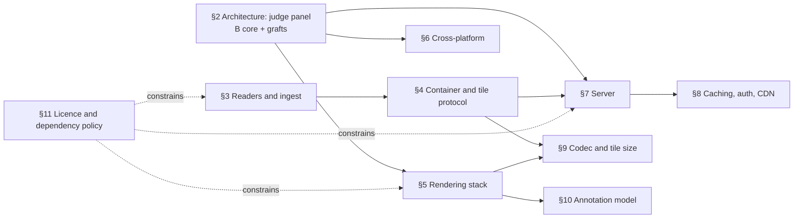
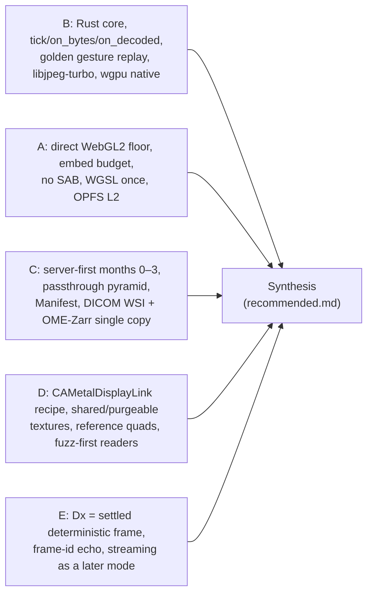

# Tradespace analysis and decisions

Stoipath WSI viewer development plan, section 3. Date 2026-10-24. This section is the single place that records *why* each major technical choice was made. It consolidates the tradespaces scattered across research notes 01–11 and the five architecture proposals (A–E) into decision matrices with one common scoring scheme, states the chosen option and the rejected alternatives, and names the condition under which each decision must be reopened. It does not restate the decided architecture (see *Recommended architecture*, `arch/recommended.md`), the latency budgets (see *Instant zoom: budgets, gates and measurement*) or the regulatory programme (see *Regulatory strategy and the Dx pathway*); it only explains the choices those sections rely on.

## 1. Method

**One scale for every matrix.** Every option is scored 1–10 (higher is better) on the seven criteria and weights the judge panel used: zoom 0.35, reach 0.20, versatility 0.10, effort 0.10, risk 0.10, maintainability 0.10, cost 0.05, so sub-decisions are commensurable with the architecture decision and goal 1 dominates everywhere. Where a research note used a 1–5 or ++/−− scale, the scores are the plan author's conversion anchored on that note's evidence; only the §2 scores are the panel's. Where a decision cannot affect zoom (container, licence) the zoom column is held equal and the other criteria decide.

**Evidence tags** follow the corpus: **[measured]**, **[verified]** (primary source read 2026-10-24), **[model]**, **[estimate]**, **[unverified]**.

**Pillar test.** Each decision ends with one line on how it serves Clinical, Research and Education; a choice optimal for goal 1 that strands a pillar is not optimal.

**Revisit conditions** are named metrics on named devices or named external events, so an agent or reviewer can tell whether a trigger has fired without re-litigating the decision; they are mirrored in the *Risk register*.

## 2. Architecture: judge-panel results and the synthesis

Three judges (performance/GPU, product/platform, delivery/engineering-management) scored proposals A–E independently against the weights above. Scores are reproduced verbatim from `judge/judgments.json`; weighted totals from `judge/ranking.json`.

### 2.1 Weighted ranking

| Proposal | Weighted score | perf | product | delivery |
|---|---|---|---|---|
| **B — one Rust engine everywhere** | **7.09** | 6.62 | 7.55 | 7.10 |
| A — web-first TypeScript engine | 7.07 | 6.90 | 7.20 | 7.10 |
| D — C++ native core, own Metal/Vulkan/GLES | 6.62 | 6.50 | 6.85 | 6.50 |
| C — OpenSeadragon adopt-then-replace, standards-first server | 5.93 | 5.75 | 6.15 | 5.90 |
| E — server GPU render + video streaming | 4.38 | 4.25 | 4.70 | 4.20 |

### 2.2 Per-criterion scores (perf / product / delivery; mean)

| Criterion (weight) | A | B | C | D | E |
|---|---|---|---|---|---|
| Zoom (0.35) | 7 / 7 / 7; **7.00** | 6.5 / 8 / 7; **7.17** | 5 / 5 / 5; 5.00 | 7 / 8 / 7; **7.33** | 3 / 4 / 4; 3.67 |
| Reach (0.20) | 6 / 7 / 6; 6.33 | 9 / 9 / 9; **9.00** | 5 / 6 / 5; 5.33 | 9 / 8 / 9; 8.67 | 5 / 5 / 4; 4.67 |
| Versatility (0.10) | 8 / 8 / 8; 8.00 | 8 / 9 / 8; **8.33** | 7 / 7 / 7; 7.00 | 8 / 8 / 8; 8.00 | 7 / 7 / 7; 7.00 |
| Effort (0.10) | 6 / 7 / 7; 6.67 | 3 / 4 / 4; 3.67 | 8 / 9 / 8; **8.33** | 3 / 3 / 3; 3.00 | 6 / 6 / 5; 5.67 |
| Risk (0.10) | 6 / 7 / 7; **6.67** | 4 / 5 / 5; 4.67 | 5 / 6 / 6; 5.67 | 3 / 4 / 3; 3.33 | 3 / 4 / 3; 3.33 |
| Maintainability (0.10) | 8 / 7 / 8; **7.67** | 6 / 7 / 7; 6.67 | 6 / 6 / 6; 6.00 | 4 / 5 / 4; 4.33 | 5 / 5 / 4; 4.67 |
| Cost (0.05) | 9 / 9 / 9; 9.00 | 9 / 9 / 9; 9.00 | 8 / 8 / 9; 8.33 | 9 / 9 / 9; 9.00 | 2 / 2 / 2; 2.00 |

### 2.3 Reading the panel

The 0.02 margin between B and A is noise; the shape of the disagreement is not. All three judges accepted the same *policy* (note 04's LOD, prefetch, eviction and blend rules) and the same *server* (C's passthrough pyramid, Manifest, path-only cache keys) and disagreed only on where the policy runs and how the web floor draws. The perf judge preferred A's direct WebGL2 on the floor devices because wgpu's WebGL2 backend is best-effort (#4081, open since 2023, on the texture-array primitive the cache uses); the product and delivery judges preferred B because A's end state has no GPU surface, no C ABI and a 60 Hz iPad for ever, so any native requirement forces a second engine. Both B-first judges attached the same condition: take gap-2's "option C" (Rust core, hand-written WebGL2 renderer on the web) up front. The delivery judge re-estimated C's effort at 80–90 PM, not 62, because R1–R4 rebuild A's engine inside OpenSeadragon.

**Decision.** Adopt B's Rust core as the single home of the policy; on the web floor execute its draw list with a hand-written `web-sys` WebGL2 renderer (`stoi-render-gl`), wgpu native-only until a WebGPU web module is allow-listed in v1; graft C's server-first months 0–3 and dual-standard store, A's web discipline, D's native present recipe behind `PresentSink`/`TileTextureStore`, and E's regulatory framing (Dx = deterministic settled frame with Rendering Complete). Provenance per component is tabulated in *Recommended architecture* §2.

**Rejected as the architecture.** E (sharp photon is RTT + codec; no client residency; 50–500× per-session cost; UDP blocked in hospitals), C's client half (blur-then-sharp for roughly a year on private OSD API), D's language (driver bugs become ours; procedural memory safety under §524B/CRA; scarcest hires), A's end state (no native path). Each remains in the design as a component or a mode, exactly as *Recommended architecture* §9 records.

**Revisit when:** (i) Stage 0 G7 fails (decoder identity) — the plan stops, not pivots; (ii) G3–G5 fail on `stoi-render-gl` — these are renderer bugs, not architecture exits; (iii) wgpu promotes WebGL2 to a supported tier and closes #4081 while `stoi-render-gl` costs >1 PM/year — fold the web renderer into wgpu; (iv) Stage 0 shows wasm-bindgen trampoline or debuggability cost >0.5 ms/frame — move the web floor renderer's *language* to TypeScript, keeping the core; (v) a required host cannot consume a C ABI — none is known.

**Pillars.** Clinical: one certifiable pixel pathway (one decoder, one shader set, one scheduler) is what makes a later Dx edition a frozen build rather than a redesign. Research: PyO3 wheel and anywidget come from the same core. Education: the PWA reaches every classroom device on day one and the offline pack serves low-bandwidth teaching.

## 3. Slide readers and ingest strategy

Evidence: note 01 (F1–F5), note 05 (MSK +130 ms/FOV for request-time transcoding, DOI 10.5858/arpa.2021-0197-OA), gap-5 (wsidicomizer 0.31.0 passthrough, `--add-missing-levels`, concatenation above 4 GB), note 09 F9 (licence classes).

| Option | Zoom | Reach | Vers. | Effort | Risk | Maint. | Cost | **Weighted** |
|---|---|---|---|---|---|---|---|---|
| R1. Serve vendor files on the fly through OpenSlide, no canonical copy | 3 | 6 | 6 | 8 | 5 | 7 | 5 | 5.10 |
| **R2. Three-tier reader chain into a canonical pyramid: byte passthrough (A/B), DCT-domain re-mux (C), decode-once (D); wsidicomizer/opentile first release, Rust `TILED_FULL`+EOT writer later; vendor file indexed in place and served during ingest** | **9** | **9** | **9** | 6 | 7 | 7 | 8 | **8.25** |
| R3. Bio-Formats / bioformats2raw as the single universal converter | 7 | 8 | 9 | 7 | 5 | 6 | 6 | 7.05 |
| R4. Client-side native-format reading (openslide-js, wsi-rs) as the primary path | 4 | 4 | 5 | 7 | 3 | 5 | 9 | 4.65 |
| R5. Own Rust readers for every format from day one, including Tier D | 9 | 9 | 7 | 2 | 4 | 6 | 8 | 7.25 |

**Why R2.** Instant zoom is a property of the ingested representation, not of the reader: SVS and SCN step by 4× between levels, CZI may have no pyramid, Philips TIFF has padded geometry, NDPI "tiles" are 8-px strips, MRXS/BIF/CZI tiles overlap, J2K/JXR/iSyntax need heavy decoders (note 01 F1). R1 therefore cannot meet goal 1 (2 s+ tiles on slides without low-resolution levels; +130 ms/FOV measured at MSK) and R4 drags LGPL and SharedArrayBuffer into the client bundle. R2 keeps the scanner's pixels byte-exact for the passthrough tier (regulatory and AI-reproducibility value), decodes exactly once for the rest, and lets the slide open seconds after upload because tiers A–C are indexed in place while the canonical copy is written (gap-5, *Recommended architecture* §3.1). wsidicomizer/opentile/wsidicom are Apache-2.0, Sectra-funded and current (0.31.0 / 0.26.0 / 0.36.1, 2026-09-28); they are the first-release converter *and* the CI oracle for the Rust writer that replaces them when throughput demands. R3 is the catch-all for Bio-Formats-only multichannel sources but runs in the GPL-isolated worker and re-shards with `zarrs`, because bioformats2raw documents no sharding option. R5 is the end state for tiers A–C only.

**Reader chain (decided).** Tier A/B (DICOM WSI, SVS-JPEG, Philips TIFF, SCN, Huron/Motic/Mikroscan/ARGOS, OME-TIFF, generic tiled TIFF with JPEG tiles): own Rust `tiff`/`dicom-rs` indexers with `JPEGTables` splice, tifffile/opentile/wsidicom as byte-identity oracles. Tier C (NDPI): libjpeg-turbo lossless transforms. Tier D: OpenSlide 4.0.1 (LGPL-2.1), libisyntax (BSD-2, IP review pending), slideio/libCZI (LGPL-3) for CZI-JXR, Bio-Formats `formats-gpl` in its own JVM container, cuCIM for J2K-heavy archives — one container image per licence class, nothing copyleft in any client, and a per-tile provenance flag (passthrough vs re-encoded) carried into telemetry and Dx records.

**Rejected.** R1 (degraded temporary mode only, never promised instant); R4 (desktop/Python nicety, never the mobile hot path).

**Revisit when:** wsi-rs passes a corpus evaluation against OpenSlide and tifffile (then own Rust readers for tiers A–C in-process for desktop and Python); Bio-Formats precompressed-tile APIs carry NDPI/DICOM losslessly (then R3 covers more of tiers A–C for multichannel); libisyntax fails IP review (then a sealed Philips-SDK worker under its own licence review); a customer inventory shows >30 % Tier D volume (then Tier-D ingest throughput, not passthrough, sets the ingest SLA).

**Pillars.** Clinical: DICOM from the first byte for brightfield; label/macro/barcode withheld to the PHI tier at ingest. Research: lossless passthrough preserves TCGA/CAMELYON pixels; Bio-Formats path covers CZI/VSI fluorescence. Education: teaching sets ingest through the same pipeline with a licence registry per slide (gap-6).

## 4. Storage container and tile protocol

Evidence: gap-5 F1–F7 (all primary sources read 2026-10-24), note 02 F2, note 05 F5. The container decision cannot change goal 1: every surviving option is byte passthrough behind a small index, and the latency figures in *Instant zoom: budgets, gates and measurement* assume only 512² tiles, 1 MiB-aligned layout, centre bundles and the L4 hot cache (gap-5 "Implications" item 3). Zoom is therefore scored 8 for all range-addressable options and the decision is carried by reach, versatility, risk and cost.

| Option | Zoom | Reach | Vers. | Effort | Risk | Maint. | Cost | **Weighted** |
|---|---|---|---|---|---|---|---|---|
| A. OME-Zarr v3 sharded with JPEG/HTJ2K chunks for everything (note 02 R2, pre-amendment plan) | 8 | 5 | 4 | 7 | 3 | 5 | 9 | 6.15 |
| **B. Dual-standard, single copy: DICOM WSI `TILED_FULL`+EOT (one instance per level, concatenation >4 GB) for brightfield; OME-Zarr 0.5 (Zarr v3 `sharding_indexed`, 512² inner chunks, core `zstd`/`bytes`) for multichannel/16-bit; one Manifest over both** | 8 | **9** | **9** | 6 | 7 | 7 | 9 | **7.95** |
| C. OME-Zarr lossless everywhere plus a derived JPEG delivery pyramid | 8 | 9 | 9 | 5 | 6 | 6 | 3 | 7.35 |
| D. DICOM WSI for everything, including 16-bit multiplex | 8 | 7 | 6 | 7 | 6 | 7 | 9 | 7.25 |
| E. PMTiles-style internal archive as canonical | 9 | 4 | 3 | 7 | 4 | 6 | 9 | 6.40 |
| F. DICOM canonical plus a full OME-Zarr brightfield mirror (true dual copy) | 8 | 9 | 9 | 5 | 6 | 5 | 3 | 7.25 |
| G. Object-per-tile (DZI / IIIF level-0 static files) | 7 | 6 | 5 | 8 | 7 | 7 | 4 | 6.55 |

**Why B.** It is the only row without a disqualifying mark in gap-5's own matrix. A fails reach: the Zarr v3 codec registry lists 17 codecs and no image codec **[verified]**, `imagecodecs_jpeg` is an unregistered raw name (ZEP 9 non-conformant), no mainstream reader (zarr-python, zarrs, zarrita, tensorstore, Viv, vizarr, zarr-java) decodes JPEG chunks and QuPath 0.7 reads no Zarr v3 at all (OMEZarrReader depends on jzarr 0.4.2) — the store would be readable only by our own code, forfeiting the interoperability that justified OME-Zarr. C and F pay 4–5× storage for >90 % of volume (100k² H&E ≈ 10–15 GB zstd vs 3–4 GB JPEG). D leaves napari/Viv/vizarr needing a DICOM reader for 16-bit data whose DICOM tooling is thin. E has no pixel-type, colour, ICC or multichannel model and no ecosystem; it survives as the derived **offline pack**. G costs ~51k objects and ~$0.25/slide in PUTs, cannot coalesce and cannot be copied as one file. B stores every pixel once and each container is readable by its community's tools: a `TILED_FULL`+EOT instance is a range-addressable tile archive readable by every clinical viewer and VNA; sharded OME-Zarr 0.5 with core codecs reads today in zarr-python 3.4.1, zarrs 0.23.14, zarrita 0.7.5, tensorstore 0.1.85, zarr-java, Viv 0.23.0, vizarr 0.3.0 and ome-zarr-py 0.21.0 **[verified]**.

**Tile protocol (decided, no scoring needed; options were ranked in note 05 F4–F5).**

| Element | Decision | Rejected | Reason |
|---|---|---|---|
| Client-facing tile address | Immutable `/{slide_hash}/{pyramid_version}/{codec}/{level}/{x}_{y}` with `Cache-Control: immutable`; token in query stripped from the cache key (§8) | Query-string signatures in the key; per-user URLs | Shared edge cache or nothing |
| Coalescing | Centre-of-viewport **bundle** endpoint (≤4 contiguous ranges) and raw shard/EOT range passthrough; DICOMweb `frames/{list}` as the standards-native form | Multi-range `Range:` headers; WebSocket or WebTransport tile transport | CloudFront returns 200/full object on any malformed multi-range; Cloudflare multipart depends on Origin Range Requests (gap-3 11b/11c); WebSocket has TCP head-of-line blocking; WebTransport Baseline only since Safari 26.4 |
| Transport | HTTP/3 with 0-RTT for GET terminated at CDN/Caddy; HTTP/2 first-class | HTTP/3 in-process (`h3` 0.0.8); HTTP/1.1 | Samsung Internet has no HTTP/3 (caniuse, July 2025 data); Chrome's TLS 1.3 early data over TCP is off, so HTTP/2 never gets 0-RTT **[verified gap-3]** |
| Façades | DICOMweb (QIDO/WADO-RS incl. `frames/{list}`, STOW-RS), IIIF Image 3.0 (grid-aligned fast path; off-grid via rate-limited libvips), DZI, Iris-shaped WADO-RS | Façades as the hot path for first-party clients | IIIF/DZI are single-tile protocols with no coalescing; Iris inherits early adopters at near-zero cost |
| Index | ≤100 KB immutable **Manifest**: `TileIndex(layer, level, x, y, [z, t, c]) → (object, offset, length, codec, provenance)` built from EOTs, shard indices and TIFF IFDs | Parsing DICOM or Zarr at request time | Edge Translator never touches container metadata on the hot path |

**Revisit when (gap-5 F5 conditions, verbatim in substance):** to A — a `jpeg`/`htj2k` codec is registered in `zarr-extensions` *and* shipped in zarr-python, zarrs and zarrita *and* QuPath reads Zarr v3; the translator then makes migration a background job. To D — early customers >90 % clinical, fluorescence <5 % of slides, and wsidicomizer/highdicom 16-bit optical paths prove adequate. To C/F — a regulator or VNA demands DICOM files *and* a research group demands OME-Zarr brightfield; this becomes an export cost line, not an architecture change. B itself is amended if EOT/concatenation breaks common VNAs for >4 GB levels (split levels into ≤2 GB instances) or if the M1 prototype shows per-level EOT loading costs client-direct readers >1 RTT at open (publish the Manifest beside the instances). The JPEG-chunk Zarr layout stays a feature-flagged experiment under the URI codec id `https://stoipath.dev/zarr/codecs/jpeg`, never holding customer data, re-decided at the first annual review.

**Pillars.** Clinical: DICOMweb is true at launch without conversion; VNA co-existence and STOW into a customer archive need no second copy. Research: multichannel is plain OME-Zarr 0.5; QuPath interoperability goes through DICOM and OME-TIFF export until Bio-Formats moves to zarr-java, which this project funds (gap-5 F8 item 6). Education: the derived offline pack is the classroom and CME enduring-material artefact.

## 5. Client rendering stack

### 5.1 Engine: build versus adopt

Evidence: note 03 §2.2/§2.9 (engine internals verified from source), note 07 F3/F6/F7 (OpenSeadragon #2906 open; blur-then-pop is the norm in every OSD/OL viewer), gap-2 (wgpu web viability, measured), the panel.

| Option | Zoom | Reach | Vers. | Effort | Risk | Maint. | Cost | **Weighted** |
|---|---|---|---|---|---|---|---|---|
| Adopt OpenSeadragon 6.1 + plugins | 3 | 6 | 5 | 9 | 5 | 5 | 9 | 5.10 |
| Adopt OpenLayers WebGLTile | 4 | 6 | 7 | 8 | 6 | 6 | 9 | 5.75 |
| Adopt MapLibre GL JS raster path | 6 | 7 | 4 | 6 | 6 | 7 | 9 | 6.25 |
| Adopt deck.gl + Viv layers | 5 | 6 | 9 | 7 | 6 | 6 | 9 | 6.20 |
| Fork Neuroglancer | 6 | 5 | 8 | 4 | 4 | 4 | 9 | 5.55 |
| Custom TypeScript engine (proposal A, panel means) | 7.00 | 6.33 | 8.00 | 6.67 | 6.67 | 7.67 | 9.00 | 7.07 |
| Rust core + wgpu on both web backends (proposal B as written, panel means) | 7.17 | 9.00 | 8.33 | 3.67 | 4.67 | 6.67 | 9.00 | 7.09 |
| **Rust core; `web-sys` WebGL2 renderer on the web floor; wgpu native; adapters for OSD/OL/deck.gl (the synthesis; plan author's scores)** | **8** | **9** | **9** | 4 | 6 | 7 | 9 | **7.65** |

**Why build.** No adoptable engine fixes the four causes of blur — finer level not resident, hard level swap, minification aliasing, main-thread stall during decode/upload (note 03 §3). OpenSeadragon uploads one texture per tile on the main thread, has no mipmaps and composites through a 2D canvas, a design its maintainers call a flaw (#2906, open) **[verified]**; OpenLayers has no mipmaps; MapLibre has mipmaps and cross-fade but is a Web-Mercator vector engine with WebGPU still on its roadmap; deck.gl's WebGPU is "not production ready" and its TileLayer adds per-frame framework cost. The custom engine is ~5–10 kLOC and buys the one differentiator nobody in pathology has (note 07 F7). The ecosystem is reused off the hot path: Viv's 16-bit shader math (MIT), dicom-microscopy-viewer's DICOM parsing, zarrita, geotiff.js; OSD `TileSource`, OpenLayers `Source` and deck.gl wrappers are first-class *adapters*; an OSD-configured baseline stays in the perf harness as the public comparator.

### 5.2 Web floor renderer

Evidence: gap-2 §2.1 (wgpu WebGL2 backend "Downlevel/Best Effort"; #4081, #3735, #10460 open; +0.68 MB gz **[measured]**), gap-2 §4.1 (decision table 72 / 78 / 82 for A / B / C), gap-3 (WebGL2 is the floor: Firefox Linux/Android and WebKitGTK have no WebGPU, Xclipse blocklisted, compat-mode limits 4096² textures and 16 KiB UBO).

| Option | Zoom | Reach | Vers. | Effort | Risk | Maint. | Cost | **Weighted** |
|---|---|---|---|---|---|---|---|---|
| TypeScript renderer executing the wasm core's draw list | 8 | 8 | 7 | 6 | 7 | 5 | 9 | 7.35 |
| wgpu's WebGL2 backend (proposal B as written) | 6 | 7 | 8 | 8 | 4 | 7 | 9 | 6.65 |
| **Rust `web-sys` WebGL2 renderer inside the core module (`stoi-render-gl`), GLSL ES 3.00 generated from WGSL by naga-cli, ≤1 LSB goldens** | **8** | **8** | 8 | 6 | **7** | 7 | 9 | **7.65** |

**Why `stoi-render-gl` now.** It removes #4081/#3735/#10460 and 0.68 MB gz from exactly the devices that define the floor, costs ~2–3 kLOC (+3 PM), keeps draw lists and uploads inside the wasm module so nothing crosses the boundary per tile, and keeps one shader source (WGSL) via naga-cli. The TypeScript variant is the recorded exit if Stage 0 shows trampoline or debuggability cost >0.5 ms/frame (expected <0.2 ms **[estimate]**). WebGPU is an *enhancement module* allow-listed per Safari major after soak (the rerun precedent: Safari defaulted to WebGL on 2026-05-20 after a 26.4 regression **[verified]**), never the floor; the renderer stays fragment-shader-only and texture-array based (≤64 layers × 512² RGBA8 per array, instance data from vertex buffers) so WebGL2, GLES 3.0, WebGPU compat and full WebGPU/Metal/Vulkan draw identical pixels.

### 5.3 Decoder

Evidence: gap-2 §2.3 **[measured]**: libjpeg-turbo bit-identical across native x86 SIMD, wasm SIMD and wasm scalar (0 differing pixels); zune-jpeg differs in 37.6 % of pixels (max 4 LSB), jpeg-decoder 10–15 % and from its own SIMD build; wasm penalty 2.1–2.9× JPEG; Safari's ImageIO is closed and colour-managed.

| Option | Zoom | Reach | Vers. | Effort | Risk | Maint. | Cost | **Weighted** |
|---|---|---|---|---|---|---|---|---|
| **libjpeg-turbo (C) as the sole Dx decoder: `turbojpeg` crate natively, own Emscripten `-msimd128` no-pthreads build on the web (~60 KB gz); `createImageBitmap` as a per-browser-build self-certified accelerator (G8), never on Safari in Dx** | 8 | **10** | 8 | 7 | **9** | 8 | 9 | **8.45** |
| Rust decoders (zune-jpeg / jpeg-decoder) | 7 | 10 | 7 | 9 | 3 | 8 | 9 | 7.60 |
| Browser-native `createImageBitmap` as the only path | 9 | 7 | 4 | 9 | 3 | 8 | 9 | 7.40 |
| OS codecs in native shells (ImageIO, BitmapFactory, WIC) | 8 | 8 | 5 | 9 | 3 | 7 | 9 | 7.25 |

"Identical pixels on every platform" is measured true only for libjpeg-turbo; it is the operational basis of Dx-mode determinism and of the golden gesture replay (an identical cache requires identical decoded pixels). Hardware JPEG decode is not a lever on either mobile platform (gap-4 §2.3/§2.6 **[verified by API absence]**). HTJ2K uses one pinned OpenJPH version on all platforms, reversible only in Dx until lossy identity across builds is verified (0.002 % saturated-sample differences were seen between two builds **[measured]**).

### 5.4 Native viewport

Evidence: gap-4 §2.10 (tradespace), §2.7 (MapLibre's 2026 changelog still extending Adreno 600 `VK_ERROR_DEVICE_LOST` workarounds **[verified]**), §2.8 (wgpu honours a pre-set `presentsWithTransaction`; no `presentedTime` (#9856); no AHardwareBuffer import).

| Option | Zoom | Reach | Vers. | Effort | Risk | Maint. | Cost | **Weighted** |
|---|---|---|---|---|---|---|---|---|
| wgpu everywhere, shells own loop and input only | 7 | 9 | 8 | 8 | 7 | 7 | 9 | 7.70 |
| **wgpu + `wgpu-hal` escape hatches behind `PresentSink` / `TileTextureStore`: shell-created `CAMetalLayer`, shared-storage and purgeable tile textures imported into wgpu** | **8** | 9 | 8 | 7 | 7 | 7 | 9 | **7.95** |
| Direct Metal on iOS, wgpu on Android | 9 | 9 | 7 | 5 | 6 | 5 | 9 | 7.70 |
| Direct Metal + direct Vulkan + own GLES fallback (proposal D) | 9 | 8 | 6 | 3 | 3 | 3 | 9 | 6.70 |

The escape-hatch variant keeps one renderer and one shader set, keeps the Android driver-bug burden upstream (wgpu/Firefox), and recovers the two levers that matter on iOS: raw layer configuration (`preferredFrameLatency` 1, two drawables) and shared/purgeable textures. **Revisit:** take the direct-Metal piece only if N-iPad misses "p95 input-to-photon ≤ REF-quad + 1 interval" at Stage 3 month 3 and profiling blames wgpu's present/upload path, not our scheduler.

**Rejected across §5.** OSD as engine (never; OSD-config stopgap only if graphics hires slip >3 months); wgpu WebGL2 backend on the web (see trigger above); wasm threads/SharedArrayBuffer (COOP/COEP breaks embeds and Android WebView, `atomics` still unstable at Rust 1.99 **[verified]**); Service Worker on the hot path (50/250 ms cold start); OffscreenCanvas-in-worker core (input-forwarding hop; only if M1 shows irreducible >8 ms main-thread tasks); Capacitor/Tauri-mobile webviews (60 Hz cap, ~15 % disk quota, App Store 4.2, no predicted touches).

**Pillars.** Clinical: a deterministic pixel pathway and Rendering Complete flag from day one; Dx mode disables approximate rendering. Research: 16-bit `r16uint` channels with in-shader transfer functions (Viv semantics) in the same renderer as brightfield. Education: WebGL2 floor reaches classroom Chromebooks and 2020-class iPads.

## 6. Cross-platform strategy

Evidence: note 06 §2.1–§2.3 (capability matrix verified against gpuweb wiki, MDN BCD, caniuse), gap-3 (Safari 60 fps preference at WebKit ToT; WKWebView can lift it only via private SPI; WebKitGTK has no WebGPU at all), gap-4 (native floors: iPad 2 intervals floor / 3 typical, Android 3 / 4 **[model]**).

| Option | Zoom | Reach | Vers. | Effort | Risk | Maint. | Cost | **Weighted** |
|---|---|---|---|---|---|---|---|---|
| (a) Web-only PWA | 5 | 7 | 7 | 9 | 8 | 9 | 9 | 6.90 |
| (b) Web core inside webview wrappers (Tauri / Electron / Capacitor) | 5 | 7 | 7 | 7 | 6 | 7 | 8 | 6.25 |
| **(c) Rust core compiled to wasm and native; thin shells (Lit web component and PWA; Tauri 2 desktop; SwiftUI + `CAMetalLayer`; Compose + `SurfaceView`); UniFFI, cbindgen C ABI, PyO3 + anywidget** | **9** | **10** | **9** | 4 | 6 | 7 | 9 | **8.20** |
| (d) C++ core with Dawn / wgpu-native and bindings | 9 | 10 | 9 | 3 | 4 | 5 | 9 | 7.70 |
| (e) Flutter (Impeller) or Compose Multiplatform | 6 | 5 | 7 | 6 | 5 | 6 | 8 | 5.90 |
| (f) React Native + Skia | 4 | 4 | 6 | 6 | 5 | 6 | 8 | 4.90 |
| (g) .NET MAUI / Avalonia | 5 | 3 | 6 | 6 | 5 | 6 | 8 | 5.05 |
| (h) Qt / QML | 7 | 4 | 7 | 6 | 5 | 6 | 6 | 5.95 |

**Why (c), and why the staging.** Goal 1 on iPad is bounded by the browser's ≈2-vsync compositor floor and WebKit's 60 Hz preference (`PreferPageRenderingUpdatesNear60FPSEnabled` default true everywhere except visionOS **[verified]**); only a native shell reaches the documented 2-interval Metal floor and GB-class caches. (c) is the MapLibre Native / Firefox-UniFFI shape — share the engine, never the UI (Dropbox's shared-C++ retreat is the cautionary tale) — and is the only option that yields a web component, a Jupyter widget and native SDKs from one codebase. (d) buys the same reach with procedural memory safety for parsers of attacker-controlled slide bytes (OpenSlide shipped two CVEs in 4.0.1 **[verified]**) and the scarcest hiring profile. (e)–(h) put a second rendering engine between us and the GPU or lack a credible, embeddable web target.

| Platform | Delivery | Stage |
|---|---|---|
| Web desktop and mobile (Chrome/Edge/Firefox/Safari, Samsung Internet, WebView) | PWA, `<stoipath-viewer>`, iframe JSON-RPC; WebGL2 floor; WebGPU module v1 | MVP |
| Windows / macOS / Linux | Tauri 2: wasm in the webview at MVP; native wgpu window with TS chrome at v0.9 once WRY's wgpu-plus-webview layering (example exists; hit-testing **[unverified]**) passes Stage 2; Linux viewport is a native wgpu window because WebKitGTK has no WebGPU | MVP → v0.9 |
| iPadOS/iOS 17+ | XCFramework (SwiftPM binaryTarget, UniFFI Swift) + reference SwiftUI app; D's present recipe | beta month 12, GA v1 |
| Android 10+ | AAR (cargo-ndk, UniFFI Kotlin, JNA ≥5.12) + reference Compose app; allow-listed Vulkan, GLES retry | v1 |
| Jupyter / Colab / VS Code / marimo | `pip install stoipath`: anywidget over the web bundle + PyO3 wheel | MVP |
| Qt / C++ / .NET / Java hosts | `stoipath.h` C ABI; Qt `QQuickItem` sample; Panama / P/Invoke | v1 |

**Rejected.** Webview wrappers on mobile (never; the PWA covers mobile web until native shells ship); Electron (100–200 MB; only if WebKitGTK WebGL2 proves inadequate on Linux, now moot given the native window); Qt as desktop shell (LGPL-3 dynamic-linking terms and procurement friction; kept as the Qt SDK sample).

**Revisit when:** Apple exposes a public WKWebView API for 120 Hz *and* WebGPU in WKWebView passes a soak — then the iPad shell can shrink to a hybrid (UI in the webview, viewport on a native `CAMetalLayer`); WRY layering fails Stage 2 — then the desktop stays wasm-in-webview and the 120 Hz desktop win is lost (recorded); Rust wasm atomics stabilise with a measured same-origin win — then a threaded web build as an opt-in for same-origin deployments only, never for embeds.

**Pillars.** Clinical: Epic Hyperdrive embeds the viewer in an iframe with no third-party cookies and no COOP/COEP (gap-7), which only (a)/(c) satisfy without a hostile build; tablets remain consultation/education until a display-agnostic clearance. Research: PyO3 wheel and anywidget are first-class, not afterthoughts. Education: LTI 1.3 launches land on the same web component (gap-6).

## 7. Server technology

Evidence: gap-5 F6 (seven servers surveyed from primary READMEs/papers), note 05 F3 (Iris 21 ms median at 5k req/s on an RK3588; Google proxy ~150 ms/frame), gap-5 edge-runtime table (Cloudflare Workers limits verified; CloudFront Functions 2 MB/10 KB/no network; Lambda@Edge no Rust runtime **[unverified for custom runtimes]**).

| Option | Zoom | Reach | Vers. | Effort | Risk | Maint. | Cost | **Weighted** |
|---|---|---|---|---|---|---|---|---|
| **Build the Edge Translator in Rust from crates (`axum` 0.8.9 / `hyper` 1.12.0, `zarrs` 0.23.14, `dicom-object` 0.10.0, `tiff` 0.11.3, `turbojpeg` 1.5.1, `moka`/`foyer`, `object_store`/`opendal`, `worker` 0.8.7); three builds from one crate graph (regional service, Cloudflare Worker, in-process library)** | **9** | **9** | **9** | 5 | 7 | 7 | 9 | **8.20** |
| Build in Go or Node | 8 | 7 | 8 | 6 | 6 | 6 | 9 | 7.25 |
| Fork Iris RESTful Server (C++ Boost.Beast) | 8 | 6 | 4 | 6 | 5 | 5 | 9 | 6.45 |
| Adopt Orthanc + WSI + DICOMweb plugins | 6 | 6 | 6 | 7 | 6 | 6 | 9 | 6.25 |
| Adopt large_image / Girder | 3 | 6 | 9 | 8 | 7 | 7 | 7 | 5.70 |
| Adopt Google Digital Pathology DICOM Proxy | 3 | 6 | 6 | 8 | 6 | 6 | 8 | 5.25 |
| Managed DICOM store (Google Healthcare API, AWS HealthImaging) as the hot tile tier | 2 | 6 | 7 | 8 | 6 | 8 | 7 | 5.15 |
| Adopt IIPImage or Cantaloupe | 3 | 5 | 5 | 8 | 6 | 6 | 7 | 4.90 |

**Why build, in Rust.** No surveyed server serves Zarr shards *and* DICOM frames by byte passthrough with tile-list bundles: Iris proves the latency class but serves only IFE over GET; Google's proxy quotes ~150 ms/frame; IIPImage and Cantaloupe re-encode; large_image decodes to numpy; Microsoft's dicom-server is archived **[verified]**. The hot path is ~300 lines of offset arithmetic per container plus what nobody ships (prefix-token auth with a path-only key, bundles, neighbour pre-warm, four façades). Rust over Go/Node because `stoi-model` and `stoi-source` are shared with the client, so shard geometry and tile addressing agree by construction, and the server's `turbojpeg` is the client's libjpeg-turbo, so decoder identity (G7) holds server-side; Go's tiled-TIFF/JPEG-transform/Zarr-v3 depth is thinner **[unverified]**. Forking Iris buys a Beast loop and loses the crate ecosystem; Orthanc couples the server to its database (its copyleft licensing is a separate review item **[unverified today]**). Managed DICOM stores are a customer's system of record behind the translator (stored-syntax frames via `transfer-syntax=*`), never the hot tier: price is irrelevant (≈$58/yr at 15M frames), latency is not.

**Deployment placement (decided).** Cloudflare first-class: Worker + Cloudflare cache, R2 `get(key, {range})` same-network, zero egress; 1 MiB-aligned origin ranges, so shards are 1 MiB-aligned; a 15-tile bundle is ≤4 shard ranges under the 6-simultaneous-connection cap. AWS: regional service (Fargate/EC2) behind CloudFront with `foyer` RAM + NVMe hot cache (CloudFront Functions and Lambda@Edge withdrawn as hosts). On-prem/hospital: the same binary behind Caddy or nginx with MinIO — the in-house-runnable stack the TSP abstract rests on. In-process: the same crates linked into Tauri and the PyO3 wheel. HTTP/3 is never terminated in the Rust process (`h3` 0.0.8, pre-1.0).

**Gate.** p99 ≤ 10 ms hot service time per container path (Zarr shard range, DICOM EOT frame, 15-tile bundle) on a 2-vCPU container and in a Worker — measured in M0–M1, a gate from M1 (see *Instant zoom: budgets, gates and measurement*).

**Revisit when:** a maintained server ships Zarr v3 shard + DICOM EOT passthrough with bundles and a published p99 ≤ 10 ms (adopt it as the regional build); `h3` reaches 1.0 and an on-prem topology has nothing in front (terminate QUIC in-process); AWS ships a Rust edge runtime with a measured win over the regional origin; Cloudflare's 6-connection cap is shown to count R2-binding calls and bundles exceed it (regional-origin fallback).

**Pillars.** Clinical: DICOMweb façade and proxying of archives that decompress despite `transfer-syntax=*` (dcm4chee 5.31 reported inconsistent); on-prem binary for PHI residency. Research: Zarr shard passthrough for zarrita/zarrs clients; in-process library in the Python wheel. Education: Worker build keeps a free public teaching deployment at a few dollars a year (note 02 F8: ~$4/yr delivery on R2 at 30k sessions).

## 8. Caching, authentication and CDN

Evidence: note 02 F6–F9 (cache layers, key scheme, cost model), note 05 F6–F7 (prefetch, OPFS, Service Worker cold start 50/250 ms **[verified web.dev]**), note 09 F5 (Fetch-spec preflight cache keyed per URL; `Authorization` not safelisted **[verified]**), gap-3 (Safari's 7-day ITP deletion covers OPFS and Cache API and `persist()` does not exempt them **[verified source]**; Chrome partitions its HTTP cache, WebView does not; CDN range semantics).

### 8.1 Tile authentication transport (zoom = added round trips on a cold tile)

| Option | Zoom | Reach | Vers. | Effort | Risk | Maint. | Cost | **Weighted** |
|---|---|---|---|---|---|---|---|---|
| 1. Session cookie to a same-origin tile proxy | 9 | 3 | 6 | 9 | 6 | 8 | 9 | 7.10 |
| 2. `Authorization: Bearer` via `fetch()` (IHE IUA / DICOMweb pattern) | 5 | 8 | 9 | 8 | 7 | 8 | 8 | 6.95 |
| 3. Per-tile signed URLs | 7 | 8 | 6 | 6 | 6 | 6 | 5 | 6.70 |
| **4. Short-lived prefix-scoped capability token in the query (ES256 JWT or macaroon, 5–15 min TTL, silent refresh), validated at the edge, stripped from a path-only cache key with `Origin` excluded; `Referrer-Policy: no-referrer`; tokens scrubbed from logs** | **9** | **9** | 8 | 7 | 7 | 8 | 9 | **8.40** |
| 5. Service Worker injecting headers | 5 | 6 | 7 | 7 | 5 | 6 | 8 | 5.85 |
| 6. Client-side decryption (AES-GCM per slide key, public ciphertext) | 8 | 9 | 7 | 4 | 6 | 6 | 9 | 7.35 |

Option 2 costs one preflight RTT per distinct tile URL when cross-origin (the preflight cache is keyed per URL and `Access-Control-Max-Age` defaults to 5 s), i.e. 20–60 ms at a CDN edge and 50–150 ms on mobile added to *every* cold zoom step — alone most of note 04's perceptual budget; it is retained only as a same-origin proxy mode for talking to someone else's DICOMweb archive. Cookies die in third-party embedding (Safari blocks, Chrome partitions). Option 4 adds nothing to the hot path and makes every tile a shared-cache hit after the first viewer of a slide. Option 6 is the roadmap item for untrusted CDNs and offline packs.

### 8.2 Cache hierarchy (decided; alternatives rejected in the right-hand column)

| Layer | Decision | Rejected alternative and reason |
|---|---|---|
| **L0** GPU slot map | ≤64-layer × 512² RGBA8 arrays (64 MiB each), no mips (the pyramid is the mip chain); Pinned Base = levels ≤2048² (≈23 MiB); dynamic budget from `os_proc_available_memory` / `MemoryInfo` + `onTrimMemory`, LRU tail purgeable on iOS | 256-layer arrays (256 MiB each, 4× the budget a 128 MiB phone has: the panel's arithmetic correction); pinning ≤4096² on GPU (70–85 MiB, 55–66 % of a phone L0); static per-device tables (`isLowRamDevice` is false on every 3–4 GB phone) |
| **L1** decoded CPU LRU | ≤25 % of L0 | Larger decoded caches on iOS (WebContent jetsam) |
| **L2** encoded local store | Worker-owned OPFS via `FileSystemSyncAccessHandle` (natively SQLite/shard files), treated as a refillable cache with Manifest re-validation | Service Worker + Cache API on the hot path (50/250 ms cold start); IndexedDB for 100–200 KB blobs (transaction overhead); trusting local presence on Safari (7-day deletion covers OPFS **[verified]**) |
| **L3** CDN edge | Immutable URLs, path-only key, 1 MiB range slices, tiered caching/origin shield, `Timing-Allow-Origin` + `Server-Timing` | Query strings or `Origin` in the key (cache fragments per user/embedder); multi-range requests (fallback to 200/full object) |
| **L4** translator hot cache | `moka` (RAM, TinyLFU) in the Worker/regional service; `foyer` RAM + NVMe at a regional origin; neighbour and child pre-warm on every request | Redis/Memorystore as a separate hop (Google's proxy pattern; adds RTT and ops) |
| **L5** object store | DICOM instances and 1 MiB-aligned OME-Zarr shards; vendor originals cold | Object-per-tile (§4 G); S3 Express as hot tier ($0.11/GB-mo, unnecessary with L3/L4) |
| Prefetch policy | Centre-out priority keyed on tier, then level distance from L\*, then focus distance; Base Bundle + levels ≥4 at open; L*+1 under the cursor from the first sample; destination level only after ≥2 consistent samples; ring 1 cellular / 2 wired; ≤50 % bandwidth, ≤25 % slots; idle fan-out unmetered only | Destination skip from the first notch (34 % of pathologist zoom bursts span <2.3 levels, Brunyé 2023 **[verified]**: a mis-predicted skip leaves nothing resident); idle fan-out on 4G |

### 8.3 Hosting default

Cloudflare R2 + Workers first-class (storage $0.015/GB-mo, egress $0, Workers $5/mo incl. 10M requests **[verified 2026-10]**: ~$4/yr delivery at 30k sessions vs ~$360/yr via CloudFront **[model]**); AWS as the customer-required variant with a regional origin; on-prem/air-gapped with the identical edge binary; offline packs for tablets. The edge component is part of the product in every topology because remote pathologists on a hospital VPN see 30–100 ms RTTs like SaaS users (note 09 F6). PHI at a third-party edge is a per-tenant deployment switch (BAA, residency), not a design dependency; Tier-2 PHI (label, macro, barcode) never reaches the CDN.

**Revisit when:** a target hospital requires edge-side revocation faster than the 5–15 min TTL (add a KV revocation lookup, ~1 ms per token); a tenant forbids PHI at the edge (regional-origin-only mode, already supported); CDN range-caching semantics change (re-measure the 1 MiB alignment); Chrome's HTTP-cache partitioning changes for embedders (irrelevant by design since the component owns its L2).

**Pillars.** Clinical: audit logs token issuance and sampled viewport trails as FHIR `AuditEvent`/ATNA, not per-tile CDN logs; LIS status feed → prefetch on `ready-for-review` turns HL7 into a performance feature (gap-7). Research: capability links with expiry are how cohorts are shared. Education: the free teaching deployment costs dollars, not thousands, because egress is zero.

## 9. Delivery codec and tile size

Evidence: note 02 F3 **[measured on this machine, 512² IHC tile, native libraries]** and F4 **[model]**, gap-3 (JPEG XL default-on in Chrome 155 and Firefox 158 **[verified]**, Safari no progressive decode, Edge/Samsung none), gap-1 F3/F7/F8 (visually lossless thresholds; moving-tier chroma risk for IHC).

### 9.1 Brightfield delivery codec

| Option | Zoom | Reach | Vers. | Effort | Risk | Maint. | Cost | **Weighted** |
|---|---|---|---|---|---|---|---|---|
| **JPEG baseline q85–90 (vendor bytes copied where the grid allows; 4:4:4 at settle)** | **9** | **10** | 5 | 9 | 9 | 9 | 6 | **8.65** |
| HTJ2K (OpenJPH): ≥8-bit, lossless, DICOM `.201/.202/.203` | 7 | 6 | **10** | 6 | 6 | 7 | 7 | 6.90 |
| WebP | 5 | 10 | 4 | 8 | 8 | 8 | 7 | 6.90 |
| AVIF (opt-in bandwidth variant) | 4 | 8 | 6 | 7 | 6 | 7 | 9 | 6.05 |
| JPEG XL | 4 | 6 | 9 | 6 | 5 | 7 | 9 | 5.75 |
| JPEG 2000 Part 1 | 2 | 3 | 8 | 6 | 5 | 6 | 7 | 4.15 |

At matched SSIM ≈0.965 (JPEG q80): WebP −20 % bytes at 4× decode; AVIF −38 % at 4× decode and 300× encode; JXL −19 % at 6–7×; J2K −19 % at 11×; HTJ2K −15 % at 2.2× **[measured]**. A 20-tile viewport is already 100–150 ms of WASM JPEG decode on a Cortex-A55 phone; a 4–6× slower codec costs more frames than its bytes save. JPEG is also the only codec passthrough from SVS/NDPI/Philips/DICOM, so the default has zero generation loss. HTJ2K covers what JPEG cannot (16-bit, lossless, DICOM-native; one pinned OpenJPH build); WebP ties it numerically but has no role JPEG lacks. AVIF is an opt-in cellular variant on ≥4 performance cores. JPEG XL moves from "2027" to "benchmark now" for the *archive* tier (lossless JPEG recompression, bit-exact JPEG back) and to an `Accept`-negotiated desktop opt-in (Chrome 155+, Firefox 158+, Safari 17+); it does nothing for time-to-sharp on the floor devices (6–7× decode, no progressive on Safari, absent on Samsung/Edge) **[verified gap-3]**.

**Multichannel/16-bit.** `zstd` (+bitshuffle) core codec in the Zarr shards (52 % of raw, 0.5 ms decode ≈ memcpy **[measured]**); 8-bit windowed previews first, 16-bit on settle; HTJ2K lossless for DICOM optical paths and archive; HTJ2K in wasm (~40 ms per 512² 16-bit frame, CPU-simulated **[cornerstone CodSpeed]**) stays off the mobile hot path.

**Moving tier.** q75 4:2:0 during gestures on cellular, q90 4:4:4 at settle, **H&E only**: gap-1 F8 places q75 4:2:0 at the diagnostic knee (Krupinski 2012: significant drop at 64:1; Johnson 2011 visually lossless mean 12.9:1) with no evidence for IHC colour edges or cytology granules, so IHC and cytology skip it; the Stage-1 reader study (gap-1 F9, n ≈ 8–12) decides whether it survives at all.

### 9.2 Tile size

| Option | Zoom | Reach | Vers. | Effort | Risk | Maint. | Cost | **Weighted** |
|---|---|---|---|---|---|---|---|---|
| 256 px | 6 | 8 | 7 | 8 | 7 | 8 | 5 | 6.95 |
| **512 px** | **9** | **9** | 8 | 8 | 8 | 8 | 8 | **8.55** |
| 1024 px | 6 | 5 | 8 | 8 | 6 | 8 | 7 | 6.45 |

A 1080p viewport is 44 / 15 / 6 tiles at 256 / 512 / 1024 px with over-fetch 40 / 87 / 199 % **[model]**; 256 px exceeds `SETTINGS_MAX_CONCURRENT_STREAMS` on 4K displays and multiplies object costs 4×; 1024 px is a 4 MiB RGBA8 upload per tile, which blows the 2–4 MiB/frame phone budget and quadruples per-tile decode latency. MSK found 1024 px fastest **[verified]**, but on LAN-attached desktops without an upload budget; our floor is a 128 MiB phone, so 512 is the knee and the over-fetch is reused by the ring. 1024 px remains a desktop 4K/8K experiment gated on GPU upload measurements.

**Revisit when:** jxl-rs progressive decode and JXL cost on an A55 core are measured acceptable (offer JXL to capable mobile clients); OpenJPH wasm decodes a 512² frame in ≤10 ms on the W-4G device (HTJ2K frames served to browsers without transcoding); the reader study detects q75→q90 refinement at ≥100 ms (moving tier removed); 1024-px upload cost on a 4K desktop is measured below the 16 MiB/frame budget with a TTS win (1024 for N-Desk/W-LAN only).

**Reviewer note (tile grid vs passthrough).** The 512-px decision and byte-for-byte passthrough of 240/256-px SVS tiles are reconciled nowhere in `recommended.md`. Three reconciliations exist: (i) the Manifest maps one logical 512² `TileIndex` to up to four vendor frame ranges and the bundle endpoint returns them together; (ii) DCT-domain re-mux into 512² tiles where restart markers permit (lossless, CPU cost at ingest); (iii) re-encode (one lossy generation, which note 01 says to avoid). This section recommends (i) as the default with (ii) where cheap, and asks the M0–M1 prototype to measure the per-tile decode-and-upload cost of four 256² frames against one 512² frame on the W-4G device before the Manifest schema is frozen. Note 02's open question 5 (share of the installed base that can be regrouped losslessly) stays open.

**Pillars.** Clinical: zero generation loss on the passthrough tier; 4:4:4 at settle; Dx mode never uses the moving tier. Research: lossless 16-bit as core Zarr codecs that every Zarr reader decodes. Education: the moving tier and DPR-2 cap make low-bandwidth classrooms usable.

## 10. Annotation model

Evidence: note 08 F1–F3 (specs and sources verified: QuPath `GsonTools.java`, highdicom ANN, W3C Web Annotation, MVT 2.1, PMTiles v3, deck.gl performance guide ~1 M items at 60 fps), note 07 (viewer-as-AI-host pattern).

| Internal model option | Zoom | Reach | Vers. | Effort | Risk | Maint. | Cost | **Weighted** |
|---|---|---|---|---|---|---|---|---|
| GeoJSON feature objects in memory | 2 | 8 | 7 | 9 | 6 | 7 | 8 | 5.60 |
| DICOM ANN packed arrays as the internal model | 6 | 6 | 6 | 7 | 6 | 6 | 9 | 6.25 |
| SpatialData / GeoParquet files as the internal model | 6 | 7 | 9 | 6 | 6 | 7 | 9 | 6.75 |
| Raster label pyramids only | 9 | 7 | 4 | 8 | 7 | 8 | 8 | 7.65 |
| **GeoArrow-shaped columnar model (flat coordinates, ring offsets, typed class/measurement columns) + packed Hilbert R-tree; vector tiles (MVT 2.1, 4096 extent, 64-unit buffer) pre-cut at ingest on the pixel pyramid grid into a PMTiles-style sidecar; per-level representation switching (centroids → simplified → full polygons); raster labels as the primary form of AI segmentation** | **9** | **9** | **9** | 5 | 6 | 7 | 9 | **8.10** |

**Why.** A 1 M-nucleus slide is ~22 M triangles and 100s of MB of JSON **[estimate]**; deck.gl's own guidance tops out near 1 M items at 60 fps **[verified]**. Millions of polygons are a level-of-detail problem, so overlays must be addressed by the same `TileIndex` and scheduled by the same `tick()` as pixels, or every AI overlay becomes a zoom-stutter source (note 08 implication 1). The columnar model maps losslessly onto all three adopted external standards — **QuPath GeoJSON dialect** (exchange, property names preserved verbatim), **DICOM Microscopy Bulk Simple Annotations** (clinical bulk, SOP class 1.2.840.10008.5.1.4.1.1.91.1) and **W3C Web Annotation** (IIIF/Annotorious) — with **SR TID 1500** for clinical ROI findings and **SpatialData** read for spatial omics. Standards live at the edges as adapters; the hot path never parses JSON floats, DICOM sequences or JSON-LD. Label and probability rasters are first-class tile layers (nearest sampling, 65,536-entry LUT); AI vendors deliver pyramids, not polygons, unless they also deliver tiles. The frame budget is partitioned 60/25/15 (pixels/overlays/UI) with overlays degraded first. Collaboration, when it comes, rides on Yjs/yrs with viewports and cursors as ephemeral awareness.

**Rejected.** SVG/DOM and Canvas-2D overlays (10³–10⁵ features); deck.gl layers *over* the raster core as the overlay engine (bypass the scheduler; attribute generation on the main thread); vector outlines as the primary store for segmentation (export of a label image instead).

**Revisit when:** NGFF adopts a vector annotation spec (align the sidecar); GeoParquet 2.0 receives OGC approval (adopt as the bulk-export format); a DICOMweb benchmark shows 10⁶-point ANN bulk-data retrieval exceeds VNA limits (chunk ANN by annotation group); a pixel-grid vector tiler in Rust (geozero + own cutter) exceeds ~2 engineer-weeks (consider tippecanoe-style tooling adapted to pixel space).

**Pillars.** Clinical: ANN/SEG/SR read-write for IDC and VNA deployments; AI overlays with provenance and a deterministic, versioned rendering the AI vendor can cite. Research: QuPath/Paquo round-trip; GeoArrow zero-copy export; active-learning loops export patches and labels from the same model. Education: hotspots, guided tours and region-marking quiz items are annotations with a `plane` and a class, nothing more.

## 11. Licence and dependency policy

Evidence: note 09 F9 and §5 (licence texts verified: OpenSlide LGPL-2.1-only, libvips LGPL-2.1+, Bio-Formats `formats-gpl` GPL-2.0+, `formats-bsd` BSD-2, libjxl BSD-3 + patent grant), gap-5 (`jpegxl-rs` 0.16.0 GPL-3.0-or-later **[verified crates.io 2026-10-24]**), gap-7 F6/F7 (PCCP precedent; pairing problem), the owner's long-term aim (free distribution to qualifying hospital systems). Zoom is neutral here and held at 7.

| Option | Zoom | Reach | Vers. | Effort | Risk | Maint. | Cost | **Weighted** |
|---|---|---|---|---|---|---|---|---|
| **Apache-2.0 + DCO for core, SDKs, shells and server; trademark policy; regulated-release channel for the Dx edition** | 7 | **10** | **9** | 9 | 8 | 8 | 9 | **8.30** |
| Apache-2.0 + CLA | 7 | 10 | 9 | 7 | 8 | 7 | 9 | 8.00 |
| MIT | 7 | 10 | 8 | 9 | 6 | 8 | 9 | 8.00 |
| Proprietary or source-available (e.g. BSL) with free hospital licences | 7 | 5 | 5 | 8 | 5 | 6 | 9 | 6.30 |
| GPL-3.0 | 7 | 4 | 6 | 8 | 5 | 6 | 9 | 6.20 |
| AGPL-3.0 or dual AGPL/commercial | 7 | 3 | 6 | 8 | 5 | 6 | 9 | 6.00 |

**Why Apache-2.0 + DCO.** The explicit patent grant with defensive termination matters where Leica, Philips, Roche, Hamamatsu and 3DHISTECH hold scanner, viewer and codec patents; MIT is patent-silent. Apache-2.0 is one-way compatible with GPLv3 (Bio-Formats is GPL-2.0-or-later) and accepted by hospital vendors, App Stores and LIS/PACS integrators; AGPL sits on most hospital vendors' prohibited lists and contradicts goal 2 outright. A proprietary or source-available licence forfeits the TSP thesis — in-house-verifiable tooling a health system can audit, build and run — even with free binaries. DCO rather than CLA keeps the barrier low for human and agent contributors and avoids legal review of every contribution; the price is no relicensing optionality later, the one choice that cannot be reversed and must be made before the first external contribution.

**Dependency policy (decided, machine-checked).** Permissive-only client core and SDKs (libjpeg-turbo, OpenJPH, zstd, `tiff`/`dicom-rs`/`zarrs`, wgpu; UniFFI/cbindgen are MPL-2.0 tooling whose generated code is unencumbered). LGPL (OpenSlide, libvips, libCZI) and GPL (Bio-Formats `formats-gpl`, `jpegxl-rs`) only in server-side ingest workers, one container image per licence class, over a tile/level RPC; counsel signs off the "mere aggregation" boundary for on-prem bundles or Glencoe's commercial terms are bought; libisyntax (BSD-2) is legally unreviewed until Philips IP is assessed. Enforcement is a CI gate on every PR: `cargo deny` licence allow-lists per crate graph, SPDX/CycloneDX SBOM per artefact, OSV monitoring, REUSE-style headers (see *Agent execution loop and verification*).

**Regulated-release channel.** The Dx edition is a tagged, frozen, validated build of the same Apache-2.0 code, distributed through a controlled channel under a Device Distribution Agreement that carries labelling, UDI, the qualification criteria for "requests/qualifies" (CAP validation capability, display QA, IT security posture, training), complaint handling, MDR reporting, security patching and liability/indemnification terms. The agreement is a device-distribution instrument, not a software licence; the code stays open. This keeps design controls, SBOM and §524B artefacts identical between the RUO and Dx channels, which is what lets the RUO phase feed the Design History File.

**Rejected.** AGPL/dual licensing (reach); CLA by default (friction; reconsider only if relicensing optionality is wanted); copyleft in any client (LGPL §6 relinking duty in WASM and iOS static frameworks; App Store conflict); shipping `anonymize-slide` (GPL-2) — its logic is reimplemented.

**Revisit when:** the EU Cyber Resilience Act determination lands as "manufacturer" rather than "open-source steward" for the project entity (the support-period and conformity obligations then bind the RUO channel from Dec 2027, note 09 F2 **[unverified dates]**); counsel rejects process isolation for Bio-Formats on-prem (buy commercial terms or limit formats to OpenSlide + `formats-bsd` + own readers); a funder or the UT System requires a specific outbound licence for grant-funded code.

**Pillars.** Clinical: the Dx channel is free to qualifying hospitals yet carries every post-market obligation; a PCCP (Proscia's August 2026 clearance is the precedent **[snippet, gap-7]**) is how new scanners and displays are added without a new 510(k). Research: Apache-2.0 is the licence research groups can build on and cite. Education: content licensing is separate from code licensing — a per-slide licence registry (IDC CC-BY, CAMELYON CC0, institutional sets) is a data-model requirement, not a code-licence one (gap-6).

## 12. Decision register

| # | Decision | Chosen | Score (next best) | Reopen trigger (named) | Section owning the trigger |
|---|---|---|---|---|---|
| D1 | Architecture | B core + A web floor + C server + D present recipe + E Dx framing | panel 7.09 (A 7.07) | G7 fail stops the plan; `stoi-render-gl` >1 PM/yr with wgpu WebGL2 supported | *Instant zoom: budgets, gates and measurement*; *Risk register* |
| D2 | Readers and ingest | Three-tier passthrough/decode-once; wsidicomizer first, Rust writer later | 8.25 (R5 7.25) | wsi-rs corpus parity; libisyntax IP review | *Roadmap and milestones* |
| D3 | Container | DICOM WSI `TILED_FULL`+EOT brightfield; OME-Zarr 0.5 sharded multichannel; one Manifest | 7.95 (C 7.35) | zarr-extensions image codec + zarr-python/zarrs/zarrita + QuPath Zarr v3 | *Recommended architecture* §9; annual review |
| D4 | Tile protocol | Immutable per-tile URLs + bundles + shard/EOT ranges + `frames/{list}`; façades | n/a (ranked in note 05) | CDN range semantics change; WebTransport Baseline maturity (2028) | *Instant zoom: budgets, gates and measurement* |
| D5 | Engine | Custom Rust core; ecosystem as adapters | 7.65 (B 7.09) | — (never OSD as engine; config stopgap if hires slip >3 months) | *Roadmap and milestones* |
| D6 | Web floor renderer | `stoi-render-gl` (web-sys WebGL2) | 7.65 (TS 7.35) | Stage 0 trampoline/debug cost >0.5 ms/frame → TS; wgpu WebGL2 supported + #4081 closed → wgpu | Stage 0 report |
| D7 | Decoder | libjpeg-turbo everywhere; self-certified browser accelerator | 8.45 (Rust 7.60) | A Rust decoder passes G7 1,000/1,000 on all targets | Stage 0 report |
| D8 | Native viewport | wgpu + `wgpu-hal` escape hatches | 7.95 (A/C 7.70) | N-iPad misses REF-quad + 1 interval and profiling blames wgpu | *Roadmap and milestones* (Stage 3 month 3) |
| D9 | Cross-platform | Rust core + thin shells; web → desktop → iPad (month 12) → Android | 8.20 (d 7.70) | Public WKWebView 120 Hz + stable WebGPU → hybrid iPad shell | *Roadmap and milestones* |
| D10 | Server | Build Edge Translator in Rust; three builds; HTTP/3 at CDN | 8.20 (Go/Node 7.25) | Maintained server with Zarr+DICOM passthrough, bundles, p99 ≤10 ms; `h3` 1.0 | *Recommended architecture* §9 |
| D11 | Auth transport | Prefix-scoped capability token, path-only key | 8.40 (6 7.35) | Edge revocation requirement <5 min; untrusted-CDN demand → encrypted tiles | *Clinical integration*; *Security and compliance* |
| D12 | Cache hierarchy and hosting | L0–L5 as §8.2; Cloudflare first-class, AWS regional, on-prem identical binary | n/a | Tenant forbids PHI at edge (regional-only mode); Cloudflare 6-connection cap hits bundles | *Deployment topologies* |
| D13 | Brightfield codec | JPEG baseline; HTJ2K for ≥8-bit/lossless/DICOM; AVIF opt-in; JXL archive benchmark | 8.65 (HTJ2K 6.90) | JXL/HTJ2K decode measured on A55; reader study on moving tier | Stage 0/1 reports |
| D14 | Tile size | 512 px (logical; see Reviewer note on vendor 256-px frames) | 8.55 (256 6.95) | 1024-px upload cost on 4K desktop measured under budget | M0–M1 prototype |
| D15 | Annotation model | GeoArrow columnar + Hilbert R-tree + MVT on pixel grid; ANN/QuPath GeoJSON/W3C adapters; raster labels for AI | 8.10 (raster-only 7.65) | NGFF vector spec; GeoParquet 2.0 OGC approval | *Versatility and standards* |
| D16 | Licence | Apache-2.0 + DCO; permissive-only client; isolated copyleft workers; regulated-release channel | 8.30 (Apache+CLA / MIT 8.00) | CRA "manufacturer" determination; counsel on Bio-Formats boundary | *Regulatory strategy and the Dx pathway* |

## 13. Reviewer notes

1. **Missing research note.** The task text cites `11-gap-8-fda-pathway-and-free-distribution` for the free-distribution and FDA-pathway material; no such file exists in `research/` (only gap-1 to gap-7 are present). The licence and regulated-channel rows above rest on note 09 and gap-7 and on the owner's stated aim; they should be re-checked against gap-8 when it is written, in particular the Device Distribution Agreement construct and the qualification criteria.
2. **"Commercial" wording.** `recommended.md` §7 and the proposals say "Dx edition and enterprise edge commercial". The owner's aim is a platform given free of charge to qualifying hospital systems. This section does not contradict the frozen-build mechanism but reinterprets its distribution: a regulated release channel under a Device Distribution Agreement, not a paid licence. If paid enterprise support or hosting is still intended as a sustainability line, *Funding and sustainability* must say so explicitly; the code licence does not change either way.
3. **512-px logical tiles versus 240/256-px passthrough frames** (§9.2 Reviewer note): the Manifest schema must allow a logical tile to span up to four byte ranges, or the plan must accept re-mux cost at ingest; this is a Stage-0/M1 measurement, not a matter of opinion, and it must be settled before the Manifest is frozen.
4. **Scores are not measurements.** The §3–§11 matrices are the plan author's conversions of the notes' evidence onto the panel's scale; the panel scored only A–E, not the synthesis. Where a runner-up is within ~0.3 (Apache+CLA vs DCO; wgpu-everywhere vs escape hatches; WebP vs HTJ2K) the text gives the deciding qualitative reason; the second decimal is not significant.
5. **Platform floors remain [model].** The compositor floor, iOS Safari and Mali-G52 upload cost and A55 wasm decode are unmeasured until Stage 0 G11–G13; none of the decisions above depends on their exact values, but the latency promises in *Instant zoom: budgets, gates and measurement* do.

## References

Corpus: `arch/recommended.md` (amended 2026-10-24, gap-5); proposals `arch/A-web-core.md`, `B-rust-core.md`, `C-standards-incremental.md`, `D-native-core.md`, `E-server-render-stream.md`; `judge/ranking.json`, `judge/judgments.json`; research notes `01-formats-readers`, `02-pyramid-storage-serving`, `03-client-rendering`, `04-instant-zoom-client`, `05-instant-zoom-systems`, `06-cross-platform`, `07-sota-survey`, `08-features-versatility`, `09-compliance-security-ops`, `10-dev-process-testing`, `11-gap-1` to `11-gap-7`.

Primary sources relied on above (all read by the corpus on 2026-10-24 unless marked):

- Schüffler PJ et al., Efficient Visualization of Whole Slide Images in Web-based Viewers for Digital Pathology, Arch Pathol Lab Med 2022 — https://doi.org/10.5858/arpa.2021-0197-OA
- Landvater RE et al., Iris RESTful Server and IrisTileSource, J Pathol Inform 2025 — https://doi.org/10.1016/j.jpi.2025.100530 ; README https://raw.githubusercontent.com/IrisDigitalPathology/Iris-RESTful-Server/main/README.md
- Google Digital Pathology DICOM Proxy README (~150 ms/frame) — https://raw.githubusercontent.com/GoogleCloudPlatform/medical-imaging/main/pathology/dicom_proxy/README.md
- zarr-extensions codec registry (17 codecs, no image codec) — https://github.com/zarr-developers/zarr-extensions/tree/main/codecs ; ZEP 9 draft — https://raw.githubusercontent.com/zarr-developers/zeps/main/draft/ZEP0009.md ; Zarr v3 sharding codec — https://github.com/zarr-developers/zarr-specs/blob/main/docs/v3/codecs/sharding-indexed/index.rst
- OME-NGFF version history (0.6 released 2026-09-14) — https://raw.githubusercontent.com/ome/ngff-spec/main/version_history.md
- wsidicomizer 0.31.0 README/CHANGELOG — https://raw.githubusercontent.com/imi-bigpicture/wsidicomizer/main/README.md ; wsidicom — https://github.com/imi-bigpicture/wsidicom ; opentile — https://pypi.org/project/opentile/
- QuPath OMEZarrReader pom (jzarr 0.4.2) — https://raw.githubusercontent.com/ome/ZarrReader/main/pom.xml ; QuPath 0.7.0 changelog — https://raw.githubusercontent.com/qupath/qupath/main/CHANGELOG.md
- OpenSeadragon issue #2906 (WebGL drawer design flaw) — https://github.com/openseadragon/openseadragon/issues/2906 ; `webgldrawer.js` — https://github.com/openseadragon/openseadragon/blob/master/src/webgldrawer.js
- wgpu README (platform tiers), CHANGELOG (v30.0.1, WebGL interop) and issues #4081, #3735, #10460, #9856 — https://github.com/gfx-rs/wgpu
- WebKit `UnifiedWebPreferences.yaml` (`PreferPageRenderingUpdatesNear60FPSEnabled`) — https://github.com/WebKit/WebKit/blob/main/Source/WTF/Scripts/Preferences/UnifiedWebPreferences.yaml ; `PlatformEnable.h` (`ENABLE_WEBGPU` Cocoa-only) — https://github.com/WebKit/WebKit/blob/main/Source/WTF/wtf/PlatformEnable.h ; ITP monitored data types — https://github.com/WebKit/WebKit/blob/main/Source/WebKit/NetworkProcess/Classifier/WebResourceLoadStatisticsStore.cpp
- Chromium WebGPU blocklist (Xclipse blocked) — https://github.com/chromium/chromium/blob/main/gpu/config/webgpu_blocklist_impl.cc ; gpuweb Implementation Status — https://github.com/gpuweb/gpuweb/wiki/Implementation-Status ; Compatibility Mode proposal — https://github.com/gpuweb/gpuweb/blob/main/proposals/compatibility-mode.md
- Chromium JPEG XL default-on (`kJXLImageFormat`) — https://github.com/chromium/chromium/blob/main/third_party/blink/common/features.cc ; Firefox 158 release notes — https://github.com/mdn/content/tree/main/files/en-us/mozilla/firefox/releases ; caniuse jpegxl/webgpu/http3 — https://github.com/Fyrd/caniuse/tree/main/features-json
- rustc wasm target features (`atomics` unstable) — https://github.com/rust-lang/rust/blob/master/compiler/rustc_target/src/target_features.rs
- libjpeg-turbo — https://github.com/libjpeg-turbo/libjpeg-turbo ; OpenJPH — https://github.com/aous72/OpenJPH ; Firefox JPEG decoder — https://github.com/mozilla/gecko-dev/blob/master/image/decoders/nsJPEGDecoder.cpp ; Skia JPEG codec — https://github.com/google/skia/blob/main/src/codec/SkJpegCodec.cpp
- Apple: CAMetalDisplayLink `preferredFrameLatency` — https://developer.apple.com/documentation/quartzcore/cametaldisplaylink/preferredframelatency ; Metal Feature Set Tables — https://developer.apple.com/metal/Metal-Feature-Set-Tables.pdf ; `os_proc_available_memory` — https://developer.apple.com/documentation/os/os_proc_available_memory ; App Store Review Guidelines — https://developer.apple.com/app-store/review/guidelines/
- Android: Choreographer `postVsyncCallback` — https://developer.android.com/reference/android/view/Choreographer ; AGDK Frame Pacing — https://developer.android.com/games/sdk/frame-pacing ; MapLibre Native Android CHANGELOG (Adreno 600 workarounds) — https://raw.githubusercontent.com/maplibre/maplibre-native/main/platform/android/CHANGELOG.md
- WHATWG Fetch (CORS-preflight cache key, safelisted headers) — https://github.com/whatwg/fetch/blob/main/fetch.bs ; Cloudflare cache keys and range requests — https://developers.cloudflare.com/cache/how-to/cache-keys/ , https://raw.githubusercontent.com/cloudflare/cloudflare-docs/production/src/content/docs/cache/reference/range-requests.mdx ; Workers limits — https://raw.githubusercontent.com/cloudflare/cloudflare-docs/production/src/content/docs/workers/platform/limits.mdx ; R2 pricing — https://developers.cloudflare.com/r2/pricing/ ; CloudFront range GETs (awsdocs mirror) — https://raw.githubusercontent.com/awsdocs/amazon-cloudfront-developer-guide/main/doc_source/RangeGETs.md
- web.dev navigation preload (Service Worker start-up cost) — https://web.dev/blog/navigation-preload ; MDN storage quotas — https://developer.mozilla.org/docs/Web/API/Storage_API/Storage_quotas_and_eviction_criteria
- Mapbox Vector Tile 2.1 — https://github.com/mapbox/vector-tile-spec/blob/master/2.1/README.md ; PMTiles v3 — https://github.com/protomaps/PMTiles/blob/main/spec/v3/spec.md ; deck.gl performance guide — https://github.com/visgl/deck.gl/blob/master/docs/developer-guide/performance.md ; highdicom ANN — https://github.com/ImagingDataCommons/highdicom/blob/master/docs/ann.rst ; QuPath `GsonTools.java` — https://github.com/qupath/qupath/blob/main/qupath-core/src/main/java/qupath/lib/io/GsonTools.java ; W3C Web Annotation Data Model — https://www.w3.org/TR/annotation-model/ ; Viv — https://github.com/hms-dbmi/viv
- Licences: OpenSlide (LGPL-2.1-only) — https://github.com/openslide/openslide.github.io/blob/main/license/index.md ; libvips README — https://github.com/libvips/libvips/blob/master/README.md ; Bio-Formats `formats-gpl` and `formats-bsd` POMs — https://github.com/ome/bioformats/blob/develop/components/formats-gpl/pom.xml , https://github.com/ome/bioformats/blob/develop/components/formats-bsd/pom.xml ; libjxl LICENSE/PATENTS — https://github.com/libjxl/libjxl ; `jpegxl-rs` 0.16.0 (GPL-3.0-or-later) — https://crates.io/api/v1/crates/jpegxl-rs/versions ; `turbojpeg` 1.5.1 — https://crates.io/crates/turbojpeg
- Brunyé TT et al., Zoom behavior during visual search, PLoS One 2023 — https://doi.org/10.1371/journal.pone.0282616 ; Krupinski EA et al. 2012 and Johnson JP et al. 2011 as cited in `11-gap-1`
- Regulatory (unverified in the corpus, re-check before external use): 21 CFR 864.3700 — https://www.ecfr.gov/current/title-21/chapter-I/subchapter-H/part-864/subpart-D/section-864.3700 ; FDA QMSR final rule — https://www.federalregister.gov/documents/2024/02/02/2024-01709/medical-devices-quality-system-regulation-amendments ; FDA premarket cybersecurity guidance — https://www.fda.gov/regulatory-information/search-fda-guidance-documents/cybersecurity-medical-devices-quality-system-considerations-and-content-premarket-submissions ; EU Cyber Resilience Act — https://eur-lex.europa.eu/eli/reg/2024/2847/oj
