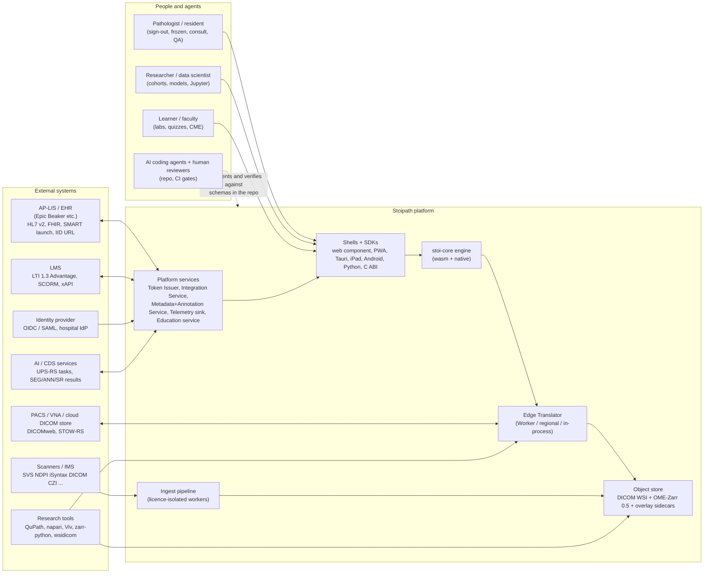
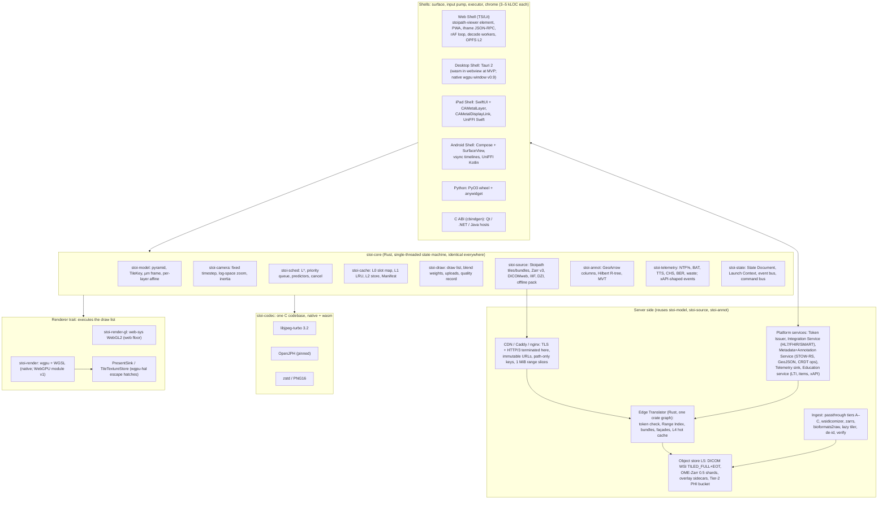
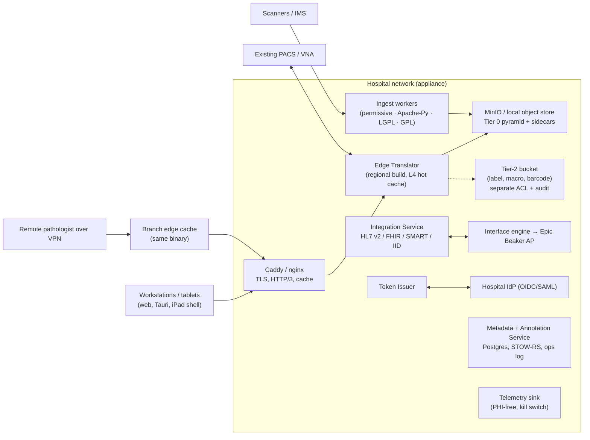

# System architecture

This section turns the decided architecture (`arch/recommended.md`, amended 2026-10-24 for the gap-5 canonical-store finding) into component, interface and deployment definitions precise enough for coding agents to implement against and for human reviewers to check. It does not re-argue the decision; where it sharpens or departs from it, a clearly marked **Reviewer note** says so. Terminology follows `recommended.md` §5 (Engine contract, Renderer, Edge Translator, Manifest, TileIndex, brightfield/multichannel canonical, offline pack, L0–L5, s, L\*, Pinned Base, Base Bundle, moving tier, NTF%, BAT, TTS, CHS, BER, I2P, REF, Nav/Dx mode, tiers N/W+/W60/W−, gates G1–G13, milestones M0–M5). Evidence tags carry over: **[measured]**, **[model]**, **[estimate]**, **[unverified]**.

Three invariants hold everything together. (1) **One `tick()`**: every decision about what to draw, fetch, decode, upload and evict is made by one single-threaded Rust state machine (`stoi-core`) compiled to wasm32 for browsers and to native for everything else; shells own only the surface, the input pump, the executor and the UI chrome. (2) **Every pixel stored once, in its community's standard container, behind one index**: brightfield 8-bit RGB as DICOM WSI `TILED_FULL` + Extended Offset Table, multichannel/16-bit as OME-Zarr 0.5 (Zarr v3 sharded, core codecs); the Edge Translator serves both by byte passthrough. (3) **One tile contract on every topology**: the same immutable, token-gated, path-keyed URLs are served by a Cloudflare Worker, a regional service behind CloudFront, a hospital appliance behind Caddy or nginx, and the in-process library inside Tauri and the Python wheel. Instant zoom (goal 1) is won by residency and prediction inside invariant 1; reach (goal 2) by the thin shells and SDKs over it; versatility (goal 3) by standards living at the edges of the system, never in the hot path. The three product pillars and the FDA aim are served by hooks designed in now (§12) rather than by separate systems.

## 1. Context



What crosses the boundary: tiles and manifests over HTTPS (HTTP/3 where the client has it, HTTP/2 first-class); DICOMweb in both directions (we consume archives and expose a façade); HL7 v2 and FHIR only into the Integration Service, never into the engine; LTI launches into the Education service; OIDC/SMART/LTI identity exchanged by the Token Issuer for short-lived capability tokens that the tile path understands; research tools read the canonical containers directly because they are standards. The repository is the single source of truth: the OpenAPI description of the Edge Translator, the JSON Schemas for Manifest, State Document and Launch Context, the UniFFI interface definition and the C header are files under `api/`, and every binding (TypeScript, Swift, Kotlin, Python, C) is generated from them in CI (see *Agent execution loop* and *Testing, verification and acceptance gates*).

## 2. Components



| Component | Responsibility | Build / runtime | On the zoom hot path? | Pillars served |
|---|---|---|---|---|
| `stoi-core` | Camera, LOD, scheduling, prefetch prediction, cache policy, draw-list generation, state, telemetry | Rust → wasm32 (no atomics, no SharedArrayBuffer) and native staticlib/cdylib | Yes, every frame | All: one behaviour everywhere is what makes clinical validation, research reproducibility and classroom use the same code |
| `Renderer` (`stoi-render-gl`, `stoi-render`) | Execute the draw list; own texture arrays, LUTs, present | web-sys WebGL2 on the web floor; wgpu natively; WebGPU module allow-listed in v1 | Yes | Dx mode (deterministic resampler), fluorescence compositing (research), CVD LUT (education) |
| `stoi-codec` | Bit-identical decode: libjpeg-turbo (sole Dx JPEG decoder), OpenJPH, zstd/PNG16 | C compiled natively (`turbojpeg` crate) and with Emscripten `-msimd128`, no pthreads (~60 KB gz + ~90 KB gz modules) | Yes, in workers/threads | Dx determinism; AI reproducibility |
| Shells and SDKs | Surface, input, executor, chrome, packaging | TS/Lit; Tauri 2; SwiftUI; Compose; PyO3/anywidget; cbindgen | Input and present only | Reach for every pillar; LIS iframe embedding; LMS launch; Jupyter |
| Edge Translator | Token validation, TileIndex → byte range, bundles, façades, hot cache, pre-warm | One Rust crate graph: `axum` regional service, Cloudflare Worker (`worker` crate), in-process lib | Yes, on misses | Clinical (DICOMweb façade, VNA proxying), research (raw ranges), education (classroom edge cache) |
| Ingest | Index-in-place, canonical write, level synthesis, de-identification, metadata, verification, publish | Rust orchestrator; licence-isolated workers (Apache Python, LGPL, GPL, proprietary oracle) | No (feeds L5) | Clinical PHI tiers; research provenance; teaching-set derivation |
| Platform services | Token Issuer; Integration Service (HL7 v2/FHIR/SMART/IID/DPIA); Metadata+Annotation Service (cases, layers, STOW-RS, GeoJSON, ops log); Telemetry sink; Education service (LTI 1.3, item bank, xAPI) | Rust services + Postgres; deployable with the appliance | No | Clinical, research, education respectively; audit for all |

The engine never touches threads, sockets or the DOM; the shells never decide what to draw. That split is what makes the golden gesture replay (a recorded pinch/wheel burst with its byte-arrival times replayed through `tick()` must yield an identical request sequence and draw list on every platform) the operational test of "one zoom behaviour everywhere".

## 3. Data flow for a zoom gesture

```mermaid
sequenceDiagram
  participant U as Pointer/touch
  participant S as Shell (rAF or display link)
  participant C as stoi-core tick()
  participant W as Decode workers / threads
  participant L2 as L2 encoded store (OPFS / disk)
  participant N as CDN edge (L3)
  participant E as Edge Translator (L4)
  participant O as Object store (L5)
  participant R as Renderer
  U->>S: pinch samples (coalesced), first sample at t0
  S->>C: tick(now, inputs, viewport)
  C->>C: camera target (log-space), L* for next frame, destination predictor arms after 2 consistent samples
  C-->>S: FrameOut: draw_list (L* where resident, ancestor cascade elsewhere), requests (tier 0 missing L*, tier 1 L*+1 in ±300 px window), cancels
  S->>R: execute draw_list, budgeted uploads
  R-->>U: photons (warm path: compositor floor ≈2 vsyncs)
  S->>L2: lookup content-addressed keys
  L2-->>S: hit → bytes
  S->>N: GET /v1/s/{sid}/b/... (centre bundle) and /t/... (edge tiles), HTTP/3 0-RTT
  N-->>S: edge hit → bytes (19/58 ms first byte on W-BB)
  N->>E: miss → validate token, strip from key
  E->>O: Range Index lookup → 1–4 contiguous byte ranges (1 MiB-aligned)
  O-->>E: stored JPEG frames / zstd chunks (no re-encode)
  E-->>N: tiles + Server-Timing, Cache-Control immutable
  N-->>S: bytes
  S->>C: on_bytes(id, bytes, timing)
  C-->>S: decode dispatch (requests carry codec)
  S->>W: transfer ArrayBuffer
  W-->>S: decoded tile (transferable) + hash
  S->>C: on_decoded(id, tile)
  C-->>S: next FrameOut: uploads (≤ budget/frame, centre-first), draw_list with cross-fade ≤100 ms
  S->>R: upload into L0 array layer, draw
  R-->>U: sharp frame; telemetry records TTS, NTF%, BER
```

Step by step on the W-BB class (laptop, Chrome, CDN edge; figures from `recommended.md` §4.4, **[model]** unless marked):

1. **Input → `tick`** (4–16 ms): the shell batches coalesced pointer samples into one `tick` per frame; nothing but a target-transform update happens in event handlers.
2. **Warm path** (≈40/50 ms p50/p95 I2P, gate ≤ REF + 1 frame): if L\* tiles are resident, the draw list is executed with trilinear blend between L\* and its parent and the frame presents at the browser's ≈2-vsync floor **[unverified; Stage 0 G11 measures it]**. The engine adds ≤1–3 ms of wasm time.
3. **Prediction**: from the first sample the scheduler requests L\*+1 under a ±300 device-px window at the cursor; the destination predictor fetches the predicted stop level only after ≥2 consistent samples above a confidence threshold (34 % of pathologist bursts span <2.3 levels, so a mis-predicted skip leaves nothing resident). Centre tiles are coalesced into one bundle; edge and prefetch tiles are separate, cancellable streams.
4. **Fetch**: L2 first (1–5 ms), then network. Edge hit: 19/58 ms first byte; destination level (20 tiles ≈ 1.6 MB) transfers in 130/650 ms. On a miss the Edge Translator resolves the TileIndex to ≤4 contiguous ranges and streams stored bytes (target p99 ≤10 ms hot service time).
5. **Decode** off the main thread (8–15 ms wall for 20 tiles on three workers; 20–40 ms on Safari wasm), then **upload** under the per-frame budget (≤16 MiB/frame desktop, ≤2–4 MiB/frame phones).
6. **Settle**: cold destination fill ≈230/650 ms; the TTS gate is ≤100/≤300 ms because residency, not the cold path, is the common case; NTF% during gesture ≤20 % and ≤1 level; blank-pixel frames must be 0. The quality record for the frame (level wanted vs drawn per tile, deficit, `rendering_complete`) is emitted by `stoi-telemetry` and is the same object the Dx-mode flag reads.

## 4. Client engine

### 4.1 Engine contract

```rust
/// One tile in one layer of one slide. Identical struct in client, Edge Translator and ingest.
pub struct TileKey { pub layer: LayerId, pub level: u8, pub x: u32, pub y: u32, pub z: u16, pub t: u16, pub c: ChannelMask }

pub struct InputSample { pub t_ns: u64, pub kind: InputKind }
// InputKind: Pointer{pos, buttons, pressure, pointer_type} | Wheel{delta_mode, dx, dy, ctrl}
//          | Pinch{centroid, scale} | Key(..) | Command(CommandId)   // voice, control surfaces, remote collaborators

pub struct Viewport { pub width_px: u32, pub height_px: u32, pub dpr: f32, pub refresh_hz: f32, pub metered: bool }

pub struct FrameOut<'a> {
    pub draw_list: &'a [DrawItem],   // view, layer, L0 slot, src rect, dst quad, lod blend weight, parent slot, sampler, lut, opacity
    pub requests:  &'a [TileRequest],// id, key, enc (settled|moving|htj2k), priority, coalesce_group, deadline_ns
    pub cancels:   &'a [ReqId],
    pub uploads:   &'a [UploadOp],   // decoded tile → (array, layer); total bytes ≤ budget.upload_per_frame
    pub quality:   FrameQuality,     // ntf, deficit_octaves, blank_px, settled, rendering_complete, pathway_version
}

pub trait Engine {
    fn tick(&mut self, now_ns: u64, inputs: &[InputSample], view: Viewport) -> FrameOut<'_>;
    fn on_bytes(&mut self, id: ReqId, bytes: Bytes, timing: NetTiming);          // from fetch or L2
    fn on_decoded(&mut self, id: ReqId, tile: DecodedTile);                       // {key, format, pixels|handle, hash}
    fn set_budget(&mut self, b: MemoryBudget);                                     // {l0, l1, l2, inflight, upload_per_frame}
    fn set_state(&mut self, s: &StateDocument) -> Result<(), StateError>;
    fn state(&self) -> StateDocument;
    fn drain_events(&mut self, out: &mut Vec<Event>);                              // viewChanged (per frame), tileSettled, renderingComplete, ...
}
```

Rules: allocation-free in steady state (slab-allocated tiles, ring buffers for queues, packed integer keys); deterministic given the same `(inputs, byte arrivals, decoded hashes)`, which is what the golden replay checks; no timers inside the core (hysteresis is in log-space, prediction is sample-driven). The web shell drives `tick` from one `requestAnimationFrame`; native shells from `CAMetalDisplayLink` / `Choreographer.postVsyncCallback` with predicted touches fed to the camera target only, never to tile requests.

### 4.2 Model and camera

`stoi-model` holds one physical frame per slide (µm, origin at the slide corner) and a per-layer affine (3×3) plus a reserved displacement-texture slot; DICOM 3D mm, OME physical axes, QuPath pixel+MPP and IIIF/DZI grids all map into it. The camera integrates at a fixed timestep in log-space scale; s (device px per texel) is computed per layer against the *composed* per-layer scale so registered slides pick the right level. Wheel deltas are normalised by `deltaMode` (read before `deltaY`), accumulated, and eased with an 80–120 ms critically damped approach; pinch and drag are 1:1.

### 4.3 LOD and draw policy (identical everywhere)

L\* is the level with s ∈ [0.5, 1.0]; finer above 1.0, coarser only below 0.5 (one level of hysteresis). Never blank (nearest resident ancestor clipped to the footprint, resident descendants overlaid; the Pinned Base is never evicted). Never magnify at rest (settle contract within the TTS budget). Fractional-LOD blend between L\* and parent; ≤100 ms cross-fade; bicubic transients during gestures; no sharpening at rest. In Dx mode the sampler, codec versions and ICC placement are pinned and the frame carries `rendering_complete`. The constants and their evidence are in *Instant zoom: performance engineering and gates*; here they are just the policy the draw list encodes.

### 4.4 Scheduler and prefetch predictor

```rust
pub struct Priority { pub tier: u8, pub level_dist: u8, pub focus_dist_px: u16 }   // lexicographic; tier 0 = visible L* missing,
                                                                                    // 1 = predicted destination / pan cone / ring, 2 = idle fan-out
pub enum Predictor {
    Destination { samples: u8, confidence: f32, target_level: u8, window: RectPx }, // arms at ≥2 consistent samples; ±300 px at cursor
    PanCone     { velocity: Vec2, taus_ms: [u16; 3] },                              // One-Euro filtered; τ = 100/250/500 ms; ≤1 viewport per 500 ms
    Ring        { depth: u8 },                                                      // 1 cellular, 2 wired
    Hover,                                                                          // pointer-down / hover → L*+1 under pointer
    IdleFanOut,                                                                     // unmetered links only
}
```

Policy constants (from `recommended.md` §4.1): all tier-0 requests issued in the first frame; 24 (phone) / 64 (desktop) in flight; cancel when <30 % of bytes have arrived; prefetch ≤50 % of EWMA bandwidth and ≤25 % of slots; DPR capped at 2 on metered links; the moving tier (q75 4:2:0, H&E only) during bursts with q90 refinement at settle; predicted-vs-actual and prefetch waste logged from M0 (Stage-1 acceptance ≤50 % waste). Request de-duplication is by `TileKey`; one in-flight record is shared by draw, prefetch and neighbouring views.

### 4.5 Renderer

```rust
pub trait Renderer {
    fn create(surface: SurfaceHandle, caps: &GpuCaps) -> Self;          // shell creates the canvas / CAMetalLayer / SurfaceView
    fn upload(&mut self, op: &UploadOp);                                  // texSubImage3D / copyExternalImageToTexture / replace(region:slice:)
    fn draw(&mut self, list: &[DrawItem], view: &Viewport, mode: RenderMode) -> PresentInfo;
    fn read_back(&mut self, region: RectPx) -> Image;                    // goldens, snapshots, headless stills
}
// Native escape hatches (gap-4 option B), implemented over wgpu-hal; swappable for direct Metal without touching the scheduler:
pub trait TileTextureStore { fn alloc(&mut self, fmt: TexFormat, layers: u16) -> ArrayId; fn write(&mut self, slot: Slot, bytes: &[u8]); fn set_volatile(&mut self, slot: Slot, on: bool); }
pub trait PresentSink { fn acquire(&mut self) -> Drawable; fn present(&mut self, d: Drawable, at_ns: Option<u64>); fn presented_time(&self) -> Option<u64>; }
```

Two implementations execute the same draw list: `stoi-render-gl` (hand-written `web-sys` WebGL2, the web floor on every browser; TypeScript is the recorded exit if Stage 0 shows trampoline cost >0.5 ms/frame) and `stoi-render` (wgpu + WGSL natively; WebGPU web module allow-listed per browser major in v1). Shaders are authored once in WGSL; GLSL ES 3.00 is generated by `naga-cli` at build time and golden-tested to ≤1 LSB (G10). GPU cache geometry: 2D texture arrays of ≤64 layers × 512² RGBA8 (64 MiB each; a 128 MiB phone holds two), no generated mips because the pyramid is the mip chain; fluorescence channels as `R16UI` with manual bilinear (or `r16float` where filterable); LUT slots: 33³ RGBA8 ICC 3D-LUT (≈144 KB), 65,536-entry label LUT, per-channel transfer-function uniforms (Viv semantics). Fragment-shader-only, no compute dependency, within WebGPU compatibility-mode limits (4096² textures, 16 KiB UBO bindings, instance data from vertex buffers).

### 4.6 Decode workers and the executor

The core owns no executor. The shell implements one host-side interface and reports results back through `on_bytes` / `on_decoded`:

```ts
interface Executor {
  fetch(req: TileRequest, cb: { bytes(id, buf, timing): void; fail(id, err): void }): AbortHandle; // L2 lookup first, then HTTP
  decode(id: ReqId, buf: ArrayBuffer, codec: Codec, dxMode: boolean): void;                       // → onDecoded(id, tile, hash)
  now(): number;                                                                                     // monotonic ns
}
```

Web: `clamp(hardwareConcurrency − 1, 1, 3)` Web Workers, each holding its own decoder wasm instance (libjpeg-turbo ≈60 KB gz, OpenJPH ≈90 KB gz, zstd), exchanging transferable `ArrayBuffer`/`ImageBitmap` only (≈0.5 ms per tile overhead, 2.2× on three workers **[measured]**); no SharedArrayBuffer, no COOP/COEP, no Service Worker on the hot path. `createImageBitmap` is a per-browser-build accelerator enabled only after the G8 start-up self-certification against golden tiles and never on Safari in Dx mode. Native: a rayon pool of `cores − 1` threads linking the same libjpeg-turbo source via `turbojpeg`, lower QoS for prefetch; OS codecs are never used in Dx mode.

### 4.7 Cache hierarchy

| Layer | Content | Where | Budget | Key and eviction | Owner |
|---|---|---|---|---|---|
| **L0** | Decoded tiles in texture arrays (RGBA8; R16UI per channel) | GPU | W-4G 128 MiB; W-iPad 256 MiB; W-LAN/W-BB 512 MiB–1 GiB; N-* 1–4 GiB dynamic from `os_proc_available_memory` / `ActivityManager.MemoryInfo` + `onTrimMemory` | Slot map, LRU; Pinned Base (levels ≤2048 px, ≈23 MiB) and ancestors of visible tiles never evicted; LRU tail `volatile` on iOS; eviction before pressure | `stoi-cache` + Renderer |
| **L1** | Decoded tiles awaiting upload | RAM | ≤25 % of L0 | LRU; feeds the per-frame upload budget centre-first | `stoi-cache` |
| **L2** | Encoded tiles, bundles, Base Bundle, Manifest | OPFS `FileSystemSyncAccessHandle` in a worker (web); SQLite + shard files (native); offline pack read-only | 300–500 MB phone, 1–4 GB desktop; unbounded for packs | Content-addressed path `{sid}/{layer}/{enc}/{level}/{x}_{y}`; refillable (Safari ITP deletes after 7 days, `persist()` does not exempt); Manifest re-validated at open | Shell executor |
| **L3** | Encoded tiles, bundles, 1 MiB range slices | CDN edge / Caddy cache | provider | Path-only key (token and `Origin` excluded); `immutable` | CDN config in repo |
| **L4** | Encoded tiles + Range Index pages | Edge Translator RAM (`moka`, TinyLFU) or RAM + NVMe (`foyer`) at a regional origin | sized to the active-case working set | Neighbour + child pre-warm on every request; per-tenant bounds | Edge Translator |
| **L5** | Canonical containers, overlay sidecars, Tier-2 PHI bucket | Object store (R2/S3/GCS/Azure/MinIO/local) | — | Immutable objects; vendor originals cold after verification | Ingest |

The same key scheme in every tier means an offline pack is a copy, a classroom edge cache is a pre-filled L4, and a tile observed on a phone is the same bytes a reader study saw on a workstation.

## 5. Tile and metadata API contract

Principles: immutable content-addressed URLs; no custom request headers on the tile path (a cross-origin `Authorization` header costs one CORS preflight per tile URL); authorisation by a prefix-scoped capability token in the query, validated at the edge and stripped from a path-only cache key; `Range` (CORS-safelisted) for client-direct container reads; standards as façades over the same index. The contract is `api/translator.openapi.yaml`; contract tests run against all three translator builds.

| Endpoint (prefix `https://{tile-host}`) | Returns | Notes |
|---|---|---|
| `GET /v1/s/{sid}/manifest.json` | Manifest (≤100 KB JSON) | `sid` = BLAKE3 of canonical pixel bytes + pyramid version, so every URL under it is immutable |
| `GET /v1/s/{sid}/t/{layer}/{enc}/{level}/{x}_{y}[_{z}_{t}]` | one tile: `image/jpeg`, `image/jph`, `application/vnd.stoipath.u16+zstd` | `layer` = pixel layer or channel-group id; `enc` ∈ {`s` settled, `m` moving tier, `h` HTJ2K, `r` raw/zstd}; blank-glass tiles are real objects (RLE-deduplicated in packs) |
| `GET /v1/s/{sid}/b/{layer}/{enc}/{level}/{x0}-{x1}x{y0}-{y1}` | bundle `application/vnd.stoipath.bundle` | rectangle only (canonical string → stable cache key), ≤16 tiles; translator coalesces to ≤4 contiguous ranges; DICOMweb `frames/{list}` is the same operation |
| `GET /v1/s/{sid}/base.bundle` | Base Bundle: all levels ≤4096 px + thumbnail (2–5 MB) | first fetch after the Manifest; pre-warmed at the edge by the Integration Service on `ready-for-review` |
| `GET /v1/s/{sid}/raw/{object}` + `Range` | bytes of a canonical object (DICOM instance, Zarr shard) | client-direct readers (desktop, Python); CDN caches 1 MiB slices |
| `GET /v1/s/{sid}/ov/{layer}/{level}/{x}_{y}.mvt` / `.lbl` | overlay vector tile (MVT, 4096 extent) / label-raster tile (PNG16 or zstd u16/u32) | served from the PMTiles-style sidecar / label pyramid by range |
| `GET /v1/s/{sid}/layers.json` | overlay layer list with provenance | immutable per layer version |
| `GET /v1/s/{sid}/assoc/{label\|macro\|thumbnail}` | associated images | **Tier 2** (label, macro): separate host and bucket, `Cache-Control: private, no-store`, token scope `assoc`, never at a CDN |
| `/dicomweb/studies/…/instances/{sop}/frames/{list}`, `/metadata`, `/bulkdata/…`; `POST …/studies` (STOW-RS) | multipart/related, stored transfer syntax (`transfer-syntax=*`) | façade over both canonical stores; STOW-RS for ANN/SEG/SR goes to the Metadata+Annotation Service |
| `/iiif/3/{sid}/info.json`, `/iiif/3/{sid}/{region}/{size}/{rotation}/{quality}.{format}` | IIIF Image 3.0 | grid-aligned regions are a range read; off-grid regions go to a rate-limited libvips slow path with a documented compliance level |
| `/dzi/{sid}.dzi`, `/dzi/{sid}_files/{l}/{x}_{y}.jpg`; `/iris/…` (v0.9) | DZI / Iris-shaped façades | compatibility surface for OpenSeadragon-era hosts |
| `POST /v1/auth/capability` (Token Issuer, not the translator) | capability token(s) | exchanges an OIDC / SMART / LTI / IID-launch credential for `{sid}`-prefixed tokens, 5–15 min TTL, silent refresh |

**Headers.** Responses: `Cache-Control: public, max-age=31536000, immutable` (Tier 0 only); `Content-Type`; `Accept-Ranges: bytes`; `Access-Control-Allow-Origin: *` (the token, not the origin, is the gate); `Timing-Allow-Origin: *` and `Server-Timing: edge;desc=hit, l4;desc=miss, origin;dur=7.3` so RUM can attribute latency per tier; `Stoi-Prov: pt|re` (passthrough vs re-encoded); `Referrer-Policy: no-referrer` on documents so the token never leaks. Requests carry nothing custom; `Accept` is honoured only on the façades. **Cache key** = scheme + host + path; the query (`t=`) is removed after validation; `Origin` is excluded; no `Vary`. **Auth**: `?t=` is an ES256 JWT (or macaroon) with `{iss, exp, sub (session), scope: ["/v1/s/{sid}/**"], mode, purposeOfUse}`, validated at the edge from a cached JWKS in ≈0.1–1 ms; revocation is by TTL plus an optional edge KV deny-list; tokens are scrubbed from every log. A same-origin proxy mode exists for bearer-token DICOMweb archives, and client-side encrypted tiles (AES-GCM per slide key over a public cache) are the roadmap item for untrusted CDNs and offline packs.

**Manifest** (client-facing, `api/manifest.schema.json`):

```ts
interface Manifest {
  schema: "stoipath.manifest/1";
  sid: string; pyramid_version: number; pixel_class: "brightfield" | "multichannel";
  tile: 512; mpp: [number, number]; size_px: [number, number]; frame_um: Affine2D;      // slide physical frame
  layers: Array<{ id: LayerId; kind: "rgb" | "channels" | "label" | "probability" | "vector";
                  channels?: Array<{ name; dtype: "u8"|"u16"|"f16"; window; color; active }>;   // omero / Optical Path round-trip
                  affine?: Affine2D; displacement?: ObjectRef }>;
  levels: Array<{ level: number; size_px: [number, number]; tiles: [number, number];
                  enc: Array<"s"|"m"|"h"|"r">; objects: ObjectRef[];                        // DICOM instances (incl. concatenations) or shards
                  provenance: { source: "passthrough"|"reencoded"|"synthesised"; converter: string; src_hash?: string } }>;
  base_bundle: { url: string; index: Array<[TileKeyPacked, number, number]> };            // offsets for levels ≤4096 px only
  range_index: { url_template: string; per_level_bytes: number[] };                       // edge-resident; published for client-direct readers
  icc: { baked_srgb: boolean; profile?: ObjectRef }; dx: { eligible: boolean; pathway_version: string };
  assoc: { label?: TierRef; macro?: TierRef; thumbnail: string }; overlays: string;        // layers.json
}
```

> **Reviewer note (Manifest vs Range Index).** `recommended.md` §3.1 describes one "≤100 KB Manifest" keyed `TileIndex → (object, offset, length, codec, provenance)`. The arithmetic does not close: a 100k² slide has ≈38k base tiles at 512², so a per-tile `(offset, length)` table is ≈0.6–0.8 MB per base level (the figure §3.1 itself quotes for the DICOM EOT). This section therefore splits the abstraction into the **Manifest** (≤100 KB, geometry, per-level object references, provenance, codecs, embedded offsets only for the Base Bundle levels) and the **Range Index** (per-level tile → byte-range tables built from EOTs, Zarr shard indices and TIFF IFDs, held and cached by the Edge Translator at L4, and published beside the instances for client-direct readers, per gap-5 F5 condition 4). Browsers and native shells never load the Range Index; they address tiles by `TileKey` and the translator does the arithmetic. No latency figure changes; the wording in `recommended.md` should read "Manifest + Range Index".

**Bundle format**: magic `STB1`, `u16 count`, a table of `{packed TileKey (relative), u8 enc, u32 length}`, then the payloads in table order. The client splits a bundle into per-tile L2 entries so later single-tile hits work. **Errors**: 401/403 (token), 404 only for keys outside the Manifest grid, 416 (range), 503 with `Retry-After` on cold origin; the translator never transcodes except the moving tier and HTJ2K→JPEG for W-4G/W-iPad or archives that need it.

> **Reviewer note (Dx and transcoding).** The HTJ2K→JPEG fallback for low-end browsers (`recommended.md` risk 15) is a second lossy generation. It must be excluded from Dx mode (the token's `mode=dx` makes the translator refuse `enc=s` for a slide whose canonical frames are HTJ2K unless the client can decode them) and recorded in `Stoi-Prov`. `recommended.md` does not say this; the plan should.

## 6. Ingest pipeline

```mermaid
flowchart LR
  IN["Intake: upload / scanner watch / C-STORE / STOW-RS\nBLAKE3 hash, quarantine, sandboxed sniff"] --> TIER["Tier select\nA/B passthrough · C NDPI re-mux · D decode-once"]
  TIER -->|A–C| IDX["Index in place\nTIFF IFD + JPEGTables, DICOM BOT/EOT,\nNDPI restart map → Range Index v0 + Manifest v0\n(viewable in seconds)"]
  TIER -->|D| DEC["Decode-once workers\nOpenSlide (LGPL) · libisyntax (BSD-2) · slideio ·\nBio-Formats/bioformats2raw (GPL JVM)"]
  IDX --> DEID["De-identify + PHI tiers\nlabel/macro/barcode/filename/free text → Tier 2 bucket\ndates/serials → Tier 1 (shift on export)"]
  DEC --> DEID
  DEID --> META["Metadata extraction\nMPP, dims, levels, ICC, channels/optical paths, z/t,\nvendor props (OpenSlide names), scanner model"]
  META --> WRITE["Canonical write\nbrightfield: wsidicomizer passthrough → DICOM WSI TILED_FULL+EOT (1 instance/level, concat >4 GB)\nmultichannel: zarrs → OME-Zarr 0.5 sharded zstd"]
  WRITE --> SYN["Level synthesis\nmissing 2× levels from nearest finer level,\nmozjpeg q90 4:4:4 / zstd; Pinned Base + Base Bundle"]
  SYN --> OV["Overlay ingest\nGeoJSON/ANN/labels → GeoArrow → MVT sidecar + label pyramids"]
  OV --> VER["Verify\nframe-hash identity vs vendor tiles;\nthird-party reader smoke (wsidicom, pydicom, Orthanc, dcm4chee;\nzarr-python, zarrs, zarrita, tensorstore)"]
  VER --> PUB["Publish\nManifest + Range Index, pointer swap, CDN pre-warm,\nvendor original → cold storage"]
```



| Stage | Rule | Why it matters to the pillars |
|---|---|---|
| Intake and sniff | Every parser runs sandboxed (gVisor/seccomp; wasm is sandboxed by construction); fuzz-hardened Rust TIFF/DICOM/NDPI readers; content hash before anything else | OpenSlide 4.0.1 fixed two CVEs in slide parsers: parsers are the attack surface §524B asks about |
| Index in place, serve now | Tier A/B/C files are indexed without touching pixels and are viewable seconds after upload through the passthrough path (§7) | Frozen-section and "view while scanning" workflows |
| De-identification and PHI tiers | A new object is produced, never an in-place edit. Tier 2 (label, macro, barcode, filename, free text) lives in a separate bucket with its own ACL and audit and never reaches a CDN; Tier 1 (scan date/time, scanner serial, operator) is shifted or truncated on de-identified export; Tier 0 (pyramid) is the only tier the CDN sees. DICOM: PS3.15 Basic Profile + Clean Descriptors, LABEL/OVERVIEW withheld by ACL (`wsidicomizer --no-label --no-overview`); TIFF: `anonymize-slide` logic re-implemented in Apache-2.0 Rust, not linked | Clinical PHI controls; legal reuse of archives for teaching sets and research cohorts |
| Metadata extraction | MPP and dimensions are the truth ("40×" is derived); ICC profile kept and baked to sRGB for JPEG delivery (deterministic, cacheable) with the raw profile available for the shader 3D-LUT path; channels/optical paths and `omero`-style render defaults; vendor properties as key–value with OpenSlide names; everything versioned into the Manifest | Measurements, colour fidelity, fluorescence defaults, provenance |
| Canonical write | Brightfield: wsidicomizer 0.31 passthrough (`--format jpeg --offset-table extended --add-missing-levels`, concatenation above 4 GB) is the first-release converter and the behavioural oracle for the later Rust `TILED_FULL`+EOT writer; HTJ2K only for >8-bit sources. Multichannel: `zarrs` directly for OME-TIFF/QPTIFF; `bioformats2raw --ngff-version 0.5` then a `zarrs` re-shard for Bio-Formats-only sources, inside the GPL worker. 512² tiles, 8×8 chunks per shard, 1 MiB-aligned, index at end, core `zstd`/`bytes` codecs only | Every pixel stored once in a container its community's tools read |
| Level synthesis | Missing dyadic levels are synthesised from the nearest finer level, never from a coarser one; new DICOM instances / new shards; the Pinned Base and Base Bundle (levels ≤4096 px) are built synchronously so zoom-out never misses | Goal 1: a level with s ∈ [0.5, 1] exists for every scale |
| Overlay ingest | §9 | AI results and annotations go through the same scheduler as pixels |
| Verify | Byte identity of passthrough frames against vendor tiles (exact, because passthrough is a copy); third-party reader smoke tests run in CI against the written objects; per-tile provenance recorded | "Readable by community tools" is a CI assertion an agent can run; AI reproducibility |
| Publish | Manifest and Range Index written, Manifest pointer swapped atomically; a lazy-tiler miss never appends into a live object on S3/R2 (no atomic append): it writes a new object and swaps the pointer; vendor original to cold storage under the Tier-2 ACL | Correctness under concurrent readers; regulatory retention of originals |

Licence classes are container boundaries: permissive core (Rust, libjpeg-turbo, OpenJPH, zstd), Apache Python worker (wsidicomizer, opentile, wsidicom, tifffile, highdicom), LGPL worker (OpenSlide 4.0.1, libvips, libCZI), GPL worker (Bio-Formats `formats-gpl`, bioformats2raw, `jpegxl-rs`), and a proprietary oracle (Philips iSyntax SDK, validation only, pending IP review of `libisyntax`). Workers speak a tile/level RPC; nothing from the last three classes ships in any client (see *Licensing, IP and open-source governance*).

## 7. On-the-fly serving of native formats

The passthrough path is why a slide is viewable seconds after upload and why on-prem sites can keep vendor files as the system of record during migration. It applies only to tiers A–C:

1. **Request** `/t/…` or `/b/…` reaches the Edge Translator; the token is checked; the `TileKey` is resolved against the **Range Index** for the in-place vendor file — TIFF/BigTIFF: `TileOffsets`/`TileByteCounts` plus the shared `JPEGTables` (SVS-JPEG, Philips TIFF, SCN, Huron/Motic/ARGOS, generic tiled TIFF, OME-TIFF); DICOM Part-10: BOT/EOT frame table (frames already carry full JPEG headers, tier A); NDPI: a restart-marker map over the per-level strip JPEG.
2. **Read** one byte range from L4 or L5 (1 MiB-aligned slices are what the CDN caches).
3. **Splice or re-mux**: tier B prepends the `JPEGTables` segment and fixes the SOI/Adobe markers (microseconds, no pixel decode); tier C performs opentile's DCT-domain lossless crop/concatenation of 8-px MCU strips into 512² tiles with libjpeg-turbo transforms (low milliseconds, no quantisation loss); tier A copies bytes.
4. **Synthesise** missing levels lazily: decode the four children at the nearest finer native level, downsample, encode (mozjpeg q90 4:4:4 brightfield; zstd multichannel), write a new object, swap the Manifest pointer; levels ≤4096 px were already built at ingest so the lazy path only ever runs for intermediate levels. SVS and SCN step by 4× between native levels, so this path is the norm, not the exception.
5. **Respond** with the same headers and provenance flag as a canonical tile; the stored result upgrades the slide to canonical in the background (the ingest pass 2).

Tier D formats (iSyntax, MRXS, CZI, BIF, VSI, svslide, Trestle, VMS/VMU, J2K/JXR sources) are never served natively: the optional degraded mode is an OpenSlide or libisyntax sidecar that decodes and re-encodes at q90 per request, labelled as degraded in the Manifest (`provenance: reencoded`, `dx.eligible: false`) while conversion runs. The byte-identity check in §6 makes the passthrough claim verifiable: the hash of every served tier-A/B tile equals the hash of the vendor tile it came from.

## 8. SDK and embedding surfaces

One **State Document** and one **Launch Context** are the public API on every surface; the web component's properties, the iframe RPC, the anywidget traitlets, the UniFFI interface and the C ABI all carry the same JSON (schemas in `api/`).

```ts
interface StateDocument {
  schema: "stoipath.state/1";
  slides: Array<{ id: string; manifest: string }>;
  views:  Array<{ id: string; slide: string; center_um: [number, number]; scale_um_per_px: number; rotation_deg: number;
                  z?: number; t?: number; channels?: ChannelState[]; overlays?: OverlayState[];
                  sync?: { group: string; mode: "lock" | "affine" | "nonrigid" | "none"; transform?: Affine2D; displacement?: string } }>;
  mode: "nav" | "dx" | "edu"; selection?: string[]; transition?: { duration_ms: number; easing: "log" };
}
interface LaunchContext {               // normalised by the Integration Service from IID URL, SMART launch, LTI or postMessage
  schema: "stoipath.launch/1"; accession?: string; caseId?: string; slideIds: string[]; studyUID?: string; seriesUIDs?: string[];
  user: { sub: string; role: string }; purposeOfUse: string; breakGlass?: boolean; locale: string;
  mode: "dx" | "ruo" | "edu"; token: string; state?: StateDocument;
}
```

**Web component** (`@stoipath/viewer`, Lit 3.3, ESM, no COOP/COEP, floor module ≤1.0 MB gz (G1), decoders as separate modules):

```ts
class StoipathViewer extends HTMLElement {
  // attributes: src (manifest or launch URL) · token · mode · state (JSON) · theme · telemetry ("on"|"off"|"airgap")
  open(launch: LaunchContext): Promise<void>;
  get state(): StateDocument; set state(s: StateDocument);
  flyTo(view: Partial<ViewState>, transition?: { duration_ms: number; easing: "log" }): Promise<void>;
  readonly annotations: AnnotationStore;   // op-based create/update/delete, query(bbox|point), import/export: GeoJSON (QuPath dialect) | DICOM ANN | W3C
  readonly layers: LayerRegistry;          // addRaster / addLabels / addVector({ url | buffers, provenance, acl })
  readonly geometry: GeometryService;      // pointInPolygon, iou, hausdorff_um, visibleCoverage — Rust, exposed to JS and Python
  readonly commands: CommandBus;           // keyboard, control surfaces, voice, remote presenters dispatch the same serialisable commands
  snapshot(opts: { scaleBar: boolean; burnIn: boolean }): Promise<Blob>;
  readonly telemetry: TelemetrySink;       // quality record, xAPI-shaped events, kill switch
  // events: stoi:slideopened · stoi:viewchanged (per frame, rAF-throttled) · stoi:tilesettled · stoi:renderingcomplete
  //         stoi:annotationcreated|updated|selected · stoi:measurementcreated · stoi:airesult · stoi:displayqa · stoi:error
}
```

**iframe JSON-RPC** for hosts that cannot load scripts or isolate (Epic Hyperdrive, LMS placements): JSON-RPC 2.0 over `postMessage` with an origin allow-list — `stoi.open(launch)`, `stoi.getState`, `stoi.setState`, `stoi.flyTo`, `stoi.annotations.*`, notifications for every event above. The host supplies the token; no third-party cookies are ever needed.

**Native SDK** (UniFFI, `api/stoipath.udl`; Swift via XCFramework + SwiftPM `binaryTarget`, Kotlin via AAR + JNA ≥5.12):

```
interface Session {
  constructor(SessionConfig cfg);                       // budgets, telemetry policy, dx profile
  void open(LaunchContext ctx);
  StateDocument state();  void set_state(StateDocument s);  void fly_to(ViewState v, Transition t);
  AnnotationStore annotations();  LayerRegistry layers();  GeometryService geometry();
  sequence<Event> drain_events();
  Engine engine();                                      // shells drive tick / on_bytes / on_decoded / set_budget
};
```

`StoipathView` (SwiftUI) owns the `CAMetalLayer` (`maximumDrawableCount` 2, `preferredFrameLatency` 1, `presentsWithTransaction` false) and the `CAMetalDisplayLink`; `StoipathSurfaceView` (Compose `AndroidView`) owns the `SurfaceView`, `postVsyncCallback` timelines and `MotionEventPredictor`. The **C ABI** (`api/stoipath.h`, cbindgen) is the frozen surface for Qt/.NET/Java hosts and the Qt `QQuickItem` sample:

```c
stoi_session_t* stoi_session_new(const char* config_json);
int  stoi_session_open(stoi_session_t*, const char* launch_json);
int  stoi_session_attach_surface(stoi_session_t*, const stoi_surface_desc_t*);   /* CAMetalLayer*, ANativeWindow*, HWND, wl_surface */
void stoi_session_input(stoi_session_t*, const stoi_input_sample_t*, size_t n);
int  stoi_session_frame(stoi_session_t*, uint64_t now_ns);                       /* tick + render + present */
const char* stoi_session_state_json(stoi_session_t*);  int stoi_session_set_state_json(stoi_session_t*, const char*);
int  stoi_session_poll_event(stoi_session_t*, char* buf, size_t cap);
void stoi_session_set_budget(stoi_session_t*, const stoi_budget_t*);
void stoi_session_free(stoi_session_t*);
```

**Python** (`pip install stoipath`: PyO3 abi3 wheel with the in-process translator + anywidget reusing the web bundle, zero renderer code in Python):

```python
import stoipath as sp
slide = sp.open("TCGA-xx.svs")                          # local file via in-process Edge Translator, or an https manifest URL + token
slide.levels, slide.mpp, slide.channels, slide.provenance
rgb = slide.read_region(level=2, x=40_000, y=12_000, w=2048, h=2048)      # numpy (H, W, 3) u8 or (C, H, W) u16
for key, tile in slide.tiles(level=0, roi=polygon_um, encoded=True): ...  # passthrough bytes, bit-identical to what the viewer draws
slide.export("out.ome.zarr", fmt="ome-zarr") ; slide.export("out/", fmt="dicom")   # on-demand export jobs, never a mirror
v = sp.Viewer(slide, state=..., mode="ruo")             # Jupyter / Colab / VS Code / marimo
v.state ; v.observe("viewChanged", cb) ; v.annotations.to_geojson(dialect="qupath")
v.layers.add_labels("preds.ome.zarr/labels/0", provenance={"producer": "unet", "version": "1.3", "input_hash": slide.sid})
ds = sp.patches(slide, annotations, size=256, level=1).to_parquet("patches.parquet")   # model-development loop
still = sp.render(state, size=(1920, 1080))             # headless deterministic render with the same core and pathway_version
```

**Compatibility adapters** (OpenSeadragon `TileSource`, OpenLayers `Source`, deck.gl layer) are first-class deliverables so Slim/OHIF/Viv-ecosystem users can adopt incrementally; the OSD-configured baseline also stays in the perf harness as the public comparator.

## 9. Overlay and annotation layer architecture

Every overlay is a pyramid addressed by the same `TileKey` (with its own `layer`) and scheduled by the same `stoi-sched`; nothing bypasses the engine, which is what keeps zoom smooth under AI overlays. Layer kinds and their rendering:

| Layer kind | Storage | Rendering | Picking |
|---|---|---|---|
| Vector (annotations, cell outlines, ROIs) | Internal GeoArrow-shaped columns (flat coordinates, ring offsets, typed class/measurement columns, 32-bit ids) + packed Hilbert R-tree; cut at ingest into MVT tiles on the pixel grid (4096 extent, 64-unit buffer) in a PMTiles-style range-readable sidecar; representation switches per level: instanced centroids → simplified polygons → full polygons | Instanced quads / triangulated polygons from GPU buffers the core owns; constant screen-space stroke; styling by column + uniforms (re-colour = uniform change, not re-upload) | R-tree query in a worker (<1 ms) or GPU id read |
| Label raster (segmentation) | Integer label pyramid (OME-Zarr `labels` / DICOM SEG incl. LABELMAP), mode-downsampled | Nearest sampling; 16/32-bit label → RGBA via LUT texture; highlight/visibility by LUT edits | Read label at pixel |
| Probability / heatmap | uint8 or float16 pyramid (DICOM Parametric Map / OME-Zarr image) with window | Bilinear; colormap LUT; blend modes | — |
| Fluorescence channels | Multichannel canonical (OME-Zarr 0.5) | Per-channel `R16UI` + transfer function, ≤8 channels per pass, additive; only enabled channels resident; 8-bit windowed first paint, 16-bit at settle | — |

Every layer carries provenance `{producer, version, inputHash, createdAt, regulatoryStatus}` and a per-layer ACL (`visible`, `hidden`, `reveal-on-event`, `author-only`) — the education answer-key and the AI-result audit trail are the same mechanism. Annotation edits are serialisable ops (create/update/delete with ids), stored by the Metadata+Annotation Service and exported through adapters: QuPath GeoJSON dialect (property names preserved verbatim), DICOM Microscopy Bulk Simple Annotations (`1.2.840.10008.5.1.4.1.1.91.1`, via STOW-RS), SR TID 1500 for ROI reports, W3C Web Annotation for IIIF hosts, SpatialData/GeoParquet for bulk research export. The op log is CRDT-ready (Yjs/yrs later) with viewports and cursors as ephemeral awareness, never document state. The frame budget is partitioned 60/25/15 (pixels/overlays/UI); when over budget the engine degrades overlays first (centroid LOD, skip label raster above 1:1), never the pixels.

## 10. Multi-slide synchronisation

The State Document's `views[]` each bind a slide, a camera and an optional `sync` group. Synchronisation is a transform in the camera, not a copy of events:

| Mode | Transform applied | Cost | Use |
|---|---|---|---|
| `lock` | identity in the shared µm frame | 0 | Serial sections already registered; H&E/IHC panels |
| `affine` | per-slide 3×3 from VALIS/wsireg import (NGFF RFC-5 `affine`) applied in the vertex path | 0 | Rotated re-scans, serial sections; exact and sharp |
| `nonrigid` (later) | displacement field (RFC-5 `displacements`) as a low-resolution two-channel float texture sampled per fragment; slot reserved from MVP | +1 texture fetch | IHC panels at high power |
| `none` | — | 0 | Tumour board N-up of unrelated cases |

Because L\* is chosen against the composed per-layer scale and the predictor runs in each slide's own frame, a two-slide synchronised view meets the single-slide gates with ≤1.5× the bytes (M5 gate). Presenter and follow-me modes for tumour boards and teaching are the same `views[]` broadcast as awareness over the collaboration channel; a headless render of the same State Document on the server produces the identical frame for exports and for SFU fan-out when that mode is added.

## 11. Deployment topologies

| Topology | Translator placement and stack | Tile RTT to client | PHI and residency | Updates and patching | Notes |
|---|---|---|---|---|---|
| **On-prem hospital appliance** (the unit that is given to qualifying hospitals) | Same translator binary behind Caddy or nginx (TLS, HTTP/3); MinIO or local object store; ingest workers (one container per licence class); Postgres; Integration Service against the site's interface engine; Token Issuer federated to the hospital IdP; k8s or VM image; optional branch-site edge cache for remote pathologists over VPN (30–100 ms RTT) | 1–5 ms LAN | Stays in the hospital; Tier-2 bucket local | Signed releases with SBOM and SLSA provenance; hospital IT applies; regulated-release channel for the Dx edition | The TSP-abstract stack: identical code path to the hosted service |
| **Air-gapped** | Same appliance, no egress; local IdP; telemetry off (`airgap` mode); fonts and models bundled | LAN | Fully isolated | Media-based signed bundles; offline licence; SBOM shipped in the bundle | Nothing may assume an external service |
| **Hosted SaaS, Cloudflare (first-class)** | Worker + Cloudflare cache; R2 ranges same-network, zero egress; 6 simultaneous connections per request → bundles coalesce to ≤4 ranges | 20–60 ms edge hit | BAA/DPA; region pinning; Tier 2 never at the edge | Continuous, by us | Public teaching collections, de-identified research cohorts, demos |
| **Hosted, AWS** | Regional service (Fargate/EC2) behind CloudFront with immutable per-tile URLs; `foyer` RAM+NVMe; S3 ranges on miss (CloudFront Functions and Lambda@Edge cannot host it) | 20–60 ms | As above | As above | For customers who require AWS |
| **Single-tenant cloud** | Same stack in the customer's account via IaC | As hosted | Customer owns data | We upgrade, customer approves | — |
| **Edge appliance at the scanner** | Lazy tiler + translator on NVMe next to scanner output; feeds the central store asynchronously | LAN | Local | As appliance | "View while scanning" for frozen sections |
| **Offline pack** (iPad, desktop, classroom) | Derived single-file pack (PMTiles-style; pixels + overlays + items + media), read by `stoi-source` locally; encrypted at rest, MDM-wipeable, device-bound long-lived token | ≈0 ms | Device encryption is the HIPAA safe harbour; teaching packs carry no PHI by construction | App store / MDM / USB | The only topology that reaches the perceptual floor on every gesture; the CME "enduring material" |



Invariants across topologies: identical client binaries and tile contract; the translator is part of the product everywhere (it validates tokens and holds L4 even on a LAN); Tier 2 never leaves the controlling institution's storage; telemetry is PHI-free by construction with a kill switch and an air-gap mode; every artefact ships with an SBOM and signed provenance. Deployment is infrastructure-as-code in the repository (`deploy/{appliance,cloudflare,aws,airgap}`) so an agent can stand up any topology and run the same conformance suite against it (see *Deployment, operations and the free-distribution model*).

## 12. How the architecture serves the pillars and the regulatory aim

| Hook designed in now | Clinical | Research | Education | Design-control artefact it feeds |
|---|---|---|---|---|
| Engine contract + golden gesture replay | Same behaviour on the validated workstation and the consult tablet | Reproducible navigation traces | Same viewer under LMS and native apps | IEC 62304 unit/integration verification; requirement IDs on replay cases |
| Dx mode (pinned libjpeg-turbo/OpenJPH, fixed resampler, server-baked ICC, `rendering_complete`, `pathway_version`, `dx_profile.json` of validated scanner/display pairings checked at open) | Primary-diagnosis-grade display; display-QA status logged; mode refused outside validated pairings | — | — | Frozen, versioned pixel pathway; PCCP scope (new pairings = profile entries, not code) |
| Provenance chain: slide `sid`, converter version, per-tile `Stoi-Prov`, overlay provenance, render `pathway_version` on every snapshot | AI-overlay audit; second-opinion traceability | Model-development reproducibility; patch export carries hashes | Answer keys versioned | Traceability matrix; ISO 14971 controls for wrong-pixel hazards |
| Launch Context + Integration Service (IID URL, SMART, HL7 v2 status sync, STOW-RS, FHIR façade, `AuditEvent`) | LIS/EHR launch, worklists, prefetch on `ready-for-review`, synoptic hand-off, break-glass, audit | DICOMweb read of archives | LTI launch maps to the same context | Audit controls (HIPAA §164.312(b)); interface contract tests |
| Layer API with ACL and provenance; op-based annotations | AI/CDS results as DICOM ANN/SEG/SR; QA re-review | Annotation at scale; active-learning loops; SpatialData export | Progressive reveal, hotspots, self-assessment scoring via `geometry` | Overlay fidelity verification |
| Capability tokens, PHI tiers, sandboxed parsers, SBOM, signed releases, telemetry kill switch | PHI controls, VNA co-existence | De-identified cohorts | No-PHI teaching packs | §524B cybersecurity file; CRA; SBOM per artefact |
| Offline pack + appliance + air-gap | Remote/telepathology, downtime | Field cohorts | Low-bandwidth classrooms, CME enduring materials | Labelling of supported environments |
| `stoi-telemetry` quality record, xAPI-shaped events | Display QA, TTS SLOs | Viewing-behaviour analytics | Progress tracking, item analytics | Post-market performance monitoring |

Machine-checkable assertions that this architecture makes available to the agent loop (details in *Testing, verification and acceptance gates*): golden gesture replay byte-identical across wasm and native; semantic goldens of draw lists (`insta`); pixel goldens ≤1 LSB across `stoi-render-gl`, wgpu backends and software rasterisers; G7 decoder hash identity 1,000/1,000 including arm64; Edge Translator p99 ≤10 ms hot per container path and build; passthrough byte identity against vendor tiles; third-party reader smoke tests on every written container; OpenAPI and JSON Schema contract tests on all three translator builds; `cargo-deny` licence policy (permissive-only client crate graph); CycloneDX SBOM and SLSA provenance on every artefact; WCAG 2.2 2.5.7/2.5.8 checks on the component. The repository layout that makes the architecture the source of truth: `api/` (schemas, UDL, header, OpenAPI), `crates/stoi-*`, `shells/{web,tauri,ios,android}`, `server/{translator,ingest,integration,metadata,education}`, `sdk/python`, `qa/{replays,goldens,devices,networks}`, `deploy/`, `docs/design-controls/{requirements,risk,traceability}`.

Earliest demonstrable milestone for the TSP abstract: the M0–M1 stack — passthrough pyramid, Edge Translator, web floor client with the quality record — running on named devices against de-identified public slides, measured with the photodiode/240 fps rig against the REF floor and the OSD-configured comparator, with provenance, agent cost and wall-time logged per merged change. A viewer alone evidences latency, determinism, interoperability and cost of production; it cannot evidence diagnostic equivalence or patient-care impact, which need the CAP-style validation study described in *Regulatory strategy and the Dx pathway*.

## Reviewer notes (collected)

Notes 1 and 2 are stated in full in §5 (Manifest vs Range Index; Dx mode and translator transcoding). Two more sharpen `recommended.md` without contradicting it:

3. **Distribution unit** (§11): `recommended.md` lists Cloudflare as "first-class" hosting. For the free-to-hospitals programme the on-prem appliance is the primary distribution artefact and hosted SaaS serves public teaching and de-identified research collections; the code path is identical, so this is a sequencing emphasis, but the deployment and funding sections should say it.
4. **Bundle addressing** (§5): `recommended.md` says "centre-of-viewport bundles coalesced into ≤4 contiguous ranges" without fixing the request shape; this section restricts bundles to rectangles with a canonical string so the CDN cache key is stable across clients.

## References

- Decided architecture and corpus: `arch/recommended.md` (amended 2026-10-24); research notes `01`, `02` (F2, F5, F6, F9, R3), `03` (§2.5, §2.6), `04` (F2–F8), `05` (F5–F9), `06` (§4.1), `08` (F1–F12), `09` (F4–F6, F9), `10` (F9, F11), `11-gap-1` (F1, F7), `11-gap-2` (§2.3, §4), `11-gap-3`, `11-gap-4` (§2.8, §2.10), `11-gap-5` (F1–F9), `11-gap-6` (core requirements), `11-gap-7` (F2, §3); proposals `arch/A`–`E`; `judge/ranking.json`, `judge/judgments.json`.
- Zarr v3 sharding codec: https://github.com/zarr-developers/zarr-specs/blob/main/docs/v3/codecs/sharding-indexed/index.rst ; zarr-extensions codec registry: https://github.com/zarr-developers/zarr-extensions/tree/main/codecs ; OME-NGFF version history (0.5, 0.6): https://raw.githubusercontent.com/ome/ngff-spec/main/version_history.md
- DICOM PS3.3 TILED_FULL/TILED_SPARSE: https://dicom.nema.org/medical/dicom/2024c/output/chtml/part03/sect_C.7.6.17.3.html ; PS3.18 WADO-RS frames: https://dicom.nema.org/medical/dicom/current/output/chtml/part18/sect_10.4.html ; Supplement 235 HTJ2K: https://www.dicomstandard.org/News-dir/ftsup/docs/sups/sup235.pdf ; PS3.15 Annex E de-identification: https://dicom.nema.org/medical/dicom/current/output/chtml/part15/chapter_E.html
- wsidicomizer 0.31.0: https://github.com/imi-bigpicture/wsidicomizer ; wsidicom: https://github.com/imi-bigpicture/wsidicom ; opentile: https://github.com/imi-bigpicture/opentile ; highdicom ANN: https://github.com/ImagingDataCommons/highdicom/blob/master/docs/ann.rst
- zarrs: https://crates.io/crates/zarrs ; dicom-rs: https://github.com/Enet4/dicom-rs ; tiff crate: https://crates.io/crates/tiff ; turbojpeg crate: https://crates.io/crates/turbojpeg ; axum: https://crates.io/crates/axum ; workers-rs: https://github.com/cloudflare/workers-rs ; moka: https://crates.io/crates/moka ; foyer: https://crates.io/crates/foyer ; object_store: https://crates.io/crates/object_store
- libjpeg-turbo: https://github.com/libjpeg-turbo/libjpeg-turbo ; OpenJPH: https://github.com/aous72/OpenJPH ; wgpu: https://github.com/gfx-rs/wgpu (issues #3735, #4081, #9856, #10460) ; naga: https://github.com/gfx-rs/wgpu/tree/trunk/naga
- UniFFI: https://github.com/mozilla/uniffi-rs ; cbindgen: https://github.com/mozilla/cbindgen ; PyO3: https://github.com/PyO3/pyo3 ; anywidget: https://github.com/manzt/anywidget ; Tauri 2: https://github.com/tauri-apps/tauri ; Lit: https://lit.dev
- Apple: CAMetalDisplayLink https://developer.apple.com/documentation/quartzcore/cametaldisplaylink ; `os_proc_available_memory` https://developer.apple.com/documentation/os/os_proc_available_memory ; WebKit 60 fps preference https://github.com/WebKit/WebKit/blob/main/Source/WTF/Scripts/Preferences/UnifiedWebPreferences.yaml ; ITP monitored data types https://github.com/WebKit/WebKit/blob/main/Source/WebKit/NetworkProcess/Classifier/WebResourceLoadStatisticsStore.cpp
- Android: Choreographer https://developer.android.com/reference/android/view/Choreographer ; MotionEventPredictor https://developer.android.com/reference/androidx/input/motionprediction/MotionEventPredictor ; ActivityManager.MemoryInfo https://developer.android.com/reference/android/app/ActivityManager.MemoryInfo
- WHATWG Fetch (CORS-preflight cache, safelisted `Range`): https://fetch.spec.whatwg.org/#cors-preflight-cache ; Cloudflare cache keys: https://developers.cloudflare.com/cache/how-to/cache-keys/ ; Cloudflare range requests: https://developers.cloudflare.com/cache/reference/range-requests/ ; Workers limits: https://developers.cloudflare.com/workers/platform/limits/ ; CloudFront range GETs: https://github.com/awsdocs/amazon-cloudfront-developer-guide/blob/main/doc_source/RangeGETs.md ; MDN storage quotas and eviction: https://developer.mozilla.org/docs/Web/API/Storage_API/Storage_quotas_and_eviction_criteria
- PMTiles v3 spec: https://github.com/protomaps/PMTiles/blob/main/spec/v3/spec.md ; Mapbox Vector Tile 2.1: https://github.com/mapbox/vector-tile-spec/blob/master/2.1/README.md ; GeoArrow: https://github.com/geoarrow/geoarrow ; flatbush: https://github.com/mourner/flatbush ; Viv: https://github.com/hms-dbmi/viv ; Yjs / y-crdt: https://github.com/yjs/yjs , https://github.com/y-crdt/y-crdt
- IHE PaLM DPIA Rev 1.4: https://www.ihe.net/uploadedFiles/Documents/PaLM/IHE_PaLM_Suppl_DPIA_Rev1-4_TI_2026-03-06.pdf ; IHE RAD IID: https://www.ihe.net/Technical_Framework/upload/IHE_RAD_Suppl_IID_Rev1-1_TI_2013-06-11.pdf ; SMART App Launch 2.2.0: https://www.hl7.org/fhir/smart-app-launch/ ; FHIR ImagingSelection: https://hl7.org/fhir/imagingselection.html ; LTI 1.3 Advantage: https://www.1edtech.org/standards/lti ; xAPI IEEE 9274.1.1: https://adlnet.gov/news/2023/11/22/xAPI-Officially-Becomes-a-Published-IEEE-Standard
- QuPath GeoJSON serialisation: https://github.com/qupath/qupath/blob/main/qupath-core/src/main/java/qupath/lib/io/GsonTools.java ; W3C Web Annotation Data Model: https://www.w3.org/TR/annotation-model/ ; SpatialData: https://github.com/scverse/spatialdata ; VALIS: https://github.com/MathOnco/valis ; wsireg: https://github.com/NHPatterson/wsireg
- OpenSlide 4.0.1 CHANGELOG (LGPL-2.1-only; CVE-2026-48977, CVE-2026-54604): https://github.com/openslide/openslide/blob/main/CHANGELOG.md ; Bio-Formats licences: https://github.com/ome/bioformats ; libisyntax: https://github.com/amspath/libisyntax ; anonymize-slide: https://github.com/bgilbert/anonymize-slide
- Iris RESTful Server: https://doi.org/10.1016/j.jpi.2025.100530 ; Google Digital Pathology DICOM Proxy: https://github.com/GoogleCloudPlatform/medical-imaging/blob/main/pathology/dicom_proxy/README.md ; Schüffler et al. 2022 (MSK, +130 ms/FOV transcoding): https://doi.org/10.5858/arpa.2021-0197-OA ; Brunyé et al. 2023 (zoom-burst amplitude): https://doi.org/10.1371/journal.pone.0282616 ; WALT: https://github.com/google/walt
- CycloneDX: https://cyclonedx.org/ ; SLSA: https://slsa.dev/ ; cargo-deny: https://github.com/EmbarkStudios/cargo-deny ; WCAG 2.2 SC 2.5.7 / 2.5.8: https://www.w3.org/WAI/WCAG22/Understanding/dragging-movements.html , https://www.w3.org/WAI/WCAG22/Understanding/target-size-minimum.html
