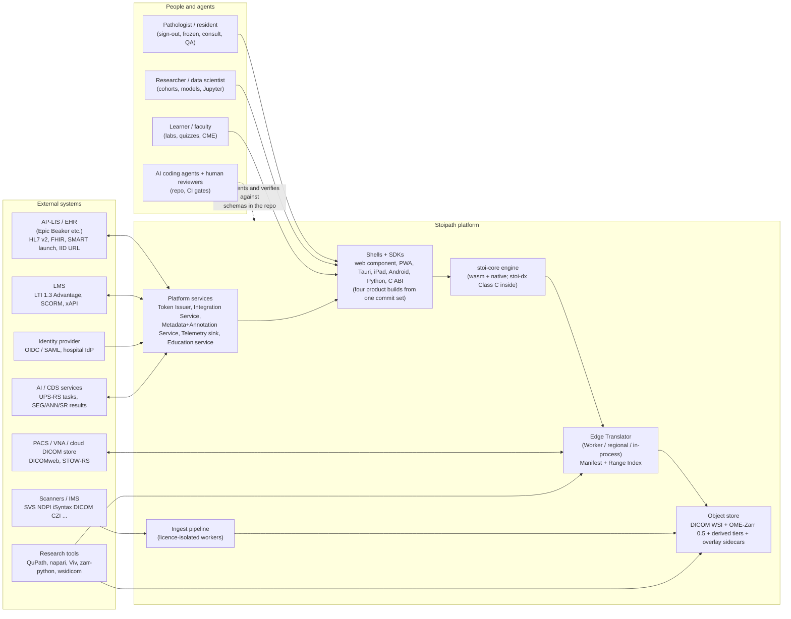
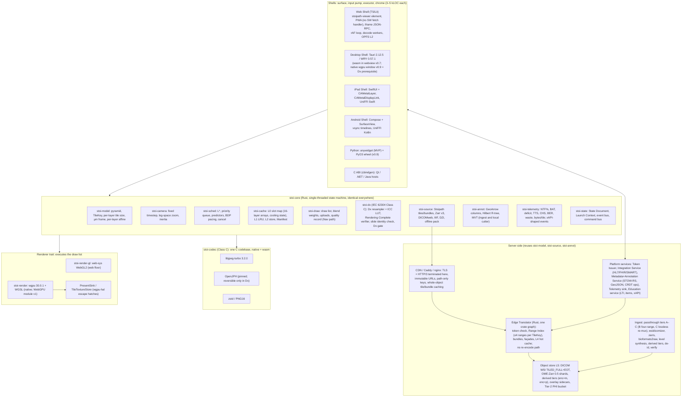
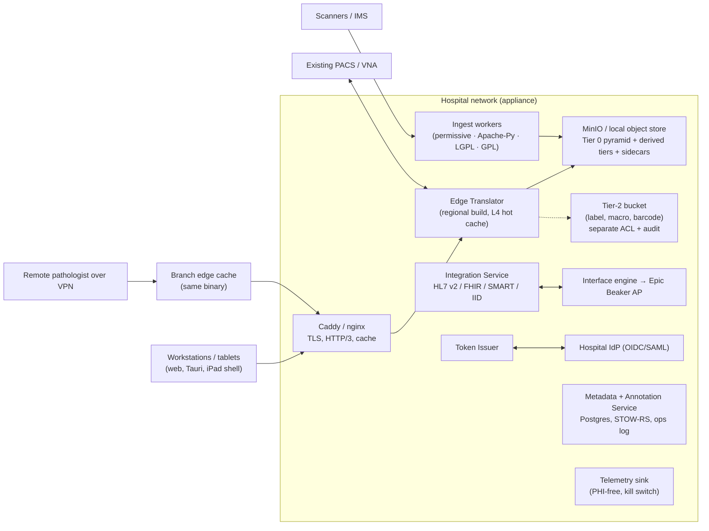

# System architecture

This section turns the decided architecture (`arch/recommended.md`, amended 2026-10-24 for the gap-5 canonical-store finding and 2026-10-25 for the critique and claims-verification pass) into component, interface and deployment definitions precise enough for coding agents to implement against and for human reviewers to check. It does not re-argue the decision; where it sharpens or departs from it, a clearly marked **Reviewer note** says so, and any later divergence is an ADR that supersedes `recommended.md`, never a note here (plan 11 A6). Terminology follows `recommended.md` §5 (Engine contract, Renderer, Edge Translator, Manifest, **Range Index**, **derived tier**, **`stoi-dx`**, **Tier B / Tier C**, brightfield/multichannel canonical, offline pack, L0–L5, s, L\*, Pinned Base, Base Bundle, moving tier, **BDP**, **gate viewport**, NTF%, BAT, resolution deficit, TTS, CHS, BER, I2P, REF, **TTFF/TTLS**, Nav/Dx render mode, the four **product builds** (Stoipath Viewer RUO / Stoipath Learn / in-house clinical / Stoipath Dx), tiers N/W+/W60/W−, gates G1–G13, milestones M0–M5, **Stages 0–3**). Evidence tags carry over: **[measured]**, **[model]**, **[estimate]**, **[unverified]**; numbers checked by the 2026-10-25 claims-verification pass (`verify/README.md`) are marked **(verified)** or **(adjusted after verification: was X)**, and numbers only Stage 0 can settle **(unverified - Stage 0 gate)**. Calendar: week 0 = Monday 2026-10-26; Stage 0 = weeks 0–6 (three two-week sprints), M0 scorecard 2026-12-05 (plan 10's sprint calendar, canonical for the whole plan).

Three invariants hold everything together. (1) **One `tick()`**: every decision about what to draw, fetch, decode, upload and evict is made by one single-threaded Rust state machine (`stoi-core`) compiled to wasm32 for browsers and to native for everything else; shells own only the surface, the input pump, the executor and the UI chrome. (2) **Every pixel stored once, in its community's standard container, behind one Manifest and one edge-resident Range Index**: brightfield 8-bit RGB as DICOM WSI `TILED_FULL` + Extended Offset Table, multichannel/16-bit as OME-Zarr 0.5 (Zarr v3 sharded, core codecs); the Edge Translator serves both by byte passthrough and **never re-encodes pixels on any request path** — the moving tier and the 8-bit preview tier are *derived* objects written at ingest, carry `provenance: derived`, and are refused in Dx mode. (3) **One tile contract on every topology**: the same immutable, token-gated, path-keyed URLs are served by a Cloudflare Worker, a regional service behind CloudFront, a hospital appliance behind Caddy or nginx, and the in-process library inside Tauri and the Python wheel. Instant zoom (goal 1) is won by residency and prediction inside invariant 1; reach (goal 2) by the thin shells and SDKs over it; versatility (goal 3) by standards living at the edges of the system, never in the hot path. The three product pillars and the FDA aim are served by hooks designed in now (§12) rather than by separate systems; the legal boundary between pillars is a **build**, not a runtime flag (§8, §12).

## 1. Context



What crosses the boundary: tiles and manifests over HTTPS (HTTP/3 where the CDN or Caddy terminates it, HTTP/2 first-class; 0-RTT only for idempotent requests, and Chromium's TLS 1.3 early data is disabled by default (verified)); DICOMweb in both directions (we consume archives and expose a façade); HL7 v2 and FHIR only into the Integration Service, never into the engine; LTI launches into the Education service; OIDC/SMART/LTI identity exchanged by the Token Issuer for short-lived capability tokens that the tile path understands; research tools read the canonical containers directly because they are standards. The repository is the single source of truth: the OpenAPI description of the Edge Translator, the JSON Schemas for Manifest, Range Index, State Document and Launch Context, the UniFFI interface definition and the C header are files under `wsi-viewer/api/` (paths per *Repository structure, developer environment and first sprints* §1), and every binding (TypeScript, Swift, Kotlin, Python, C) is generated from them in CI (see *Autonomous execution model and dissemination plan* and *Quality, testing and performance QA*).

## 2. Components



| Component | Responsibility | Build / runtime | On the zoom hot path? | Pillars served |
|---|---|---|---|---|
| `stoi-core` | Camera, LOD, scheduling, prefetch prediction, cache policy, draw-list generation, state, telemetry | Rust → wasm32 (no atomics, no SharedArrayBuffer; Rust 1.99 stable, wasm `atomics` still Unstable (verified)) and native staticlib/cdylib | Yes, every frame | All: one behaviour everywhere is what makes clinical validation, research reproducibility and classroom use the same code |
| `stoi-dx` (IEC 62304 **Class C**, with `stoi-codec`) | The Dx settled-frame path: fixed resampler, application of the server-computed ICC→sRGB LUT, gamma-space `Rgba8Unorm` filtering; the **Rendering Complete verifier** (recomputes from camera scale and each drawn tile's self-identifying header — level, x, y, slide hash checked against the Manifest, never scheduler bookkeeping — that every visible pixel is sampled at L\* with canonical provenance); the **case/slide identity check**; the **Dx gate** (`build_hash` in the cleared-configuration register, `pathway_hash`, `dx_profile.json`, display-QA record freshness) | Rust, same crate graph; a crate boundary enforced by the layering test (plan 10 §1) and `cargo deny` features; fault-injection test: a wrong-level, stale or wrong-slide tile injected into the draw list must suppress the flag | Settled frames only | Clinical Dx; the verifier is what lets `stoi-sched`/`stoi-cache` stay Class B (`recommended.md` §3.2) |
| `Renderer` (`stoi-render-gl`, `stoi-render`) | Execute the draw list; own texture arrays, LUTs, present | web-sys WebGL2 on the web floor (13.7 KB gz for the floor renderer alone (verified)); wgpu 30.0.1 natively; WebGPU module allow-listed in v1 | Yes | Dx mode (deterministic resampler via `stoi-dx`), fluorescence compositing (research), CVD LUT (education) |
| `stoi-codec` (**Class C**) | Bit-identical decode: libjpeg-turbo 3.2.0 (sole Dx JPEG decoder), OpenJPH (reversible HTJ2K only in Dx), zstd/PNG16 | C compiled natively (`turbojpeg` 1.5.1) and with Emscripten `-msimd128`, no pthreads (~60 KB gz + ~90 KB gz modules; the `-msimd128` decode-only build is **(unverified - Stage 0 gate G13)** — like-for-like libjpeg-turbo-family wasm measured 2.9–4.4× native (adjusted after verification: was 2.1–2.9×, a range that belonged to the rejected jpeg-decoder-rs)) | Yes, in workers/threads | Dx determinism (695/695 JPEGs bit-identical across x86 SIMD/scalar, aarch64 NEON/scalar under qemu, jSquash and wasm-vips (verified); real arm64 hardware still required for G7 DHF evidence); AI reproducibility |
| Shells and SDKs | Surface, input, executor, chrome, packaging; one commit set yields four product builds | TS/Lit 3.3; Tauri 2.12.5; SwiftUI; Compose; PyO3/anywidget; cbindgen | Input and present only | Reach for every pillar; LIS iframe embedding; LMS launch; Jupyter |
| Edge Translator | Token validation, Range Index → ≤4 byte ranges, bundles, façades, hot cache, pre-warm; **no transcode row** | One Rust crate graph: `axum` 0.8.9 regional service, Cloudflare Worker (`worker` 0.8.7), in-process lib | Yes, on misses | Clinical (DICOMweb façade, VNA proxying), research (raw ranges), education (classroom edge cache) |
| Ingest | Index-in-place, canonical write (Tier B four-range entries, Tier C lossless re-mux), level synthesis, derived tiers, de-identification, metadata incl. the per-slide ICC LUT, verification, publish | Rust orchestrator; licence-isolated workers (Apache Python, LGPL, GPL, proprietary oracle) | No (feeds L5) | Clinical PHI tiers; research provenance; teaching-set derivation |
| Platform services | Token Issuer; Integration Service (HL7 v2/FHIR/SMART/IID/DPIA); Metadata+Annotation Service (cases, layers, STOW-RS, GeoJSON, ops log); Telemetry sink; Education service (LTI 1.3, item bank, xAPI) | Rust services + Postgres; deployable with the appliance | No | Clinical, research, education respectively; audit for all |

The engine never touches threads, sockets or the DOM; the shells never decide what to draw. That split is what makes the golden gesture replay the operational test of "one zoom behaviour everywhere": a recorded pinch/wheel burst with its byte-arrival times **and its `set_budget` / upload-per-frame timeline** replayed through `tick()` must yield an identical request sequence and draw list **on policy-level fields** (TileKey, level, blend weight, request/cancel order) on every platform; `(array, layer)` slot ids are a per-platform snapshot, not a cross-platform assertion (adjusted after critique: the frame-time AIMD controller changes the upload budget per device every frame, so byte-identical `FrameOut` across shells held only when uploads were not budget-limited).

## 3. Data flow for a zoom gesture

```mermaid
sequenceDiagram
  participant U as Pointer/touch
  participant S as Shell (rAF or display link)
  participant C as stoi-core tick()
  participant W as Decode workers / threads
  participant L2 as L2 encoded store (OPFS shard file / disk)
  participant N as CDN edge (L3)
  participant E as Edge Translator (L4)
  participant O as Object store (L5)
  participant R as Renderer
  U->>S: pinch samples (coalesced), first sample at t0
  S->>C: tick(now, inputs, viewport)
  C->>C: camera target (log-space), L* for next frame, destination predictor arms after 2 consistent samples
  C-->>S: FrameOut: draw_list (L* where resident, ancestor cascade elsewhere), requests (tier 0 missing L*, tier 1 L*+1 in ±300 px window, paced to ≤2×BDP), cancels
  S->>R: execute draw_list, budgeted uploads (never into an array drawn in the last 2–3 frames)
  R-->>U: photons (warm path: compositor floor ≈2 vsyncs, typical 3)
  S->>L2: lookup content-addressed keys (kept-open sync handle, p50 ≤0.2 ms)
  L2-->>S: hit → bytes
  S->>N: GET /v1/s/{sid}/b/... (centre bundle) and /t/... (edge tiles), HTTP/2 or HTTP/3
  N-->>S: edge hit → bytes (32/83 ms first byte on W-BB)
  N->>E: miss → validate token, strip from key
  E->>O: Range Index lookup → 1–4 contiguous byte ranges (one per shard/frame group)
  O-->>E: stored JPEG frames / zstd chunks (no re-encode)
  E-->>N: tiles + Server-Timing, Cache-Control immutable
  N-->>S: bytes
  S->>C: on_bytes(id, bytes, timing)
  C-->>S: decode dispatch (requests carry codec)
  S->>W: transfer ArrayBuffer
  W-->>S: decoded tile (transferable) + hash + self-identifying header
  S->>C: on_decoded(id, tile)
  C-->>S: next FrameOut: uploads (≤ min(byte cap, time box ÷ per-tile cost), centre-first), draw_list with fade ≤3 frames at rest
  S->>R: upload into a cooled L0 array layer, draw
  R-->>U: sharp frame; telemetry records TTS (at fade start), NTF%, deficit, BER, bytes/tile
```

Step by step on the W-BB class (laptop, Chrome, CDN edge, 1920×1080 DPR 1 gate viewport = 20 tiles per level; figures from `recommended.md` §4.4, **[model]** unless marked):

1. **Input → `tick`** (4–16 ms for pointer input with a rAF pending — the floor configuration; **≈27 ms for wheel**, because Chromium delivers non-passive wheel events rAF-aligned, `RendererCompositorToMain` 16 ms p50 measured on Chromium 153 (adjusted after verification)): the shell batches coalesced pointer samples into one `tick` per frame; nothing but a target-transform update happens in event handlers.
2. **Warm path** (gate ≤ REF + 1 frame at p95, unchanged and unaffected by the corrections): if L\* tiles are resident, the draw list is executed with trilinear blend between L\* and its parent and the frame presents at the browser's compositor floor. Floor configuration **40/50 ms** p50/p95 I2P (2 present vsyncs, pointer input) (verified as a floor); **typical ≈48/61 ms** (3 present vsyncs incl. the OS-compositor latch; Chromium's high-latency mode adds one vsync at p95); wheel-driven zoom **≈60 ms p50** (adjusted after verification: the 40/50 row was a component floor, not a typical, and every public browser touch-to-photon measurement is ≥55 ms). The 2-vsync present floor itself is **(unverified - Stage 0 gate G11, photodiode/240 fps rig)**. The engine adds ≤1–3 ms of wasm time; REF vs GL-in-rAF differed by 3 ms p50 in EventLatency traces (verified: the viewer adds nothing of its own).
3. **Prediction**: from the first sample the scheduler requests L\*+1 under a ±300 device-px window at the cursor; the destination predictor fetches the predicted stop level only after ≥2 consistent samples above a confidence threshold (34 % of pathologist bursts span <2.3 levels — Brunyé 2023, verified verbatim — so a mis-predicted skip leaves nothing resident). The prefetch lead is a **distribution, not a point**: ≈U(0, 300) ms at 3.33 levels/s (p25 75 / p50 155 / p75 225 ms), ≈85 ms median at a plausible 6 levels/s phone pinch, so Stage-1 prefetch is sized to the **p25 lead (≈75 ms)** (adjusted after verification); "196 ms" is a dataset minimum used as a deadline. Centre tiles are coalesced into one bundle; edge and prefetch tiles are separate, cancellable streams; everything is paced by bytes (§4.4).
4. **Fetch**: L2 first (kept-open OPFS sync handle p50 ≤0.2 ms, p99 ≤0.5 ms (verified)), then network. Edge hit: first byte **32/83 ms** (adjusted after verification: was 19/58, which sat below the class's own 25 ms RTT and came from a 12/30 ms input set); TCP slow start adds ≈+85/110 ms per burst after a 0.5–2 s idle gap unless the server disables `tcp_slow_start_after_idle` or QUIC preserves cwnd (adjusted after verification: the term was absent); the destination level — **20 tiles ≈ 1.85–2.29 MB** at q85–q90 4:4:4 dense tissue (adjusted after verification: was "20 tiles ≈ 1.6 MB" at a flat 80 KB/tile, which the stated codec tier does not produce; measured 95/117 KB p50 per dense tissue tile on CAMELYON16 tumor_014, 150 viewports) — transfers in **150–185 / 740–920 ms** (was 130/650). Only the centre bundle / ±300 px L\*+1 window (≈90–160 ms) lands inside the lead at p50; the full level does not and is covered by the ≤1-level transient (adjusted after verification). On a miss the Edge Translator resolves the TileKey through the Range Index to ≤4 contiguous ranges and streams stored bytes: target **p99 ≤10 ms hot service time at ≤50 % utilisation** per container path (verified on x86 for the Zarr-tile and DICOM-frame paths with >7× margin; the 15-tile bundle path **fails when implemented naively** — p99 8.7–9.2 ms, p999 14–48 ms — and passes with pooled buffers and per-tile `pread` + vectored writes, an M1 item).
5. **Decode** off the main thread: **15–30 ms wall** for 20 tiles on the desktop pool (adjusted after verification: the 8–15 ms figure needs ≥8 free cores; 20 `createImageBitmap` took 31.7 ms at load ≈5 on four x86 cores), 20–40 ms on Safari WASM, **130–240 ms** on W-4G WASM for 20 tiles (was 100–150; ≈70–130 for the 11-tile DPR-2 fill), then **upload** under the effective per-frame budget `min(byte cap, time box ÷ measured per-tile cost)` (adjusted after critique: the byte cap alone — "≤16 MiB/frame desktop, ≤2–4 MiB/frame phones" — admitted only one tile per 3 ms frame at the old G5 ceiling of 2 ms/tile). W-LAN/W-BB upload throughput is **measured at M0** and planned at 4–8 tiles/frame until then (20 tiles in 3–5 frames, 50–83 ms); phones need ≥2 tiles per 3 ms box, hence G5 = ≤1.2 ms per tile p95 into an in-use array. Uploads never target an array referenced by the last 2–3 frames' draws (§4.5).
6. **Settle**: W-BB cold destination fill **≈300–350 / 1,000–1,200 ms** (adjusted after verification: was ≈230/650 — the 650 cell was the transfer term alone; fetch→decode→upload of real q85 tiles measured 340 ms p50 at the p50 condition). The gate is **split** (adjusted after verification and critique: one "p50/p95" row could not be met by any cold fill at the p95 network): **warm-settle TTS ≤100 / ≤300 ms** over settles that hit L0/L1 (the CHS population), **cold-fill gate ≤380 / ≤1,300 ms** over L2/L3 misses, **CHS ≥95 %** and **BER ≥90 %** (values owned by *Requirements and platform matrix* NFR-P7/P8); the overall TTS is reported next to them (≈ warm + 5 % cold on W-BB). TTS is measured **at fade start** (first frame in which every visible pixel is sampled from L\* or its blended parent), with the ≤3-frame (50 ms) settled fade excluded from TTS and counted in BAT, and pop-in counted separately; NTF% during gesture ≤20 % and ≤1 level; the at-rest **resolution deficit including the blend weight** (`f · log2 s_parent`) ≤0.15 octave; blank-pixel frames must be 0. The quality record for the frame (level wanted vs drawn per tile, deficit, `rendering_complete`, bytes per tile at L\*) is emitted by `stoi-telemetry`; `rendering_complete` is asserted only after the `stoi-dx` verifier recomputes it from the drawn tiles' own headers, never from scheduler bookkeeping.

## 4. Client engine

### 4.1 Engine contract

```rust
/// One logical 512² tile in one layer of one slide. Identical struct in client, Edge Translator and ingest.
/// A TileKey resolves to 1–4 byte ranges (Tier B: four 256² vendor frames per logical tile).
pub struct TileKey { pub layer: LayerId, pub level: u8, pub x: u32, pub y: u32, pub z: u16, pub t: u16, pub c: ChannelMask }

pub struct InputSample { pub t_ns: u64, pub kind: InputKind }
// InputKind: Pointer{pos, buttons, pressure, pointer_type} | Wheel{delta_mode, dx, dy, ctrl}
//          | Pinch{centroid, scale} | Key(..) | Command(CommandId)   // voice, control surfaces, remote collaborators

pub struct Viewport { pub width_px: u32, pub height_px: u32, pub dpr: f32, pub refresh_hz: f32, pub metered: bool }

pub struct NetEstimate { pub bw_ewma_bps: u64, pub rtt_p50_ns: u64 }     // BDP = bw_ewma × rtt_p50 is the pacing unit

pub struct FrameOut<'a> {
    pub draw_list: &'a [DrawItem],   // view, layer, L0 slot, src rect (sub-frame for Tier B), dst quad, lod blend weight, parent slot, sampler, lut, opacity
    pub requests:  &'a [TileRequest],// id, key, enc (s settled | m moving | p preview8 | h htj2k | r raw), priority, coalesce_group, deadline_ns
    pub cancels:   &'a [ReqId],
    pub uploads:   &'a [UploadOp],   // decoded tile → (array, layer); array ∉ arrays drawn in the last 2–3 frames; Σ bytes ≤ effective budget
    pub quality:   FrameQuality,     // ntf, deficit_octaves (incl. blend weight), blank_px, settled, rendering_complete (set by stoi-dx only),
                                     // bytes_per_tile_at_lstar, attestation (edid | mdm-profile | none), pathway_hash
}

pub trait Engine {
    fn tick(&mut self, now_ns: u64, inputs: &[InputSample], view: Viewport, net: NetEstimate) -> FrameOut<'_>;
    fn on_bytes(&mut self, id: ReqId, bytes: Bytes, timing: NetTiming);          // from fetch or L2
    fn on_decoded(&mut self, id: ReqId, tile: DecodedTile);                       // {key, sub, format, pixels|handle, hash, header: {level, x, y, slide_hash}}
    fn set_budget(&mut self, b: MemoryBudget);                                     // {l0, l1, l2, inflight_bytes, upload_per_frame}; every call is recorded in the replay
    fn set_state(&mut self, s: &StateDocument) -> Result<(), StateError>;
    fn state(&self) -> StateDocument;
    fn drain_events(&mut self, out: &mut Vec<Event>);                              // viewChanged (per frame), tileSettled, renderingComplete, identityMismatch, ...
}
```

Rules: allocation-free in steady state (slab-allocated tiles, ring buffers for queues, packed integer keys); deterministic given the same `(inputs, byte arrivals, decoded hashes, budget timeline)`, which is what the golden replay checks on policy-level fields; no timers inside the core (the L\* guard band is in log-space, prediction is sample-driven). The web shell drives `tick` from one `requestAnimationFrame`; native shells from `CAMetalDisplayLink` / `Choreographer.postVsyncCallback` with predicted touches fed to the camera target only, never to tile requests.

### 4.2 Model and camera

`stoi-model` holds one physical frame per slide (µm, origin at the slide corner), a per-layer affine (3×3) plus a reserved displacement-texture slot, and a **per-layer vendor frame size** (`tile` ∈ {256, 512, 1024}; the engine's grid is always 512² logical tiles — a 256² source is four sub-frames per TileKey); DICOM 3D mm, OME physical axes, QuPath pixel+MPP and IIIF/DZI grids all map into it. The camera integrates at a fixed timestep in log-space scale; s (device px per texel) is computed per layer against the *composed* per-layer scale so registered slides pick the right level. Wheel deltas are normalised by `deltaMode` (read before `deltaY`), accumulated, and eased with an 80–120 ms critically damped approach; pinch and drag are 1:1.

### 4.3 LOD and draw policy (identical everywhere)

L\* is the level with s ∈ [0.5, 1.0]: **a partition — exactly one level qualifies at any scale — with an ε = 0.03 octave guard band against input jitter, not a dead band** (adjusted after critique: "one level of hysteresis" would have led an implementer to add one; see *Instant-zoom engineering design* §4). Finer above 1.0·2^ε, coarser only below 0.5·2^−ε. **Sparse vendor pyramids** (SVS/SCN step 4× between native levels): until the intermediate level is synthesised, L\* draws the finer native level minified up to 4× with the blend spanning two octaves, never the coarser level magnified >2× (§7). Never blank (nearest resident ancestor clipped to the footprint, resident descendants overlaid; `ancestor_of_visible` is the **full chain** from each visible tile to the Pinned Base, 10–13 slots at high power on a 100k² slide, and that chain and the Pinned Base are never evicted). Never magnify at rest (settle contract within the TTS budget). Fractional-LOD blend between L\* and parent; **one landing rule**: any change of drawn level at a pixel after the last input is faded — ≤3 frames (50 ms) on a settled frame, ≤100 ms during gestures — the fade excluded from TTS and counted in BAT (adjusted after critique: "a tile landing into a fractional-blend slot needs no fade" could not occur, because while the child was missing the parent was drawn at weight 1). **Bicubic (Catmull-Rom) transients only on W+ and N classes; bilinear on W-4G and W-iPad** (adjusted after critique: a 9-tap kernel at DPR-3 geometry is 8–15 ms on a Mali-G52 at ≈3.4 Gtexel/s, not 0.3–1 ms). No sharpening at rest. In Dx mode the sampler, codec versions (libjpeg-turbo 3.2.0; reversible HTJ2K only — lossy HTJ2K differs x86 vs aarch64 in 3 pixels / 1 LSB and is out of Dx permanently (verified)), the server-computed ICC LUT and gamma-space `Rgba8Unorm` filtering are pinned under `pathway_hash`, and the frame carries `rendering_complete` from the `stoi-dx` verifier. The constants and their evidence are in *Instant-zoom engineering design*; here they are just the policy the draw list encodes.

### 4.4 Scheduler and prefetch predictor

```rust
pub struct Priority { pub tier: u8, pub level_dist: u8, pub focus_dist_px: u16 }   // lexicographic; tier 0 = visible L* missing,
                                                                                    // 1 = predicted destination / pan cone / ring, 2 = idle fan-out
pub enum Predictor {
    Destination { samples: u8, confidence: f32, target_level: u8, window: RectPx }, // arms at ≥2 consistent samples; ±300 px at cursor
    PanCone     { velocity: Vec2, taus_ms: [u16; 3] },                              // One-Euro filtered; τ = 100/250/500 ms; ≤1 viewport per 500 ms
    Ring        { depth: u8 },                                                      // 1 cellular, 2 wired; set size derived from the byte budget per class
    Hover,                                                                          // pointer-down / hover → L*+1 under pointer; hit rate logged
    IdleFanOut,                                                                     // unmetered links only
}
pub struct Pacing { pub inflight_max: Bytes /* ≈2 × BDP */, pub prefetch_max: Bytes /* ≈1 × BDP */, pub slot_ceiling: u16 /* 24 phone / 64 desktop, secondary */ }
```

Policy constants (from `recommended.md` §4.1 as amended 2026-10-25): all tier-0 requests issued in the first frame and **always admitted**; **pacing by bytes, not slots** — total in flight ≤ ≈2 × BDP (`bw_ewma × rtt_p50`, both already tracked), prefetch ≤ ≈1 BDP; BDP ≈140 KB (≈1.5 tiles) on W-4G, ≈310 KB (≈3 tiles) on W-BB, ≈125 KB on W-LAN (adjusted after critique: the former "24 (phone) / 64 (desktop) in flight; prefetch ≤50 % of EWMA bandwidth and ≤25 % of slots" put ≈14 BDP ≈ 600 ms of bytes ahead of every new tier-0 request on W-4G while starving the 40–50 tier-1 wants per frame; the slot caps remain only as secondary ceilings). Ring, window and cone set sizes are derived per class from the byte budget and the burst-end-residency gate (BER), not fixed fractions. Cancel when <30 % of bytes have arrived (this stops the server, not the bytes already in the socket and radio queue, and Safari sends no priority signal — hence pacing first, h2/h3 priorities second; a Tier-2 test asserts that a tier-0 request issued while prefetch saturates the budget sees first byte within RTT + 1 BDP on the W-4G and W-BB profiles). **DPR cap keyed to the L0 budget, not the network class**: the shell picks the largest DPR for which the un-evictable set plus working set fits ≤ ~60 % of L0 slots — DPR 2 always on a 128 MiB L0, DPR 3 only from 256 MiB (adjusted after critique: "capped at 2 on metered links" left a 3 GB phone on classroom Wi-Fi unprotected); the metered-link rule stays as a bandwidth saving on top. The **moving tier** (`enc=m`, q75 4:2:0, H&E only, 64 KB/tile = 0.55–0.68× of the settled tier (adjusted after verification: was 0.88×)) is an ingest-derived object, **off by default**, enabled per deployment where radio classes are expected, with q90 refinement at settle and a Stage-1 kill condition on bytes per gesture (every stopped-on level is fetched twice, ≈+60 %); moving-tier bytes count in waste and bytes-per-gesture. Predicted-vs-actual and prefetch waste are logged from M0 (Stage-1 acceptance ≤50 % waste; Stage 1 = the M1→M2 window per `recommended.md` §5). Request de-duplication is by `TileKey`; one in-flight record is shared by draw, prefetch and neighbouring views.

### 4.5 Renderer

```rust
pub trait Renderer {
    fn create(surface: SurfaceHandle, caps: &GpuCaps) -> Self;          // shell creates the canvas / CAMetalLayer / SurfaceView
    fn upload(&mut self, op: &UploadOp);                                  // texSubImage3D / copyExternalImageToTexture / replace(region:slice:); sub-frame offsets for Tier B
    fn draw(&mut self, list: &[DrawItem], view: &Viewport, mode: RenderMode) -> PresentInfo;   // RenderMode::{Nav, Dx}; Dx path lives in stoi-dx
    fn read_back(&mut self, region: RectPx) -> Image;                    // goldens, snapshots, headless stills
}
// Native escape hatches (gap-4 option B), implemented over wgpu-hal; swappable for direct Metal without touching the scheduler:
pub trait TileTextureStore { fn alloc(&mut self, fmt: TexFormat, layers: u16) -> ArrayId; fn write(&mut self, slot: Slot, bytes: &[u8]); fn set_volatile(&mut self, slot: Slot, on: bool); fn last_drawn_frame(&self, array: ArrayId) -> u64; }
pub trait PresentSink { fn acquire(&mut self) -> Drawable; fn present(&mut self, d: Drawable, at_ns: Option<u64>); fn presented_time(&self) -> Option<u64>; }
```

Two implementations execute the same draw list: `stoi-render-gl` (hand-written `web-sys` WebGL2, the web floor on every browser; 3–5 kLOC with +3 PM as a floor (adjusted after verification: was 2–3 kLOC); TypeScript is the recorded exit if Stage 0 shows trampoline cost >0.5 ms/frame) and `stoi-render` (wgpu 30.0.1 + WGSL natively; the wgpu WebGL-interop escape hatch `create_texture_from_webgl_handle` is unreleased trunk code, absent from 30.0.1, so the floor renderer stays whether or not v31 ships it (adjusted after verification); WebGPU web module allow-listed per browser major in v1). Shaders are authored once in WGSL; GLSL ES 3.00 is generated by `naga-cli` at build time and golden-tested to ≤1 LSB (G10). **GPU cache geometry** (adjusted after critique and verification): 2D texture arrays of **16 layers × 512² RGBA8 = 16 MiB as the default allocation unit**, ≤64 layers the upper bound — a 128 MiB phone L0 is eight 16-layer arrays drawn with ≤8 instanced calls per level (two 64-layer arrays allocated the whole budget at either DPR with zero headroom for the revisit cache, in-flight uploads or the +11–20 MiB cross-fade duplicates, and a TBDR ghost copy of a 64 MiB array is a 64 MiB memcpy). **Uploads never target an array referenced by the last 2–3 frames' draws** (jank cause #38): on tile-based deferred renderers (Mali, Adreno, Apple GPUs through ANGLE-Metal in Safari) `texSubImage3D` into a texture that in-flight draws still reference forces the driver to ghost-copy the resource or insert a pipeline bubble, so slots carry a `cooling` state, uploads rotate across arrays, `texStorage3D` + fence-gated writes are used where available, and the frame-time controller logs per-upload GPU-side cost as the production detector; G12 measures uploads into (a) an idle array and (b) an array bound by the previous frame's draw and gates on (b). The G4 layer-count sweep (1…64, 128, 256) passed with 0 bad layers on ANGLE/SwiftShader WebGL2 and WebGPU (verified); the wgpu #4081 multiple-of-16 effect is Mali/Adreno-only and stays a device test. **L0 counts tile slots only**: canvas backbuffers (≈10–34 MiB), LUTs and overlay layers add ≈35–40 MiB of GPU memory outside L0 and are counted in the risk-2 kill-threshold budget (verified). No generated mips because the pyramid is the mip chain; fluorescence channels as `R16UI` in 16-layer arrays with manual bilinear (or `r16float` where filterable), ≤3/≤4/8 visible channels by class (§9). LUT slots: 33³ RGBA8 **server-computed, client-applied** ICC→sRGB 3D-LUT (≈144 KB, one dependent fetch after blending, on untagged passthrough tiles — see §6), a 1-D brightness/contrast/gamma LUT uniform (one-frame update, no refetch, on-screen indicator when non-default, recorded in the quality record and State Document, reset on Dx-mode entry), a 65,536-entry label LUT and per-channel transfer-function uniforms (Viv semantics). Filtering is in gamma space (`Rgba8Unorm`; sRGB view formats not used) in both render modes and is part of `pathway_hash`. Fragment-shader-only, no compute dependency; the WebGPU compatibility-mode limits (4096² textures, 16 KiB UBO bindings, 4 colour attachments, instance data from vertex buffers) are **guaranteed minimums** that adapters may exceed — designed to the minimums (verified).

### 4.6 Decode workers and the executor

The core owns no executor. The shell implements one host-side interface and reports results back through `on_bytes` / `on_decoded`:

```ts
interface Executor {
  fetch(req: TileRequest, cb: { bytes(id, buf, timing): void; fail(id, err): void }): AbortHandle; // L2 lookup first, then HTTP
  decode(id: ReqId, buf: ArrayBuffer, codec: Codec, dxMode: boolean): void;                       // → onDecoded(id, tile, hash, header)
  now(): number;                                                                                     // monotonic ns
}
```

Web: **one pool rule** (adjusted after critique: the plan carried two): `clamp(hardwareConcurrency − 1, 1, 3)` Web Workers on phone and tablet classes (W-4G, W-iPad; Safari reports `hardwareConcurrency` 4 or 8, so always 3 there; an `hc = 2` Android device yields one worker = main-thread offload only, no throughput gain (verified)) and `clamp(hardwareConcurrency − 1, 1, 6)` on desktop classes (W-LAN, W-BB). Each worker holds its own decoder wasm instance (libjpeg-turbo ≈60 KB gz, OpenJPH ≈90 KB gz, zstd; decoder modules compile eagerly in 6–8 ms on x86, ≈30–80 ms on a phone (verified)), exchanging transferable `ArrayBuffer`/`ImageBitmap` only — transfer tax 0.1–0.2 ms per tile in real Web Workers (verified; the 0.5 ms figure was conservative); pool speed-up 2.2× on three workers **idle** [measured] but **1.2–1.6× under core contention** (adjusted after verification), which is why G9 (≥1.8× under page load, ≤2–3 ms/tile overhead) is at genuine risk and the 20-tile wall-time budget is the gate that matters. No SharedArrayBuffer, no COOP/COEP (verified: an isolated page inside a plain host loses SAB, a plain iframe inside a COEP host is blocked, COEP hosts need CORP on images), and **no Service Worker fetch handler**: a PWA service worker with a `fetch` handler intercepts every fetch the controlled page issues, including cross-origin tile-host requests, so a separate `{tile-host}` does not keep it off the path (adjusted after critique: "SW off the hot path" had no mechanism). The mechanism is **no fetch handler in the SW at all** (app shell cached via HTTP caching and the web-app manifest), or Chrome 123+'s Static Routing API (`event.addRoutes`, source `network`) for the tile-host URL pattern where available; a Tier-2 assertion on WebKit and Chromium checks that no tile request carries a service-worker timing span (jank cause #39). SW cold start measured 12 ms median on x86 Chromium 153 (the 50/250 ms figures are 2017 Chrome numbers; a 2024+ phone is plausibly 30–60 ms — adjusted after verification). `createImageBitmap` is a per-browser-build accelerator enabled only after the G8 start-up self-certification against golden tiles and never on Safari in Dx mode; **WebCodecs `ImageDecoder` is excluded from the allow-list** (differed on 660/695 tiles; `createImageBitmap` with and without `colorSpaceConversion: none` and HTMLImageElement→canvas matched 695/695 on Chromium 153 (verified)). Native: a rayon pool of `cores − 1` threads linking the same libjpeg-turbo source via `turbojpeg`, lower QoS for prefetch; OS codecs are never used in Dx mode. Tier B tiles arrive as four 256² sub-frames per TileKey: ≈1.3× the decode time (per-image overhead) and 4× the upload calls at identical bytes, measured as a variant in G12/G13 **(unverified - Stage 0 gate)**.

### 4.7 Cache hierarchy

| Layer | Content | Where | Budget | Key and eviction | Owner |
|---|---|---|---|---|---|
| **L0** | Decoded tiles in 16-layer texture arrays (RGBA8; R16UI per channel), **tile slots only** | GPU | W-4G **128 MiB = 8 × 16-layer arrays, DPR 2 always** (≈88 slots un-evictable + working set at DPR 2 with worst-case tile counts — adjusted after critique: was 59 with averages and the parent alone); W-iPad **192 MiB** (adjusted after verification: was 256 MiB — L0 256 + L1 64 MiB = 320 MiB already exceeded the old G6 footprint gate, and iOS runs WebGL in the GPU Process, so G6 measures GPU Process + WebContent with layers filled, not allocated); W-LAN/W-BB 512 MiB–1 GiB; N-* 1–4 GiB dynamic from `os_proc_available_memory` / `ActivityManager.MemoryInfo` + `onTrimMemory`; process RSS is 1.3–1.8× nominal texture bytes (verified on ANGLE) and backbuffers/LUTs/overlays (≈35–40 MiB) sit outside L0 but inside the kill-threshold budget | Slot map, LRU with a `cooling` state (no writes into an array drawn in the last 2–3 frames); Pinned Base (`max(w, h) ≤ 2048 px`, 11–22 tiles ≈ 11–22 MiB; ≈23 MiB only for a square slide — adjusted after verification: was "levels ≤2048 px, ≈23 MiB") and the full ancestor chain of visible tiles never evicted; LRU tail `volatile` on iOS; eviction before pressure; proptest: DPR-2 working set on a 128 MiB L0 ≤85 % of slots | `stoi-cache` + Renderer |
| **L1** | Decoded tiles awaiting upload | RAM | ≤25 % of L0; each `ImageBitmap` costs ≈1.08 MiB of renderer RSS invisible to `performance.memory` (verified) | LRU; feeds the per-frame upload budget centre-first; a 20-tile L1→L0 re-upload is 167–333 ms on a phone, so "revisits instant" requires **L0 residency**, which the DPR-2 cap and 16-layer arrays buy | `stoi-cache` |
| **L2** | Encoded tiles, bundles, Pinned/Base Bundle, Manifest | OPFS as **one shard file per slide with kept-open `FileSystemSyncAccessHandle`s** in a worker (reads p50 ≤0.2 ms vs 1.0–1.2 ms open+read+close; writes 0.1–1.1 ms vs 2–3 ms one-file-per-tile — verified); SQLite + shard files (native); offline pack read-only | 300–500 MB phone, 1–4 GB desktop; unbounded for packs; Chromium's `navigator.storage.estimate().quota` reports usage + 10 GiB, not the enforced 60 % of disk, so sizing never reads it as a disk share (verified) | Content-addressed key `{sid}/{layer}/{enc}/{level_hash}/{x}_{y}` (per-level content hash, so a re-written level invalidates only its own entries); refillable — Safari ITP deletes it after **30 operating days** without user interaction (7 only for origins flagged by link decoration from a prevalent domain; `persist()` is not consulted on the ITP path; MDN still says seven days and Safari 27 runtime behaviour is unconfirmed — adjusted after verification: was "7 days"), installed Home-Screen PWAs, app-bound and managed domains exempt; Manifest re-validated at open | Shell executor |
| **L3** | Encoded tiles and bundles as **whole cached objects**; 1 MiB range slices only for raw proxied `Range` reads | CDN edge / Caddy cache | provider | Path-only key (token and `Origin` excluded); `immutable`; raw range reads of objects >512 MB (one-instance-per-level DICOM bases) do not cache on Cloudflare below Enterprise — the hot path never issues them (adjusted after verification) | CDN config in repo |
| **L4** | Encoded tiles + Range Index pages | Edge Translator RAM (`moka`, TinyLFU) or RAM + NVMe (`foyer`) at a regional origin; in the Worker build the "hot hit" is a Cache API hit (no persistent RAM across isolates) | sized to the active-case working set | Neighbour + child pre-warm on every request; per-tenant bounds | Edge Translator |
| **L5** | Canonical containers, derived tiers (`enc=m`, `enc=p`) as separate never-canonical objects, overlay sidecars, Tier-2 PHI bucket | Object store (R2/S3/GCS/Azure/MinIO/local); S3 first byte 100–200 ms per AWS's own guide (adjusted after verification: was 50–200), so L4 is mandatory on AWS | — | Immutable objects; vendor originals cold after verification | Ingest |

The same key scheme in every tier means an offline pack is a copy, a classroom edge cache is a pre-filled L4, and a tile observed on a phone is the same bytes a reader study saw on a workstation.

## 5. Tile and metadata API contract

Principles: immutable content-addressed URLs; no custom request headers on the tile path (a cross-origin `Authorization` header costs one CORS preflight per tile URL); authorisation by a prefix-scoped capability token in the query, validated at the edge and stripped from a path-only cache key; `Range` (CORS-safelisted) for client-direct container reads; standards as façades over the same index; **no request-time re-encoding on any path**. The contract is `api/translator.openapi.yaml`; contract tests run against all three translator builds.

| Endpoint (prefix `https://{tile-host}`) | Returns | Notes |
|---|---|---|
| `GET /v1/slides/{slideId}` | `{ sid, manifest_url, pyramid_version }` (short TTL, `Cache-Control: private, max-age=60`) | **Resolver** from the launch-context `slideId` / DICOM UIDs to the current Manifest (added after critique: `sid` immutability conflicted with two-pass ingest and lazy synthesis, and no resolver existed) |
| `GET /v1/s/{sid}/manifest.json` | Manifest (≤100 KB JSON) | `sid` = BLAKE3 of the canonical pixel identity (slide hash); the Manifest carries `pyramid_version` and **per-level content hashes**; every tile URL embeds its level's hash, so adding a synthesised level or finishing pass 2 bumps `pyramid_version` and invalidates only the changed level's URLs, never the slide's whole L2/L3 state (view-while-scanning does not go cold at the moment the slide becomes canonical) |
| `GET /v1/s/{sid}/t/{layer}/{enc}/{level}/{lh}/{x}_{y}[_{z}_{t}]` | one tile: `image/jpeg`, `image/jph`, `application/vnd.stoipath.u16+zstd`; for Tier B levels a `multipart/mixed` of the four vendor frames or the bundle form below | `layer` = pixel layer or channel-group id; `enc` ∈ {`s` settled canonical, `m` moving tier (derived), `p` 8-bit preview tier (derived), `h` HTJ2K, `r` raw/zstd}; `lh` = per-level content hash; blank-glass tiles are real objects (RLE-deduplicated in packs); `enc=m`/`enc=p` are refused when the token's render mode is `dx` |
| `GET /v1/s/{sid}/b/{layer}/{enc}/{level}/{lh}/{x0}-{x1}x{y0}-{y1}` | bundle `application/vnd.stoipath.bundle` | rectangle only (canonical string → stable cache key), ≤16 TileKeys; translator coalesces to **one range per shard or frame group** — ≤4 ranges for viewports ≤8 tiles wide (5×3 viewport: mean 1.9, max 4; a 4K DPR-1 viewport reaches 6, over-read ≈1.3–1.4× (verified)); DICOMweb `frames/{list}` is the same operation; served from pooled buffers with per-tile `pread` and vectored writes (the naive coalesce-read-slice-copy path fails the p99 gate (verified)) |
| `GET /v1/s/{sid}/pinned.bundle` | Pinned Base: levels with `max(w, h) ≤ 2048 px` + thumbnail, 0.9–2.4 MB encoded (0.86 MB on CAMELYON16 tumor_014; ≈2.4 MB on the 95 %-tissue Stage-0 pyramid) (adjusted after verification) | the **first-frame dependency is only its thumbnail + levels ≤1024 px subset** (≈5 tiles, ≈0.5 MB), read by `Range` using the Manifest's bundle index; then the rest of the Pinned Base; pre-warmed at the edge by the Integration Service on `ready-for-review` |
| `GET /v1/s/{sid}/base.bundle` | Base Bundle: levels `≤4096 px`, ≈1 MB for a typical 2:1 slide, 2–3 MB square biopsy, ≤5 MB at ≤55 % tissue, **≤8–10 MB worst case** (9.5 MB measured on the tissue-dense Stage-0 pyramid) (adjusted after verification: was "2–5 MB") | **off the first-frame path**; metered-link-gated; decoded lazily by ROI on phones (64 tiles at 10–24 ms each across three workers is 190–320 ms on an A55, not one decode round); per-level sizes measured at M0 |
| `GET /v1/s/{sid}/raw/{object}` + `Range` | bytes of a canonical object (DICOM instance, Zarr shard) | client-direct readers (desktop, Python); CDN caches 1 MiB slices; objects >512 MB are uncacheable on Cloudflare below Enterprise |
| `GET /v1/s/{sid}/ov/{layer}/{level}/{x}_{y}.mvt` / `.lbl` | overlay vector tile (MVT, 4096 extent) / label-raster tile (PNG16 or zstd u16/u32) | served from the PMTiles-style sidecar / label pyramid by range |
| `GET /v1/s/{sid}/layers.json` | overlay layer list with provenance | immutable per layer version |
| `GET /v1/s/{sid}/icc.lut` | 33³ RGBA8 ICC→sRGB LUT (≈144 KB), versioned | **server-computed, client-applied** (`lcms2`/`moxcms` once per slide at ingest; see §6); part of `pathway_hash` |
| `GET /v1/s/{sid}/assoc/{label\|macro\|thumbnail}` | associated images | **Tier 2** (label, macro): separate host and bucket, `Cache-Control: private, no-store`, token scope `assoc`, never at a CDN; clinical and Dx builds display the label by default (wrong-slide hazard, §8) |
| `/dicomweb/studies/…/instances/{sop}/frames/{list}`, `/metadata`, `/bulkdata/…`; `POST …/studies` (STOW-RS) | multipart/related, stored transfer syntax (`transfer-syntax=*`) | façade over both canonical stores (**MVP**); STOW-RS for ANN/SEG/SR goes to the Metadata+Annotation Service |
| `/iiif/3/{sid}/info.json`, `/iiif/3/{sid}/{region}/{size}/{rotation}/{quality}.{format}` | IIIF Image 3.0 (**v0.7**) | grid-aligned regions are a range read; off-grid regions go to a rate-limited slow path on a **permissive Rust resampler** (`fast_image_resize` or `image`, pinned at Stage 0) with a documented compliance level — **libvips (LGPL) never enters the translator's crate graph** (adjusted after critique: it sits in the isolated ingest worker image only; *Risks, compliance, security, licensing and open questions* §5.2's permissive-only class is enforced by `cargo deny`) |
| `/dzi/{sid}.dzi`, `/dzi/{sid}_files/{l}/{x}_{y}.jpg` (**v0.7**); `/iris/…` (**v0.9**) | DZI / Iris-shaped façades | compatibility surface for OpenSeadragon-era hosts |
| `POST /v1/auth/capability` (Token Issuer, not the translator) | capability token(s) | exchanges an OIDC / SMART / LTI / IID-launch credential for `{sid}`-prefixed tokens, 5–15 min TTL, silent refresh |

**Headers.** Responses: `Cache-Control: public, max-age=31536000, immutable` (Tier 0 only); `Content-Type`; `Accept-Ranges: bytes`; `Access-Control-Allow-Origin: *` (the token, not the origin, is the gate); `Timing-Allow-Origin: *` and `Server-Timing: edge;desc=hit, l4;desc=miss, origin;dur=7.3` so RUM can attribute latency per tier; `Stoi-Prov: pt|rm|re|sy|dv` (passthrough vendor frame | lossless re-mux | re-encoded | synthesised | derived tier); `Referrer-Policy: no-referrer` on documents so the token never leaks. Requests carry nothing custom; `Accept` is honoured only on the façades. **Cache key** = scheme + host + path; the query (`t=`) is removed after validation; `Origin` is excluded; no `Vary`. **Auth**: `?t=` is an ES256 JWT (or macaroon) with `{iss, exp, sub (session), scope: ["/v1/s/{sid}/**"], product, render_mode, purposeOfUse}`, validated at the edge from a cached JWKS in ≈0.1–1 ms; revocation is by TTL plus an optional edge KV deny-list; tokens are scrubbed from every log. A same-origin proxy mode exists for bearer-token DICOMweb archives, and client-side encrypted tiles (AES-GCM per slide key over a public cache) are the roadmap item for untrusted CDNs and offline packs. **Service-time gate**: p99 ≤10 ms hot per container path (Zarr shard range, DICOM EOT frame, 15-tile bundle) **at a stated load of ≤50 % utilisation** on a 2-vCPU container and in the Worker build (adjusted after verification: the gate lacked a load statement; an M/M/1 bound puts p99 ≤10 ms at ρ ≤25–50 % for 1–2 ms service times; measured on x86 at two pinned cores: Zarr tile p99 0.09 ms unloaded / 1.3–1.4 ms at 5.6–6.4k req/s, DICOM frame 0.11–0.17 / 0.4–0.8 ms at 8.2k req/s).

**Manifest** (client-facing, `api/manifest.schema.json`) and **Range Index** (`api/range-index.schema.json`, edge-resident):

```ts
interface Manifest {
  schema: "stoipath.manifest/1";
  sid: string; pyramid_version: number; pixel_class: "brightfield" | "multichannel";
  tile_logical: 512; mpp: [number, number]; size_px: [number, number]; frame_um: Affine2D;      // slide physical frame
  layers: Array<{ id: LayerId; kind: "rgb" | "channels" | "label" | "probability" | "vector";
                  tile: 256 | 512 | 1024;                                                        // vendor frame size; 256 ⇒ four sub-frames per TileKey (Tier B)
                  channels?: Array<{ name; dtype: "u8"|"u16"|"f16"; window; color; active }>;   // omero / Optical Path round-trip
                  affine?: Affine2D; displacement?: ObjectRef }>;
  levels: Array<{ level: number; size_px: [number, number]; tiles: [number, number];
                  hash: string;                                                                   // per-level content hash (in every tile URL)
                  enc: Array<"s"|"m"|"p"|"h"|"r">; objects: ObjectRef[];                          // DICOM instances (incl. concatenations) or shards
                  provenance: { source: "passthrough"|"remux"|"reencoded"|"synthesised"|"derived"; converter: string; src_hash?: string };
                  bytes: { perLevelMedian: number; tier: "q85-420"|"q85-444"|"q90-444"|"vendor" } }>;   // per-level byte model, re-fitted from telemetry
  derived: Array<{ enc: "m" | "p"; levels: number[]; provenance: "derived" }>;                   // moving tier (off by default), 8-bit preview tier
  pinned_bundle: { url: string; index: Array<[TileKeyPacked, number, number]> };                // offsets for levels max(w,h) ≤ 2048 px; first-frame subset = thumbnail + levels ≤1024 px
  base_bundle:   { url: string; index: Array<[TileKeyPacked, number, number]>; bytes: number };  // levels ≤ 4096 px; off the first-frame path
  range_index: { url_template: string; per_level_bytes: number[] };                             // edge-resident; published beside the instances for client-direct readers
  icc: { lut: ObjectRef; lut_version: string; baked_levels: number[]; profile?: ObjectRef };     // server-computed LUT; baking only for re-encoded/synthesised levels
  dx: { eligible: boolean; pathway_hash: string };                                               // false during pass 1 and for any slide with derived-only levels
  assoc: { label?: TierRef; macro?: TierRef; thumbnail: string }; overlays: string;              // layers.json
}
// Range Index (never fetched by browsers or native shells): TileIndex(layer, level, x, y, [z, t, c]) → 1..4 × { object, offset, length }
// 16–64 B per tile, ≈0.8–3 MB per 100k² slide, built at ingest from DICOM EOTs, Zarr shard indices and TIFF IFDs.
```

> **Reviewer note (Manifest vs Range Index) — adopted.** The pre-amendment `recommended.md` §3.1 described one "≤100 KB Manifest" keyed `TileIndex → (object, offset, length, codec, provenance)`. The arithmetic did not close: a 100k² slide has ≈51k tiles across levels, ≈0.8 MB at 16 B each (the figure §3.1 itself quoted for the DICOM EOT). This section's split into the **Manifest** (≤100 KB: geometry, per-layer `tile`, per-level object references and content hashes, codecs, provenance, byte model, bundle offsets, derived-tier catalogue) and the **Range Index** (edge-resident, ≤4 ranges per TileKey, published beside the instances for client-direct readers per gap-5 F5 condition 4) was adopted into `recommended.md` §3.1 and §5 by the 2026-10-25 amendment and is canonical for *Requirements and platform matrix* FR-S3, *Instant-zoom engineering design* §5 and plan 10's `stoi-manifest` crate; both JSON Schemas live under `api/`. Browsers and native shells never load the Range Index; they address tiles by `TileKey` and the translator does the arithmetic. No latency figure changes.

**Bundle format**: magic `STB1`, `u16 count`, a table of `{packed TileKey (relative), u8 sub (0 for 512² frames; 0–3 for Tier B sub-frames), u8 enc, u32 length}`, then the payloads in table order. The client splits a bundle into per-tile L2 entries so later single-tile hits work. **Errors**: 401/403 (token; also `enc=m`/`enc=p` under a `render_mode=dx` token), 404 only for keys outside the Manifest grid, 416 (range), 503 with `Retry-After` on cold origin. **The translator never re-encodes pixels on any request path** (adjusted after critique: the earlier text excepted the moving tier and an HTJ2K→JPEG fallback, i.e. request-time transcoding existed and contradicted *Executive summary, vision, goals, non-goals and success metrics* §1): the moving tier and the 8-bit preview tier for >8-bit sources are derived objects written at ingest (§6); the former HTJ2K→JPEG request-time fallback for W-4G/W-iPad is withdrawn in favour of the ingest-derived `enc=p` tier; the only request-time byte manipulation is the Tier B `JPEGTables` splice and, during index-in-place serving only, the Tier C lossless DCT-domain re-mux (§7), neither of which decodes or re-quantises a pixel.

> **Reviewer note (Dx and derived tiles) — adopted.** Every derived tier is a second lossy generation. Dx mode refuses it: a token with `render_mode=dx` makes the translator refuse `enc=m` and `enc=p`, the client draws only `provenance ∈ {passthrough, remux (post-ingest), reencoded, synthesised}` tiles in a settled Dx frame, and the quality record's `rendering_complete` is suppressed otherwise; `Stoi-Prov` records the provenance on every response. `recommended.md` §3.1/§5 now say this; *Requirements and platform matrix* FR-V4 and NFR-D2 carry the refusal.

## 6. Ingest pipeline

```mermaid
flowchart LR
  IN["Intake: upload / scanner watch / C-STORE / STOW-RS\nBLAKE3 hash, quarantine, sandboxed sniff"] --> TIER["Tier select\nA DICOM · B passthrough (frame size divides 512: 256², 512²) ·\nC lossless re-mux (240² SVS, NDPI strips) · D decode-once"]
  TIER -->|A–C| IDX["Index in place\nTIFF IFD + JPEGTables, DICOM BOT/EOT,\nNDPI restart map → Range Index v0 + Manifest v0\n(viewable seconds after file close; dx.eligible=false)"]
  TIER -->|D| DEC["Decode-once workers, ROI-first\nOpenSlide (LGPL) · libisyntax (BSD-2) · slideio ·\nBio-Formats/bioformats2raw (GPL JVM)"]
  IDX --> DEID["De-identify + PHI tiers\nlabel/macro/barcode/filename/free text → Tier 2 bucket\ndates/serials → Tier 1 (shift on export)"]
  DEC --> DEID
  DEID --> META["Metadata extraction\nMPP, dims, levels, ICC → 33³ LUT, channels/optical paths, z/t,\nvendor props (OpenSlide names), scanner model"]
  META --> WRITE["Canonical write\nbrightfield: wsidicomizer passthrough → DICOM WSI TILED_FULL+EOT (1 instance/level, concat >4 GB);\nTier C re-muxed to 512² frames once, here\nmultichannel (v0.7): zarrs → OME-Zarr 0.5 sharded zstd"]
  WRITE --> SYN["Level synthesis\nmissing 2× levels from nearest finer level,\nmozjpeg q90 4:4:4 / zstd; ≤4096-px levels at index time"]
  SYN --> DRV["Derived tiers (never canonical)\nenc=m moving tier (H&E, off by default) ·\nenc=p 8-bit preview (>8-bit, multichannel)"]
  DRV --> OV["Overlay ingest\nGeoJSON/ANN/labels → GeoArrow → MVT sidecar + label pyramids"]
  OV --> VER["Verify\nA/B: frame-byte identity per vendor frame · C: decoded-pixel identity via G7 decoder;\nthird-party reader smoke (wsidicom, pydicom, Orthanc, dcm4chee;\nzarr-python, zarrs, zarrita, tensorstore)"]
  VER --> PUB["Publish\nManifest (per-level hashes) + Range Index, pointer swap, CDN pre-warm,\nvendor original → cold storage"]
```



| Stage | Rule | Why it matters to the pillars |
|---|---|---|
| Intake and sniff | Every parser runs sandboxed (gVisor/seccomp; wasm is sandboxed by construction); fuzz-hardened Rust TIFF/DICOM/NDPI readers; content hash before anything else | OpenSlide 4.0.1 fixed two CVEs in slide parsers: parsers are the attack surface §524B asks about |
| Index in place, serve now | Tier A/B/C files are indexed without touching pixels and are viewable through the passthrough path (§7). **Scope** (adjusted after critique): TIFF-family scanners (SVS, NDPI, Philips) write the IFD at file close, so the promise is "viewable within seconds of file close"; only DICOM-output scanners (GT 450 DX) deliver instances or Concatenation fragments incrementally via C-STORE/STOW-RS, so "view while scanning" is true only for them. `dx.eligible` is `false` until pass 2 completes | Frozen-section and view-while-scanning workflows, stated honestly |
| Tier B vs Tier C (the 512² grid decision, `recommended.md` §3.1, decided 2026-10-25) | The engine's TileKey stays 512² everywhere; the Manifest carries `tile` per layer. **Tier B** = vendor frames whose size divides 512 (GT 450 256², Philips/DICOM 512² or 256²): a Range Index entry of four byte ranges per TileKey, each frame served, hashed and decoded exactly as written — byte identity (FR-S2) **per vendor frame**. **Tier C** = 240² classic SVS, NDPI strips and any size that does not divide 512: lossless DCT-domain re-mux into 512² frames (MCU-aligned: 240 = 15 × 16, 512 = 32 × 16, no re-quantisation); identity oracle = **decoded-pixel identity against the vendor frames through the G7 reference decoder**, and the vendor-byte-hash claim is withdrawn for Tier C. Packing 240² frames into 512² L0 layers (≈78 % waste) is rejected. The Manifest-freeze DoD (plan 10 S2-09) includes a 256-px SVS fixture | Resolves the contradiction between the 512² grid and byte-for-byte passthrough that was frozen into the Manifest unreconciled; TCGA's SVS corpus is mostly Tier C |
| De-identification and PHI tiers | A new object is produced, never an in-place edit. Tier 2 (label, macro, barcode, filename, free text) lives in a separate bucket with its own ACL and audit and never reaches a CDN; Tier 1 (scan date/time, scanner serial, operator) is shifted or truncated on de-identified export; Tier 0 (pyramid) is the only tier the CDN sees. DICOM: PS3.15 Basic Profile + Clean Descriptors, LABEL/OVERVIEW withheld by ACL (`wsidicomizer --no-label --no-overview`); TIFF: `anonymize-slide` logic re-implemented in Apache-2.0 Rust, not linked | Clinical PHI controls; legal reuse of archives for teaching sets and research cohorts |
| Metadata extraction | MPP and dimensions are the truth ("40×" is derived); **colour**: the scanner ICC profile is kept and a per-slide 33³ ICC→sRGB LUT is **computed once server-side** (`lcms2`/`moxcms`, ≈144 KB, versioned) and **applied in the shader on every platform**; passthrough tiles are served **untagged** so Firefox's qcms and Chromium's Skia do not transform them (the G8 self-certification depends on this); baking into pixels happens **only for re-encoded or synthesised levels**, where re-encoding happens anyway, and the passthrough/synthesised level-boundary ΔE is a test (adjusted after critique: "ICC kept and baked to sRGB for JPEG delivery" is impossible for byte-passthrough tiles without breaking byte identity and reintroducing a second pixel copy; *Instant-zoom engineering design* §12 is canonical and `recommended.md` §5 now reads "server-computed, client-applied"); channels/optical paths and `omero`-style render defaults; vendor properties as key–value with OpenSlide names; everything versioned into the Manifest | Measurements, colour fidelity (one Dx pathway definition), fluorescence defaults, provenance |
| Canonical write | Brightfield: wsidicomizer 0.31.0 passthrough (`--format jpeg --offset-table extended --add-missing-levels`, concatenation above 4 GB) is the first-release converter and the behavioural oracle for the later Rust `TILED_FULL`+EOT writer; the canonical frame size follows the vendor frame for Tier B (256²) and is 512² after the one-time Tier C re-mux; HTJ2K only for >8-bit sources (reversible only inside the Dx pathway). Multichannel (**v0.7**, moved out of MVP by the 2026-10-25 re-scope): `zarrs` directly for OME-TIFF/QPTIFF; `bioformats2raw --ngff-version 0.5` then a `zarrs` re-shard for Bio-Formats-only sources, inside the GPL worker. 512² tiles, 8×8 chunks per shard, 1 MiB-aligned, index at end, core `zstd`/`bytes` codecs only | Every pixel stored once in a container its community's tools read |
| Level synthesis | Missing dyadic levels are synthesised from the nearest finer level, never from a coarser one; new DICOM instances / new shards with their own content hash; the **≤4096-px levels are built at index time** so zoom-out never misses, and on the frozen-section path the ROI's intermediate level is synthesised **synchronously** before the slide is announced; until an intermediate level exists, L\* follows the sparse-pyramid rule (§4.3) | Goal 1: a level with s ∈ [0.5, 1] exists for every scale, and the "first view after ingest" case is gated separately from TTS |
| Derived tiers (new row) | Written **here, never at request time**: the brightfield **moving tier** (`enc=m`, q75 4:2:0, H&E only, levels finer than the Base Bundle; ≈0.55–0.68× of settled bytes in storage ≈ +2 GB per 3–4 GB slide, so **off by default**, enabled per deployment where radio classes are expected, with the Stage-1 kill condition of §4.4); the **8-bit preview tier** (`enc=p`: per-channel 8-bit windowed grayscale JPEG from the `omero` default windows, libjpeg-turbo so G7 identity holds, ≈25–45 KB per channel-tile) for >8-bit brightfield and multichannel sources, replacing the former HTJ2K→JPEG request-time fallback. Every derived object carries `provenance: derived`; Dx refuses it | Goal 1 on radio classes and phones without a request-time transcode row in the translator's p99 gate |
| Overlay ingest | §9 | AI results and annotations go through the same scheduler as pixels |
| Verify | Tier A/B: byte identity of every served frame against the vendor frame (exact, because passthrough is a copy); Tier C: decoded-pixel identity through the G7 reference decoder plus a lossless re-tiling proof; third-party reader smoke tests run in CI against the written objects; per-tile provenance recorded | "Readable by community tools" is a CI assertion an agent can run; AI reproducibility; the PCCP scanner protocol is format-specific for the same reason |
| Publish | Manifest and Range Index written with **per-level content hashes**, Manifest pointer swapped atomically, `pyramid_version` bumped; the `slideId` resolver (§5) returns the new Manifest; a lazy-tiler miss never appends into a live object on S3/R2 (no atomic append): it writes a new object and swaps the pointer. **Cache consequence of pass 2** (added after critique): unchanged levels keep their URLs and their L2/L3 entries; only re-written levels (Tier C re-mux, synthesised intermediates) change URL and go cold, so a frozen-section slide does not lose its warm cache when it becomes canonical; vendor original to cold storage under the Tier-2 ACL | Correctness under concurrent readers; regulatory retention of originals |

Licence classes are container boundaries: permissive core (Rust, libjpeg-turbo, OpenJPH, zstd), Apache Python worker (wsidicomizer, opentile, wsidicom, tifffile, highdicom), LGPL worker (OpenSlide 4.0.1, libvips 8.18 — also the only place off-grid IIIF resampling may use libvips, which never enters the translator — libCZI), GPL worker (Bio-Formats `formats-gpl`, bioformats2raw, `jpegxl-rs` 0.16 GPL-3.0-or-later), and a proprietary oracle (Philips iSyntax SDK, validation only, pending IP review of `libisyntax`). Workers speak a tile/level RPC; nothing from the last three classes ships in any client or in the translator (see *Risks, compliance, security, licensing and open questions* §5). Campus OTC written approval of the Apache-2.0 release (Regents' Rule 90101) is due by the end of Sprint 1 (2026-11-07) and gates any public registry publish.

## 7. On-the-fly serving of native formats

The passthrough path is why a slide is viewable seconds after file close and why on-prem sites can keep vendor files as the system of record during migration. It applies only to tiers A–C:

1. **Request** `/t/…` or `/b/…` reaches the Edge Translator; the token is checked; the `TileKey` is resolved against the **Range Index** for the in-place vendor file to **1–4 byte ranges** — TIFF/BigTIFF: `TileOffsets`/`TileByteCounts` plus the shared `JPEGTables` (SVS-JPEG, Philips TIFF, SCN, Huron/Motic/ARGOS, generic tiled TIFF, OME-TIFF); DICOM Part-10: BOT/EOT frame table (frames already carry full JPEG headers, tier A); NDPI: a restart-marker map over the per-level strip JPEG.
2. **Read** the ranges from L4 or L5 (one range per frame group; 1 MiB-aligned slices matter only for raw proxied ranges at the CDN).
3. **Splice or re-mux**: tier A copies bytes; tier B prepends the `JPEGTables` segment and fixes the SOI/Adobe markers on each of the (up to four) vendor frames per logical tile (microseconds, no pixel decode); tier C — during index-in-place serving only — performs opentile's DCT-domain lossless crop/concatenation of 8-px MCU strips (240² SVS frames, NDPI strips) into 512² frames with libjpeg-turbo transforms (low milliseconds; entropy re-coding only, no pixel decode, no re-quantisation; `Stoi-Prov: rm`). The canonical write performs the same re-mux once, after which the stored 512² frames are served as tier A.
4. **Synthesise** missing levels: the ≤4096-px levels were built at index time, so this path only ever runs for intermediate levels — lazily on the hosted paths, **synchronously for the launch ROI on the frozen-section path**; decode the four children at the nearest finer native level, downsample, encode (mozjpeg q90 4:4:4 brightfield; zstd multichannel), write a new object with its own content hash, bump `pyramid_version`, swap the Manifest pointer. Until the intermediate level exists, L\* draws the finer native level minified up to 4× with the blend spanning two octaves (§4.3). SVS and SCN step by 4× between native levels, so this path is the norm, not the exception, and the "first view after ingest" case is gated separately from TTS.
5. **Respond** with the same headers and provenance flag as a canonical tile; the stored result upgrades the slide to canonical in the background (the ingest pass 2) without invalidating unchanged levels (§6 Publish). `dx.eligible` stays `false` until pass 2 has verified every level.

> **Reviewer note (Tier C re-mux versus "no request-time transcoding").** `recommended.md` §3.1 says the translator "never re-encodes pixels on any request path". The Tier C DCT-domain re-mux during index-in-place serving re-codes entropy-coded coefficients without decoding or re-quantising a pixel, so the decoded pixels are identical by construction and no lossy generation is added; this section treats it as a splice, not a transcode, and keeps it out of the Dx pathway anyway by making `dx.eligible` false until the canonical write is complete. If the regulatory review disagrees, the fallback is to run the Tier C re-mux at ingest only and to serve 240²/NDPI sources from the canonical copy alone (first view minutes, not seconds, for those formats).

Tier D formats (iSyntax, MRXS, CZI, BIF, VSI, svslide, Trestle, VMS/VMU, J2K/JXR sources) are never served natively and **there is no per-request re-encode** (adjusted after critique: the earlier "degraded mode" re-encoded at q90 per request, which is request-time transcoding): the decode-once worker writes levels **ROI-first** — the ≤4096-px levels, then the launch viewport's level, then the rest — as re-encoded canonical objects (mozjpeg q90 4:4:4, once, deterministic), so first view is minutes rather than hours and the Manifest marks each level `provenance: reencoded` as it lands. The identity checks in §6 make the passthrough claim verifiable: the hash of every served tier-A/B vendor frame equals the hash of the frame in the vendor file, and every tier-C 512² frame decodes to the same pixels as the vendor frames it was re-muxed from.

## 8. SDK and embedding surfaces

One **State Document** and one **Launch Context** are the public API on every surface; the web component's properties, the iframe RPC, the anywidget traitlets, the UniFFI interface and the C ABI all carry the same JSON (schemas in `api/`). **The legal boundary between pillars is a build, not a flag** (adjusted after critique; `recommended.md` §3 "Product builds"): one commit set produces **Stoipath Viewer** (RUO distribution build: no LIS/HL7 write-back, no sign-out events, no Dx gate; the RUO string asserted by CI), **Stoipath Learn** (education; no PHI by construction), the **in-house clinical build** for the validating UT CLIA lab(s) (Dx-pathway capable; the only pre-clearance build with HL7/FHIR write-back and sign-out events) and **Stoipath Dx** (the cleared, signed, reproducible build). The launch-context `product` field is an identifier that **must match the running build** (the RUO build refuses `dx`); a build-feature matrix test in CI is the machine check. Whether a runtime flag could ever satisfy FDA's RUO totality-of-circumstances test is an open question for counsel; the architecture does not depend on the answer.

```ts
interface StateDocument {
  schema: "stoipath.state/1";
  slides: Array<{ id: string; slideId?: string; manifest: string; sid: string }>;
  views:  Array<{ id: string; slide: string; center_um: [number, number]; scale_um_per_px: number; rotation_deg: number;
                  z?: number; t?: number; channels?: ChannelState[]; overlays?: OverlayState[];
                  display?: { brightness: number; contrast: number; gamma: number };            // 1-D LUT; reset on Dx entry; shown when non-default
                  sync?: { group: string; mode: "lock" | "affine" | "nonrigid" | "none"; transform?: Affine2D; displacement?: string } }>;
  render_mode: "nav" | "dx";                                                                    // per-session render mode, honoured only by Dx-capable builds
  selection?: string[]; transition?: { duration_ms: number; easing: "log" };
}
interface LaunchContext {               // normalised by the Integration Service from IID URL, SMART launch, LTI or postMessage
  schema: "stoipath.launch/1"; accession?: string; caseId?: string; part?: string; block?: string; slideLabelText?: string;
  slideIds: string[]; studyUID?: string; seriesUIDs?: string[];
  user: { sub: string; role: string }; purposeOfUse: string; breakGlass?: boolean; locale: string;
  product: "viewer-ruo" | "learn" | "clinical-ih" | "dx";                                       // must equal the running build's product
  token: string; state?: StateDocument;
}
```

**Slide identity (wrong-slide / wrong-patient hazard, added after critique).** Before drawing, the shell resolves each `slideIds[i]` through `GET /v1/slides/{slideId}`, verifies that the Manifest's `sid` and the DICOM Study/Series UIDs match the launch context, and emits `stoi:identitymismatch` (and refuses Dx) on any mismatch; the clinical and Dx builds display the Tier-2 label image (token scope `assoc`) and the launch-context identifiers (accession, part, block, slide label text) by default. A contract test feeds mismatched launch/manifest pairs. This is the number-one clinical-viewer hazard and was absent from every pre-amendment hazard list (HAZ seeded in plan 10 S1-12).

**Web component** (`@stoipath/viewer`, Lit 3.3, ESM, no COOP/COEP, floor module **≤1.0 MB gz in decimal megabytes** (G1; 1,028,041 B passes 1.0 MiB by 2 % and fails 1.0 MB by 2.8 %, so the unit is stated); target 0.6 MB — the deployable post-wasm-bindgen WebGL2-only module measured 0.77 MB gz and the dual build 0.80 MB gz, so the budget is governed by the core/format crates and the target is reachable (adjusted after verification: the corpus sizes were pre-wasm-bindgen and in MiB); decoders as separate modules; cold compile is G2's risk — eager Liftoff of a ≈3 MB raw module is 87–118 ms single-thread on x86, ≈180–1,200 ms on a phone (adjusted after verification: was 50–100 ms), so the floor module's raw size is kept ≤2 MB by excluding format crates):

```ts
class StoipathViewer extends HTMLElement {
  // attributes: src (manifest or launch URL) · token · product · render-mode · state (JSON) · theme · telemetry ("on"|"off"|"airgap")
  open(launch: LaunchContext): Promise<void>;
  get state(): StateDocument; set state(s: StateDocument);
  flyTo(view: Partial<ViewState>, transition?: { duration_ms: number; easing: "log" }): Promise<void>;
  readonly annotations: AnnotationStore;   // op-based create/update/delete, query(bbox|point), import/export: GeoJSON (QuPath dialect) | DICOM ANN | W3C
  readonly layers: LayerRegistry;          // addRaster / addLabels / addVector({ url | buffers, provenance, acl }); untiled buffers ≤ ≈10^5 features (hard warning), the local tiler above that
  readonly geometry: GeometryService;      // pointInPolygon, iou, hausdorff_um, visibleCoverage — Rust, exposed to JS and Python
  readonly commands: CommandBus;           // keyboard, control surfaces, voice, remote presenters dispatch the same serialisable commands
  snapshot(opts: { scaleBar: boolean; burnIn: boolean }): Promise<Blob>;
  readonly telemetry: TelemetrySink;       // quality record (incl. bytes/tile at L*, attestation), xAPI-shaped events, kill switch
  // events: stoi:slideopened · stoi:viewchanged (per frame, rAF-throttled) · stoi:tilesettled · stoi:renderingcomplete · stoi:identitymismatch
  //         stoi:annotationcreated|updated|selected · stoi:measurementcreated · stoi:airesult · stoi:displayqa · stoi:dxattestation · stoi:error
}
```

**iframe JSON-RPC** for hosts that cannot load scripts or isolate (Epic Hyperdrive, LMS placements): JSON-RPC 2.0 over `postMessage` with an origin allow-list — `stoi.open(launch)`, `stoi.getState`, `stoi.setState`, `stoi.flyTo`, `stoi.annotations.*`, notifications for every event above. The host supplies the token; no third-party cookies are ever needed (Hyperdrive-compatible by construction; mock-verified at MVP, verified inside a real Hyperdrive sandbox only once a UT site, an Epic analyst and open.epic access exist). **Companion-window pattern** (added after critique): a sign-out pathologist keeps the LIS on one monitor and the slide on the diagnostic display, and an iframe cannot leave the Hyperdrive window, so the Hyperdrive activity hosts a thin controller iframe that opens or hands off to the viewer in a top-level window or the Tauri shell on the diagnostic display, kept in sync through the launch-context token and the event bus.

**Native SDK** (UniFFI 0.32, `api/stoipath.udl`; Swift via XCFramework + SwiftPM `binaryTarget`, Kotlin via AAR + JNA ≥5.12):

```
interface Session {
  constructor(SessionConfig cfg);                       // budgets, telemetry policy, dx profile
  void open(LaunchContext ctx);
  StateDocument state();  void set_state(StateDocument s);  void fly_to(ViewState v, Transition t);
  AnnotationStore annotations();  LayerRegistry layers();  GeometryService geometry();
  sequence<Event> drain_events();
  Engine engine();                                      // shells drive tick / on_bytes / on_decoded / set_budget
};
```

`StoipathView` (SwiftUI) owns the `CAMetalLayer` (`maximumDrawableCount` 2, `preferredFrameLatency` 1 — the API accepts only 1.0 or 2.0 (verified), `presentsWithTransaction` false) and the `CAMetalDisplayLink`; UIKit "usually delivers touches at around 60 Hz" (Apple), so the N-iPad warm I2P row is 25/33 ms as an API floor and ≈33/42 ms typical if delivery is 60 Hz — G11 measures the delivery rate on ProMotion (adjusted after verification). `StoipathSurfaceView` (Compose `AndroidView`) owns the `SurfaceView`, `postVsyncCallback` timelines and `MotionEventPredictor`. The **desktop shell** is Tauri 2.12.5 / WRY 0.57.1 (verified 2026-10-25): wasm in the webview at **v0.7** (moved out of MVP by the 2026-10-25 re-scope), native wgpu window with TS chrome at **v0.9**, which is a **Dx prerequisite** (EDID/monitor enumeration + ICC for display attestation), not a roadmap cut; WRY child-webview layering is supported on macOS, Windows and Linux **X11 only** (no Wayland path — Ubuntu/Fedora default sessions need XWayland or a different composition), and a full-window transparent webview that forwards input over IPC adds ≈8–17 ms, so the Stage-2 I2P test runs with the chrome overlay present (adjusted after verification). The **C ABI** (`api/stoipath.h`, cbindgen) is the frozen surface for Qt/.NET/Java hosts and the Qt `QQuickItem` sample:

```c
stoi_session_t* stoi_session_new(const char* config_json);
int  stoi_session_open(stoi_session_t*, const char* launch_json);
int  stoi_session_attach_surface(stoi_session_t*, const stoi_surface_desc_t*);   /* CAMetalLayer*, ANativeWindow*, HWND, wl_surface */
void stoi_session_input(stoi_session_t*, const stoi_input_sample_t*, size_t n);
int  stoi_session_frame(stoi_session_t*, uint64_t now_ns);                       /* tick + render + present */
const char* stoi_session_state_json(stoi_session_t*);  int stoi_session_set_state_json(stoi_session_t*, const char*);
int  stoi_session_poll_event(stoi_session_t*, char* buf, size_t cap);
void stoi_session_set_budget(stoi_session_t*, const stoi_budget_t*);
void stoi_session_free(stoi_session_t*);
```

**Python** (`pip install stoipath`: anywidget over the web bundle at **MVP**; the PyO3 abi3 wheel with the in-process translator at **v0.9** (adjusted after critique: sections disagreed MVP/v0.9/v1); zero renderer code in Python):

```python
import stoipath as sp
slide = sp.open("TCGA-xx.svs")                          # local file via in-process Edge Translator, or an https manifest URL + token
slide.levels, slide.mpp, slide.channels, slide.provenance
rgb = slide.read_region(level=2, x=40_000, y=12_000, w=2048, h=2048)      # numpy (H, W, 3) u8 or (C, H, W) u16
for key, frame in slide.frames(level=0, roi=polygon_um, encoded=True): ...  # vendor frames: byte-identical to what the viewer decodes for Tier A/B;
                                                                            # decoded-pixel-identical for Tier C (re-muxed) — never claimed as a vendor-byte hash there
slide.export("out.ome.zarr", fmt="ome-zarr") ; slide.export("out/", fmt="dicom")   # on-demand export jobs, never a mirror
v = sp.Viewer(slide, state=..., product="viewer-ruo")   # Jupyter / Colab / VS Code / marimo
v.state ; v.observe("viewChanged", cb) ; v.annotations.to_geojson(dialect="qupath")
v.layers.add_labels("preds.ome.zarr/labels/0", provenance={"producer": "unet", "version": "1.3", "input_hash": slide.sid})
v.layers.add_vector("detections.parquet")               # local GeoArrow/GeoParquet → MVT tiler (same cutter crate as ingest): 1 M detections render within the frame budget, no server job
ds = sp.patches(slide, annotations, size=256, level=1).to_parquet("patches.parquet")   # model-development loop
still = sp.render(state, size=(1920, 1080))             # headless deterministic render with the same core and pathway_hash
```

**Compatibility adapters** (OpenSeadragon `TileSource`, OpenLayers `Source`, deck.gl layer) are first-class deliverables so Slim/OHIF/Viv-ecosystem users can adopt incrementally; the OpenSeadragon baseline stays in the perf harness as the public comparator under the **tuned profile** (`maxTilesPerFrame` 100, `immediateRender` true, raised `imageLoaderLimit`), with cold and warm frames and the WebGL and canvas drawers reported separately — default settings measure request rationing (10, 5, 3, 2, 1 tiles/frame) and the 1.2 s spring, not rendering (verified on OSD 6.1.1).

## 9. Overlay and annotation layer architecture

Every overlay is a pyramid addressed by the same `TileKey` (with its own `layer`) and scheduled by the same `stoi-sched`; nothing bypasses the engine, which is what keeps zoom smooth under AI overlays. Layer kinds and their rendering:

| Layer kind | Storage | Rendering | Picking |
|---|---|---|---|
| Vector (annotations, cell outlines, ROIs) | Internal GeoArrow-shaped columns (flat coordinates, ring offsets, typed class/measurement columns, 32-bit ids) + packed Hilbert R-tree; cut into MVT tiles on the pixel grid (4096 extent, 64-unit buffer) in a PMTiles-style range-readable sidecar — **at ingest by the server, or on demand by the same cutter crate inside the in-process translator** (PyO3 wheel, Tauri) for model-development loops that produce new polygon sets every iteration (added after critique; untiled `addVector({ buffers })` is capped at ≈10⁵ features with a hard warning); representation switches per level: instanced centroids → simplified polygons → full polygons | Instanced quads / triangulated polygons from GPU buffers the core owns; constant screen-space stroke; styling by column + uniforms (re-colour = uniform change, not re-upload) | R-tree query in a worker (<1 ms) or GPU id read |
| Label raster (segmentation) | Integer label pyramid (OME-Zarr `labels` / DICOM SEG incl. LABELMAP), mode-downsampled | Nearest sampling; 16/32-bit label → RGBA via LUT texture; highlight/visibility by LUT edits | Read label at pixel |
| Probability / heatmap | uint8 or float16 pyramid (DICOM Parametric Map / OME-Zarr image) with window | Bilinear; colormap LUT; blend modes | — |
| Fluorescence channels | Multichannel canonical (OME-Zarr 0.5, 16-bit zstd) **plus the ingest-derived 8-bit preview tier** (`enc=p`, per-channel windowed grayscale JPEG from the `omero` defaults, ≈25–45 KB per channel-tile) | Per `recommended.md` §4.5 (added after critique: the 16-bit path had no residency or bandwidth model — 8 × R16 × 512² = 4 MiB of GPU memory per tile position and ≈12–32 MB per 16-bit fill): **W-4G/N-And ≤3 visible channels, 8-bit tier only** (one RGBA8 composite slot per tile; fill ≈0.8–1.5 MB, brightfield-class); **W-iPad ≤4**, 16-bit zstd for the centre tiles only in analysis contexts; **W-LAN/W-BB/N-Desk/N-iPad 8 channels**, 8-bit tier for the first paint of a gesture and 16-bit zstd for all visible channels at settle (16–43 MB per fill, a settle-only cost). The multichannel **Pinned Base is the 8-bit composite**. Per-channel `R16UI` in 16-layer arrays + transfer function, N fetches per fragment budgeted by texel rate per class, additive; only enabled channels resident. Fluorescence sits outside the Dx label and the 8-bit tier is refused in Dx like every derived object; the M5 gate is restated accordingly (≤3 channels at the 8-bit tier meet the M2 gates on W-4G/N-And, ≤4 on W-iPad; 8-channel 16-bit meets M1/M2 on the desktop and native-tablet classes only) | — |

Every layer carries provenance `{producer, version, inputHash, createdAt, regulatoryStatus}` and a per-layer ACL (`visible`, `hidden`, `reveal-on-event`, `author-only`) — the education answer-key and the AI-result audit trail are the same mechanism. In Dx mode an AI overlay renders only for algorithms whose vendor has validated Stoipath Dx as a compatible viewer; otherwise it carries a "not validated for diagnostic use on this viewer" marker or is suppressed. Annotation edits are serialisable ops (create/update/delete with ids), stored by the Metadata+Annotation Service and exported through adapters: QuPath GeoJSON dialect (property names preserved verbatim), DICOM Microscopy Bulk Simple Annotations (`1.2.840.10008.5.1.4.1.1.91.1`, via STOW-RS), SR TID 1500 for ROI reports, W3C Web Annotation for IIIF hosts, SpatialData/GeoParquet for bulk research export. The op log is CRDT-ready (Yjs/yrs later) with viewports and cursors as ephemeral awareness, never document state. The frame budget is partitioned 60/25/15 (pixels/overlays/UI); on W-iPad the upload time box is widened from 3 to 4.5 ms by an explicit cut of the overlay/UI partition (≈2.3 ms per tile on an A13 per WebKit 260460 otherwise admits one tile per frame); when over budget the engine degrades overlays first (centroid LOD, skip label raster above 1:1), never the pixels.

## 10. Multi-slide synchronisation

The State Document's `views[]` each bind a slide, a camera and an optional `sync` group. Synchronisation is a transform in the camera, not a copy of events:

| Mode | Transform applied | Cost | Use |
|---|---|---|---|
| `lock` | identity in the shared µm frame | 0 | Serial sections already registered; H&E/IHC panels |
| `affine` | per-slide 3×3 from VALIS/wsireg import (NGFF RFC-5 `affine`) applied in the vertex path | 0 | Rotated re-scans, serial sections; exact and sharp |
| `nonrigid` (later) | displacement field (RFC-5 `displacements`) as a low-resolution two-channel float texture sampled per fragment; slot reserved from MVP | +1 texture fetch | IHC panels at high power |
| `none` | — | 0 | Tumour board N-up of unrelated cases |

Because L\* is chosen against the composed per-layer scale and the predictor runs in each slide's own frame, a two-slide synchronised view meets the single-slide gates with ≤1.5× the bytes (M5 gate). Presenter and follow-me modes for tumour boards and teaching are the same `views[]` broadcast as awareness over the collaboration channel; a 30-seat classroom or a 30-viewer follow-me tumour board is a **shared-bottleneck profile** (30 × ≈2.5 MB per synchronised zoom ≈ 75 MB per instructor gesture ≈ 6 s on a 100 Mbps access point regardless of edge-cache hit rate — added after critique) in the Tier 2/3 harness, and presenter-driven pre-push of the presenter's prefetch list to followers is a policy feature with its own waste accounting. A headless render of the same State Document on the server produces the identical frame for exports and for SFU fan-out when that mode is added.

## 11. Deployment topologies

| Topology | Translator placement and stack | Tile RTT to client | PHI and residency | Updates and patching | Notes |
|---|---|---|---|---|---|
| **On-prem / UT-operated appliance** (the unit that is given to qualifying hospitals; **the default for UT pilots — EDU-1, CLIN-1, FREE-1 — and for Dx 1.0**) | Same translator binary behind Caddy or nginx (TLS, HTTP/3); MinIO or local object store; ingest workers (one container per licence class); Postgres; Integration Service against the site's interface engine; Token Issuer federated to the hospital IdP; k8s or VM image; optional branch-site edge cache for remote pathologists over VPN (30–100 ms RTT); **packaged at MVP, not v0.9** (adjusted after critique: it is the same binary; only packaging and docs move) | 1–5 ms LAN | Stays in the hospital; Tier-2 bucket local. **TX-RAMP** (added after critique): Texas Government Code §2054.0593 lets institutions of higher education contract only for cloud services that are TX-RAMP certified (Level 2 for PHI/FERPA data; 18-month provisional path), so UT pilots run on this topology on UT VMs and object store so that TX-RAMP does not apply; applicability confirmed with the UT ISO before M1 | Signed releases with SBOM and SLSA provenance; hospital IT applies; regulated-release channel for the Dx edition | The TSP-abstract stack: identical code path to the hosted service |
| **Air-gapped** | Same appliance, no egress; local IdP; telemetry off (`airgap` mode); fonts and models bundled | LAN | Fully isolated | Media-based signed bundles; offline licence; SBOM shipped in the bundle; Dx gate decisions cached locally ≥30 days | Nothing may assume an external service |
| **Hosted, Cloudflare** (first-class hosted target; **not** the default for Texas public institutions) | Worker + Cloudflare cache; R2 ranges same-network, zero egress; 128 MB per isolate, 30 s CPU, 10,000 subrequests, 6 simultaneous outgoing connections per request — **R2 calls count while awaiting response headers but a seventh is queued (+1 R2 header RTT), it does not fail or stall** (verified; closes the open question); bundles coalesce to one range per shard (≤4 for viewports ≤8 tiles wide); the Worker's hot hit is a Cache API hit; raw range reads of >512 MB DICOM instances are uncacheable below Enterprise, so Concatenation at ≤512 MB is decided at M1 for Cloudflare-hosted deployments | 20–60 ms edge hit | BAA/DPA; region pinning; Tier 2 never at the edge; TX-RAMP provisional status filed by M2 if any UT site uses it | Continuous, by us | Public teaching collections, de-identified research cohorts, demos |
| **Hosted, AWS** | Regional service (Fargate/EC2) behind CloudFront with immutable per-tile URLs; `foyer` RAM+NVMe (mandatory: S3 first byte is 100–200 ms per AWS's own guide (adjusted after verification)); S3 ranges on miss (CloudFront Functions and Lambda@Edge cannot host it) | 20–60 ms | As above | As above | For customers who require AWS |
| **Single-tenant cloud** | Same stack in the customer's account via IaC | As hosted | Customer owns data | We upgrade, customer approves | — |
| **Edge appliance at the scanner** | Lazy tiler + translator on NVMe next to scanner output; feeds the central store asynchronously | LAN | Local | As appliance | "View while scanning" for DICOM-output scanners; "view at file close" for TIFF-family scanners (§6) |
| **Offline pack** (iPad, desktop, classroom) | Derived single-file pack (PMTiles-style; pixels + overlays + items + media), read by `stoi-source` locally; encrypted at rest, MDM-wipeable, device-bound long-lived token; on iPad viable inside an **installed Home-Screen PWA**, which WebKit exempts from ITP script-storage deletion (adjusted after verification: was "approximated on iPad") | ≈0 ms | Device encryption is the HIPAA safe harbour; teaching packs carry no PHI by construction | App store / MDM / USB | The only topology that reaches the perceptual floor on every gesture; the CME "enduring material" |



Invariants across topologies: identical client binaries and tile contract; the translator is part of the product everywhere (it validates tokens and holds L4 even on a LAN); Tier 2 never leaves the controlling institution's storage; telemetry is PHI-free by construction with a kill switch and an air-gap mode; every artefact ships with an SBOM and signed provenance; Dx 1.0 is labelled for the on-prem topology only and the others enter through the PCCP "Deployment" category. Deployment is infrastructure-as-code in the repository (`deploy/{appliance,cloudflare,aws,airgap}` under plan 10 §1's layout) so an agent can stand up any topology and run the same conformance suite against it (see *Cross-platform delivery plan* and *Regulatory pathway to FDA clearance and the free-distribution model*).

## 12. How the architecture serves the pillars and the regulatory aim

| Hook designed in now | Clinical | Research | Education | Design-control artefact it feeds |
|---|---|---|---|---|
| Engine contract + golden gesture replay (policy-level fields, budget timeline recorded) | Same behaviour on the validated workstation and the consult tablet | Reproducible navigation traces | Same viewer under LMS and native apps | IEC 62304 unit/integration verification; FR-/NFR- IDs on replay cases |
| Dx pathway in `stoi-dx` + `stoi-codec` (IEC 62304 Class C): pinned libjpeg-turbo/reversible OpenJPH, fixed resampler, **server-computed client-applied ICC LUT** on `Rgba8Unorm`, the Rendering Complete **verifier**, slide identity check, `pathway_hash` / `build_hash`; the **Dx gate** admits a session only with a registered `build_hash`, a hospital-delivered `dx_profile.json` (validated scanner formats and display identities) and a fresh display-QA record, and only on surfaces that can **attest the display** — the native desktop shell (EDID/monitor enumeration + ICC) or an MDM-managed browser session carrying the profile — with the attestation source recorded in the quality record (adjusted after critique: a browser alone cannot identify the physical display, so the v0.9 native desktop window is a Dx prerequisite) | Primary-diagnosis-grade display; display-QA status logged; Dx refused outside validated pairings and on unattested displays | — | — | Frozen, versioned pixel pathway (`pathway_hash` frozen at v1); PCCP scope (new pairings = profile entries, not code); product code **QKQ** under 21 CFR 864.3700 |
| Four product builds from one commit set (Stoipath Viewer RUO / Learn / in-house clinical / Dx) with the build-feature matrix test | In-house clinical build carries LIS write-back and sign-out events; RUO build refuses them | RUO build | Learn: own name, no PHI | RUO totality-of-circumstances defence; labelling per build |
| Slide-identity verification and label display (wrong-slide / wrong-patient hazard) | `identityMismatch` before any pixel; label + accession/part/block shown by default | — | Answer keys bound to `sid` | ISO 14971 HAZ "wrong slide or patient displayed" with its controls and contract test |
| Provenance chain: slide `sid`, per-level hashes, converter version, per-tile `Stoi-Prov`, overlay provenance, render `pathway_hash` on every snapshot | AI-overlay audit; second-opinion traceability | Model-development reproducibility; patch export carries hashes | Answer keys versioned | Traceability matrix; ISO 14971 controls for wrong-pixel hazards |
| Launch Context + Integration Service (IID URL, SMART, HL7 v2 status sync, STOW-RS, FHIR façade, `AuditEvent`; companion-window hand-off) | LIS/EHR launch, worklists, prefetch on `ready-for-review`, synoptic hand-off, break-glass, audit | DICOMweb read of archives | LTI launch maps to the same context | Audit controls (HIPAA §164.312(b)); interface contract tests |
| Layer API with ACL and provenance; op-based annotations; local tiler | AI/CDS results as DICOM ANN/SEG/SR; QA re-review; validated-compatibility marker in Dx | Annotation at scale; active-learning loops; SpatialData export | Progressive reveal, hotspots, self-assessment scoring via `geometry` | Overlay fidelity verification |
| Capability tokens, PHI tiers, sandboxed parsers, SBOM, signed releases, telemetry kill switch | PHI controls, VNA co-existence | De-identified cohorts | No-PHI teaching packs | §524B cybersecurity file; CRA; SBOM per artefact |
| Offline pack + appliance + air-gap | Remote/telepathology, downtime | Field cohorts | Low-bandwidth classrooms (incl. iPad PWA packs), CME enduring materials | Labelling of supported environments |
| `stoi-telemetry` quality record (bytes per tile at L\*, deficit incl. blend weight, attestation), xAPI-shaped events | Display QA, TTS SLOs | Viewing-behaviour analytics; byte-model re-fit | Progress tracking, item analytics | Post-market performance monitoring |

Machine-checkable assertions that this architecture makes available to the agent loop (details in *Quality, testing and performance QA*): golden gesture replay identical on policy-level fields across wasm and native with the budget timeline replayed; semantic goldens of draw lists (`insta`); pixel goldens ≤1 LSB across `stoi-render-gl`, wgpu backends and software rasterisers; G7 decoder hash identity 1,000/1,000 on real arm64 hardware (695/695 already verified incl. aarch64 NEON under qemu); the `stoi-dx` verifier's fault-injection test; Edge Translator p99 ≤10 ms hot at ≤50 % utilisation per container path and build, including the bundle path; passthrough identity per vendor frame (Tier A/B) and decoded-pixel identity (Tier C); third-party reader smoke tests on every written container; OpenAPI and JSON Schema contract tests on all three translator builds; the build-feature matrix test across the four product builds; `cargo-deny` licence policy (permissive-only client and translator crate graphs); CycloneDX SBOM and SLSA provenance on every artefact; WCAG 2.2 2.5.7/2.5.8 checks on the component. **Repository layout, file names, ID namespaces and the ADR register are owned by *Repository structure, developer environment and first sprints* §1** (`wsi-viewer/{api,crates,server,codecs,shaders,packages,apps,python,gates,docs/design-controls,docs/provenance}`); the earlier layout listed here (`api/`, `shells/`, `server/{translator,…}`, `sdk/python`, `qa/`) is withdrawn and is to be read as pointing there (adjusted after critique: two incompatible layouts would have been encoded by agents in week 1).

Earliest demonstrable milestone for the TSP abstract (deadline Friday 2026-10-30 17:00 CT; meeting 22–24 January 2027): the **T0 evidence pack** (device runs 25–27 Oct, freeze 28 Oct, internal submit target 29 Oct) and the **M0 scorecard (2026-12-05)** — G1–G13 on the named floor devices, passthrough pyramid, Edge Translator, web floor client with the quality record — plus the Tier-2 nightly trend by the 2027-01-15 presentation data freeze; M1 appears only if its gates are green by then. The T0 pack reports **input-to-swap / I2FC proxies, not I2P** (no photodiode rig before the G11 procurement date of 2026-11-24), states which device was measured and that REF was measured on it the same day, and compares against OpenSeadragon under the tuned profile with cold and warm frames separate; provenance, agent cost and wall-time are logged per merged change, and the cost comparison uses plan 07 §9's programme totals (≈70–85 PM to MVP, ≈195–230 PM to v1) with the platform-only figure as a sub-line. Only de-identified public slides are used. A viewer alone evidences latency, determinism, interoperability and cost of production; it cannot evidence diagnostic equivalence or patient-care impact, which need the validation study described in *Regulatory pathway to FDA clearance and the free-distribution model*.

## Reviewer notes (collected)

Notes 1 and 2 are stated in full in §5 (Manifest vs Range Index; Dx mode and derived tiles); both were adopted into `recommended.md` by the 2026-10-25 amendment and are no longer departures. Note 5 (Tier C re-mux versus "no request-time transcoding") is in §7. Two more sharpen `recommended.md` without contradicting it:

3. **Distribution unit** (§11): the on-prem / UT-operated appliance is the primary distribution artefact and the pilot and Dx 1.0 default; hosted SaaS serves public teaching and de-identified research collections. `recommended.md` §3.1's deployment table now says the same (TX-RAMP row), so this is a sequencing statement, not a departure; the code path is identical.
4. **Bundle addressing** (§5): `recommended.md` says "centre-of-viewport bundles coalesced into one range per shard" without fixing the request shape; this section restricts bundles to rectangles with a canonical string so the CDN cache key is stable across clients, and adds the `sub` index for Tier B sub-frames.

## References

- Decided architecture and corpus: `arch/recommended.md` (amended 2026-10-24 and 2026-10-25); `verify/README.md` and `verify/required-changes.json` (claims C01–C24; every change naming this section applied); `critique/issues.json`; research notes `01`, `02` (F2, F5, F6, F9, R3), `03` (§2.5, §2.6, §2.8), `04` (F2–F8), `05` (F5–F9), `06` (§4.1), `08` (F1–F12), `09` (F4–F6, F9), `10` (F9, F11), `11-gap-1` (F1, F7, F9), `11-gap-2` (§2.3, §4), `11-gap-3`, `11-gap-4` (§2.8, §2.10), `11-gap-5` (F1–F9), `11-gap-6` (core requirements), `11-gap-7` (F2, §3), `11-gap-8` (F1, F3, F4, F7, F8); proposals `arch/A`–`E`; `judge/ranking.json`, `judge/judgments.json`.
- Zarr v3 sharding codec: https://github.com/zarr-developers/zarr-specs/blob/main/docs/v3/codecs/sharding-indexed/index.rst ; zarr-extensions codec registry: https://github.com/zarr-developers/zarr-extensions/tree/main/codecs ; OME-NGFF version history (0.5, 0.6): https://raw.githubusercontent.com/ome/ngff-spec/main/version_history.md
- DICOM PS3.3 TILED_FULL/TILED_SPARSE: https://dicom.nema.org/medical/dicom/2024c/output/chtml/part03/sect_C.7.6.17.3.html ; PS3.18 WADO-RS frames: https://dicom.nema.org/medical/dicom/current/output/chtml/part18/sect_10.4.html ; Supplement 235 HTJ2K: https://www.dicomstandard.org/News-dir/ftsup/docs/sups/sup235.pdf ; PS3.15 Annex E de-identification: https://dicom.nema.org/medical/dicom/current/output/chtml/part15/chapter_E.html
- wsidicomizer 0.31.0: https://github.com/imi-bigpicture/wsidicomizer ; wsidicom: https://github.com/imi-bigpicture/wsidicom ; opentile: https://github.com/imi-bigpicture/opentile ; highdicom ANN: https://github.com/ImagingDataCommons/highdicom/blob/master/docs/ann.rst
- zarrs: https://crates.io/crates/zarrs ; dicom-rs: https://github.com/Enet4/dicom-rs ; tiff crate: https://crates.io/crates/tiff ; turbojpeg crate: https://crates.io/crates/turbojpeg ; axum: https://crates.io/crates/axum ; workers-rs: https://github.com/cloudflare/workers-rs ; moka: https://crates.io/crates/moka ; foyer: https://crates.io/crates/foyer ; object_store: https://crates.io/crates/object_store ; fast_image_resize: https://crates.io/crates/fast_image_resize
- libjpeg-turbo: https://github.com/libjpeg-turbo/libjpeg-turbo ; OpenJPH: https://github.com/aous72/OpenJPH ; wgpu: https://github.com/gfx-rs/wgpu (issues #3735, #4081, #9856, #10460 — states per gap-2's same-day read, not re-verified: GitHub was blocked during verification; CHANGELOG "Unreleased" lists `create_texture_from_webgl_handle`) ; naga: https://github.com/gfx-rs/wgpu/tree/trunk/naga
- UniFFI: https://github.com/mozilla/uniffi-rs ; cbindgen: https://github.com/mozilla/cbindgen ; PyO3: https://github.com/PyO3/pyo3 ; anywidget: https://github.com/manzt/anywidget ; Tauri 2: https://github.com/tauri-apps/tauri ; WRY README (child webviews: macOS, Windows, Linux X11 only): https://github.com/tauri-apps/wry ; Lit: https://lit.dev
- Apple: CAMetalDisplayLink (`preferredFrameLatency` 1.0 or 2.0) https://developer.apple.com/documentation/quartzcore/cametaldisplaylink ; "Getting high-fidelity input with coalesced touches" (UIKit delivers touches at around 60 Hz) https://developer.apple.com/documentation/uikit/touches_presses_and_gestures/handling_touches_in_your_view/getting_high-fidelity_input_with_coalesced_touches ; `os_proc_available_memory` https://developer.apple.com/documentation/os/os_proc_available_memory ; WebKit 60 fps preference https://github.com/WebKit/WebKit/blob/main/Source/WTF/Scripts/Preferences/UnifiedWebPreferences.yaml ; WebKit ITP operating-dates windows (30 long / 7 short) `ResourceLoadStatisticsStore.cpp` https://github.com/WebKit/WebKit ; WebKit bugs 234920, 235043, 260460 (Safari texture-upload cost), 195325 (canvas memory caps removed) https://bugs.webkit.org/
- Arm Mali GPU best practices (ghost copies of in-use resources): https://documentation-service.arm.com/static/67a62b17091bfc3e0a947695 and https://developer.arm.com/community/arm-community-blogs/b/mobile-graphics-and-gaming-blog/posts/mali-performance-6-efficiently-updating-dynamic-resources ; Mali-G52 texel rate: https://documentation-service.arm.com/static/620e22c90ca305732a3a5dd0
- Android: Choreographer https://developer.android.com/reference/android/view/Choreographer ; MotionEventPredictor https://developer.android.com/reference/androidx/input/motionprediction/MotionEventPredictor ; ActivityManager.MemoryInfo https://developer.android.com/reference/android/app/ActivityManager.MemoryInfo
- Chromium: `life_of_a_frame.md` / `how_cc_works.md` (2-vsync pipeline, high-latency mode) https://chromium.googlesource.com/chromium/src/+/main/docs/ ; Service Worker Static Routing API https://developer.chrome.com/blog/service-worker-static-routing ; WHATWG Fetch (CORS-preflight cache, safelisted `Range`): https://fetch.spec.whatwg.org/#cors-preflight-cache ; Cloudflare cache keys: https://developers.cloudflare.com/cache/how-to/cache-keys/ ; Cloudflare range requests: https://developers.cloudflare.com/cache/reference/range-requests/ ; Cloudflare default cache behaviour (512 MB cap): https://developers.cloudflare.com/cache/concepts/default-cache-behavior/ ; Workers limits (6 connections; R2 calls count but queue): https://developers.cloudflare.com/workers/platform/limits/ ; CloudFront range GETs: https://github.com/awsdocs/amazon-cloudfront-developer-guide/blob/main/doc_source/RangeGETs.md ; AWS S3 performance guide (first-byte latency): https://docs.aws.amazon.com/AmazonS3/latest/userguide/optimizing-performance.html ; MDN storage quotas and eviction: https://developer.mozilla.org/docs/Web/API/Storage_API/Storage_quotas_and_eviction_criteria
- PMTiles v3 spec: https://github.com/protomaps/PMTiles/blob/main/spec/v3/spec.md ; Mapbox Vector Tile 2.1: https://github.com/mapbox/vector-tile-spec/blob/master/2.1/README.md ; GeoArrow: https://github.com/geoarrow/geoarrow ; flatbush: https://github.com/mourner/flatbush ; Viv: https://github.com/hms-dbmi/viv ; Yjs / y-crdt: https://github.com/yjs/yjs , https://github.com/y-crdt/y-crdt
- IHE PaLM DPIA Rev 1.4: https://www.ihe.net/uploadedFiles/Documents/PaLM/IHE_PaLM_Suppl_DPIA_Rev1-4_TI_2026-03-06.pdf ; IHE RAD IID: https://www.ihe.net/Technical_Framework/upload/IHE_RAD_Suppl_IID_Rev1-1_TI_2013-06-11.pdf ; SMART App Launch 2.2.0: https://www.hl7.org/fhir/smart-app-launch/ ; FHIR ImagingSelection: https://hl7.org/fhir/imagingselection.html ; LTI 1.3 Advantage: https://www.1edtech.org/standards/lti ; xAPI IEEE 9274.1.1: https://adlnet.gov/news/2023/11/22/xAPI-Officially-Becomes-a-Published-IEEE-Standard
- QuPath GeoJSON serialisation: https://github.com/qupath/qupath/blob/main/qupath-core/src/main/java/qupath/lib/io/GsonTools.java ; W3C Web Annotation Data Model: https://www.w3.org/TR/annotation-model/ ; SpatialData: https://github.com/scverse/spatialdata ; VALIS: https://github.com/MathOnco/valis ; wsireg: https://github.com/NHPatterson/wsireg
- OpenSlide 4.0.1 CHANGELOG (LGPL-2.1-only; CVE-2026-48977, CVE-2026-54604): https://github.com/openslide/openslide/blob/main/CHANGELOG.md ; Bio-Formats licences: https://github.com/ome/bioformats ; libisyntax: https://github.com/amspath/libisyntax ; anonymize-slide: https://github.com/bgilbert/anonymize-slide
- Iris RESTful Server (21 ms median at >5,000 req/s in the paper; README now <35 ms median at >7,500 req/s): https://doi.org/10.1016/j.jpi.2025.100530 , https://arxiv.org/abs/2508.06615 ; Google Digital Pathology DICOM Proxy (~150 ms/frame): https://github.com/GoogleCloudPlatform/medical-imaging/blob/main/pathology/dicom_proxy/README.md ; Schüffler et al. 2022 (MSK; same-vendor decode/re-encode penalty +59–100 ms/FOV — adjusted after verification: the +130 ms Philips gap is confounded by iSyntax SDK decoding, 128-px blocks and sequential serving): https://doi.org/10.5858/arpa.2021-0197-OA , https://pmc.ncbi.nlm.nih.gov/articles/PMC10060618/ ; Brunyé et al. 2023 (zoom-burst amplitude; verified verbatim): https://doi.org/10.1371/journal.pone.0282616 ; Kayser and Wienert 2009: https://pmc.ncbi.nlm.nih.gov/articles/PMC2654030/ ; OpenSeadragon 6.1.1 `tiledimage.js` (`maxTilesPerFrame` rationing): https://github.com/openseadragon/openseadragon ; WALT: https://github.com/google/walt
- FDA product code QKQ: https://www.accessdata.fda.gov/scripts/cdrh/cfdocs/cfpcd/classification.cfm?id=QKQ ; PathPresenter K250968: https://fda.innolitics.com/device/K250968 ; TX-RAMP eligibility: https://dir.texas.gov/information-security/texas-risk-and-authorization-management-program-tx-ramp/tx-ramp-eligibility ; Texas Government Code §2054.0593: https://statutes.capitol.texas.gov/
- CycloneDX: https://cyclonedx.org/ ; SLSA: https://slsa.dev/ ; cargo-deny: https://github.com/EmbarkStudios/cargo-deny ; WCAG 2.2 SC 2.5.7 / 2.5.8: https://www.w3.org/WAI/WCAG22/Understanding/dragging-movements.html , https://www.w3.org/WAI/WCAG22/Understanding/target-size-minimum.html
