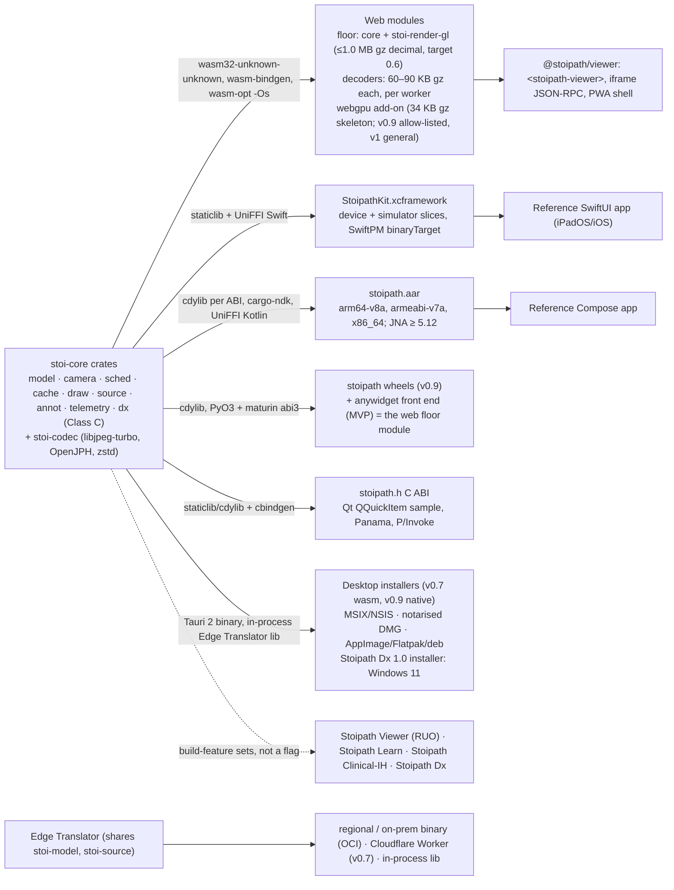
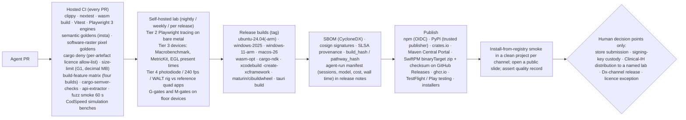

# Cross-platform delivery plan

Section 06 of the Stoipath WSI viewer development plan. Date 2026-10-24, amended 2026-10-25. This section takes the decided architecture (`arch/recommended.md`, hereafter "Recommended architecture": one Rust `stoi-core` state machine, `stoi-render-gl` on the web floor, wgpu natively, Edge Translator in three builds, four product builds from one commit set) as given and specifies, per target platform, how the engine is packaged, delivered, adapted, tested and released. Evidence tags follow the corpus: **[measured]**, **[model]**, **[estimate]**, **[unverified]**; **[verified 2026-10-24]** marks a primary source read for this section; **(verified)**, **(adjusted after verification: was X)** and **(unverified - Stage 0 gate)** mark the outcome of the 2026-10-25 claims-verification pass (`verify/README.md`, `verify/required-changes.json`). Terminology (device classes W-LAN…N-And, fidelity tiers N/W+/W60/W−, cache layers L0–L5, gates G1–G13, milestones M0–M5, Stages 0–3, releases MVP 0.5 / v0.7 / v0.9 / v1, product builds Stoipath Viewer / Learn / Clinical-IH / Dx) is that of the Recommended architecture §3, §3.2, §4.3, §5 and §8.

> **Amendment 2026-10-25 (critique + verification).** Applied from `critique/issues.json`: the single calendar (Stage 0 = weeks 0–6, M0 = 2026-12-05; §6, §8), the week-0 device procurement replacing "the lab is bought in M1" (§8), plan 02 §5.1's fidelity-tier definitions replacing this section's (§1, §3: WebGPU is an enhancement, never a tier criterion; Chrome on 3–4 GB Mali/Adreno is W−, Firefox Linux is W+, WebKitGTK is W60), the four product builds replacing a runtime RUO flag (§2, §5, §6, P13), Dx mode restricted to display-attesting surfaces with the v0.9 native desktop window as a Dx prerequisite and the Windows 11 installer as the Dx 1.0 platform (§3, §4.2, §10), the Service Worker mechanism (§4.1), the one decode-pool rule (§2), Stage 1/2/3 used only as the Recommended architecture §5 defines them, cross-reference titles reconciled to the real section titles, the MVP re-scope (Tauri desktop to v0.7, PyO3 wheel to v0.9, fluorescence to v0.7; §3, §6) and the deletion of the "gap-8 does not exist" reviewer note (the note exists and §5/§10 follow it). Applied from the verification pass: web and native warm-I2P narrative (C01/C02, §4.3), the WebKit 60 Hz nuance (C03), W-iPad L0 192 MiB and the G6 process (C09), deployable bundle sizes and the G1 unit (C13), WebGPU reach nuances (C16), ITP 30 operating days and the SW cold-start figure (C17), pool scaling under contention (C18), WRY X11-only layering and the overlay input hop (C20), G7/G8 corpus results (C12), the translator gate's load statement (C22) and the OpenSeadragon comparator protocol for the TSP evidence (C24). Nothing here diverges from the Recommended architecture; where this section once argued for a scheduling change it is recorded as a reviewer note, and any future divergence is an ADR (plan 11 A6).

Where this section depends on other plan sections it says so by title: *Instant-zoom engineering design* (policy and budgets), *System architecture* (§5–§7: Edge Translator, Manifest and Range Index, offline pack), *Quality, testing and performance QA* (gates, goldens, lab procedures), *Regulatory pathway to FDA clearance and the free-distribution model* (the four builds, Dx 1.0 scope, qualification criteria, design controls), *Product pillars: clinical use, research and education* (launch contract, Hyperdrive embedding, LTI, offline classroom use), *Roadmap, milestones, team and estimates* (release dates for pillar features), *Repository structure, developer environment and first sprints* (the canonical calendar, `docs/plan/calendar.yaml`, `docs/plan/devices.yaml`) and *Autonomous execution model and dissemination plan* (how CI gates become merge criteria; the single TSP fact block, §B1).

## 1. Delivery thesis

Eight surfaces, one engine, four fidelity tiers, four product builds. Everything that decides zoom behaviour (camera, L\*, prefetch pacing, eviction, blend, decode, draw list) is compiled from the same crates on every platform and verified by the golden gesture replay; what differs per platform is only the **surface** (canvas, `CAMetalLayer`, `SurfaceView`, Tauri window, host texture), the **input path**, the **executor** (worker pool or rayon), the **memory signal**, the **offline store** and the **distribution channel**. That is the whole content of this section: the shells are thin by budget (≤3–5 kLOC each, Recommended architecture risk 6) and every platform-specific decision below is one of those six things. The product build (Stoipath Viewer for RUO distribution, Stoipath Learn for education, Stoipath Clinical-IH for the validating UT CLIA lab(s), Stoipath Dx once cleared) is a seventh axis that cuts across all surfaces: it is a build-feature set, a name and a label, never a runtime flag (Recommended architecture §3; Regulatory pathway section Decision 3).

The fidelity tiers are plan 02 §5.1's definitions, canonical in Recommended architecture §5 (adjusted after critique: this section previously defined W+ by "128 MiB–1 GiB L0" and W− by "no WebGPU path", and 02 defined them by cadence, L0 budget and device class; 02's definitions win, and WebGPU availability is an enhancement, never a tier criterion):

| Tier | Meaning (02 §5.1) | Who gets it |
|---|---|---|
| **N** | Native shell: display-rate frames (120 Hz where the OS grants it), GB-class dynamic caches, shared-memory or staging uploads inside one interval, OS input prediction to the camera | N-Desk (Tauri native wgpu window, v0.9), N-iPad (v0.9 beta, v1 GA), N-And (v1), C-ABI hosts |
| **W+** | Web at the display's rate (60 Hz; 120 where the browser grants it) with WebGL2 (WebGPU module where allow-listed, as an enhancement), **L0 ≥ 512 MiB and ≥ 4 GB RAM**; six decode workers on desktop classes | Chrome/Edge/Firefox desktop on every OS (Firefox Linux included — adjusted after critique: was W−), Chrome Android on ≥4 GB devices, WebView2 hosts |
| **W60** | Safari/WKWebView on every Apple platform including macOS: 60 Hz WebKit cap, WASM-only decode in Dx, 192 MiB L0 on the 2020 iPad (adjusted after verification: was 256 MiB), 512 MiB on macOS; also WebKitGTK (Tauri Linux at v0.7), whose rendering-update rate is governed by the same WebKit preference (unverified - Stage 2 measurement; Reviewer note 1) | Safari macOS/iOS/iPadOS, every WKWebView incl. Tauri on macOS at v0.7, WebKitGTK at v0.7 |
| **W−** | Floor Android 3–4 GB (the W-4G class): 128 MiB L0, DPR capped at 2 by the L0 budget (not by the network), bilinear transients, three decode workers | Chrome on Mali-G52/G57 and Adreno 610 phones (adjusted after critique: was W+), Samsung Internet on Exynos/Xclipse, Firefox Android, Android 11 devices |

All four tiers satisfy the same *content* contract (never blank, ≤1 level soft during a burst, L\*-only at rest within the TTS budget); they differ in cadence, cache size and the latency floor the platform imposes. The gate for every tier is relative to that floor ("warm I2P ≤ REF + 1 frame at p95", Recommended architecture §4.4 — unchanged by verification, which confirmed that the viewer adds ≈3 ms p50 over the REF page in Chromium EventLatency traces), so a W60 device is not penalised for WebKit's cap and an N device is not excused by it. Transport is not a tier criterion either: Samsung Internet 30 (shipped 2026-05-11, Blink 143) has no HTTP/3, so the HTTP/2 tile path is tested on it, in every tier.

## 2. One engine, many artefacts

Packaging rules that follow from the architecture and the research:

- **The web floor module contains no wgpu.** `stoi-render-gl` (web-sys WebGL2, GLSL ES 3.00 generated from WGSL by naga-cli at build time) is the only renderer in the MVP web bundle. The weights, after wasm-bindgen 0.2.129 and `wasm-opt -Os --strip-debug` (adjusted after verification: the corpus figures were raw cargo output that never went through wasm-bindgen, and were in MiB): the wgpu dual-backend skeleton deploys at **0.80 MB gz** (was quoted as 0.98 MiB), of which the WebGL2 backend is **+0.73–0.77 MB gz** (was 0.68); a web-sys WebGL2 floor renderer with the texture-array slot LRU and instanced quads is **13.7 KB gz** (33 KB with glam, serde_json, hashbrown and log) **(verified, C13)**. G1 is therefore governed by the core and format crates, not by the renderer, and the 0.6 MB target is reachable. The WebGPU module (wgpu `webgpu` feature only) is **34 KB gz** as a skeleton (adjusted after verification: was 0.21 MB — 6.5× too high) and ≈0.1–0.2 MB gz as shipped **[estimate]**, a separate lazily-loaded artefact allow-listed per Chromium major from v0.9 and general at v1. G1 is stated in **decimal MB (1.0 MB = 1,000,000 B)**: the old skeleton at 1,028,041 B would pass 1.0 MiB by 2 % and fail 1.0 MB by 2.8 %, so the unit is part of the gate (verified). Cold compile is the larger cold-start risk: V8's "5–8 ms compile" was lazy validation only; eager Liftoff of a ≈3 MB raw module is 87–118 ms single-threaded on x86, i.e. **180–1,200 ms on a phone [estimate]**, and lazy mode moves that cost into the first frame — so every shell uses `compileStreaming` with the browser code cache (Chrome caches streaming-compiled modules >128 KB on repeat visits), decoders stay separate eagerly compiled modules (171 KB raw, 6–8 ms x86 / ≈30–80 ms phone), and G2 (≤300 ms floor Android / ≤150 ms iPhone 12 cold) is marked at risk (adjusted after verification: was "50–100 ms phone").
- **Decoders are separate wasm modules loaded by each worker**, so the pool never instantiates the core module. One pool rule, stated in Recommended architecture §3 and repeated here only for the shells that implement it: `clamp(hardwareConcurrency − 1, 1, 3)` workers on phone and tablet classes (W-4G, W-iPad — Safari reports `hardwareConcurrency` 4 or 8, so always 3 there; `hc = 2` yields one worker, i.e. main-thread offload without throughput gain) and `clamp(hardwareConcurrency − 1, 1, 6)` on desktop classes (W-LAN, W-BB) (adjusted after critique: the plan carried two rules). Pool speed-up is 2.2× on three workers idle **[measured]** but 1.2–1.6× under core contention (adjusted after verification), so G9 is at genuine risk and the 20-tile wall time, not per-worker speed-up, is the gate that matters; the transferable tax is 0.1–0.2 ms per tile in real Web Workers (the plan's 0.5 ms was conservative) (verified). No `SharedArrayBuffer`, no COOP/COEP, no nightly Rust: wasm32 `atomics` is `Unstable` at Rust 1.99.1 **(verified, C18)**, Android WebView has no SAB **(verified)**, and third-party embeds cannot be cross-origin isolated (an isolated page inside a plain host iframe loses SAB; a plain iframe inside a COEP host is blocked — reproduced). wgpu's `fragile-send-sync-non-atomic-wasm` feature makes its objects `Send + Sync` on non-atomics wasm; the default `!Send + !Sync` is a default, not an absolute, and the native shells never depend on it.
- **Native artefacts link the same libjpeg-turbo and OpenJPH sources** via the `turbojpeg` crate and the pinned OpenJPH FFI; OS codecs (ImageIO, `BitmapFactory`, WIC) are compiled in only behind the non-Dx feature. Decoder identity now rests on 695/695 JPEGs (139 tiles × 5 tiers) bit-identical across libjpeg-turbo 3.2.0 x86 SIMD, x86 scalar, aarch64 NEON and aarch64 scalar (qemu-user), jSquash/mozjpeg wasm and wasm-vips **(verified, C12)**; G7 still runs on real arm64 hardware for the DHF. Lossy HTJ2K differs x86 vs aarch64 in 3 pixels (max 1 LSB) and reversible HTJ2K is identical, so lossy HTJ2K stays out of Dx permanently (verified); WebCodecs `ImageDecoder` differed on 660/695 tiles and is excluded from the G8 self-certification allow-list (verified). This is what makes a Dx-edition build a *tag*, not a port.
- **Lockstep semver across SDK channels** (npm, PyPI, crates.io, SwiftPM, Maven Central, C-ABI headers), released every 4 weeks with patches as needed; desktop apps and the Edge Translator ride their own trains (note 10 F11). A given SDK version is one commit set built for seven channels **and four product builds**: Stoipath Viewer (RUO distribution: no LIS/HL7 write-back, no sign-out events, no Dx gate; the RUO string asserted by CI), Stoipath Learn (education; no PHI by construction), Stoipath Clinical-IH (in-house clinical build for the validating UT CLIA lab(s): Dx-pathway capable, carries the HL7/FHIR write-back and sign-out surfaces, labelled "in-house laboratory-validated tool, not FDA cleared", distributed to no other institution) and Stoipath Dx (the cleared, signed, reproducible build). A build-feature matrix test in CI is the machine check that the Viewer build cannot carry a clinical integration surface (adjusted after critique: a `mode: dx|ruo|edu` flag in one build fails FDA's RUO totality-of-circumstances test per research 11-gap-8 F3; the launch-context `mode` field is a product identifier that must match the running build).

## 3. Platform matrix

| Target | Delivery mechanism | Engine packaging | GPU path | Input | L0 budget | Offline store | Tier | Ships |
|---|---|---|---|---|---|---|---|---|
| Web desktop: Chrome/Edge 156, Firefox 158 | PWA, `<stoipath-viewer>`, iframe RPC; no fetch handler in the Service Worker (§4.1) | wasm floor module + decoder workers (6 on desktop); WebGPU add-on v0.9/v1 | WebGL2 floor. WebGPU as an enhancement when allow-listed: Chrome 113+ (Linux only from Chrome 144, Intel Gen12+); Firefox 141 Windows, 145 Apple-silicon macOS 26, 147 older Apple-silicon macOS, no Intel Mac and no Linux (pref is early-beta, not strictly Nightly-only) **(verified, C16)** | Pointer Events (pressure/tilt, coalesced/predicted), wheel (rAF-aligned in Chromium — §4.1), ctrl-wheel = trackpad pinch, keyboard | 512 MiB–1 GiB | OPFS shard file (L2), refillable | W+ on every OS (Firefox Linux included — adjusted after critique) | MVP; Dx mode only in an MDM-managed session with a hospital-pushed `dx_profile.json` (§10) |
| Web desktop: Safari 27 | same | same; WASM decode always in Dx | WebGL2 default; WebGPU per-major allow-list after soak (rerun's Safari 26.4 regression, WebKit 315186, is RESOLVED FIXED — verified) | Pointer Events incl. Safari 18.2+ coalesced/predicted; no `pointerrawupdate` | 512 MiB | OPFS; ITP deletes it after **30 operating days** without interaction (adjusted after verification: was 7 days — see §4.1) | W60 (120 Hz only if the user flips Safari's flag); the v0.9 Tauri native window is the macOS Dx path | MVP |
| Web Android: Chrome 156 on Mali/Adreno/Intel, Android 12+ | PWA | same | WebGL2; WebGPU 121+ or compat mode 146+ (compat limits — 4096² textures, 16 KiB UBO, 4 colour attachments, whole-array views — are guaranteed minimums; adapters may report more; design to the minimums **(verified, C16)**) later | touch 60–120 Hz, stylus via Pointer Events | ≥4 GB: 512 MiB; 3–4 GB: 128 MiB, DPR 2 always (L0-keyed cap, not metered-link-keyed — adjusted after critique) | OPFS | **W+ on ≥4 GB with L0 ≥ 512 MiB; W− on 3–4 GB** (adjusted after critique: was W+ for all) | MVP |
| Web Android: Samsung Internet 30 (Blink 143), Exynos/Xclipse; Android 11 devices; Firefox Android | PWA | same | **WebGL2 only** (Xclipse falls to `AndroidLimitedSupport` in every Chromium browser; Samsung Internet's caniuse "y" applies to Snapdragon devices only; Firefox Android WebGPU not shipped) **(verified, C16)** | same | 128 MiB | OPFS | W− | MVP, tested first |
| Web iOS/iPadOS: Safari 17–27, WKWebView (incl. Hyperdrive/LIS webviews), Home-Screen PWA | PWA (Home-Screen install), embed | same; WASM decode always | WebGL2 (ANGLE-on-Metal); WebGPU allow-list ≥ iOS 26 | touch; Pencil as Pointer Events (no UIKit prediction, no hover) | **192 MiB** (adjusted after verification: was 256 MiB; §4.1) | OPFS; ITP 30 operating days; **installed Home-Screen PWAs, app-bound and managed domains are exempt** (verified) — classroom offline packs are viable in the installed PWA | W60 | MVP |
| Windows 10 1803+ / 11 (x64, arm64) | Tauri 2.12.5 (2026-10-21) / WRY 0.57.1 (2026-10-23) **(verified)**: wasm in WebView2 (**v0.7** — adjusted after critique: was MVP) → native wgpu D3D12 window + WebView2 chrome (**v0.9, Dx prerequisite**); in-process Edge Translator for local SVS/NDPI/DICOM/OME-TIFF | Tauri binary + wasm module (v0.7); native core (v0.9) | WebGL2 in WebView2 → wgpu D3D12 (Vulkan fallback); EDID/monitor enumeration + ICC for display attestation | WebView2 Pointer Events → `WM_POINTER` pen in the native window | 2–4 GiB | app data dir, SQLite L2, offline packs | W+ → N | v0.7 → v0.9 → v1 signed, auto-updating; **Stoipath Dx 1.0 installer: Windows 11** (RC ≈W96, DX-1 per the Regulatory pathway section) |
| macOS 12+ (Apple silicon, Intel) | Tauri 2: wasm in WKWebView (v0.7) → native wgpu Metal window (v0.9) | as Windows | WebGL2 in WKWebView (60 Hz) → wgpu Metal (ProMotion) | trackpad pinch, Pointer Events → NSEvent pressure/tablet | 2–4 GiB | same | W60 → N (the v0.9 window is the macOS Dx path; macOS enters Dx via the PCCP "Deployment" category) | v0.7 → v0.9 → v1 |
| Linux (Ubuntu/Fedora LTS, x64/arm64) | Tauri 2: wasm in WebKitGTK (v0.7, WebGL2 only, **no WebGPU exists in WebKitGTK** — verified) → native wgpu Vulkan/GL window (v0.9). **WRY child-webview layering is X11-only (no Wayland path)** **(verified, C20)**: Ubuntu/Fedora default Wayland sessions need XWayland or the side-by-side layout of Reviewer note 1 | as Windows | WebGL2 → wgpu Vulkan, GL fallback | X11/Wayland pointer, tablet | 2–4 GiB | same | W60 → N (adjusted after critique: was W−) | v0.7 → v0.9 → v1 (see Reviewer note 1) |
| iPadOS/iOS 17+ (15–16 degraded) | `StoipathKit.xcframework` (SwiftPM `binaryTarget`, UniFFI Swift) + reference SwiftUI app; TestFlight → App Store + Apple Business Manager custom-app distribution via MDM | staticlib per slice | wgpu Metal with `PresentSink`/`TileTextureStore` escape hatches; `MTLGPUFamily.apple5` (A12)+ | `coalescedTouches` (ink), `predictedTouches` (camera only), Pencil hover `zOffset` (iPadOS 16.1, M2+), Pencil Pro squeeze (17.5), `estimatedProperties` | 512 MiB–2 GiB dynamic (`os_proc_available_memory`), LRU tail `volatile` | app container (Data Protection), offline packs, MDM wipe | N (warm I2P 25/33 ms API-floor configuration; typical ≈33/42 if UIKit delivers touches at ~60 Hz — §4.3) | spike at MVP, beta v0.9 (month 12), GA v1 |
| Android 10+ / API 29 | `stoipath.aar` (Maven Central) + reference Compose app; Play internal/closed testing → Play + Managed Google Play private apps | cdylib per ABI | wgpu Vulkan default, GLES retry on device-loss; device allow/deny list | `MotionEvent` history (ink), `MotionEventPredictor` 1.0.0 (camera), `requestUnbufferedDispatch` in gestures, `FLAG_CANCELED` palm rejection | 256 MiB–1 GiB dynamic (`MemoryInfo`, `onTrimMemory`) | app-private encrypted storage, offline packs | N | v1 |
| Embed: web component | npm `@stoipath/viewer` ESM; single-file CDN build | wasm floor module | as host browser | as host | per tier | OPFS under *our* origin only when same-origin; otherwise host's partition | host tier | MVP |
| Embed: iframe + `postMessage` JSON-RPC | hosted viewer page, origin allow-list, signed launch-state blob | wasm floor module served from our origin | as host browser | as host | per tier | OPFS under our origin (Chrome partitions the HTTP cache per top-level site **[verified, gap-3]**; the ITP operating-day clock runs against our origin in Safari) | host tier | MVP |
| Embed: Python / Jupyter / Colab / VS Code / marimo | `pip install stoipath`: anywidget whose ESM *is* the web floor module (**MVP**); PyO3 abi3 wheel with headless tiling, decode, the in-process Edge Translator and a local GeoArrow/GeoParquet → MVT tiler (**v0.9** — adjusted after critique: sections disagreed MVP/v0.9/v1; Recommended architecture §6 owns it) | wasm (MVP) + wheel (v0.9) | notebook front-end browser | as browser | as browser | kernel-side filesystem | W+/W60 | MVP (widget), v0.9 (wheel), v1 (headless render) |
| Embed: iOS SDK / Android SDK | XCFramework / AAR with a `StoipathView` / `AndroidView(SurfaceView)` | as native | as native | host app routes input; SDK exposes the same state document | host-set | host | N | v0.9 beta / v1 |
| Embed: C/C++ hosts (Qt, .NET, Java) | `stoipath.h` (cbindgen) + static/dynamic lib; Qt `QQuickItem` sample; Panama FFM and P/Invoke samples; render into a host-provided surface or offscreen texture blitted by the host | staticlib/cdylib | wgpu on the host's backend | host | host-set | host | N | v1 |
| **Stoipath Dx 1.0 (cleared edition) scope** — added 2026-10-25 | Signed Tauri native desktop installer, **Windows 11**; on-prem Edge Translator behind Caddy/nginx; scanners Hamamatsu NanoZoomer S360MD and Leica Aperio GT 450 DX (or one of them if the design-partner lab owns only one); named display Barco MDPC-8127 (a second ≥8 MP medical display if the partner has one); OS code-signing verifies the installer hash, Translator-side signed manifests verify served bundles | native core + `stoi-dx` | wgpu DX12 or Vulkan; EDID display identity | `WM_POINTER` | 2–4 GiB | SQLite L2 | N | DX-1 (Regulatory pathway section §7); macOS, browsers, cloud topology and air-gapped media follow through the PCCP "Deployment" category |

Latency and TTS figures per class are in the Recommended architecture §4.4 (as adjusted by verification) and are not restated; this table only says which class a target falls in. The gate viewport differs per class (4K DPR 1 for W-LAN/N-Desk, 1080p for W-BB, DPR 2 for the phone and iPad classes), so a shell's acceptance record names its viewport geometry.

## 4. Platform notes: what the shells must do

### 4.1 Web desktop and mobile (the MVP surface)

The Web Shell (TypeScript/Lit) owns one `requestAnimationFrame` loop, the canvas, the worker pool, OPFS and the PWA manifest. Three decisions are platform policy rather than feature detection:

1. **Renderer selection.** WebGL2 everywhere at MVP. The WebGPU module is enabled per *browser major* after G6/G10 pass on that version — behind a Chromium allow-list at v0.9, general at v1 — with a "Restart with WebGL2" affordance and `uncapturederror` telemetry (rerun's precedent after Safari 26.4 broke its WebGPU views **[verified, gap-2]**; WebKit 315186 is now RESOLVED FIXED — verified). Compat-mode WebGPU on GLES 3.1 Android (Chrome 146+) is admitted only because the texture-array renderer already honours its limits, treated as guaranteed minimums **[verified, gap-3; C16]**. Tile slots live in **16-layer 512² RGBA8 arrays** (≤64) with a `cooling` slot state so a layer is never written into an array drawn in the last 2–3 frames — the TBDR ghost-copy/pipeline-bubble jank Arm documents for Mali, and ANGLE-on-Metal plausibly shares (Recommended architecture §4.1 cause #38, added after critique).
2. **Decode path.** WASM libjpeg-turbo in workers is the reference on every browser; `createImageBitmap(blob,{colorSpaceConversion:"none",premultiplyAlpha:"none"})` is enabled per browser build only after the G8 start-up self-certification (it and HTMLImageElement→canvas matched 695/695 on Chromium 153 — verified), and never on Safari in Dx mode because ImageIO is a black box **[verified, gap-2]**. WebCodecs `ImageDecoder` is absent from shipping Safari (WebKit ToT has it on; expect 2027) **[verified, gap-3]**, differed on 660/695 tiles where it exists, and is excluded from the G8 allow-list (verified); it remains an opt-in non-Dx accelerator only where a per-browser self-certification passes.
3. **Storage.** OPFS via `FileSystemSyncAccessHandle` in a worker is L2 on every engine (Chrome 102 / Chrome Android 109 / Firefox 111 / Safari 15.2), laid out as **one shard file per slide with kept-open handles** (reads p50 ≤0.2 ms vs 1.0–1.2 ms open+read+close; writes 0.1–1.1 ms vs 2–3 ms one-file-per-tile — verified, C17). It is a *cache*, never a store of record: at WebKit trunk, ITP deletes OPFS and Cache API data after **30 operating days** (days of Safari use) without user interaction with the origin — 7 operating days only for origins flagged by link decoration from a prevalent domain; MDN still says seven days and shipping Safari 27 behaviour is unconfirmed (adjusted after verification: was "7 days"); `navigator.storage.persist()` is not consulted on the ITP path (verified). Installed Home-Screen web apps, app-bound domains and managed domains are exempt (verified), which is what makes classroom offline packs viable in an installed PWA on iPad (§10). Chromium's `navigator.storage.estimate().quota` reports usage + 10 GiB, not the enforced 60 % of disk, so L2 sizing never reads it as a disk share (verified). For an iframe embed the ITP clock runs against our origin. **Service Worker:** "off the hot path" has a mechanism, not a hope (adjusted after critique): the PWA Service Worker has **no `fetch` handler at all** — the app shell is cached by HTTP caching and the manifest — or, where Chrome 123+ exposes the Static Routing API, `event.addRoutes({ condition: { urlPattern: tileHost }, source: "network" })` bypasses the SW for tile hosts with the no-fetch-handler SW elsewhere (Safari and Firefox have no equivalent, and W-iPad is the class most exposed). A Tier-2 assertion on WebKit and Chromium checks that no tile request carries a service-worker timing span. The quoted cold-start cost of 50/250 ms was a 2017 Chrome figure; measured 11.9 ms median on contended x86 Chromium 153 for a trivial SW, plausibly 30–60 ms on a 2024+ phone (adjusted after verification) — small, but still 30–60 % of a W-4G TTS p50 budget, which is why the fetch handler is absent rather than fast.

iOS Safari and WKWebView are W60 by WebKit's `PreferPageRenderingUpdatesNear60FPSEnabled` default, which an App Store app may not flip (private `_WKFeature` SPI) **[verified, gap-3; C03]**. Web Animations timelines can raise and GPU-canvas pacing can only lower WebKit's rendering-update rate; neither lifts a per-frame redrawn WebGL/WebGPU canvas above 60 Hz (`framesPerSecondNearestFullSpeed`: 120→60, 90→90, 144→72 Hz) (verified). The WebContent process is jetsam-killed at an undocumented, device-dependent footprint, and the anecdotes need their provenance stated (adjusted after verification, C09): the 2048 MB "ActiveHard" kill is WebContent on an iPhone 17 Pro, iOS 26.3–26.4.1, on a CSS-animation page without WebGL **[note 06]**; the iPhone soft limit is ≈1.5 GB (`InactiveSoft` 1536 MB, WebKit bug 264370); the 224/256/288 MB canvas caps were iOS-12-era and were removed in June 2023 (bug 195325), so they are not a live constraint; the "≈1.25 GB iPad Air 3" kill was a WebGL canvas-resize leak on iOS 14.2 fixed in 14.3; and "384 MB (iOS 15)" is unsourced and dropped. Two consequences: W-iPad L0 is **192 MiB** (adjusted after verification: was 256 MiB — L0 256 + L1 64 = 320 MiB already exceeded the old 300 MB G6 gate as written), and G6/M2 measure **GPU Process + WebContent (or total) footprint with layers filled, not just allocated**, because iOS runs WebGL in the GPU Process by default (`ENABLE_GPU_PROCESS_WEBGL_BY_DEFAULT` for IOS_FAMILY/MAC — verified) and `texStorage3D` commits lazily; process RSS runs 1.3–1.8× the nominal texture bytes (128 MiB nominal cost 215–235 MiB on ANGLE/SwiftShader), and the gate is "peak ≤60 % of the measured kill threshold per process, 30 min soak without jetsam". On Android, Chrome's rAF follows the display's current mode (OEM adaptive-refresh policy, 60 Hz in power saver) **[verified, gap-3]**, so the acceptance record must log the observed cadence per device rather than assume 120 Hz.

Input on the web is Pointer Events only: pressure and tilt everywhere, `getCoalescedEvents`/`getPredictedEvents` in Chrome 58/77, Firefox 59/89, Safari 18.2 **[verified, notes 06/08]**; no access to UIKit prediction or Pencil hover. Trackpads are a first-class pathology input (most home reporters used them, gap-1 F8) and get their own rate-limited pan and pinch model, not a wheel alias. Wheel and pointer are measured separately (adjusted after verification, C01): Chromium delivers non-passive wheel events rAF-aligned (`RendererCompositorToMain` ≈16 ms p50), so wheel-driven zoom has input→tick ≈27 ms rather than 4–16 and a warm I2P of ≈60 ms p50 at the 2-vsync present floor; pointer input with a pending rAF is 4.5 ms p50. The 40/50 ms (W-LAN, W-BB) and 45/55 ms (W-4G, W-iPad) rows are floor configurations; typical is ≈48/61 ms desktop-class and ≈55–65/70–78 ms on W-4G and W-iPad (3 present vsyncs including the OS-compositor latch; Chromium's high-latency mode adds one vsync at p95). The relative gate is unaffected.

### 4.2 Desktop: Tauri 2 in two steps

Tauri 2.12.5 (2026-10-21) and WRY 0.57.1 (2026-10-23) **(verified, C20)** wrap WebView2 (Windows 10 1803+), WKWebView and WebKitGTK with a minimal app under 600 KB **[verified, note 06]**; no Chromium is bundled, so installers stay under 30 MB. The desktop app ships at **v0.7** (adjusted after critique: was MVP; the Recommended architecture §8 re-scoped MVP 0.5 to "M2 + what M2 needs", and local TIFF-JPEG/DICOM reading through the in-process core is exercised from the Python widget and the tests until then) as the web floor module running in the system webview plus the in-process Edge Translator library reading local vendor files (TIFF-JPEG, DICOM, OME-TIFF) through the same Manifest and Range Index path as the server, which is what makes an offline pathologist workstation a configuration rather than a product. At **v0.9** the viewport moves to a native wgpu window with the TypeScript chrome layered above; this is now a **Dx prerequisite, not polish** (adjusted after critique): a browser cannot identify the physical display it is on (no EDID; the Window Management API is Chromium-only, permission-gated and absent inside a third-party iframe), so the native shell's monitor enumeration (EDID + ICC) is the only self-attesting display identity, and the signed Windows 11 installer is the Dx 1.0 platform (§3; Regulatory pathway section §2.7). Facts that bound the step: WRY ships a wgpu-plus-webview example (transparent winit window, wgpu surface cleared to `TRANSPARENT`, `WebViewBuilder::with_transparent(true).build_as_child`), and child webviews are supported **on macOS, Windows and Linux X11 only — there is no Wayland path** (verified: WRY README), so Ubuntu/Fedora default sessions need XWayland or the side-by-side composition of Reviewer note 1, documented at Stage 2. The N-Desk 20/30 ms warm-I2P row assumes pointer input reaches the wgpu window directly; a full-window transparent webview that forwards input over IPC adds ≈8–17 ms (one webview frame) and would push warm I2P to ≈30–45 ms, collapsing the tier toward the wasm-in-webview fallback (adjusted after verification), so **the Stage-2 I2P test runs with the chrome overlay present**. Transparent-overlay hit-testing across WebView2/WKWebView/WebKitGTK remains **[unverified]**. "Stage 2" means what the Recommended architecture §5 defines: the native-desktop-window gate before v0.9 (WRY layering, overlay-present I2P, Wayland fallback). The step lifts macOS from W60 (WKWebView never gets ProMotion) and Linux from W60 (WebKitGTK has `ENABLE_WEBGPU` compiled out **[verified, gap-3]**) to N; on Windows it replaces a WebGL2-in-WebView2 path whose WebGPU exposure remains **[unverified]** today (MS Learn unreachable from the sandbox). Pen input in the native window is `WM_POINTER` on Windows and NSEvent tablet data on macOS; TAO's pen-pressure coverage is **[unverified]** and is listed as a risk.

Signing and updates: Authenticode on Windows (Azure Trusted Signing or an EV certificate, operational details **[unverified]**), Developer ID plus notarisation on macOS, Flatpak/AppImage/deb on Linux; the Tauri updater's signed manifests drive auto-update from v1. Hospital IT deploys the same installers through Intune/Jamf/winget; an air-gapped site receives the signed installer and the Edge Translator OCI image on media (note 09 F6), and for the Dx edition a signed activation file bound to `build_hash`, `pathway_hash`, `dx_profile.json` and the display-QA records (Regulatory pathway section §6). The Dx installer's hash is verified by OS code-signing; served bundles are verified by Translator-side signed manifests, because a served page cannot trust itself.

### 4.3 iPadOS and iOS: the one shell that changes the latency floor

The iPad Shell exists for one reason: WebKit's 60 fps cap and the ≈2-vsync present floor put web iPad warm I2P at **45/55 ms in the floor configuration and ≈55–65/70–78 ms typical**, while a native Metal present path reaches a documented floor of 2 display intervals (16.7 ms) and a typical 3 (25 ms) at 120 Hz — **web ≈55–65 → native ≈25–33 ms p50** (adjusted after verification: was "≈45 → ≈25"; C01/C02). The native row is an **API-floor configuration**: its 0–1-interval input term assumes 120 Hz touch delivery, and Apple states that "UIKit usually delivers touches to your app at around 60 Hz, but some devices are capable of recording touch information at up to 240 Hz", so the typical N-iPad row is **≈33/42 ms if UIKit delivers at ~60 Hz**, the strict floor is ≈11 ms (1 interval + firmware), and the web→native gain is ≈25–35 ms or ≈12 ms accordingly **[model from verified API semantics, gap-4; 2-vsync present floor unverified - Stage 0 G11 photodiode rig]**. G11's reference Metal quad app therefore also logs the UIKit touch-delivery rate on ProMotion (60 vs 120 Hz); the iPad-shell case survives either way because verification raised the web rows more than it lowered the native gain. The shell's recipe is fixed by gap-4 and proposal D: shell-created `CAMetalLayer` (so wgpu adds no sublayer, issue #3190) with `maximumDrawableCount = 2`, `presentsWithTransaction = false`, `framebufferOnly = true`, handed to wgpu; `CAMetalDisplayLink` with `preferredFrameLatency = 1` (the only accepted values are 1.0 and 2.0 — verified); `CAFrameRateRange(80,120,120)` requested only during gesture or inertia; overlays drawn in the same Metal frame; tile textures created through `wgpu-hal` with `storageModeShared`, `allowGPUOptimizedContents = false` and an LRU tail set `volatile` so it stops counting toward the jetsam footprint **[verified APIs, gap-4]**. Decode is libjpeg-turbo NEON in a QoS-tiered pool (`activeProcessorCount − 1`); hardware JPEG decode is not a lever on either platform **[verified by API absence, gap-4]**.

Minimum OS is iOS/iPadOS 17 for `CAMetalDisplayLink`, degrading to `CADisplayLink` + `preferredFrameRateRange` on 15–16; Metal family `apple5` (A12) or later; iPhone needs `CADisableMinimumFrameDurationOnPhone` for >60 Hz. Memory is dynamic: the budget is re-read from `os_proc_available_memory()` after every memory warning; the `increased-memory-limit` entitlement is requested but behaviour never depends on it. Pencil: coalesced 240 Hz touches feed ink, predicted touches feed the camera target only, hover `zOffset` drives a loupe on M2+ iPad Pro, squeeze and double-tap switch tools.

Distribution: TestFlight for the v0.9 beta; App Store plus Apple Business Manager custom apps for v1 so a hospital can push the app through its MDM without a public listing. Store constraints verified on Apple's pages: uploads must be built with Xcode 26 and the iOS 26 SDK since 2026-04-28 and must target iOS 13 or later since 2026-09-09; required-reason API declarations (privacy manifest) have been mandatory since 2024-05-01 and apply to the XCFramework we ship as well as to the app, so `StoipathKit` carries its own `PrivacyInfo.xcprivacy` and is distributed as a signed XCFramework **[verified 2026-10-24]**. Guideline 1.4.1 reviews "medical apps that could be used for diagnosing or treating patients" with greater scrutiny and rejects accuracy claims that cannot be validated **[verified 2026-10-24]**: the listed app is **Stoipath Viewer** (RUO) and states its intended use in-app; **Stoipath Clinical-IH** reaches the validating UT CLIA lab(s) only through Business Manager custom-app or TestFlight internal distribution and is never listed; the Dx edition is not listed until cleared, and a tablet is outside the Dx 1.0 platform set in any case (it can enter later only through the PCCP "Deployment" category once a display-agnostic or tablet pairing exists — note 09, gap-7, gap-8). Frozen-section use on the iPad is consultation on the Clinical-IH build under the lab's own validation; a frozen-section *Dx* claim is a separate indication (PathPresenter K250968's cleared intended use excludes frozen sections and cytology — gap-8 F1). Guideline 2.5.6 (WebKit only for browsing) and 4.2 (minimum functionality) are why webview wrappers were rejected (Recommended architecture §9) and why the native app adds Pencil, Files, offline packs and share sheets.

### 4.4 Android: the fragmentation shell

Android 10 / API 29 floor (SurfaceControl, Vulkan 1.1 on all 64-bit devices, front-buffer library); `postVsyncCallback` frame timelines when API ≥ 33, `Surface.setFrameRate(120, DEFAULT, ONLY_IF_SEAMLESS)` when API ≥ 30, `SurfaceView` never `TextureView`, two-image swapchain, `requestUnbufferedDispatch` during gestures; the typical floor is one interval worse than iPad because of SurfaceFlinger (3 floor / 4 typical at 120 Hz; N-And warm I2P 40/55 ms, 65/90 at 60 Hz; strict floor ≈19 ms **[model, gap-4; kept after verification, C02]**). Front-buffered rendering is reserved for the stylus ink overlay (Google: small regions only). Upload is a staging copy (`write_texture`, ~1 MiB per tile) because wgpu does not import `AHardwareBuffer` **[verified by absence, gap-4]**; the ≤8 MiB/interval phone budget in §4.4 of the Recommended architecture already assumes this.

Driver policy: Vulkan default with automatic GLES retry on device-creation failure or `VK_ERROR_DEVICE_LOST` in the first N frames, a vendor/renderer allow/deny list inside the core, the GLES build always shipped, and the golden suite run on Adreno 6xx, Mali-G5x/G7x, Xclipse and a PowerVR device before each wgpu bump (MapLibre's 2026 changelog is the cost evidence for owning this ourselves **[verified, gap-4]**; wgpu majors arrive every 77–104 days — v27 2025-10-01 … v30.0.1 2026-08-22 — so "one wgpu major per release train" is the cadence we absorb). Memory: `MemoryInfo.availMem/threshold` and `onTrimMemory`, never `isLowRamDevice` (false on every 3–4 GB phone). Multichannel on N-And follows the Recommended architecture §4.5 phone policy: ≤3 visible channels at the ingest-derived 8-bit tier, never 16-bit.

Packaging: `cargo ndk -t arm64-v8a -t armeabi-v7a -t x86_64` into `jniLibs`, UniFFI Kotlin with JNA ≥ 5.12, AAR on Maven Central via the Central Publisher Portal (OSSRH reached end-of-life on 2025-06-30 **[verified 2026-10-24]**). Two Play rules verified bind the pipeline: new apps and updates must target API 36 from 2026-08-31 (extension to 2026-11-01) **[verified 2026-10-24, developer.android.com]**, and all apps targeting API 35+ must support 16 KB memory pages on 64-bit devices, with updates lacking support blocked from 2027-02-01 **[verified 2026-10-24, developer.android.com]**; the Rust `.so` files are therefore linked with 16 KB `max-page-size` alignment and the AAR CI job asserts it with the NDK's alignment check. Distribution is Play internal testing → closed testing → production plus Managed Google Play private apps for hospital MDMs.

### 4.5 Embeddables

- **Web component** (`<stoipath-viewer>`, MVP): ESM on npm, no COOP/COEP, no fetch-handler Service Worker, decoders as separate modules, hard `size-limit` budget (G1, decimal MB), the one JSON state document as the public API. Chrome partitions the HTTP cache by (top-level site, frame site) **[verified, gap-3]**, so the component owns its L2 and every host site is a cold first load of ≈0.77–1.0 MB gz plus compile (adjusted after verification: was 0.6–1.0; the floor target remains 0.6); a dual-wasm build (WebGPU-only module for capable browsers) is the recorded answer if integrators object to weight (Recommended architecture risk 3). The embedded build is **Stoipath Viewer** (RUO) unless the host is a validating UT lab's LIS, in which case it is Clinical-IH; the host cannot switch builds with a parameter.
- **iframe + `postMessage`** (MVP): the hosted viewer page with an origin allow-list and a signed launch-state blob; this is the path that survives Epic Hyperdrive (iframe, no third-party cookies, capability-token tile auth) and LMS LTI launches (gap-7, gap-6). It is also the fallback for hosts whose CSP forbids wasm from a third-party origin. Dx mode is never offered inside an iframe, which cannot attest a display (§10).
- **Python / Jupyter** (MVP widget, v0.9 wheel, v1 headless render): anywidget 0.11 wraps the web floor module (vizarr pattern, zero Python rendering code **[verified, note 06]**) and runs in Jupyter, JupyterLab, Colab, VS Code and marimo; the PyO3 0.30 / maturin 1.15 abi3 wheel (v0.9 — adjusted after critique) carries the in-process Edge Translator so local slides are tiled without a server, reads both canonical stores directly (wsidicom, zarr-python as oracles) and ships the local GeoArrow/GeoParquet → MVT tiler (acceptance: 1 M detections from a local Parquet file render within the frame budget without a server job). Wheels: manylinux_2_28 x64/arm64, musllinux, macOS arm64/x64, Windows via cibuildwheel 4.3.4.
- **iOS and Android SDKs** (v0.9 beta / v1): the same XCFramework and AAR the reference apps use; `StoipathView` / `AndroidView(SurfaceView)` plus the UniFFI state document and event bus. Hosts route input; the SDK never owns a window.
- **C/C++ hosts** (v1): `stoipath.h` via cbindgen is the only frozen native surface; Swift, Kotlin, Python and .NET bindings are regenerated from it. Rendering targets a host-provided surface or an offscreen texture the host blits. QuPath (Java/JavaFX, not Qt) is reached through Panama FFM or a sidecar process and realistically keeps its own viewer; our value there is shared tiles and annotations (note 06, Recommended architecture risk 12).

## 5. Store, enterprise-distribution and licence constraints

| Channel | Constraint (status) | Consequence for the plan |
|---|---|---|
| Apple App Store | Xcode 26 / iOS 26 SDK uploads since 2026-04-28; iOS 13+ since 2026-09-09; required-reason API manifests since 2024-05-01 **[verified 2026-10-24]**; 1.4.1 medical-app scrutiny, 2.5.6 WebKit-only browsing, 4.2 minimum functionality, 5.1.3 health-data rules **[verified 2026-10-24 / note 06]** | Annual Xcode re-pin in CI (`macos-26` runners); privacy manifest in app *and* XCFramework; the listed app is Stoipath Viewer with its RUO intended-use statement in-app; Clinical-IH only via custom-app/TestFlight internal distribution; no Dx claim on tablets (outside Dx 1.0 scope); native value (Pencil, Files, offline) in the shell |
| Apple Business Manager / MDM | Custom-app private distribution; device encryption + remote wipe (HIPAA safe harbour, note 09) **[vendor terms unverified]** | Offline packs only in Data-Protected storage; MDM configuration keys for server URL, telemetry kill switch, air-gap mode and the site `dx_profile.json` |
| Google Play | Target API 36 by 2026-08-31 (ext. 2026-11-01); 16 KB page support required, updates blocked from 2027-02-01 **[verified 2026-10-24]**; Managed Google Play for private apps | `targetSdk` and NDK alignment asserted in the AAR job; Play Console pre-launch report consumed as a compatibility signal only |
| Microsoft | WebView2 Evergreen tracks Edge stable; WebGPU exposure in WebView2 **[unverified]**; Authenticode signing; Intune/winget/MSIX **[operational details unverified]** | v0.7 desktop uses WebGL2 in WebView2 (no dependency on WebView2 WebGPU); signing keys in KMS/HSM, never on a runner; the Dx 1.0 installer is Windows 11 and OS code-signing is its hash check |
| Linux | Flathub review, AppImage, distro packages; WebKitGTK has no WebGPU **[verified, gap-3]**; WRY child webviews X11-only **(verified, C20)** | Native wgpu window is the only N path; Wayland fallback documented at Stage 2; see Reviewer note 1 |
| npm / PyPI / crates.io / Maven | npm trusted publishing (OIDC) GA since 2025-07-31, CLI ≥ 11.5.1 **[verified 2026-10-24]**; PyPI trusted publishers **[verified, note 10]**; crates.io trusted publishing **[unverified]**; Maven Central Publisher Portal only **[verified 2026-10-24]** | Tokenless OIDC publishing wherever it exists, scoped tokens in an HSM-backed secret store otherwise; provenance attestations on every artefact |
| Licences | **Apache-2.0 + DCO throughout** (ADR-010: regulated-release channel, free to qualifying systems — adjusted after critique: "Dx edition and enterprise edge commercial" is withdrawn); client core dependencies permissive-only (libjpeg-turbo, OpenJPH, libjxl, tiff/dicom-rs/zarrs, wgpu); OpenSlide LGPL-2.1-only, libvips LGPL, Bio-Formats GPL, `jpegxl-rs` GPL-3.0+ stay in isolated server workers **[verified, note 09, Recommended architecture §7]**; the IIIF off-grid slow path uses a permissive Rust resampler in the translator or the LGPL worker image, never libvips inside the translator binary (adjusted after critique) | `cargo deny` allow-list differs per artefact: the XCFramework, AAR, wasm, wheel and translator jobs fail on any copyleft crate; the ingest-worker image carries its own SBOM and licence notice; campus OTC open-source release approval by the end of Sprint 1 |
| Regulated channel | QMSR (21 CFR 820 aligned with ISO 13485) effective 2026-02-02; §524B SBOM and patching obligations; software-only viewers are **product code QKQ** under 21 CFR 864.3700 (not PSY — adjusted after critique), cleared with named scanner/display pairings on bench data (PathPresenter K250968 in 81 FDA days with no clinical study; Proscia's K230839 did carry a multi-site study); PCCP precedent for adding scanners, formats and displays (Proscia, Aug 2026 **[snippet, vendor]**); a frozen-section Dx claim is a separate indication **[research 11-gap-8 F1–F3; Regulatory pathway section]** | **Four builds from one commit set** (Recommended architecture §3): Stoipath Viewer (RUO channel, continuous), Stoipath Learn (education, no PHI), Stoipath Clinical-IH (validating UT CLIA lab(s) only; the only pre-clearance build with HL7/FHIR write-back and sign-out; CLIN-1 and CAP-1 run on it under the lab's labelling and CLIA/CAP) and Stoipath Dx (frozen tagged build, DHF evidence, qualified hospitals via the regulated-release channel after clearance); build-feature matrix test in CI; design controls from week 0 |

## 6. What ships in which release

Calendar: Stage 0 = weeks 0–6 (week 0 = Monday 2026-10-26; three two-week sprints; **M0 = 2026-12-05**), the single calendar of *Repository structure* ADR-0023 / `docs/plan/calendar.yaml` (adjusted after critique: "weeks 0–2" was one of three incompatible calendars). MVP 0.5 = month 6–7 (week 30), v0.7 = month 9 (week 39), v0.9 = month 12 (week 52), v1 = month 18–20 (weeks 78–84); M1 falls at week 13 or 16 depending on the *Roadmap* section's re-derivation from M0 and is cited by name here. Release tags for pillar features (HL7/SMART, display QA, CAP tooling, LTI certification) are owned by the Roadmap's milestone table and 02's Release column; this table owns artefacts.

| Artefact | Stage 0 (weeks 0–6, M0 = 2026-12-05) | MVP 0.5 (month 6–7; = M2 + what M2 needs) | v0.7 → v0.9 (months 9–12) | v1 (month 18–20) | After v1 |
|---|---|---|---|---|---|
| Web floor module + `@stoipath/viewer` | G1–G10, G12, G13 on the floor devices (W-4G, W-iPad, Xclipse, Firefox Linux) with G11 rigs in Sprint 3; T0 pack (2026-10-29) with input-to-swap proxies, not I2P | PWA, component, iframe RPC, OPFS shard-file L2, telemetry incl. the quality record, launch-context contract v1 (Hyperdrive-compatible), raster overlays, `stoi-dx` Class C crate; **brightfield only** (adjusted after critique: ≤8-ch fluorescence moved to v0.7) | ≤8-channel fluorescence on the §4.5 residency model (v0.7: ≤3 visible channels at the ingest-derived 8-bit tier on phones, ≤4 on W-iPad, 16-bit at settle on desktop classes); vector-tile annotations with the local tiler (v0.9); WebGPU add-on behind a Chromium allow-list (v0.9); offline-pack *reading* (Reviewer note 3) | WebGPU module general (Safari per major); DICOM ANN/SEG/SR; multi-slide sync; 10⁶-object layers on N-Desk/W-LAN | dual-wasm if the embed market demands |
| Tauri desktop (Win/mac/Linux) | — | — (adjusted after critique: was wasm-in-webview at MVP; local files are exercised from the Python widget and tests) | **v0.7**: wasm in webview + in-process Edge Translator (local files); **v0.9**: native wgpu window, 120 Hz, pen in the native window, EDID/monitor enumeration + ICC display attestation and the display-QA module (FR-I10; adjusted after critique: was v1 — CLIN-1 at week 52 needs display-QA logging live) — **Dx prerequisite** | signed, notarised, auto-updating on three OSes; MDM/winget/Flathub; Stoipath Dx 1.0 installer (Windows 11) RC ≈W96 | Dx channel after clearance (DX-1 W117, DX-2 estimate 2029); macOS and other surfaces via the PCCP |
| `StoipathKit.xcframework` + SwiftUI app | photodiode rig + CSS-transform REF page on the 2020 iPad (G11, Sprint 3); the reference Metal quad app by M2 (it also logs the UIKit touch-delivery rate) | spike only | **beta on TestFlight** (v0.9, month 12), M3 (iPad) gate | GA: App Store (Stoipath Viewer) + Business Manager custom app (Clinical-IH to the validating lab) | — |
| `stoipath.aar` + Compose app | reference Vulkan + SurfaceView quad app by M2 (G11) | spike only | — | GA: Play + Managed Play, M3 (Android) gate | — |
| Python wheel + anywidget | — | anywidget over the web bundle (MVP) | **PyO3 abi3 wheel (v0.9)** with local tiling, the in-process Edge Translator, both-store readers and the GeoParquet → MVT tiler (adjusted after critique: was MVP) | headless render API, SpatialData/GeoParquet read | — |
| `stoipath.h` C ABI + samples | — | — | header frozen at 0.x (v0.9) | Qt `QQuickItem` sample, Panama and P/Invoke samples, OSD/OpenLayers/deck.gl adapters | — |
| Edge Translator | M0–M1 prototypes: p99 ≤ 10 ms hot service time **at ≤50 % utilisation per container path** (a stated load — adjusted after verification, C22), the 15-tile bundle path on pooled per-tile `pread` with vectored writes (naive coalesced reads measured p99 8.7–9.2 ms vs 1.6–3.6 ms per-row), 4 × 256² vs 1 × 512² decode + upload on the W-4G device | regional / on-prem binary behind Caddy/nginx (UT-operated topology for pilots); DICOMweb façade; prefix-token auth; PHI-tier bucket (adjusted after critique: Worker build and IIIF/DZI façades moved to v0.7) | Cloudflare Worker build from the same crate graph (v0.7; TX-RAMP or UT-operated for UT sites); IIIF/DZI façades (v0.7), Iris façade (v0.9); OpenSlide worker image (v0.7); on-prem binary passes the M1 suite (v0.9) | all topologies, offline-pack writer, conformance corpus; the Dx 1.0 topology (on-prem behind Caddy/nginx) frozen | — |
| Product builds and regulated release | design controls from week 0: REQ IDs on tests, risk register seeded in Sprint 1, SBOM and signed evidence on every channel; the **four-artefact split and build-feature matrix test** in CI; campus OTC approval by Sprint 1 end; RA/QA 0.2 FTE from Sprint 1 | Stoipath Viewer (RUO labelling) and Stoipath Learn released; QMS SOP set A approved by M1; manufacturer-model ADR at M1; Pre-Sub drafted at M2 | Stoipath Clinical-IH for CLIN-1 (week 52, non-diagnostic, one UT site); IEC 62304 / ISO 14971 / IEC 62366 files formalised (weeks 39–52); Pre-Sub submitted ≤ 2027-06-30; scanner corpus / loaner agreements and the Barco MDPC-8127 by v0.9 | DHF assembled and audited; QMS operating; FR-R7 deployment self-check and FR-R8 post-market hooks in the Dx build | CAP-1 on Clinical-IH (W87–104), DX-0 (W104), DX-1 (W117), Dx channel to qualifying hospitals after clearance (FREE-1) |

## 7. Build and release pipeline

Per artefact:

| Artefact | Runner | Toolchain and pins | Pre-publish gates (all machine-checkable) | Signing / provenance | Channel |
|---|---|---|---|---|---|
| wasm floor + decoder + WebGPU modules; `@stoipath/viewer` | `ubuntu-24.04` | Rust 1.99 stable, `wasm32-unknown-unknown`, wasm-bindgen 0.2.x, wasm-opt -Os; Emscripten for libjpeg-turbo/OpenJPH (`-msimd128`, no pthreads); naga-cli WGSL→GLSL | G1 size budgets in decimal MB (floor ≤1.0 MB gz, target 0.6; full ≤1.3 MB); G2 cold compile + first frame with lazy vs eager compilation reported; G7 hash identity on the 695-file corpus (x86 and arm64 runners — real arm64 for the DHF); G8 self-cert matrix with WebCodecs excluded; WGSL↔GLSL goldens ≤1 LSB; Playwright on Chromium/Firefox/WebKit; `publint`, `@arethetypeswrong/cli`, api-extractor diff; build-feature matrix (Viewer build carries no HL7/sign-out surface and refuses `mode: dx`) | npm provenance via OIDC trusted publishing; SBOM | npm `latest`/`next`; single-file CDN build |
| `StoipathKit.xcframework` | `macos-26` (build), lab Mac mini (perf) | Xcode 26 / iOS 26 SDK (store requirement since 2026-04-28), UniFFI 0.32 Swift, device + simulator slices | XCTest, Swift API diff, privacy manifest present, G7 arm64 identity, M3 (iPad) gates on lab devices incl. the touch-delivery-rate log | Signed XCFramework, SwiftPM checksum committed, cosign | GitHub Releases zip + `Package.swift`; TestFlight / App Store / Business Manager for the apps |
| `stoipath.aar` | `ubuntu-24.04` + KVM emulator (functional), lab Android (perf) | cargo-ndk, NDK r28+ with 16 KB alignment, UniFFI 0.32 Kotlin, JNA ≥ 5.12, `targetSdk` 36 | 16 KB ELF alignment check; `targetSdk` assertion; instrumentation tests; golden suite on four GPU families per wgpu bump; M3 (Android) gates | Gradle signing, SBOM, cosign | Maven Central Portal; Play testing tracks; Managed Google Play |
| Python wheels + anywidget | cibuildwheel matrix (manylinux_2_28 x64/arm64, musllinux, macOS, Windows) | PyO3 0.30, maturin 1.15 abi3, anywidget 0.11 | pytest incl. both-store reads (wsidicom, zarr-python oracles); widget meets M1 gates inside JupyterLab (M4); local-tiler acceptance (1 M detections from Parquet) | PyPI trusted publisher (OIDC) | PyPI (widget MVP, wheel v0.9); conda-forge later |
| Rust crates | `ubuntu-24.04` | release-plz, `cargo-semver-checks` | MSRV N-2; `cargo deny`; crate-layering test (Class C boundary: `stoi-codec`, `stoi-dx`) | crates.io trusted publishing **[unverified]**, token fallback | crates.io |
| Tauri desktop | `windows-2025`, `windows-11-arm`, `macos-26`, `ubuntu-24.04(-arm)` | Tauri 2.12.5, WRY 0.57.1 | installer < 30 MB; open a 4 GB local SVS cold and meet class gates; Stage-2 exit (v0.9): native-window warm I2P ≤ REF-quad + 1 interval **with the chrome overlay present**, hit-testing through transparent regions on all three webviews, Wayland fallback documented; EDID/ICC attestation test; updater manifest validity | Authenticode (Trusted Signing/EV), Developer ID + notarisation, Flatpak/AppImage signatures; updater signing key in KMS | GitHub Releases, winget, Flathub, MDM |
| Stoipath Dx installer (Windows 11) — added 2026-10-25 | `windows-2025` with a frozen toolchain image | same pins as the Tauri row, frozen per Dx train | reproducible-build check (two builders, identical `build_hash`); `pathway_hash` unchanged by security-only updates; FR-R7 deployment self-check tests; DHF evidence archive signed; cleared-configuration register entry | Authenticode + cosign; `build_hash`/`pathway_hash` registered | regulated-release channel to qualifying hospitals only; signed media + activation file for air-gapped sites |
| C ABI | all three OS runners | cbindgen; header diff as a PR artefact | header is the frozen surface: any diff is a semver event; Qt sample builds | SBOM | GitHub Releases |
| Edge Translator | `ubuntu-24.04(-arm)`; Worker build on wasm32 | axum/hyper, `worker` 0.8.7, zarrs, dicom-rs | p99 ≤ 10 ms hot service-time gate **at ≤50 % utilisation per path** (Zarr tile, DICOM frame, 15-tile bundle) on a 2-vCPU ARM container (adjusted after verification: the gate lacked a load statement); third-party-reader smoke (wsidicom, pydicom, Orthanc, dcm4chee, zarr-python, zarrs, zarrita, tensorstore); 24 h fuzz on readers | cosign-signed OCI image, Helm chart, SBOM | ghcr.io; Cloudflare (v0.7); on-prem media |

Rules the *Autonomous execution model* section inherits from this table: every row's gates are CI jobs an agent can run and read; no artefact publishes without green gates and an attestation; the five human decision points are the only steps that need a person in the loop, and each is a signed approval recorded beside the attestation. Hosted runners produce correctness and instruction-count numbers only; anything that becomes a latency or frame-time gate comes from the lab (note 10 F3). Every gate value lives in `gates/*.json` (owned by *Quality, testing and performance QA*); this section quotes them, it does not define them.

## 8. Device test lab

The lab is owned, not rented: cloud farms cannot host the photodiode or WALT rig, cannot pin firmware or thermal state and cannot measure input-to-photon; they are used weekly for the compatibility matrix only (note 10 F6). Each device is assigned to a canonical class so that every gate names the weakest device of its class.

**Procurement is a week-0 purchase, not an M1 one** (adjusted after critique: this section said "the lab is bought in M1", while G3–G6 and G12 need the floor phone, the 2020 iPad and the iPhone 12 in November). The dated list is *Repository structure* S1-00 / `docs/plan/devices.yaml`: (a) on the bench Mon 2026-10-26 for the T0 measurements: whatever floor-class Android (3–4 GB, Mali-G52/G57 or Adreno 610, Android 12–13, 60 Hz) and iPad/iPhone the owner has on hand plus a 240 fps phone camera — if no floor-class device is on hand, the T0 pack reports what was measured, labelled by class, and states that REF was measured on the same device the same day; (b) orders placed by Wed 2026-10-28 for delivery by Fri 2026-11-06: a purchased floor-class Android of the note 10 F6 specification and a USB hub; (c) delivered by Mon 2026-11-23 for Sprint 3 (G3, G5, G6, G8, G11): 2020-class iPad (8th gen, A12, 3 GB), iPhone 12 or equivalent, a Galaxy with an Xclipse GPU, an Android 11 device, a Firefox Linux box, a photodiode rig (Teensy + photodiode) and the camera on a mount; (d) WALT by M1 (M2 at the latest); (e) the N-iPad and N-And devices by month 7 for the M2 reference quads; (f) a medical-grade display only when the Dx design partner is named (v0.9). A missing device marks its G-items "device missing" on the M0 scorecard rather than blocking the sprint.

| Class / purpose | Devices (models illustrative, **[availability unverified]**) | Instruments | Gates run |
|---|---|---|---|
| W-4G floor | Android 3–4 GB, Mali-G52/G57 (e.g. Galaxy A1x/Helio class), 60 Hz, Android 12–13; Adreno 610 device; Android 11 device (no WebGPU) | Chrome tracing, EGL frame timestamps, `dumpsys meminfo`, WALT drag latency (from M1), 240 fps camera | G2, G3 (incl. the transients-active variant), G5 (≤1.2 ms per 512² upload p95, per named source type, into an in-use array), G9 under page load, G12 into (a) an idle array and (b) an array bound by the previous frame's draw, G13; M2; L0-keyed DPR cap checks |
| W− | Exynos/Xclipse Galaxy (S23 FE / S24 EU) in Samsung Internet 30 and Chrome; Snapdragon Galaxy for the Samsung Internet HTTP/3 question; a PowerVR device | same | G3/G4 WebGL2 on Xclipse (the G4 1…64/128/256 layer sweep passed on ANGLE/SwiftShader — verified; Mali/Adreno/Xclipse remain the device test); HTTP/2-only path; wgpu golden suite before each bump |
| W-iPad | iPad 8th gen (A12, 3 GB) on iPadOS 17/18 and a second on 26; iPhone 12 (G2 reference) | XCUITest + in-page telemetry, MetricKit, JetsamEvent logs, Xcode Instruments per process, WALT | G2, G3, G5 (WebKit 260460 puts an A13 at ≈2.3 ms per tile, so G5 is at risk here and the time box is widened by an explicit overlay/UI cut), G6 (500 reloads + 30 min soak; **GPU Process + WebContent footprint, layers filled**), G12; M2 memory ≤60 % of the measured kill threshold per process at the 192 MiB L0 |
| N-iPad | iPad Pro M-series 120 Hz + Apple Pencil (Pro) | `presentedTime` via wgpu-hal, `gpuStartTime/gpuEndTime`, signposts, photodiode rig vs reference Metal quad (G11), **UIKit touch-delivery-rate log (60 vs 120 Hz)** | M3 (iPad): p99 frame ≤ 8.3 ms, I2P ≤ REF-quad + 1 interval, Pencil events within 1 frame; the delivery rate selects 25/33 or 33/42 ms as the typical row |
| N-And | Pixel 8/9 (Perfetto, Macrobenchmark reference, 120 Hz); mid-range 120 Hz Android 6 GB | Macrobenchmark `FrameTimingMetric`, `EGL_ANDROID_get_frame_timestamps`, Perfetto, photodiode vs reference Vulkan quad | M3 (Android); GLES retry path; `onTrimMemory` harness (`am send-trim-memory`) |
| W-BB / W-LAN desktop | Intel-iGPU Windows laptop (WebView2, Edge); Windows arm64 laptop; MacBook Air (Safari W60, WKWebView); Linux box with AMD or NVIDIA (Firefox Linux WebGL2, WebKitGTK, X11 and Wayland sessions) | Playwright + Chromium tracing, `gpuBenchmarking.pinchBy`, CSS-transform reference page for REF, wheel and pointer separately | M0, M1 at the class gate viewport (1080p for W-BB; 4K DPR 1 for W-LAN); W-LAN upload throughput measured at M0; Tauri v0.7 and Stage-2 window gates incl. the overlay-present I2P and the Wayland fallback; WebKitGTK WebGL2 adequacy (Reviewer note 1) |
| N-Desk | 120 Hz workstation (Windows 11 — the Dx 1.0 platform) with the on-prem Edge Translator on 1 GbE; one 27" 4K IPS ≥300 cd/m² display with ICC profile for Dx-mode goldens (gap-1 F4); EDID enumeration test fixtures; a Barco MDPC-8127-class medical display when the Dx design partner is named **[cost unverified]** | WALT, high-speed camera, display colorimeter | N-Desk gates at 4K DPR 1 (44–54 tiles per level); display-QA module tests (v0.9); display-attestation tests |
| Infrastructure | Mac mini (Apple silicon) runner with USB hub for iOS devices and the XCFramework perf jobs; Linux runner with adb hub; Windows box; Raspberry Pi `tc netem` bridge with the five network profiles (LAN, broadband-CDN, 4G good, cellular poor, far origin — p95 radio inputs stay [unverified] until the D8 field measurement); mitmproxy record/replay of tile traffic; Toxiproxy for server faults | — | all tiers |

Procedure: fixed brightness, airplane mode plus lab Wi-Fi or wired, thermal cool-down checks between runs, battery >50 % or powered, N ≥ 10 runs, bootstrap confidence intervals on p95 and alerts on *shift* against a per-device baseline (note 10 F4). The reference quad apps (CSS-transform page, raw Metal, raw Vulkan + SurfaceView) live in the harness repository and are re-measured whenever device firmware changes, because every latency gate is relative to them. The verification report's §4 (D1–D12) is the list of what the lab must settle first: present floors and warm I2P for pointer and wheel (D1), native floors and touch delivery (D2), upload cost by source type (D3), per-process footprint and soak (D4), A55 WASM decode and pool scaling under load (D5), cold start (D6), NEON identity on hardware (D7), radio percentiles (D8), overlay input path and Wayland (D10), the OpenSeadragon comparator on devices (D12). Cost: ≈USD 8–12k capex plus ≈0.2 FTE operations **[estimate, note 10 F6; unverified]**; the performance/QA engineer who owns it is hired in Stage 0 and the Stage-0 device set is ordered in week 0, before the first mobile claim is made.

## 9. Platform-specific risks

| # | Platform | Risk | L / I | Mitigation and trigger |
|---|---|---|---|---|
| P1 | Web floor | WebGL2 texture-array or upload cost on iOS Safari / Mali-G52 breaks G3–G5 (WebKit 234920/294602 — 294602 verifiable as open only to Nov 2025; wgpu #4081 class of bug now ours in `stoi-render-gl`; TBDR ghost copies when a layer is written into an array still referenced by in-flight draws — cause #38); a public data point already puts an A13 at ≈2.3 ms per 512² tile (WebKit 260460) against G5's ≤1.2 ms | Med / High | 16-layer arrays with the `cooling` slot state; G4 layer sweep on Mali/Adreno/Xclipse; G12 measures (a) idle-array and (b) in-use-array uploads per source type in Stage 0 and gates on (b); the TypeScript renderer is the recorded exit if web-sys trampolines cost >0.5 ms/frame |
| P2 | Web iOS | WebContent and GPU Process jetsam at an undocumented budget; ITP deletes OPFS after 30 operating days for an ordinary origin (7 for link-decoration-flagged ones); G2 cold compile at risk on a ≈3 MB raw module | High / Med | 192 MiB L0, eviction before pressure, M2 soak gate on GPU Process + WebContent with filled layers; L2 refillable by design, Manifest re-validation at open; installed-PWA exemption for classroom use; streaming compile + code cache, decoders as separate eager modules |
| P3 | Web Android | Xclipse/Exynos and Firefox Android have no WebGPU; compat-mode limits; 3–4 GB phones are W− and get bilinear transients and DPR 2 | High / Low | WebGL2 is the floor, not a fallback; W− tested first; renderer designed within compat minimums; tier logged in telemetry and shown when it limits a mode |
| P4 | Desktop | Tauri native-wgpu-window-plus-webview layering: X11-only on Linux (no Wayland path — verified), hit-testing unproven on WebView2/WKWebView/WebKitGTK, and an input hop through a full-window transparent webview would add ≈8–17 ms and push N-Desk warm I2P to ≈30–45 ms | Med / High (now a Dx prerequisite) | Stage-2 gate before v0.9 with the overlay present; side-by-side layout (chrome beside, not over, the viewport) as the fallback that keeps input direct; XWayland or side-by-side on Wayland; wasm-in-webview (W+/W60) for one more release only for non-Dx use |
| P5 | Desktop | Pen pressure/tilt in the native window (TAO/winit coverage **[unverified]**) | Med / Low | `WM_POINTER` / NSEvent tablet code in the shell; Windows Ink prediction not relied upon |
| P6 | iPad | No `presentedTime` through wgpu (#9856 — state not re-verified); present path may miss "≤ REF-quad + 1 interval"; UIKit may deliver touches at 60 Hz, shrinking the native-over-web gain to ≈12 ms | Med / Med | `PresentSink` escape hatch to the raw `MTLDrawable`; direct-Metal present path (gap-4 option C, Stage 3) only if profiling blames wgpu; G11 logs the delivery rate and the typical row is restated from it |
| P7 | iPad | 120 Hz withdrawn in Low Power / thermal / "Limit Frame Rate"; quality-vs-rate feedback loop | High / Low | Request 120 Hz only during gestures; never adapt render quality to the granted rate; log downclocks as thermal events |
| P8 | Android native | Driver fragmentation (Adreno 6xx `VK_ERROR_DEVICE_LOST`, Mali WGSL transpile crash #10186, PowerVR surface creation) | High / Med | wgpu/Firefox workarounds upstream; GLES retry; allow/deny list; four-family golden suite per wgpu bump; one wgpu major per release train (77–104-day cadence) |
| P9 | Android native | Extra 1 MiB staging copy per tile without AHB import | Med / Low | ≤8 MiB/interval budget already assumes it; wgpu-hal AHB import patch if M3 misses on Mali-G52-class devices |
| P10 | Stores | Apple toolchain and Play target/alignment deadlines move yearly; a missed deadline blocks all updates incl. security patches (a §524B obligation) | Med / High | Annual re-pin job in CI with a failing test two months before each published deadline; store-policy watch as a scheduled agent task |
| P11 | Embeds | ≈0.77–1.0 MB gz cold load plus 180–1,200 ms eager compile per host site because of cache partitioning; hospital CSPs forbidding third-party wasm | Med / Med | iframe fallback from our origin; streaming compile and code cache; dual-wasm; published embed-weight budget; `wasm-unsafe-eval`-free loading documented for CSP owners |
| P12 | SDKs | Seven channels in lockstep; one leaked token compromises a clinical supply chain | Low / High | OIDC trusted publishing where available; HSM-held keys; cosign + SLSA attestations; install-from-registry smoke before announcement |
| P13 | Product builds | The RUO build is used clinically off-label, or the four builds are conflated (a flag fails FDA's RUO totality test); Clinical-IH leaks beyond the validating lab; Dx mode activated on an unattested display | Med / High | Four builds from one commit set with the build-feature matrix test (Stoipath Viewer carries no HL7/sign-out surface and refuses `mode: dx`; intended-use statement in every shell); Clinical-IH distributed only to labs named in `dx_profile.json`; Dx mode only on the native desktop shell (EDID) or an MDM-managed session with a hospital-pushed `dx_profile.json`, gated by the FR-R7 deployment self-check; Dx channel only to qualifying hospitals under the Regulatory pathway section |
| P14 | Staffing | iOS and Android engineers hired too late for the month-12 iPad beta | Med / Med | iOS hire at **week 26** (month 6; now aligned in the Roadmap and Recommended architecture §8 — adjusted after critique: the Roadmap had W34); N-iPad devices and photodiode rig by month 7; Android after the iPad shell passes M3 |
| P15 | Stage 0 | Devices arrive after the gates that need them; no floor-class phone on the bench for the T0 measurements (2026-10-26/27) | High / High | Week-0 procurement (§8) with a "device lab PO issued" check before Sprint 3; the T0 pack reports what was measured, labelled by class, with REF measured on the same device the same day; G-items "device missing" on the scorecard rather than silently passed |
| P16 | MVP scope | Removing the desktop app and the PyO3 wheel from MVP leaves local-file and offline workstation users waiting until v0.7/v0.9 | Med / Low | The anywidget exercises the in-process core on local files from MVP; the research pillar's first usable release is the MVP widget + web; desktop and wheel dates are published in the Roadmap, not implied |

## 10. How the delivery plan serves the three pillars and the long-term aim

| Pillar / aim | Platform deliverables that carry it |
|---|---|
| **Clinical** | iframe + `postMessage` embed that survives Epic Hyperdrive and LIS webviews (MVP; the embedded build is Stoipath Viewer, which carries no sign-out or HL7 surface — those exist only in **Stoipath Clinical-IH**, delivered to the validating UT lab from CLIN-1 at week 52); Windows/macOS Tauri app with the native wgpu window, EDID/ICC display attestation, display-QA module and dictation co-existence (v0.9); DICOMweb client in every shell; iPad shell for frozen-section and remote consultation on the Clinical-IH build under the lab's own validation (frozen-section Dx is a separate indication); **Dx mode only where the display can be attested** (adjusted after critique): (a) the native desktop shell (EDID/monitor enumeration + ICC) or (b) an MDM-managed browser session whose hospital-pushed `dx_profile.json` names the display, with the attestation source recorded in the quality record — never in an unmanaged browser or an iframe; Stoipath Dx 1.0 as the signed Windows 11 installer with the on-prem Edge Translator; MDM distribution for every OS; telemetry kill switch and air-gap mode in each shell |
| **Research** | anywidget in Jupyter/Colab/VS Code/marimo from MVP; the PyO3 wheel with the in-process Edge Translator, direct readers for both canonical stores and the local GeoParquet → MVT tiler at v0.9; ≤8-channel fluorescence from v0.7 on the §4.5 residency model (16-bit at settle on desktop classes; the ingest-derived 8-bit tier with ≤3–4 visible channels on phones and iPad); C ABI for napari/Slicer/Qt hosts (v1); QuPath via DICOM and OME-TIFF export and a Panama bridge; OSD/OpenLayers/deck.gl adapters so Slim/Viv-ecosystem users adopt incrementally |
| **Education** | **Stoipath Learn** build (no PHI by construction) as a PWA on Chromebooks, iPads and phones without installs (W60/W− tiers hold the content contract); iframe launch from LTI 1.3 with a signed state blob; offline-pack reading in the PWA, Tauri and the iPad app for low-bandwidth classrooms and CME enduring materials — viable on iPad because an installed Home-Screen PWA is exempt from ITP deletion (adjusted after verification: the earlier plan treated iPad offline packs as approximated); WCAG 2.2 AA keyboard path in the Web Shell |
| **FDA-cleared, free platform** | One commit set builds every channel and all four product builds, so the Dx edition is a tag with design-history evidence rather than a port; SBOM, signatures, SLSA provenance and `build_hash`/`pathway_hash` on every artefact (§524B); store deadlines tracked as failing tests because a free product still owes security patches; Apache-2.0 + DCO with a regulated-release channel free to qualifying health systems (ADR-010); the qualification criteria of the Regulatory pathway section §6.1 (CLIA certificate and CAP or equivalent accreditation, CAP WSI validation with a summary returned, cleared or PCCP pairings only, display-QA programme, IT-security and identity attestation, training, a signed agreement with complaint and adverse-event reporting) are enforced by the **FR-R7 deployment self-check** — registered `build_hash` and `pathway_hash`, site `dx_profile.json`, display-QA record freshness, attestation source, IdP reachability, telemetry endpoint or kill-switch state, PHI-tier configuration, training record — delivered through MDM or installer configuration keys, not by trust and not by a `mode` field (adjusted after critique) |

**Earliest demonstrable milestone for the TSP abstract.** TSP facts are owned by the *Autonomous execution model and dissemination plan* §B1 (106th Annual Meeting 22–24 January 2027; abstract deadline Friday 30 October 2026, 17:00 CT; ≤350 words; no author or institution names in the file) and are not restated. The first thing this plan can *show* is the Stage-0 evidence: the T0 pack (2026-10-29) with the floor-device measurements of TTS, NTF% and blank-pixel frames against the CSS-transform reference floor, reporting **input-to-swap / first-contentful-frame proxies, not input-to-photon** (no photodiode rig before Sprint 3), labelled by the class of whatever device was on the bench; then the M0 scorecard (2026-12-05, G1–G13 on the floor devices) with the Tier-2 nightly trend; M1 is presented only if its gates are green by the 2027-01-15 data freeze. The comparator is OpenSeadragon 6.1.1 **in its tuned profile** (`maxTilesPerFrame: 100`, `imageLoaderLimit` raised, `immediateRender: true`), because its defaults ration 10, 5, 3, 2, 1 … tiles per frame and settle a 1.2 s spring that would measure request rationing and animation rather than rendering; cold and warm frames and the canvas and WebGL drawers are reported separately (adjusted after verification, C24). Cost accounting comes from the per-artefact provenance manifest (agent sessions, model, cost, wall time) and the install-from-registry smoke logs, with the programme total of the Roadmap §9 (≈70–85 PM to MVP, ≈195–230 PM to v1) as the comparison baseline and the platform-only figure as a sub-line. A viewer alone demonstrates viewing latency, openness and in-house verifiability; it cannot demonstrate diagnostic equivalence or patient-care impact, and the abstract must say so. Only de-identified public slides (CAMELYON, IDC) are used.

## 11. Reviewer notes

1. **Linux and the native window.** The Recommended architecture ships "wasm in webview" on all three desktops at v0.7 and the native wgpu window at v0.9. WebKitGTK has no WebGPU, its WebGL2 quality on Ubuntu/Fedora LTS is unmeasured (gap-3 #9b, note 06 open question 4), and its rendering-update rate is assumed capped near 60 Hz by the same WebKit preference that governs Safari (this section classifies it W60 on that inference — unverified - Stage 2 measurement). If the Stage-2 measurement on the lab Linux box shows WebKitGTK WebGL2 failing G3/G5, the Linux shell should skip the wasm-in-WebKitGTK step and go straight to the native wgpu window (a winit/TAO window with the TypeScript chrome in WebKitGTK *beside*, not over, the viewport), accepting a plainer layout for one release. WRY's X11-only child-webview constraint makes that side-by-side form the likely Linux layout on Wayland sessions anyway. This is a scheduling change within the decided architecture, not a divergence from it; if adopted it is recorded as an ADR (plan 11 A6).
2. **iPad staffing — resolved.** The 2026-10-24 note asked for the iOS hire by month 6 for a month-12 beta that must pass M3; the Roadmap and the Recommended architecture §8 now carry the hire at week 26 and the N-iPad devices and photodiode rig by month 7. Effort figures are unchanged.
3. **Offline pack timing.** The System architecture schedules the offline pack writer for v1. The Education pillar's low-bandwidth classroom use and the iPad shell's offline mode both want pack *reading* earlier, and verification removed the main obstacle on iPad (an installed Home-Screen PWA is exempt from ITP deletion). Reading a derived single-file bundle is a `stoi-source` adapter over the same Manifest abstraction; pulling the reader into v0.9 (PWA, Tauri, iPad beta) while the writer stays at v1 costs little and is shown in §6 as the proposal; the System architecture owns the decision.

## References

Corpus: `arch/recommended.md` (§3, §3.2, §4.3–4.5, §5–§10, as amended 2026-10-25); `verify/README.md` and `verify/required-changes.json` (C01–C03, C09, C10, C12, C13, C16–C18, C20, C22–C24; §4 items D1–D12); `critique/issues.json`; `research/06-cross-platform.md`; `research/11-gap-2-rust-wgpu-web-core-viability.md` (§2.1–2.4, §4); `research/11-gap-3-platform-facts-reverification.md` (verdict table, compat-mode limits); `research/11-gap-4-native-mobile-render-pipeline.md` (§2.1–2.10, §4); `research/11-gap-8-fda-pathway-and-free-distribution.md` (F1–F4, §4); `research/03-client-rendering.md` (§2.1, §2.7); `research/09-compliance-security-ops.md` (F1, F5, F6, F9); `research/10-dev-process-testing.md` (F3, F4, F6, F11, §6); `research/08-features-versatility.md` (F10–F12); `research/11-gap-1-pathologist-human-factors.md` (F4, F5, F8); `research/11-gap-6-education-modules.md` (F5, F8); `research/11-gap-7-clinical-integration.md` (F2, F6, §4); plan sections 02 §5.1–5.3, 10 §1 and S1-00, 13 §2.4, §2.7, §6.1; `judge/ranking.json`, `judge/judgments.json` (delivery and product judges' conditions on bundle weight, Stage-0 gates, iPad timing).

Primary sources read for this section on 2026-10-24:

- Android 16 KB page-size requirement (updates blocked from 2027-02-01): https://developer.android.com/guide/practices/page-sizes
- Google Play target API level requirement (API 36 by 2026-08-31): https://developer.android.com/google/play/requirements/target-sdk
- Apple upcoming requirements (Xcode 26 / SDK 26 since 2026-04-28; iOS 13 minimum since 2026-09-09; required-reason APIs since 2024-05-01): https://developer.apple.com/news/upcoming-requirements/
- App Store Review Guidelines (1.4.1, 2.5.6, 4.2, 5.1.3): https://developer.apple.com/app-store/review/guidelines/
- Apple privacy manifests for apps and third-party SDKs: https://developer.apple.com/documentation/bundleresources/adding-a-privacy-manifest-to-your-app-or-third-party-sdk
- npm trusted publishing with OIDC generally available (2025-07-31): https://github.blog/changelog/2025-07-31-npm-trusted-publishing-with-oidc-is-generally-available/
- Maven Central: OSSRH end-of-life 2025-06-30, Central Publisher Portal: https://central.sonatype.org/pages/ossrh-eol/ and https://central.sonatype.org/news/20250326_ossrh_sunset/

Primary sources read by the verification pass on 2026-10-25 and relied on here (artefacts under `verify/`):

- WRY README (child webviews: macOS, Windows, Linux X11 only) and `examples/wgpu.rs`: https://github.com/tauri-apps/wry ; crates.io versions tauri 2.12.5 / wry 0.57.1: https://crates.io/crates/tauri , https://crates.io/crates/wry
- WebKit ITP operating-date windows (`operatingDatesWindowLong { 30 }`, `Short { 7 }`; exemptions for app-bound, managed, persisted and standalone-application domains): https://github.com/WebKit/WebKit/blob/main/Source/WebKit/NetworkProcess/Classifier/ResourceLoadStatisticsStore.cpp
- WebKit GPU-Process WebGL default (`ENABLE_GPU_PROCESS_WEBGL_BY_DEFAULT`): https://github.com/WebKit/WebKit/blob/main/Source/WTF/wtf/PlatformEnableCocoa.h ; WebKit bug 260460 (A13 iPad `texSubImage2D` cost): https://bugs.webkit.org/show_bug.cgi?id=260460
- Chromium reported quota (`CalculateReportedQuota`, usage + 10 GiB): https://source.chromium.org/chromium/chromium/src/+/main:storage/browser/quota/quota_manager_impl.cc ; Service Worker Static Routing API: https://developer.chrome.com/blog/service-worker-static-routing
- Apple touch delivery ("UIKit usually delivers touches to your app at around 60 Hz"): https://developer.apple.com/documentation/uikit/getting-high-fidelity-input-with-coalesced-touches
- Arm Mali guidance on updating dynamic resources on TBDR GPUs (ghost copies, N-buffering): https://developer.arm.com/community/arm-community-blogs/b/mobile-graphics-and-gaming-blog/posts/mali-performance-6-efficiently-updating-dynamic-resources
- FDA product code QKQ (digital pathology image viewing and management software, 21 CFR 864.3700): https://www.accessdata.fda.gov/scripts/cdrh/cfdocs/cfpcd/classification.cfm?id=QKQ

Primary sources carried from the corpus (read by the research notes on 2026-10-24 unless noted):

- WebKit 60 fps preference and WKWebView SPI: https://github.com/WebKit/WebKit/blob/main/Source/WTF/Scripts/Preferences/UnifiedWebPreferences.yaml , https://github.com/WebKit/WebKit/blob/main/Source/WebKit/UIProcess/API/Cocoa/WKPreferencesPrivate.h
- WebKitGTK WebGPU build gating: https://github.com/WebKit/WebKit/blob/main/Source/WTF/wtf/PlatformEnable.h
- ITP data types incl. OPFS: https://github.com/WebKit/WebKit/blob/main/Source/WebKit/NetworkProcess/Classifier/WebResourceLoadStatisticsStore.cpp
- Chromium WebGPU blocklist (Xclipse) and compat mode: https://github.com/chromium/chromium/blob/main/gpu/config/webgpu_blocklist_impl.cc , https://github.com/gpuweb/gpuweb/blob/main/proposals/compatibility-mode.md
- Chromium HTTP-cache partitioning: https://github.com/chromium/chromium/blob/main/net/http/http_cache.cc
- Gecko WebGPU and WebCodecs prefs: https://github.com/mozilla-firefox/firefox/blob/main/modules/libpref/init/StaticPrefList.yaml
- MDN browser-compat-data (OPFS, Pointer Events, SAB, OffscreenCanvas, GPU): https://github.com/mdn/browser-compat-data
- rustc wasm `atomics` unstable: https://github.com/rust-lang/rust/blob/master/compiler/rustc_target/src/target_features.rs
- wgpu README, CHANGELOG, issues #3190, #4081, #9856, #10186 (issue states per gap-2's same-day read; not re-verified, GitHub blocked in verification): https://github.com/gfx-rs/wgpu
- Apple: CAMetalDisplayLink https://developer.apple.com/documentation/quartzcore/cametaldisplaylink ; ProMotion guidance https://developer.apple.com/documentation/quartzcore/optimizing-iphone-and-ipad-apps-to-support-promotion-displays ; `os_proc_available_memory` https://developer.apple.com/documentation/os/os_proc_available_memory ; purgeable resources https://developer.apple.com/documentation/metal/reducing-the-memory-footprint-of-metal-apps ; Pencil hover https://developer.apple.com/documentation/uikit/adopting-hover-support-for-apple-pencil ; App Store guidelines 2.5.6 and 4.2 (note 06) https://developer.apple.com/app-store/review/guidelines/
- Android: Choreographer https://developer.android.com/reference/android/view/Choreographer ; frame rate https://developer.android.com/media/optimize/performance/frame-rate ; SurfaceView https://developer.android.com/reference/android/view/SurfaceView ; MotionEventPredictor https://developer.android.com/reference/androidx/input/motionprediction/MotionEventPredictor ; ActivityManager.MemoryInfo https://developer.android.com/reference/android/app/ActivityManager.MemoryInfo ; Vulkan overview https://developer.android.com/games/develop/vulkan/overview ; AHardwareBuffer https://developer.android.com/ndk/reference/group/a-hardware-buffer
- MapLibre Native Android changelog (driver workarounds): https://raw.githubusercontent.com/maplibre/maplibre-native/main/platform/android/CHANGELOG.md
- Tauri 2 releases: https://github.com/tauri-apps/tauri/releases
- UniFFI (Swift/Kotlin bindings): https://github.com/mozilla/uniffi-rs ; cargo-ndk: https://github.com/bbqsrc/cargo-ndk ; Mozilla XCFramework distribution via SwiftPM: https://github.com/mozilla/rust-components-swift
- anywidget: https://github.com/manzt/anywidget ; vizarr (anywidget pattern): https://github.com/hms-dbmi/vizarr ; PyO3 / maturin: https://github.com/PyO3/maturin ; cibuildwheel: https://github.com/pypa/cibuildwheel ; PyPI trusted publishers: https://docs.pypi.org/trusted-publishers/
- GitHub Actions runner images and larger/GPU runners: https://github.com/actions/runner-images , https://docs.github.com/en/actions/reference/runners/larger-runners ; Android emulator action: https://github.com/ReactiveCircus/android-emulator-runner
- Playwright WebView2 testing: https://playwright.dev/docs/webview2 ; Chromium `gpuBenchmarking`: https://source.chromium.org/chromium/chromium/src/+/main:content/renderer/gpu_benchmarking_extension.cc
- Macrobenchmark metrics: https://developer.android.com/topic/performance/benchmarking/macrobenchmark-metrics ; `EGL_ANDROID_get_frame_timestamps`: https://registry.khronos.org/EGL/extensions/ANDROID/EGL_ANDROID_get_frame_timestamps.txt ; MetricKit `scrollHitchTimeRatio`: https://developer.apple.com/documentation/metrickit/mxanimationmetric/scrollhitchtimeratio
- WALT latency timer: https://github.com/google/walt
- Fetch standard (CORS preflight cache, safelisted headers): https://fetch.spec.whatwg.org/#cors-preflight-cache
- OpenSeadragon 6.1.1 (comparator defaults verified in source by the verification pass): https://github.com/openseadragon/openseadragon
- Licences: OpenSlide LGPL-2.1-only https://github.com/openslide/openslide.github.io/blob/main/license/index.md ; libjpeg-turbo https://github.com/libjpeg-turbo/libjpeg-turbo/blob/main/LICENSE.md ; OpenJPH https://github.com/aous72/OpenJPH/blob/master/LICENSE ; `jpegxl-rs` GPL-3.0-or-later https://crates.io/api/v1/crates/jpegxl-rs/versions
- Unverified this session (cited as pointers only): WebView2 WebGPU exposure https://learn.microsoft.com/microsoft-edge/webview2/ ; crates.io trusted publishing https://crates.io/docs/trusted-publishing ; Azure Trusted Signing https://learn.microsoft.com/azure/trusted-signing/ ; Apple Business Manager custom apps https://support.apple.com/guide/apple-business-manager/ ; Managed Google Play private apps https://support.google.com/googleplay/work/
