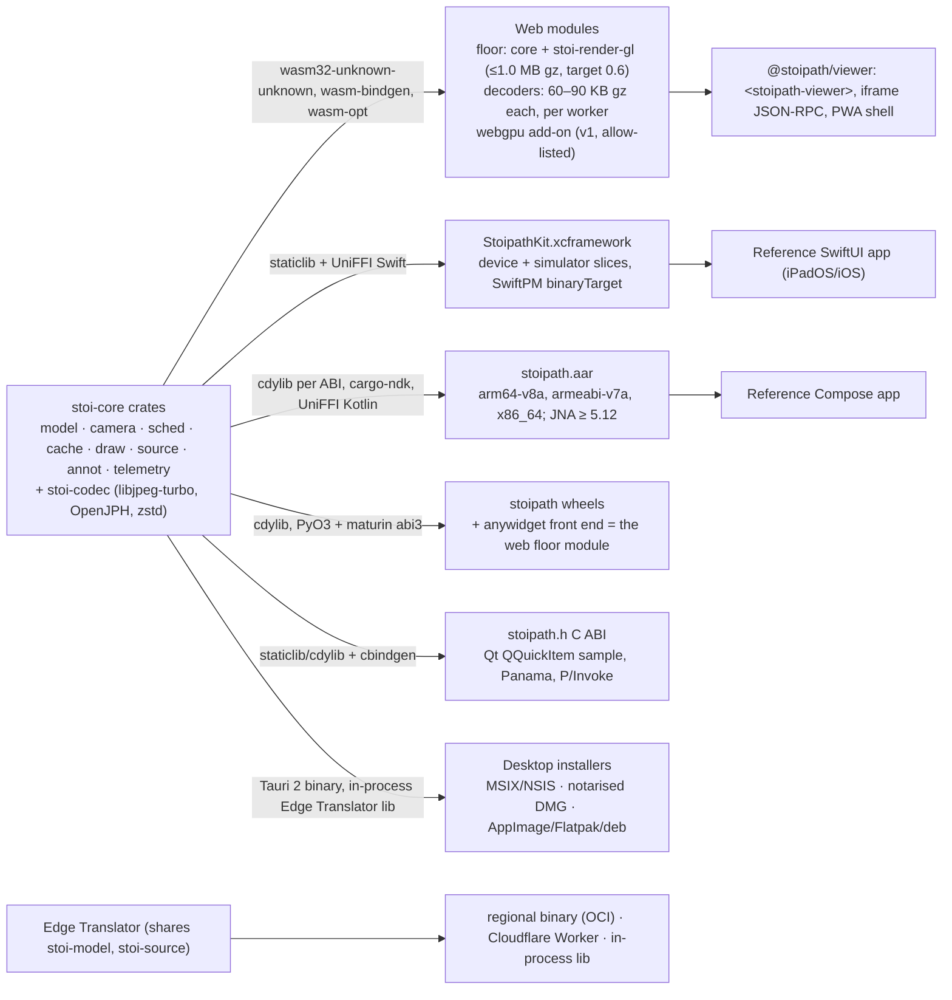
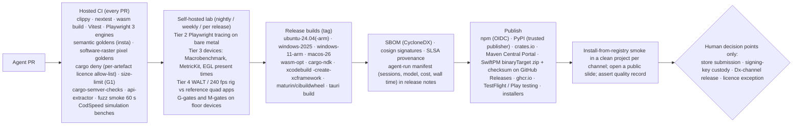

# Cross-platform delivery plan

Section 06 of the Stoipath WSI viewer development plan. Date 2026-10-24. This section takes the decided architecture (`arch/recommended.md`: one Rust `stoi-core` state machine, `stoi-render-gl` on the web floor, wgpu natively, Edge Translator in three builds) as given and specifies, per target platform, how the engine is packaged, delivered, adapted, tested and released. Evidence tags follow the corpus: **[measured]**, **[model]**, **[estimate]**, **[unverified]**; **[verified 2026-10-24]** marks a primary source read today for this section. Terminology (device classes W-LAN…N-And, fidelity tiers N/W+/W60/W−, cache layers L0–L5, gates G1–G13, milestones M0–M5, releases MVP / v0.9 / v1) is that of the Recommended architecture §4.3, §5 and §8.

Where this section depends on other plan sections it says so by title: the Instant-zoom engineering section (policy and budgets), the Server, storage and ingest section (Edge Translator, Manifest, offline pack), the Verification and testing section (gates, goldens, lab procedures), the Regulatory pathway section (RUO vs Dx edition, design controls), the Clinical integration section (launch contract, Hyperdrive embedding), the Education modules section (LTI, offline classroom use) and the Agent execution loop section (how CI gates become merge criteria).

## 1. Delivery thesis

Eight surfaces, one engine, four fidelity tiers. Everything that decides zoom behaviour (camera, L\*, prefetch, eviction, blend, decode, draw list) is compiled from the same crates on every platform and verified by the golden gesture replay; what differs per platform is only the **surface** (canvas, `CAMetalLayer`, `SurfaceView`, Tauri window, host texture), the **input path**, the **executor** (worker pool or rayon), the **memory signal**, the **offline store** and the **distribution channel**. That is the whole content of this section: the shells are thin by budget (≤3–5 kLOC each, Recommended architecture risk 6) and every platform-specific decision below is one of those six things.

The fidelity tiers (proposal B's definitions, adopted in Recommended architecture §5):

| Tier | Meaning | Who gets it |
|---|---|---|
| **N** | Native shell: display-rate frames (120 Hz where the OS grants it), GB-class dynamic caches, shared-memory or staging uploads inside one interval, OS input prediction to the camera | N-Desk (Tauri native wgpu window, v0.9), N-iPad (v0.9 beta, v1 GA), N-And (v1), C-ABI hosts |
| **W+** | Web at the display's rate, WebGL2 floor renderer (WebGPU module when allow-listed), 128 MiB–1 GiB L0 | Chrome/Edge/Firefox desktop, Chrome Android on Mali/Adreno, WebView2 hosts |
| **W60** | Web capped at 60 Hz by WebKit, 256 MiB L0, WASM decode only in Dx mode | Safari macOS/iOS/iPadOS, every WKWebView incl. Tauri on macOS at MVP |
| **W−** | WebGL2-only, no WebGPU path possible, HTTP/2 only where the browser lacks HTTP/3 | Samsung Internet on Exynos/Xclipse, Firefox Linux/Android, WebKitGTK (Tauri Linux at MVP), Android 11 devices |

All four tiers satisfy the same *content* contract (never blank, ≤1 level soft during a burst, L\*-only at rest within the TTS budget); they differ in cadence, cache size and the latency floor the platform imposes. The gate for every tier is relative to that floor ("warm I2P ≤ REF + 1 frame at p95", Recommended architecture §4.4), so a W60 device is not penalised for WebKit's cap and an N device is not excused by it.

## 2. One engine, many artefacts

Packaging rules that follow from the architecture and the research:

- **The web floor module contains no wgpu.** `stoi-render-gl` (web-sys WebGL2, GLSL ES 3.00 generated from WGSL by naga-cli at build time) is the only renderer in the MVP web bundle; the measured wgpu dual-backend skeleton (0.98 MB gz, of which 0.68 MB is the WebGL2 backend **[measured, gap-2]**) is exactly the weight G1 forbids. The WebGPU module (wgpu `webgpu` feature only, 0.21 MB gz skeleton **[measured]**, 0.3–0.5 MB gz as shipped **[estimate]**) is a separate lazily-loaded artefact from v1, allow-listed per browser major.
- **Decoders are separate wasm modules loaded by each worker**, so the `clamp(hardwareConcurrency − 1, 1, 3)` worker pool never instantiates the core module. No `SharedArrayBuffer`, no COOP/COEP, no nightly Rust: wasm32 `atomics` is still `Unstable` at Rust 1.99 **[verified, gap-3]**, Android WebView has no SAB **[verified, gap-3]**, and third-party embeds cannot be cross-origin isolated.
- **Native artefacts link the same libjpeg-turbo and OpenJPH sources** via the `turbojpeg` crate and the pinned OpenJPH FFI; OS codecs (ImageIO, `BitmapFactory`, WIC) are compiled in only behind the non-Dx flag. This is what makes a Dx-edition build a *tag*, not a port.
- **Lockstep semver across SDK channels** (npm, PyPI, crates.io, SwiftPM, Maven Central, C-ABI headers), released every 4 weeks with patches as needed; desktop apps and the Edge Translator ride their own trains (note 10 F11). A given SDK version is one commit set built for seven channels, which is the only way the "one behaviour everywhere" claim can be audited after the fact.

## 3. Platform matrix

| Target | Delivery mechanism | Engine packaging | GPU path | Input | L0 budget | Offline store | Tier | Ships |
|---|---|---|---|---|---|---|---|---|
| Web desktop: Chrome/Edge 156, Firefox 158 | PWA, `<stoipath-viewer>`, iframe RPC | wasm floor module + decoder workers; WebGPU add-on v1 | WebGL2; WebGPU 113+/141+ when allow-listed (Firefox Linux: WebGL2 only) | Pointer Events (pressure/tilt, coalesced/predicted), wheel, ctrl-wheel = trackpad pinch, keyboard | 512 MiB–1 GiB | OPFS (L2), refillable | W+ (W− Firefox Linux) | MVP |
| Web desktop: Safari 27 | same | same; WASM decode always in Dx | WebGL2 default; WebGPU per-major allow-list after soak | Pointer Events incl. Safari 18.2+ coalesced/predicted; no `pointerrawupdate` | 512 MiB | OPFS, deleted by ITP after 7 days of no interaction | W60 (120 Hz only if the user flips Safari's flag) | MVP |
| Web Android: Chrome 156 on Mali/Adreno/Intel, Android 12+ | PWA | same | WebGL2; WebGPU 121+ or compat mode 146+ (4096² textures, 16 KiB UBO, whole-array views) later | touch 60–120 Hz, stylus via Pointer Events | 128 MiB (DPR 3→2 on metered) | OPFS | W+ | MVP |
| Web Android: Samsung Internet 30 (Blink 143), Exynos/Xclipse; Android 11 devices; Firefox Android | PWA | same | **WebGL2 only** (Xclipse blocklisted in all Chromium browsers; Firefox Android WebGPU Nightly-only) | same | 128 MiB | OPFS | W− | MVP, tested first |
| Web iOS/iPadOS: Safari 17–27, WKWebView (incl. Hyperdrive/LIS webviews) | PWA (Home-Screen install), embed | same; WASM decode always | WebGL2 (ANGLE-on-Metal); WebGPU allow-list ≥ iOS 26 | touch; Pencil as Pointer Events (no UIKit prediction, no hover) | 256 MiB | OPFS, 7-day ITP deletion | W60 | MVP |
| Windows 10 1803+ / 11 (x64, arm64) | Tauri 2.12 app: wasm in WebView2 (MVP) → native wgpu D3D12 window + WebView2 chrome (v0.9); in-process Edge Translator for local SVS/NDPI/DICOM/OME-TIFF | Tauri binary + wasm module (MVP); native core (v0.9) | WebGL2 in WebView2 → wgpu D3D12 (Vulkan fallback) | WebView2 Pointer Events → `WM_POINTER` pen in the native window | 2–4 GiB | app data dir, SQLite L2, offline packs | W+ → N | MVP → v0.9 → v1 signed, auto-updating |
| macOS 12+ (Apple silicon, Intel) | Tauri 2: wasm in WKWebView (MVP) → native wgpu Metal window (v0.9) | as Windows | WebGL2 in WKWebView (60 Hz) → wgpu Metal (ProMotion) | trackpad pinch, Pointer Events → NSEvent pressure/tablet | 2–4 GiB | same | W60 → N | MVP → v0.9 → v1 |
| Linux (Ubuntu/Fedora LTS, x64/arm64) | Tauri 2: wasm in WebKitGTK (MVP, WebGL2 only, **no WebGPU exists in WebKitGTK**) → native wgpu Vulkan/GL window (v0.9) | as Windows | WebGL2 → wgpu Vulkan, GL fallback | X11/Wayland pointer, tablet | 2–4 GiB | same | W− → N | MVP → v0.9 → v1 (see Reviewer note 1) |
| iPadOS/iOS 17+ (15–16 degraded) | `StoipathKit.xcframework` (SwiftPM `binaryTarget`, UniFFI Swift) + reference SwiftUI app; TestFlight → App Store + Apple Business Manager custom-app distribution via MDM | staticlib per slice | wgpu Metal with `PresentSink`/`TileTextureStore` escape hatches; `MTLGPUFamily.apple5` (A12)+ | `coalescedTouches` (ink), `predictedTouches` (camera only), Pencil hover `zOffset` (iPadOS 16.1, M2+), Pencil Pro squeeze (17.5), `estimatedProperties` | 512 MiB–2 GiB dynamic (`os_proc_available_memory`), LRU tail `volatile` | app container (Data Protection), offline packs, MDM wipe | N | spike at MVP, beta v0.9 (month 12), GA v1 |
| Android 10+ / API 29 | `stoipath.aar` (Maven Central) + reference Compose app; Play internal/closed testing → Play + Managed Google Play private apps | cdylib per ABI | wgpu Vulkan default, GLES retry on device-loss; device allow/deny list | `MotionEvent` history (ink), `MotionEventPredictor` 1.0.0 (camera), `requestUnbufferedDispatch` in gestures, `FLAG_CANCELED` palm rejection | 256 MiB–1 GiB dynamic (`MemoryInfo`, `onTrimMemory`) | app-private encrypted storage, offline packs | N | v1 |
| Embed: web component | npm `@stoipath/viewer` ESM; single-file CDN build | wasm floor module | as host browser | as host | per tier | OPFS under *our* origin only when same-origin; otherwise host's partition | host tier | MVP |
| Embed: iframe + `postMessage` JSON-RPC | hosted viewer page, origin allow-list, signed launch-state blob | wasm floor module served from our origin | as host browser | as host | per tier | OPFS under our origin (Chrome partitions HTTP cache per top-level site; ITP clock runs against our origin in Safari) | host tier | MVP |
| Embed: Python / Jupyter / Colab / VS Code / marimo | `pip install stoipath`: PyO3 abi3 wheel (headless tiling, decode, in-process Edge Translator) + anywidget whose ESM *is* the web floor module | wheel + wasm | notebook front-end browser | as browser | as browser | kernel-side filesystem | W+/W60 | MVP (widget + local tiles), v1 (headless render) |
| Embed: iOS SDK / Android SDK | XCFramework / AAR with a `StoipathView` / `AndroidView(SurfaceView)` | as native | as native | host app routes input; SDK exposes the same state document | host-set | host | N | v0.9 beta / v1 |
| Embed: C/C++ hosts (Qt, .NET, Java) | `stoipath.h` (cbindgen) + static/dynamic lib; Qt `QQuickItem` sample; Panama FFM and P/Invoke samples; render into a host-provided surface or offscreen texture blitted by the host | staticlib/cdylib | wgpu on the host's backend | host | host-set | host | N | v1 |

Latency and TTS figures per class are in the Recommended architecture §4.4 and are not restated; this table only says which class a target falls in.

## 4. Platform notes: what the shells must do

### 4.1 Web desktop and mobile (the MVP surface)

The Web Shell (TypeScript/Lit) owns one `requestAnimationFrame` loop, the canvas, the worker pool, OPFS and the PWA manifest. Three decisions are platform policy rather than feature detection:

1. **Renderer selection.** WebGL2 everywhere at MVP. From v1 the WebGPU module is enabled per *browser major* after G6/G10 pass on that version (rerun's precedent after Safari 26.4 broke its WebGPU views **[verified, gap-2]**), with a "Restart with WebGL2" affordance and `uncapturederror` telemetry. Compat-mode WebGPU on GLES 3.1 Android (Chrome 146+) is admitted only because the texture-array renderer already honours its limits **[verified, gap-3]**.
2. **Decode path.** WASM libjpeg-turbo in workers is the reference on every browser; `createImageBitmap(blob,{colorSpaceConversion:"none",premultiplyAlpha:"none"})` is enabled per browser build only after the G8 start-up self-certification, and never on Safari in Dx mode because ImageIO is a black box **[verified, gap-2]**. WebCodecs `ImageDecoder` is absent from shipping Safari (WebKit ToT has it on; expect 2027) **[verified, gap-3]** and is an opt-in non-Dx accelerator elsewhere.
3. **Storage.** OPFS via `FileSystemSyncAccessHandle` in a worker is L2 on every engine (Chrome 102 / Android 109 / Firefox 111 / Safari 15.2) but is a *cache*, never a store of record: Safari's ITP deletes OPFS and Cache API data after 7 days without user interaction with the origin and `navigator.storage.persist()` does not exempt it **[verified, gap-3]**; for an iframe embed that clock runs against our origin. The Service Worker caches the app shell only and is kept off the tile hot path (50/250 ms cold start).

iOS Safari and WKWebView are W60 by WebKit's `PreferPageRenderingUpdatesNear60FPSEnabled` default, which an App Store app may not flip (private `_WKFeature` SPI) **[verified, gap-3]**; the WebContent process is jetsam-killed at an undocumented, device-dependent footprint (a 2048 MB "ActiveHard" kill reported on a 12 GB iPhone 17 Pro **[note 06]**; 224–384 MB canvas budgets and ~1.25 GB kills in older reports **[note 03]**). Hence the 256 MiB L0, eviction before pressure, and M2's "peak ≤60 % of the measured kill threshold, 30 min soak without jetsam" gate. On Android, Chrome's rAF follows the display's current mode (OEM adaptive-refresh policy, 60 Hz in power saver) **[verified, gap-3]**, so the acceptance record must log the observed cadence per device rather than assume 120 Hz.

Input on the web is Pointer Events only: pressure and tilt everywhere, `getCoalescedEvents`/`getPredictedEvents` in Chrome 58/77, Firefox 59/89, Safari 18.2 **[verified, notes 06/08]**; no access to UIKit prediction or Pencil hover. Trackpads are a first-class pathology input (most home reporters used them, gap-1 F8) and get their own rate-limited pan and pinch model, not a wheel alias.

### 4.2 Desktop: Tauri 2 in two steps

Tauri 2.12.5 (2026-10-21) wraps WebView2 (Windows 10 1803+), WKWebView and WebKitGTK with a minimal app under 600 KB **[verified, note 06]**; no Chromium is bundled, so installers stay under 30 MB. At MVP the desktop app is the web floor module running in the system webview plus the in-process Edge Translator library reading local vendor files (TIFF-JPEG, DICOM, OME-TIFF) through the same Manifest path as the server, which is what makes an offline pathologist workstation a configuration rather than a product. At v0.9 the viewport moves to a native wgpu window with the TypeScript chrome layered above (WRY ships a wgpu-plus-webview example; transparent overlay and hit-testing across WebView2/WKWebView/WebKitGTK are **[unverified]** and are a Stage 2 gate). That step is what lifts macOS from W60 (WKWebView never gets ProMotion) and Linux from W− (WebKitGTK has `ENABLE_WEBGPU` compiled out **[verified, gap-3]**) to N; on Windows it replaces a WebGL2-in-WebView2 path whose WebGPU exposure remains **[unverified]** today. Pen input in the native window is `WM_POINTER` on Windows and NSEvent tablet data on macOS; TAO's pen-pressure coverage is **[unverified]** and is listed as a risk.

Signing and updates: Authenticode on Windows (Azure Trusted Signing or an EV certificate, operational details **[unverified]**), Developer ID plus notarisation on macOS, Flatpak/AppImage/deb on Linux; the Tauri updater's signed manifests drive auto-update from v1. Hospital IT deploys the same installers through Intune/Jamf/winget; an air-gapped site receives the signed installer and the Edge Translator OCI image on media (note 09 F6).

### 4.3 iPadOS and iOS: the one shell that changes the latency floor

The iPad Shell exists for one reason: WebKit's 60 fps cap and the ≈2-vsync compositor floor put web iPad I2P at ≈45/55 ms, while a native Metal present path reaches a documented floor of 2 display intervals (16.7 ms) and a typical 3 (25 ms) at 120 Hz **[model from verified API semantics, gap-4]**. The shell's recipe is fixed by gap-4 and proposal D: shell-created `CAMetalLayer` (so wgpu adds no sublayer, issue #3190) with `maximumDrawableCount = 2`, `presentsWithTransaction = false`, `framebufferOnly = true`, handed to wgpu; `CAMetalDisplayLink` with `preferredFrameLatency = 1`; `CAFrameRateRange(80,120,120)` requested only during gesture or inertia; overlays drawn in the same Metal frame; tile textures created through `wgpu-hal` with `storageModeShared`, `allowGPUOptimizedContents = false` and an LRU tail set `volatile` so it stops counting toward the jetsam footprint **[verified APIs, gap-4]**. Decode is libjpeg-turbo NEON in a QoS-tiered pool (`activeProcessorCount − 1`); hardware JPEG decode is not a lever on either platform **[verified by API absence, gap-4]**.

Minimum OS is iOS/iPadOS 17 for `CAMetalDisplayLink`, degrading to `CADisplayLink` + `preferredFrameRateRange` on 15–16; Metal family `apple5` (A12) or later; iPhone needs `CADisableMinimumFrameDurationOnPhone` for >60 Hz. Memory is dynamic: the budget is re-read from `os_proc_available_memory()` after every memory warning; the `increased-memory-limit` entitlement is requested but behaviour never depends on it. Pencil: coalesced 240 Hz touches feed ink, predicted touches feed the camera target only, hover `zOffset` drives a loupe on M2+ iPad Pro, squeeze and double-tap switch tools.

Distribution: TestFlight for the v0.9 beta; App Store plus Apple Business Manager custom apps for v1 so a hospital can push the app through its MDM without a public listing. Store constraints verified today on Apple's pages: uploads must be built with Xcode 26 and the iOS 26 SDK since 2026-04-28 and must target iOS 13 or later since 2026-09-09; required-reason API declarations (privacy manifest) have been mandatory since 2024-05-01 and apply to the XCFramework we ship as well as to the app, so `StoipathKit` carries its own `PrivacyInfo.xcprivacy` and is distributed as a signed XCFramework **[verified 2026-10-24]**. Guideline 1.4.1 reviews "medical apps that could be used for diagnosing or treating patients" with greater scrutiny and rejects accuracy claims that cannot be validated **[verified 2026-10-24]**: the RUO app states its intended use in-app, the Dx edition is not listed until cleared, and a tablet cannot carry a primary-diagnosis claim in any case until a display-agnostic clearance exists (note 09, gap-7). Guideline 2.5.6 (WebKit only for browsing) and 4.2 (minimum functionality) are why webview wrappers were rejected (Recommended architecture §9) and why the native app adds Pencil, Files, offline packs and share sheets.

### 4.4 Android: the fragmentation shell

Android 10 / API 29 floor (SurfaceControl, Vulkan 1.1 on all 64-bit devices, front-buffer library); `postVsyncCallback` frame timelines when API ≥ 33, `Surface.setFrameRate(120, DEFAULT, ONLY_IF_SEAMLESS)` when API ≥ 30, `SurfaceView` never `TextureView`, two-image swapchain, `requestUnbufferedDispatch` during gestures; the typical floor is one interval worse than iPad because of SurfaceFlinger (3 floor / 4 typical at 120 Hz **[model, gap-4]**). Front-buffered rendering is reserved for the stylus ink overlay (Google: small regions only). Upload is a staging copy (`write_texture`, ~1 MiB per tile) because wgpu does not import `AHardwareBuffer` **[verified by absence, gap-4]**; the ≤8 MiB/interval phone budget in §4.4 of the Recommended architecture already assumes this.

Driver policy: Vulkan default with automatic GLES retry on device-creation failure or `VK_ERROR_DEVICE_LOST` in the first N frames, a vendor/renderer allow/deny list inside the core, the GLES build always shipped, and the golden suite run on Adreno 6xx, Mali-G5x/G7x, Xclipse and a PowerVR device before each wgpu bump (MapLibre's 2026 changelog is the cost evidence for owning this ourselves **[verified, gap-4]**). Memory: `MemoryInfo.availMem/threshold` and `onTrimMemory`, never `isLowRamDevice` (false on every 3–4 GB phone).

Packaging: `cargo ndk -t arm64-v8a -t armeabi-v7a -t x86_64` into `jniLibs`, UniFFI Kotlin with JNA ≥ 5.12, AAR on Maven Central via the Central Publisher Portal (OSSRH reached end-of-life on 2025-06-30 **[verified 2026-10-24]**). Two Play rules verified today bind the pipeline: new apps and updates must target API 36 from 2026-08-31 (extension to 2026-11-01) **[verified 2026-10-24, developer.android.com]**, and all apps targeting API 35+ must support 16 KB memory pages on 64-bit devices, with updates lacking support blocked from 2027-02-01 **[verified 2026-10-24, developer.android.com]**; the Rust `.so` files are therefore linked with 16 KB `max-page-size` alignment and the AAR CI job asserts it with the NDK's alignment check. Distribution is Play internal testing → closed testing → production plus Managed Google Play private apps for hospital MDMs.

### 4.5 Embeddables

- **Web component** (`<stoipath-viewer>`, MVP): ESM on npm, no COOP/COEP, decoders as separate modules, hard `size-limit` budget (G1), the one JSON state document as the public API. Chrome partitions the HTTP cache by (top-level site, frame site) **[verified, gap-3]**, so the component owns its L2 and every host site is a cold first load; a dual-wasm build (WebGPU-only module for capable browsers) is the recorded answer if integrators object to weight (Recommended architecture risk 3).
- **iframe + `postMessage`** (MVP): the hosted viewer page with an origin allow-list and a signed launch-state blob; this is the path that survives Epic Hyperdrive (iframe, no third-party cookies, capability-token tile auth) and LMS LTI launches (gap-7, gap-6). It is also the fallback for hosts whose CSP forbids wasm from a third-party origin.
- **Python / Jupyter** (MVP widget, v1 headless render): anywidget 0.11 wraps the web floor module (vizarr pattern, zero Python rendering code **[verified, note 06]**) and runs in Jupyter, JupyterLab, Colab, VS Code and marimo; the PyO3 0.30 / maturin 1.15 abi3 wheel carries the in-process Edge Translator so local slides are tiled without a server, and reads both canonical stores directly (wsidicom, zarr-python). Wheels: manylinux_2_28 x64/arm64, musllinux, macOS arm64/x64, Windows via cibuildwheel 4.3.4.
- **iOS and Android SDKs** (v0.9 beta / v1): the same XCFramework and AAR the reference apps use; `StoipathView` / `AndroidView(SurfaceView)` plus the UniFFI state document and event bus. Hosts route input; the SDK never owns a window.
- **C/C++ hosts** (v1): `stoipath.h` via cbindgen is the only frozen native surface; Swift, Kotlin, Python and .NET bindings are regenerated from it. Rendering targets a host-provided surface or an offscreen texture the host blits. QuPath (Java/JavaFX, not Qt) is reached through Panama FFM or a sidecar process and realistically keeps its own viewer; our value there is shared tiles and annotations (note 06, Recommended architecture risk 12).

## 5. Store, enterprise-distribution and licence constraints

| Channel | Constraint (status) | Consequence for the plan |
|---|---|---|
| Apple App Store | Xcode 26 / iOS 26 SDK uploads since 2026-04-28; iOS 13+ since 2026-09-09; required-reason API manifests since 2024-05-01 **[verified 2026-10-24]**; 1.4.1 medical-app scrutiny, 2.5.6 WebKit-only browsing, 4.2 minimum functionality, 5.1.3 health-data rules **[verified 2026-10-24 / note 06]** | Annual Xcode re-pin in CI (`macos-26` runners); privacy manifest in app *and* XCFramework; RUO intended-use statement in-app; no Dx claim on tablets; native value (Pencil, Files, offline) in the shell |
| Apple Business Manager / MDM | Custom-app private distribution; device encryption + remote wipe (HIPAA safe harbour, note 09) **[vendor terms unverified]** | Offline packs only in Data-Protected storage; MDM configuration keys for server URL, telemetry kill switch, air-gap mode |
| Google Play | Target API 36 by 2026-08-31 (ext. 2026-11-01); 16 KB page support required, updates blocked from 2027-02-01 **[verified 2026-10-24]**; Managed Google Play for private apps | `targetSdk` and NDK alignment asserted in the AAR job; Play Console pre-launch report consumed as a compatibility signal only |
| Microsoft | WebView2 Evergreen tracks Edge stable; Authenticode signing; Intune/winget/MSIX **[operational details unverified]** | MVP desktop uses WebGL2 in WebView2 (no dependency on WebView2 WebGPU); signing keys in KMS/HSM, never on a runner |
| Linux | Flathub review, AppImage, distro packages; WebKitGTK has no WebGPU **[verified, gap-3]** | Native wgpu window is the only N path; see Reviewer note 1 |
| npm / PyPI / crates.io / Maven | npm trusted publishing (OIDC) GA since 2025-07-31, CLI ≥ 11.5.1 **[verified 2026-10-24]**; PyPI trusted publishers **[verified, note 10]**; crates.io trusted publishing **[unverified]**; Maven Central Publisher Portal only **[verified 2026-10-24]** | Tokenless OIDC publishing wherever it exists, scoped tokens in an HSM-backed secret store otherwise; provenance attestations on every artefact |
| Licences | Client core permissive-only (libjpeg-turbo, OpenJPH, libjxl, tiff/dicom-rs/zarrs, wgpu); OpenSlide LGPL-2.1-only, libvips LGPL, Bio-Formats GPL, `jpegxl-rs` GPL-3.0+ stay in isolated server workers **[verified, note 09, Recommended architecture §7]** | `cargo deny` allow-list differs per artefact: the XCFramework, AAR, wasm and wheel jobs fail on any copyleft crate; the ingest-worker image carries its own SBOM and licence notice |
| Regulated channel | QMSR effective 2026-02-02; §524B SBOM and patching obligations; viewer clearances are scanner/display pairings; PCCP precedent (Proscia, Aug 2026) **[note 09, gap-7; unverified regulatory detail]** | Two release channels from the same commits: **RUO channel** (continuous) and **Dx channel** (frozen tagged build, DHF evidence, qualified hospitals only); see the Regulatory pathway section |

## 6. What ships in which release

| Artefact | Stage 0 (weeks 0–2) | MVP (month 6–7) | v0.9 (month 12) | v1 (month 18–20) | After v1 |
|---|---|---|---|---|---|
| Web floor module + `@stoipath/viewer` | G1–G10, G12, G13 on W-4G, W-iPad, Xclipse, Firefox Linux | PWA, component, iframe RPC, OPFS L2, telemetry, brightfield + ≤8-ch fluorescence | vector-tile annotations; WebGPU add-on behind Chromium allow-list | WebGPU module general (Safari per major); DICOM ANN/SEG/SR; multi-slide sync; offline-pack reading | dual-wasm if embed market demands |
| Tauri desktop (Win/mac/Linux) | — | wasm in webview + in-process Edge Translator (local files) | native wgpu window, 120 Hz, pen in native window | signed, notarised, auto-updating on three OSes; MDM/winget/Flathub | Dx edition build with display-QA module |
| `StoipathKit.xcframework` + SwiftUI app | reference Metal quad app + photodiode rig (G11) | spike only | **beta on TestFlight**, M3 (iPad) gate | GA: App Store + Business Manager custom app | — |
| `stoipath.aar` + Compose app | reference Vulkan+SurfaceView quad app (G11) | spike only | — | GA: Play + Managed Play, M3 (Android) gate | — |
| Python wheel + anywidget | — | widget over web bundle; wheel with local tiling and both-store readers | — | headless render API, SpatialData/GeoParquet read | — |
| `stoipath.h` C ABI + samples | — | — | header frozen at 0.x | Qt `QQuickItem` sample, Panama and P/Invoke samples, OSD/OpenLayers/deck.gl adapters | — |
| Edge Translator | M0–M1 prototypes (p99 ≤ 10 ms hot) | regional OCI image + Cloudflare Worker from one crate graph; DICOMweb/IIIF/DZI façades | on-prem binary behind Caddy/nginx, Iris façade | all topologies, offline-pack writer, conformance corpus | — |
| Regulated release | — | RUO labelling; design-control artefacts start accruing (traceability IDs on tests) | design controls formal (Recommended architecture §8) | Dx design history ready | Dx channel after clearance with named scanners/displays |

## 7. Build and release pipeline

Per artefact:

| Artefact | Runner | Toolchain and pins | Pre-publish gates (all machine-checkable) | Signing / provenance | Channel |
|---|---|---|---|---|---|
| wasm floor + decoder + WebGPU modules; `@stoipath/viewer` | `ubuntu-24.04` | Rust 1.99 stable, `wasm32-unknown-unknown`, wasm-bindgen 0.2.x, wasm-opt; Emscripten for libjpeg-turbo/OpenJPH (`-msimd128`, no pthreads); naga-cli WGSL→GLSL | G1 size budgets; G7 1,000/1,000 decoder hash identity (x86 and arm64 runners); WGSL↔GLSL goldens ≤1 LSB; Playwright on Chromium/Firefox/WebKit; `publint`, `@arethetypeswrong/cli`, api-extractor diff | npm provenance via OIDC trusted publishing; SBOM | npm `latest`/`next`; single-file CDN build |
| `StoipathKit.xcframework` | `macos-26` (build), lab Mac mini (perf) | Xcode 26 / iOS 26 SDK (store requirement since 2026-04-28), UniFFI 0.32 Swift, device + simulator slices | XCTest, Swift API diff, privacy manifest present, G7 arm64 identity, M3 (iPad) gates on lab devices | Signed XCFramework, SwiftPM checksum committed, cosign | GitHub Releases zip + `Package.swift`; TestFlight / App Store / Business Manager for the app |
| `stoipath.aar` | `ubuntu-24.04` + KVM emulator (functional), lab Android (perf) | cargo-ndk, NDK r28+ with 16 KB alignment, UniFFI 0.32 Kotlin, JNA ≥ 5.12, `targetSdk` 36 | 16 KB ELF alignment check; `targetSdk` assertion; instrumentation tests; golden suite on four GPU families per wgpu bump; M3 (Android) gates | Gradle signing, SBOM, cosign | Maven Central Portal; Play testing tracks; Managed Google Play |
| Python wheels + anywidget | cibuildwheel matrix (manylinux_2_28 x64/arm64, musllinux, macOS, Windows) | PyO3 0.30, maturin 1.15 abi3, anywidget 0.11 | pytest incl. both-store reads (wsidicom, zarr-python oracles); widget meets M1 gates inside JupyterLab (M4) | PyPI trusted publisher (OIDC) | PyPI; conda-forge later |
| Rust crates | `ubuntu-24.04` | release-plz, `cargo-semver-checks` | MSRV N-2; `cargo deny` | crates.io trusted publishing **[unverified]**, token fallback | crates.io |
| Tauri desktop | `windows-2025`, `windows-11-arm`, `macos-26`, `ubuntu-24.04(-arm)` | Tauri 2.12, WRY | installer < 30 MB; open a 4 GB local SVS cold and meet class gates (note 06 Stage 2 exit); updater manifest validity | Authenticode (Trusted Signing/EV), Developer ID + notarisation, Flatpak/AppImage signatures; updater signing key in KMS | GitHub Releases, winget, Flathub, MDM |
| C ABI | all three OS runners | cbindgen; header diff as a PR artefact | header is the frozen surface: any diff is a semver event; Qt sample builds | SBOM | GitHub Releases |
| Edge Translator | `ubuntu-24.04(-arm)`; Worker build on wasm32 | axum/hyper, `worker` 0.8.7, zarrs, dicom-rs | p99 ≤ 10 ms hot service-time gate; third-party-reader smoke (wsidicom, pydicom, Orthanc, dcm4chee, zarr-python, zarrs, zarrita, tensorstore); 24 h fuzz on readers | cosign-signed OCI image, Helm chart, SBOM | ghcr.io; Cloudflare; on-prem media |

Rules the Agent execution loop section inherits from this table: every row's gates are CI jobs an agent can run and read; no artefact publishes without green gates and an attestation; the four human decision points are the only steps that need a person in the loop, and each is a signed approval recorded beside the attestation. Hosted runners produce correctness and instruction-count numbers only; anything that becomes a latency or frame-time gate comes from the lab (note 10 F3).

## 8. Device test lab

The lab is owned, not rented: cloud farms cannot host the WALT rig, cannot pin firmware or thermal state and cannot measure input-to-photon; they are used weekly for the compatibility matrix only (note 10 F6). Each device is assigned to a canonical class so that every gate names the weakest device of its class.

| Class / purpose | Devices (models illustrative, **[availability unverified]**) | Instruments | Gates run |
|---|---|---|---|
| W-4G floor | Android 3–4 GB, Mali-G52/G57 (e.g. Galaxy A1x/Helio class), 60 Hz, Android 12–13; Adreno 610 device; Android 11 device (no WebGPU) | Chrome tracing, EGL frame timestamps, `dumpsys meminfo`, WALT drag latency, 240 fps camera | G2, G3, G5, G9, G12, G13; M2; moving-tier and DPR-cap checks |
| W− | Exynos/Xclipse Galaxy (S23 FE / S24 EU) in Samsung Internet 30 and Chrome; Snapdragon Galaxy for the Samsung Internet HTTP/3 question; a PowerVR device | same | G3/G4 WebGL2 on Xclipse; HTTP/2-only path; wgpu golden suite before each bump |
| W-iPad | iPad 8th gen (A12, 3 GB) on iPadOS 17/18 and a second on 26; iPhone 12 (G2 reference) | XCUITest + in-page telemetry, MetricKit, JetsamEvent logs, WALT | G2, G3, G5, G6 (500 reloads + 30 min soak), G12; M2 memory ≤60 % of measured kill threshold |
| N-iPad | iPad Pro M-series 120 Hz + Apple Pencil (Pro) | `presentedTime` via wgpu-hal, `gpuStartTime/gpuEndTime`, signposts, photodiode rig vs reference Metal quad (G11) | M3 (iPad): p99 frame ≤ 8.3 ms, I2P ≤ REF-quad + 1 interval, Pencil events within 1 frame |
| N-And | Pixel 8/9 (Perfetto, Macrobenchmark reference, 120 Hz); mid-range 120 Hz Android 6 GB | Macrobenchmark `FrameTimingMetric`, `EGL_ANDROID_get_frame_timestamps`, Perfetto, photodiode vs reference Vulkan quad | M3 (Android); GLES retry path; `onTrimMemory` harness (`am send-trim-memory`) |
| W-BB / W-LAN desktop | Intel-iGPU Windows laptop (WebView2, Edge); Windows arm64 laptop; MacBook Air (Safari W60, WKWebView); Linux box with AMD or NVIDIA (Firefox Linux WebGL2, WebKitGTK) | Playwright + Chromium tracing, `gpuBenchmarking.pinchBy`, CSS-transform reference page for REF | M0, M1; Tauri MVP and v0.9 window gates; WebKitGTK WebGL2 adequacy (Reviewer note 1) |
| N-Desk | 120 Hz workstation with the on-prem Edge Translator on 1 GbE; one 27" 4K IPS ≥300 cd/m² display with ICC profile for Dx-mode goldens (gap-1 F4); a medical-grade display only when the Dx edition validation starts **[cost unverified]** | WALT, high-speed camera, display colorimeter | N-Desk gates; display-QA module tests (v1) |
| Infrastructure | Mac mini (Apple silicon) runner with USB hub for iOS devices and the XCFramework perf jobs; Linux runner with adb hub; Windows box; Raspberry Pi `tc netem` bridge with the five network profiles (LAN, broadband-CDN, 4G good, cellular poor, far origin); mitmproxy record/replay of tile traffic; Toxiproxy for server faults | — | all tiers |

Procedure: fixed brightness, airplane mode plus lab Wi-Fi or wired, thermal cool-down checks between runs, battery >50 % or powered, N ≥ 10 runs, bootstrap confidence intervals on p95 and alerts on *shift* against a per-device baseline (note 10 F4). The reference quad apps (CSS-transform page, raw Metal, raw Vulkan + SurfaceView) live in the harness repository and are re-measured whenever device firmware changes, because every latency gate is relative to them. Cost: ≈USD 8–12k capex plus ≈0.2 FTE operations **[estimate, note 10]**; the performance/QA engineer who owns it is hired in M0 and the lab is bought in M1, before the first mobile claim is made.

## 9. Platform-specific risks

| # | Platform | Risk | L / I | Mitigation and trigger |
|---|---|---|---|---|
| P1 | Web floor | WebGL2 texture-array or upload cost on iOS Safari / Mali-G52 breaks G3–G5 (WebKit 234920/294602 open; wgpu #4081 class of bug now ours in `stoi-render-gl`) | Med / High | G4 tests every layer count 1…64; G12 per-tile upload on both devices in Stage 0; TypeScript renderer is the recorded exit if web-sys trampolines cost >0.5 ms/frame |
| P2 | Web iOS | WebContent jetsam at an undocumented budget; ITP deletes OPFS after 7 days | High / Med | 256 MiB L0, eviction before pressure, M2 soak gate; L2 refillable by design, Manifest re-validation at open |
| P3 | Web Android | Xclipse/Exynos and Firefox Android never get WebGPU; compat-mode limits | High / Low | WebGL2 is the floor, not a fallback; W− tested first; renderer designed within compat limits |
| P4 | Desktop | Tauri native-wgpu-window-plus-webview layering and hit-testing unproven on WebView2/WKWebView/WebKitGTK | Med / Med | Stage 2 gate; fallback is wasm-in-webview (W+/W60) for one more release; Linux may skip the webview path (Reviewer note 1) |
| P5 | Desktop | Pen pressure/tilt in the native window (TAO/winit coverage **[unverified]**) | Med / Low | `WM_POINTER` / NSEvent tablet code in the shell; Windows Ink prediction not relied upon |
| P6 | iPad | No `presentedTime` through wgpu (#9856); present path may miss "≤ REF-quad + 1 interval" | Med / Med | `PresentSink` escape hatch to the raw `MTLDrawable`; direct-Metal present path (gap-4 option C) only if profiling blames wgpu |
| P7 | iPad | 120 Hz withdrawn in Low Power / thermal / "Limit Frame Rate"; quality-vs-rate feedback loop | High / Low | Request 120 Hz only during gestures; never adapt render quality to the granted rate; log downclocks as thermal events |
| P8 | Android native | Driver fragmentation (Adreno 6xx `VK_ERROR_DEVICE_LOST`, Mali WGSL transpile crash #10186, PowerVR surface creation) | High / Med | wgpu/Firefox workarounds upstream; GLES retry; allow/deny list; four-family golden suite per wgpu bump; one wgpu major per release train |
| P9 | Android native | Extra 1 MiB staging copy per tile without AHB import | Med / Low | ≤8 MiB/interval budget already assumes it; wgpu-hal AHB import patch if M3 misses on Mali-G52-class devices |
| P10 | Stores | Apple toolchain and Play target/alignment deadlines move yearly; a missed deadline blocks all updates incl. security patches (a §524B obligation) | Med / High | Annual re-pin job in CI with a failing test two months before each published deadline; store-policy watch as a scheduled agent task |
| P11 | Embeds | 0.6–1.0 MB gz cold load per host site because of cache partitioning; hospital CSPs forbidding third-party wasm | Med / Med | iframe fallback from our origin; dual-wasm; published embed-weight budget; `wasm-unsafe-eval`-free loading documented for CSP owners |
| P12 | SDKs | Seven channels in lockstep; one leaked token compromises a clinical supply chain | Low / High | OIDC trusted publishing where available; HSM-held keys; cosign + SLSA attestations; install-from-registry smoke before announcement |
| P13 | Regulated channel | RUO builds used clinically off-label on tablets; Dx edition conflated with RUO channel | Med / High | Intended-use statement in every shell; Dx mode disabled outside validated displays; Dx channel distributed only to qualified hospitals under the Regulatory pathway section |
| P14 | Staffing | iOS and Android engineers hired too late for the month-12 iPad beta | Med / Med | iOS hire by month 6 (Reviewer note 2); Android after the iPad shell passes M3 |

## 10. How the delivery plan serves the three pillars and the long-term aim

| Pillar / aim | Platform deliverables that carry it |
|---|---|
| **Clinical** | iframe + `postMessage` embed that survives Epic Hyperdrive and LIS webviews (MVP); Windows/macOS Tauri app with native wgpu window, display-QA module and dictation co-existence (v0.9–v1); DICOMweb client in every shell; iPad shell for frozen-section and remote consultation (RUO/consult labelling); Dx channel as a frozen build of the same artefacts once cleared; MDM distribution for every OS; telemetry kill switch and air-gap mode in each shell |
| **Research** | Python wheel with in-process Edge Translator and direct readers for both canonical stores; anywidget in Jupyter/Colab/VS Code/marimo; C ABI for napari/Slicer/Qt hosts; QuPath via DICOM and OME-TIFF export and a Panama bridge; OSD/OpenLayers/deck.gl adapters so Slim/Viv-ecosystem users adopt incrementally |
| **Education** | PWA on Chromebooks, iPads and phones without installs (W60/W− tiers hold the content contract); iframe launch from LTI 1.3 with a signed state blob; offline pack reading in PWA, Tauri and the iPad app for low-bandwidth classrooms and CME enduring materials; WCAG 2.2 AA keyboard path in the Web Shell |
| **FDA-cleared, free platform** | One commit set builds every channel, so the Dx edition is a tag with design-history evidence rather than a port; SBOM, signatures and provenance on every artefact (§524B); store deadlines tracked as failing tests because a free product still owes security patches; qualification criteria (display QA, IT posture, training) are enforced by shell configuration keys delivered through MDM, not by trust |

**Earliest demonstrable milestone for the TSP abstract.** The first thing this plan can *show* is the web MVP on the floor devices: W-4G and W-iPad measurements of I2P, TTS, NTF% and blank-pixel frames against the CSS-transform reference floor and against the OpenSeadragon-configured comparator on the same devices and public slides (CAMELYON, IDC), with the per-artefact provenance manifest (agent sessions, model, cost, wall time) and the install-from-registry smoke logs as the cost-accounting evidence. A viewer alone demonstrates viewing latency, openness and in-house verifiability; it cannot demonstrate diagnostic equivalence or patient-care impact, and the abstract must say so (see the TSP abstract section).

## 11. Reviewer notes

1. **Linux at MVP.** The Recommended architecture ships "wasm in webview" on all three desktops at MVP and the native wgpu window at v0.9. WebKitGTK has no WebGPU and its WebGL2 quality on Ubuntu/Fedora LTS is unmeasured (gap-3 #9b, note 06 open question 4). If the Stage 2 planning measurement on the lab Linux box shows WebKitGTK WebGL2 failing G3/G5, the Linux shell should go straight to the native wgpu window at MVP (a winit/TAO window with the TypeScript chrome in WebKitGTK beside, not over, the viewport), accepting a plainer layout for one release. This is a scheduling change within the decided architecture, not a divergence from it.
2. **iPad staffing.** The team table adds the iOS engineer "by v1", but the iPad shell beta is at month 12 after M2 (month 6–7). A month-12 beta that must pass M3 needs the iOS hire by month 6 and the N-iPad lab devices and photodiode rig by month 7. The effort figures are unchanged; the hiring date is not.
3. **Offline pack timing.** The Server section schedules the offline pack writer for v1. The Education pillar's low-bandwidth classroom use and the iPad shell's offline mode both want pack *reading* earlier. Reading a derived single-file bundle is a `stoi-source` adapter over the same Manifest abstraction; pulling the reader into v0.9 (PWA, Tauri, iPad beta) while the writer stays at v1 costs little and should be considered.
4. **Research note gap-8.** The task refers to `11-gap-8-fda-pathway-and-free-distribution`; that note is not present in the research directory as of this writing. The regulatory and distribution constraints in §5 and §10 are therefore taken from note 09, gap-7 and the programme statement, and the Regulatory pathway section should be checked against gap-8 when it exists.

## References

Corpus: `arch/recommended.md` (§3, §4.3–4.4, §5–§10); `research/06-cross-platform.md`; `research/11-gap-2-rust-wgpu-web-core-viability.md` (§2.1–2.4, §4); `research/11-gap-3-platform-facts-reverification.md` (verdict table, compat-mode limits); `research/11-gap-4-native-mobile-render-pipeline.md` (§2.1–2.10, §4); `research/03-client-rendering.md` (§2.1, §2.7); `research/09-compliance-security-ops.md` (F1, F5, F6, F9); `research/10-dev-process-testing.md` (F3, F4, F6, F11, §6); `research/08-features-versatility.md` (F10–F12); `research/11-gap-1-pathologist-human-factors.md` (F4, F5, F8); `research/11-gap-6-education-modules.md` (F5, F8); `research/11-gap-7-clinical-integration.md` (F2, F6, §4); `judge/ranking.json`, `judge/judgments.json` (delivery and product judges' conditions on bundle weight, Stage-0 gates, iPad timing).

Primary sources read for this section on 2026-10-24:

- Android 16 KB page-size requirement (updates blocked from 2027-02-01): https://developer.android.com/guide/practices/page-sizes
- Google Play target API level requirement (API 36 by 2026-08-31): https://developer.android.com/google/play/requirements/target-sdk
- Apple upcoming requirements (Xcode 26 / SDK 26 since 2026-04-28; iOS 13 minimum since 2026-09-09; required-reason APIs since 2024-05-01): https://developer.apple.com/news/upcoming-requirements/
- App Store Review Guidelines (1.4.1, 2.5.6, 4.2, 5.1.3): https://developer.apple.com/app-store/review/guidelines/
- Apple privacy manifests for apps and third-party SDKs: https://developer.apple.com/documentation/bundleresources/adding-a-privacy-manifest-to-your-app-or-third-party-sdk
- npm trusted publishing with OIDC generally available (2025-07-31): https://github.blog/changelog/2025-07-31-npm-trusted-publishing-with-oidc-is-generally-available/
- Maven Central: OSSRH end-of-life 2025-06-30, Central Publisher Portal: https://central.sonatype.org/pages/ossrh-eol/ and https://central.sonatype.org/news/20250326_ossrh_sunset/

Primary sources carried from the corpus (read by the research notes on 2026-10-24 unless noted):

- WebKit 60 fps preference and WKWebView SPI: https://github.com/WebKit/WebKit/blob/main/Source/WTF/Scripts/Preferences/UnifiedWebPreferences.yaml , https://github.com/WebKit/WebKit/blob/main/Source/WebKit/UIProcess/API/Cocoa/WKPreferencesPrivate.h
- WebKitGTK WebGPU build gating: https://github.com/WebKit/WebKit/blob/main/Source/WTF/wtf/PlatformEnable.h
- ITP data types incl. OPFS: https://github.com/WebKit/WebKit/blob/main/Source/WebKit/NetworkProcess/Classifier/WebResourceLoadStatisticsStore.cpp
- Chromium WebGPU blocklist (Xclipse) and compat mode: https://github.com/chromium/chromium/blob/main/gpu/config/webgpu_blocklist_impl.cc , https://github.com/gpuweb/gpuweb/blob/main/proposals/compatibility-mode.md
- Chromium HTTP-cache partitioning: https://github.com/chromium/chromium/blob/main/net/http/http_cache.cc
- Gecko WebGPU and WebCodecs prefs: https://github.com/mozilla-firefox/firefox/blob/main/modules/libpref/init/StaticPrefList.yaml
- MDN browser-compat-data (OPFS, Pointer Events, SAB, OffscreenCanvas, GPU): https://github.com/mdn/browser-compat-data
- rustc wasm `atomics` unstable: https://github.com/rust-lang/rust/blob/master/compiler/rustc_target/src/target_features.rs
- wgpu README, CHANGELOG, issues #3190, #4081, #9856, #10186: https://github.com/gfx-rs/wgpu
- Apple: CAMetalDisplayLink https://developer.apple.com/documentation/quartzcore/cametaldisplaylink ; ProMotion guidance https://developer.apple.com/documentation/quartzcore/optimizing-iphone-and-ipad-apps-to-support-promotion-displays ; `os_proc_available_memory` https://developer.apple.com/documentation/os/os_proc_available_memory ; purgeable resources https://developer.apple.com/documentation/metal/reducing-the-memory-footprint-of-metal-apps ; Pencil hover https://developer.apple.com/documentation/uikit/adopting-hover-support-for-apple-pencil ; App Store guidelines 2.5.6 and 4.2 (note 06) https://developer.apple.com/app-store/review/guidelines/
- Android: Choreographer https://developer.android.com/reference/android/view/Choreographer ; frame rate https://developer.android.com/media/optimize/performance/frame-rate ; SurfaceView https://developer.android.com/reference/android/view/SurfaceView ; MotionEventPredictor https://developer.android.com/reference/androidx/input/motionprediction/MotionEventPredictor ; ActivityManager.MemoryInfo https://developer.android.com/reference/android/app/ActivityManager.MemoryInfo ; Vulkan overview https://developer.android.com/games/develop/vulkan/overview ; AHardwareBuffer https://developer.android.com/ndk/reference/group/a-hardware-buffer
- MapLibre Native Android changelog (driver workarounds): https://raw.githubusercontent.com/maplibre/maplibre-native/main/platform/android/CHANGELOG.md
- Tauri 2 releases and WRY: https://github.com/tauri-apps/tauri/releases , https://github.com/tauri-apps/wry
- UniFFI (Swift/Kotlin bindings): https://github.com/mozilla/uniffi-rs ; cargo-ndk: https://github.com/bbqsrc/cargo-ndk ; Mozilla XCFramework distribution via SwiftPM: https://github.com/mozilla/rust-components-swift
- anywidget: https://github.com/manzt/anywidget ; vizarr (anywidget pattern): https://github.com/hms-dbmi/vizarr ; PyO3 / maturin: https://github.com/PyO3/maturin ; cibuildwheel: https://github.com/pypa/cibuildwheel ; PyPI trusted publishers: https://docs.pypi.org/trusted-publishers/
- GitHub Actions runner images and larger/GPU runners: https://github.com/actions/runner-images , https://docs.github.com/en/actions/reference/runners/larger-runners ; Android emulator action: https://github.com/ReactiveCircus/android-emulator-runner
- Playwright WebView2 testing: https://playwright.dev/docs/webview2 ; Chromium `gpuBenchmarking`: https://source.chromium.org/chromium/chromium/src/+/main:content/renderer/gpu_benchmarking_extension.cc
- Macrobenchmark metrics: https://developer.android.com/topic/performance/benchmarking/macrobenchmark-metrics ; `EGL_ANDROID_get_frame_timestamps`: https://registry.khronos.org/EGL/extensions/ANDROID/EGL_ANDROID_get_frame_timestamps.txt ; MetricKit `scrollHitchTimeRatio`: https://developer.apple.com/documentation/metrickit/mxanimationmetric/scrollhitchtimeratio
- WALT latency timer: https://github.com/google/walt
- Fetch standard (CORS preflight cache, safelisted headers): https://fetch.spec.whatwg.org/#cors-preflight-cache
- Licences: OpenSlide LGPL-2.1-only https://github.com/openslide/openslide.github.io/blob/main/license/index.md ; libjpeg-turbo https://github.com/libjpeg-turbo/libjpeg-turbo/blob/main/LICENSE.md ; OpenJPH https://github.com/aous72/OpenJPH/blob/master/LICENSE ; `jpegxl-rs` GPL-3.0-or-later https://crates.io/api/v1/crates/jpegxl-rs/versions
- Unverified this session (cited as pointers only): WebView2 WebGPU exposure https://learn.microsoft.com/microsoft-edge/webview2/ ; crates.io trusted publishing https://crates.io/docs/trusted-publishing ; Azure Trusted Signing https://learn.microsoft.com/azure/trusted-signing/ ; Apple Business Manager custom apps https://support.apple.com/guide/apple-business-manager/ ; Managed Google Play private apps https://support.google.com/googleplay/work/
