# Roadmap, milestones, team and estimates

Plan section for the Stoipath WSI viewer. Date 2026-10-24, revised 2026-10-25 after the four-critic review and the claims-verification pass. Terminology, device classes (W-LAN, W-BB, W-4G, W-iPad, N-Desk, N-iPad, N-And), cache layers (L0–L5), metrics (NTF%, TTS, I2P, REF, CHS, BER) and gates (G1–G13, M0–M5) are those of `arch/recommended.md` as amended on 2026-10-25 (Amendment 2, §3.2 and §4.4) and of `verify/README.md`; where this section restates a number it carries the verification tag. Tags: **[measured]**, **[model]**, **[estimate]**, **[unverified]**, **(verified)**, **(adjusted after verification: was X)**, **(unverified – Stage 0 gate)**.

**Calendar.** The canonical calendar is section 10's sprint calendar (ADR-0023): **week 0 = Monday 2026-10-26**; Stage 0 = three two-week sprints (S1 2026-10-26 → 11-06, S2 11-09 → 11-20, S3 11-23 → 12-04); **M0 = 2026-12-05**. Every date below derives from it and is written once in `docs/plan/calendar.yaml` (section 10 owns the file; this section owns the milestone list it holds). The earlier drafts' M0 dates (2026-11-20 here, 2026-11-30 in section 09) and `recommended.md` §8's "weeks 0–2" are superseded by that ADR. **Release authority:** this section's §3 milestone table is the single owner of *when* a feature ships; section 02's Release column, section 01 §7.4 and section 12's per-release tables are regenerated from it (critique: pillar features carried four different release tags). **Regulatory authority:** section 13 owns the regulatory programme; this section schedules its milestones and gates (R0–R7) and takes section 13 §7.1's *targets* as the plan dates, keeping the earlier Phase-5 dates as the *bounds*.

Effort is in person-months (PM) of the *reference human team*; §8 says how that converts under agent execution and §8a states the two execution scenarios the owner must choose between at M0.

## 1. Shape of the roadmap

Five phases, ordered by what must be known before the next dollar is spent. Each phase carries an explicit buffer (critique: Phases 3–4 were loaded with no slack); the buffer is the gap between the phase's last content milestone and its release date.

| Phase | Weeks (dates) | Purpose | Buffer | Release |
|---|---|---|---|---|
| **0. Stage 0: floors and go/no-go** | 0–5 (2026-10-26 → Fri 2026-12-04; **M0 Sat 2026-12-05**) | Three sprints (section 10 §8): S1 "measure the floor" (device numbers on the TypeScript spike, G7/G12/G13, governance, schemas), S2 "one engine, one replay" (`stoi-core` wasm + `stoi-render-gl` parity with the spike), S3 "gates, the iPad, the B/C decision" (G1–G13 scorecard, ADR-0030). Decide B vs its priced exits; decide execution scenario A or B (§8a) | Sprint 3's device check is a check, not a gate: a missing device marks its G-items "device missing" | none; **M0** scorecard (`gates/m0.json`) |
| **1. Foundations** | 6–13 (2026-12-07 → 2027-01-29) | **Cut to what M1 needs** (critique: Phase 1 was overloaded and is now 7.5 working weeks over the holiday fortnight): DICOM brightfield passthrough canonical (Tier A/B; Tier C re-mux with the decoded-pixel oracle), Manifest + Range Index, regional/on-prem Edge Translator binary with bundles and prefix tokens, full §4.1 policy in `tick()`, `stoi-render-gl`, the `stoi-dx` Class C crate skeleton, golden gesture replay (with the `set_budget` timeline recorded), Tier-1/2 harness nightly; desktop web alpha | None inside the phase. **Fallback pre-authorised at M0:** if Sprint 3 ends with the render-gl parity harness incomplete, Phase 1 becomes weeks 6–16 and **M1 → 2027-02-19**, recorded as an ADR, with every later date re-derived from `calendar.yaml` | internal alpha; **M1** (+ **R0**) |
| **2. MVP** | 13–30 (→ 2027-05-28) | **M2 (week 26): goal 1 validated end-to-end on real devices.** **MVP 0.5 = "M2 + what M2 needs"** (re-scoped 2026-10-25 with `recommended.md` §8): web viewer (W+/W60/W−), brightfield DICOM passthrough + regional/on-prem translator (packaged behind Caddy/nginx; UT-operated topology for pilots), DICOMweb façade, npm + anywidget, launch-context contract v1 (mock-verified, Hyperdrive-compatible by construction), QuPath GeoJSON import/export, raster overlay layers, quality record + dashboard, the RUO build **Stoipath Viewer** with the build-feature matrix test; education API freeze; Pre-Sub drafted (W26) and submitted (W30) | 4 weeks between M2 (W26) and the MVP release (W30) | **MVP 0.5** (RUO) + **R1** |
| **3. v0.x hardening** | 30–52 (→ 2027-10-29) | v0.7 (W39): **Stoipath Learn** education package, LTI 1.3 launch + AGS verified against the 1EdTech reference platform, Tauri wasm-in-webview desktop, OME-Zarr 0.5 multichannel canonical + ≤8-channel fluorescence on the §4.5 residency model, Cloudflare Worker build, IIIF/DZI façades, OpenSlide worker, export jobs, cohort browsing, sponsor LOI. v0.9 (W52): HL7 v2 status sync with prefetch-on-ready-for-review and the SMART adapter (conditional, see §3), display-QA logging and attestation (the full module at v1), CAP tooling part 1, PyO3 wheel, vector-tile annotations with the local tiler, native wgpu desktop window with EDID display attestation (**a Dx 1.0 prerequisite, not a cut**), iPad shell beta (**M3-iPad**), Iris façade, Rust `TILED_FULL` writer, IEC 62304/ISO 14971/IEC 62366 files formalised with the class known from Pre-Sub feedback, the in-house clinical build **Stoipath Clinical-IH** for CLIN-1 | 9 weeks to v0.7 with ≈1.5 weeks buffer; 13 weeks to v0.9 with ≈2 weeks buffer (15 %) | **v0.7** (W39), **v0.9** (W52) + **R2**; **CLIN-1** |
| **4. v1** | 52–84 (→ 2028-06-09; range W78–W87) | **Default v1 scope = the pre-critique scope minus cuts #1, #2, #4, #5, #7, #8 of §10**, each re-added only by a recorded add-back decision at v0.9 (critique: make the cut list the default, not an option): iPad GA (XCFramework, SwiftPM), C ABI (`stoipath.h`) + Maven, 10⁵-object vector layers, DICOM ANN/SEG/SR, manual multi-slide sync, ICC pipeline hardening, conformance corpus, offline packs, all topologies (**M4**, **M5** at default scope), FHIR façade, STOW-RS write-back, DPIA connectathon, audit/RBAC/break-glass, CAP tooling part 2, research export/active learning/spatial-omics, education spaced practice/offline bundle/analytics, signed auto-updating desktop on three OSes, **DHF assembled and audited**, QMS operating, `pathway_hash` frozen. Add-back candidates: Android shell + AAR (**M3-And**), WebGPU module, 10⁶-object layers, z/t and affine registration, Qt/OSD/OpenLayers/deck.gl adapters, QTI/SCORM/CME PDF | 32 weeks = 27 weeks of content + 5 weeks (15 %) buffer; the W78–W87 range is the buffer made visible | **v1.0** + **R3** |
| **5. Post-v1: Dx 1.0 and free distribution** | 84–147 target (→ 2029-08); bound 84–156 (→ 2029-10) | 5a (W84–104): ≥60-case CAP validation at the design-partner lab (**CAP-1**), bench programme on the v1 pathway, **DX-F** release-candidate freeze (W96), first management review, QMS internal audit on ≥5 months of records, steward entity approved and insured, funding commitment, **DX-0** (W104). 5b: 510(k) + PCCP submission **DX-1 target W110** (bound W117; ≈W132 if FDA requires the reader study). 5c: **DX-2** clearance target W125–135 (bound W135–143), registration and listing within 30 days of clearance. 5d: **FREE-1** 2–3 UT System sites target W135–147 (bound W143–156), **FREE-2** first non-UT system at DX-2 + 6–12 months; streaming mode; upstream programme; first annual re-decision of the JPEG-chunk Zarr experiment (W136) | The target-to-bound gap (7–9 weeks per milestone) is the buffer | **Stoipath Dx 1.0**; first free deployment |

Two principles decide the ordering. First, nothing with a latency claim is built before its floor is measured (Stage 0), and nothing native is built before the web build has passed M1/M2 on the floor devices (the delivery judge's condition 2). Second, every pillar ships first on the RUO/in-house builds and is gated by a machine-checkable gate, never by a date: education can ship early because it needs no display pairing; clinical sign-out waits on the CAP study, counsel's positions OQ-01/OQ-03, and then the Dx pathway. A third rule from the programme context: any phase whose agent spend exceeds its section 11 A5 cap (Stage 0 US$12 k, Phase 1 US$30 k, monthly US$10 k, US$150 hard cap per PR — provisional, recalibrated at M0 and M1) is a human decision point (H2) regardless of the calendar.

**Stage 1, 2 and 3 (defined here and in `recommended.md` §5; the critics found them used but undefined).** *Stage 1* = the M1 → M2 window (weeks 13–26): the reader study (gap-1 F9, weeks 14–24, IRB-gated) and the prefetch-waste acceptance (§4.2 item 4) belong to it. *Stage 2* = the native desktop window measurement gate before v0.9 (weeks 39–52): warm I2P with the chrome overlay present, which decides whether the Tauri native window ships or the wasm-in-webview build remains the desktop. *Stage 3* = the native shells: M3-iPad (W52) and, if added back, M3-And; "Stage 3 month 3" (the direct-Metal revisit of D8) is M3-iPad + 3 months ≈ W65.

## 2. Phase detail

### Phase 0: Stage 0 (weeks 0–5; M0 = 2026-12-05)

**Objective.** Prove that the §4.4 budgets of `recommended.md` close on the worst device *before* the policy is written. "Worst" is the W-4G class (3–4 GB Android, Mali-G52/G57 or Adreno 610, Chrome WebGL2, DPR 3→2) and W-iPad (2020 A12 iPad, Safari 60 Hz); Xclipse and Firefox Linux are correctness-only. Sprint-by-sprint content, owners and definitions of done are section 10 §8; this section carries the gates, the devices and the exit decision.

**Device procurement is a week-0 purchase (section 10 S1-00; H2 by the PO), not a Sprint-3 gate or an M1 purchase** (critique: devices were scheduled after the gates that need them; section 06 §8's "the lab is bought in M1" is superseded). Dated list, mirrored in `docs/plan/devices.yaml`: (a) on the bench Mon 2026-10-26 for S1-07a: whatever floor-class Android phone and iPad/iPhone the owner has on hand, plus a 240 fps phone camera (if no floor-class device is on hand, S1-07a runs on the laptop plus whatever phone/tablet exists, labelled by class, under section 11 B4's "insufficient runs" rule); (b) orders placed by Wed 2026-10-28 for delivery by Fri 2026-11-06 (S1-07b, G12, G13): a purchased floor-class Android of the note 10 F6 specification and a USB hub for `lab-android`; (c) delivered by Mon 2026-11-23 (Sprint 3: G3, G5, G6, G8, G11): 2020-class iPad (8th gen, A12, 3 GB), iPhone 12 or equivalent, a Samsung Galaxy with Xclipse GPU, an Android 11 device (no WebGPU), a Firefox Linux box, a photodiode rig (Teensy + photodiode) and the camera on a mount; (d) WALT by M1 (target; M2 at the latest — the first external mobile claim needs its drag-latency measurement). Budget ≈USD 8–12 k capex **[unverified, note 10 F6]**. The full 10–14-device lab (note 10 F6) is completed in Phase 2 once funding is identified (§8a).

**Deliverables.** Repo scaffold (Cargo workspace + pnpm + Turborepo, nextest, Playwright, CI on three OSes; section 10 §1); `stoi-render-gl` skeleton drawing 60 tiles from ≤64-layer 512² arrays with cross-level blend (16-layer arrays with the `cooling` state are the production design, §4.2); Emscripten libjpeg-turbo `-msimd128` decode-only module and worker pool; the per-frame **quality record** (incl. the bytes-per-tile-at-L\* field), the fiducial synthetic-slide generator and the camera-path DSL (note 10 F5); the Tier-1 deterministic headless-Chrome harness; the in-page I2FC proxy and CDP input-to-swap tracing (Sprint 1) and the photodiode/240 fps input-to-photon rig (Sprint 3); CSS-transform REF page and raw Metal/Vulkan REF quads; the gap-5 F9 server prototypes (translator hot path on a 2-vCPU container and in a Worker, shard geometry under replayed traces, EOT-at-open cost, R2/S3 cold first byte, HTJ2K decode on the W-4G device, **4 × 256² vs 1 × 512² decode + upload on the W-4G device** for Tier-B passthrough); the Base Bundle and Pinned Base measured per level on the CAMELYON pyramid; the **T0 evidence pack** (§6); the design-control skeleton from Sprint 1 (REQ IDs on tests, `risk-register.yaml` seeded in S1-12, SBOM and signed builds, provenance ledger); the campus OTC open-source release approval (OQ-00, by the end of Sprint 1, Fri 2026-11-06 — it gates every later registry publish and the public dashboard).

**Exit criteria (M0; all machine-checked, results committed as JSON under `docs/evidence/stage0/`, rendered by `harness gate` as the scorecard; M0 is defined once in section 08 §9 and `gates/m0.json` — Stage 0 G1–G13 on the floor devices + the renderer/policy criteria on the desktop Tier 0–1 + translator p99 recorded — and cited here, not redefined).**

- **G1** floor module ≤1.0 **MB** gz (decimal MB, stated explicitly: 1,028,041 B passes 1.0 MiB by 2 % and fails 1.0 MB by 2.8 %), target 0.6; full ≤1.3 MB. Deployable post-wasm-bindgen sizes measured 0.77 MB gz (WebGL2-only) and 0.80 MB gz (dual), the `web-sys` floor renderer alone 13.7 KB gz, so the target is governed by the core/format crates **(adjusted after verification: the corpus figures were pre-wasm-bindgen and in MiB)**.
- **G2** cold compile + first frame ≤300 ms floor Android / ≤150 ms iPhone 12, reporting lazy vs eager compilation of the shipping engine. **At risk**: eager Liftoff of a ≈3 MB raw module is 87–118 ms single-thread on x86 → 180–1,200 ms phone estimate, and lazy mode moves the cost into the first frame **(adjusted after verification: was "50–100 ms phone", which measured lazy validation only)**.
- **G3** p99 frame ≤16.7 ms, including a variant with transients active (ancestor magnification over 50 % of the viewport, bilinear kernel on W-4G/W-iPad); **G4** 1…64-layer array correctness on W-4G, W-iPad, Xclipse and Firefox Linux (the sweep 1…64, 128, 256 passed on ANGLE/SwiftShader WebGL2 and WebGPU **(verified)**; Mali/Adreno remain the device test for wgpu #4081).
- **G5** ≤1.2 ms p95 per 512² upload into an *in-use* array on the floor phone, per named source type (ArrayBuffer / ImageData / ImageBitmap / canvas), no main-thread stall >8 ms **(adjusted after critique and verification: was ≤2 ms, which admits one tile per 3 ms upload box; WebKit bug 260460 gives ≈2.3 ms/tile on an A13 iPad, so G5 is marginal-to-failing on W-iPad and G12 must measure it)**.
- **G6** Safari soak, 0 kills, measuring **GPU Process + WebContent** footprint with layers filled rather than allocated, peak ≤60 % of the measured kill threshold per process **(adjusted after verification: "WebContent RSS ≤300 MB" measured the wrong process — iOS runs WebGL in the GPU Process — and was already exceeded by L0 + L1)**.
- **G7** 1,000/1,000 decoder hash identity on real arm64 hardware (**failure stops the plan**); 695/695 identity across x86 SIMD/scalar, aarch64 NEON/scalar under qemu, jSquash and wasm-vips is the precursor **(verified)**, not the DHF evidence.
- **G8** `createImageBitmap` self-certification matrix per browser; the WebCodecs `ImageDecoder` path is excluded from the allow-list (differed on 660/695 tiles **(verified)**).
- **G9** worker pool ≥1.8× on three workers, overhead ≤2–3 ms/tile **(adjusted after verification: the 2.2× figure was idle; 1.2–1.6× measured under core contention, so G9 is at genuine risk; the overhead criterion was ≤1 ms/tile)**. A G9 miss re-derives the pool rule (ADR-0029), not the architecture.
- **G10** WebGPU-vs-WebGL2 goldens ≤1 LSB.
- **G11** REF floors recorded for every lab device with the photodiode rig, pointer and wheel reported separately (wheel input is rAF-aligned in Chromium, ≈27 ms input→tick **(verified)**), plus the UIKit touch-delivery rate on ProMotion (60 vs 120 Hz), which decides whether N-iPad's typical row is 25/33 or 33/42 ms **(adjusted after verification, C02)**.
- **G12** per-tile upload cost on iOS Safari and Mali-G52, (a) into an idle array and (b) into an array bound by the previous frame's draw — the gate is on (b) (TBDR ghost-copy risk) — and the 4 × 256² variant.
- **G13** WASM libjpeg-turbo (`-msimd128` decode-only build) on an A55 core with dense H&E q85–90 4:4:4 tiles; the planning value is 10–24 ms/tile **[estimate] (unverified – Stage 0 gate; adjusted after verification: was 9–15 ms with no primary A55 source)**.
- **Translator prototype**: p99 ≤10 ms hot service time per container path **at a stated load ≤50 % utilisation**, with the 15-tile bundle path on pooled per-tile `pread` and vectored writes (naive coalescing measured p99 8.7–9.2 ms and would fail on a 2-vCPU ARM container) **(adjusted after verification, C22)**; informational at M0, a gate from M1.
- **Exits**: G3–G5 misses are renderer bugs, not architecture exits; G1/G2 miss → dual-wasm and a module re-budget (ADR-0029); a measured trampoline/debug cost >0.5 ms/frame → the recorded TypeScript-renderer exit (the spike kept as `apps/ref-ts-spike` is that exit's candidate); G7 miss → stop.

**Duration and team.** Six weeks (three sprints), the first funded milestone. Reference team 5.8 FTE (§8) **under scenario A**; under scenario B the owner is the device operator and reviewer and agents implement (§8a). "Hired before week 0" is withdrawn as a precondition: the tech lead/architect and the graphics/performance reviewer must be *identified* (paid or volunteer) before Sprint 2 (Mon 2026-11-09), or Sprint 2's parity harness has no merge authority.

### Phase 1: Foundations (weeks 6–13; M1 = 2027-01-29)

**Objective.** The only deployed latency data (MSK, Schüffler 2022) attributes **+59–100 ms/FOV** to server-side decode/re-encode in its own same-vendor comparison **(adjusted after verification: was "+130 ms/FOV", the Philips gap confounded by iSyntax decoding, 128-px blocks and sequential serving)**, so the server comes first; the policy follows in the same quarter because the golden gesture replay needs both ends.

**Deliverables (cut to fit 7.5 working weeks; everything removed here appears at its new release in Phase 2–3).** Server: passthrough Tier A (DICOM, BigTIFF 512²), Tier B (SVS 256² as four-range entries per TileKey), Tier C (240²/NDPI DCT-domain re-mux with the decoded-pixel identity oracle against tifffile); two-pass ingest writing the **brightfield canonical** (DICOM WSI `TILED_FULL`+EOT via wsidicomizer 0.31 passthrough); level synthesis as new instances; **Manifest (≤100 KB) + Range Index** with schemas under `api/`; Edge Translator as the **regional/on-prem binary** (the Cloudflare Worker build moves to v0.7), bundles on the pooled per-tile `pread` path, prefix capability tokens with path-only cache keys, PHI-tier bucket; DICOM-side third-party-reader CI smoke tests (wsidicom, pydicom, Orthanc, dcm4chee; the Zarr side follows the multichannel canonical at v0.7). Core: full §4.1 policy in `tick()` (L\*, never-blank cascade, never-magnify-at-rest, fractional-LOD blend with the at-rest deficit metric, prefetch sized to the p25 lead ≈75 ms with BDP pacing, L0-keyed DPR cap, 16-layer arrays with the `cooling` state, full ancestor chain), L0/L1 budgets with the §4.2 corrections, `stoi-dx` skeleton (Rendering Complete verifier, identity check), `stoi-telemetry`, golden gesture replay as a CI test with the `set_budget` timeline in the `.sgr`. Web: alpha PWA on desktop Chrome/Edge/Firefox/Safari over the real translator, no fetch handler in the service worker (or `addRoutes` where available). Tier-2 harness (Playwright tracing, `gpuBenchmarking` gestures, CDP network emulation, a shared-bottleneck classroom profile) nightly on bare metal; 24 h fuzzing on SVS/TIFF/DICOM readers. **Reader-study lead items** (critique: the Stage-1 study had no IRB or recruitment path): protocol and IRB submission by week 8 (Mon 2026-12-21; owner PATH + PO, with the faculty co-owner as PI), recruitment list (≥4 attendings, ≥4 residents) by week 10, replay harness ready by week 13. **Regulatory items at M1 (section 13 R0):** SOP set A (document, design and software-development control) approved; regulatory strategy memo and the four intended-use statements signed **by T1 (2027-01-15)**; manufacturer-default ADR (UT component institution holds the 510(k); UT-affiliated 501(c)(3) stewards the code) with institutional sponsor engagement started; a named faculty PI/medical director as co-owner and ISO 13485 management representative; vendor outreach started (Hamamatsu S360MD, Leica GT 450 DX, Barco MDPC-8127); OQ-01 written position. **CLIN-0 lead items:** a named UT site, an Epic analyst and open.epic access by M1 (OQ-15 becomes a gate); site agreement, IT security review and interface-engine work order to be signed by M2.

**Exit criteria (M1, week 13; `gates/m1.json`).** Gate viewport per class: W-LAN evaluated at 1080p/DPR 1 *and* 4K/DPR 1.5–2; W-BB at 1080p. Cold, W-BB profile: **warm-settle TTS ≤100/≤300 ms p50/p95** (settles that hit L0/L1), **cold-fill gate ≤380/≤1,300 ms** (L2/L3 misses at the class p50/p95 network), **CHS ≥95 %**, **BER ≥90 %**, NTF% during gesture ≤20 %, ≤1 level; blur-ms per gesture ≤150 ms; prefetch waste ≤50 % (Stage-1 acceptance, §4.2 item 4); input-to-swap ≤ REF + 1 frame at p95 (Chromium `EventLatency`), pointer and wheel separately; edge pop-in during slow pans = 0 at ≤1 viewport/500 ms at 1080p (02 NFR-P14; the W-BB clause is 1080p-only and holds at the p50 bandwidth, not at the 20 Mbps p95-low) **(adjusted after verification and critique: the earlier single row "TTS p50 ≤100, p95 ≤300" conflated warm and cold settles)**. W-LAN: warm-settle ≤50/≤100, cold-fill ≤130/≤220 (1080p) and ≤220/≤380 (4K, upload-bound), CHS ≥95 %, BER ≥95 %, NTF ≤5 %. The slide-open and launch-inclusive open metrics as section 05 §15 defines them (one value set per class). At-rest blended deficit ≤0.15 octave area-weighted with NTF% = 0 for unblended coarse pixels. Semantic and software-raster goldens green on three engines; 24 h fuzz zero crashes; translator p99 ≤10 ms hot at ≤50 % utilisation on all three container paths incl. the bundle path; every tile byte of a converted Tier-A/B slide hash-matches the vendor file and every Tier-C tile passes the decoded-pixel oracle; the replay of one recorded gesture yields an identical request sequence on Chrome, Firefox and Safari; `gates/reg/r0.json` complete.

**Duration and team.** 7.5 working weeks; ramp from 5.8 to 9.5 FTE (add 2 web/TS, 0.5 backend, pathologist advisor to 0.3; RA/QA 0.2 continues from Sprint 1). Under scenario B the same deliverables are attempted with agents and the owner, and the M1 review decides whether M2 on real devices is attempted or the programme pauses for funding.

### Phase 2: MVP (weeks 13–30; M2 = 2027-04-30, MVP 0.5 = 2027-05-28)

**Objective.** Validate goal 1 on the real floor devices with hardware input-to-photon, then ship the RUO viewer on the web, in Jupyter and as a web component, with the first pillar contracts.

**Deliverables.** Mobile web on W-4G and W-iPad (L0-keyed DPR cap independent of network class, moving tier behind its deployment switch, OPFS shard-file L2 with kept-open handles, per-process memory budgets from `set_budget`); WALT rig and the full device lab (10–14 devices, note 10 F6), incl. a W-4G-on-Wi-Fi profile; `<stoipath-viewer>` with iframe RPC (no COOP/COEP); `pip install stoipath` as anywidget over the web bundle (the PyO3 wheel moves to v0.9); DICOMweb `frames/{list}` façade; brightfield only (fluorescence moves to v0.7); QuPath GeoJSON import/export; raster overlay layers (OME-Zarr `labels`, probability maps) through the same scheduler; OSD 6.1.1 as the perf comparator under the tuned-profile protocol; the on-prem/UT-operated packaging of the regional binary behind Caddy/nginx (pulled from v0.9 because the fall-2027 pilot and CLIN-1 run on UT infrastructure, which keeps TX-RAMP out of scope; any Cloudflare/AWS path used by a UT institution needs TX-RAMP provisional status filed by M2); **education API freeze** (stable annotation/layer IDs with per-layer ACL, serialisable view state, typed event bus mapped to xAPI, geometry services, launch contexts, offline pack hook; gap-6 "core requirements"); **launch-context contract v1**: IID-style context launch + SSO + DICOMweb client + iframe embedding "Hyperdrive-compatible by construction" (no cookies, no COOP/COEP) verified against a Beaker-shaped mock, with verification inside a real Hyperdrive sandbox tied to the CLIN-0 node; the identity check (`LaunchContext.slideIds`/`studyUID` vs Manifest `sid`/DICOM UIDs, `identityMismatch` event) with its mismatched-pair contract test; the Stage-1 reader study (gap-1 F9, n ≈ 8–12, weeks 14–24 if IRB approval lands by week 13); the public perf dashboard (gated by OTC approval); **Stoipath Viewer** RUO build with the build-feature matrix test proving no LIS write-back, no sign-out events and no Dx gate in the RUO artefact; the `stoi-dx` Class C crate boundary enforced by the layering test and `cargo deny` features; **Pre-Sub drafted at M2 (W26) and submitted by W30 (2027-05-28; latest 2027-06-30)** with section 13's questions incl. the "moving image = navigation, settled frame = diagnostic image" framing (OQ-17) and the AI-overlay compatibility question; design-partner shortlist with scanner inventory (a "design partner" is a UT CLIA lab with an S360MD and/or GT 450 DX in clinical service, section 13 §4.2).

**Exit criteria (M2, week 26; `gates/m2.json`; MVP release week 30 with `gates/reg/r1.json`).** On the weakest W-4G device at the DPR-2 cap (10.8 tiles per level): p95 frame ≤16.7 ms, NTF = 0 on warm cache, **warm-settle TTS ≤250/≤700 ms**, **cold-fill gate ≤650/≤2,900 ms** (DPR-2 settled tier; centre 9 tiles ≤600/≤2,600), **CHS ≥85 %**, **BER ≥70 %**, NTF ≤50 % and ≤2 levels during gestures, never a blank tile on the cellular-poor profile, blur-ms ≤300 ms; the overall TTS p95 over all settles is *reported*, not gated, and is expected at ≈1.0–1.3 s with ≈15 % cold settles **(adjusted after verification, C04: a single "≤250/≤700" row under a p50/p95 header was unreachable for any cold fill at the p95 network — the centre 9 tiles alone take 1.0–1.3 s — and the modelled cold fill at the measured 95–117 KB tile bytes is ≈600/2,700 ms, ≈430/1,900 with the moving tier)**. W-iPad: warm-settle ≤100/≤300, cold-fill ≤500/≤1,300, CHS ≥90 %, NTF ≤20 %; memory peak ≤60 % of the measured kill threshold **per process (GPU Process and WebContent)**, 30 min soak without jetsam; WALT drag latency ≤ REF + 1 frame at p95 on iPad and mid-range Android, with the absolute values reported (typical web warm I2P ≈55–65/70–78 ms on W-4G and W-iPad; the 45/55 ms rows are the floor configuration **(adjusted after verification, C01)**); the upload-budget row (§4.2 item 2) measured per source type and inside the table; slide-open prefetch budgeted at ≤8 MB worst case from the per-level bytes measured at M0 **(adjusted after verification, C07: the Base Bundle was budgeted at 2–5 MB; measured ≈1 MB for a typical 2:1 slide, 6.5–8 MB for tissue-dense square slides)**; the 30-seat classroom shared-bottleneck profile holds the W-4G gates on the education pillar's follow-me scenario; reader-study constants adopted if the study has reported, otherwise the corpus defaults are recorded with a waiver and the study recalibrates at v0.7. MVP: npm and PyPI install-from-registry smoke (after OTC approval); iframe embed and the Jupyter widget meet the M1 gates; licence scan (permissive-only client), SBOM and signed artefacts on every channel; requirements-to-test traceability ≥95 % of tagged requirements (section 08 §11 defines ≥90 % at M1 and 100 % for Dx; 95 % is this release's threshold); build-feature matrix green; Pre-Sub receipt in the archive.

**This is the earliest point at which the zoom-latency goal is validated end-to-end on real devices**: Stage 0 proves the *budget closes* (floors, upload, decode) on the worst device; M1 validates the *policy* end-to-end on desktop browsers with emulated networks and real input pipelines; **M2 (week 26, 2027-04-30) validates the product end-to-end on the W-4G and W-iPad devices with a photodiode rig**, cold and warm, over shaped networks. No external latency claim about mobile is made before M2 (risk 1).

**Duration and team.** 17 weeks; 11.2 FTE rising to 12.2 (integration/education full-stack from week 16, **iOS from week 26** — critique: section 06 needs the iOS hire by month 6 for a month-12 beta; the earlier "from week 34" is withdrawn) + 0.5 pathologist + 0.5 instructional designer + RA/QA 0.2 + a 40–80 h regulatory consultant for the Pre-Sub. **Funding gate:** the full device lab purchase and the Phase-2 hires start only when funding for Phases 2–3 is identified at M1 (§8a; UT FY2027 programme budget now, FY2028 request by 2027-03).

### Phase 3: v0.x (weeks 30–52)

**Deliverables.** *v0.7 (W39, 2027-07-30):* **Stoipath Learn** (own package and name, no PHI): collections, guided tours, MCQ and select-point items, region-marking item with keyboard/text alternative, LTI 1.3 Advantage (Deep Linking/AGS/NRPS) with LTI Platform Storage so launches succeed with third-party cookies blocked (Safari iPad, partitioned Chrome) and a same-/new-window fallback, verified against the 1EdTech reference platform and Canvas/Brightspace/Blackboard Ultra sandboxes, CVD-friendly LUT, WCAG 2.2 AA; Tauri 2 wasm-in-webview desktop with local TIFF-JPEG/DICOM through the in-process core; **multichannel canonical** (OME-Zarr 0.5 sharded, core codecs) with the derived 8-bit windowed delivery tier generated at ingest and ≤8-channel fluorescence on the `recommended.md` §4.5 residency model (phone policy: ≤3 visible channels, 8-bit composite, 16-bit on settle for the centre tiles) plus Zarr-side reader CI (zarr-python, zarrs, zarrita/vizarr, tensorstore); Cloudflare Worker build from the same crate graph; IIIF and DZI façades; OpenSlide as a server worker; the moving-tier derived H&E pyramid behind its deployment switch with its storage cost recorded (kill decision from Stage-1 data); OME-TIFF/DICOM export jobs (QuPath cannot read Zarr v3, risk 12); IDC/CAMELYON cohort browsing; sponsor LOI (section 13); Pre-Sub written feedback expected ≈W40–44 (2027-08-06 → 09-03) and mapped to ADRs/OQs, including the reader-study go/no-go. *v0.9 (W52, 2027-10-29):* HL7 v2 case/status sync in an integration service with **prefetch on ready-for-review** and the SMART App Launch adapter — **conditional on the CLIN-0 work order being signed by M2; otherwise both move to v1 (their section 02 tag) and CLIN-1 runs on IID launch with manual case navigation**; **display-QA logging and attestation** (FR-I10a: `displayQaStatus` event, per-display identity, logged pass/fail; EDID identity in the native shell, `dx_profile.json` via MDM in managed browsers — the full display-QA module, FR-I10b: per-display ICC characterisation, test pattern, QA cadence and the Dx-gate consult, ships at v1 for Dx, per 02 §7 item 2); **CAP tooling part 1** (blinded re-review mode, random case sampling — the reader-study instrument that CLIN-1 pilots); PyO3 wheel (headless tiles, numpy, GeoArrow in/out, direct canonical reads); vector-tile annotations with the local tiler in the in-process translator (documented untiled-buffer ceiling ≤10⁵ features); WebGPU module allow-listed per browser major after soak **if added back at the v0.9 decision**; Tauri native wgpu window at 120 Hz (N-Desk) with EDID display attestation — the Dx 1.0 platform (WRY child-webview layering is macOS/Windows/Linux X11 only; the Wayland fallback — XWayland or a different composition — is documented **(adjusted after verification, C20)**); iPad shell beta over UniFFI with D's present recipe (**M3-iPad**); Iris façade; Rust `TILED_FULL`+EOT writer replacing wsidicomizer where throughput demands; EOT-vs-concatenation default fixed from the VNA matrix; IEC 62304 process document, ISO 14971 file and IEC 62366 use specification formalised (W39–52) on the artefacts that have existed since Sprint 1, with the class known from Pre-Sub feedback; SOP set B drafted; third-party VPAT; 1EdTech certification *filed* (membership budgeted, §9); formal institutional sponsor decision and steward decision; design partner confirmed with scanner inventory, signed corpus/loaner agreement or own-scanner plan, Barco MDPC-8127 purchased or loaned; qualification-criteria draft (OQ-25, section 13 §6.1); **Stoipath Clinical-IH** build (Dx-mode capable; labelled "in-house laboratory-validated tool, not FDA cleared, for use only within the validating lab under CLIA/CAP validation"; the only pre-clearance build with HL7/FHIR write-back and sign-out events; distributed to no other institution) for CLIN-1.

**Exit criteria.** v0.7 (`gates/v07.json`): M1/M2 gates unchanged (no regression beyond the noise band without a recorded waiver); LTI launches into the 1EdTech reference platform and the three LMS sandboxes pass the conformance script, including a cookieless WebKit launch; the region-marking item scores by µm-aware geometry in CI; fluorescence meets the §4.5 class budgets on W-LAN/W-BB/N-Desk (phones per the phone policy); Tauri wasm desktop meets the W-LAN gates; moving-tier bytes appear in the waste and bytes-per-gesture metrics. v0.9 (`gates/v09.json`, `gates/reg/r2.json`): N-Desk warm I2P ≤ REF-quad p95 + 1 interval **with the chrome overlay present** (20/30 ms is the API-floor sum assuming pointer input reaches the wgpu window directly; a full-window transparent webview forwarding input over IPC adds ≈8–17 ms and would push it to ≈30–45 — this is the Stage-2 test **(adjusted after verification, C20)**); N-iPad beta p99 frame ≤8.3 ms at 120 Hz on the pathologist path, WALT I2P ≤ REF-quad + 1 interval (the 25/33 ms row is the API-floor configuration; typical ≈33/42 if UIKit delivers touches at 60 Hz — G11 decides **(adjusted after verification, C02)**), Pencil events reflected within 1 frame; on-prem binary passes the M1 suite behind nginx; the Rust writer is byte-identical to wsidicomizer on the corpus; WebGPU-vs-WebGL2 goldens ≤1 LSB on every allow-listed browser (if added back); display-QA logging records pass/fail per display and the Dx gate refuses an unattested display; HL7 contract tests against Beaker-shaped sandbox messages (if in scope); 62304/14971/62366 files generated from `docs/design-controls/` with 0 orphan hazards; Pre-Sub feedback filed; sponsor LOI and formal decision present; the Clinical-IH build-feature matrix shows the clinical surfaces present only in that artefact.

**Team.** 12.5 FTE (RA/QA 0.5 from week 39; iOS from week 26 continues).

### Phase 4: v1 (weeks 52–84; default scope)

**Deliverables (default scope).** iPad GA (XCFramework, SwiftPM binary target); C ABI (`stoipath.h`) and Maven (**M4** at default scope: the Qt `QQuickItem` sample and the OSD/OpenLayers/deck.gl adapters are headers-only unless added back); 10⁵-object vector annotation layers (10⁶ if added back), DICOM ANN/SEG/SR, manual multi-slide sync (affine registration and z/t if added back), ICC pipeline hardening, conformance suite with a published `TILED_FULL`+EOT / sharded-0.5 corpus, offline packs (viable inside an installed PWA on iPad — ITP exempts Home-Screen web apps **(verified, C17)**), all topologies incl. air-gapped (**M5** at default scope); FHIR façade (`ImagingStudy`, `ImagingSelection`, `AuditEvent`), STOW-RS write-back, DPIA Image Display actor and a connectathon, audit/RBAC/break-glass, dictation co-existence, presenter mode and cursors, the companion-window pattern for Hyperdrive (controller iframe hands off to a top-level window or the Tauri shell on the diagnostic display); AI-host layer API with provenance and the Dx-mode overlay rule (vendor-validated algorithms only); **CAP tooling part 2** (washout tracking, concordance export); research: patch/label export, active-learning loop, spatial-omics overlays, provenance records; education: spaced self-assessment, offline classroom bundle, cohort analytics (QTI 3 import and the CME certificate/PARS export if added back; LTI AGS carries grades meanwhile); signed auto-updating desktop on three OSes and the Dx 1.0 installer (Windows 11 first); FR-R7–FR-R11 (deployment self-check, post-market hooks, identity echo, scale accuracy); **Design History File assembled** (requirements, risk, SOUP/SBOM, V&V evidence from the device lab, usability file) and the DHF generator audited; QMS SOP set B effective and the QMS operating; QMS tool validation (ISO 13485 §4.1.6: GitHub/CI, trace and DHF generators, evidence-archive signing, e-signature identity; 2–4 PM); security risk report and penetration test; steward entity incorporated with IRS filing (W52–60); insurance quotes; distribution-agreement draft reviewed by two prospective UT hospitals; IRB protocol for the confirmatory reader study filed at v1 (if Pre-Sub feedback made it live); `pathway_hash` frozen at v1.

**Exit criteria (`gates/v1.json`, `gates/reg/r3.json`).** M3-iPad GA: the v0.9 N-iPad gates on the release build; M3-And (only if added back): EGL present-time histogram p99 ≤1 vsync, Macrobenchmark `frameOverrunMs` P99 ≤0 for the Compose chrome, 2 h soak without LMK at ≥4× the web budget; M4: install-from-registry smoke on every shipped channel, `cargo-semver-checks` and api-extractor clean, iframe without COOP/COEP meets M1, bundle within size-limit; M5: **8-channel 16-bit fluorescence meets the M1/M2 gates on W-LAN, W-BB, N-Desk and N-iPad; on W-4G/W-iPad/N-And the phone policy (≤3 visible channels, 8-bit composite, 16-bit on settle for the centre tiles) meets the class gates** (critique: 8 × R16 × 512² = 4 MiB per tile; the pinned set alone exceeded the 128 MiB phone L0), two-slide sync ≤1.5× bytes, the 10⁵ (or 10⁶) layer within frame budget, conformance 100 % on IDC DICOMweb, IIIF 3 validators and OME-Zarr 0.5 fixtures; DHF review passes an independent RA audit; CRA/§524B artefacts (SBOM, vulnerability intake, signed update channel) live; tool-validation records present; QMS declared operating.

**Team.** 16 FTE (17 with the Android add-back): +1 Rust systems, +0.5 performance/QA, RA 1.0 + QA 0.5, cybersecurity 0.5, +0.5 DevRel from week 52 (critique and section 13 §7.4: the earlier table had no cyber line and RA/QA = 1.0).

### Phase 5: post-v1 (weeks 84–147 target; bound 156)

Section 13 §7 owns the content; this section schedules it. The pre-critique plan started the QMS, the legal manufacturer and the design partner *after* v1; those are now Phase 1–4 items (above), so Phase 5 contains only what cannot start before the v1 pathway exists.

**Deliverables.** *5a (W84–104):* ≥60-case CAP validation at the design-partner UT CLIA lab per application (routine H&E first; frozen and haematopathology as separate ≥60-case applications, ≥2-week washout, real displays) on the Clinical-IH build (**CAP-1**, W87–104); analytical bench programme per FDA's WSI technical-performance assessment on the frozen v1 pathway (W84–104); **DX-F** Dx 1.0 release-candidate freeze at W96 (UI and labelling; `pathway_hash` unchanged since v1) gating the HF summative (W96–110) and any reader study; first management review (W96); QMS internal audit on ≥5 months of records; steward entity approved under the Regents' affiliated-organisation rules and insured; PCCP drafted (additional cleared scanners, formats and displays — the Proscia Concentriq AP-Dx August 2026 template; format-specific protocol: byte identity for Tier A/B, decoded-pixel identity for Tier C; lossy HTJ2K outside the PCCP because it is not hash-identical across ISAs **(verified, C12)**); **DX-0** board decision (W104) with **committed funding covering ≥24 months of fixed post-market cost** as a hard criterion. *5b:* eSTAR package, verification evidence archive of the DX-F train, HF summative report closed ≥4 weeks before filing, §524B file, labelling with UDI; **DX-1** Traditional 510(k) under 21 CFR 864.3700, product code **QKQ** (software-only viewer; not PSY), viewer predicate (PathPresenter K250968 or Paige FullFocus K241273), with the PCCP — target W110 (2028-12-04), bound W117 (2029-01-22), ≈W132 if FDA's Pre-Sub feedback requires the confirmatory reader study (then W96–126, IRB-approved by W92). *5c:* **DX-2** clearance target W125–135 (2029-03 to 2029-06; bound W135–143); registration and listing within 30 days of clearance and before FREE-1 (one registration point); MDR/806/CAPA procedures exercised; installed-base registry and cleared-configuration register live; mock recall. *5d:* **FREE-1** = 2–3 UT System hospitals with conditional agreements signed pre-clearance under standard UT terms and CAP validation starting the week of clearance (target W135–147); **FREE-2** = the first non-UT system at DX-2 + 6–12 months (hospital contracting, TX-RAMP where hosted, interface work, ≥60-case validation before Dx-mode activation; onboarding capacity 2–3 sites per quarter per onboarding engineer); streaming mode as a thin-client option; the gap-5 F8 upstream programme; first annual re-decision of the JPEG-chunk Zarr experiment (W136).

**Indicative dates [estimate], target / bound.** DX-0 W104 (2028-10-23) / unchanged; DX-1 W110 (2028-12-04) / W117 (2029-01-22); DX-2 W125–135 (2029-03 to 06) / W135–143 (2029-05 to 07) — the independent openFDA analysis puts the median Traditional 510(k) at ≈151 calendar days receipt-to-clearance including applicant hold time, and viewer-only predicates cleared in ≈81 FDA days (PathPresenter) with bench-plus-pairing evidence and no reader study; FREE-1 W135–147 (2029-05 to 08) / W143–156 (2029-07 to 10). Costs per section 13 §7.2: **$1.5–3 M to clearance** over 2.5–3 years ($1.55–2.8 M without the reader study, $1.7–3.2 M with it), of which FDA fees are $0–45 k **(adjusted after critique: note 09's "$0.5–2 M, 12–24 months" omitted the QMS stand-up, HF summative, bench programme, tool validation and three years of RA/QA staffing)**; steady state ≈$1.2–2.0 M/yr (section 13 §5.3).

> **Reviewer note (DX-1 target).** One critic puts DX-1 at ≈W104–108 by running bench, HF summative and eSTAR assembly from v1. Section 13, the owner of the regulatory programme, freezes the UI twelve weeks after v1 (DX-F, W96) so that CAP-1's formative findings can still change critical-task surfaces before the summative, and targets W110; this section adopts W110 and records W104–108 as reachable only by freezing the UI at v1 and accepting that CAP-1 findings become post-clearance changes.

## 3. Milestone table

Every gate is a JSON evidence file under `gates/` (`gates/m*.json`, `gates/v*.json`, `gates/reg/r*.json`) rendered on the dashboard; the human decision is a signature over that file. Dates are generated from `docs/plan/calendar.yaml`.

| ID | Week | Date | Milestone | Gate (machine-checked unless noted) | Human decision |
|---|---|---|---|---|---|
| **T0** | 0 | Thu 2026-10-29 | TSP evidence pack and internal abstract submission (§6; the TSP deadline is Fri 2026-10-30 17:00 CT) | Device numbers with validity flags, OSD comparator (tuned and default profiles), Tier-1 harness numbers, cost/provenance ledger incl. human hours; abstract ≤350 words, no names (section 11 B3–B6) | Owner approves wording and submits |
| **OTC** | 1 | Fri 2026-11-06 (Sprint 1 end) | Campus OTC approval of the Apache-2.0 open-source release (OQ-00) | Approval record in `docs/qms/` or an exception ADR; until then the repository stays private / `LICENSE` marked proposed and no registry publish or public dashboard | PO + TL + OTC written approval (H2 on S1-02) |
| **M0** | 5 | Sat 2026-12-05 | Stage 0 exit (scorecard reviewed Fri 2026-12-04; ADR-0030) | `gates/m0.json`: G1–G13 each pass/miss/measured/device-missing with result files on named devices; renderer/policy criteria (08 §9); translator p99 per path at stated load | Go / exit (TS renderer, dual-wasm, option-C variants) / stop (G7); **execution scenario A or B (§8a)**; Phase-1 fallback (M1 2027-02-19) armed or not |
| **T1** | 11 | Fri 2027-01-15 | TSP presentation data freeze (§6) | M0 scorecard + Tier-2 nightly trend M0 → T1 + OSD comparator + provenance of the first eleven weeks; regulatory strategy memo and the four intended-use statements signed | Owner approves the poster/talk content |
| **TSP** | 12 | 22–24 Jan 2027 | 106th TSP Annual Meeting, Hyatt Regency Austin (41st Rainey Residents'/Fellows' Seminar) | — | — |
| **M1 / R0** | 13 | Fri 2027-01-29 | Web alpha | `gates/m1.json` (§2); translator p99 ≤10 ms at ≤50 % load; replay identity on 3 engines; `gates/reg/r0.json`: SOP set A approved, intended-use statements, manufacturer-default ADR, faculty co-owner, risk register baselined, OTC record | Confirm floor devices and lab list; **funding for Phases 2–3 identified (scenario A) or Phase 2 re-planned (scenario B)**; CLIN-0 site named; IRB submission confirmed |
| **M2** | 26 | Fri 2027-04-30 | Mobile web beta: **goal 1 validated end-to-end on real devices** | `gates/m2.json` (§2) incl. WALT and per-process memory; reader-study constants adopted or waiver recorded; CLIN-0 work order signed or HL7/SMART re-tagged to v1; Pre-Sub drafted; design-partner shortlist | Approve first external latency claims; HL7/SMART release decision |
| **MVP 0.5 / R1** | 30 | Fri 2027-05-28 | RUO release **Stoipath Viewer**: web, npm, anywidget, DICOMweb façade, GeoJSON, raster overlays; on-prem packaging | M4-lite install smoke; licence/SBOM/signing; traceability ≥95 %; build-feature matrix; Class C boundary enforced; `gates/reg/r1.json` incl. Pre-Sub receipt | Release; **research pillar first usable**; OQ-01/OQ-03 written positions due |
| **v0.7** | 39 | Fri 2027-07-30 | **Stoipath Learn**; Tauri wasm desktop; multichannel canonical + fluorescence; Worker build; IIIF/DZI; OpenSlide | `gates/v07.json`: LTI conformance incl. cookieless WebKit; §4.5 fluorescence budgets; no gate regression | **Education pillar first usable**; pilot course approval; sponsor LOI signed |
| **PRE-SUB** | 40–44 | 2027-08-06 → 09-03 | FDA Pre-Sub written feedback | Each answer mapped to an ADR or OQ in `docs/adr/` | Reader-study go/no-go; Class C scope confirmed before the 62304 formalisation |
| **EDU-1** | 44 | Mon 2027-08-30 | Fall-2027 pilot starts (UT Canvas or Brightspace site, UT-operated topology) | Conformance tests pass; 1EdTech certification *filed*; VPAT; teaching-set pipeline log | Programme director sign-off |
| **M3-iPad / v0.9 / R2** | 52 | Fri 2027-10-29 | iPad shell beta, native desktop window (Dx platform), display-QA logging, CAP tooling part 1, PyO3 wheel, vector tiles, Iris, Rust writer, 62304/14971/62366 files | `gates/v09.json`; on-prem passes M1 suite; writer byte-identity; Stage-2 I2P with overlay; `gates/reg/r2.json`: files with 0 orphan hazards, Pre-Sub feedback filed, LOI + formal sponsor decision, design-partner confirmation with scanner inventory, corpus/loaner agreement, MDPC-8127 | Fix EOT/concatenation default; **formal institutional sponsor and steward decisions**; **add-back decision** (Android, WebGPU, 10⁶, z/t, adapters, QTI/CME); draft qualification criteria |
| **CLIN-1** | 52 | Fri 2027-10-29 | **Clinical pillar first usable (non-diagnostic)** on **Stoipath Clinical-IH**: consultation, tumour board, QA/second-read, frozen-section *preliminary* consult at one UT site, in-house only (critique: the earlier "RUO-labelled" build would fail the RUO totality test) | Audit events, break-glass, identity check and label display, display-QA logging live; HL7 sync live if CLIN-0 signed; OQ-01/OQ-03 positions on file | Site compliance approval (CMS QSO-23-15-CLIA remote-review conditions; cytology excluded) |
| **v1.0 / M4 / M5 / R3** | 84 (78–87) | Fri 2028-06-09 | v1.0 at default scope (+ M3-And if added back); `pathway_hash` frozen | M4, M5 gates; `gates/reg/r3.json`: DHF audit, security risk report, pen test, tool validation, FR-R7–FR-R11, QMS operating, IRB filed if live | Release; design-partner lab confirmed for CAP-1; Phase-5 funding plan |
| **CAP-1** | 87–104 | 2028-06-26 → 10-23 | ≥60-case CAP validation at the design-partner UT CLIA lab per application, ≥2-week washout, real displays, on Clinical-IH | Concordance export from the CAP tooling; revalidation triggers recorded | Lab director signs; **in-house primary diagnosis (routine H&E) begins** — independent of the 510(k) path |
| **DX-F / R4** | 96 | Mon 2028-08-28 | Dx 1.0 release-candidate freeze (UI + labelling) | `gates/reg/r4.json`: RC tag with `pathway_hash` unchanged since v1, `build_hash` frozen, labelling draft, HF summative protocol approved, bench started on the RC, first management-review minutes | RA, PA sign |
| **DX-0 / R5** | 104 | Mon 2028-10-23 | Board decision to submit | `gates/reg/r5.json`: QMS records ≥5 months, internal audit, management review, **funding commitment ≥24 months of fixed post-market cost**, RACI, steward entity's legal existence, PCCP draft, CAP-1 report | Board / institution decision |
| **DX-1 / R6** | 110 target (117 bound; ≈132 if reader study) | 2028-12-04 (2029-01-22; ≈2029-05-07) | 510(k) + PCCP submission | `gates/reg/r6.json`: eSTAR checklist 100 %, evidence-archive hash referenced, HF report closed, bench reports, reader-study report or Pre-Sub record that none is needed | Counsel, RA, PO |
| **DX-2** | 125–135 target (135–143 bound) | 2029-03 → 06 (05 → 07) | Clearance [estimate] | `gates/reg/r7.json` (part): registration and listing within 30 days; MDR/806/CAPA exercised; registers live; mock recall | Labelling, UDI, post-market plan active |
| **FREE-1 / R7** | 135–147 target (143–156 bound) | 2029-05 → 08 (07 → 10) | First free deployments: 2–3 UT System hospitals | Qualification checklist, onboarding tests, display-QA attestation, activation files; first site activation record | Distribution committee |
| **FREE-2** | DX-2 + 6–12 months | 2029-09 → 2030-06 | First non-UT health system | Same checklist; TX-RAMP where hosted | Distribution committee |

## 4. Workstream swimlane

```mermaid
gantt
  title Stoipath roadmap (week 0 = 2026-10-26; M0 = 2026-12-05, ADR-0023; dates from docs/plan/calendar.yaml)
  dateFormat YYYY-MM-DD
  axisFormat %b %y
  section Gates and measurement
  Stage-0 device set on bench / ordered (S1-00)      :s00, 2026-10-26, 4w
  Sprint 1 measure the floor                         :s1, 2026-10-26, 2w
  Sprint 2 one engine one replay                     :s2, 2026-11-09, 2w
  Sprint 3 gates, iPad, B/C decision                 :s3, 2026-11-23, 2w
  M0 scorecard                                       :milestone, m0, 2026-12-05, 0d
  Tier-2 harness, fuzzing nightly                    :t2, 2026-12-07, 8w
  M1 gate                                            :milestone, m1, 2027-01-29, 0d
  Full device lab (10-14) and WALT                   :lab, 2027-02-01, 8w
  Reader study (IRB-gated)                           :rs, 2027-02-01, 11w
  M2 gate                                            :milestone, m2, 2027-04-30, 0d
  section Server and store
  DICOM passthrough A-C, Manifest + Range Index      :srv1, 2026-12-07, 8w
  Bundles, tokens, DICOMweb facade, on-prem packaging:srv2, 2027-02-01, 17w
  OME-Zarr canonical, Worker, IIIF/DZI, OpenSlide    :srv3, 2027-05-31, 9w
  Iris facade, Rust writer, EOT default              :srv4, 2027-07-26, 14w
  Conformance corpus, offline packs                  :srv5, 2027-11-01, 30w
  section Core and web
  Policy in tick(), stoi-render-gl, stoi-dx          :core1, 2026-12-07, 8w
  Mobile web, OPFS, PWA, component, raster overlays  :core2, 2027-02-01, 17w
  Fluorescence (sec 4.5 model), moving-tier switch   :core3, 2027-05-31, 9w
  Vector tiles + local tiler; WebGPU if added back   :core4, 2027-07-26, 14w
  ANN/SEG/SR, 10^5 layers, ICC hardening             :core5, 2027-11-01, 30w
  section Desktop and native
  iPad spike                                         :ipd0, 2027-03-15, 10w
  Tauri wasm-in-webview                              :dsk1, 2027-05-31, 9w
  Native wgpu window + EDID (Dx platform; Stage 2)   :dsk2, 2027-07-26, 14w
  iPad shell beta                                    :ipd1, 2027-06-21, 19w
  iPad GA                                            :ipd2, 2027-11-01, 25w
  Android shell (add-back at v0.9, else v1.x)        :and1, 2028-06-12, 16w
  section SDKs
  npm, anywidget                                     :sdk1, 2027-02-01, 17w
  PyO3 wheel, XCFramework beta                       :sdk2, 2027-07-26, 14w
  C ABI, Maven; adapters if added back               :sdk3, 2027-11-01, 30w
  section Clinical pillar
  CLIN-0 site, Epic analyst, work order              :cl0, 2027-01-04, 17w
  Launch contract v1 (mock), DICOMweb client, iframe :cl1, 2027-02-01, 17w
  HL7 sync + prefetch, SMART, display QA, CAP tool 1 :cl2, 2027-07-26, 14w
  Clinical-IH build; CLIN-1 at one UT lab            :cl3, 2027-10-25, 32w
  FHIR, STOW-RS, audit, CAP tool 2, connectathon     :cl4, 2027-11-01, 30w
  CAP-1 at the design-partner lab                    :cl5, 2028-06-26, 17w
  section Education pillar
  Core API freeze for education                      :ed0, 2027-02-01, 8w
  Collections, tours, items, LTI 1.3 (ref platform)  :ed1, 2027-03-29, 18w
  VPAT, 1EdTech certification filed                  :ed2, 2027-07-26, 14w
  Fall 2027 pilot                                    :ed3, 2027-08-30, 16w
  Spaced practice, offline bundle, analytics         :ed4, 2027-11-01, 30w
  section Research pillar
  DICOMweb read, Jupyter widget, GeoJSON             :re1, 2027-02-01, 17w
  OME-Zarr read, export jobs, cohorts                :re2, 2027-05-31, 9w
  Patch export, active learning, omics               :re3, 2027-11-01, 30w
  section Regulatory and dissemination
  TSP T0 evidence pack                               :milestone, t0, 2026-10-29, 0d
  OTC open-source approval                           :milestone, otc, 2026-11-06, 0d
  Design controls from Sprint 1 (REQ IDs, risk, SBOM):rg0, 2026-10-26, 52w
  TSP data freeze T1                                 :milestone, t1, 2027-01-15, 0d
  SOP set A, sponsor ADR, faculty co-owner (R0)      :milestone, rg1, 2027-01-29, 0d
  Vendor outreach, design-partner shortlist          :rg2, 2027-01-25, 14w
  Pre-Sub drafted and submitted                      :rg3, 2027-04-26, 5w
  Pre-Sub feedback                                   :milestone, rg4, 2027-09-03, 0d
  62304/14971/62366 formalised; SOP set B drafted    :rg5, 2027-07-26, 14w
  Steward entity, Regents approval, insurance        :rg6, 2027-10-25, 52w
  DHF assembly and independent RA audit              :rg7, 2027-11-01, 31w
  v1.0 (pathway_hash frozen)                         :milestone, v1, 2028-06-09, 0d
  QMS operating; bench programme; HF summative       :rg8, 2028-06-05, 22w
  DX-F RC freeze                                     :milestone, dxf, 2028-08-28, 0d
  DX-0 decision incl. funding commitment             :milestone, dx0, 2028-10-23, 0d
  DX-1 target (bound 2029-01-22)                     :milestone, dx1, 2028-12-04, 0d
  FDA review to clearance (target)                   :dx2, 2028-12-04, 22w
  FREE-1 2-3 UT sites (target)                       :dx3, 2029-05-28, 12w
```

## 5. Dependency graph

```mermaid
flowchart LR
  PO[S1-00 device set ordered week 0] --> S0[Stage 0: G1-G13 on floor devices, 3 sprints]
  OTC[OTC open-source approval, Sprint 1] --> PUB[Registry publish, public dashboard]
  S0 --> M0{M0 go / exit / stop - scenario A or B}
  M0 --> SRV[Server: DICOM passthrough, Manifest + Range Index, regional translator]
  M0 --> CORE[Core policy + stoi-render-gl + stoi-dx]
  SOPA[SOP set A, sponsor ADR, faculty co-owner] --> M1
  FUND[Funding identified for Phases 2-3] --> M1
  SRV --> M1{M1 web alpha - R0}
  CORE --> M1
  IRB[Reader-study protocol + IRB, weeks 8-13] --> RS[Reader study]
  M1 --> MW[Mobile web on W-4G, W-iPad]
  M1 --> LAB[Full device lab + WALT]
  M1 --> RS
  M1 --> EDF[Education API freeze]
  M1 --> CL1[Launch contract v1, DICOMweb client, iframe]
  MW --> M2{M2: goal 1 on real devices}
  LAB --> M2
  RS -. constants if available, else waiver .-> M2
  M2 --> MVP[MVP 0.5 = Stoipath Viewer RUO - R1 - Pre-Sub submitted]
  CL1 --> MVP
  PUB --> MVP
  MVP --> EDU[Stoipath Learn v0.7]
  EDF --> EDU
  EDU --> PILOT[Fall 2027 pilot, EDU-1]
  MVP --> TAU[Tauri wasm desktop v0.7]
  MVP --> FLU[OME-Zarr canonical + fluorescence v0.7]
  MVP --> PRESUB[Pre-Sub feedback W40-44]
  MVP --> HL7[HL7 sync + prefetch, SMART: v0.9 if CLIN-0 signed by M2, else v1]
  CL0[CLIN-0: named UT site, Epic analyst, work order by M2] --> HL7
  MVP --> DQA[Display QA + CAP tooling part 1, v0.9]
  MVP --> IPAD[iPad shell beta]
  MVP --> NWIN[Native wgpu window + EDID - Stage-2 test with overlay]
  MVP --> ONP[Iris facade, Rust writer]
  PRESUB --> FORM[62304 / 14971 / 62366 formalised]
  PARTNER[Design-partner lab + corpus + MDPC-8127 by v0.9] --> V09
  SPON[Formal sponsor + steward decision] --> V09
  IPAD --> V09{v0.9 / M3-iPad - R2}
  NWIN --> V09
  ONP --> V09
  DQA --> V09
  FORM --> V09
  DQA --> CLIN1[CLIN-1 on Stoipath Clinical-IH, non-diagnostic]
  OQ[OQ-01 / OQ-03 counsel positions by MVP] --> CLIN1
  HL7 -. if in scope .-> CLIN1
  V09 --> ADD{Add-back decision: Android, WebGPU, 10^6, z/t, adapters, QTI/CME}
  V09 --> CABI[iPad GA, C ABI, Maven]
  V09 --> M5W[Versatility set M5, default scope]
  V09 --> CAPT[FHIR, STOW-RS, audit, CAP tooling part 2]
  V09 --> DHF[DHF assembly - SOP set B - steward entity]
  CABI --> V1{v1.0 - R3 - pathway_hash frozen}
  M5W --> V1
  CAPT --> V1
  DHF --> V1
  ADD -. if added back .-> V1
  V1 --> CAP[CAP-1 at the design-partner lab]
  OQ --> CAP
  V1 --> BENCH[Bench programme W84-104]
  V1 --> QMSOP[QMS operating - management review W96]
  V1 --> DXF{DX-F RC freeze W96 - R4}
  DXF --> HF[HF summative W96-110]
  CAP --> INH[In-house primary diagnosis on Clinical-IH]
  FUNDC[Funding commitment at least 24 months post-market] --> DX0
  QMSOP --> DX0{DX-0 board decision - R5}
  BENCH --> DX0
  DX0 --> DX1[DX-1: 510k + PCCP - R6]
  HF --> DX1
  PRESUB -. reader study only if FDA asks .-> DX1
  DX1 --> DX2[DX-2 clearance]
  DX2 --> FREE[FREE-1: 2-3 UT sites - R7]
  FREE --> FREE2[FREE-2: first non-UT system]
```

Critical path to v1: Stage 0 → core policy → M1 → mobile web + lab → M2 → MVP → iPad beta + native window → v0.9 → M5/M4 (default scope) → v1. Critical path to free distribution: OTC and the sponsor ADR (Sprint 1, M1) → Pre-Sub (W30 → W40–44) → design partner, corpus and display (v0.9) → QMS operating and DHF audit (v1) → DX-F → DX-0 (funding) → DX-1 → DX-2 → onboarding. **CAP-1 (in-house use) and the 510(k) are independent paths and are not serialised** (critique: the earlier `INH → K510` edge was not a real dependency); CAP-1's instrument is piloted in CLIN-1, not the reverse. The items that can slip everything are: the human merge authority and graphics/perf reviewer (they gate Sprint 2), funding for Phase 2 (it gates the device lab and M2 on the full device set), the CLIN-0 site commitments (they gate HL7 and the Hyperdrive verification), and the design-partner lab with cleared scanners in clinical service (it gates CAP-1, the bench corpora and DX-1). The QMS and the entity, which the earlier draft started last, are now the earliest regulatory nodes.

## 6. The TSP milestone

**Facts (section 11 B1 is the plan's single TSP fact block; verified by the owner on texpath.org on 2026-10-24; this section cites them and carries no inference of its own):** the **106th TSP Annual Meeting, 22–24 January 2027, Hyatt Regency Austin**; the competition is the **41st Annual John R. Rainey, MD Residents'/Fellows' Seminar**; abstract deadline **Friday 30 October 2026, 17:00 CT**; website submission only; maximum **350 words**; no author, co-author or institution names in the abstract file; a resident or fellow may be first author on one submission; **the owner is an eligible resident and will submit as first author**. The programme's internal target is **Thursday 29 October 2026 (T0, week 0)** — submit one day early — and section 11 B3 is the operative day-by-day schedule (deploy and prep Sun 25, device sessions Mon 26–Tue 27, measurement freeze Wed 28 18:00 CT, submit Thu 29). The earlier draft's "early February 2027 [unverified]" meeting date, "deadline could not be read", eligibility caveat and "T1 = M1" are withdrawn: the meeting falls in **week 12**, five days *before* M1.

**Earliest demonstrable milestone: T0 (2026-10-29).** It consists of what exists by then, nothing more: the Stage-0 *measurement prototype* (the TypeScript spike: synthetic and CAMELYON pyramid, WebGL2 client, tile protocol) measured on (a) the Tier-1 deterministic headless-Chrome harness (per-frame deficit, TTS, NTF% on emulated W-LAN/W-BB/4G networks against the standard 100k² fiducial slide and the standard pathologist path — reported as network-shaped transfer only, never as device latency), (b) desktop Chrome real-input gestures via `gpuBenchmarking`, (c) whichever phone and tablet are physically on the bench, **named by device class with the class criteria they meet or miss**, with the CSS-transform REF page measured on the same device the same day. Input latency is reported as the in-page **I2FC proxy** and Chromium **input-to-swap** (CDP `EventLatency`), pointer and wheel separately; **input-to-photon is not claimed** before the Sprint-3 photodiode rig (critique: the earlier draft listed "a 240 fps camera for I2P" in the pack). The comparator is OpenSeadragon 6.1.1 on the same tiles and devices under the **tuned profile** (`maxTilesPerFrame` 100, `imageLoaderLimit` raised, `immediateRender` true) with the default profile reported separately, cold and warm frames separately, canvas and WebGL drawers separately — default settings would measure OSD's request rationing (10, 5, 3, 2, 1 tiles per frame) and its 1.2 s spring, not rendering **(verified, C24)**. The pack also carries the **provenance and cost ledger** of the plan and prototype (agent sessions, tokens, wall-clock, dollars, **human review hours — so that "free" is honest about what it omits**, every artefact hash-linked to the repository), the licence/SBOM scan, and the verification statistics (24 load-bearing claims: 4 supported, 16 adjusted, 4 contested-resolved, 0 refuted).

**What the abstract can and cannot claim.** It can claim: a measured, reproducible viewer benchmark (public synthetic slides, public gesture paths, public harness) with OSD as baseline under a stated protocol; the cost and provenance of AI-built open tooling against the plan's own baseline (§9: ≈55–70 PM to MVP and ≈200–230 PM to v1 for the programme, platform-only sub-line ≈45–55 / ≈150–170 PM); that the stack runs on in-house hardware with no subscription; "intended for open-source release" (not "open-source") until the OTC approval lands; "designed to run under design controls" unless S1-12 is merged before the freeze. It cannot claim: mobile floor numbers (M2), diagnostic equivalence or non-inferiority (CAP study, 2028), input-to-photon, or any patient-care impact; only de-identified public slides (CAMELYON16 CC0, IDC CC-BY) are used. The framing is "method and preliminary measurements"; section 11 Part B owns the text (B6) and the honesty rules (B8), and B10 states what a follow-up study inside a CLIA lab would need to say anything about direct patient care (turnaround, pathologist time, avoided licence cost — none of which a viewer alone shows).

**Data freeze for the meeting: T1 = Friday 2027-01-15 (week 11, seven days before the meeting).** The poster or platform talk carries the **M0 scorecard** (G1–G13 on the named floor devices, incl. G7 decoder identity on real arm64, G11 REF floors with the photodiode rig and the UIKit delivery rate, G12/G13 upload and A55 decode costs, G1/G2 deployable bundle size in MB and MiB and the lazy-vs-eager cold start), the **Tier-2 nightly trend from M0 to T1**, the OSD comparator on devices, the provenance of the first eleven weeks (cost per merged change, cost per gate pass, burn vs cap, unassisted-merge share), the licence/SBOM audit, and the regulatory strategy memo with the intended-use statements (signed by T1, section 13 §7.2). **M1 (2027-01-29) falls after the meeting, so no M1 figure can be presented in January**; M1/M2 evidence is carried by the 2028 TSP cycle or a journal paper (section 11 B7 option (ii)). If M0 slips, the presentation shows the Sprint-1/2 device numbers (S1-07b, S2-06) and the scorecard as it stands, labelled as such; nothing else on the roadmap moves for the abstract.

## 7. Pillar readiness

| Pillar | First usable release | What it is | Gate that releases it | Later tiers |
|---|---|---|---|---|
| **Research** | MVP 0.5, W30 (2027-05) | **Stoipath Viewer** (RUO) + `pip install stoipath` (anywidget) in Jupyter/Colab; DICOMweb read; brightfield; QuPath GeoJSON; raster overlays; provenance records | M1 + M2 + PyPI install smoke + R1 | v0.7 OME-Zarr 0.5 read and multichannel, ≤8-channel fluorescence, export jobs, IDC/CAMELYON cohorts; v0.9 PyO3 wheel, vector tiles with the local tiler; v1 patch/label export, active learning, spatial-omics overlays, ANN/SEG/SR, 10⁵ layers (10⁶ if added back) |
| **Education** | v0.7, W39 (2027-07); pilot W44 (fall 2027) | **Stoipath Learn** (own name, no PHI): collections, guided tours, MCQ/select-point/region-marking items, LTI 1.3 Advantage with Platform Storage into Canvas/Brightspace/Blackboard Ultra, WCAG 2.2 AA, CVD LUT; students use phones, so M2 is the gate; UT-operated topology (TX-RAMP out of scope) | M2 + LTI conformance incl. cookieless WebKit + VPAT + teaching-set pipeline; certification filed at v0.9 | v1 spaced practice, offline classroom bundle (installed PWA on iPad), analytics; QTI import and CME attestation/PARS export if added back (joint providership) |
| **Clinical, non-diagnostic** | CLIN-1, W52 (2027-10) | **Stoipath Clinical-IH** (in-house, lab-validated labelling; not the RUO build): consultation, tumour board, QA/second-read, frozen-section *preliminary* consult at one UT site; IID launch from the LIS, identity check and label display, audit, break-glass, display-QA logging; HL7 status sync if CLIN-0 signed; cytology excluded | v0.9 + audit/identity/display-QA live + OQ-01/OQ-03 positions + site compliance approval under CMS QSO-23-15-CLIA conditions | — |
| **Clinical, in-house primary diagnosis** | after CAP-1, W104 (2028-10) | Routine H&E sign-out at the validating UT CLIA lab on validated displays, Dx mode on the Clinical-IH build (Rendering Complete verifier, pinned decoders, `dx_profile.json`) | v1 + ≥60-case CAP validation per application; FDA enforcement discretion for in-lab tools (LDT rule rescinded 2025-09-19); independent of the 510(k) path | Frozen and haematopathology as separate ≥60-case applications; a frozen-section Dx *claim* is a separate indication (K250968 excludes frozen sections and cytology) |
| **Clinical, distributed Dx edition** | DX-2 / FREE-1, target W125–147 (2029-03 → 08), bound W135–156 | **Stoipath Dx 1.0** (21 CFR 864.3700, product code QKQ): one platform family (signed Tauri installer on Windows 11, EDID display identity), one topology (on-prem translator), two scanners (S360MD, GT 450 DX), one named display (Barco MDPC-8127; a second via the PCCP display class); given free to qualifying hospital systems through the regulated-release channel | 510(k) clearance; QMS operating; funding commitment; qualification criteria (section 13 §6.1) met; FREE-1 = UT System sites with pre-signed conditional agreements, FREE-2 = first non-UT system at DX-2 + 6–12 months | macOS, browsers (MDM-managed with `dx_profile.json`), cloud and air-gapped topologies and further pairings via the PCCP or letter-to-file; tablets remain consultation-only until a display-agnostic clearance exists |

## 8. Team, FTE over time and the agent-execution translation

**Reference human team** (the delivery judge's synthesis, re-timed to this calendar; **scenario A** of §8a):

| Role | W0–5 | W6–13 | W13–30 | W30–52 | W52–84 | W84–147 |
|---|---|---|---|---|---|---|
| Tech lead / architect, merge authority (shipped a GPU streaming or map engine) | 1 | 1 | 1 | 1 | 1 | 1 |
| Rust/graphics (wgpu, WGSL, WebGL2) | 2 | 2 | 2 | 2 | 2 | 1 |
| Rust systems (I/O, formats, codecs) | 1 | 2 | 2 | 2 | 3 | 2 |
| Web/TypeScript (Lit, workers, a11y) | 0 | 2 | 2 | 2 | 2 | 1 |
| Backend/infra (translator, CDN, Helm) | 0.5 | 1 | 1 | 1 | 1 | 1 |
| Performance/QA (lab, gates, WALT) | 1 | 1 | 1 | 1 | 1.5 | 1 |
| Integration/education full-stack | 0 | 0 | 1 (from W16) | 1 | 1 | 1 |
| iOS (Swift/Metal) | 0 | 0 | 1 (**from W26**) | 1 | 1 | 0.5 |
| Android (Kotlin/Vulkan) | 0 | 0 | 0 | 0 | 1 only if added back at v0.9 | 0.5 |
| Pathologist advisor / clinical lead (faculty co-owner, ISO 13485 management representative from M1) | 0.1 | 0.3 | 0.5 | 0.5 | 0.5 | 1 |
| Instructional designer | 0 | 0 | 0.5 | 0.5 | 0.5 | 0.5 |
| RA/QA (section 13 §7.4) | **0.2** | **0.2** | **0.2** | 0.5 (from W39) | 1.5 (RA 1.0 + QA 0.5) | 2 |
| Cybersecurity engineer (shared with platform) | 0 | 0 | shared | shared | 0.5 | 0.5 |
| DevRel/docs | 0 | 0 | 0 | 0 | 0.5 | 0.5 |
| **Total FTE** | **5.8** | **9.5** | **11.2 → 12.2** | **12.5** | **16 (17 with Android)** | **13.5** |

External roles that are hours, not FTE: regulatory consultant 20–40 h in Phases 0–1 and 40–80 h for the Pre-Sub (critique: the only Phase-0 cost gap-8 identifies and the earlier table omitted); FDA counsel; UT System OGC and open-source/IP counsel; 1EdTech membership; eSTAR consultant 200–400 h, HF consultant and biostatistician in Phase 5 (section 13 §7.4). **(Adjusted after critique: the earlier table had RA/QA = 0 until W30 while section 10's Sprint-1 items already named RA as owner, the iOS hire at W34, and no cybersecurity line.)**

Hiring order is a gate, not a preference: the tech lead/architect and the graphics/performance reviewer are *identified* (paid or volunteer) before Sprint 2 or Sprint 2's parity harness has no merge authority; the performance engineer who physically owns the lab before the Phase-2 device purchase; iPad before Android; RA/QA 0.2 from Sprint 1 and 0.5 by week 39 so the 62304 process is written by people who will be audited on it; the faculty co-owner by M1.

### 8a. Execution scenarios (an M0 human decision, recorded as an ADR)

The staffing table above is not the programme's situation on 2026-10-26: week 0 starts with an owner, agents, borrowed devices and no payroll (critique: the plan silently assumed a funded 5.5-FTE team hired before week 0). Two scenarios are therefore stated, and the choice is a human decision at M0 with the funding evidence in hand:

| | **A. Funded reference team** | **B. Owner + agents, zero payroll** |
|---|---|---|
| Who | The table above, funded from the UT programme budget (FY2027 request now, FY2028 by 2027-03) and grants with 9–12-month award lags (ITCR R21/U01 cycles ≈Feb/Jun/Oct 2027 → Phase 4; CPRIT via the 501(c)(3) → Phase 5; section 13 §5.4) | The owner as device operator, reviewer and PO; a volunteer tech lead/reviewer; agents implement under the section 11 A5 caps |
| Reachable | The calendar of §1–§3 | Stage 0 measurements on owned/borrowed devices (G1, G2, G7, G9, G12, G13; G11 only with the Teensy photodiode rig); M0 core + golden replay; a desktop web alpha meeting the M1 W-LAN/W-BB gates under emulation; the T0/T1 TSP evidence; OTC approval and the design-control skeleton |
| Not reachable | — | The 10–14-device lab and WALT, the reader study (needs a faculty PI, IRB and pathologist time), M2 on the full device set (an "M2-lite" on one phone and one iPad is possible and is labelled as such), the clinical pilot, the QMS and manufacturer entity, LTI certification, native shells |
| Calendar | As published; buffers per §1 | Stage 0 and Phase 1 as published; at M1 the programme either converts to A (funding identified) or pauses after M2-lite with the evidence pack as the funding instrument |
| Money | Payroll + non-labour (§9) | Non-labour only: agent compute within caps (Stage 0 US$12 k, Phase 1 US$30 k), the Stage-0 device set (≈USD 8–12 k) if bought, hosted CI |

**Gates:** "funding identified for Phases 2–3" is a node before Phase 2 in §5 and an M1 human decision; "device lab PO issued" is S1-00 at week 0 for the Stage-0 set and an M1 decision for the full lab; the per-phase agent-token caps and the per-PR hard cap are numbers in section 11 A5 and are reported weekly against the ledger, with cost-per-gate-pass as a metric (section 11 A8).

**Agent-executed configuration.** The programme is to be executed by AI coding agents with humans as reviewers and gate-keepers. Three honest statements govern the translation. (1) Person-months above measure *work content*, which does not shrink when an agent does it; what changes is who does it and at what cost per unit. (2) There is no calibrated conversion for this class of work (Rust graphics, codecs, device-level performance); the programme measures it from week 0: per merged PR, agent cost (tokens, dollars), wall-clock, human review minutes, gate pass rate, first-attempt pass rate and rework ratio are logged to `docs/provenance/runs.jsonl` with a per-PR roll-up, and the PM-to-calendar conversion is recalibrated at M0 and M1. (3) The calendar is **not** shortened on an assumed speed-up. Code-heavy workstreams (core, server, shells, SDKs) may compress by 1.5–3× **[estimate, uncalibrated]**, and only within the retry budget the caps allow; the pacing items do not compress at all: device procurement, the reader study and its IRB, LTI certification, connectathon dates, CAP study washouts, QMS records that must age ≥5 months before audit, FDA review, hospital contracting, and hiring the humans who own those. If measured throughput at M1 is ≥2× the reference team, v1 can be pulled to weeks 60–65 and the add-back list widened; the gates and the regulatory pacing items do not change.

Human roster under agent execution: tech lead/architect and merge authority 1.0; graphics and performance lead who physically owns the device lab 1.0; Rust systems/security reviewer 0.5→1.0; product owner 0.5; pathologist / faculty co-owner 0.3→1.0; clinical informatics analyst 0.5 from week 16; instructional designer 0.5 from week 16; RA/QA **0.2 from week 0** → 2.0; cybersecurity 0.5 from week 52; DevRel 0.5 from week 52. That is ≈4.5 FTE at Stage 0 rising to ≈8–9 by v1, with the agent pool sized by the cost ceiling per phase rather than by headcount. What agents cannot do in this plan: run the lab, recruit and run the reader study, sign CAP validations, be the legal manufacturer or the institutional sponsor, file with FDA, negotiate content licences or hospital agreements, attest to display QA at a hospital, or sign anything in section 11 A10's human-signature list; agents are untrusted generators whose output is verified by qualified deterministic checks (goldens, replay, G7, trace gate), not qualified tools.

## 9. Effort totals

| Line | To MVP (W30) | To v1 (W84), cumulative | Post-v1 to Dx clearance (W84–135/143), period total | Basis |
|---|---|---|---|---|
| Viewer platform (core, renderers, codecs, web/desktop/native shells, server, ingest, annotations, SDKs, perf/QA, lab; design-control traceability ≈10 % overhead is inside this line) | **45–55** **(adjusted after the MVP re-scope: was 55–65; the ≈10–15 PM moved to v0.7/v0.9, not removed)** | 150–170 (default v1 scope; add-backs ≈+25 PM in total: Android ≈10, WebGPU ≈5, 10⁶ layers ≈4, z/t + affine ≈6, adapters ≈4 — the first three are inside the range's upper half) | 20–30 (maintenance, streaming mode, upstream programme; **a period total for ≈1.1 years, not an annual rate** — critique) | `recommended.md` §8 (delivery judge); proposal B §7 workstream table |
| Education package (Stoipath Learn: collections, tours, items, LTI, a11y, analytics) | 3–4 (API freeze and design only; features ship at v0.7) **(adjusted: was 6–8)** | 16–20 | 4–6 | gap-6 feature map; LTI via library with Platform Storage, content partnered |
| Clinical integration service (launch contract, identity check, HL7/FHIR, SMART, STOW-RS, audit, display QA, CAP tooling, dictation) | 2–3 (launch contract v1, mock-verified) **(adjusted: was 3–5)** | 14–18 | 6–10 (site interfaces) | gap-7 integration map |
| Regulatory, design controls, DHF (RA/QA line incl. the Class C delta; clinical affairs and cyber are counted in the clinical and platform lines) | ≈3 (RA/QA 0.2 FTE + Class C crate skeleton) | ≈15 (incl. Class C one-off ≈6–10 PM: detailed design and unit-level verification records for `stoi-codec`, `stoi-dx` and identity) | ≈45–55 (RA 2.0, QMS operation, eSTAR, PCCP; ≈1–2 PM per Dx train) | section 13 §7.3 **(adjusted after critique: the earlier 3–4 / 10–14 / 30–45 were Class-B numbers)** |
| Reader study, pathologist time, content licensing, VPAT | 2–3 | 5–7 | 15–25 (CAP study support; confirmatory reader study only if FDA asks) | gap-1 F9; gap-6; section 13 §4.2 |
| **Total** | **≈55–70 PM** **(adjusted: was 70–85)** | **≈200–230 PM** **(adjusted: was 195–230)** | **≈90–125 PM** **(adjusted: was 75–115)** | |
| **Annual maintenance after clearance** | — | — | **≈35–60 PM/yr [estimate]** (quarterly Dx release trains with full regression and letter-to-file memos, the RUO train, browser/wgpu SOUP bumps with Class C re-verification, security fixes ≤30 days, 2–6 PM per PCCP pairing, device-lab and photometry upkeep) | section 13 §5.3 / §7.6 (the earlier draft had no such line; section 13 had borrowed the 20–30 PM period total as an annual figure) |

**These totals are the programme baseline for any cost comparison, including the TSP abstract** (critique: sections 01, 09 and 11 had quoted the platform-only 55–65 / 150–170 PM as the programme figure, and 11 B5 E5 the pre-re-scope 70–85 / 195–230; both were regenerated from this table at assembly on 2026-10-25, with the platform figure kept as a sub-line). Uncertainty: the delivery judge's ±25 % applies to the platform line; the pillar lines carry ±35 % because their scope depends on partner institutions; the regulatory line is [model] from section 13. The bottom-up roster in §8 sums to ≈210 PM at v1 for platform plus pillars, inside the range.

**External, non-labour costs (not in the table).** Device lab ≈USD 8–12 k capex for the Stage-0 set plus the Phase-2 completion to 10–14 devices **[unverified, note 10 F6]**; Mac mini / lab runner boxes ≈USD 4–5 k (section 08 §3.6); hosted CI ≈USD 1–1.6 k/month (section 08 §8); **agent compute** under section 11 A5's provisional caps — Stage 0 US$12 k, Phase 1 US$30 k, monthly US$10 k, US$150 hard cap per PR, later phases set at the M1 recalibration — reported weekly against the ledger; regulatory consultant 20–40 h ≈USD 15–40 k in Phases 0–1; 1EdTech membership (Alliance minimum) for the LTI certification **[unverified fee]**; serving a few hundred dollars a month at 20 TB (note 09 F8); the Dx track **$1.5–3 M to clearance** and **≈$1.2–2.0 M/yr steady state** (section 13 §7.2 and §5.3; **adjusted after critique: was "USD 0.5–2 M for the whole Dx track"**); and the human roster's cost even where it is volunteer time, so that the TSP cost comparison states what "free" omits.

> **Reviewer note (design controls and Stage-0 duration).** The first draft diverged from `recommended.md` §8 in two places by reviewer note: design controls from week 0 instead of v0.9, and a three-week Stage 0. Both are now in the architecture itself — Amendment 2 §3.2 ("design controls from week 0", formal IEC 62304 process at v0.9) and §8 (six-week Stage 0 per ADR-0023) — so this section no longer overrides anything; where it restates a figure it carries the architecture's or the verification report's tag. Any future divergence is an ADR superseding the architecture, not a note here (section 11 A6).

## 10. What to cut if time is short

Ordered by least damage to the three goals and the three pillars; each cut names the measured trigger. **Cuts #1, #2, #4, #5, #7 and #8 are the default v1 scope** (§1 Phase 4); each is *re-added* at the v0.9 add-back decision only if v0.7 landed inside its buffer and the M1-recalibrated throughput supports it. **Cut #3 is withdrawn**: the native wgpu desktop window with EDID display attestation is the Dx 1.0 platform (section 13 §2.7; a browser cannot attest the physical display), not polish.

| # | Cut or defer (default unless added back) | Saves | Why it is safe | Never cut |
|---|---|---|---|---|
| 1 | Android native shell → v1.x | ≈10 PM, 2 months on the v1 path | The PWA meets the W-4G gates at M2; the web floor on W-4G is ≈55–65/70–78 ms typical warm I2P (45/55 floor configuration) and N-And reaches 40/55 ms at 120 Hz, 65/90 at 60 Hz **(adjusted after verification, C01/C02: the earlier row compared the native 60 Hz figure with the native 120 Hz figure)** | Stage 0 and its gates; G7 |
| 2 | WebGPU module → v1.x | ≈5 PM | WebGL2 is the floor by design; WebGPU is an enhancement gated per browser major; the WebGPU-only module is 34 KB gz so size is not the argument **(verified, C13)** | The device lab, the quality record, the golden gesture replay with the `set_budget` timeline |
| 3 | ~~Native wgpu Tauri window → keep wasm-in-webview~~ **withdrawn** | — | It is the Dx 1.0 platform and the only surface that can attest a display | Design-control traceability from Sprint 1; SOP set A before the first design-input baseline |
| 4 | 10⁶-object annotation layers → 10⁵ | ≈4 PM | Vector tiles at 10⁵ cover sign-out and teaching; 10⁶ is AI-overlay scale; the local tiler ships regardless | Security scans, SBOM, signed releases |
| 5 | z/t stacks, multi-slide affine registration → manual sync only | ≈6 PM | Research pillar needs them later than cohort browsing does | Dual-standard canonical store and the reader CI |
| 6 | IIIF/DZI façades → v0.9 if v0.7 slips (already moved from MVP to v0.7 by the re-scope) | ≈2 PM | OSD/IIIF users are served by the DICOMweb façade and the compatibility `TileSource` | Capability-token/path-only cache contract (cannot be retrofitted) |
| 7 | Qt sample, OSD/OpenLayers/deck.gl adapters → headers only | ≈4 PM | C ABI stability matters; samples do not gate anyone | Education API freeze at MVP (a fork later costs more than the freeze) |
| 8 | QTI import, SCORM export, CME certificate PDF → v1.x | ≈3 PM | LTI AGS carries grades; CME is partner-provided | LTI 1.3 with Platform Storage and WCAG 2.2 AA (UT procurement gates) |
| 9 | Streaming mode, image search, voice navigation → unscheduled | ≈15 PM | All are "later" in gap-7 and `recommended.md` §9 | CAP-validation tooling part 1 at v0.9 and part 2 before v1 (the clinical pillar's only route to diagnosis); the Stoipath Viewer build-feature matrix test (the RUO boundary) |
| 10 | Freeze the Dx 1.0 UI at v1 instead of DX-F (W96), pulling DX-1 to ≈W104–108 | ≈6 weeks on the Dx path, not PM | Only if CLIN-1's formative findings have already closed the critical-task surfaces; otherwise CAP-1 findings become post-clearance changes (Reviewer note, §2 Phase 5) | QMS operating before any clinical distribution; OTC approval before any registry publish; funding commitment before DX-1 |

> **Reviewer note (cut #10).** The earlier cut #10 ("start the design partner search at v0.9") is no longer a cut: the design partner, corpus agreement and display are v0.9 gates (R2) in the baseline, and QMS SOP set A is an M1 gate. The remaining Dx-path lever is the UI freeze point, stated above.

If the merge authority or the graphics/perf reviewer is not identified by Sprint 2, or scenario B applies past M1, `recommended.md` §9 allows an OpenSeadragon-configuration stopgap for demonstrations only, under the tuned-profile protocol; it never becomes the engine and never carries a latency claim.

## References

- Architecture and corpus: `arch/recommended.md` (§3.1–§3.2, §4, §5, §8–§10; Amendment 2 of 2026-10-25); `verify/README.md` and `verify/required-changes.json` (claims C01, C02, C04, C07, C12, C13, C17, C20, C22, C24 as cited inline); `arch/B-rust-core.md` §7 (workstream effort table); `judge/ranking.json`, `judge/judgments.json` (delivery judge: ≈55–65 PM platform to MVP as originally scoped, ≈150–170 PM to v1, 9 → 12–13 FTE); plan sections 10 (sprint calendar, ADR-0023, S1-00 procurement), 11 (Part B TSP facts; A5 cost caps; A8 metrics), 13 (regulatory programme: §2.7 Dx 1.0 scope, §3.10 R0–R7, §4.2 evidence plan, §5.3–§5.4 costs and funding, §7 targets and bounds), 08 §9 (M0 definition), 02 (requirement IDs); `research/10-dev-process-testing.md` (F1 team, F4–F6 harness and lab, §6 M0–M5 gates); `research/09-compliance-security-ops.md` (F1 regulatory options and costs, F5 token contract, F8 serving cost); `research/11-gap-1-pathologist-human-factors.md` (F9 reader study); `research/11-gap-2-rust-wgpu-web-core-viability.md` (§4.2 Stage 0); `research/11-gap-4-native-mobile-render-pipeline.md` (§4); `research/11-gap-5-canonical-store-and-tile-server.md` (F9 prototypes); `research/11-gap-6-education-modules.md`; `research/11-gap-7-clinical-integration.md`; `research/11-gap-8-fda-pathway-and-free-distribution.md` (F1 product code QKQ and predicates, F3 RUO totality, F4 Class C, F6 Regents' Rule 90101, F8 funding and eligibility, §4.2–4.3 roadmap and immediate actions).
- Texas Society of Pathologists, 106th Annual Meeting 22–24 January 2027, Hyatt Regency Austin; 41st Annual John R. Rainey, MD Residents'/Fellows' Seminar; abstract deadline Fri 2026-10-30 17:00 CT, 350 words, no names — texpath.org, verified by the owner 2026-10-24 (section 11 B1 holds the fact block; the TSP pages are unreachable from this sandbox).
- FDA QMSR final rule (89 FR 7496, published 2024-02-02, effective 2026-02-02): https://www.federalregister.gov/documents/2024/02/02/2024-01709/medical-devices-quality-system-regulation-amendments ; summaries: https://emergobyul.com/news/us-fda-incorporates-iso-13485-within-its-qmsr-final-rule , https://www.cov.com/news-and-insights/insights/2024/02/fda-finalizes-rule-incorporating-iso-13485-into-new-quality-management-system-regulation-qmsr
- Product code QKQ and viewer predicates: PathPresenter K250968 (QKQ, 21 CFR 864.3700; intended use excludes frozen sections and cytology) https://fda.innolitics.com/device/K250968 ; FDA product classification QKQ https://www.accessdata.fda.gov/scripts/cdrh/cfdocs/cfpcd/classification.cfm?id=QKQ
- Proscia Concentriq AP-Dx 510(k) with PCCP (announced 2026-08-06; scanners, formats and displays addable without a new 510(k)): https://www.biospace.com/press-releases/proscia-receives-new-fda-510k-clearance-for-concentriq-ap-dx-with-predetermined-change-control-plan ; https://proscia.com/blog/keeping-digital-pathology-open-the-regulatory-framework-behind-concentriq-ap-dx ; https://www.captodayonline.com/proscia-gets-new-clearance-for-concentriq-ap-dx/
- 510(k) timing: MDUFA performance commitments https://www.fda.gov/media/191758/download ; independent openFDA analysis (median ≈151 calendar days receipt-to-clearance, Traditional 510(k), Jan 2023–Sep 2026) https://www.complizen.ai/post/fda-510k-review-times-by-country
- CMS QSO-23-15-CLIA (revised 2025-09-23; remote review conditions, cytology excluded): https://www.cms.gov/files/document/qso-23-15-clia-revised-2025-09-23.pdf ; CAP WSI validation guideline (Evans et al. 2021/2022): https://www.cap.org/protocols-and-guidelines/cap-guidelines/current-cap-guidelines/validating-whole-slide-imaging-for-diagnostic-purposes-in-pathology ; FDA LDT rule rescission (2025-09-19): https://www.medtechdive.com/news/FDA-rescinds-LDT-final-rule/760645/
- TX-RAMP (Tex. Gov't Code §2054.0593; applies to cloud services contracted by Texas public institutions): https://dir.texas.gov/information-security/texas-risk-and-authorization-management-program-tx-ramp/tx-ramp-eligibility ; https://www.utsouthwestern.edu/employees/information-security/tx-ramp/
- 1EdTech LTI 1.3 / LTI Advantage and certification (membership required): https://www.imsglobal.org/activity/learning-tools-interoperability ; https://www.1edtech.org/certification/lti
- Measurement and data: WALT latency timer https://github.com/google/walt ; CAMELYON (CC0) https://registry.opendata.aws/camelyon/ ; NCI Imaging Data Commons https://github.com/ImagingDataCommons/idc-index ; MSK deployment latency (Schüffler et al. 2022; same-vendor decode/re-encode penalty +59–100 ms/FOV) https://doi.org/10.5858/arpa.2021-0197-OA ; zoom-burst statistics (Brunyé et al. 2023) https://doi.org/10.1371/journal.pone.0282616 ; WebKit bug 260460 (texSubImage2D cost on A13, basis of the G5 adjustment) https://bugs.webkit.org/show_bug.cgi?id=260460
- Standards on the roadmap: IHE PaLM DPIA Rev 1.4 (TI 2026-03-06) https://www.ihe.net/uploadedFiles/Documents/PaLM/IHE_PaLM_Suppl_DPIA_Rev1-4_TI_2026-03-06.pdf ; HL7 SMART App Launch 2.2.0 https://www.hl7.org/fhir/smart-app-launch/toc.html ; wsidicomizer https://github.com/imi-bigpicture/wsidicomizer ; OpenSeadragon 6.1.1 (comparator; defaults verified from source) https://github.com/openseadragon/openseadragon
