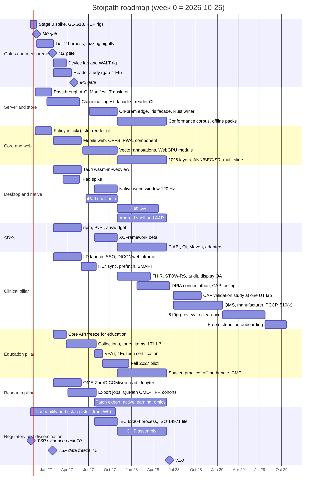
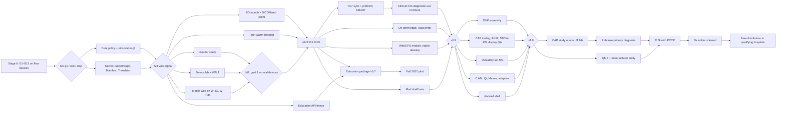

# Roadmap, milestones, team and estimates

Plan section for the Stoipath WSI viewer. Date 2026-10-24. Terminology, device classes (W-LAN, W-BB, W-4G, W-iPad, N-Desk, N-iPad, N-And), cache layers (L0–L5), metrics (NTF%, TTS, I2P, REF, CHS, BER) and gates (G1–G13, M0–M5) are those of `arch/recommended.md`; this section schedules them and does not change any figure. Tags: **[measured]**, **[model]**, **[estimate]**, **[unverified]**. Project start is **week 0 = Monday 2026-10-26**; every date below derives from it. Effort is in person-months (PM) of the *reference human team*; §8 says how that converts under agent execution.

## 1. Shape of the roadmap

Five phases, ordered by what must be known before the next dollar is spent:

| Phase | Weeks (dates) | Purpose | Release |
|---|---|---|---|
| **0. Stage 0: floors and go/no-go** | 0–3 (2026-10-26 → 2026-11-20) | Measure the four unmeasured terms the latency tables rest on (compositor floor, iOS Safari/Mali upload, A55 WASM decode, REF floors) on the worst devices; pass G1–G13; decide B vs its priced exits | none; **M0** |
| **1. Foundations** | 3–13 (→ 2027-01-29) | Server first (passthrough tiers A–C, two-pass ingest, Manifest, Edge Translator in both builds), core policy in `stoi-core`, `stoi-render-gl`, measurement stack; web alpha on desktop browsers | internal alpha; **M1** |
| **2. MVP** | 13–30 (→ 2027-05-28) | Mobile web beta on the floor devices (**M2**: goal 1 validated end-to-end on real devices), Tauri desktop (wasm in webview), npm/PyPI/anywidget, DICOMweb/IIIF/DZI façades, ≤8-channel fluorescence, QuPath GeoJSON; first clinical launch contract and the education API freeze; reader study | **MVP 0.5** (RUO) |
| **3. v0.x hardening** | 30–52 (→ 2027-10-29) | Education package and fall-2027 pilot; HL7 status sync as a prefetch feature; SMART adapter; vector-tile annotations; WebGPU module allow-listed; native wgpu desktop window; iPad shell beta (**M3-iPad**); on-prem edge binary; Rust `TILED_FULL` writer; IEC 62304 process formalised | **v0.7** (W39), **v0.9** (W52) |
| **4. v1** | 52–84 (→ 2028-06-09; range W78–W87) | iPad GA, Android shell + AAR (**M3-And**), C ABI/Qt/Maven and the viewer adapters (**M4**), versatility set (**M5**: 10⁶-object layers, DICOM ANN/SEG/SR, multi-slide affine sync, z/t, ICC, conformance corpus, offline packs), FHIR façade, STOW-RS write-back, display QA, audit/RBAC, collaboration, CAP-validation tooling; Design History File ready | **v1.0** |
| **5. Post-v1: Dx edition and free distribution** | 84–156 (→ 2029-10) | QMS and legal manufacturer; design partner with a cleared scanner; analytical/clinical validation; 510(k) with PCCP; UDI, labelling, post-market processes; qualification criteria and onboarding for free distribution; streaming mode; upstream programme; first annual re-decision of the JPEG-Zarr experiment | **Dx edition 1.0**; first free deployment |

Two principles decide the ordering. First, nothing with a latency claim is built before its floor is measured (Stage 0), and nothing native is built before the web build has passed M1/M2 on the floor devices (the delivery judge's condition 2). Second, every pillar ships first on the RUO viewer and is gated by a machine-checkable gate, never by a date: education can ship early because it needs no display pairing; clinical sign-out waits on the CAP study and then the Dx pathway.

## 2. Phase detail

### Phase 0: Stage 0 (weeks 0–3)

**Objective.** Prove that the §4.4 budgets of `recommended.md` close on the worst device *before* the policy is written. "Worst" is the W-4G class (3–4 GB Android, Mali-G52/G57 or Adreno 610, Chrome WebGL2, DPR 3→2) and W-iPad (2020 A12 iPad, Safari 60 Hz); Xclipse and Firefox Linux are correctness-only.

**Deliverables.** Repo scaffold (Cargo workspace + pnpm + Turborepo, nextest, Playwright, CI on three OSes; note 10 F2/F3); `stoi-render-gl` skeleton drawing 60 tiles from ≤64-layer 512² arrays with cross-level blend; Emscripten libjpeg-turbo module and worker pool; the per-frame **quality record**, the fiducial synthetic-slide generator and the camera-path DSL (note 10 F5); the Tier-1 deterministic headless-Chrome harness; a minimal input-to-photon rig (240 fps camera, ±4 ms; WALT by M2); CSS-transform REF page and raw Metal/Vulkan REF quads; gap-5 F9 server prototypes (translator hot path on a 2-vCPU container and in a Worker, shard geometry under replayed traces, EOT-at-open cost, R2/S3 cold first byte, HTJ2K decode on the W-4G device); the **T0 evidence pack** (§6).

**Exit criteria (all machine-checked, results committed as JSON).** G1 floor module ≤1.0 MB gz (target 0.6), full ≤1.3 MB; G2 cold compile + first frame ≤300 ms floor Android / ≤150 ms iPhone 12; G3 p99 frame ≤16.7 ms and G4 1…64-layer array correctness on W-4G, W-iPad, Xclipse, Firefox Linux; G5 ≤2 ms per 512² upload, no main-thread stall >8 ms; G6 Safari soak, 0 kills; **G7 1,000/1,000 decoder hash identity incl. arm64 (failure stops the plan)**; G8 `createImageBitmap` self-cert matrix; G9 worker pool ≥1.8×; G10 WebGPU-vs-WebGL2 goldens ≤1 LSB; G11 REF floors recorded for every lab device; G12 per-tile upload cost on iOS Safari and Mali-G52; G13 WASM libjpeg-turbo on an A55 core. Translator prototype: p99 ≤10 ms hot service time per container path (informational at M0, a gate from M1). G3–G5 failures are renderer bugs, not architecture exits; G1/G2 failure → dual-wasm; a measured trampoline/debug cost >0.5 ms/frame → the recorded TypeScript-renderer exit.

**Duration and team.** Two weeks of work plus one week of buffer for device procurement and the M0 review. 5.5 FTE: tech lead 1, Rust/graphics 2, Rust systems 1, performance/QA 1, backend 0.5. This is the first funded milestone and the hiring order (graphics seniors and the performance engineer first) is itself a deliverable.

### Phase 1: Foundations (weeks 3–13)

**Objective.** The only deployed latency data (MSK, +130 ms/FOV from request-time transcoding) blames the server, so the server comes first; the policy follows in the same quarter because the golden gesture replay needs both ends.

**Deliverables.** Server: passthrough tiers A–C (SVS/NDPI/Philips/BigTIFF/DICOM indexed in place), two-pass ingest writing the **brightfield canonical** (DICOM WSI `TILED_FULL`+EOT via wsidicomizer 0.31 passthrough) and the **multichannel canonical** (OME-Zarr 0.5 sharded, core codecs), level synthesis as new instances/shards, the ≤100 KB Manifest, Edge Translator as regional binary and Cloudflare Worker from one crate graph, bundles, capability tokens with path-only cache keys, PHI-tier bucket, third-party-reader CI smoke tests (wsidicom, pydicom, Orthanc, dcm4chee; zarr-python, zarrs, zarrita/vizarr, tensorstore). Core: full §4.1 policy in `tick()` (L\*, never-blank cascade, never-magnify-at-rest, fractional-LOD blend, prefetch with confidence-gated destination, scheduling), L0/L1 budgets with the §4.2 corrections, `stoi-telemetry`, golden gesture replay as a CI test. Web: alpha PWA on desktop Chrome/Edge/Firefox/Safari over the real translator. Tier-2 harness (Playwright tracing, `gpuBenchmarking` gestures, CDP network emulation) nightly on bare metal; 24 h fuzzing on SVS/TIFF/DICOM readers.

**Exit criteria (M1, week 13).** Cold, W-BB profile: TTS p50 ≤100 ms, p95 ≤300 ms (note 10 says p99 ≤250 ms; `recommended.md` §4.4 is canonical); NTF% during gesture ≤20 %, ≤1 level; blur-ms per gesture ≤150 ms; CHS ≥95 % on the pathologist path; prefetch waste ≤50 % (Stage-1 acceptance, §4.2 item 4); input-to-swap ≤ REF + 1 frame at p95 (Chromium LatencyInfo); W-LAN: TTS ≤50/≤100, NTF ≤5 %; semantic and software-raster goldens green on three engines; 24 h fuzz zero crashes; translator p99 ≤10 ms hot on all three container paths; every tile byte of a converted slide hash-matches the vendor file; the replay of one recorded gesture yields an identical request sequence on Chrome, Firefox and Safari.

**Duration and team.** 10 weeks; ramp from 5.5 to 9 FTE (add 2 web/TS, 0.5 backend, 0.3 pathologist advisor).

### Phase 2: MVP (weeks 13–30)

**Objective.** Validate goal 1 on the real floor devices with hardware input-to-photon, then ship the RUO viewer on every web platform plus desktop, Python and the first pillar contracts.

**Deliverables.** Mobile web on W-4G and W-iPad (DPR cap, moving tier, OPFS L2 as refillable cache, memory budgets from `set_budget`); WALT rig and the device lab (10–14 devices, note 10 F6); Tauri 2 desktop with wasm in the webview and local TIFF-JPEG/DICOM through the in-process core; `<stoipath-viewer>` with iframe RPC (no COOP/COEP); `pip install stoipath` (anywidget over the web bundle + PyO3 wheel); DICOMweb `frames/{list}`, IIIF and DZI façades; brightfield + ≤8-channel fluorescence; QuPath GeoJSON import/export and the OME-TIFF export job (QuPath cannot read Zarr v3, risk 12); OpenSlide as a server worker; OSD compatibility `TileSource` and OSD as the perf comparator; **education API freeze** (stable annotation/layer IDs with per-layer ACL, serialisable view state, typed event bus mapped to xAPI, geometry services, launch contexts, offline pack hook; gap-6 "core requirements"); **clinical MVP integration** (IID-style context launch + SSO + DICOMweb client + iframe embedding that survives Epic Hyperdrive; gap-7 rec. 1); the Stage-1 reader study (gap-1 F9, n ≈ 8–12, weeks 14–24) whose calibrated constants replace estimates at M2; the public perf dashboard.

**Exit criteria (M2, week 26; MVP release week 30).** On the weakest W-4G device: p95 frame ≤16.7 ms, NTF = 0 on warm cache, TTS p50 ≤250 ms / p95 ≤700 ms on the 4G profile, NTF ≤50 % and ≤2 levels during gestures, never a blank tile on the cellular-poor profile, blur-ms ≤300 ms; W-iPad: TTS ≤100/≤300, NTF ≤20 %, memory peak ≤60 % of the measured WebContent kill threshold, 30 min soak without jetsam; WALT drag latency ≤ REF + 1 frame at p95 on iPad and mid-range Android; the upload-budget row (§4.2 item 2) measured and inside the table; MVP: npm and PyPI install-from-registry smoke; iframe embed and the Jupyter widget meet the M1 gates; licence scan (permissive-only client), SBOM and signed artefacts on every channel; requirements-to-test traceability ≥95 % of tagged requirements.

**This is the earliest point at which the zoom-latency goal is validated end-to-end on real devices**: Stage 0 proves the *budget closes* (floors, upload, decode) on the worst device; M1 validates the *policy* end-to-end on desktop browsers with emulated networks and real input pipelines; **M2 (week 26, 2027-04-30) validates the product end-to-end on the W-4G and W-iPad devices with a photodiode rig**, cold and warm, over shaped networks. No external latency claim about mobile is made before M2 (risk 1).

**Duration and team.** 17 weeks; 10 FTE (9 core + 1 integration/education full-stack from week 16) + 0.5 pathologist + 0.5 instructional designer.

### Phase 3: v0.x (weeks 30–52)

**Deliverables.** *v0.7 (W39):* education package (collections, guided tours, MCQ and select-point items, region-marking item with keyboard/text alternative, LTI 1.3 Advantage with Deep Linking/AGS/NRPS, CVD-friendly LUT, WCAG 2.2 AA), HL7 v2 case/status sync in an integration service with **prefetch on ready-for-review** (gap-7's single most valuable early integration), SMART App Launch adapter, vector-tile annotations, OME-TIFF/DICOM export jobs, IDC/CAMELYON cohort browsing. *v0.9 (W52):* WebGPU module allow-listed per browser major after soak; Tauri native wgpu window at 120 Hz (N-Desk); iPad shell beta over UniFFI with D's present recipe (**M3-iPad**); on-prem edge binary behind Caddy/nginx and the Iris façade; Rust `TILED_FULL`+EOT writer replacing wsidicomizer where throughput demands; EOT-vs-concatenation default fixed from the VNA matrix; IEC 62304 process documentation and ISO 14971 risk file formalised on the traceability that has existed since week 0; third-party VPAT; 1EdTech LTI certification.

**Exit criteria.** v0.7: M1/M2 gates unchanged (no regression beyond the noise band without a recorded waiver); LTI launches into Canvas, Brightspace and Blackboard Ultra sandboxes pass the conformance script; the region-marking item scores by µm-aware geometry in CI; HL7 contract tests against Beaker-shaped sandbox messages. v0.9: N-Desk warm I2P ≤20/30 ms; N-iPad beta p99 frame ≤8.3 ms at 120 Hz on the pathologist path, WALT I2P ≤ REF-quad + 1 interval, Pencil events reflected within 1 frame; on-prem binary passes the same M1 suite behind nginx; the Rust writer is byte-identical to wsidicomizer on the corpus; WebGPU-vs-WebGL2 goldens ≤1 LSB on every allow-listed browser.

**Team.** 11 FTE (+1 iOS from week 34, +0.5 RA/QA from week 39).

### Phase 4: v1 (weeks 52–84)

**Deliverables.** iPad GA (XCFramework, SwiftPM binary target); Android shell + AAR (Vulkan allow-list, GLES retry; **M3-And**); C ABI (`stoipath.h`), Qt `QQuickItem` sample, Maven, OSD/OpenLayers/deck.gl adapters (**M4**); 10⁶-object annotation layers, DICOM ANN/SEG/SR, multi-slide affine sync, z/t, ICC, conformance suite with a published `TILED_FULL`+EOT / sharded-0.5 corpus, offline packs, all topologies incl. air-gapped (**M5**); FHIR façade (`ImagingStudy`, `ImagingSelection`, `AuditEvent`), STOW-RS write-back, DPIA Image Display actor and a connectathon, display QA module, audit/RBAC/break-glass, dictation co-existence, presenter mode and cursors; AI-host layer API with provenance; CAP-validation tooling (blinded re-review, case sampling, washout tracking, concordance export); research: patch/label export, active-learning loop, spatial-omics overlays, provenance records; education: spaced self-assessment, offline classroom bundle, cohort analytics, QTI 3 import, CME attestation/certificate/6-year export with PARS CSV; signed auto-updating desktop on three OSes; **Design History File assembled** (requirements, risk, SOUP/SBOM, V&V evidence from the device lab, usability file).

**Exit criteria.** M3-And: EGL present-time histogram p99 ≤1 vsync, Macrobenchmark `frameOverrunMs` P99 ≤0 for the Compose chrome, 2 h soak without LMK at ≥4× the web budget; M4: install-from-registry smoke on all seven channels, `cargo-semver-checks` and api-extractor clean, iframe without COOP/COEP meets M1, bundle within size-limit; M5: 8-channel 16-bit fluorescence meets M1/M2 on the same devices, two-slide sync ≤1.5× bytes, 10⁶-object layer within frame budget, conformance 100 % on IDC DICOMweb, IIIF 3 validators and OME-Zarr 0.5 fixtures; DHF review passes an independent RA audit; CRA/§524B artefacts (SBOM, vulnerability intake, signed update channel) live.

**Team.** 12–13 FTE (+1 Android from week 52, +1 Rust systems, +0.5 DevRel).

### Phase 5: post-v1 (weeks 84–156)

**Deliverables.** QMS procedures operating under 21 CFR 820 as amended by the QMSR (ISO 13485:2016 incorporated; in force since 2026-02-02) and a legal manufacturer entity (W84–W104); design partner with a cleared scanner and display; analytical bench tests per FDA's WSI technical-performance assessment and a pathologist concordance study; 510(k) under 21 CFR 864.3700 with a **PCCP** covering additional cleared scanners, formats and displays (the Proscia Concentriq AP-Dx August 2026 template); labelling, UDI, complaint handling, MDR reporting, recall and security-patch procedures; the free-distribution programme: published qualification criteria, onboarding and training kit, display-QA and IT-security attestations, licence and indemnification terms; streaming mode as a thin-client option; the gap-5 F8 upstream programme; first annual re-decision of the JPEG-chunk Zarr experiment.

**Indicative dates [estimate].** QMS live W104 (2028-10); 510(k) submission W117 (2029-01); clearance W135–W143 (2029-05 to 2029-07; the independent openFDA analysis puts the median Traditional 510(k) at ~151 calendar days receipt-to-clearance including applicant hold time); first free deployment to a qualifying hospital W143–W156 (2029-07 to 2029-10). Note 09's range for a standalone SaMD 510(k) is 12–24 months and roughly $0.5–2 M including QMS, IEC 62304, ISO 14971, IEC 62366-1, the §524B file and the study; this schedule sits at the fast end because the DHF is assembled during v1, not after it.

## 3. Milestone table

| ID | Week | Date | Milestone | Gate (machine-checked unless noted) | Human decision |
|---|---|---|---|---|---|
| **T0** | 0 | 2026-10-29 | TSP evidence pack (§6) | Tier-1 deterministic frames + prototype measurements + cost/provenance ledger committed | Owner approves abstract wording |
| **M0** | 3 | 2026-11-20 | Stage 0 exit | G1–G13 | Go / exit (TS renderer, dual-wasm) / stop (G7) |
| **M1** | 13 | 2027-01-29 | Web alpha; TSP data freeze (T1) | M1 gates §2; translator p99 ≤10 ms; replay identity on 3 engines | Confirm floor devices and lab list; regulatory posture memo signed |
| **M2** | 26 | 2027-04-30 | Mobile web beta: **goal 1 validated end-to-end on real devices** | M2 gates §2 incl. WALT; reader-study constants adopted | Approve first external latency claims |
| **MVP 0.5** | 30 | 2027-05-28 | RUO release: web, desktop (wasm), Python, npm, DICOMweb/IIIF/DZI, fluorescence ≤8 ch | M4-lite install smoke; licence/SBOM/signing; traceability ≥95 % | Release; **research pillar first usable** |
| **v0.7** | 39 | 2027-07-30 | Education package; HL7 sync + prefetch; SMART adapter | LTI conformance script; HL7 contract tests; no gate regression | **Education pillar first usable**; pilot course approval |
| **EDU-1** | 44 | 2027-08-30 | Fall-2027 pilot starts (UT Canvas or Brightspace site) | 1EdTech certification, VPAT, teaching-set pipeline log | Programme director sign-off |
| **M3-iPad / v0.9** | 52 | 2027-10-29 | iPad shell beta, WebGPU module, native desktop, on-prem edge, Rust writer, 62304 process | M3-iPad gates; on-prem passes M1 suite; writer byte-identity | Fix EOT/concatenation default; draft free-distribution qualification criteria |
| **CLIN-1** | 52 | 2027-10-29 | **Clinical pillar first usable (non-diagnostic)**: consultation, tumour board, QA, frozen-section *preliminary* consult at one UT site, RUO-labelled, in-house | Audit events, break-glass, HL7 sync, display-QA logging live | Site compliance approval (CLIA remote-review conditions; cytology excluded) |
| **M3-And / M4 / M5** | 78–84 | 2028-04-24 → 2028-06-09 | v1.0 | M3-And, M4, M5 gates; DHF audit | Release; decide Dx design partner |
| **CAP-1** | 87–104 | 2028-06 → 2028-10 | ≥60-case CAP validation at one UT CLIA lab per application, ≥2-week washout, real displays | Concordance export from the CAP tooling; revalidation triggers recorded | Lab director signs; **in-house primary diagnosis (routine H&E) begins** |
| **DX-0** | 104 | 2028-10-23 | QMS live; manufacturer entity; PCCP drafted | QMS internal audit | Board decision to submit |
| **DX-1** | 117 | 2029-01-22 | 510(k) submission | Submission package checklist | Counsel/RA |
| **DX-2** | 135–143 | 2029-05 → 2029-07 | Clearance [estimate] | — | Labelling, UDI, post-market plan active |
| **FREE-1** | 143–156 | 2029-07 → 2029-10 | First free deployment to a qualifying hospital system | Qualification checklist, onboarding tests, display QA attestation | Distribution committee |

## 4. Workstream swimlane

## 5. Dependency graph

Critical path to v1: Stage 0 → core policy → M1 → mobile web + lab → M2 → MVP → iPad beta → v0.9 → Android/M5 → v1. Critical path to free distribution: v1 → CAP study and QMS in parallel → 510(k) → clearance → onboarding. The two items that can slip everything are the graphics hires (they gate Stage 0 itself) and the design partner with a cleared scanner (gates DX-1).

## 6. The TSP milestone

The owner intends to submit to the Texas Society of Pathologists annual-meeting abstract competition. The programme's internal deadline for the abstract text is **2026-10-29 (week 0, Thursday)**; the TSP's own deadline could not be read from this sandbox (texmed.org and texpath.org refuse the proxy) and must be confirmed by the owner. The 103rd meeting was 2–4 Feb 2024 (Austin) and the 104th 7–9 Feb 2025 (Houston), so the 106th is expected in early February 2027 **[unverified]**, i.e. weeks 14–15, two weeks after M1.

**Earliest demonstrable milestone: T0 (2026-10-29).** It consists of what exists by then, nothing more: the Stage-0 prototype (synthetic pyramid, WebGL2 client, tile protocol) measured on (a) the Tier-1 deterministic headless-Chrome harness (per-frame deficit, TTS, NTF% on emulated W-LAN/W-BB networks against the standard 100k² fiducial slide and the standard pathologist path), (b) desktop Chrome real-input gestures via `gpuBenchmarking`, (c) whichever one Android phone and one iPad are physically available, with a 240 fps camera for I2P; the OpenSeadragon default-configuration baseline on the same slide and path (the comparator `recommended.md` names); and the **provenance and cost ledger** of the plan and prototype themselves (agent sessions, tokens, wall-clock, dollars, human review hours, every artefact hash-linked to the repository).

**What the abstract can and cannot claim.** It can claim: a measured, reproducible viewer benchmark (public synthetic slides, public gesture paths, public harness) with OSD as baseline; the cost and provenance of AI-built open tooling; that the stack runs on in-house hardware with no subscription. It cannot claim: mobile floor numbers (M2), diagnostic equivalence or non-inferiority (CAP study, 2028), or any patient-care impact; only de-identified public slides (CAMELYON16 CC0, IDC CC-BY) are used. The framing must be "method and preliminary measurements"; the dissemination section ("Autonomous execution model and dissemination plan") owns the text.

**Data freeze for the meeting: T1 = M1 (week 13, 2027-01-29).** By the meeting the talk or poster carries M0 (G1–G13 on the real floor devices, including the first REF floors and A55 decode numbers) and, if M1 passes on schedule, web-alpha TTS/NTF% against the canonical W-LAN/W-BB gates. If M1 slips, the presentation shows M0 plus the Tier-2 nightly trend; nothing else on the roadmap moves for the abstract.

## 7. Pillar readiness

| Pillar | First usable release | What it is | Gate that releases it | Later tiers |
|---|---|---|---|---|
| **Research** | MVP 0.5, W30 (2027-05) | Web viewer + `pip install stoipath` in Jupyter/Colab; direct OME-Zarr 0.5 and DICOMweb read; IDC/CAMELYON cohorts; QuPath GeoJSON; OME-TIFF/DICOM export; ≤8-channel fluorescence; provenance records | M1 + M2 + PyPI install smoke; reader CI on both canonicals | v0.7 cohorts and export jobs; v1 patch/label export, active learning, spatial-omics overlays, 10⁶-object layers, ANN/SEG/SR |
| **Education** | v0.7, W39 (2027-07); pilot W44 (fall 2027) | Collections, guided tours, MCQ/select-point/region-marking items, LTI 1.3 Advantage into Canvas/Brightspace/Blackboard Ultra, WCAG 2.2 AA, CVD LUT, on the RUO viewer (students use phones, so M2 is the gate) | M2 + LTI conformance + VPAT + teaching-set pipeline | v1 spaced practice, offline bundle, analytics, QTI import, CME attestation/export via joint providership |
| **Clinical, non-diagnostic** | CLIN-1, W52 (2027-10) | Consultation, tumour board, QA/second-read, frozen-section *preliminary* consult at one UT site; IID launch from the LIS, HL7 status sync, audit, break-glass, display-QA logging; RUO-labelled, in-house only, cytology excluded | v0.9 + audit/HL7 live + site compliance approval under CMS QSO-23-15-CLIA conditions | — |
| **Clinical, in-house primary diagnosis** | after CAP-1, W104 (2028-10) | Routine H&E sign-out at the validating UT CLIA lab on validated displays, Dx mode (Rendering Complete flag, pinned decoders) | v1 + ≥60-case CAP validation per application; FDA enforcement discretion for in-lab tools (LDT rule rescinded 2025-09-19) | Frozen and haematopathology as separate ≥60-case applications |
| **Clinical, distributed Dx edition** | DX-2/FREE-1, W143–W156 (2029) | Cleared viewer given free to qualifying hospital systems; PCCP for scanners/displays | 510(k) clearance; QMS; qualification criteria met | Tablets remain consultation-only until a display-agnostic clearance exists |

## 8. Team, FTE over time and the agent-execution translation

**Reference human team** (the delivery judge's synthesis, re-timed to this calendar):

| Role | W0–3 | W3–13 | W13–30 | W30–52 | W52–84 | W84–156 |
|---|---|---|---|---|---|---|
| Tech lead (shipped a GPU streaming or map engine) | 1 | 1 | 1 | 1 | 1 | 1 |
| Rust/graphics (wgpu, WGSL, WebGL2) | 2 | 2 | 2 | 2 | 2 | 1 |
| Rust systems (I/O, formats, codecs) | 1 | 2 | 2 | 2 | 3 | 2 |
| Web/TypeScript (Lit, workers, a11y) | 0 | 2 | 2 | 2 | 2 | 1 |
| Backend/infra (translator, CDN, Helm) | 0.5 | 1 | 1 | 1 | 1 | 1 |
| Performance/QA (lab, gates, WALT) | 1 | 1 | 1 | 1 | 1.5 | 1 |
| Integration/education full-stack | 0 | 0 | 1 | 1 | 1 | 1 |
| iOS (Swift/Metal) | 0 | 0 | 0 | 1 | 1 | 0.5 |
| Android (Kotlin/Vulkan) | 0 | 0 | 0 | 0 | 1 | 0.5 |
| Pathologist advisor / clinical lead | 0 | 0.3 | 0.5 | 0.5 | 0.5 | 1 |
| Instructional designer | 0 | 0 | 0.5 | 0.5 | 0.5 | 0.5 |
| RA/QA | 0 | 0 | 0 | 0.5 | 1 | 2 |
| DevRel/docs | 0 | 0 | 0 | 0 | 0.5 | 0.5 |
| **Total FTE** | **5.5** | **9.3** | **11** | **12.5** | **16** | **13** |

Hiring order is a gate, not a preference: the two graphics engineers and the performance engineer are hired before week 0 or Stage 0 does not start; iPad before Android; RA/QA by week 39 so the 62304 process is written by people who will be audited on it.

**Agent-executed configuration.** The programme is to be executed by AI coding agents with humans as reviewers and gate-keepers. Three honest statements govern the translation. (1) Person-months above measure *work content*, which does not shrink when an agent does it; what changes is who does it and at what cost per unit. (2) There is no calibrated conversion for this class of work (Rust graphics, codecs, device-level performance); the programme measures it from week 0: per merged PR, agent cost (tokens, dollars), wall-clock, human review minutes, gate pass rate and rework ratio are logged to the repository, and the PM-to-calendar conversion is recalibrated at M0 and M1. (3) The calendar is **not** shortened on an assumed speed-up. Code-heavy workstreams (core, server, shells, SDKs) may compress by 1.5–3× **[estimate, uncalibrated]**; the pacing items do not compress at all: device procurement, the reader study, LTI certification, connectathon dates, CAP study washouts, QMS stand-up, FDA review, and hiring the humans who own those. If measured throughput at M1 is ≥2× the reference team, v1 can be pulled to weeks 60–65 and the Dx submission by about one quarter; the gates do not change.

Human roster under agent execution: tech lead/architect and merge authority 1.0; graphics and performance lead who physically owns the device lab 1.0; Rust systems/security reviewer 0.5→1.0; product owner 0.5; pathologist 0.3→1.0; clinical informatics analyst 0.5 from week 16; instructional designer 0.5 from week 16; RA/QA 0.2→2.0; DevRel 0.5 from week 39. That is ≈4.5 FTE at Stage 0 rising to ≈7–8 by v1, with the agent pool sized by a cost ceiling per phase rather than by headcount. What agents cannot do in this plan: run the lab, recruit and run the reader study, sign CAP validations, be the legal manufacturer, file with FDA, negotiate content licences, or attest to display QA at a hospital.

## 9. Effort totals

| Line | To MVP (W30) | To v1 (W84), cumulative | Post-v1 to Dx clearance, additional | Basis |
|---|---|---|---|---|
| Viewer platform (core, renderers, codecs, web/desktop/native shells, server, ingest, annotations, SDKs, perf/QA, lab) | 55–65 | 150–170 | 20–30 (maintenance, streaming mode, upstream programme) | `recommended.md` §8 (delivery judge); proposal B §7 workstream table |
| Education package (collections, tours, items, LTI, a11y, analytics, CME export) | 6–8 | 16–20 | 4–6 | gap-6 feature map; LTI via library, content partnered |
| Clinical integration service (launch contract, HL7/FHIR, SMART, STOW-RS, audit, display QA, CAP tooling, dictation) | 3–5 | 14–18 | 6–10 (site interfaces) | gap-7 integration map |
| Regulatory, design controls, DHF (traceability from W0 ≈10 % overhead, 62304/14971/62366 files, SBOM/§524B) | 3–4 | 10–14 | 30–45 internal + external costs | note 09 F1 option D; note 10 rec. 8 |
| Reader study, pathologist time, content licensing, VPAT | 2–3 | 5–7 | 15–25 (CAP study support, concordance study) | gap-1 F9; gap-6 |
| **Total** | **≈70–85 PM** | **≈195–230 PM** | **≈75–115 PM** | |

Uncertainty: the delivery judge's ±25 % applies to the platform line; the pillar lines carry ±35 % because their scope depends on partner institutions. The bottom-up roster in §8 sums to ≈205 PM at v1 for the platform plus pillars, inside the range. External, non-labour costs are not in the table: device lab ≈USD 8–12 k capex; serving a few hundred dollars a month at 20 TB (note 09 F8); QMS/notified consultancy, 510(k) user fee, testing and the concordance study, which note 09 places at roughly USD 0.5–2 M for the whole Dx track **[estimate]**.

**Reviewer note (schedule, not architecture).** `recommended.md` §8 puts "design controls start" at v0.9. The owner's long-term aim requires the RUO phase to be run under design controls that later feed the DHF, so this section starts *lightweight* design controls (requirement IDs on tests, archived evidence per release, a living risk register, SBOM) at week 0 and reserves the v0.9 date for the *formal* IEC 62304 process documentation. This strengthens rather than contradicts the architecture. Likewise, Stage 0 is scheduled as weeks 0–3 rather than 0–2 to absorb device and rig procurement; the two weeks of engineering are unchanged.

## 10. What to cut if time is short

Ordered by least damage to the three goals and the three pillars; each cut names the measured trigger.

| # | Cut or defer | Saves | Why it is safe | Never cut |
|---|---|---|---|---|
| 1 | Android native shell → post-v1 | ≈10 PM, 2 months on the v1 path | The PWA already meets the W-4G gates at M2; N-And improves the floor only from 65/90 to 40/55 ms I2P | Stage 0 and its gates; G7 |
| 2 | WebGPU module → post-v1 | ≈5 PM | WebGL2 is the floor by design; WebGPU is an enhancement gated per browser major | The device lab, the quality record, the golden gesture replay |
| 3 | Native wgpu Tauri window → keep wasm-in-webview | ≈5 PM | Desktop meets W-LAN gates in the webview; 120 Hz is N-Desk polish | Design-control traceability from week 0 |
| 4 | 10⁶-object annotation layers → 10⁵ | ≈4 PM | Vector tiles at 10⁵ cover sign-out and teaching; 10⁶ is AI-overlay scale | Security scans, SBOM, signed releases |
| 5 | z/t stacks, multi-slide affine registration → manual sync only | ≈6 PM | Research pillar needs them later than cohort browsing does | Dual-standard canonical store and the reader CI |
| 6 | IIIF/DZI façades → DICOMweb only at MVP | ≈2 PM | OSD/IIIF users are served by the compatibility `TileSource` | Capability-token/path-only cache contract (cannot be retrofitted) |
| 7 | Qt sample, OSD/OpenLayers/deck.gl adapters → headers only | ≈4 PM | C ABI stability matters; samples do not gate anyone | Education API freeze at MVP (a fork later costs more than the freeze) |
| 8 | QTI import, SCORM export, CME certificate PDF → v1.x | ≈3 PM | LTI AGS carries grades; CME is partner-provided | LTI 1.3 and WCAG 2.2 AA (UT procurement gates) |
| 9 | Streaming mode, image search, voice navigation → unscheduled | ≈15 PM | All are "later" in gap-7 and `recommended.md` §9 | CAP-validation tooling before v1 (the clinical pillar's only route to diagnosis) |
| 10 | Compress the Dx track only by starting the design partner search at v0.9 | time, not PM | Every month saved before DX-1 is a month earlier for FREE-1 | QMS before any clinical distribution |

If the graphics hires slip more than three months, `recommended.md` §9 allows an OpenSeadragon-configuration stopgap for demonstrations only; it never becomes the engine and never carries a latency claim.

## References

- Architecture and corpus: `arch/recommended.md` (§3.1, §4, §5, §8–§10); `arch/B-rust-core.md` §7 (workstream effort table); `judge/ranking.json`, `judge/judgments.json` (delivery judge: ≈55–65 PM to MVP at month 6–7, ≈150–170 PM to v1 at month 18–20, 9 → 12–13 FTE); `research/10-dev-process-testing.md` (F1 team, F4–F6 harness and lab, §6 M0–M5 gates); `research/09-compliance-security-ops.md` (F1 regulatory options and costs, F5 token contract); `research/11-gap-1-pathologist-human-factors.md` (F9 reader study); `research/11-gap-2-rust-wgpu-web-core-viability.md` (§4.2 Stage 0); `research/11-gap-4-native-mobile-render-pipeline.md` (§4); `research/11-gap-5-canonical-store-and-tile-server.md` (F9 prototypes); `research/11-gap-6-education-modules.md`; `research/11-gap-7-clinical-integration.md`. The note `11-gap-8-fda-pathway-and-free-distribution` referenced by the task brief was not present in the research directory at writing time; the Dx-track dates here rest on notes 09 and gap-7 plus the sources below.
- FDA QMSR final rule (89 FR 7496, published 2024-02-02, effective 2026-02-02): https://www.federalregister.gov/documents/2024/02/02/2024-01709/medical-devices-quality-system-regulation-amendments ; summaries: https://emergobyul.com/news/us-fda-incorporates-iso-13485-within-its-qmsr-final-rule , https://www.cov.com/news-and-insights/insights/2024/02/fda-finalizes-rule-incorporating-iso-13485-into-new-quality-management-system-regulation-qmsr
- Proscia Concentriq AP-Dx 510(k) with PCCP (announced 2026-08-06; scanners, formats and displays addable without a new 510(k)): https://www.biospace.com/press-releases/proscia-receives-new-fda-510k-clearance-for-concentriq-ap-dx-with-predetermined-change-control-plan ; https://proscia.com/blog/keeping-digital-pathology-open-the-regulatory-framework-behind-concentriq-ap-dx ; https://www.captodayonline.com/proscia-gets-new-clearance-for-concentriq-ap-dx/
- 510(k) timing: MDUFA performance commitments https://www.fda.gov/media/191758/download ; independent openFDA analysis (median ~151 calendar days receipt-to-clearance, Traditional 510(k), Jan 2023–Sep 2026) https://www.complizen.ai/post/fda-510k-review-times-by-country
- CMS QSO-23-15-CLIA (revised 2025-09-23; remote review conditions, cytology excluded): https://www.cms.gov/files/document/qso-23-15-clia-revised-2025-09-23.pdf ; CAP WSI validation guideline (Evans et al. 2021/2022): https://www.cap.org/protocols-and-guidelines/cap-guidelines/current-cap-guidelines/validating-whole-slide-imaging-for-diagnostic-purposes-in-pathology ; FDA LDT rule rescission (2025-09-19): https://www.medtechdive.com/news/FDA-rescinds-LDT-final-rule/760645/
- Texas Society of Pathologists abstract competition page (unreachable from this sandbox; owner to confirm the 2027 deadline): https://imis.texmed.org/AMSiMis/TSPI/Events/Annual_Meeting/Abstract_Competition.aspx ; meeting-date pattern (103rd 2–4 Feb 2024 Austin; 104th 7–9 Feb 2025 Houston): https://gopathdx.com/tsp-103 , https://gopathdx.com/tsp-104
- Measurement and data: WALT latency timer https://github.com/google/walt ; CAMELYON (CC0) https://registry.opendata.aws/camelyon/ ; NCI Imaging Data Commons https://github.com/ImagingDataCommons/idc-index ; MSK deployment latency (Schüffler et al. 2022) https://doi.org/10.5858/arpa.2021-0197-OA ; zoom-burst statistics (Brunyé et al. 2023) https://doi.org/10.1371/journal.pone.0282616
- Standards on the roadmap: IHE PaLM DPIA Rev 1.4 (TI 2026-03-06) https://www.ihe.net/uploadedFiles/Documents/PaLM/IHE_PaLM_Suppl_DPIA_Rev1-4_TI_2026-03-06.pdf ; HL7 SMART App Launch 2.2.0 https://www.hl7.org/fhir/smart-app-launch/toc.html ; 1EdTech LTI 1.3 / LTI Advantage https://www.imsglobal.org/activity/learning-tools-interoperability ; wsidicomizer https://github.com/imi-bigpicture/wsidicomizer
