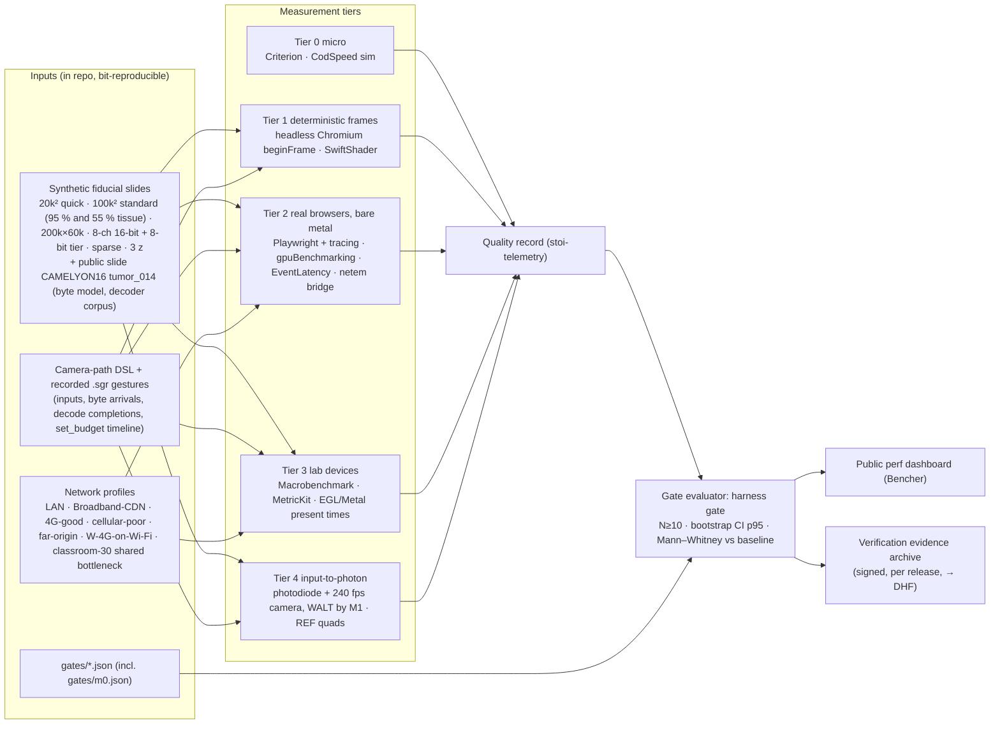
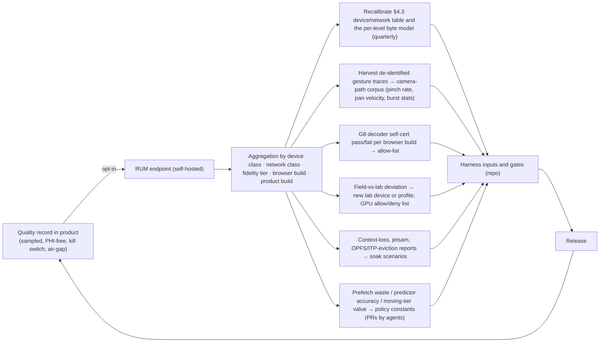

# Quality, testing and performance QA

Section 08 of the Stoipath WSI viewer development plan. Date 2026-10-24; revised 2026-10-25 against the four critics' issues (`critique/issues.json`) and the claims-verification report (`verify/README.md`, `verify/required-changes.json`). Corrections are marked inline as **(verified)**, **(adjusted after verification: was X)**, **(adjusted after critique: was X)** or **(unverified – Stage 0 gate)**. Terminology, device classes, gate viewports, latency figures and gate names are those of the recommended architecture as amended (`arch/recommended.md`, amendment 2: §3.2 safety class and the Dx boundary, §4.1 policy, §4.3 classes and byte model, §4.4 budgets and gate rows, §4.5 multichannel, §5 metrics and stage definitions, §8 Stage 0 G1–G13). The calendar is section 10's (`docs/plan/calendar.yaml`, ADR-0023): week 0 = Monday 2026-10-26, Stage 0 = three two-week sprints, **M0 = 2026-12-05** (week 6); M1 = week 13, M2 = week 26, MVP 0.5 = week 30 as section 07 carries them (adjusted after critique: this section said "Stage 0 (weeks 0–2)" and "M0 ≈ month 2"). Ownership: **this section owns gate definitions** (`gates/*.json`, `gates/m0.json`, `gates/waivers/*.json`); section 02 owns requirement text and the FR-/NFR- namespace (Stage-0 gates are NFR-G01…NFR-G13); section 10 owns paths, file names and the sprint calendar; section 11 owns the agent-loop roles and the TSP facts (B1); section 13 (*Regulatory pathway, QMS and free distribution*) owns the regulatory programme and the R0–R7 gates (`gates/reg/r*.json`). Where this section's figures differ from research note 10 §6 or from a pre-amendment plan section, the amended architecture's figures win and the difference is stated. Evidence tags follow the corpus: **[measured]**, **[model]**, **[estimate]**, **[verified]**, **[unverified]**.

## 1. Principles

1. **Goal 1 is a measured property, so the measurement stack is product code, not QA code.** "No blur, no pop-in" cannot be observed from outside on iPad Safari or a Mali-G52 phone: no GPU timers, no frame readback, lossy screen capture. `stoi-telemetry` therefore emits a per-frame **quality record** on every platform (per drawn tile: level wanted, level drawn, blend weight, upload age, provenance flag; per frame: input timestamp, `tick` duration, present timestamp, uploads and the upload budget in force, blank pixels, fade active, Rendering Complete, colour path; per gesture: TTS, BAT, BER, CHS, waste, **bytes per tile at L\*** — the field that re-fits the byte model (added after verification)). Every gate below reads that record; external instruments (Chromium traces, Perfetto, photodiode) exist to prove the record is honest and to measure what the engine cannot see (the platform floor).
2. **One behaviour everywhere is tested as one replay.** A recorded gesture, replayed through `tick()` with its recorded byte-arrival times, decode completions **and every `set_budget` / upload-per-frame change with its timestamp**, must produce identical **policy-level** output — request sequence, cancel sequence, TileKey/level/blend weight of every drawn tile, upload order by TileKey — on native, wasm and every shell. (array, layer) slot ids are a per-platform snapshot, never a cross-platform assertion (adjusted after critique: the pre-amendment recording captured the memory budget once, so the shell's frame-time AIMD controller made the number of uploads per `tick`, and hence the slot state, platform-dependent). This **golden gesture replay** is the operational definition of goal 1 across goal 2 and the single most important test in the repository.
3. **Gate on residency and sharpness, not frame rate alone.** A viewer can hold 60 fps while magnifying an ancestor. NTF%, blend-weighted resolution deficit (incl. its at-rest bound), BAT, warm-settle and cold-fill TTS, blank-pixel frames, pop-in count, CHS and BER encode goal 1; frame time and I2P catch jank and pipeline latency.
4. **Three measurement regimes.** Noise-free CI on hosted runners (instruction counts, deterministic headless frames); real browsers on owned bare metal with statistics; real devices in an owned lab with a hardware input-to-photon rig. Anything that produces a latency or frame-time number used in a gate runs on pinned, owned hardware. Cloud device farms are for compatibility only.
5. **The weakest device of each class defines the gate, at the class gate viewport**, and every latency gate is relative to the measured platform floor **REF** (CSS-transform page on the web, raw Metal / raw Vulkan+SurfaceView quad natively) on the same device and firmware, so we are never penalised for WebKit's 60 Hz cap or SurfaceFlinger's extra interval. Viewport geometry is part of every gate (adjusted after critique: "20 tiles" was a 1080p/DPR-1 laptop viewport applied to every class; W-LAN and N-Desk are evaluated on the sign-out persona's 4K display, phones at their DPR-2 cap).
6. **Every test is a design-control artefact from day one.** Each test names a requirement ID (section 02's FR-/NFR- namespace); the traceability matrix, SOUP list (the SBOM), anomaly list and verification evidence are generated by CI per release, so the Design History File for the later Dx edition is assembled, not reconstructed. The pixel pathway and case/slide identity are IEC 62304 **Class C** behind a crate boundary that CI enforces (recommended §3.2; plan §13 §3.4 and the "regulatory baseline" ADR), Class B/A elsewhere (adjusted after critique: "Class B assumed" is withdrawn; research note 11-gap-8 and plan §13 exist and this section's earlier caveat that they did not is deleted). What Class C changes for testing is stated in §11.
7. **Everything is machine-checkable.** Gates live in the repository as data (`gates/*.json`, validated by `packages/schemas/gate.json`: metric, device class, network profile, gate viewport, threshold, N, statistic); `harness gate` evaluates them in CI and an agent runs the same evaluation locally; the gate tables in sections 01/02/05/08/12 are generated from these files so constants cannot drift again (adjusted after critique: four constants — the upload-controller wording, the M0 main-thread limit, BER on W-4G, the 10⁶-object layer gate — had drifted between sections). Humans decide waivers (`gates/waivers/*.json`), threshold loosening, device-list changes and release sign-off; nothing else.

## 2. Test strategy per layer

| Layer (component, §3 of recommended) | What must be true | Test types and oracles | Tooling | Cadence |
|---|---|---|---|---|
| **Readers** (`stoi-source` TIFF/BigTIFF/NDPI/SCN/Philips, DICOM Part-10 `TILED_FULL`/EOT, Zarr v3 shards, IIIF/DZI/DICOMweb clients) | Byte-exact frame extraction for **Tier A/B** sources (vendor frames that divide 512: GT450 256² frames as ≤4 byte ranges per TileKey); **decoded-pixel identity** against tifffile/OpenSlide for **Tier C** sources (240² SVS, NDPI strips) through the lossless DCT-domain re-mux (adjusted after critique: "byte-exact tile extraction" and "hash-identical to vendor tiles" were false for 240² SVS, i.e. the TCGA corpus); no crash or hang on any input; identical results to community readers | Unit; property tests (every `TileIndex` resolves inside the object; EOT/IFD monotonicity; re-mux round trip: a re-muxed 512² tile decodes to the pixels of the stitched vendor tiles); **differential tests** against tifffile, opentile, wsidicom, OpenSlide 4.0.1, zarr-python/zarrs on the OpenSlide test corpus, CAMELYON16 (tumor_014 is staged) and IDC samples; **fuzzing** (§5) | cargo-nextest, proptest, cargo-fuzz + `arbitrary`, ClusterFuzzLite, pytest oracles in a GPL-isolated container | PR (unit, property, 60 s fuzz, corpus subset); nightly (full corpus, 24 h fuzz batch) |
| **Ingest** (wsidicomizer passthrough → brightfield canonical; `zarrs` → multichannel canonical; level synthesis; Manifest + Range Index build; derived tiers; de-identification) | Tier A/B frame bytes hash-identical to vendor frames; Tier C re-mux pixel-identical (the lossless re-tiling proof the PCCP needs); **Manifest ≤100 KB for the 100k² synthetic slide with the Range Index size recorded** (adjusted after critique: one ≤100 KB Manifest holding every tile's offset was arithmetically impossible — ≈51k tiles ≈ 0.8 MB — so the Manifest carries geometry, per-level object references and Base-Bundle offsets and the edge-resident Range Index carries `TileIndex → ≤4 × (object, offset, length)`); synthesised levels within tolerance of a reference downsample; **derived tiers** (`enc=m` moving tier, 8-bit multichannel preview) written at ingest with `provenance: derived`, never canonical; the per-level byte model (`bytes.perLevelMedian`, q85 4:2:0 and q90 4:4:4 separately) written and within 10 % of a re-measurement; label/macro/barcode never reach tier 0 (the label image is retained in tier 2 for the `/assoc/label` scope the clinical build displays); third parties can read the output | Hash identity per frame (A/B); pixel identity (C); Manifest and Range Index round trip; **third-party-reader smoke tests** (wsidicom, pydicom, Orthanc and dcm4chee STOW/WADO; zarr-python, zarrs, zarrita/vizarr, tensorstore); PHI-tier assertions (no `LABEL`/`OVERVIEW` instance in tier 0, no barcode string, no `ImageDescription` filename); derived-tier provenance assertions; idempotency and crash-restart tests of the two-pass pipeline; write-new-object + per-level pointer-swap race tests on MinIO (unchanged levels keep their URLs) | Containers per licence class; synthetic slides written to SVS-like TIFF at 240²/256²/512², NDPI-like, DICOM, OME-Zarr | PR (synthetic 20k² slide); nightly (100k² standard slide, tumor_014, vendor corpus, all readers) |
| **Edge Translator** (regional service, Cloudflare Worker, in-process library) | p99 ≤ 10 ms hot service time per path **at a stated load, ≤50 % utilisation**, on the target container (2-vCPU ARM, Graviton/Ampere) and in `workerd` (adjusted after verification: the gate had no load statement; measured p99 0.09–0.17 ms unloaded and ≤1.4 ms at 5.6–8.2k req/s on two pinned x86 cores for the Zarr-tile and DICOM-frame paths — an M/M/1 bound puts the limit at ρ ≤ ≈25–50 % for 1–2 ms service times; in the Worker build the "hot hit" is a Cache API hit, not an L4 RAM hit); the **15-tile bundle path uses pooled buffers and per-tile `pread` with vectored writes/sendfile** (a naive coalesce-read-slice-copy measured p99 8.7–9.2 ms, p999 14–48 ms, and fails the gate on a 2-vCPU ARM container (verified)); bundles correct; token validated and stripped from the cache key; `Origin` excluded; façades conformant; Dx-mode requests never receive derived objects | Criterion micro-benchmarks of offset arithmetic; load tests (k6/oha) sweeping utilisation 10–80 % with p99 per utilisation, on the ARM container and in `workerd` with the R2 binding mocked, then on Cloudflare with real R2; conformance suites (DICOMweb WADO-RS `frames/{list}` with `transfer-syntax=*`, IIIF Image 3 validator, DZI); cache-key tests against Cloudflare and CloudFront range semantics (1 MiB slices apply only to raw proxied ranges; raw range reads of >512 MB DICOM levels are uncacheable below Enterprise — the test asserts the hot path serves per-tile/bundle objects, never raw ranges through the CDN (verified)); R2 six-connection test (a seventh concurrent call is queued until headers return, not failed (verified)); fuzz of URL/range/Manifest/Range-Index parsing; fault injection (Toxiproxy latency, slow-close, 5xx); licence-class test that the IIIF off-grid resampler runs in a separate LGPL worker image, never in the translator binary (adjusted after critique) | axum test harness, k6, `workerd`, IIIF validator, dicomweb-client, Toxiproxy, `verify/artifacts/C22/edgebench` as the seed | PR (unit, conformance subset); nightly (load sweep, full conformance, fault injection) |
| **Engine** (`stoi-core`: model, camera, sched, cache, draw, telemetry; `stoi-dx` Class C verifier) | Deterministic state machine; policy invariants of recommended §4.1 hold; budgets close on a 128 MiB L0 at DPR 2 | **Golden gesture replay** (§3.2) native + wasm + shells; property tests of invariants: never blank (every viewport pixel covered by a resident ancestor); the **full ancestor chain** of every visible tile and the Pinned Base never evicted (adjusted after critique: was parent-only); tier-0 requests all issued in the first frame; cancel only below 30 % bytes; **BDP pacing** — total in flight ≤ ≈2 × BDP, prefetch ≤ ≈1 BDP, tier-0 always admitted (adjusted after critique: "prefetch ≤ 50 % bandwidth and ≤ 25 % slots" is withdrawn); uploads never target an array drawn in the last 2–3 frames (`cooling` slot state; 16-layer arrays); DPR cap keyed to the L0 budget, not the network class; **proptest "un-evictable + working set on a 128 MiB L0 at DPR 2 ≤ 85 % of slots" with worst-case tile counts** (15 L\* tiles on a 780 × 1,688 px viewport; adjusted after critique); memory-budget tests at 128/192/256/512 MiB; `tick` wall time ≤ 1–3 ms in wasm; semantic goldens of the draw list via `insta`; **Rendering Complete verifier fault injection** — a wrong-level, stale, wrong-slide or `enc=m` tile injected into the draw list must suppress the flag (the Class C independent check of recommended §3.2); **identity-mismatch contract test** — mismatched `LaunchContext.slideIds`/`studyUID` versus the Manifest slide hash and DICOM UIDs emits `identityMismatch` and draws nothing (HAZ-001 wrong slide or patient displayed; added after critique) | cargo-nextest, proptest, insta, wasm-bindgen-test in headless Chromium, CodSpeed simulation mode | PR |
| **Renderer** (`stoi-render-gl` web-sys WebGL2 floor; `stoi-render` wgpu native/WebGPU) | Pixels identical across backends within tolerance; texture arrays correct at 1…64 layers (16 the default unit); uploads within the effective budget `min(byte cap, time box ÷ measured per-tile cost)`; context loss recovered; transients bilinear on W-4G/W-iPad and bicubic only on W+/N, shaders budgeted by texel rate per class (adjusted after critique) | Golden images (§4): semantic, exact on software rasterisers, perceptual on real GPUs; WGSL→GLSL ≤ 1 LSB; WebGPU vs WebGL2 ≤ 1 LSB (G10); G4 array correctness — the sweep 1…64, 128, 256 passed with 0 bad layers on ANGLE/SwiftShader WebGL2 and WebGPU (verified), so Mali-G52/Adreno 610/A12 Safari remain the device test (wgpu #4081's multiple-of-16 effect is Mali/Adreno-only); **G5/G12 upload cost into (a) an idle array and (b) an array bound by the previous frame's draw, gate on (b)** (adjusted after critique: on tile-based deferred renderers — Mali, Adreno, Apple GPUs through ANGLE-Metal — `texSubImage3D` into a texture in-flight draws still reference forces a ghost copy or a pipeline bubble; 05 §14 cause #38); G3 variant with transients active over 50 % of the viewport; context-loss and visibility-change recovery; four-GPU-family suite before each wgpu bump | Playwright `toHaveScreenshot`, pixelmatch/odiff, SwiftShader, lavapipe, WARP, RenderDoc/Xcode GPU capture for triage | PR (software raster); nightly (T4, lab GPUs) |
| **Shells and UI** (Web Shell Lit component/PWA/iframe RPC, Tauri, SwiftUI, Compose) | Input reaches `tick` without added frames; **no service worker on the tile path** (no fetch handler at all, or Chrome's Static Routing API `addRoutes` where available; adjusted after critique: "SW off the hot path" had no mechanism — a fetch handler intercepts cross-origin tile fetches too; the 2017 "50/250 ms cold start" figures are stale, 12 ms median measured on x86 Chromium 153, a 2024+ phone plausibly 30–60 ms (verified)); OPFS L2 as **one shard file per slide with kept-open `FileSystemSyncAccessHandle`s** (reads p50 ≤0.2 ms vs 1.0–1.2 ms open+read+close (verified)); embeds work without COOP/COEP or third-party cookies (iframe matrix verified: an isolated page inside a plain host loses SAB, a plain iframe inside a COEP host is blocked); keyboard parity; WCAG 2.2 AA | E2E functional (Playwright 3 engines, WebView2, XCUITest, Compose test, Appium on farms); gesture tests through the real input pipeline; **Tier-2 assertion that no tile request shows a service-worker timing span** on Chromium and WebKit; iframe-in-Hyperdrive-like harness (no cookies, cross-origin; the thin controller iframe hands off to a top-level window or the Tauri shell); accessibility (§7); soak (2 h random walk; memory growth measured per process — GPU Process + WebContent on iOS — with layers filled, not merely allocated; jetsam/LMK); **ITP eviction test**: script storage deleted after 30 operating days without interaction for an ordinary origin, 7 only for link-decoration-flagged origins, installed Home-Screen web apps exempt (adjusted after verification: was "7-day eviction"; WebKit trunk read, shipping Safari 27 behaviour unconfirmed — observed on a lab iPad over 30 days of use) | Playwright 1.64, XCUITest, Macrobenchmark, Appium 3 | PR (smoke); nightly (full); weekly (farm, soak) |
| **SDKs and bindings** (npm, PyPI/anywidget, crates, XCFramework/UniFFI, AAR, C ABI) | Installable from each registry into a clean project; API stable under semver; identical engine behaviour through every binding; worker pool `clamp(hardwareConcurrency − 1, 1, 3)` behaves as specified (Safari reports `hardwareConcurrency` 4 or 8, so the clamp is always 3 there; an hc = 2 Android device gets 1 worker = offload only (verified); the desktop exception is ADR-0029) | Install-from-registry smoke on all channels; `cargo-semver-checks`, `@microsoft/api-extractor`, `publint`, `arethetypeswrong`; replay-through-binding tests (the same `.sgr` recording via C ABI, UniFFI Swift/Kotlin, PyO3 gives the same policy-level sequence); size-limit budgets (G1, decimal MB) | Release pipeline, maturin/cibuildwheel, SwiftPM, Gradle | PR (API reports); release (install smoke) |
| **Product builds and regulatory checks** (Stoipath Viewer RUO, Stoipath Learn, the in-house clinical build, Stoipath Dx — four artefacts from one commit set, plan §13 Decision 3; added after critique) | Viewer and Learn carry **no clinical surfaces** (no HL7/FHIR write-back, no `signoutRequested`, no Dx gate) and assert the RUO string; only the in-house clinical build and Dx carry them; Class C crates depend only on Class C crates; a Dx-train release whose `pathway_hash` changed without a signed change-assessment memo does not ship; forced security updates never change `pathway_hash` | **Build-flag matrix test** (feature × artefact; each clinical surface asserted absent or present by symbol scan and API probe); layering test over `cargo metadata` (ADR-0014) and `cargo deny` features; `pathway_hash` and `build_hash` recomputed from the build and checked against the cleared-configuration register; `gates/reg/r*.json` evidence files produced by CI for R0–R7 (gate text owned by plan §13 §3.10) | `xtask check`, `cargo deny`, `harness gate` | PR; release |

Pillar coverage: the clinical pillar is served by the Edge Translator conformance suites, the third-party-reader tests (VNA readability is a CI assertion), PHI-tier assertions, the identity-mismatch and verifier fault-injection tests, Dx-mode determinism (§4), the build-flag matrix and the design-control hooks (§11); the research pillar by the differential tests against the Python toolchain, OME-Zarr fixtures, the multichannel fixture with its 8-bit derived tier, replay-through-PyO3 and the published benchmark; the education pillar by the accessibility gates (§7), offline-pack goldens incl. the installed-PWA path on iPad, the classroom shared-bottleneck profile and the low-bandwidth profiles (§3.7).

## 3. The performance-regression harness

### 3.1 Synthetic deterministic slides and the public byte-model fixture

Synthetic slides are generated, not sampled, so they have known ground truth and no licence or PHI friction. The Stage-0 generator (`gen_synthetic_pyramid.py`: seeded procedural H&E-like texture, 512² JPEG q85 4:4:4, 2× pyramid, seam-consistent per-tile nuclei) is extended in Stage 0 with: **fiducials that encode level, column and row** (a 2-D barcode and micro-text in each tile corner) and a **Siemens-star sharpness target every 2,048 px**, so any screenshot can be decoded to prove exactly which level was drawn where, independently of the renderer's own record; a **colour-patch strip** (sRGB and scanner-ICC-tagged ColorChecker-like patches) for §4; and **16-bit multichannel** variants with known per-channel histograms **plus their ingest-derived 8-bit windowed tier** (recommended §4.5). Parameter set: 20k² (PR), 100k×100k (standard gate slide, in a 95 %-tissue and a 55 %-tissue variant so the Base Bundle is measured at both — the tissue-dense square Stage-0 pyramid measured **9.5 MB** for its 85 ≤4096-px tiles at q85 4:2:0 against ≤5 MB modelled at ≤55 % tissue (verified)), 200k×60k (elongated, > 4 GB level → tests Concatenation/EOT), 8-channel 16-bit 40k², sparse tissue (90 % glass), 3 z-planes. Each is written to every supported container: SVS-like tiled TIFF **at 240² (Tier C), 256² (Tier B) and 512²** (adjusted after critique: the 512-only fixture never exercised the passthrough case), NDPI-like strips, Philips-like padded TIFF, DICOM WSI `TILED_FULL`+EOT (wsidicomizer 0.31, incl. one concatenated level), OME-Zarr 0.5 sharded (zarr-python 3.4, zstd), DZI (pyvips). Generation runs in a pinned container with fixed seeds and encoder versions; the output hashes are committed, so goldens stay valid across machines.

Synthetic texture does not compress like tissue, so the **byte model is fitted on a public slide**: CAMELYON16 tumor_014 (CC0; 214,016 × 97,792 px, 2.2:1), 150 random dense 5 × 4 viewports — dense H&E 512² tiles **95 KB p50 at q85 4:4:4** (90 KB Huffman-optimised), **117 KB at q90 4:4:4** (102 KB optimised), 76 KB at q85 4:2:0 and for vendor q80 4:2:0 passthrough; 20-tile fill 1.85/1.95 MB p50/p90 at q85 4:4:4, 2.29/2.40 MB at q90 4:4:4; moving tier (q75 4:2:0, 64 KB/tile) 0.55–0.68× of the settled tier (verified; the flat "≈80 KB per tile, 1.6 MB per fill" is withdrawn everywhere). The same slide's 139 tiles × 5 encoder tiers form the committed 695-file decoder-identity corpus (`verify/artifacts/C12/corpus`, §4). No section may quote a flat per-tile figure; the Manifest's `bytes.perLevelMedian` and the quality record's bytes-per-tile field are the only sources.

### 3.2 Camera paths and the golden gesture replay

Two input forms drive every tier. The **camera-path DSL** (JSON: `pinch(anchor, scale, duration, easing)`, `pan(velocity, duration)`, `fling`, `wheel(steps, interval)`, `jump`, `dwell`, `key(…)`) is synthetic and parametrised; three executors consume the same file: Chromium `chrome.gpuBenchmarking.pinchBy/smoothScrollBy/smoothDrag/swipe` (real input pipeline), CDP `Input.*`/WebDriver for Firefox and WebKit, and XCUITest `pinch(withScale:velocity:)` / UiAutomator natively. The **recorded gesture** (`.sgr`) is captured from a real session: input samples with timestamps, viewport, DPR and gate geometry, the initial memory budget **and every subsequent `set_budget` / upload-per-frame change with its timestamp**, every `on_bytes` event with its arrival time and size, every `on_decoded` completion. Replay sets the host clock from the recording and feeds `tick()`; the assertion is an identical **policy-level `FrameOut` sequence** — requests, cancels, per-tile (TileKey, level, blend weight), upload order by TileKey — across `cargo nextest` (native), wasm-bindgen-test in headless Chromium, and the shells via the C ABI and UniFFI; the (array, layer) slot assignment is diffed only against a per-platform snapshot (adjusted after critique: the frame-time AIMD controller changes how many uploads a `tick` emits, so slot ids cannot be a cross-platform golden). Recording arrival times and the budget timeline is what makes the claim exact rather than "same first-frame requests" (the delivery judge's objection).

The **standard pathologist path** is parametrised from the measured literature (note 11-gap-1; every figure verified verbatim in Brunyé 2023 and Kayser/Wienert 2009): low-power survey ≈ 4.5 s, ≈ 3 ROIs, ≈ 17 zoom bursts per slide, 66.4 % of magnification-change events ≥ 5× (34 % of bursts span < 2.3 levels), 196 ms **minimum** inter-burst gap, slow edge-following pans at ≤ 1 viewport per 500 ms, ≈ 20 % of moves changing magnification. Two usage corrections (adjusted after verification): **196 ms is a dataset minimum over 21,416 mouse-wheel events in a desktop DeepZoom viewer, used as a deadline, not a typical lead**; and the prefetch lead is a distribution, not the point value 155 ms — at 3.33 levels/s and a log-uniform start scale it is ≈ U(0, 300) ms (p25 75 / p50 155 / p75 225 ms), ≈ 85 ms median at a plausible phone pinch rate of 6 levels/s — so the harness reports BER against the burst-end instant and against the p25 lead, and prefetch is sized to the p25. The 100 ms TTS p50 target itself has no pathology evidence (HCI-generic); the gap-1 F9 reader study in **Stage 1** (= the M1→M2 window, recommended §5) is its only refutation path. Trainee (more coverage, more high-power dwell) and second-opinion (short, low-power, meander) variants are kept because telemetry is stratified by experience; pinch dynamics are unmeasured in pathology **[unverified]**, so Stage-1 gesture logs (§10) replace the assumed 3.33 levels/s.

### 3.3 Metrics collected

| Metric (recommended §5) | Definition | Primary source | Cross-check |
|---|---|---|---|
| **NTF%** | Share of presented frames with any visible pixel sampled from a level coarser than L\* **as an unblended magnified ancestor**; a pixel sampled from the blended parent at its fractional weight is *not* NTF (adjusted after critique: under the trilinear blend the old definition made NTF ≈ 100 % at rest, or silently exempted the blend); split *during gesture* / *after last input* | quality record | fiducial decode of Tier-1 screenshots |
| **Resolution deficit** | Per frame, area-weighted mean and max of `log2(wanted density / drawn density)` **including the blend weight** (`f · log2 s_parent`), clamped at 0 (octaves); **at-rest gate ≤ 0.15 octave** area-weighted (added after critique: this is where the blend's softness — the blur a pathologist at 20–40× reports — is measured) | quality record | Laplacian variance on Siemens stars; trilinear vs pure-L\* bilinear at s ∈ [0.5, 0.75] on the star goldens and in a gap-1 F9 reader-study arm |
| **BAT** | Σ (levels coarser than L\*) × (viewport area fraction) × frame time, level·s per interaction, **fade time included**; *blur-ms* = time with max deficit > 0.5 is a derived scalar | quality record | — |
| **TTS** | Last input → first frame in which every visible pixel is sampled from L\* or its blended parent, i.e. **at fade start** (adjusted after critique: "NTF = 0 and no fade in progress" made the ≤ 50 ms W-LAN gate unreachable whenever any tile landed after the last input); reported as **warm-settle TTS** (settles that hit L0/L1 — the CHS population), **cold-fill TTS** (settles that miss L2/L3, at the class network) and **overall** (reported, not gated) | quality record | screenshot fiducials |
| **BER** | Fraction of the destination level's L\*+1 window resident at burst end (burst = zoom events ≤ 196 ms apart); also reported at +500 ms | scheduler record | — |
| **Blank-pixel frames**, **pop-in count** | Frames with any unpainted viewport pixel (must be 0); **any unfaded change of drawn level at a pixel after the last input** (one landing rule: every level change is faded, ≤ 3 frames / 50 ms on a settled frame, ≤ 100 ms during gestures; adjusted after critique: was "≥ 1 level without a ≥ 100 ms cross-fade") | quality record | screenshot |
| **CHS**, **prefetch waste**, **bytes/requests per gesture**, **bytes per tile at L\***, **overfetch ratio**, **predicted-vs-actual destination**, **in-flight bytes vs BDP** | Cache-hit at settle; prefetched-and-evicted-unused bytes ÷ prefetched (moving-tier bytes included); transferred ÷ visible bytes; in-flight ÷ `bw_ewma × rtt_p50` | scheduler record, `PerformanceResourceTiming` / native client | Edge Translator logs via frame-id echo; Manifest `bytes.perLevelMedian` |
| **I2P** | Input hardware timestamp → photon, **pointer and wheel reported separately** (Chromium delivers non-passive wheel rAF-aligned: input→`tick` ≈ 27 ms, not 4–16 (verified)) | Tier 4 rig; Chromium `EventLatency`/`LatencyInfo` (`INPUT_EVENT_LATENCY_ORIGINAL_COMPONENT` → `..._GPU_SWAP_BUFFER_COMPONENT`) as input-to-swap; Event Timing in Firefox/Safari as `processingEnd` → next paint; `CAMetalDrawable.presentedTime`, `eglGetFrameTimestampsANDROID` natively | REF quad on the same device |
| **Frame time p50/p95/p99, dropped %** | Chromium Graphics.Smoothness definitions; native present-interval histogram | trace / record | Macrobenchmark `frameOverrunMs`, MetricKit `scrollHitchTimeRatio` |
| **Upload bytes/frame, upload budget in force, per-upload GPU-side cost, decode p95, main-thread block/frame** | From the record, the AIMD controller's state and worker timings | record | timer queries where available (§3.5) |
| **Memory peak** | JS heap + L0 texture bytes from our allocator **and measured process RSS per process** (GPU Process + WebContent on iOS; renderer + GPU process in Chromium; RSS + GPU natively; RSS is 1.3–1.8× nominal texture bytes on ANGLE, each ImageBitmap L1 tile ≈ 1.08 MiB of renderer RSS invisible to `performance.memory` (verified)) | record | `os_proc_available_memory`, Xcode Instruments, `dumpsys meminfo`, JetsamEvent logs |
| **TTFF**, **TTLS**, **slide switch** | **TTFF** = URL/launch → first frame drawing thumbnail + levels ≤ 1024 px with input accepted; **TTLS** = worklist click incl. token exchange → first L\*-sharp frame at the launch viewport (adjusted after critique: replaces this section's TTFSV, 01's TTFI and 12's launch metric, which disagreed); Navigation Timing / native | record | Server-Timing |

### 3.4 Measurement tiers

| Tier | What | Tooling | Signal | Cadence |
|---|---|---|---|---|
| 0 | Micro: decode, `JPEGTables` splice, Tier C re-mux, scheduler decisions, eviction, Manifest/Range-Index lookups, Edge Translator offset arithmetic | Criterion 0.8 / Divan (Rust), tinybench (TS); CodSpeed `mode: simulation` (instruction counts) or Bencher thresholds | noise-free | PR |
| 1 | Deterministic frames: camera path in headless Chromium, one `HeadlessExperimental.beginFrame` per virtual vsync with `--run-all-compositor-stages-before-draw --enable-gpu-benchmarking`, SwiftShader, screenshot + quality record per frame; mitmproxy replay of recorded tile responses so the server contributes zero variance | CDP, Playwright, SwiftShader | exact: *which level on which frame*, not how long | PR |
| 2 | Real browsers on bare metal: `browser.startTracing` (categories `input, cc, viz, gpu, benchmark, disabled-by-default-devtools.timeline.frame`), gestures via `gpuBenchmarking`, network shaped by the **lab netem bridge** for gate runs (real TCP, so slow start, loss and reordering are real; CDP `Network.emulateNetworkConditions` has no slow start and is smoke-only — adjusted after verification), `Emulation.setCPUThrottlingRate` (smoke only, never a gate); Firefox/WebKit via in-page `PerformanceObserver` `event` entries and rAF deltas; service-worker-span assertion on tile requests | Playwright 1.64, Chromium EventLatency, Bencher | input-to-swap, frame time, all record metrics | nightly, N ≥ 10 |
| 3 | Lab devices, mobile browsers and native shells: Android Macrobenchmark `FrameTimingMetric`, Perfetto `trace_processor` SQL, `EGL_ANDROID_get_frame_timestamps` for SurfaceView present times (Perfetto FrameTimeline does not cover SurfaceView); iOS `XCTOSSignpostMetric`/`XCTClockMetric`, MetricKit, `addPresentedHandler`, `gpuStartTime/gpuEndTime`, Xcode Instruments for GPU Process footprint; mobile Safari via XCUITest + in-page telemetry; thermal state checked before each run | adb/USB hub on self-hosted runners | real GPU, thermal, memory | weekly; pre-release |
| 4 | Hardware input-to-photon (§3.8) | photodiode + 240 fps camera from Sprint 3; WALT-class rig by M1 | ground truth and REF floors | per release; whenever the input or present path changes |

Hygiene that decides whether the numbers mean anything: fixed brightness, airplane mode plus lab Wi-Fi or wired, thermal cool-down with `ProcessInfo.thermalState` / `PowerManager.getCurrentThermalStatus` checks, no adaptive refresh unless the scenario tests it, battery > 50 % or powered, N ≥ 10 runs per scenario, bootstrap confidence interval on p95 and Mann–Whitney against the per-device baseline, alerts on *shift* rather than single-run thresholds (Bencher boundary thresholds implement this); every result file records device model, OS build, browser build, thermal state and host load (the verification pass's own CPU-side numbers were upper bounds because the box ran at load 5–18).

### 3.5 GPU timestamps

GPU timing is a lab tool, not a fleet tool. `EXT_disjoint_timer_query_webgl2` exists only in desktop Chrome **[verified BCD]**; WebGPU `timestamp-query` is quantised in Chrome unless `--enable-webgpu-developer-features`, fine-grained on Apple-silicon Safari 26+, absent in Firefox **[verified source, gap-3]**; native wgpu/Metal/Vulkan give real timestamps. Policy: the upload budget is set by the **frame-time AIMD controller** (05 §8: halve on an overrun, grow after 30 clean frames), **timer queries are telemetry only** (adjusted after critique: this section's "online budget from timer queries" wording is superseded); per-frame aggregates (upload batch time, draw time) on Chrome desktop and natively feed the G5/G12 gates and the per-upload GPU-side cost that detects TBDR ghost copies in production; per-tile GPU timing is never a gate on the web. Where no timer exists the record uses CPU-side timing around the upload call and the present timestamp. One public iOS data point already exists and is marginal for G5: WebKit bug 260460 (iPad 9th gen A13, iOS 16.6) ≈ 2.25 ms/MiB via `texSubImage2D(ImageBitmap)` ⇒ ≈ 2.3 ms per 512² tile (adjusted after verification: was "per-tile cost on iOS Safari unmeasured"); "14 ms per upload call" is bug 234920 (iPhone 12 Pro, iOS 15.2) and "72 ms per frame" is bug 235043.

### 3.6 Device farm composition and procurement dates

Own lab (self-hosted runners; replace models as the market moves) mapped to the canonical classes:

| Class | Devices (≥ 1 each) | Why |
|---|---|---|
| W-LAN / N-Desk | Intel-iGPU Windows laptop; Windows 11 workstation with a 27″ 4K display and a 120–144 Hz panel (the Dx 1.0 platform and the sign-out persona's geometry); Linux box with AMD or NVIDIA GPU; NUC; on-prem Edge Translator on the lab switch | weakest desktop GPU defines the W-LAN gate; 4K/DPR-1 is the gate viewport; 120 Hz for N-Desk |
| W-BB | MacBook Air (Safari and Chrome); Windows arm64 laptop | Safari W60 tier; WARP/arm64 coverage |
| W-4G | 3–4 GB Android 12–13 with Mali-G52/G57 (60 Hz); Adreno 610 device; Exynos Galaxy with **Xclipse** (WebGL2 only, WebGPU blocklisted); Android 11 device (no WebGPU) | the floor device defines every mobile-web gate; also runs the W-4G-on-Wi-Fi profile |
| W-iPad | 2020 iPad 8th gen (A12, 3 GB) on iPadOS 26; an iPad still on iPadOS 17/18 | WebKit 60 Hz cap, GPU Process + WebContent footprint, L0 192 MiB |
| N-iPad | iPad Pro M-series 120 Hz with Apple Pencil (hover-capable) | M3 gate; UIKit touch-delivery rate (G11) |
| N-And | Pixel 8/9 (Perfetto, Macrobenchmark reference); mid-range 120 Hz Android; Snapdragon Galaxy | 120 Hz pacing, Vulkan/GLES retry, device allow-list |
| Reference | iPhone 12 (G2), iPhone SE-class | compile-time and memory floors |

**Procurement is a week-0 purchase, dated** (adjusted after critique: the gates that need the floor devices run in November, while earlier drafts bought the lab at M1): floor Android (Mali-G52/G57 or Adreno 610, 3–4 GB) and a 240 fps camera **before 2026-10-28** (the T0 evidence pack depends on a phone being on the bench on 28 Oct); 2020 iPad (A12), iPhone 12, an Xclipse Galaxy and the photodiode rig **before 2026-11-24** (Sprint 3, G11); the WALT-class timer **by M1**; the remaining classes by M2. Thirteen to fifteen devices ≈ USD 8–12k capex plus ≈ 0.2 FTE ops **[estimate]**; the Mac mini, NUC, Windows and Linux runner boxes ≈ USD 4–5k **[estimate]**. Cloud farms cover the compatibility matrix, never latency gates: AWS Device Farm is USD 0.17 per device-minute or USD 250 per unmetered slot per month **[verified AWS pricing page, 2026-10-24]**; BrowserStack App Automate is ≈ USD 199–249 per parallel per month according to third-party listings **[unverified; vendor page not read]**. Budget two slots or parallels ≈ USD 500/month for weekly runs of the functional suite across the long tail of OS versions and GPUs.

### 3.7 Network emulation profiles

Profiles reproduce recommended §4.3's network columns (one input set — adjusted after verification: §4.3 and §4.4 carried two RTT sets, and a 19 ms first byte sat below a 25 ms RTT; first byte is now 32/83 ms on W-BB/W-iPad and 67/306 ms on W-4G, with a modelled TCP slow-start term of ≈ +85–110 ms per burst at the p50 conditions and ≈ +450 ms at the W-4G p95 condition unless the server disables `tcp_slow_start_after_idle` or QUIC preserves cwnd). They are applied at a lab bridge (`tc qdisc netem` on a Raspberry Pi between the Wi-Fi AP and the lab Edge Translator — the only option for real phones and the one that keeps TCP real), at the browser (CDP, smoke only) and at the server (Toxiproxy for faults). mitmproxy record/replay removes server variance from client measurements. The p95 radio values are **[unverified assumptions]** until verification item D8 (a day of 1,000+ fetches on commercial 4G/5G, home broadband and campus Wi-Fi) replaces them.

| Profile | RTT p50 / jitter | Down / up Mbps | Loss | Maps to | Used for (gate rows of §9) |
|---|---|---|---|---|---|
| LAN | < 1 ms / 0 | 1,000 / 1,000 | 0 | W-LAN, N-Desk | warm I2P; warm-settle TTS ≤ 50/100; cold-fill ≤ 130/220 at 1080p, ≤ 220/380 at 4K (N-Desk ≤ 50/80, ≤ 90/130); NFR-P14 slow pans |
| Broadband-CDN | 25 ms / ± 5 | 100 / 20 | 0 | W-BB, W-iPad, N-iPad | warm-settle TTS ≤ 100/300; cold-fill ≤ 380/1,300 (W-BB), ≤ 500/1,300 (W-iPad), ≤ 450/1,650 (N-iPad); NFR-P14 at 1080p holds at this profile only |
| Broadband-p95 | 50 ms / ± 10 | 20 / 5 | 0.1 % | tail of W-BB | NTF% ≤ 20 %, ≤ 1 level; the p95 cells of the cold-fill rows; slow pans at 1080p need 30–37 Mbps and do **not** hold here, which is why NFR-P14's W-BB clause is 1080p at the p50 profile (adjusted after critique) |
| 4G-good | 45 ms / ± 15 | 25 / 5 | 0.5 % | W-4G, N-And | warm-settle TTS ≤ 250/700; cold-fill ≤ 650/2,900 at the DPR-2 settled fill (centre 9 ≤ 600/2,600); moving tier; BDP test (tier-0 first byte ≤ RTT + 1 BDP while prefetch saturates) |
| Cellular-poor | 200 ms / ± 60 | 5 / 1 | 1 % | W-4G p95 | never blank, ≤ 2 levels, BAT bound; the p95 cells of the W-4G cold-fill row |
| W-4G-on-Wi-Fi (added after critique) | 25 ms / ± 5 | 100 / 20 | 0 | 3 GB phone on classroom or hospital Wi-Fi | the L0-keyed DPR cap and the 85 % working-set proptest bound on an unmetered link — the education pillar's main configuration |
| Classroom-30 / follow-me-30 (added after critique) | 25 ms / ± 5 behind a 100 or 300 Mbps access point shared by 30 clients | 100 or 300 shared | 0 | 30-seat virtual-microscopy lab; 30-viewer tumour board | shared-bottleneck gate: 30 × ≈ 2.5 MB per synchronised zoom ≈ 75 MB per instructor gesture ≈ 6 s on 100 Mbps whatever the edge-cache hit rate; measures presenter-driven pre-push of the presenter's prefetch list (a policy feature with its own waste accounting) against naive fan-out; the edu-pillar "M2 gates hold in a 30-seat classroom" claim is evaluated here, not on the single-client profiles |
| Far-origin | 150 ms / ± 20 | 50 / 10 | 0 | no-CDN topology | L4/L5 miss path, prefetch depth, S3/R2 cold first byte (≈ 100–200 ms for larger objects per AWS's own guide) |
| Offline / flaky | drop every N s for 5 s | — | burst | offline pack, education classroom | OPFS shard-file refill, ITP 30-operating-day eviction (7 for link-decoration origins; installed PWA exempt — adjusted after verification), Chromium `estimate().quota` = usage + 10 GiB never read as a disk share |

### 3.8 Hardware input-to-photon rig

Browsers hide decode and present timing, and the floors in the latency tables are models — web warm I2P **40/50 ms (W-LAN, W-BB) and 45/55 ms (W-4G, W-iPad) are the floor configuration** (2 present vsyncs, pointer input with a rAF pending); typical is ≈ 48/61 ms desktop-class and ≈ 55–65 / 70–78 ms on W-4G and W-iPad (3 present vsyncs incl. the OS-compositor latch; Chromium's high-latency mode adds one vsync at p95), wheel-driven zoom ≈ 60 ms p50, every public browser touch-to-photon measurement is ≥ 55 ms (adjusted after verification); native floors are iPad 2 / typical 3 intervals and Android 3 / 4, with strict floors ≈ 11 ms iPad and ≈ 19 ms Android, and N-iPad's 25/33 ms is the API-floor configuration against ≈ 33/42 ms **if UIKit delivers touches at ~60 Hz** (Apple: "UIKit usually delivers touches to your app at around 60 Hz") — so the rig is the only credible end-to-end instrument. Build: a photodiode on the panel and a 240 fps phone camera (± 4 ms) from Sprint 3; a WALT-class timer (Teensy, screen photodiode, accelerometer or solenoid "finger", USB clock sync re-synced every few minutes) by M1 **[WALT README verified; its maintenance status could not be checked from this sandbox, so the firmware and hardware files are vendored into the repo]**; budget permitting, a 1000 fps industrial camera (± 1 ms). The **REF quad apps** ship inside the harness: a CSS-transform page (web floor), a raw-Metal textured quad following the finger (`CAMetalDisplayLink`, `preferredFrameLatency` 1.0 / 2.0, `maximumDrawableCount` 2 / 3 — the only values the API accepts (verified)), a raw Vulkan + SurfaceView quad (`postVsyncCallback`, 2-image swapchain); the iPad quad app also **logs touch-event timestamps to measure the UIKit delivery rate (60 vs 120 Hz) on ProMotion** (G11 amendment after verification: this decides whether the native-over-web iPad gain is ≈ 12 ms or ≈ 25–35 ms). Every I2P gate is "viewer p95 ≤ REF p95 + 1 frame (or interval)" on the same device and firmware (G11) — the relative gate is unaffected by the floor-vs-typical correction (verified: in Chromium EventLatency traces the viewer's GL-in-rAF page differed from REF by 3 ms p50). The Edge Translator stamps each response with a request id in `Server-Timing`; the client echoes it into the quality record, giving an end-to-end trace from byte arrival to photon for the cold path. 30 trials per device × input type (pinch, drag, wheel, Pencil), pointer and wheel reported separately, p50/p95 and the measured present-vsync count reported. **Until the rig exists, no document claims I2P**: the T0 evidence pack and Sprint-1/2 reports carry the in-page I2FC proxy and Chromium input-to-swap, named as proxies (section 11 B2).

## 4. Golden-image rendering tests and colour accuracy

GPU output is not bit-stable across vendors, drivers or driver versions, so goldens are layered:

1. **Semantic goldens (always, every platform).** The per-frame draw list from Tier 1 and from replay is serialised **on policy-level fields** — TileKey, level, blend weight, transform, upload order by TileKey, requests and cancels — and diffed with `insta`; slot ids are a separate per-platform snapshot (adjusted after critique). Deterministic everywhere because it describes decisions, not pixels; it is also the Dx-mode audit record.
2. **Exact pixel goldens on software rasterisers.** Chrome SwiftShader (WebGL2 and Dawn-SwiftShader WebGPU), lavapipe for wgpu-Vulkan on Linux, WARP for D3D12 on Windows: zero-tolerance diffs. Apple has no software Metal, so Apple goldens are per-GPU-family with tolerance on the lab Mac mini and iPads. Chrome's SwiftShader fallback flags are pinned and re-validated on every Chromium bump.
3. **Perceptual goldens on real GPUs.** Playwright `toHaveScreenshot` with `threshold` and `maxDiffPixels`, pixelmatch/odiff, SSIM for fluorescence colormaps; snapshots keyed by browser, platform and GPU family; stored in an object bucket keyed by renderer version and rasteriser, reviewed as PR artefacts.

Cross-backend identity: WGSL is authored once; the GLSL ES 3.00 that naga-cli emits for the wgpu path and the hand-written `stoi-render-gl` shaders must match the WebGPU/native output of the same scene to **≤ 1 LSB per channel** (G10, deck.gl discipline), re-run on every wgpu bump and on four GPU families (Adreno 6xx, Mali-G5x/G7x, Xclipse, PowerVR) before a native release. Decoder identity is a golden too: G7 requires 1,000/1,000 hash-identical tiles between our `-msimd128` libjpeg-turbo build, native x86 and arm64 libjpeg-turbo and the server reference. State of the evidence (verified, `verify/artifacts/C12`): **695/695 JPEGs (139 tiles × 5 tiers) bit-identical across libjpeg-turbo 3.2.0 x86 SIMD, x86 scalar, aarch64 NEON and aarch64 scalar (qemu-user), jSquash/mozjpeg wasm and wasm-vips** — NEON equivalence is functionally verified under emulation, and G7 still runs on real arm64 hardware (the hosted `ubuntu-24.04-arm` runner, the lab devices, iOS Safari) for the DHF record (adjusted after verification: was "identical today for x86 native, wasm SIMD and wasm scalar"); Blink decodes with `JDCT_ISLOW` + fancy upsampling + block smoothing (`jpeg_image_decoder.cc:548-551`, matching Gecko `nsJPEGDecoder.cpp:462-466`; Skia sets no override) (verified); the fancy-vs-non-fancy 4:2:0 difference is 60.63 % of pixels = 38.98 % of samples (same data, two denominators; max 17 LSB), so every identity statement names its unit. G8 is the per-browser `createImageBitmap(blob, {colorSpaceConversion:"none", premultiplyAlpha:"none"})` self-certification matrix, run at start-up in the product and in CI on the lab browsers, with field results flowing back through RUM (§10): `createImageBitmap` with and without `colorSpaceConversion: none` and HTMLImageElement→canvas matched 695/695 on Chromium 153, while **WebCodecs `ImageDecoder` (I420/I444 `copyTo`) differed on 660/695 and is excluded from the allow-list** (adjusted after verification). Reversible HTJ2K through one pinned OpenJPH build is identical across x86 and aarch64; **lossy HTJ2K differs in 3 pixels (0.0011 %, max 1 LSB) between the two ISAs and is out of Dx permanently** (adjusted after verification: was "0.002 % saturated-sample differences between builds"). Rust JPEG decoders (zune-jpeg, jpeg-decoder, jpeg-js) differ from libjpeg-turbo on 660/695 tiles (0.6–5.7 % of pixels at the canonical 4:4:4 tier, 10–38 % at 4:2:0) and stay rejected.

**Colour accuracy.** Decision (ADR, from 05 §12; plan §13 §2.4; recommended §5): passthrough tiles are served **untagged and byte-identical**; a per-slide **server-computed ICC→sRGB 33³ LUT**, versioned inside `pathway_hash`, is applied in one shader with gamma-space `Rgba8Unorm` filtering; baking to sRGB happens only for re-encoded or synthesised levels (adjusted after critique: "scanner ICC baked to sRGB at ingest" was impossible for byte-passthrough tiles without breaking byte identity and reintroducing a second pixel copy, so the pre-amendment test (a) described a mechanism that does not exist for > 90 % of volume). Tests: (a) the LUT generator against a LittleCMS reference on the synthetic colour-patch strip and the OpenSlide ICC-tagged slides, **evaluated on the composited frame read back from the renderer, not on served bytes**: ΔE2000 ≤ 1.0 mean, ≤ 2.0 max per patch **[estimate; target to be confirmed with the pathologist advisor]**; (b) the in-shader LUT against the same reference to ≤ 1 LSB after dithering — exact on SwiftShader, within the G10 tolerance on real GPUs; (c) the **level-boundary ΔE** between a passthrough level and the adjacent synthesised (baked) level on the same patch ≤ 1.0 mean, so a zoom across the boundary shows no colour step (added after critique); (d) `drawingBufferColorSpace = "display-p3"` output checked on Chrome, Firefox 132+ and Safari 16.4+ by rendering known patches and reading back — Nav mode only, Dx mode is sRGB; (e) 16-bit window/level and colormap maths against a NumPy reference on fluorescence fixtures, and the ingest-derived 8-bit multichannel tier against a NumPy rendering of the `omero` default windows; (f) the CVD-friendly YCbCr remap (education pillar) against the published transform, MS-SSIM > 0.95 to the original; (g) the brightness/contrast/gamma 1-D LUT every cleared QKQ viewer exposes: identity at default, on-screen indicator when non-default, reset and logged on Dx-mode entry (a plan §13 §3.3 hazard control). **Dx-mode determinism gate:** for the Dx corpus the settled frame carrying the Rendering Complete flag must hash identically run-to-run on each **Dx 1.0 platform** (the signed Tauri Windows 11 installer with wgpu DX12 and with Vulkan; the PCCP deployment path, MDM-managed Chrome/Edge on the web-sys WebGL2 renderer), ≤ 1 LSB across GPU families and renderers, zero tolerance within one rasteriser class (SwiftShader, WARP, lavapipe exact); the flag is asserted only by the `stoi-dx` verifier (it recomputes L\* from the camera scale and each drawn tile's self-identifying header against the Manifest, never from scheduler bookkeeping); settled Dx frames contain no `enc=m` or HTJ2K→JPEG fallback tile (FR-V4 amendment); frame hash, `pathway_hash` and `build_hash` are written into the quality record so a sign-out session can later be reproduced (adjusted after critique: was "identical on W-LAN (SwiftShader and Intel iGPU), N-Desk and N-iPad" — a browser outside an MDM profile cannot attest its display and tablets are consultation-only, so W-LAN, W-iPad and N-iPad run the determinism test as evidence, not as a Dx gate).

> **Reviewer note (metric definition).** Recommended §5 lists BAT (level·s) from note 04 and note 10 §6 gates on *blur-ms*. This section treats BAT as primary and blur-ms as a derived scalar so the two cannot drift; `gates/*.json` carries BAT.

## 5. Fuzzing of format readers

Parsers of attacker-controlled slide bytes are the attack surface: OpenSlide 4.0.1 fixed an arbitrary memory write in the Ventana BIF reader (CVE-2026-48977) and an uninitialised-pixel return (CVE-2026-54604) **[verified CHANGELOG]**. Rust removes the memory-safety class but not logic bugs, panics, unbounded allocation or infinite loops, and safety does not cross FFI into libjpeg-turbo and OpenJPH.

- **Targets:** TIFF/BigTIFF IFD and tag parsing (SVS, NDPI offset extension, SCN XML, Philips padded geometry, OME-TIFF), `JPEGTables` splice, the **Tier C DCT-domain re-mux** (240² → 512²; the re-muxed stream must decode and must decode to the stitched vendor pixels), DICOM Part-10 (EOT, BOT, Concatenation, `TILED_FULL` geometry) and DICOMweb JSON/multipart, Zarr v3 `zarr.json` and shard indices (incl. crc32c-less), OME-NGFF metadata, Manifest and **Range Index** builders and readers (incl. the derived-tier catalogue), Edge Translator URL/range/token parsing, bundle framing, launch-context token and `dx_profile.json`, annotation inputs (GeoJSON, MVT, DICOM ANN/SEG/SR), offline-pack headers.
- **Method:** cargo-fuzz (libFuzzer) with `arbitrary` structure-aware generators (IFD trees, DICOM element sequences, shard indices) and proptest invariants (every `TileIndex` resolves inside the object; decoded tile dimensions equal declared); seeds from the OpenSlide test corpus, IDC and CAMELYON samples (incl. the 695-file corpus) and the synthetic slides, minimised with `cargo fuzz cmin`; ASan/UBSan (and MSan where the toolchain allows) on the C dependencies; resource limits (`-rss_limit_mb`, `-timeout`) so allocation and hang bugs count as crashes.
- **CI:** ClusterFuzzLite 60 s per target on every PR, 24 h batch nightly on a self-hosted Linux box (hosted minutes are reserved for correctness), OSS-Fuzz enrolment once the readers are public (Rust supported). **Merge rule:** no reader or parser merges without a fuzz target, an `arbitrary` generator, a seed corpus and a differential test; **release rule:** 24 h zero-crash before any reader ships; crash reproducers become regression tests.
- **Differential testing** against tifffile, opentile, wsidicom, OpenSlide 4.0.1 and zarr-python/zarrs: a mismatch is a bug in one of them and is filed upstream when it is theirs.

## 6. Security testing and product-boundary checks

Security testing produces the same artefacts whether we are a device or not (FDA §524B, HIPAA, EU CRA), so they are built once:

| Control | Test or check | Cadence |
|---|---|---|
| Supply chain | `cargo audit`/`cargo deny` (advisories, licences, sources), OSV monitoring, pnpm audit, pip-audit; **SBOM** (CycloneDX and SPDX) generated per build and per release with VEX statements for non-affecting CVEs; SLSA-style provenance attestations; cosign-signed artefacts and OCI images; OIDC trusted publishing on every registry that supports it (npm `npm trust`, PyPI, crates.io) | PR; release |
| Licence hygiene | `cargo deny` licence allow-list enforced per crate graph: permissive-only in `stoi-core`, the renderers, the Web Shell, SDKs and the Edge Translator; LGPL/GPL (OpenSlide, libvips incl. the **IIIF off-grid resampler**, Bio-Formats, `jpegxl-rs`) only in separate worker images (adjusted after critique: the translator's "libvips slow path" would have put LGPL in a permissive-only class); the client bundle and the translator binary are scanned for GPL/LGPL symbols | PR |
| Product boundary (added after critique) | **Build-flag matrix test**: Stoipath Viewer (RUO) and Stoipath Learn have no HL7/FHIR write-back, no `signoutRequested`, no Dx gate and carry the RUO string; the in-house clinical build and Stoipath Dx carry them; Class C crates (`class = "C"` in `Cargo.toml` metadata) depend only on Class C crates (layering test, ADR-0014); `pathway_hash` and `build_hash` recomputed and matched against the cleared-configuration register; a Dx-train release whose `pathway_hash` changed without a signed change-assessment memo fails CI; R0–R7 evidence files (`gates/reg/r*.json`) generated | PR; release |
| Tile auth contract | Tests that the capability token validates at the edge, is stripped from the cache key, that `Origin` is excluded from the key, that a token for prefix A cannot fetch prefix B, expiry and refresh paths, `Referrer-Policy: no-referrer`, no PHI or token in logs (log scrubbing test), bearer-token same-origin proxy mode for external DICOMweb; `/assoc/label` scope issued only to clinical and Dx builds | PR |
| PHI tiers | Ingest assertions (§2 Ingest row); CDN config test that tier-2 prefixes are uncacheable; de-identification golden tests on vendor fixtures with planted identifiers (label, barcode, `ImageDescription`, dates, serials); teaching-set derivation tests | PR; nightly |
| Telemetry privacy | Schema validation that RUM payloads carry no free text, no identifiers, hashed slide ids only; canary tests inject PHI-like strings and assert they never leave the client; kill switch and air-gap mode tests | PR |
| Sandboxing | Ingest workers run under gVisor/Firecracker with seccomp; tests that a crafted slide cannot read outside its input, open network or exceed memory | nightly |
| Web app | Playwright-driven OWASP ZAP baseline scan of the Web Shell and façades (DICOMweb, IIIF, DZI); CSP, CORP/COEP-free embedding, iframe sandbox tests; dependency pinning | nightly |
| Secrets | GitHub secret scanning and push protection; gitleaks in CI | PR |
| Pen test and threat model | Threat model (STRIDE over the launch-context contract, token exchange, Edge Translator, ingest, the Dx gate and registry) reviewed per release train; annual third-party penetration test; coordinated disclosure via `SECURITY.md` with a 90-day window | release; annual |

## 7. Accessibility testing

WCAG 2.2 AA is normative for a pan/zoom viewer (SC 2.5.7 Dragging Movements, SC 2.5.8 Target Size) and a procurement gate for UT campuses (ADA Title II, Texas TAC 206/213). Tests: axe-core via `@axe-core/playwright` on every Web Shell route and on the education authoring surfaces, zero critical/serious violations as a PR gate; a **keyboard executor** for the camera-path DSL so every scripted gesture also runs through keyboard pan/zoom and tap-to-centre, asserting the same end state (the 2.5.7 single-pointer alternative); an automated 24×24 CSS px target check over the rendered chrome; `prefers-reduced-motion` tests (no inertia, no cross-fade longer than one frame); focus-order and ARIA snapshot tests; contrast checks of overlays and annotation palettes against the slide background on the synthetic colour strip; a check that no semantic (correct/incorrect, layer identity) is encoded in colour alone, using deuteranopia/protanopia simulation of the palette; manual VoiceOver, TalkBack and NVDA passes on the region-marking item and the quiz flows before each release; the native shells run Xcode Accessibility Inspector audits and Android Accessibility Scanner. A third-party VPAT audit precedes the first UT procurement conversation (M4; the education pilot's LTI conformance and VPAT timing is section 07's).

## 8. CI/CD matrix and budget

| Target | Runner | Every PR | Nightly / weekly | Release |
|---|---|---|---|---|
| Linux x64 | `ubuntu-24.04` (hosted) | clippy, nextest, wasm build + wasm-bindgen + wasm-opt + size-limit (G1, decimal MB), Vitest, Playwright Chromium/Firefox/WebKit functional, Tier 0 (CodSpeed sim), Tier 1 deterministic frames, semantic + SwiftShader pixel goldens, replay goldens (native + wasm, policy-level), ingest on the 20k² slide, fuzz smoke 60 s/target, cargo-deny + layering test + build-flag matrix, SBOM, api-extractor/semver-checks, axe, `xtask trace` (traceability delta), `harness gate` on Tier-1 output | conformance suites, third-party-reader smoke (containers), translator load sweep on an ARM container, ZAP | SBOM/VEX, attestations, OCI build, `pathway_hash`/`build_hash` register check |
| Linux arm64 | `ubuntu-24.04-arm` | build, nextest, **G7 arm64 decoder hashes on real arm64 hardware** (the DHF-grade evidence the qemu run is not) | translator load sweep (2 vCPU pinned) | wheels, AAR cross-check |
| Linux GPU | T4 larger runner | — | WebGPU CTS subset, wgpu Vulkan goldens, headful Chrome WebGPU goldens (correctness only) | — |
| Windows x64 / arm64 | `windows-2025`, `windows-11-arm` | Rust D3D12 (WARP goldens), Edge/Chrome Playwright, WebView2 smoke | — | NuGet/Tauri installers (the Dx 1.0 installer is code-signed here) |
| macOS arm64 | `macos-26` | Rust Metal build/tests, WebKit Playwright, Xcode build, Simulator XCTest, SwiftPM resolve | — | XCFramework + checksum |
| Android emulator | `ubuntu-latest` + KVM | instrumentation functional (never perf) | — | AAR |
| Self-hosted bare metal | Mac mini, NUC, Windows 11 4K workstation, Linux GPU box, lab devices | — | Tier 2 (nightly, N ≥ 10, netem bridge), Tier 3 (weekly), 24 h fuzz batch, soak, G8 on iOS Safari | Tier 4, evidence archive |
| Cloud farm | AWS Device Farm / BrowserStack | — | weekly functional across OS/GPU long tail | — |

**Budget.** Hosted rates read today from GitHub's runner-pricing reference: Linux 2-core x64 USD 0.006/min, Linux arm64 0.005, Windows 2-core 0.010, macOS 3–4-core 0.062, Linux 4-core GPU 0.052 **[verified docs.github.com Enterprise Server page; GitHub states cloud prices were cut by up to 39 % on 2026-01-01; the proposed USD 0.002/min self-hosted platform fee is postponed]**. A PR run of ≈ 110 Linux x64 job-minutes (parallel jobs, ≈ 25 min wall with sccache and Turborepo remote cache), 15 arm64, 25 Windows and 20 macOS costs ≈ USD 2.3; at 300 agent-driven PR runs per month ≈ USD 700. Nightly (T4 90 min, Linux 360 min, macOS 30 min) ≈ USD 9, ≈ USD 270/month; weekly and release jobs ≈ USD 50/month. **Hosted total ≈ USD 1,000–1,100/month [estimate]**, plus ≈ USD 500/month farm, plus the one-off lab and runner capex in §3.6 and 0.2 FTE ops. Wall-clock budgets, which matter more to the agent loop than dollars: PR gate ≤ 25 min p95 (merge queue, affected-package filtering, cached toolchains); nightly ≤ 6 h; weekly lab ≤ 24 h; release ≤ 48 h including Tier 4. A PR that exceeds its budget by > 20 % is itself a regression (CI time is a tracked metric).

## 9. Release gating criteria per milestone

Gates are evaluated on the weakest lab device of the named class **at the class gate viewport** — W-LAN and N-Desk on the 3840 × 2160 DPR-1 workstation (44–54 L\* tiles per level, the sign-out persona's 27″ 4K display; 1080p/20 tiles recorded as the secondary geometry), W-BB on 1920 × 1080 DPR 1 (20 tiles; 4K recorded), W-4G and N-And at the DPR-2 cap (≈ 11–15 tiles; the 20-tile DPR-3 figure is an uncapped reference only), W-iPad 2160 × 1620 DPR 2 (≈ 20–22 tiles), N-iPad ≈ 30 tiles (adjusted after critique: "20 tiles" was a 1080p/DPR-1 laptop viewport applied to every class) — on the 100k² standard synthetic slide (95 %-tissue variant) plus the tissue-dense public slide (CAMELYON16 tumor_014, CC0; IDC CC-BY samples for the DICOMweb façade) and the standard pathologist path, N ≥ 10, distribution tests; figures from recommended §4.4 and §8 as amended. **TTS is gated as warm-settle TTS** (settles that hit L0/L1 — the CHS population), **cold-fill TTS** (settles that miss L2/L3, measured at the class p50/p95 network) **and a CHS floor, with overall TTS reported, not gated** (adjusted after critique and verification: a single "≤ 250 / ≤ 700" row under a p50/p95 header was unreachable for any cold fill at the p95 network — the centre 9 tiles alone take 1.0–1.3 s — and with ≈ 15 % cold settles the honest overall W-4G p95 is ≈ 1.0–1.3 s; W-BB and W-iPad close because their cold share and cold p50 are small). "REF" is measured on the same device and firmware. All thresholds live in `gates/*.json` (schema `packages/schemas/gate.json`), from which this table and the tables in sections 01/02/05/12 are generated; CHS, BER and NFR-P14 values are section 02's (NFR-P7/P8/P14). Dates come from `docs/plan/calendar.yaml`; milestone weeks are quoted here for orientation only.

| Milestone | Scope | Gates (all must pass) |
|---|---|---|
| **Stage 0 → M0** (weeks 0–6, three two-week sprints; **M0 = 2026-12-05**; `gates/m0.json`) | Floor devices: W-4G (Mali-G52/G57 or Adreno 610, 3–4 GB), W-iPad (2020 A12), Xclipse Galaxy, Firefox Linux, iPhone 12; desktop Chrome Tier 0–1 on the Intel-iGPU laptop; translator prototype on the 2-vCPU ARM container and in `workerd` | **M0 is defined here, once** (adjusted after critique: sections 07, 08/05 and 10 defined it three ways): (1) **G1–G13 each with a result file** — pass / miss / measured / device-missing — on the named devices; (2) the renderer/policy criteria below; (3) translator p99 per path recorded at stated load. **G1** floor module ≤ 1.0 **MB (decimal, stated explicitly: 1,028,041 B passes 1.0 MiB by 2 % and fails 1.0 MB by 2.8 %)** gzipped, target 0.6, full ≤ 1.3 MB — the deployable post-wasm-bindgen + wasm-opt sizes measured 0.80 MB gz for the wgpu dual build, 0.77 WebGL2-only, 34 KB WebGPU-only and 13.7 KB gz for a web-sys WebGL2 floor renderer, so the target is reachable and governed by the core/format crates (adjusted after verification: the corpus sizes were pre-wasm-bindgen and in MiB); **G2** cold compile + first frame ≤ 300 ms floor Android / ≤ 150 ms iPhone 12, fresh profile then warm code cache, lazy vs eager compile recorded — **at risk**: eager Liftoff of a ≈ 3 MB raw module is 87–118 ms single-thread on x86 → 180–1,200 ms phone estimate, and lazy mode moves the cost into the first frame (adjusted after verification: "5–8 ms compile" was lazy validation only; the phone estimate was "50–100 ms"); **G3** p99 frame ≤ 16.7 ms for 60 blended tiles at the class DPR **and** a transients-active variant (ancestor magnification over 50 % of the viewport, bilinear kernel on W-4G/W-iPad) (adjusted after critique: a 9-tap bicubic at DPR-3 geometry is 8–15 ms on a Mali-G52, not 0.3–1 ms); **G4** 1…64-layer array correctness, 0 mismatches, on Mali-G52/Adreno 610/A12 Safari (the sweep 1…64, 128, 256 passed with 0 bad layers on ANGLE/SwiftShader WebGL2 and WebGPU (verified); wgpu #4081 is Mali/Adreno-only); **G5** ≤ 1.2 ms per 512² upload p95 **into an in-use array** on the floor phone, per named source type (ArrayBuffer / ImageData / ImageBitmap / canvas — 0.1–3.7 ms wall apart even on x86; WebGPU `copyExternalImageToTexture(ImageBitmap)` was a 25–31 ms blit on SwiftShader), no main-thread stall > 8 ms (adjusted after critique and verification: was ≤ 2 ms, which admits one tile per 3 ms box and makes a cold 20-tile level 333 ms, not 83–167; WebKit 260460 gives ≈ 2.3 ms/tile on an A13 iPad, so G5 is marginal-to-failing on W-iPad and its time box widens to 4.5 ms by shrinking the overlay partition explicitly); **G6** Safari soak 500 reloads + 30 min, 0 kills, **GPU Process + WebContent** footprint with layers filled, not merely allocated (`texStorage3D` commits lazily, +7 MiB until filled), peak ≤ 60 % of the measured kill threshold per process, W-iPad L0 192 MiB (adjusted after verification: "WebContent RSS ≤ 300 MB" measured the wrong process — iOS runs WebGL in the GPU Process — and L0 256 + L1 64 MiB = 320 MiB already exceeded it; RSS is 1.3–1.8× nominal texture bytes; the iOS-12-era 224/256/288 MB canvas caps were removed in 2023 and "384 MB iOS 15" is unsourced — dropped); **G7** 1,000/1,000 decoder hash identity **on real arm64 hardware** (695/695 verified incl. aarch64 NEON under qemu, §4) — **failure stops the plan**; **G8** `createImageBitmap` self-cert matrix documented, **WebCodecs `ImageDecoder` excluded**, run on iOS Safari; **G9** worker pool ≥ 1.8× **under page load** on the floor phone with ≤ 2–3 ms/tile overhead (adjusted after verification: 2.2× was idle, 1.2–1.6× measured under contention — at genuine risk; the 20-tile wall time is the gate that matters and a G9 miss lowers the pool target, not the architecture); **G10** WebGPU-vs-WebGL2 ≤ 1 LSB; **G11** REF floors measured with the photodiode/240 fps rig, pointer and wheel separately, **plus the UIKit touch-delivery rate on ProMotion**; **G12** per-tile upload cost on iOS Safari and Mali-G52/Adreno 610 into (a) an idle array and (b) an array bound by the previous frame's draw, **gate on (b)**, incl. the 4 × 256² frames-per-tile variant (adjusted after critique); **G13** `-msimd128` libjpeg-turbo decode-only module on an A55 core with dense H&E q85/q90 4:4:4 tiles — estimate band **10–24 ms/tile [estimate; no primary A55 source]**, WASM penalty 2.9–4.4× for libjpeg-turbo-family wasm (2.1× belonged to the rejected jpeg-decoder-rs) — 1/2/3 workers while the page animates, incl. the 4 × 256² variant (adjusted after verification: was "9–15 ms", "2.1–2.9×"); 02 NFR-P10's absolute "decode p95 ≤ 4 ms per worker" is replaced by this measurement and the 20-tile wall-time budget (adjusted after critique). **Renderer/policy criteria (desktop Chrome, Intel-iGPU laptop, synthetic slide, Tier 0–1):** warm: deficit = 0 on 100 % of frames and blend-weighted at-rest deficit ≤ 0.15 octave, 0 pop-in, 0 blank frames, p99 frame ≤ 16.7 ms, **no main-thread task > 8 ms** (adjusted after critique: was 50 ms; 05 §3's value), L0 within budget; golden gesture replay identical native vs wasm on policy-level fields with the `set_budget` timeline replayed; **W-LAN/W-BB upload throughput (tiles per 3 ms box) measured** and written into recommended §4.4 (planned 4–8 tiles/frame until then — the pre-amendment "16 MiB/frame, 2 frames" assumed 0.19 ms/tile); **4 × 256² vs 1 × 512² decode + upload measured on the W-4G device**; predicted-vs-actual destination and waste logging live. **Translator (gap-5 F9 prototypes):** p99 ≤ 10 ms hot service time per path (Zarr shard range, DICOM EOT frame, 15-tile bundle on the pooled per-tile `pread` path) **at ≤ 50 % utilisation** on the 2-vCPU container and in `workerd`, with the utilisation sweep recorded. G7 failure stops the plan; G3–G5 misses are renderer bugs, not architecture exits; the recorded human decision is B (continue `stoi-render-gl` + wgpu native) / an exit (dual-wasm, TS web renderer, option C variants) / stop (ADR-0030). |
| **M1** web alpha (week 13; desktop Chrome/Edge, Firefox, Safari) | + Tier 2 on the netem bridge, network profiles, translator on the ARM container | **W-LAN (4K DPR 1):** warm-settle TTS ≤ 50/100 ms, cold-fill ≤ 220/380 (≤ 130/220 at 1080p), NTF% ≤ 5 % ≤ 1 level, at-rest deficit ≤ 0.15 octave, BAT ≤ 0.02 level·s, CHS ≥ 95 %, **BER ≥ 95 %**, **NFR-P14 edge pop-in during slow pans = 0 at ≤ 1 viewport/500 ms**; **W-BB (1080p; 4K recorded):** warm-settle TTS ≤ 100/300, cold-fill ≤ 380/1,300, NTF% ≤ 20 % ≤ 1 level, BAT ≤ 0.1, CHS ≥ 95 %, **BER ≥ 90 %**, NFR-P14 = 0 at the p50 profile and 1080p only (4K slow pans need 67–82 Mbps; adjusted after critique), cold destination fill recorded as a table row — model ≈ 200–230 / 770–800 ms by the verification's re-sum at 1.6 MB, ≈ 300–350 / 1,000–1,200 with measured tile bytes and the upload finding in recommended §4.4 (adjusted after verification: was ≈ 230/650; the 650 cell was the transfer term alone, and fetch→decode→upload of real q85 tiles measured 340 ms p50 at the W-BB p50 condition); **TTFF** ≤ 0.4/0.8 s W-LAN, ≤ 0.8/1.5 s W-BB and **TTLS** ≤ 1.5/3.0 s (added after critique: the open-time metric had no owning gate); warm input-to-swap ≤ REF + 1 frame p95, pointer and wheel separately; **BDP test**: a tier-0 request issued while prefetch saturates the budget sees first byte ≤ RTT + 1 BDP on the W-BB profile; no service-worker span on any tile request (Chromium, WebKit); prefetch waste ≤ 50 % (Stage-1 acceptance; tighten after telemetry); semantic + software-raster goldens green on three engines; 24 h zero-crash fuzz on TIFF/DICOM/Zarr readers, the Tier C re-mux, Manifest and Range Index; Manifest ≤ 100 KB on the 100k² slide with the Range Index size recorded; third-party-reader smoke green on the DICOM canonical (Zarr joins at v0.7); DICOMweb façade conformance subset; translator p99 ≤ 10 ms at ≤ 50 % utilisation on the 2-vCPU ARM container incl. the bundle path; axe zero critical; requirement coverage ≥ 90 %; OSD 6.1.1 **tuned-profile** comparator run on the same slides and profiles (§11); R0 evidence file produced (plan §13) |
| **M2** mobile web beta (week 26; **MVP 0.5 release week 30 = M2 + what M2 needs** — adjusted after critique: "M2 = MVP" conflated two dates) (Chrome Android, Samsung Internet, iPad Safari) | + Tier 3–4 | **W-4G at the DPR-2 cap:** p95 frame ≤ 16.7 ms, deficit = 0 warm, **warm-settle TTS ≤ 250/700**, **cold-fill ≤ 650/2,900** at the DPR-2 settled fill (centre 9 ≤ 600/2,600) on the 4G-good profile, NTF% ≤ 50 % ≤ 2 levels (≥ 2 at ≥ 20× logged as defects), **CHS ≥ 85 %**, **BER ≥ 70 %** (02 NFR-P8; adjusted after critique: this section's reviewer note said ≥ 80 %), overall TTS p95 reported (expect ≈ 1.0–1.3 s), cellular-poor never blank, W-4G-on-Wi-Fi profile inside the 85 % working-set bound, 11-tile cold upload ≤ 6 frames at G5 (20 tiles ≤ 10 frames), TTFF ≤ 1.5/3.0 s with the module code-cached (≤ 3/6 s cold), TTLS ≤ 3/6 s; **W-iPad:** warm-settle TTS ≤ 100/300, cold-fill ≤ 500/1,300, CHS ≥ 90 %, BER ≥ 90 %, **GPU Process + WebContent** peak ≤ 60 % of the measured kill threshold per process (adjusted after verification: was "WebContent"), 30 min soak without jetsam at L0 192 MiB; rig I2P ≤ REF + 1 frame p95 on W-iPad and W-4G (pinch, drag) with absolute p50/p95 and the measured present-vsync count reported (the rig replaces the floor-45/55, typical-55–65/70–78 model); upload budget honoured (G5/G12 per source type); embed without COOP/COEP meets M1 gates; bundle within G1; WCAG 2.2 AA audit of the component; SBOM + signed release; install smoke npm and anywidget; Stage-1 reader-study constants adopted or the ≤ 50 % waste and 196 ms deadline kept as recorded defaults. (Note 10 §6 set TTS p50 ≤ 150 ms on 4G-good; recommended §4.4 supersedes it.) |
| **M3** native shells (Stage 3: N-iPad beta month 12 / v0.9; N-And v1) and the **Stage 2** N-Desk gate before v0.9 | Tier 3–4 on N-Desk, N-iPad, N-And | **N-iPad (≈ 30 tiles):** p99 frame ≤ 8.3 ms at 120 Hz, I2P ≤ REF-quad + 1 interval p95 (photodiode) with the UIKit touch-delivery rate reported (it selects the 25/33 API-floor or the ≈ 33/42 typical row), warm-settle TTS ≤ 100/300, cold-fill ≤ 450/1,650, **CHS ≥ 90 %** (02 NFR-P7; adjusted after critique: 01 said ≥ 95 %), BER ≥ 90 %, Pencil hover/pressure reflected within 1 frame; **N-And (DPR-2 cap):** EGL present-time histogram p99 ≤ 1 vsync, Macrobenchmark `frameOverrunMs` p99 ≤ 0 for the Compose chrome, I2P ≤ REF + 1 interval, warm-settle TTS ≤ 250/700, cold-fill ≤ 620/2,850, CHS ≥ 85 %, BER ≥ 70 %; **N-Desk (Stage 2, 4K):** warm I2P ≤ REF-quad + 1 interval **with the chrome overlay present** (a full-window transparent webview forwarding input over IPC adds ≈ 8–17 ms; WRY child webviews are macOS, Windows and Linux X11 only, so the Wayland fallback is documented (verified)), cold-fill ≤ 90/130, EDID display attestation recorded in the quality record; 2 h soak within the dynamic memory budget, no LMK/jetsam; golden suite green on four GPU families; WebGPU module allow-listed per Safari major only after G6 + G10 pass |
| **M4** SDKs and embedding | Release validation | Install-from-registry smoke on all channels; no unintended API breaks (`cargo-semver-checks`, api-extractor); replay-through-binding identical on policy-level fields for C ABI, UniFFI Swift/Kotlin, PyO3; Jupyter widget meets M1 gates inside JupyterLab; iframe embed meets M1; Qt sample renders at host rate; VPAT delivered |
| **M5** versatility (v1) | Full skeleton | **Multichannel per recommended §4.5:** ≤ 3 visible channels at the ingest-derived 8-bit tier meet the M2 gates on W-4G/N-And, ≤ 4 on W-iPad; 8-channel 16-bit meets the M1/M2 gates on W-LAN, W-BB, N-Desk and N-iPad only, with the 16-bit fetch a settle-only cost (16–43 MB per fill → 1.3–3.5 s on W-BB, never on the gesture path) and fill bytes measured on the multichannel fixture (adjusted after critique: was "8-channel 16-bit meets the M1/M2 gates on the same devices", which no residency model supported — 8 × R16 × 512² is 4 MiB per tile position and the pinned set alone does not fit a 128 MiB L0); two-slide synchronised view meets M1 with ≤ 1.5× bytes; 10⁶-object annotation layer within the **25 % overlay frame budget on N-Desk and W-LAN, centroid LOD elsewhere**, overlays degrade first, never pixels (02 NFR-P15; adjusted after critique: was "60/25/15 partition"); conformance 100 % on IDC DICOMweb, IIIF 3 validator and OME-Zarr fixtures; published `TILED_FULL`+EOT / sharded-0.5 corpus; offline-pack goldens incl. the installed-PWA path on iPad; Dx-mode settled-frame determinism per §4 on the Dx 1.0 platform set, with evidence runs on W-LAN, W-iPad and N-iPad; full traceability matrix; `pathway_hash` frozen at v1; R3 evidence |
| **Dx edition** (post-v1, separate train; plan §13 R4–R7) | Design-control closure | 100 % FR/NFR ↔ test ↔ evidence, with **unit-level verification records and detailed design per Class C crate** (recommended §3.2; plan §13 §3.4); Rendering Complete determinism on the validated pairings (Hamamatsu S360MD and Leica GT 450 DX; Barco MDPC-8127 and a second ≥ 8 MP medical display); analytical pixel-pathway verification archived (decoder identity on hardware, resampler, LUT ΔE and level-boundary ΔE, brightness/contrast indicator, verifier fault injection, identity-mismatch contract test); summative usability (IEC 62366); §524B SBOM/VEX and pen-test evidence; CAP-style ≥ 60-case study run with the product's own blinded-review tooling (frozen section is a separate indication and a separate CAP application); PCCP test protocol per scanner and display — byte identity for Tier A/B, decoded-pixel identity plus the re-tiling proof for Tier C, reversible HTJ2K only; `pathway_hash` unchanged since v1 and `build_hash` frozen at the RC (R4); cleared-configuration register and `dx_profile.json` checked by the Dx gate, gate decisions cached ≥ 30 days |

**Regression policy.** A gate metric may worsen beyond its noise band only with a waiver: a signed human decision committed under `gates/waivers/`, named in the release notes and shown on the public dashboard. Tightening a threshold is an ordinary PR; loosening one or removing a device from the matrix is a human decision. No literal threshold lives in test code (`xtask check` rejects a magic number beside a gate name).

> **Reviewer note (BER and pan).** Recommended §4.4 gated the gesture phase on NTF% alone, while note 11-gap-1 shows two thirds of pathologist magnification changes are ≥ 5×, so intermediate levels are often skipped and the perceptually relevant quantity at burst end is **BER**; 02 NFR-P14 makes pan co-equal with zoom. Both are now gate rows above with section 02's values (BER ≥ 95/90/70/90 % for W-LAN/W-BB/W-4G/W-iPad; NFR-P14 = 0 on W-LAN at 4K and W-BB at 1080p) and in `gates/*.json`; BER is measured at the burst-end instant and again at +500 ms, because 196 ms is a dataset minimum, and the cut-offs are replaced by the Stage-1 reader study. This adds gates; it does not change any §4.4 figure.

> **Reviewer note (translator gate).** "p99 ≤ 10 ms hot service time" is measured in-process from first request byte read to last response byte written, excluding TLS, with the hot cache primed, **at a stated utilisation (≤ 50 %) on the 2-vCPU ARM container with HTTP/2 enabled**, and reports client-observed TTFB from a LAN client as a secondary row; the Worker build is measured inside `workerd` with the R2 binding mocked (its hot hit is a Cache API hit), then on Cloudflare with real R2 at 4–6 concurrent ranges. The verification pass measured the x86 seed (`verify/artifacts/C22/edgebench`, HTTP/1.1, two pinned cores): Zarr tile p99 0.09 ms unloaded / 1.3–1.4 ms at 5.6–6.4k req/s, DICOM frame 0.11–0.17 / 0.4–0.8 ms at 8.2k, bundle 8.7–9.2 ms naive vs 1.6–3.6 ms per-row — the bundle path is the only one near the gate, hence the pooled `pread` requirement in §2 (verified).

## 10. RUM feedback into the harness

The field is the only place where the real device × browser × network distribution exists. The product samples the quality record per gesture (not per frame) and ships it opt-in and PHI-free by construction: derived device class (UA, adapter or `WEBGL_debug_renderer_info`, `hardwareConcurrency`, `deviceMemory`), network class (`effectiveType`, EWMA RTT and bandwidth from `PerformanceResourceTiming`, which needs `Timing-Allow-Origin` and `Server-Timing` on tiles), fidelity tier, backend and product build, per-gesture NTF%/deficit/BAT/TTS (warm-settle and cold-fill)/CHS/BER/waste, **bytes per tile at L\***, Event-Timing input-to-paint, frame p95, upload bytes and budget, memory peak per process, context-loss and self-certification outcomes, cache-tier hit rates and a sampled viewport trail (also the audit and research artefact). Slide ids are hashed with a per-tenant salt; no free text; on-prem installs get a kill switch and an air-gap mode. The six actions in the diagram run on a cadence: the gates follow the fleet (quarterly recalibration, and the byte model is re-fitted from the field — a per-level median that drifts > 10 % from the Manifest's reopens the fill rows); harvested gesture traces are how the unmeasured pathologist pinch rate and pan velocity reach the Stage-1 reader study and the prefetch cone; a device class whose field TTS p95 exceeds its lab gate by > 25 % earns a new lab device or profile; the moving tier's measured value decides its Stage-1 kill decision; policy-constant changes are PRs that agents propose and the harness verifies. Once the Dx edition exists the same stream is the post-market surveillance signal that complaint handling and MDR reporting consume.

## 11. Design controls, the agent loop and the TSP abstract

**Design controls from week 0.** Every test names a requirement ID in section 02's namespace — `#[test] fn nfr_p2_warm_settle_tts_w_lan()` or a `req` attribute in Rust, `@pytest.mark.req("NFR-G01")`, Playwright `test.info().annotations` `req: NFR-P2`, a tag in XCTest/JUnit (adjusted after critique: this section's `REQ-ZOOM-012` namespace is withdrawn in favour of FR-/NFR-, with the Stage-0 gates as NFR-G01…NFR-G13); requirements live in `docs/design-controls/requirements/FR-*.yaml`, `NFR-*.yaml` with risk-control links to `docs/design-controls/hazards/HAZ-*.yaml` (ISO 14971; HAZ-001 is "wrong slide or patient displayed", seeded in Sprint 1 with the identity-mismatch test as its control); `xtask trace` generates the traceability matrix nightly and fails the release if coverage drops below the milestone threshold (≥ 90 % at M1, ≥ 95 % at MVP 0.5, 100 % for the Dx edition). The SBOM is the IEC 62304 SOUP list; issue labels feed the anomaly list; the per-release **verification evidence archive** (signed tarball: gate results, raw traces, quality records, device firmware and OS versions, lab environment manifest, waivers, `pathway_hash`/`build_hash`) is immutable and is what the Design History File will cite. **IEC 62304 class: C for the pixel pathway and case/slide identity, B/A elsewhere** (adjusted after critique: "Class B assumed" is withdrawn; recommended §3.2 draws the Class C set narrowly as `stoi-codec` + `stoi-dx` with the independent Rendering Complete verifier, and records the whole `stoi-core` as the fallback if the segregation review or Pre-Sub rejects the narrow boundary — plan §13 Decision 4 states that wider set; the "regulatory baseline" ADR fixes it). What Class C changes for this section: detailed design and **unit-level verification records for every Class C crate** (not only integration goldens), the verifier fault-injection and identity-mismatch tests as formal verification of the Class C independent check, the layering test as the §4.3 segregation evidence, and `pathway_hash` as the frozen identity whose change is a re-verification event (CI-enforced memo on the Dx train). Lightweight controls run from Sprint 1 (REQ IDs, hazard register, SBOM, signed evidence); the formal IEC 62304 process document, ISO 14971 file and IEC 62366 file are written at v0.9 from these artefacts. IEC 62366 formative evaluation is the Stage-1 reader study (gap-1 F9) plus gesture logs; the summative evaluation belongs to the Dx edition. §524B cybersecurity evidence is §6. Agents are untrusted generators whose output is accepted by qualified deterministic checks — goldens, replay, G7, the trace gate — with model and prompt identity recorded for reproducibility only (plan §13 §3.1a).

**What the agent loop gets from this section.** Agents pick up backlog items whose acceptance criterion is a gate file or a test; they run Tiers 0–1 locally and in PR CI, and request Tier 2–4 runs by label (the lab is a shared, scheduled resource). A merge needs green gates (`harness gate`), a green traceability delta (`xtask trace`) and provenance: every agent run appends to `docs/provenance/runs.jsonl` and every merged PR gets `docs/provenance/changes/<pr>.json` (agent model and version, tokens, USD, CI minutes, wall time, human review minutes; the `Agent-Run:` trailer resolves to a ledger line or `xtask backlog check` refuses the PR — paths per section 10 §1.1, fields per section 11 A6). Humans decide waivers, threshold loosening, device-matrix changes, release sign-off, reader-study protocols and the regulatory posture; everything else is automatic (see *Autonomous execution model and dissemination plan*).

**Earliest demonstrable milestone and what an abstract can honestly claim.** TSP facts are section 11 B1's and are not restated with independent dates here: deadline **Friday 30 October 2026, 17:00 CT** (the programme's internal submit-one-day-early target is Thursday 29 October = T0); presentation at the 106th TSP Annual Meeting, **22–24 January 2027**, 41st John R. Rainey, MD Residents'/Fellows' Seminar; ≤ 350 words; no author, co-author or institution names in the file; the owner is an eligible resident and first author (adjusted after critique: this section's "≈ month 2" and other sections' February-meeting reasoning are withdrawn). Two evidence points: **T0 (29 Oct)** — the Stage-0 TypeScript WebGL2 prototype measured on the devices actually on the bench (the pack names each device and shows REF measured on it the same day), reporting in-page I2FC and Chromium input-to-swap proxies, **never I2P** (no rig before Sprint 3), plus TTS, NTF%, frame p99 and bytes per gesture on the LAN and W-4G netem profiles, against the REF page and an OpenSeadragon 6.1.1 comparator; and the **January presentation (data freeze T1 = 2027-01-15)**, which carries the **M0 scorecard** (G1–G13 result files on the named devices, incl. G7 decoder identity on real arm64, G11 REF floors with the rig and the G12/G13 upload and A55 decode costs, the golden gesture replay native vs wasm) plus the Tier-2 nightly trend, and M1 figures only if M1 is green by T1; M1/M2 evidence is the carrier for the 2028 cycle or a journal (section 11 B7 option (ii)). **Comparator protocol** (adjusted after verification): every "X× faster than OpenSeadragon" statement uses the **tuned profile** — `maxTilesPerFrame 100`, `imageLoaderLimit` raised, `immediateRender true` — because the defaults (verified from the 6.1.1 source, npm 2026-09-09: `maxTilesPerFrame 1`, `springStiffness 6.5`, `animationTime 1.2`, `blendTime 0`, `immediateRender false`, `imageLoaderLimit 0`) ration 10, 5, 3, 2, 1, … tiles per frame (20 tiles in 4 frames = 67 ms; 54 in 38 = 633 ms) and the spring settles 90 % at 425 ms, so a default comparison measures request rationing and animation, not rendering; OSD's update/draw cost is reported per state (end-state 0.3–0.5 ms per frame at 24 tiles; animating 4–5 ms p99 unthrottled, 32 ms p99 at 4× CPU throttle) and the WebGL and canvas drawers separately (the WebGL drawer collapsed to 2.7–7 fps under software-GL uploads); Slim is the DICOMweb comparator at M1. The abstract also reports provenance and cost from the ledger (agent and CI cost per merged change, human review hours valued at a stated loaded rate) with the programme baseline of section 07 §9 — ≈ 70–85 PM to MVP and ≈ 195–230 PM to v1 for platform + pillars + regulatory, the platform-only ≈ 55–65 / ≈ 150–170 PM as a sub-line (adjusted after critique: 01/09/11 had cited the platform figure as the programme) — and states what "free" omits (review hours, devices, hosting, the post-market service entity). It reports the in-house verifiability evidence (third-party-reader CI assertions, replay identity across platforms, the planning pipeline's own 24-claim verification pass: 16 adjusted, 0 refuted). A viewer alone can show navigation latency, sharpness, bundle size, interoperability and cost; it cannot show diagnostic equivalence or patient-care impact. No diagnostic claim is made before a CAP-style ≥ 60-case validation study; no latency threshold is called clinically validated (the 100 ms TTS target is HCI-generic); efficiency claims are proxies (the field's own data say digital is still ≈ 19 % slower per case than glass, Hanna 2019), and tablet claims are "validated for existence, unproven for speed" until Tier 4 numbers exist. Only de-identified public slides are used (CAMELYON16 CC0, IDC CC-BY).

## References

Corpus: `arch/recommended.md` as amended (§3.2, §4.1–§4.5, §5, §8, §10); `verify/README.md` and `verify/required-changes.json` (C01–C24; artifacts under `verify/artifacts/`, incl. `C12/corpus`, `C22/edgebench`, `C13/glquad`); `critique/issues.json`; research notes 01 (F3, F10 readers and oracles), 02 (F6, F9), 03 (§2.6 colour), 04 (F8 metrics and targets), 05 (F1), 06 (§4.2), 08 (F7 colour, F12, WCAG), 09 (F4–F7, F9), 10 (F3–F10, §5–§6), 11-gap-1 (F1, F7, F9), 11-gap-2 (§2.3, §4.2 G1–G10), 11-gap-3 (verdict table, timestamp-query), 11-gap-4 (§2.9, R1), 11-gap-5 (ingest verification, F9), 11-gap-6 (F8 accessibility), 11-gap-7 (F6 CAP validation), 11-gap-8 (F3–F4 class and build segregation, F7 cleared-configuration enforcement); plan sections 02 (NFR-P/NFR-M/NFR-D), 05 (§8, §12, §14 causes #38–#39, §15), 10 (§1.1 paths and IDs, calendar), 11 (A6, B1–B7), 13 (§2.4, §2.7, §3.3–§3.4, §3.10); `judge/judgments.json` (delivery judge on recording arrival times; perf judge on REF quads and the photodiode rig).

External (read 2026-10-24/25 unless marked):
- GitHub Actions runner pricing reference: https://docs.github.com/en/enterprise-server@3.17/billing/reference/actions-runner-pricing ; 2026 pricing changes: https://resources.github.com/actions/2026-pricing-changes-for-github-actions/ ; larger/GPU runners: https://docs.github.com/en/actions/reference/runners/larger-runners ; runner images: https://github.com/actions/runner-images ; Android emulator action: https://github.com/ReactiveCircus/android-emulator-runner
- AWS Device Farm pricing: https://aws.amazon.com/device-farm/pricing ; BrowserStack App Automate pricing (third-party listings, unverified): https://devicelab.dev/blog/browserstack-app-automate-pricing-2025
- Chrome DevTools Protocol (`HeadlessExperimental.beginFrame`, `Tracing`, `Network.emulateNetworkConditions`, `Emulation.setCPUThrottlingRate`): https://chromedevtools.github.io/devtools-protocol/ ; Chromium `gpuBenchmarking`: https://source.chromium.org/chromium/chromium/src/+/main:content/renderer/gpu_benchmarking_extension.cc ; `LatencyInfo`: https://source.chromium.org/chromium/chromium/src/+/main:ui/latency/latency_info.h ; graphics smoothness definitions: https://chromium.googlesource.com/chromium/src/+/main/docs/speed/graphics_metrics_definitions.md ; life of a frame / cc: https://chromium.googlesource.com/chromium/src/+/main/docs/ ; WebGPU timestamp quantization: https://source.chromium.org/chromium/chromium/src/+/main:gpu/command_buffer/service/webgpu_decoder_impl.cc ; Service Worker Static Routing API: https://developer.chrome.com/blog/service-worker-static-routing ; Blink JPEG decoder settings: https://source.chromium.org/chromium/chromium/src/+/main:third_party/blink/renderer/platform/image-decoders/jpeg/jpeg_image_decoder.cc
- WebKit: `UnifiedWebPreferences.yaml` / `AnimationFrameRate.cpp` (60 Hz cap), `PlatformEnableCocoa.h` (`ENABLE_GPU_PROCESS_WEBGL_BY_DEFAULT`), `ResourceLoadStatisticsStore.cpp` (ITP operating-date windows), `NavigatorBase.cpp` (`hardwareConcurrency` 4/8) in https://github.com/WebKit/WebKit ; upload-cost bugs 234920, 235043, 260460 (snippets; Bugzilla proxy-blocked): https://bugs.webkit.org/
- Arm GPU Best Practices (TBDR dynamic-resource updates): https://documentation-service.arm.com/static/67a62b17091bfc3e0a947695 ; Mali performance blog 6: https://developer.arm.com/community/arm-community-blogs/b/mobile-graphics-and-gaming-blog/posts/mali-performance-6-efficiently-updating-dynamic-resources
- Playwright: tracing https://playwright.dev/docs/api/class-browser#browser-start-tracing ; screenshots https://playwright.dev/docs/test-snapshots ; WebView2 https://playwright.dev/docs/webview2 ; axe-core Playwright: https://github.com/dequelabs/axe-core-npm/tree/develop/packages/playwright
- MDN browser-compat-data (`EXT_disjoint_timer_query_webgl2`, `GPUSupportedFeatures`, `PerformanceEventTiming`, OPFS, SharedArrayBuffer): https://github.com/mdn/browser-compat-data
- Android: Macrobenchmark metrics https://developer.android.com/topic/performance/benchmarking/macrobenchmark-metrics ; Perfetto FrameTimeline https://perfetto.dev/docs/data-sources/frametimeline ; `EGL_ANDROID_get_frame_timestamps` https://registry.khronos.org/EGL/extensions/ANDROID/EGL_ANDROID_get_frame_timestamps.txt ; Choreographer https://developer.android.com/reference/android/view/Choreographer ; frame pacing https://developer.android.com/games/sdk/frame-pacing
- Apple: `XCTOSSignpostMetric` https://developer.apple.com/documentation/xctest/xctossignpostmetric ; `MXAnimationMetric.scrollHitchTimeRatio` https://developer.apple.com/documentation/metrickit/mxanimationmetric/scrollhitchtimeratio ; `MTLDrawable.presentedTime` https://developer.apple.com/documentation/metal/mtldrawable/presentedtime ; `CAMetalDisplayLink` (`preferredFrameLatency`) https://developer.apple.com/documentation/quartzcore/cametaldisplaylink ; `CAMetalLayer.maximumDrawableCount` https://developer.apple.com/documentation/quartzcore/cametallayer/maximumdrawablecount ; UIKit touch delivery ("around 60 Hz"): https://developer.apple.com/documentation/uikit/touches_presses_and_gestures/handling_touches_in_your_view/getting_high-fidelity_input_with_coalesced_touches
- WALT latency timer: https://github.com/google/walt ; usage doc https://raw.githubusercontent.com/google/walt/master/docs/usage/WALT_usage.md ; photoresistor rig validated against a 240 Hz camera (< 2.64 ms): https://hci.uni-regensburg.de/publications/yet_another_latency_measuring_device
- Fuzzing: cargo-fuzz https://github.com/rust-fuzz/cargo-fuzz ; `arbitrary` https://github.com/rust-fuzz/arbitrary ; ClusterFuzzLite https://google.github.io/clusterfuzzlite ; OSS-Fuzz https://github.com/google/oss-fuzz ; OpenSlide CHANGELOG (CVE-2026-48977, CVE-2026-54604) https://github.com/openslide/openslide/blob/main/CHANGELOG.md ; OpenSlide test data https://openslide.cs.cmu.edu/download/openslide-testdata/
- Benchmarks and goldens: CodSpeed action (simulation mode) https://github.com/CodSpeedHQ/action ; Bencher https://github.com/bencherdev/bencher ; Criterion https://github.com/bheisler/criterion.rs ; insta https://github.com/mitsuhiko/insta ; pixelmatch https://github.com/mapbox/pixelmatch ; odiff https://github.com/dmtrKovalenko/odiff ; WebGPU CTS https://github.com/gpuweb/cts ; OpenSeadragon 6.1.1 source (defaults, `tiledimage.js` rationing) https://github.com/openseadragon/openseadragon
- Network and edge: Toxiproxy https://github.com/Shopify/toxiproxy ; mitmproxy https://mitmproxy.org/ ; `tc-netem` https://man7.org/linux/man-pages/man8/tc-netem.8.html ; Cloudflare range requests, default cache behavior and Workers limits https://developers.cloudflare.com/cache/concepts/default-cache-behavior/ , https://developers.cloudflare.com/workers/platform/limits/ ; AWS S3 performance guidelines (first byte) https://docs.aws.amazon.com/AmazonS3/latest/userguide/optimizing-performance.html
- Conformance and oracles: IIIF Image API 3.0 validator https://iiif.io/api/image/validator/ ; dicomweb-client https://github.com/ImagingDataCommons/dicomweb-client ; wsidicom https://github.com/imi-bigpicture/wsidicom ; wsidicomizer https://github.com/imi-bigpicture/wsidicomizer ; opentile https://github.com/imi-bigpicture/opentile ; tifffile https://pypi.org/project/tifffile/ ; zarr-python https://github.com/zarr-developers/zarr-python ; zarrs https://github.com/zarrs/zarrs ; zarrita https://github.com/manzt/zarrita.js ; Orthanc WSI https://orthanc.uclouvain.be/book/plugins/wsi.html ; dcm4chee-arc-light https://github.com/dcm4che/dcm4chee-arc-light ; libjpeg-turbo https://github.com/libjpeg-turbo/libjpeg-turbo ; OpenJPH https://github.com/aous72/OpenJPH
- Security and supply chain: FDA premarket cybersecurity guidance (§524B) https://www.fda.gov/regulatory-information/search-fda-guidance-documents/cybersecurity-medical-devices-quality-system-considerations-and-content-premarket-submissions (not fetched; cited via notes 09 and 11-gap-8) ; CycloneDX https://cyclonedx.org/ ; SPDX https://spdx.dev/ ; SLSA https://slsa.dev/ ; cosign https://github.com/sigstore/cosign ; cargo-deny https://github.com/EmbarkStudios/cargo-deny ; OSV https://osv.dev/ ; OWASP ZAP https://www.zaproxy.org/ ; npm trusted publishing (`npm trust`, CLI ≥ 11.5.0) https://github.com/npm/cli/blob/latest/docs/lib/content/commands/npm-trust.md ; PyPI trusted publishers https://docs.pypi.org/trusted-publishers/
- Accessibility: WCAG 2.2 Understanding SC 2.5.7 and 2.5.8 https://github.com/w3c/wcag/tree/main/understanding/22 ; colour-vision-deficiency H&E transform (Dalton, Ellis & Rakha 2026) https://doi.org/10.1016/j.jpi.2026.100646
- Pathologist navigation statistics used for the standard path (verified verbatim in PMC): Brunyé et al. 2023 https://doi.org/10.1371/journal.pone.0282616 ; Kayser/Wienert et al. 2009 https://doi.org/10.1186/1746-1596-4-3 ; Krupinski et al. 2006 https://doi.org/10.1016/j.humpath.2006.08.024 ; deployed FOV latency baseline and the same-vendor transcoding comparison (+59–100 ms/FOV), Schüffler et al. 2022 https://doi.org/10.5858/arpa.2021-0197-OA ; digital vs glass efficiency, Hanna et al. 2019 (≈ 19 % longer per case) ; Vodovnik 2015 bandwidth thresholds (20 / 8 Mbps) ; CAP WSI validation guideline (Evans et al. 2022) https://www.cap.org/protocols-and-guidelines/cap-guidelines/current-cap-guidelines/validating-whole-slide-imaging-for-diagnostic-purposes-in-pathology
- Public slide corpora: CAMELYON on AWS Open Data (CC0) https://registry.opendata.aws/camelyon/ ; NCI Imaging Data Commons https://portal.imaging.datacommons.cancer.gov/
- Standards referenced for design controls (not fetched from this sandbox): IEC 62304 https://www.iso.org/standard/38421.html ; ISO 14971 https://www.iso.org/standard/72704.html ; IEC 62366-1 https://www.iso.org/standard/63179.html ; FDA product code QKQ https://www.accessdata.fda.gov/scripts/cdrh/cfdocs/cfpcd/classification.cfm?id=QKQ
