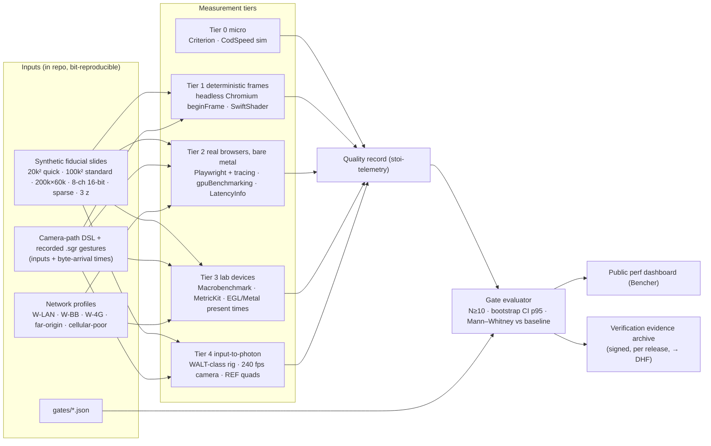
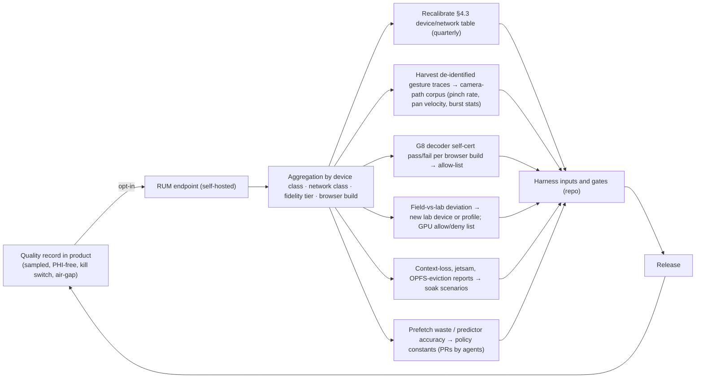

# Quality, testing and performance QA

Section 08 of the Stoipath WSI viewer development plan. Date 2026-10-24. Terminology, device classes, latency figures and gate names are those of the recommended architecture (`arch/recommended.md`: §4.3 device classes W-LAN … N-And, §4.4 budgets, §5 metrics, §8 Stage 0 gates G1–G13 and milestones M0–M5). Evidence tags follow the corpus: **[measured]**, **[model]**, **[estimate]**, **[verified]**, **[unverified]**. Where this section's figures differ from research note 10 §6 (written before the architecture was decided), the recommended architecture's figures win and the difference is stated.

## 1. Principles

1. **Goal 1 is a measured property, so the measurement stack is product code, not QA code.** "No blur, no pop-in" cannot be observed from outside on iPad Safari or a Mali-G52 phone: no GPU timers, no frame readback, lossy screen capture. `stoi-telemetry` therefore emits a per-frame **quality record** on every platform (per drawn tile: level wanted, level drawn, blend weight, upload age, provenance flag; per frame: input timestamp, `tick` duration, present timestamp, uploads, blank pixels). Every gate below reads that record; external instruments (Chromium traces, Perfetto, photodiode) exist to prove the record is honest and to measure what the engine cannot see (the platform floor).
2. **One behaviour everywhere is tested as one replay.** A recorded gesture, replayed through `tick()` with its recorded byte-arrival times, must produce an identical request sequence, cancel sequence and draw list on native, wasm and every shell. This **golden gesture replay** is the operational definition of goal 1 across goal 2 and the single most important test in the repository.
3. **Gate on residency and sharpness, not frame rate alone.** A viewer can hold 60 fps while magnifying an ancestor. NTF%, resolution deficit, BAT, TTS, blank-pixel frames, pop-in count, CHS and BER encode goal 1; frame time and I2P catch jank and pipeline latency.
4. **Three measurement regimes.** Noise-free CI on hosted runners (instruction counts, deterministic headless frames); real browsers on owned bare metal with statistics; real devices in an owned lab with a hardware input-to-photon rig. Anything that produces a latency or frame-time number used in a gate runs on pinned, owned hardware. Cloud device farms are for compatibility only.
5. **The weakest device of each class defines the gate**, and every latency gate is relative to the measured platform floor **REF** (CSS-transform page on the web, raw Metal / raw Vulkan+SurfaceView quad natively), so we are never penalised for WebKit's 60 Hz cap or SurfaceFlinger's extra interval.
6. **Every test is a design-control artefact from day one.** Each test carries a requirement ID; the traceability matrix, SOUP list (the SBOM), anomaly list and verification evidence are generated by CI per release, so the Design History File for the later Dx edition is assembled, not reconstructed (see *Regulatory strategy, quality management and the free-distribution model*; research note 11-gap-8 was not available to this author, so the hooks below derive from notes 09 and 10).
7. **Everything is machine-checkable.** Gates live in the repository as data (`gates/*.json`: metric, device class, network profile, threshold, N, statistic); CI evaluates them; an agent can run the same evaluation locally. Humans decide waivers, threshold loosening, device-list changes and release sign-off; nothing else.

## 2. Test strategy per layer

| Layer (component, §3 of recommended) | What must be true | Test types and oracles | Tooling | Cadence |
|---|---|---|---|---|
| **Readers** (`stoi-source` TIFF/BigTIFF/NDPI, DICOM Part-10 `TILED_FULL`/EOT, Zarr v3 shards, IIIF/DZI/DICOMweb clients) | Byte-exact tile extraction; no crash or hang on any input; identical results to community readers | Unit; property tests (every `TileIndex` maps inside the file; EOT/IFD monotonicity); **differential tests** against tifffile, opentile, wsidicom, OpenSlide 4.0.1, zarr-python/zarrs on the OpenSlide test corpus, CAMELYON and IDC samples; **fuzzing** (§5) | cargo-nextest, proptest, cargo-fuzz + `arbitrary`, ClusterFuzzLite, pytest oracles in a GPL-isolated container | PR (unit, property, 60 s fuzz, corpus subset); nightly (full corpus, 24 h fuzz batch) |
| **Ingest** (wsidicomizer passthrough → brightfield canonical; `zarrs` → multichannel canonical; level synthesis; Manifest build; de-identification) | Frame bytes hash-identical to vendor tiles (passthrough is a byte copy); Manifest resolves every tile; synthesised levels within tolerance of a reference downsample; label/macro/barcode never reach tier 0; third parties can read the output | Hash identity per frame; Manifest round-trip; **third-party-reader smoke tests** (wsidicom, pydicom, Orthanc and dcm4chee STOW/WADO; zarr-python, zarrs, zarrita/vizarr, tensorstore); PHI-tier assertions (no `LABEL`/`OVERVIEW` instance, no barcode string, no `ImageDescription` filename in tier 0); idempotency and crash-restart tests of the two-pass pipeline; write-new-object + pointer-swap race tests on MinIO | Containers per licence class; synthetic slides written to SVS-like TIFF, NDPI-like, DICOM, OME-Zarr | PR (synthetic 20k² slide); nightly (100k² standard slide, vendor corpus, all readers) |
| **Edge Translator** (regional service, Cloudflare Worker, in-process library) | p99 ≤ 10 ms hot service time per container path; bundles correct; token validated and stripped from cache key; `Origin` excluded; façades conformant | Criterion micro-benchmarks of offset arithmetic; load tests (k6/oha) at 5k req/s on a 2-vCPU container and in `workerd`; conformance suites (DICOMweb WADO-RS `frames/{list}` with `transfer-syntax=*`, IIIF Image 3 validator, DZI); cache-key tests against Cloudflare and CloudFront range semantics (1 MiB slices); fuzz of URL/range/Manifest parsing; fault injection (Toxiproxy latency, slow-close, 5xx) | axum test harness, k6, `workerd`, IIIF validator, dicomweb-client, Toxiproxy | PR (unit, conformance subset); nightly (load, full conformance, fault injection) |
| **Engine** (`stoi-core`: model, camera, sched, cache, draw, telemetry) | Deterministic state machine; policy invariants of §4.1 hold; budgets close on a 128 MiB L0 | **Golden gesture replay** (§3.2) native + wasm + shells; property tests of invariants (never blank: every viewport pixel covered by a resident ancestor; ancestors of visible tiles never evicted; Pinned Base never evicted; tier-0 requests all issued in the first frame; cancel only below 30 % bytes; prefetch ≤ 50 % bandwidth and ≤ 25 % slots); memory-budget tests at 128/256/512 MiB; `tick` wall time ≤ 1–3 ms in wasm; semantic goldens of the draw list via `insta` | cargo-nextest, proptest, insta, wasm-bindgen-test in headless Chromium, CodSpeed simulation mode | PR |
| **Renderer** (`stoi-render-gl` WebGL2; `stoi-render` wgpu native/WebGPU) | Pixels identical across backends within tolerance; texture arrays correct at 1…64 layers; uploads within budget; context loss recovered | Golden images (§4): semantic, exact on software rasterisers, perceptual on real GPUs; WGSL→GLSL ≤ 1 LSB; WebGPU vs WebGL2 ≤ 1 LSB (G10); G4 array correctness; G5/G12 upload cost; context-loss and visibility-change recovery; four-GPU-family suite before each wgpu bump | Playwright `toHaveScreenshot`, pixelmatch/odiff, SwiftShader, lavapipe, WARP, RenderDoc/Xcode GPU capture for triage | PR (software raster); nightly (T4, lab GPUs) |
| **Shells and UI** (Web Shell Lit component/PWA/iframe RPC, Tauri, SwiftUI, Compose) | Input reaches `tick` without added frames; embeds work without COOP/COEP or third-party cookies; keyboard parity; WCAG 2.2 AA | E2E functional (Playwright 3 engines, WebView2, XCUITest, Compose test, Appium on farms); gesture tests through the real input pipeline; iframe-in-Hyperdrive-like harness (no cookies, cross-origin); accessibility (§7); soak (2 h random walk, memory growth, jetsam/LMK) | Playwright 1.64, XCUITest, Macrobenchmark, Appium 3 | PR (smoke); nightly (full); weekly (farm, soak) |
| **SDKs and bindings** (npm, PyPI/anywidget, crates, XCFramework/UniFFI, AAR, C ABI) | Installable from each registry into a clean project; API stable under semver; identical engine behaviour through every binding | Install-from-registry smoke on all channels; `cargo-semver-checks`, `@microsoft/api-extractor`, `publint`, `arethetypeswrong`; replay-through-binding tests (the same `.sgr` recording via C ABI, UniFFI Swift/Kotlin, PyO3 gives the same request sequence); size-limit budgets (G1) | Release pipeline, maturin/cibuildwheel, SwiftPM, Gradle | PR (API reports); release (install smoke) |

Pillar coverage: the clinical pillar is served by the Edge Translator conformance suites, the third-party-reader tests (VNA readability is a CI assertion), PHI-tier assertions, Dx-mode determinism (§4) and the design-control hooks (§11); the research pillar by the differential tests against the Python toolchain, OME-Zarr fixtures, replay-through-PyO3 and the published benchmark; the education pillar by the accessibility gates (§7), offline-pack goldens and the low-bandwidth profiles (§3.7).

## 3. The performance-regression harness

### 3.1 Synthetic deterministic slides

Synthetic slides are generated, not sampled, so they have known ground truth and no licence or PHI friction. The Stage-0 generator (`gen_synthetic_pyramid.py`: seeded procedural H&E-like texture, 512² JPEG q85 4:4:4, 2× pyramid, seam-consistent per-tile nuclei) is extended in M0 with: **fiducials that encode level, column and row** (a 2-D barcode and micro-text in each tile corner) and a **Siemens-star sharpness target every 2,048 px**, so any screenshot can be decoded to prove exactly which level was drawn where, independently of the renderer's own record; a **colour-patch strip** (sRGB and scanner-ICC-tagged ColorChecker-like patches) for §4; and **16-bit multichannel** variants with known per-channel histograms. Parameter set: 20k² (PR), 100k×100k (standard gate slide), 200k×60k (elongated, > 4 GB level → tests Concatenation/EOT), 8-channel 16-bit 40k², sparse tissue (90 % glass), 3 z-planes. Each is written to every supported container: SVS-like tiled TIFF (tifffile, with `JPEGTables`), NDPI-like strips, Philips-like padded TIFF, DICOM WSI `TILED_FULL`+EOT (wsidicomizer 0.31, incl. one concatenated level), OME-Zarr 0.5 sharded (zarr-python 3.4, zstd), DZI (pyvips). Generation runs in a pinned container with fixed seeds and encoder versions; the output hashes are committed, so goldens stay valid across machines.

### 3.2 Camera paths and the golden gesture replay

Two input forms drive every tier. The **camera-path DSL** (JSON: `pinch(anchor, scale, duration, easing)`, `pan(velocity, duration)`, `fling`, `wheel(steps, interval)`, `jump`, `dwell`, `key(…)`) is synthetic and parametrised; three executors consume the same file: Chromium `chrome.gpuBenchmarking.pinchBy/smoothScrollBy/smoothDrag/swipe` (real input pipeline), CDP `Input.*`/WebDriver for Firefox and WebKit, and XCUITest `pinch(withScale:velocity:)` / UiAutomator natively. The **recorded gesture** (`.sgr`) is captured from a real session: input samples with timestamps, viewport and DPR, memory budget, every `on_bytes` event with its arrival time and size, every `on_decoded` completion. Replay sets the host clock from the recording and feeds `tick()`; the assertion is byte-identical `FrameOut` sequences (requests, cancels, uploads, draw list) across `cargo nextest` (native), wasm-bindgen-test in headless Chromium, and the shells via the C ABI and UniFFI. Recording arrival times is what makes the claim exact rather than "same first-frame requests" (the delivery judge's objection).

The **standard pathologist path** is parametrised from the measured literature (note 11-gap-1): low-power survey ≈ 4.5 s, ≈ 3 ROIs, ≈ 17 zoom bursts per slide with 66 % spanning ≥ 2.3 levels, 196 ms minimum inter-burst gap, slow edge-following pans at ≤ 1 viewport per 500 ms, ≈ 20 % of moves changing magnification. Trainee (more coverage, more high-power dwell) and second-opinion (short, low-power, meander) variants are kept because telemetry is stratified by experience; pinch dynamics are unmeasured in pathology, so Stage-1 gesture logs (§10) replace the assumed 3.3 levels/s.

### 3.3 Metrics collected

| Metric (recommended §5) | Definition | Primary source | Cross-check |
|---|---|---|---|
| **NTF%** | Share of presented frames with any visible pixel sampled from a level coarser than L\*; split *during gesture* / *after last input* | quality record | fiducial decode of Tier-1 screenshots |
| **Resolution deficit** | Per frame, area-weighted mean and max of `log2(wanted density / drawn density)`, clamped at 0 (octaves) | quality record | Laplacian variance on Siemens stars |
| **BAT** | Σ (levels coarser than L\*) × (viewport area fraction) × frame time, level·s per interaction; *blur-ms* = time with max deficit > 0.5 is a derived scalar | quality record | — |
| **TTS** | Last input → first frame with NTF = 0 (strict) or deficit ≤ 0.5 (lenient) | quality record | screenshot fiducials |
| **BER** | Fraction of destination-level tiles resident at burst end (burst = zoom events ≤ 196 ms apart) | scheduler record | — |
| **Blank-pixel frames**, **pop-in count** | Frames with any unpainted viewport pixel (must be 0); tile whose drawn level changes ≥ 1 after settle without a ≥ 100 ms cross-fade | quality record | screenshot |
| **CHS**, **prefetch waste**, **bytes/requests per gesture**, **overfetch ratio**, **predicted-vs-actual destination** | Cache-hit at settle; prefetched-and-evicted-unused bytes ÷ prefetched; transferred ÷ visible bytes | scheduler record, `PerformanceResourceTiming` / native client | Edge Translator logs via frame-id echo |
| **I2P** | Input hardware timestamp → photon | Tier 4 rig; Chromium `LatencyInfo` (`INPUT_EVENT_LATENCY_ORIGINAL_COMPONENT` → `..._GPU_SWAP_BUFFER_COMPONENT`) as input-to-swap; Event Timing in Firefox/Safari as `processingEnd` → next paint; `CAMetalDrawable.presentedTime`, `eglGetFrameTimestampsANDROID` natively | REF quad on the same device |
| **Frame time p50/p95/p99, dropped %** | Chromium Graphics.Smoothness definitions; native present-interval histogram | trace / record | Macrobenchmark `frameOverrunMs`, MetricKit `scrollHitchTimeRatio` |
| **Upload bytes/frame, decode p95, main-thread block/frame** | From the record and worker timings | record | timer queries where available (§3.5) |
| **Memory peak** | JS heap + L0 texture bytes from our allocator; RSS + GPU natively | record | `os_proc_available_memory`, `dumpsys meminfo`, JetsamEvent logs |
| **TTFSV**, **slide switch** | URL open → first slide pixels; Navigation Timing / native | record | Server-Timing |

### 3.4 Measurement tiers

| Tier | What | Tooling | Signal | Cadence |
|---|---|---|---|---|
| 0 | Micro: decode, `JPEGTables` splice, scheduler decisions, eviction, Manifest lookups, Edge Translator offset arithmetic | Criterion 0.8 / Divan (Rust), tinybench (TS); CodSpeed `mode: simulation` (instruction counts) or Bencher thresholds | noise-free | PR |
| 1 | Deterministic frames: camera path in headless Chromium, one `HeadlessExperimental.beginFrame` per virtual vsync with `--run-all-compositor-stages-before-draw --enable-gpu-benchmarking`, SwiftShader, screenshot + quality record per frame; mitmproxy replay of recorded tile responses so the server contributes zero variance | CDP, Playwright, SwiftShader | exact: *which level on which frame*, not how long | PR |
| 2 | Real browsers on bare metal: `browser.startTracing` (categories `input, cc, viz, gpu, benchmark, disabled-by-default-devtools.timeline.frame`), gestures via `gpuBenchmarking`, `Network.emulateNetworkConditions` (latency, throughput, packet loss/queue/reordering) and `Emulation.setCPUThrottlingRate` (smoke only, never a gate); Firefox/WebKit via in-page `PerformanceObserver` `event` entries and rAF deltas | Playwright 1.64, Chromium LatencyInfo, Bencher | input-to-swap, frame time, all record metrics | nightly, N ≥ 10 |
| 3 | Lab devices, mobile browsers and native shells: Android Macrobenchmark `FrameTimingMetric`, Perfetto `trace_processor` SQL, `EGL_ANDROID_get_frame_timestamps` for SurfaceView present times (Perfetto FrameTimeline does not cover SurfaceView); iOS `XCTOSSignpostMetric`/`XCTClockMetric`, MetricKit, `addPresentedHandler`, `gpuStartTime/gpuEndTime`; mobile Safari via XCUITest + in-page telemetry; thermal state checked before each run | adb/USB hub on self-hosted runners | real GPU, thermal, memory | weekly; pre-release |
| 4 | Hardware input-to-photon (§3.8) | WALT-class rig, 240 fps camera | ground truth and REF floors | per release; whenever the input or present path changes |

Hygiene that decides whether the numbers mean anything: fixed brightness, airplane mode plus lab Wi-Fi or wired, thermal cool-down with `ProcessInfo.thermalState` / `PowerManager.getCurrentThermalStatus` checks, no adaptive refresh unless the scenario tests it, battery > 50 % or powered, N ≥ 10 runs per scenario, bootstrap confidence interval on p95 and Mann–Whitney against the per-device baseline, alerts on *shift* rather than single-run thresholds (Bencher boundary thresholds implement this).

### 3.5 GPU timestamps

GPU timing is a lab tool, not a fleet tool. `EXT_disjoint_timer_query_webgl2` exists only in desktop Chrome **[verified BCD]**; WebGPU `timestamp-query` is quantised in Chrome unless `--enable-webgpu-developer-features`, fine-grained on Apple-silicon Safari 26+, absent in Firefox **[verified source, gap-3]**; native wgpu/Metal/Vulkan give real timestamps. Policy: per-frame aggregates (upload batch time, draw time) on Chrome desktop and natively feed the online upload budget (§4.2 correction 2) and the G5/G12 gates; per-tile GPU timing is never a gate on the web. Where no timer exists the record uses CPU-side timing around the upload call and the present timestamp.

### 3.6 Device farm composition

Own lab (self-hosted runners; replace models as the market moves) mapped to the canonical classes:

| Class | Devices (≥ 1 each) | Why |
|---|---|---|
| W-LAN / N-Desk | Intel-iGPU Windows laptop; Linux box with AMD or NVIDIA GPU and a 120–144 Hz display; NUC; on-prem Edge Translator on the lab switch | weakest desktop GPU defines the W-LAN gate; 120 Hz for N-Desk |
| W-BB | MacBook Air (Safari and Chrome); Windows arm64 laptop | Safari W60 tier; WARP/arm64 coverage |
| W-4G | 3–4 GB Android 12–13 with Mali-G52/G57 (60 Hz); Adreno 610 device; Exynos Galaxy with **Xclipse** (WebGL2 only, WebGPU blocklisted); Android 11 device (no WebGPU) | the floor device defines every mobile-web gate |
| W-iPad | iPad 8th gen (A12, 3 GB) on iPadOS 26; an iPad still on iPadOS 17/18 | WebKit 60 Hz cap, WebContent jetsam |
| N-iPad | iPad Pro M-series 120 Hz with Apple Pencil (hover-capable) | M3 gate |
| N-And | Pixel 8/9 (Perfetto, Macrobenchmark reference); mid-range 120 Hz Android; Snapdragon Galaxy | 120 Hz pacing, Vulkan/GLES retry, device allow-list |
| Reference | iPhone 12 (G2), iPhone SE-class | compile-time and memory floors |

Thirteen to fifteen devices ≈ USD 8–12k capex plus ≈ 0.2 FTE ops **[estimate]**; the Mac mini, NUC, Windows and Linux runner boxes ≈ USD 4–5k **[estimate]**. Cloud farms cover the compatibility matrix, never latency gates: AWS Device Farm is USD 0.17 per device-minute or USD 250 per unmetered slot per month **[verified AWS pricing page, 2026-10-24]**; BrowserStack App Automate is ≈ USD 199–249 per parallel per month according to third-party listings **[unverified; vendor page not read]**. Budget two slots or parallels ≈ USD 500/month for weekly runs of the functional suite across the long tail of OS versions and GPUs.

### 3.7 Network emulation profiles

Profiles reproduce §4.3's network columns and are applied at the browser (CDP), at a lab bridge (`tc qdisc netem` on a Raspberry Pi between the Wi-Fi AP and the lab Edge Translator, the only option for real phones) and at the server (Toxiproxy for faults). mitmproxy record/replay removes server variance from client measurements.

| Profile | RTT p50 / jitter | Down / up Mbps | Loss | Maps to | Used for |
|---|---|---|---|---|---|
| LAN | < 1 ms / 0 | 1,000 / 1,000 | 0 | W-LAN, N-Desk | warm I2P, TTS ≤ 50/100 |
| Broadband-CDN | 25 ms / ± 5 | 100 / 20 | 0 | W-BB, W-iPad, N-iPad | TTS ≤ 100/300 |
| Broadband-p95 | 50 ms / ± 10 | 25 / 5 | 0.1 % | tail of W-BB | NTF% ≤ 20 %, ≤ 1 level |
| 4G-good | 45 ms / ± 15 | 25 / 5 | 0.5 % | W-4G, N-And | TTS ≤ 250/700, moving tier, DPR cap |
| Cellular-poor | 200 ms / ± 60 | 5 / 1 | 1 % | W-4G p95 | never blank, ≤ 2 levels, BAT bound |
| Far-origin | 150 ms / ± 20 | 50 / 10 | 0 | no-CDN topology | L4/L5 miss path, prefetch depth |
| Offline / flaky | drop every N s for 5 s | — | burst | offline pack, education classroom | OPFS refill, 7-day eviction, Safari ITP |

### 3.8 Hardware input-to-photon rig

Browsers hide decode and present timing, and the native floors in gap-4 §2.9 are models (iPad floor 2 intervals, typical 3; Android floor 3, typical 4), so the rig is the only credible end-to-end instrument. Build: a WALT-class timer (Teensy, screen photodiode, accelerometer or solenoid "finger", USB clock sync re-synced every few minutes) **[WALT README verified; its maintenance status could not be checked from this sandbox, so the firmware and hardware files are vendored into the repo]**, cross-checked with a 240 fps phone camera (± 4 ms) and, budget permitting, a 1000 fps industrial camera (± 1 ms). The **REF quad apps** ship inside the harness: a CSS-transform page (web floor), a raw-Metal textured quad following the finger (`CAMetalDisplayLink`, latency 1, 2 drawables), a raw Vulkan + SurfaceView quad (`postVsyncCallback`, 2-image swapchain). Every I2P gate is "viewer p95 ≤ REF p95 + 1 frame (or interval)" on the same device and firmware (G11). The Edge Translator stamps each response with a request id in `Server-Timing`; the client echoes it into the quality record, giving an end-to-end trace from byte arrival to photon for the cold path. 30 trials per device × input type (pinch, drag, wheel, Pencil), p50/p95 reported.

## 4. Golden-image rendering tests and colour accuracy

GPU output is not bit-stable across vendors, drivers or driver versions, so goldens are layered:

1. **Semantic goldens (always, every platform).** The per-frame draw list (tile ids, levels, blend weights, transforms, upload order) from Tier 1 and from replay is serialised and diffed with `insta`. Deterministic everywhere because it describes decisions, not pixels; it is also the Dx-mode audit record.
2. **Exact pixel goldens on software rasterisers.** Chrome SwiftShader (WebGL2 and Dawn-SwiftShader WebGPU), lavapipe for wgpu-Vulkan on Linux, WARP for D3D12 on Windows: zero-tolerance diffs. Apple has no software Metal, so Apple goldens are per-GPU-family with tolerance on the lab Mac mini and iPads. Chrome's SwiftShader fallback flags are pinned and re-validated on every Chromium bump.
3. **Perceptual goldens on real GPUs.** Playwright `toHaveScreenshot` with `threshold` and `maxDiffPixels`, pixelmatch/odiff, SSIM for fluorescence colormaps; snapshots keyed by browser, platform and GPU family; stored in an object bucket keyed by renderer version and rasteriser, reviewed as PR artefacts.

Cross-backend identity: WGSL is authored once; the GLSL ES 3.00 that naga-cli emits for `stoi-render-gl` must match the WebGPU/native output of the same scene to **≤ 1 LSB per channel** (G10, deck.gl discipline), re-run on every wgpu bump and on four GPU families (Adreno 6xx, Mali-G5x/G7x, Xclipse, PowerVR) before a native release. Decoder identity is a golden too: G7 requires 1,000/1,000 hash-identical tiles between our Emscripten libjpeg-turbo build, native x86 and arm64 libjpeg-turbo and the server reference (measured identical today for x86 native, wasm SIMD and wasm scalar **[measured, gap-2]**); G8 is the per-browser `createImageBitmap(blob, {colorSpaceConversion:"none", premultiplyAlpha:"none"})` self-certification matrix, which runs at start-up in the product and in CI on the lab browsers, and whose field results flow back through RUM (§10). Reversible HTJ2K through one pinned OpenJPH build must be identical across platforms; lossy HTJ2K stays out of Dx until it is (gap-2 found 0.002 % saturated-sample differences between builds).

**Colour accuracy.** Brightfield tiles are served with the scanner ICC baked to sRGB at ingest (deterministic, cacheable); raw sources (DICOM/OME-Zarr read directly) go through a 33³ 3-D LUT in the fragment shader. Tests: (a) the server transform against a LittleCMS reference on the synthetic colour-patch strip and the OpenSlide ICC-tagged slides, **ΔE2000 ≤ 1.0 mean, ≤ 2.0 max** per patch **[estimate; target to be confirmed with the pathologist advisor]**; (b) the shader LUT against the same reference to ≤ 1 LSB after dithering; (c) `drawingBufferColorSpace = "display-p3"` output checked on Chrome, Firefox 132+ and Safari 16.4+ by rendering known patches and reading back; (d) 16-bit window/level and colormap maths against a NumPy reference on fluorescence fixtures; (e) the CVD-friendly YCbCr remap (education pillar) against the published transform, MS-SSIM > 0.95 to the original. **Dx-mode determinism gate:** for the Dx corpus the settled frame with the Rendering Complete flag must hash identically on W-LAN (SwiftShader and Intel iGPU), N-Desk and N-iPad after the fixed resampler and pinned decoders, with ≤ 1 LSB tolerance across GPU families and zero tolerance within one rasteriser class; the frame hash is written into the quality record so a sign-out session can later be reproduced.

> **Reviewer note (metric definition).** Recommended §5 lists BAT (level·s) from note 04 and note 10 §6 gates on *blur-ms*. This section treats BAT as primary and blur-ms as a derived scalar so the two cannot drift; the assembler should align note 10's wording.

## 5. Fuzzing of format readers

Parsers of attacker-controlled slide bytes are the attack surface: OpenSlide 4.0.1 fixed an arbitrary memory write in the Ventana BIF reader (CVE-2026-48977) and an uninitialised-pixel return (CVE-2026-54604) **[verified CHANGELOG]**. Rust removes the memory-safety class but not logic bugs, panics, unbounded allocation or infinite loops, and safety does not cross FFI into libjpeg-turbo and OpenJPH.

- **Targets:** TIFF/BigTIFF IFD and tag parsing (SVS, NDPI offset extension, SCN XML, Philips padded geometry, OME-TIFF), `JPEGTables` splice, DICOM Part-10 (EOT, BOT, Concatenation, `TILED_FULL` geometry) and DICOMweb JSON/multipart, Zarr v3 `zarr.json` and shard indices (incl. crc32c-less), OME-NGFF metadata, Manifest builder and reader, Edge Translator URL/range/token parsing, bundle framing, annotation inputs (GeoJSON, MVT, DICOM ANN/SEG/SR), offline-pack headers.
- **Method:** cargo-fuzz (libFuzzer) with `arbitrary` structure-aware generators (IFD trees, DICOM element sequences, shard indices) and proptest invariants (every `TileIndex` resolves inside the object; decoded tile dimensions equal declared); seeds from the OpenSlide test corpus, IDC and CAMELYON samples and the synthetic slides, minimised with `cargo fuzz cmin`; ASan/UBSan (and MSan where the toolchain allows) on the C dependencies; resource limits (`-rss_limit_mb`, `-timeout`) so allocation and hang bugs count as crashes.
- **CI:** ClusterFuzzLite 60 s per target on every PR, 24 h batch nightly on a self-hosted Linux box (hosted minutes are reserved for correctness), OSS-Fuzz enrolment once the readers are public (Rust supported). **Merge rule:** no reader or parser merges without a fuzz target, an `arbitrary` generator, a seed corpus and a differential test; **release rule:** 24 h zero-crash before any reader ships; crash reproducers become regression tests.
- **Differential testing** against tifffile, opentile, wsidicom, OpenSlide 4.0.1 and zarr-python/zarrs: a mismatch is a bug in one of them and is filed upstream when it is theirs.

## 6. Security testing

Security testing produces the same artefacts whether we are a device or not (FDA §524B, HIPAA, EU CRA), so they are built once:

| Control | Test or check | Cadence |
|---|---|---|
| Supply chain | `cargo audit`/`cargo deny` (advisories, licences, sources), OSV monitoring, pnpm audit, pip-audit; **SBOM** (CycloneDX and SPDX) generated per build and per release with VEX statements for non-affecting CVEs; SLSA-style provenance attestations; cosign-signed artefacts and OCI images; OIDC trusted publishing on every registry that supports it (npm `npm trust`, PyPI, crates.io) | PR; release |
| Licence hygiene | `cargo deny` licence allow-list enforced per crate graph: permissive-only in `stoi-core`, the renderers, the Web Shell, SDKs and the Edge Translator; LGPL/GPL (OpenSlide, libvips, Bio-Formats, `jpegxl-rs`) only in ingest worker images; the client bundle is scanned for GPL symbols | PR |
| Tile auth contract | Tests that the capability token validates at the edge, is stripped from the cache key, that `Origin` is excluded from the key, that a token for prefix A cannot fetch prefix B, expiry and refresh paths, `Referrer-Policy: no-referrer`, no PHI or token in logs (log scrubbing test), bearer-token same-origin proxy mode for external DICOMweb | PR |
| PHI tiers | Ingest assertions (§2 Ingest row); CDN config test that tier-2 prefixes are uncacheable; de-identification golden tests on vendor fixtures with planted identifiers (label, barcode, `ImageDescription`, dates, serials); teaching-set derivation tests | PR; nightly |
| Telemetry privacy | Schema validation that RUM payloads carry no free text, no identifiers, hashed slide ids only; canary tests inject PHI-like strings and assert they never leave the client; kill switch and air-gap mode tests | PR |
| Sandboxing | Ingest workers run under gVisor/Firecracker with seccomp; tests that a crafted slide cannot read outside its input, open network or exceed memory | nightly |
| Web app | Playwright-driven OWASP ZAP baseline scan of the Web Shell and façades (DICOMweb, IIIF, DZI); CSP, CORP/COEP-free embedding, iframe sandbox tests; dependency pinning | nightly |
| Secrets | GitHub secret scanning and push protection; gitleaks in CI | PR |
| Pen test and threat model | Threat model (STRIDE over the launch-context contract, token exchange, Edge Translator, ingest) reviewed per release train; annual third-party penetration test; coordinated disclosure via `SECURITY.md` with a 90-day window | release; annual |

## 7. Accessibility testing

WCAG 2.2 AA is normative for a pan/zoom viewer (SC 2.5.7 Dragging Movements, SC 2.5.8 Target Size) and a procurement gate for UT campuses (ADA Title II, Texas TAC 206/213). Tests: axe-core via `@axe-core/playwright` on every Web Shell route and on the education authoring surfaces, zero critical/serious violations as a PR gate; a **keyboard executor** for the camera-path DSL so every scripted gesture also runs through keyboard pan/zoom and tap-to-centre, asserting the same end state (the 2.5.7 single-pointer alternative); an automated 24×24 CSS px target check over the rendered chrome; `prefers-reduced-motion` tests (no inertia, no cross-fade longer than one frame); focus-order and ARIA snapshot tests; contrast checks of overlays and annotation palettes against the slide background on the synthetic colour strip; a check that no semantic (correct/incorrect, layer identity) is encoded in colour alone, using deuteranopia/protanopia simulation of the palette; manual VoiceOver, TalkBack and NVDA passes on the region-marking item and the quiz flows before each release; the native shells run Xcode Accessibility Inspector audits and Android Accessibility Scanner. A third-party VPAT audit precedes the first UT procurement conversation (M4).

## 8. CI/CD matrix and budget

| Target | Runner | Every PR | Nightly / weekly | Release |
|---|---|---|---|---|
| Linux x64 | `ubuntu-24.04` (hosted) | clippy, nextest, wasm build + wasm-opt + size-limit (G1), Vitest, Playwright Chromium/Firefox/WebKit functional, Tier 0 (CodSpeed sim), Tier 1 deterministic frames, semantic + SwiftShader pixel goldens, replay goldens (native + wasm), ingest on the 20k² slide, fuzz smoke 60 s/target, cargo-deny, SBOM, api-extractor/semver-checks, axe | conformance suites, third-party-reader smoke (containers), load tests, ZAP | SBOM/VEX, attestations, OCI build |
| Linux arm64 | `ubuntu-24.04-arm` | build, nextest, G7 arm64 decoder hashes | — | wheels, AAR cross-check |
| Linux GPU | T4 larger runner | — | WebGPU CTS subset, wgpu Vulkan goldens, headful Chrome WebGPU goldens (correctness only) | — |
| Windows x64 / arm64 | `windows-2025`, `windows-11-arm` | Rust D3D12 (WARP goldens), Edge/Chrome Playwright, WebView2 smoke | — | NuGet/Tauri installers |
| macOS arm64 | `macos-26` | Rust Metal build/tests, WebKit Playwright, Xcode build, Simulator XCTest, SwiftPM resolve | — | XCFramework + checksum |
| Android emulator | `ubuntu-latest` + KVM | instrumentation functional (never perf) | — | AAR |
| Self-hosted bare metal | Mac mini, NUC, Windows box, Linux GPU box, lab devices | — | Tier 2 (nightly, N ≥ 10), Tier 3 (weekly), 24 h fuzz batch, soak | Tier 4, evidence archive |
| Cloud farm | AWS Device Farm / BrowserStack | — | weekly functional across OS/GPU long tail | — |

**Budget.** Hosted rates read today from GitHub's runner-pricing reference: Linux 2-core x64 USD 0.006/min, Linux arm64 0.005, Windows 2-core 0.010, macOS 3–4-core 0.062, Linux 4-core GPU 0.052 **[verified docs.github.com Enterprise Server page; GitHub states cloud prices were cut by up to 39 % on 2026-01-01; the proposed USD 0.002/min self-hosted platform fee is postponed]**. A PR run of ≈ 110 Linux x64 job-minutes (parallel jobs, ≈ 25 min wall with sccache and Turborepo remote cache), 15 arm64, 25 Windows and 20 macOS costs ≈ USD 2.3; at 300 agent-driven PR runs per month ≈ USD 700. Nightly (T4 90 min, Linux 360 min, macOS 30 min) ≈ USD 9, ≈ USD 270/month; weekly and release jobs ≈ USD 50/month. **Hosted total ≈ USD 1,000–1,100/month [estimate]**, plus ≈ USD 500/month farm, plus the one-off lab and runner capex in §3.6 and 0.2 FTE ops. Wall-clock budgets, which matter more to the agent loop than dollars: PR gate ≤ 25 min p95 (merge queue, affected-package filtering, cached toolchains); nightly ≤ 6 h; weekly lab ≤ 24 h; release ≤ 48 h including Tier 4. A PR that exceeds its budget by > 20 % is itself a regression (CI time is a tracked metric).

## 9. Release gating criteria per milestone

Gates are evaluated on the weakest lab device of the named class, on the 100k² standard synthetic slide and the standard pathologist path (plus one de-identified public slide: CAMELYON CC0 or IDC CC-BY), N ≥ 10, distribution tests, figures from recommended §4.4 and §8. "REF" is measured on the same device and firmware.

| Milestone | Scope | Gates (all must pass) |
|---|---|---|
| **Stage 0** (weeks 0–2) | Spike on W-4G, W-iPad, Xclipse, Firefox Linux, iPhone 12 | G1 floor module ≤ 1.0 MB gz (target 0.6), full ≤ 1.3 MB; G2 cold compile + first frame ≤ 300 ms floor Android / ≤ 150 ms iPhone 12; G3 p99 frame ≤ 16.7 ms for 60 tiles at DPR 3; G4 1…64-layer array correctness, 0 mismatches; G5 ≤ 2 ms per 512² upload, no main-thread stall > 8 ms; G6 Safari soak 500 reloads + 30 min, 0 kills, RSS ≤ 300 MB; G7 1,000/1,000 decoder hash identity incl. arm64 (**failure stops the plan**); G8 self-cert matrix documented; G9 worker pool ≥ 1.8×; G10 WebGPU-vs-WebGL2 ≤ 1 LSB; G11 REF floors measured with the rig; G12 per-tile upload cost on iOS Safari and Mali-G52; G13 WASM libjpeg-turbo on an A55 core |
| **M0** renderer spike (desktop Chrome, synthetic) | Tier 0–1; Edge Translator F9 prototypes | Warm: deficit = 0 on 100 % of frames, 0 pop-in, 0 blank frames, p99 frame ≤ 16.7 ms on the Intel-iGPU laptop, no main-thread task > 50 ms, L0 within budget ± 0; golden gesture replay identical native vs wasm; Edge Translator p99 ≤ 10 ms hot service time per container path (Zarr shard range, DICOM EOT frame, 15-tile bundle) on 2 vCPU and in a Worker; predicted-vs-actual destination and waste logging live |
| **M1** web alpha (desktop Chrome/Edge, Firefox, Safari) | + Tier 2, network profiles | W-LAN: TTS ≤ 50/100 ms, NTF% ≤ 5 % ≤ 1 level; W-BB: TTS ≤ 100/300, NTF% ≤ 20 % ≤ 1 level, cold destination fill ≈ 230/650 recorded as a table row; warm input-to-swap ≤ REF + 1 frame p95; CHS ≥ 95 % on the pathologist path; prefetch waste ≤ 50 % (Stage-1 acceptance; tighten after telemetry); semantic + software-raster goldens green on three engines; 24 h zero-crash fuzz on TIFF/DICOM/Zarr readers and the Manifest; third-party-reader smoke green on both canonicals; façade conformance subset; axe zero critical; requirement coverage ≥ 90 % |
| **M2** mobile web beta = MVP (Chrome Android, Samsung Internet, iPad Safari) | + Tier 3–4 | W-4G: p95 frame ≤ 16.7 ms, deficit = 0 warm, TTS ≤ 250/700, NTF% ≤ 50 % ≤ 2 levels (≥ 2 at ≥ 20× logged), cellular-poor never blank; W-iPad: TTS ≤ 100/300, memory peak ≤ 60 % of the measured WebContent kill threshold, 30 min soak without jetsam; rig I2P ≤ REF + 1 frame p95 on W-iPad and W-4G; upload budget honoured (G5/G12); embed without COOP/COEP meets M1 gates; bundle within G1; WCAG 2.2 AA audit of the component; SBOM + signed release; install smoke npm and PyPI. (Note 10 §6 set TTS p50 ≤ 150 ms on 4G-good; recommended §4.4's ≤ 250/≤ 700 supersedes it.) |
| **M3** native shells (iPad beta month 12; Android v1) | Tier 3–4 on N-iPad, N-And | N-iPad: p99 frame ≤ 8.3 ms at 120 Hz, I2P ≤ REF-quad + 1 interval p95 (photodiode), TTS ≤ 100/300, Pencil hover/pressure reflected within 1 frame; N-And: EGL present-time histogram p99 ≤ 1 vsync, Macrobenchmark `frameOverrunMs` p99 ≤ 0 for the Compose chrome, I2P ≤ REF + 1 interval, TTS ≤ 250/700; 2 h soak within the dynamic memory budget, no LMK/jetsam; golden suite green on four GPU families; WebGPU module allow-listed per Safari major only after G6 + G10 pass |
| **M4** SDKs and embedding | Release validation | Install-from-registry smoke on all channels; no unintended API breaks (`cargo-semver-checks`, api-extractor); replay-through-binding identical for C ABI, UniFFI Swift/Kotlin, PyO3; Jupyter widget meets M1 gates inside JupyterLab; iframe embed meets M1; Qt sample renders at host rate; VPAT delivered |
| **M5** versatility (v1) | Full skeleton | 8-channel 16-bit fluorescence meets M1/M2 gates on the same devices; two-slide synchronised view meets M1 with ≤ 1.5× bytes; 10⁶-object annotation layer within the 60/25/15 frame partition (overlays degrade first, never pixels); conformance 100 % on IDC DICOMweb, IIIF 3 validator and OME-Zarr fixtures; published `TILED_FULL`+EOT / sharded-0.5 corpus; offline-pack goldens; Dx-mode settled-frame hash identical across W-LAN, N-Desk, N-iPad; full traceability matrix |
| **Dx edition** (post-v1, separate train) | Design-control closure | 100 % REQ ↔ test ↔ evidence; Rendering Complete determinism on the validated display pairings; analytical pixel-pathway verification (decoder identity, resampler, ICC ΔE) archived; summative usability; §524B SBOM/VEX and pen-test evidence; CAP-style ≥ 60-case study run with the product's own blinded-review tooling; PCCP test protocol defined for new scanners and displays |

**Regression policy.** A gate metric may worsen beyond its noise band only with a waiver: a signed human decision committed under `waivers/`, named in the release notes and shown on the public dashboard. Tightening a threshold is an ordinary PR; loosening one or removing a device from the matrix is a human decision.

> **Reviewer note (gates).** Recommended §4.4 gates the gesture phase on NTF%, while note 11-gap-1 shows two thirds of pathologist zoom bursts span ≥ 2.3 levels, so intermediate levels are often skipped and the perceptually relevant quantity is **BER**. I recommend adding a BER gate from M1 (destination level ≥ 95 % resident within the 196 ms inter-burst gap on W-LAN/W-BB, ≥ 80 % within 500 ms on W-4G) alongside NTF%, with the exact cut-offs replaced by the Stage-1 reader study. This adds a gate; it does not change any §4.4 figure.

> **Reviewer note (translator gate).** "p99 ≤ 10 ms hot service time" needs a measurement point. This section measures it in-process from first request byte read to last response byte written, excluding TLS, with the hot cache primed, and reports client-observed TTFB from a LAN client as a secondary row; the Worker build is measured inside `workerd` with the R2 binding mocked, then on Cloudflare with real R2.

## 10. RUM feedback into the harness

The field is the only place where the real device × browser × network distribution exists. The product samples the quality record per gesture (not per frame) and ships it opt-in and PHI-free by construction: derived device class (UA, adapter or `WEBGL_debug_renderer_info`, `hardwareConcurrency`, `deviceMemory`), network class (`effectiveType`, EWMA RTT and bandwidth from `PerformanceResourceTiming`, which needs `Timing-Allow-Origin` and `Server-Timing` on tiles), fidelity tier and backend, per-gesture NTF%/BAT/TTS/CHS/BER/waste, Event-Timing input-to-paint, frame p95, upload bytes, memory peak, context-loss and self-certification outcomes, cache-tier hit rates and a sampled viewport trail (also the audit and research artefact). Slide ids are hashed with a per-tenant salt; no free text; on-prem installs get a kill switch and an air-gap mode. The six actions in the diagram run on a cadence: the gates follow the fleet (quarterly recalibration); harvested gesture traces are how the unmeasured pathologist pinch rate and pan velocity reach the Stage-1 reader study and the prefetch cone; a device class whose field TTS p95 exceeds its lab gate by > 25 % earns a new lab device or profile; policy-constant changes are PRs that agents propose and the harness verifies. Once the Dx edition exists the same stream is the post-market surveillance signal that complaint handling and MDR reporting consume.

## 11. Design controls, the agent loop and the TSP abstract

**Design controls from day one.** Every test is annotated with a requirement ID (`#[requirement("REQ-ZOOM-012")]` attribute in Rust, a tag in Playwright/XCTest/JUnit); requirements live in the repository as structured files with risk-control links (ISO 14971); CI generates the traceability matrix nightly and fails the release if coverage drops below the milestone threshold (≥ 90 % at M1, 100 % for the Dx edition). The SBOM is the IEC 62304 SOUP list; issue labels feed the anomaly list; the per-release **verification evidence archive** (signed tarball: gate results, raw traces, quality records, device firmware and OS versions, lab environment manifest, waivers) is immutable and is what the Design History File will cite. IEC 62304 Class B is assumed until the Dx intended use is written. IEC 62366 formative evaluation is the Stage-1 reader study (gap-1 F9) plus gesture logs; the summative evaluation belongs to the Dx edition. §524B cybersecurity evidence is §6.

**What the agent loop gets from this section.** Agents pick up work with an acceptance criterion that is a gate file or a test; they run Tiers 0–1 locally and in PR CI, and request Tier 2–4 runs by label (the lab is a shared, scheduled resource). A merge needs green gates, a green traceability delta and provenance: every PR records agent model and version, tokens, CI minutes and wall time in a `provenance/` ledger. Humans decide waivers, threshold loosening, device-matrix changes, release sign-off, reader-study protocols and the regulatory posture; everything else is automatic (see *Agent execution loop and repository governance*).

**Earliest demonstrable milestone and what an abstract can honestly claim.** The earliest evidence is the end of Stage 0 plus M0 (≈ month 2): measured TTS, NTF%, BAT, frame p99 and rig I2P on three named devices, against two baselines on the same devices and slides — the REF floor and an OpenSeadragon 6.1.1 configured for best effort (`immediateRender`, `maxTilesPerFrame 100`, `imageLoaderLimit 24/64`, `blendTime 0.08`), with Slim as a DICOMweb comparator at M1 — on synthetic slides and de-identified public slides (CAMELYON CC0, IDC CC-BY). The abstract should also report provenance and cost from the ledger (agent and CI cost per merged change, human review hours) and the in-house verifiability evidence (third-party-reader CI assertions, replay identity across platforms). A viewer alone can show navigation latency, sharpness, bundle size, interoperability and cost; it cannot show diagnostic equivalence or patient-care impact. No diagnostic claim is made before a CAP-style ≥ 60-case validation study; efficiency claims are proxies (the field's own data say digital is still ≈ 19 % slower per case than glass), and tablet claims are "validated for existence, unproven for speed" until Tier 4 numbers exist.

## References

Corpus: `arch/recommended.md` (§3–§5, §8, §10); research notes 01 (F3, F10 readers and oracles), 02 (F6, F9), 03 (§2.6 colour), 04 (F8 metrics and targets), 05 (F1), 06 (§4.2), 08 (F7 colour, F12, WCAG), 09 (F4–F7, F9), 10 (F3–F10, §5–§6), 11-gap-1 (F1, F7, F9), 11-gap-2 (§2.3, §4.2 G1–G10), 11-gap-3 (verdict table, timestamp-query), 11-gap-4 (§2.9, R1), 11-gap-5 (ingest verification, F9), 11-gap-6 (F8 accessibility), 11-gap-7 (F6 CAP validation); `judge/judgments.json` (delivery judge on recording arrival times; perf judge on REF quads and the photodiode rig).

External (read 2026-10-24 unless marked):
- GitHub Actions runner pricing reference: https://docs.github.com/en/enterprise-server@3.17/billing/reference/actions-runner-pricing ; 2026 pricing changes: https://resources.github.com/actions/2026-pricing-changes-for-github-actions/ ; larger/GPU runners: https://docs.github.com/en/actions/reference/runners/larger-runners ; runner images: https://github.com/actions/runner-images ; Android emulator action: https://github.com/ReactiveCircus/android-emulator-runner
- AWS Device Farm pricing: https://aws.amazon.com/device-farm/pricing ; BrowserStack App Automate pricing (third-party listings, unverified): https://devicelab.dev/blog/browserstack-app-automate-pricing-2025
- Chrome DevTools Protocol (`HeadlessExperimental.beginFrame`, `Tracing`, `Network.emulateNetworkConditions`, `Emulation.setCPUThrottlingRate`): https://chromedevtools.github.io/devtools-protocol/ ; Chromium `gpuBenchmarking`: https://source.chromium.org/chromium/chromium/src/+/main:content/renderer/gpu_benchmarking_extension.cc ; `LatencyInfo`: https://source.chromium.org/chromium/chromium/src/+/main:ui/latency/latency_info.h ; graphics smoothness definitions: https://chromium.googlesource.com/chromium/src/+/main/docs/speed/graphics_metrics_definitions.md ; WebGPU timestamp quantization: https://source.chromium.org/chromium/chromium/src/+/main:gpu/command_buffer/service/webgpu_decoder_impl.cc
- Playwright: tracing https://playwright.dev/docs/api/class-browser#browser-start-tracing ; screenshots https://playwright.dev/docs/test-snapshots ; WebView2 https://playwright.dev/docs/webview2 ; axe-core Playwright: https://github.com/dequelabs/axe-core-npm/tree/develop/packages/playwright
- MDN browser-compat-data (`EXT_disjoint_timer_query_webgl2`, `GPUSupportedFeatures`, `PerformanceEventTiming`): https://github.com/mdn/browser-compat-data
- Android: Macrobenchmark metrics https://developer.android.com/topic/performance/benchmarking/macrobenchmark-metrics ; Perfetto FrameTimeline https://perfetto.dev/docs/data-sources/frametimeline ; `EGL_ANDROID_get_frame_timestamps` https://registry.khronos.org/EGL/extensions/ANDROID/EGL_ANDROID_get_frame_timestamps.txt ; Choreographer https://developer.android.com/reference/android/view/Choreographer
- Apple: `XCTOSSignpostMetric` https://developer.apple.com/documentation/xctest/xctossignpostmetric ; `MXAnimationMetric.scrollHitchTimeRatio` https://developer.apple.com/documentation/metrickit/mxanimationmetric/scrollhitchtimeratio ; `MTLDrawable.presentedTime` https://developer.apple.com/documentation/metal/mtldrawable/presentedtime ; `CAMetalDisplayLink` https://developer.apple.com/documentation/quartzcore/cametaldisplaylink
- WALT latency timer: https://github.com/google/walt ; usage doc https://raw.githubusercontent.com/google/walt/master/docs/usage/WALT_usage.md ; photoresistor rig validated against a 240 Hz camera (< 2.64 ms): https://hci.uni-regensburg.de/publications/yet_another_latency_measuring_device
- Fuzzing: cargo-fuzz https://github.com/rust-fuzz/cargo-fuzz ; `arbitrary` https://github.com/rust-fuzz/arbitrary ; ClusterFuzzLite https://google.github.io/clusterfuzzlite ; OSS-Fuzz https://github.com/google/oss-fuzz ; OpenSlide CHANGELOG (CVE-2026-48977, CVE-2026-54604) https://github.com/openslide/openslide/blob/main/CHANGELOG.md ; OpenSlide test data https://openslide.cs.cmu.edu/download/openslide-testdata/
- Benchmarks and goldens: CodSpeed action (simulation mode) https://github.com/CodSpeedHQ/action ; Bencher https://github.com/bencherdev/bencher ; Criterion https://github.com/bheisler/criterion.rs ; insta https://github.com/mitsuhiko/insta ; pixelmatch https://github.com/mapbox/pixelmatch ; odiff https://github.com/dmtrKovalenko/odiff ; WebGPU CTS https://github.com/gpuweb/cts
- Network: Toxiproxy https://github.com/Shopify/toxiproxy ; mitmproxy https://mitmproxy.org/ ; `tc-netem` https://man7.org/linux/man-pages/man8/tc-netem.8.html
- Conformance and oracles: IIIF Image API 3.0 validator https://iiif.io/api/image/validator/ ; dicomweb-client https://github.com/ImagingDataCommons/dicomweb-client ; wsidicom https://github.com/imi-bigpicture/wsidicom ; wsidicomizer https://github.com/imi-bigpicture/wsidicomizer ; opentile https://github.com/imi-bigpicture/opentile ; tifffile https://pypi.org/project/tifffile/ ; zarr-python https://github.com/zarr-developers/zarr-python ; zarrs https://github.com/zarrs/zarrs ; zarrita https://github.com/manzt/zarrita.js ; Orthanc WSI https://orthanc.uclouvain.be/book/plugins/wsi.html ; dcm4chee-arc-light https://github.com/dcm4che/dcm4chee-arc-light
- Security and supply chain: FDA premarket cybersecurity guidance (§524B) https://www.fda.gov/regulatory-information/search-fda-guidance-documents/cybersecurity-medical-devices-quality-system-considerations-and-content-premarket-submissions (not fetched; cited via note 09) ; CycloneDX https://cyclonedx.org/ ; SPDX https://spdx.dev/ ; SLSA https://slsa.dev/ ; cosign https://github.com/sigstore/cosign ; cargo-deny https://github.com/EmbarkStudios/cargo-deny ; OSV https://osv.dev/ ; OWASP ZAP https://www.zaproxy.org/ ; npm trusted publishing (`npm trust`, CLI ≥ 11.5.0) https://github.com/npm/cli/blob/latest/docs/lib/content/commands/npm-trust.md ; PyPI trusted publishers https://docs.pypi.org/trusted-publishers/
- Accessibility: WCAG 2.2 Understanding SC 2.5.7 and 2.5.8 https://github.com/w3c/wcag/tree/main/understanding/22 ; colour-vision-deficiency H&E transform (Dalton, Ellis & Rakha 2026) https://doi.org/10.1016/j.jpi.2026.100646
- Pathologist navigation statistics used for the standard path: Brunyé et al. 2023 https://doi.org/10.1371/journal.pone.0282616 ; Kayser/Wienert et al. 2009 https://doi.org/10.1186/1746-1596-4-3 ; Krupinski et al. 2006 https://doi.org/10.1016/j.humpath.2006.08.024 ; deployed FOV latency baseline, Schüffler et al. 2022 https://doi.org/10.5858/arpa.2021-0197-OA ; CAP WSI validation guideline (Evans et al. 2022) https://www.cap.org/protocols-and-guidelines/cap-guidelines/current-cap-guidelines/validating-whole-slide-imaging-for-diagnostic-purposes-in-pathology
- Public slide corpora: CAMELYON on AWS Open Data (CC0) https://registry.opendata.aws/camelyon/ ; NCI Imaging Data Commons https://portal.imaging.datacommons.cancer.gov/
- Standards referenced for design controls (not fetched from this sandbox): IEC 62304 https://www.iso.org/standard/38421.html ; ISO 14971 https://www.iso.org/standard/72704.html ; IEC 62366-1 https://www.iso.org/standard/63179.html
