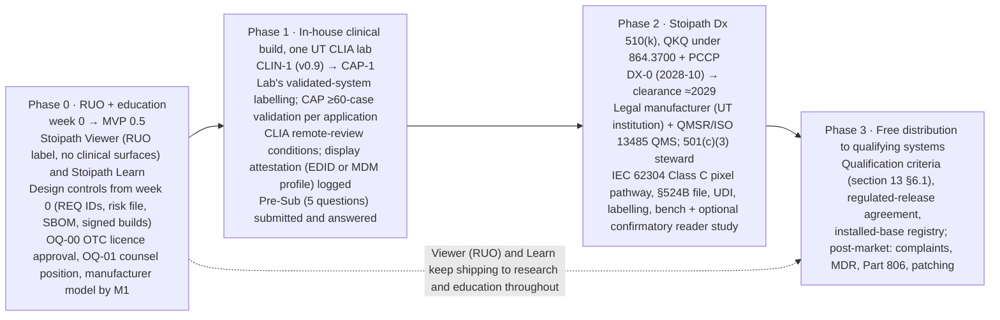

# Risks, compliance, security, licensing and open questions

Section 9 of the Stoipath WSI viewer development plan. Date 2026-10-24. Inputs: the decided architecture (`arch/recommended.md`, incl. the gap-5 amendment), research notes 01, 02, 07, 09, 10, 11-gap-2, 11-gap-3, 11-gap-6, 11-gap-7, 11-gap-8, the judge panel (`judge/ranking.json`, `judge/judgments.json`) and today's web verification of the regulatory facts note 09 left `[unverified]`. Tags as in the corpus: **[measured]**, **[model]**, **[estimate]**, **[verified]** (primary or near-primary source read today), **[unverified]**. Revised 2026-10-25 against the four-critic review (`critique/issues.json`) and the claims-verification report (`verify/README.md`, `verify/required-changes.json`); numbers touched by that report carry **(verified)**, **(adjusted after verification: was X)** or **(unverified - Stage 0 gate)** inline. Terminology follows `recommended.md` §5 (Engine contract, Edge Translator, Manifest, Dx mode, Rendering Complete flag, L0–L5, NTF%, TTS, G1–G13, M0–M5).

> **Scope note.** Regulation is kept at risk-register and summary level here. The full programme (device classification and predicates, Pre-Sub, QMS, legal manufacturer, PCCP, validation study, labelling, UDI, post-market, qualification criteria, distribution agreement, funding) is owned by section 13, **"Regulatory pathway to FDA clearance and the free-distribution model"**, built on research note `11-gap-8-fda-pathway-and-free-distribution`. Where this section and section 13 differ, section 13 governs for regulatory content and this section governs for the risk register, the security architecture, licensing mechanics and the open-question register; the facts in §3 were re-aligned to section 13 and gap-8 on 2026-10-25 (product code QKQ, IEC 62304 Class C for the segregated pixel pathway, separate build artefacts rather than a `mode` flag, manufacturer model, cost to clearance).

> **Date anchors.** The canonical calendar is section 10's sprint calendar: **week 0 = Monday 2026-10-26**; Stage 0 = three two-week sprints (weeks 0–6); **M0 = 2026-12-05** (M0 scorecard, ADR-0030). Later milestones are those of the Roadmap (section 07 §3) milestone table — M1 2027-01-29 (week 13), M2 2027-04-30 (week 26), MVP 0.5 2027-05-28 (week 30), v0.7 2027-07-30 (week 39), v0.9 / CLIN-1 2027-10-29 (week 52), v1.0 2028-06-09 (week 84), CAP-1 2028-06 → 2028-10, DX-0 2028-10-23 — and are quoted here for convenience only: **milestone IDs, not dates, are binding in this section**, and `docs/plan/calendar.yaml` (section 10) is the single machine-readable source if the Roadmap moves M1 after the six-week Stage 0. TSP facts are those verified by the owner on texpath.org (2026-10-24) and carried in section 11 B1: 106th TSP Annual Meeting 22–24 January 2027, Hyatt Regency Austin; 41st John R. Rainey, MD Residents'/Fellows' Seminar; abstract deadline **Friday 2026-10-30, 17:00 CT**, website submission, ≤ 350 words, no author/institution names in the file; the owner is an eligible resident and first author. The programme's **internal submit target is Thursday 2026-10-29** (one day early, section 11 B3). The earlier "T0 = 2026-11-02" anchor of this section is withdrawn.

## 1. What this section protects, and for whom

Goal 1 (instant zoom) is a residency problem solved once in `stoi-core`; the risks that can take it away are not renderer bugs but *contract* decisions made elsewhere: a tile-auth transport that adds a CORS preflight per cold zoom step, a CDN cache key that fragments per user or per embedding origin, a Dx-mode rule that forbids the cross-level blend, a licence that keeps the one bit-identical decoder out of the client. Goal 2 (reach) dies on licensing and embedding hygiene: one LGPL object in the wasm bundle or one third-party cookie dependency and the SDK is unshippable inside Epic Hyperdrive, an iOS XCFramework or a vendor LIS. Goal 3 (versatility) and the three pillars (clinical, research, education) each carry their own compliance regime: CLIA/CAP and FDA for clinical, IRB/de-identification and provenance for research, LTI/ACCME/ADA for education. The long-term aim (an FDA-cleared platform given free to qualifying hospital systems) means that every decision below must be made as if a Design History File will one day cite it; the research-use-only phase is the cheapest time to build that habit and the most expensive time to skip it (note 10 §1.10: ~10 % overhead now, prohibitive to retrofit).

Owners are the humans accountable at gates, since AI agents implement. Abbreviations: **PO** product owner; **TL** tech lead; **GL** graphics lead; **SL** systems/Rust lead; **BL** backend/infra lead (also security lead until a dedicated hire); **PQ** performance/QA engineer; **RA** regulatory/quality lead (fractional, ≈0.2 FTE from week 0 as section 10's sprint roles assume, 0.5 FTE from v0.7/W39 and 1.0 at v1 per section 13 §7; `recommended.md` §8's "from v0.9" is superseded by the week-0 design-controls decision); **LC** legal counsel (external); **PA** pathologist advisor; **AO** agent-pipeline orchestrator (owner of the execution loop); **DR** DevRel.

## 2. Risk register

Likelihood **L** and impact **I** on 1–5; score = L × I; ≥ 12 is tracked at every gate review. Early-warning indicators are written so an agent can evaluate them from repository artefacts wherever possible (a metric, a CI check, a dated external event). Items marked `(= R§10 #n)` restate `recommended.md` §10 risk *n* with owners and indicators added; nothing in §10 is contradicted.

### 2.1 Technical

| ID | Risk | L | I | Early-warning indicator | Mitigation | Owner / gate |
|---|---|---|---|---|---|---|
| T1 (= R§10 #1) | Compositor floor, per-tile upload cost on iOS Safari / Mali-G52 and A55 WASM decode are unmeasured; §4.4 web rows are floor-configuration sums, about one 60 Hz frame optimistic and two for wheel input **(verified: C01 — typical ≈48/61 ms desktop, ≈55–65/70–78 ms phone/iPad; wheel input→tick ≈27 ms)**; one public iOS data point puts upload at ≈2.3 ms per 512² tile on an A13 iPad, so G5 (≤ 2 ms/tile) is marginal on the 2020 A12 device **(verified: C10, WebKit 260460)**; A55 decode estimate widened to 10–24 ms/tile and the libjpeg-turbo-family WASM penalty to 2.9–4.4× **(adjusted after verification: was 9–15 ms and 2.1–2.9×; C11)** | 4 | 5 | G11–G13 results differ from `recommended.md` §4.4 by > 1 frame on any class; G9 pool speed-up < 1.8× under contention (1.2–1.6× measured on a loaded x86 box) | No external latency claim before WALT/camera numbers; the relative gates (warm I2P ≤ REF + 1 frame; REF-quad + 1 interval) are unchanged; recalibrate every absolute row at M0 from the device lab | PQ / Stage 0 |
| T2 (= R§10 #2) | 128 MiB phone L0 does not close: the working set is ≈65 MiB at DPR 2 / ≈81–89 MiB at DPR 3 at tile granularity, but two 64-layer arrays allocate the full 128 MiB at either DPR (zero headroom for revisit cache, in-flight uploads or the ≤ 100 ms cross-fade duplicates, +11–20 MiB transient) **(adjusted after verification: was ≈64/91 MiB; C09)**; process RSS runs 1.3–1.8× nominal texture bytes; W-iPad L0 256 + L1 64 MiB = 320 MiB already exceeds the G6 300 MB gate as written; the DPR cap is keyed to the network class, not to the L0 budget, so DPR 3 on hospital/classroom Wi-Fi is uncapped | 4 | 5 | M2 soak: peak > 60 % of the measured kill threshold, or any jetsam in 30 min, **measured as GPU Process + WebContent footprint on iOS (WebGL lives in the GPU Process) with layers filled, not merely allocated** **(verified: C09)** | Size arrays to the budget (e.g. 32-layer arrays); L0 defined as tile slots only, backbuffers/LUTs/overlays (≈35–40 MiB) counted separately in the kill-threshold budget; key the DPR cap to the L0 budget; §4.2 Pinned Base criterion max(w,h) ≤ 2048 px (11–22 tiles; ≈23 MiB only for square slides, 11–14 MiB typical **(verified: C07)**); eviction before pressure; dynamic budgets from OS signals; W-iPad L0 ≤ 192 MiB or G6 re-scoped | GL / M2 |
| T3 (= R§10 #3) | Floor module > 1.0 MB gz or cold start > 300 ms on floor Android; embedders reject weight. Deployable (post-wasm-bindgen, wasm-opt -Os) sizes: wgpu dual 0.80 MB gz, WebGL2-only 0.77 MB gz, WebGPU-only 34 KB gz, `web-sys` WebGL2 floor renderer 13.7 KB gz (33 KB with glam/serde_json/hashbrown/log) **(adjusted after verification: was 1.03 / 0.93 / 0.22 MB gz pre-wasm-bindgen; C13)** — G1 is governed by the core/format crates and the 0.6 MB target is reachable. Cold start is the larger risk: the corpus's "5–8 ms compile" was V8 lazy validation; eager Liftoff of a ≈3 MB module is 87–118 ms single-thread on x86, i.e. ≈180–1,200 ms on a floor phone **(adjusted after verification: was 50–100 ms; C13)** | 3 | 3 | G1 (state the unit: MiB vs MB; 1,028,041 B passes 1.0 MiB by 2 % and fails 1.0 MB by 2.8 %) / G2 on a deployable module, cold and code-cached; `size-limit` budget in CI breached | Separate decoder modules (171 KB, eager compile ≈30–80 ms phone), streaming compile with Chrome's code cache for modules > 128 KB, lazy-compilation cost measured inside the first frame, dual-wasm | TL / Stage 0, M4 |
| T4 (= R§10 #4) | Destination predictor mis-predicts (34 % of zoom bursts < 2.3 levels) and wastes metered bandwidth | 3 | 3 | Prefetch waste > 50 % at Stage 1; predicted-vs-actual logged from M0 | Confidence gating (≥ 2 consistent samples), L\*+1 window first, reader study (gap-1 F9) | GL, PA / M1 |
| T5 (= R§10 #5) | wgpu quarterly majors (v27 2025-10-01, v28 2025-12-18, v29 2026-03-19, v30 2026-07-01, v30.0.1 2026-08-22 latest; 77–104-day cadence **(verified: C19)**) and Safari WebGPU regressions; the WebGL interop (`create_texture_from_webgl_handle`) relied on as the B→C escape hatch is **unreleased trunk code, not in v30.0.1** **(adjusted after verification; C19)**, so that hatch is not additive today; `stoi-render-gl` is 3–5 kLOC with +3 PM as a floor **(adjusted after verification: was 2–3 kLOC; C19)** | 4 | 3 | Any G3/G4/G10 failure on a wgpu bump; new Safari-major WebGPU issue in `gfx-rs/wgpu` | wgpu native-only until v1, vendored and pinned, two-week upgrade window gated on G3/G4/G10; Safari WebGL2 default, per-major allow-list, "Restart with WebGL2" | GL / every release |
| T6 (= R§10 #7) | Android native driver fragmentation (Adreno u32 #5318, PowerVR #7669; issue states per gap-2's same-day read, not re-verified — GitHub was unreachable from the verification sandbox) | 4 | 3 | Golden suite failure on any of four GPU families per wgpu bump; `VK_ERROR_DEVICE_LOST` rate in beta telemetry | GLES retry, device allow/deny list, workarounds upstream | GL / M3 |
| T7 (= R§10 #8) | Dx determinism undermined by browser decoders (Safari ImageIO is a black box) or lossy HTJ2K: OpenJPH lossy output differs x86 vs aarch64 in 3 pixels of a tile (0.0011 %, max 1 LSB); reversible HTJ2K is identical **(adjusted after verification: was "0.002 % of samples across builds"; C12)**. libjpeg-turbo is bit-identical on 695/695 JPEGs across x86 SIMD/scalar, aarch64 NEON/scalar (qemu), jSquash and wasm-vips; Blink's decoder settings (JDCT_ISLOW + fancy upsampling + block smoothing) are now read from source; **WebCodecs `ImageDecoder` differed on 660/695 tiles and must never enter the self-certification allow-list** **(verified: C12)** | 2 | 5 | G7 < 1,000/1,000 on real arm64 hardware (qemu equivalence is functional evidence, not DHF evidence); G8 matrix shows a drift on a browser build previously allow-listed | libjpeg-turbo everywhere; `createImageBitmap` only after per-build self-certification, never on Safari in Dx; WebCodecs path excluded; one pinned OpenJPH; reversible HTJ2K only in Dx (lossy HTJ2K is not hash-identical across ISAs); Rendering Complete flag from day one | SL / Stage 0, every release |
| T8 (= R§10 #10, #11) | > 4 GB DICOM levels: EOT/Concatenation support uneven across VNAs; EOT (≈ 0.8 MB at base) slows client-direct readers at open; and Cloudflare checks its cacheable-size cap against the complete `Content-Range` size, so **raw range reads of objects > 512 MB (one-instance-per-level DICOM base 3–4 GB, level 1 0.75–1 GB) are uncacheable below Enterprise (5 GB)** — contradicting gap-5 F5 "DICOM range reads cache like any file"; Zarr 8×8 shards of 3.8–5 MB are unaffected **(verified: C21)** | 3 | 3 | VNA matrix at M1 shows any archive refusing EOT or decompressing despite `transfer-syntax=*`; > 1 RTT penalty at open in the M1 prototype; any L3 miss pattern on DICOM-backed tiles that tracks object size | Per-level EOT-vs-concatenation at ingest; ≤ 2 GB instance fallback; translator proxies non-conformant archives and serves DICOM frames as per-tile/bundle responses (L3 caches those as whole objects, so the 512 MB cap never applies on the hot path); Manifest published beside instances | BL / M1 |
| T9 (= R§10 #12, #13) | QuPath/OMERO (Bio-Formats on jzarr 0.4.2) read no Zarr v3; codec-namespace fragmentation delays the upstream programme 12–24 months | 4 | 3 | QuPath 0.8 changelog without zarr-java; `zarr-extensions` registration PR unmerged at v0.9 | DICOM + OME-TIFF export for QuPath at MVP; fund OMEZarrReader → zarr-java; URI codec id meanwhile; experiment holds no customer data | SL / v0.9 |
| T10 (= R§10 #14) | Lazy-tiler write into a live shard/instance on S3/R2 (no atomic append) corrupts concurrent reads | 3 | 3 | Any CRC/hash mismatch in the F9 prototype concurrency test | Write-new-object + Manifest pointer swap; synthesised levels as new instances | BL / M1 |
| T11 (= R§10 #15, #16) | HTJ2K decode too slow on W-4G (openjphjs) or absent in customers' cleared viewers; edge fan-out: R2 `get/head/list/put/delete` calls **do** count toward the Worker's 6-simultaneous-connection limit while awaiting headers, but a seventh call is queued (+1 R2 header RTT), not failed **(verified: C21, closes the R§10 #16 open question)**; the 1 MiB origin-range alignment and 17.5×/≈1,000× read amplification apply **only** to raw Range requests proxied to an origin, not to the Worker + R2 hot path where R2 returns exact ranges and L3 caches per-tile/bundle responses as whole objects **(adjusted after verification; C21)** | 3 | 3 | W-4G HTJ2K decode > 2× JPEG in the M0–M1 prototype; translator p99 > 10 ms hot **at a stated load (≤ 50 % utilisation)** — the naive coalesce-read-slice-copy bundle path measured p99 8.7–9.2 ms on two pinned cores vs 1.6–3.6 ms with per-tile pread/vectored writes **(verified: C22)** | JPEG baseline stays brightfield default; translator transcodes HTJ2K→JPEG where needed (Dx mode refuses transcoded tiles); bundles coalesce to one range per shard (≤ 4 shards for bundles ≤ 8 tiles wide; a 4K DPR-1 viewport reaches 6; over-read ≈1.3–1.4×); bundle path uses pooled buffers and vectored writes/sendfile; regional-origin fallback | BL / M1 |
| T12 | Safari ITP deletes script-writable storage (OPFS, Cache API) after **30 operating days** (days of Safari use) without user interaction for an ordinary first-party origin at WebKit trunk (`operatingDatesWindowLong = 30`); the 7-day window applies only to origins flagged by link decoration from a prevalent domain; MDN still says seven days and shipping Safari 27 behaviour is unconfirmed **(adjusted after verification: was 7 days; C17)**. `navigator.storage.persist()` is not consulted on the ITP path (confirmed). Exempt: Home-Screen web apps (installed PWA), app-bound and managed domains — so iPad classroom offline packs are viable inside an installed PWA. Chromium `estimate().quota` reports usage + 10 GiB, not the enforced 60 % of disk, so L2 sizing must not read it as a disk share **(verified: C17)** | 3 | 2 | L2 miss rate on returning iPad users ≈ cold; observe the live window on a real device over 30 days of use (Stage-0 documentary item) | L2 is a refillable cache, never a store of record (shard-file L2 with kept-open `FileSystemSyncAccessHandle`: reads p50 ≤ 0.2 ms vs 1.0–1.2 ms open/read/close); Manifest re-validation + cheap refill; education offline packs ship as an installed PWA on iPad | TL / M2 |
| T13 | Tile-identity / stale-tile bugs under throttled networks (endemic even in Mapbox 3.34-rc, OpenLayers 10.10/10.11 [verified note 07]) | 3 | 4 | Golden gesture replay with recorded byte-arrival times diverges between platforms; fiducial decode in Tier 1 shows a wrong (level,x,y) | Fiducial synthetic slides decode every drawn tile's identity in CI; replay with network record/replay (mitmproxy) on every PR | PQ / M0 |
| T14 | Regulatory stance on client-side filtering (mipmaps, cross-level blend, transient bicubic) and on the colour step in a Dx viewer is unknown (note 03 Q6, note 07 Q7); the colour step itself was specified three incompatible ways across sections (server-baked ICC vs server-computed LUT applied in-shader) until ADR-0026 below | 3 | 4 | Pre-Sub feedback or a design partner's RA objects to any resampling at rest; Dx pathway version changes without an ADR | Dx mode = deterministic settled frame, documented resampler, no sharpening at rest; one versioned Dx pixel pathway (codec, resampler, ICC LUT, filtering space, Rendering Complete) frozen before the RUO MVP ships (section 13 §3.4); Nav mode is explicitly "navigation image" (PCoIP precedent); question (2)/(4) of the Pre-Sub (section 13 OQ-26) | RA, PA / Pre-Sub |

### 2.2 Delivery and programme (agent-executed)

| ID | Risk | L | I | Early-warning indicator | Mitigation | Owner / gate |
|---|---|---|---|---|---|---|
| D1 (= R§10 #6) | Graphics seniors (wgpu/WGSL/Metal) and Rust systems hires slip; shells need Swift and Kotlin too | 3 | 5 | Two graphics seniors not in seat by M0; shell LOC > 5 kLOC | Hire graphics and PQ first; shells ≤ 3–5 kLOC over core view-models; UniFFI; iPad before Android | PO, TL / M0 |
| D2 | Effort under-estimate: the programme baseline is the Roadmap's (section 07 §9) **≈55–70 PM to MVP and ≈200–230 PM to v1** (platform + education + clinical integration + regulatory + reader study, after the 2026-10-25 MVP re-scope), of which the platform-only line is ≈45–55 / ≈150–170 PM (delivery judge's synthesis, ≈55–65 PM to MVP as originally scoped; C's 62 PM was judged ≥ 30 % low); the regulatory line in that total already carries section 13 §7.3's Class C delta (≈6–10 PM one-off plus ≈1–2 PM per Dx train for detailed design and unit-level verification) | 3 | 4 | Burn-down at M1 shows < 40 % of MVP scope at > 50 % of budget | Monthly re-estimate against gates, scope cuts pre-agreed (fluorescence ≤ 8 ch, annotations GeoJSON only at MVP); one baseline number for the TSP cost comparison (§6) | PO / M1 |
| D3 | Device lab and WALT rig not funded, not hosted or bought after the gates that need them; perf gates then run on cloud farms, whose timing is noise | 3 | 5 | Floor Android phone + 240 fps camera not on the bench by 2026-10-28 (the T0 number depends on it); 2020 A12 iPad, Xclipse Galaxy and photodiode rig not in hand by 2026-11-24 (Sprint 3, G11); WALT not in hand by M1; any gate "measured" on BrowserStack | Stage-0 device set is a **week-0 purchase** (section 10 Sprint 1), WALT by M1; lab (~USD 8–12k capex + 0.2 FTE [unverified pricing]) in the first budget; farms for compatibility only; the T0 evidence pack names the device measured and states that REF was measured on it the same day | PO, PQ / week 0, M0 |
| D4 | iPad shell slips from month 12 to B's 18–20; "instant on iPad" is a native-shell promise | 3 | 4 | XCFramework spike not green by v0.9 − 3 months | Spike at MVP; D's present recipe pre-verified (gap-4); UniFFI Swift generated from the core | TL / v0.9 |
| D5 | Agent-produced figures or claims leak into external documents without verification (every FDA/EU statement in note 09 was `[unverified]` at writing) | 4 | 4 | CI grep finds `[unverified]`/`[estimate]` in `docs/external/**`; a claim without a `[measured]`/source tag | Claims-verification discipline: every quantitative statement tagged; external docs built only from tagged sources; a human (PO or RA) signs each external release | AO, RA / every release |
| D6 | Agents introduce copyleft or proprietary code into the client core (a `cargo add`, a vendored snippet) | 3 | 5 | `cargo deny check licenses` or `license-checker` fails; SBOM diff shows a new licence family in `stoi-*` client crates | Allow-list per crate class (§5.3) enforced in CI; SBOM diff is a required PR check; licence-review queue for "unknown" | SL, LC / every PR |
| D7 | Secret or token leakage via agent logs, CI artefacts, or tile URLs with tokens in referrers | 3 | 5 | Secret scanning alert; a `?t=` token in any stored log | OIDC trusted publishing (no long-lived tokens), GitHub secret scanning + push protection, `Referrer-Policy: no-referrer`, log scrubbing tests | BL / every PR |
| D8 | Agent cost and time are not accounted, so the TSP cost comparison cannot be made and budgets cannot be forecast | 4 | 3 | Any merged PR without a provenance record (model, tokens, wall time, human review minutes) | Provenance ledger committed with each PR (`docs/provenance/runs.jsonl` + per-PR roll-up, the section 10 convention), aggregated weekly; budget alarms | AO / M0 |
| D9 | Human review becomes the bottleneck of the agent loop, or rubber-stamps | 4 | 3 | Median PR review latency > 2 working days; approvals with zero comments on > 80 % of PRs | Gates define what needs a human (architecture, licence, regulatory, external claims, releases); everything else merges on green machine checks; sampled deep reviews | AO, TL / M1 |
| D10 | Repository and plan drift (plan says X, code does Y) | 3 | 3 | Requirement IDs in the plan without a linked test; tests without requirement IDs | Repo is the single source of truth: plan sections live in-repo, requirement IDs on tests, traceability report generated per release | AO, RA / M1 |

### 2.3 Market and adoption

| ID | Risk | L | I | Early-warning indicator | Mitigation | Owner / gate |
|---|---|---|---|---|---|---|
| M1 | Integration burden, not rendering, decides adoption: ~15 % of US practices use WSI for primary diagnosis; cost and integration are the top barriers (CAP 2025, L.E.K. 2026 [snippet, gap-7]) | 4 | 4 | No UT lab has a signed Beaker launch-context test plan by v0.9 | MVP = IID-style launch + SSO + DICOMweb + iframe; v1 = HL7 status sync used for prefetch; everything LIS-specific in an integration service | PO / v0.9 |
| M2 | Incumbents erode the differentiators: Proscia's Aug 2026 PCCP clearance allows new scanners, formats and displays without a new 510(k) [verified trade press]; OSD/OL slowly fix stale-tile handling | 3 | 3 | A competitor publishes TTS-class latency numbers; OSD merges a direct-WebGL mode | Publish our harness and numbers first (note 07 R1); compete on openness and in-house verifiability, not on features | PO, DR / MVP |
| M3 | Epic distribution gating (Showroom review, Hyperdrive iframe quirks) | 3 | 3 | First in-house Hyperdrive embed fails cookie/COOP assumptions | Iframe-safe, no third-party cookies, no COOP/COEP from day one; first deployment in-house, not via Showroom | BL / v0.9 |
| M4 | Education content licensing stalls (most curated collections are non-commercial or bespoke) | 4 | 4 | Fewer than 200 CC-BY/CC0 teaching slides curated by MVP | Seed from IDC CC-BY and CAMELYON CC0; licence registry per slide; negotiate DAPA/Leeds early | PO, PA / MVP |
| M5 | Hospital procurement demands SOC 2 / ISO 27001, VPAT and a BAA even for free software | 4 | 3 | First IT security questionnaire returned with blocking items | Design to the HIPAA NPRM anyway (§4); WCAG 2.2 AA in MVP; third-party VPAT before any UT procurement; SOC 2 Type II for any hosted offering | BL, PO / v0.9 |
| M6 | "Free" is read as "unsupported"; hospitals will not run clinical software without an SLA | 3 | 4 | Qualification conversations stall on support, not features | Define the qualification criteria and the support/service model in the regulatory section; a funded service entity, not volunteers | PO / v1 |
| M7 | Standards drift: OME-NGFF 0.6 (2026-09-14), Zarr codec registration, DPOW TI (Nov 2026), FHIR R5/R6 `ImagingSelection` | 3 | 2 | Conformance suite fails against a new upstream release | Standards as façades over the Manifest; conformance corpus published; connectathon participation within 12 months | SL / v1 |

### 2.4 Regulatory, legal and compliance

| ID | Risk | L | I | Early-warning indicator | Mitigation | Owner / gate |
|---|---|---|---|---|---|---|
| R1 | "Free" does not mean outside FDA: giving a viewer to another institution for primary diagnosis is device distribution; the 510(k) and all post-market duties attach to intended use, not price. 21 CFR 807.3(b) defines commercial distribution as "held or offered for sale" [verified eCFR text]; CPG Sec. 300.600 lists FDA's criteria (offered for sale for a specific purpose without limitation, a purchase order accepted or ready to be accepted, not offered only for research/investigational use) but nothing public addresses **no-charge** distribution [verified via fda.gov listing extract; full text unread]. Either reading hurts: "not commercial" means the 21 U.S.C. 379j fee exemption applies but a 510(k) would strictly not be *required*; "commercial" means fees apply (section 13 §5.1). The plan files regardless | 4 | 5 | Any build with Dx mode or clinical-integration surfaces (HL7/FHIR write-back, sign-out events) running outside the validating UT lab before clearance, other than under a documented investigational-use arrangement (IUO label, IRB) | Counsel's written position (OQ-01, M1) and Pre-Sub question 5 (section 13 OQ-26); RUO build carries no clinical-integration surfaces (§3); in-house use at one UT lab under CLIA/CAP validation first (FDA LDT rule rescinded 2025-09-19 [snippet, gap-7]) with the in-house clinical build, distributed to no other institution | LC, RA / M1 |
| R2 | Predicate and pairing problem: QKQ clearances (software-only viewers under 21 CFR 864.3700; PSY is the code for systems that include a scanner) name scanners and displays — PathPresenter K250968 (2025-06-20, 81 FDA days): S360MD + one Barco MDPC-8127, bench + predicate, no reader study; Paige FullFocus K241273: GT 450 DX + S360MD + a display *set*; Barco MDPC-8127 lists six pairings [snippet]; every cleared QKQ IFU seen is FFPE-only and **excludes frozen sections and cytology**, so a frozen-section Dx claim is a separate indication (De Novo-class novelty per section 13 §2.3; the Roadmap §7 already treats frozen as a separate CAP application); tablets and consumer displays cannot carry a Dx claim; and **a browser cannot identify the physical display** (no EDID, no monitor identity; Window Management API Chromium-only and permission-gated; nothing inside a Hyperdrive iframe), so a browser-side "display QA module" is self-attestation | 5 | 4 | Pre-Sub feedback requires a pairing per scanner/display or refuses a PCCP display class; any Dx-mode session whose display attestation source is "user" | PCCP from the first Dx submission (Proscia precedent, 2026-08-06); first pairings S360MD and GT 450 DX, Barco MDPC-8127 + one Dell medical display (section 13 §2.4); **Dx mode only on surfaces that can attest the display** — the native desktop shell (EDID/monitor enumeration + ICC) or an MDM-managed browser whose display pairing is pushed by the hospital as `dx_profile.json` — with the attestation source and the cleared-configuration hash in the quality record; the v0.9 native desktop window is therefore a Dx prerequisite, not polish | RA / Pre-Sub, v1 |
| R3 | Design-controls debt: requirements traceability, ISO 14971 risk file, IEC 62304 lifecycle evidence (Class C detailed design and unit-level verification for the segregated pixel-pathway crates) and IEC 62366 usability file cannot be reconstructed later | 3 | 5 | Traceability report shows requirements without tests, or tests without requirement IDs, at M1; a Class C crate without detailed-design documentation at v0.9; the crate-layering test (section 10 §1) admits a dependency across the Class C boundary | Requirement IDs on every test from M0; risk file opened at M1 with the hazard list in §3 (incl. wrong slide/patient); IEC 62304 §4.3 segregation as an architectural fact enforced by the crate-layering test; usability engineering file started with gap-1 findings; archived evidence per release | RA, PQ / M1 |
| R4 | No legal manufacturer entity or QMS when clinical distribution is wanted (QMSR, ISO 13485:2016-based, in force since 2026-02-02 [verified]); and nobody with authority has approved the licence: under Regents' Rule 90101 the Board of Regents owns software created by UT employees, and an Apache-2.0 release needs the campus technology-commercialisation office's (OTC) approval [snippet, gap-8 F6] — the repository already exists, registry publishes (M2) and a public dashboard are distribution acts | 4 | 5 | OQ-00 (IP determination + OTC release approval) unanswered at the end of Sprint 1 (2026-11-07); no manufacturer-model decision by M1; any registry publish or public dashboard before OQ-00 lands | Default manufacturer model decided by **M1, not v0.9** (gap-8 §4.1 hybrid: a UT component institution registers as specification developer and holds the 510(k); a UT-affiliated 501(c)(3) stewards the Apache-2.0 core, signs distribution agreements, carries insurance), because it determines who may sign the licence and the distribution agreement; LICENSE file marked "proposed" and repository private until OTC approval; QMS on documented free tooling (qmsOS/OpenRegulatory templates) stood up in Phase 2–3, procedures drafted before v1 | PO, LC / Sprint 1, M1 |
| R5 | Cybersecurity obligations: FD&C §524B (SBOM, vulnerability plan, secure development) for cyber devices [verified]; the governing FDA guidance is *Cybersecurity in Medical Devices: QMS Considerations and Content of Premarket Submissions* dated **2026-02-03**, superseding 2025-06-27 [verified by section 13 via FDA PDF title/date extract and RAPS; closes OQ-11]; EU CRA reporting duties since 2026-09-11, full obligations 2027-12-11 [verified secondary], and an RUO viewer is *not* exempt | 4 | 4 | SBOM missing from a release; CVE in a parser (OpenSlide 4.0.1 fixed two [verified]) without a patch inside the disclosure window | §4.5: SBOM per release, OSV monitoring, sandboxed parsers, CVD policy, signed updates | BL, RA / MVP |
| R6 | HIPAA Security Rule NPRM (Jan 2025: mandatory encryption, MFA, 72-hour restore, annual pen test) now slated for July 2027 [verified secondary]; design uncertainty | 2 | 2 | Final rule published | Design to the NPRM now; nothing in the architecture depends on the outcome | BL / v1 |
| R7 | CLIA remote-review conditions shift (cytology discretion ended 2026-03-23; Oct 2026 proposed rule) | 3 | 3 | Final rule text differs from QSO-23-15 | Mode-specific policy engine (dx/ruo/edu per launch context); cytology excluded from remote modes until the rule is final | RA, PA / v1 |
| R8 | PHI leakage through label, macro, barcode, filename, scan dates, scanner serial — not through tissue tiles | 3 | 5 | Any Tier 2 object with a CDN cache hit; any PHI field in RUM payloads | Three PHI tiers (§4.3); Tier 2 never cached at the edge; de-identification writes a new object; PHI-free telemetry by construction, tested | BL / M1 |
| R9 | IP: Philips iSyntax patents and SDK EULA vs `libisyntax` (BSD-2, IP unassessed); LGPL static linking in wasm/iOS; Bio-Formats GPL boundary in on-prem bundles | 2 | 5 | Counsel has not signed off before a copyleft or iSyntax component ships | §5: permissive-only client; LGPL/GPL process-isolated server-side; libisyntax gated on counsel review; Glencoe commercial licence as fallback | LC, SL / MVP |
| R10 | EU IVDR Class C (notified body, 12–18 month queues) if the Dx edition is ever distributed in the EU; no transitional relief for a new device **[unverified]** | 2 | 4 | Any EU hospital in the qualification pipeline | US-first; IVDR only with a European partner; keep the technical file IVDR-shaped | RA / v1 |
| R11 | Accessibility is a legal gate for UT (ADA Title II WCAG 2.1 AA; Texas TAC 206/213) [verified via university pages, gap-6] | 3 | 4 | VPAT with any "does not support" on core navigation | WCAG 2.2 AA in MVP; keyboard pan/zoom; text alternative for region items; CVD remap LUT | TL / MVP |
| R12 | AI-overlay liability: a rendering change alters an algorithm's appearance; EU AI Act high-risk obligations for AI vendors we host (2 Aug 2027, Digital Omnibus pending) **[unverified]** | 2 | 4 | Vendor refuses to validate on our renderer | Deterministic overlay path; layer provenance `{producer, version, inputHash, regulatoryStatus}`; vendor validation contract | SL, RA / v1 |
| R13 | Re-identification in teaching sets (rare cases, dated narratives) and research exports | 2 | 5 | Teaching-set stage bypassed; dates finer than year in an export | Teaching-set pipeline stage with logged determination; year-only dates; withdrawal hook per slide | PA, RA / MVP |
| R14 | Post-market obligations (complaint handling, MDR reporting, Part 806 corrections and removals, security patching, UDI, installed-base registry) are unfunded because the product is free: section 13 §5.3 prices them at ≈$0.5–0.95 M/yr fixed (people, insurance, pen test, eQMS, lab, fees) plus 35–60 PM/yr engineering maintenance, ≈$1.2–2.0 M/yr steady state, against grants (NCI ITCR, CPRIT, ARPA-H), philanthropy, consortium dues and cost-recovery services | 3 | 5 | No post-market budget line in the v1 plan; no funded service entity at DX-0 | Service model and funding per section 13 §5.3–5.4; UDI as plain text at startup and in a menu for stand-alone software (21 CFR 801.50 [verified]) and the cleared-configuration hash in the About screen designed in now | PO, RA / v1 |
| R15 | TSP abstract overclaims: a viewer alone cannot show patient-care impact; no diagnostic-equivalence claim without a validation study; an "X× faster than OpenSeadragon" figure measured against OSD's defaults would measure request rationing (`maxTilesPerFrame` 1 → 10,5,3,2,1 tiles/frame) and the 1.2 s spring animation rather than rendering **(verified: C24)**; the January talk (22–24 Jan 2027, before M1) can carry only M0 plus the Tier-2 nightly trend | 3 | 4 | Abstract draft contains "diagnostic", "equivalent", "saves" without a cited measurement; any comparator number without the tuned-profile protocol; a slide claiming M1 data for the January talk | Abstract limited to measured latency vs baselines on de-identified public slides (OSD 6.1.1 in the tuned profile: `maxTilesPerFrame` 100, `immediateRender`, cold and warm reported separately; input-to-swap/I2FC proxies, not input-to-photon, until the photodiode rig exists), provenance and cost accounting against the section 07 §9 baseline, and the in-house-verifiability argument; presentation data freeze T1 = 2027-01-15 (week 11, seven days before the meeting; section 07 §3); PA and RA review | PO, PA / 2026-10-29 internal, TSP deadline 2026-10-30 17:00 CT |
| R16 | **Wrong slide or wrong patient displayed** — the first hazard of any clinical viewer and absent from the earlier hazard lists; a pathologist signing out from a Hyperdrive iframe has no mandated way to confirm slide identity because the label/macro live in PHI Tier 2 | 3 | 5 | Contract test with mismatched launch-context/Manifest pairs fails or does not exist; a clinical/Dx-mode session without the label image and accession/part/block identifiers rendered; any `identityMismatch` event in production | Clinical and Dx modes display the Tier-2 label image and the launch-context identifiers (accession, part, block, slide label text) by default via the `/assoc/label` token scope; the shell verifies `LaunchContext.slideIds`/`studyUID` against the Manifest `sid` and DICOM UIDs before drawing and emits `identityMismatch`; HAZ entry in the ISO 14971 seed (section 10 S1-12) with REQ IDs (FR-I1/FR-R3) | SL, RA / M1 |
| R17 | The RUO label is used for diagnostic work: FDA judges RUO status on the totality of circumstances (marketing, features, customers; 2013 RUO/IUO guidance [snippet, gap-8 F3]); a build labelled "Not for use in diagnostic procedures" that issues frozen-section preliminaries, carries LIS sign-out integration or Dx-mode display gating jeopardises both the RUO channel and the later 510(k) | 4 | 5 | CI build-flag matrix finds HL7/FHIR write-back, `signoutRequested` events or a Dx gate in the RUO artefact; a `mode` flag used as the legal boundary between pillars | Four build artefacts from one commit set, not a flag (§3); mode engine refuses clinical-integration surfaces in the RUO build; counsel confirms the artefact split satisfies the totality test (OQ-35) | PO, LC, RA / MVP |

## 3. Compliance roadmap (summary)

The posture is note 09 option D as amended by gap-8 and section 13: an **Apache-2.0 core** carrying design controls from week 0, released as **four build artefacts from one commit set, not one build with a `mode` flag** — (a) **Stoipath Viewer**, the RUO distribution build ("For Research Use Only. Not for use in diagnostic procedures."; no LIS/HL7/FHIR write-back, no sign-out events, no Dx-mode display gate; the RUO string asserted by CI); (b) **Stoipath Learn**, the education product (own name, not a device, no PHI by construction); (c) the **in-house clinical build** for the validating UT CLIA laboratory (Dx-mode capable; labelled under the laboratory's validated-system labelling and CLIA/CAP; the only pre-clearance artefact with clinical-integration surfaces; distributed to no other institution — this is what CLIN-1 and CAP-1 run); (d) **Stoipath Dx**, the cleared edition (frozen, signed, reproducible build whose configuration hash is checked by the Dx gate) released later through the regulated-release channel. A flag is not enough because FDA judges RUO status on the totality of circumstances **[snippet, gap-8 F3]**; section 13 owns the names and the labelling text, and OQ-35 asks counsel to confirm the split. Gap-7 supplies the middle step that makes the free-distribution aim reachable without a 510(k) first: a single UT CLIA laboratory may validate and use a non-cleared in-house viewer for primary diagnosis under CAP's WSI guideline (≥ 60 cases per application, ≥ 2-week washout, the whole system incl. display and network, revalidation on material change) because FDA's LDT rule was rescinded on 2025-09-19 and enforcement discretion continues for lab-developed tools used within one laboratory **[snippet, gap-7; OQ-03, counsel to confirm the lab-tool analogy — an explicit predecessor of the Roadmap's CLIN-1 and CAP-1 milestones]**. Distribution to *other* institutions for diagnosis is 21 CFR 864.3700 territory: Class II, special controls, **product code QKQ** for software-only "digital pathology image viewing and management software" (PSY is the code for systems that include a scanner; note 09 and the first draft of this section had PSY — corrected per gap-8 F1 and the K250968 record **[verified: 510kdatabase.net / innolitics mirror of the FDA record]**). The predicate pattern is favourable: at least 13 QKQ devices since Sectra K193054 (2020) — Paige FullFocus K201005/K241273, Proscia Concentriq AP-Dx K230839 and its 2026-08-06 PCCP clearance, PathPresenter K250968 (81 FDA days), PathAI K243391, Indica K252762, INFINITT K243449 — and **viewer-only sponsors have cleared with named scanner/display pairings and bench pixel-pathway equivalence, without a reader study** (the reader-study special control is read "as appropriate" when the predicate carries the clinical evidence) **[snippet, gap-8 F1]**. Every QKQ IFU seen is FFPE-only and excludes frozen sections and cytology, so the plan's frozen-section emphasis is a separate indication (section 13 §2.3) and, pre-clearance, a separate CAP validation application (Roadmap §7). The pathway is therefore a Traditional 510(k) with a viewer predicate plus a PCCP from the first filing; the Pre-Sub (free; five questions, section 13 OQ-26) is the first regulatory engagement — the critique asks for it in H1 2027 (drafted by M2) rather than section 13's ≈W40; section 13 §7 owns that date.

| Area | Phase 0 (RUO + education builds, week 0 → MVP) | Phase 1 (in-house clinical build, one CLIA lab, CLIN-1 → CAP-1) | Phase 2–3 (Stoipath Dx, post-v1) | Machine-checkable evidence |
|---|---|---|---|---|
| Intended use and labelling | "For Research Use Only. Not for use in diagnostic procedures." on the Viewer build, splash and SDK README; Learn carries its own name and no device claim; **no LIS/HL7/FHIR write-back, sign-out events or Dx gate compiled into the RUO artefact** (a `mode` value in the launch context selects UI behaviour inside an artefact, never the legal boundary between artefacts) | In-house clinical build under the lab's own validated-system labelling; Dx mode enabled only on displays the surface can attest (native shell EDID/ICC, or an MDM-pushed `dx_profile.json`) at that site | 510(k)-cleared labelling naming scanner/display pairings or a PCCP class; UDI and cleared-configuration hash as plain text at startup, About screen and menu | CI build-flag matrix: RUO artefact contains none of the clinical surfaces and carries the RUO string; Dx mode refuses to start without a display attestation record and a matching configuration hash |
| Software lifecycle (IEC 62304: **Class C** for the segregated Dx pixel pathway and case/slide identity — `stoi-codec`, the Dx paths of `stoi-draw`/`stoi-render(-gl)`, the Dx gate, slide identity, the Translator's Dx pixel path; Class A/B for navigation, annotation, management, education and research behind an IEC 62304 §4.3 boundary; FDA documentation level Enhanced; ADR-0014 as amended, section 13 §3.4 — the earlier "assume Class B" is withdrawn) | Requirement IDs on tests; architecture and SOUP list (the SBOM); Class C boundary defined in code and enforced by the crate-layering test | Problem-resolution process; detailed-design documents and unit-level verification records for the Class C crates; release records archived | Full lifecycle file; SOUP risk assessment per dependency; Pre-Sub confirms class and documentation level | Traceability report per release: 0 untraced requirements, 0 untagged tests; layering test: no Class A/B crate on a Class C dependency path |
| Risk management (ISO 14971) | Hazard list opened at M1 (seeded in section 10 S1-12): **wrong slide or patient displayed** (R16), mis-rendered or missing pixels at rest (blur at ≥ 20×, pop-in, stale tile identity), colour shift (ICC LUT), wrong Z-plane/level, stale cache, label/PHI leak, overlay misregistration | Risk controls verified in the device lab (NTF%, blank-pixel frames = 0, fiducial identity, launch-context ↔ Manifest identity contract test, ΔE on the composited frame) | Risk/benefit and residual-risk report in the submission | Each hazard ID maps to ≥ 1 gate metric with a threshold; the identity-mismatch contract test exists and passes |
| Usability (IEC 62366-1) | Pathologist paths in the camera-path DSL; gap-1 human-factors findings as use-specification inputs | Formative evaluations during the CAP study | Summative usability study on the Dx edition | Formative reports stored under requirement IDs |
| Cybersecurity (§524B; CRA for RUO) | SBOM (SPDX/CycloneDX) per release; OSV; sandboxed parsers; CVD policy; signed releases | Pen test; vulnerability-management plan exercised | Premarket cyber file (threat model, SBOM, patch plan) | SBOM present in every release; `cargo audit`/`cargo deny` green; CVE-to-patch time logged |
| DICOM conformance | Client conformance statement (PS3.2) with the first DICOMweb release: VL WSI Storage, Microscopy Bulk Simple Annotations, transfer syntaxes JPEG/HTJ2K/JXL, QIDO/WADO-RS incl. `frames/{list}`, STOW-RS | DPIA Image Display actor; connectathon within 12 months | Conformance statement frozen per cleared version | Third-party-reader CI smoke tests (wsidicom, pydicom, Orthanc, dcm4chee; zarr-python, zarrs, zarrita, tensorstore) per `recommended.md` §3.1 step 3 |
| De-identification and identity | Three PHI tiers at ingest (§4.3); `wsidicomizer --no-label --no-overview`; own Apache-2.0 reimplementation of `anonymize-slide` logic; Tier-2 label image and accession/part/block identifiers shown by default in clinical/Dx modes via the `/assoc/label` scope (R16) | Tier policy audited per site; teaching-set stage; identity verification before first draw | PS3.15 Annex E profile documented in labelling | CI: no Tier 2 object has a public cache header; export fuzz for dates finer than year; mismatched launch/Manifest pairs raise `identityMismatch` |
| Clinical validation | None claimed; the public latency baseline is MSK's 108–238 ms median per field of view by vendor path (Schüffler 2022; the same-vendor decode/re-encode penalty is +59–100 ms/FOV, not the +130 ms earlier attributed to transcoding **(adjusted after verification; C22)**) | CAP study tooling in-product (blinded re-review, sampling, washout, concordance export); the ≥ 60-case CAP validation at the first UT lab doubles as formative evidence | Analytical bench equivalence per the special controls and TPA guidance; a compact confirmatory reader study (200–400 cases, 3–4 readers) only if the Pre-Sub asks for it (section 13 §4.2) | Study data exported with provenance from the event bus |

Everything else — QMS procedures, legal-manufacturer form, predicate selection, Pre-Sub package, PCCP scope, reader-study design, labelling, UDI issuance, post-market surveillance, the qualification criteria (section 13 §6.1 supplies them from gap-8 F8's REDCap-style template: CLIA certificate + CAP AP accreditation, CAP WSI validation with a returned summary, cleared or PCCP pairings only, display-QA programme, security attestation, training, signed regulated-release agreement), the distribution agreement, liability/indemnification (a UT holder cannot indemnify — Tex. Const. art. III §49 — which is why the 501(c)(3) steward carries insurance) and funding — belongs to section 13, **"Regulatory pathway to FDA clearance and the free-distribution model"**.

## 4. Security architecture summary

### 4.1 Identity and launch

OIDC against the hospital or university IdP (Entra ID / InCommon SAML bridged to OIDC) for the first-party apps; **SMART App Launch 2.2.0** adapter for EHR-embedded launch; **LTI 1.3** for LMS launch (identity travels in the launch JWT); IHE IID-style context URL plus an opaque `launch` token for LIS worklists. The SDK always accepts an externally supplied token so LIS, PACS and Jupyter hosts keep their own login, and exchanges it for tile capability tokens (§4.2). Authorisation is decided once, at token issuance, at slide/study/collection grain (RBAC or Cedar/OPA), and encoded as scope; per-slide ACLs then cost nothing on the hot path, and sharing is a capability link with expiry.

### 4.2 Tile authorisation: the latency decision

The Fetch standard keys the CORS-preflight cache per URL and `Authorization` is not a CORS-safelisted header [verified note 09], so a cross-origin bearer-token tile fetch pays one preflight per distinct tile URL. On HTTP/2 the preflights parallelise, so the cost is ≈ 1 RTT per *cold zoom step*: 20–60 ms at a CDN edge, 50–150 ms on mobile **[model, note 09]** — larger than the whole W-BB TTS budget (≤ 100 ms p50). Cookies avoid the preflight but die in third-party embedding (Safari blocks, Chrome partitions). Per-tile signed URLs defeat the shared cache unless the signature is stripped after validation. Hence:

| Transport | Extra RTT on a cold zoom step | Shared-cache hit across users | Works embedded (iframe, WebView, Hyperdrive) | Revocation | Verdict |
|---|---|---|---|---|---|
| Session cookie to same-origin proxy | 0 | Yes if edge strips cookie from key | **No** | Server-side kill | First-party web app only |
| `Authorization: Bearer` (IUA / DICOMweb pattern) | **+1 RTT** cross-origin | Only with `public`/`s-maxage` and edge stripping; most DICOMweb servers send `private` | Yes | Token TTL | Keep for "talk to someone else's PACS" through a same-origin proxy |
| Per-tile HMAC-signed URL | 0, but +1 RTT per batch to fetch the URL list | No unless signature excluded from key | Yes | TTL | Rejected |
| **Prefix-scoped capability token in the query** (`?t=…` covering `/slides/{id}/**`), ES256 JWT or macaroon, validated at the edge (Worker / Caddy / nginx), stripped from a **path-only cache key**, `Origin` excluded | **0** | **Yes** (first viewer warms the edge for everyone) | Yes (no cookies, no custom headers) | TTL 5–15 min + silent refresh; optional edge KV deny-list ≈ 1 ms | **Adopted** (ADR-0012) |
| Client-side AES-GCM decryption of publicly cached ciphertext | 0 | Fully public cache | Yes | Key rotation | Roadmap: untrusted CDNs and offline packs |

Consequences baked into the URL scheme now: `Referrer-Policy: no-referrer` on every page that holds a token; token scrubbing in CDN and translator logs (tested); never PHI in a path; `Timing-Allow-Origin` and `Server-Timing` on tiles so RUM can attribute latency without request headers; no `traceparent` on the tile path (it reintroduces the preflight). Note 02's "never query-string signatures" and note 09's capability token agree once the token is excluded from the cache key; the Edge Translator's path-only key is the reconciliation.

### 4.3 PHI tiers and what the CDN sees

| Tier | Contents | Storage and access | Edge cacheable |
|---|---|---|---|
| 2 — direct identifiers | Label image, macro/overview image, barcode, original filename, free-text metadata, DICOM Patient/Study/Specimen modules | Separate bucket/prefix, own ACL and audit; role-gated layer in the viewer; vendor originals cold under this ACL | **Never** |
| 1 — Safe-Harbor-adjacent | Scan date/time finer than year, scanner serial, operator | Metadata store; shifted/truncated on de-identified export | No |
| 0 — pixel pyramid | Brightfield canonical (DICOM WSI `TILED_FULL`+EOT) and multichannel canonical (OME-Zarr 0.5 shards); linked but not identifying | L5 object store; served by the Edge Translator | Yes (L3/L4) |

De-identification is an ingest stage producing a new object, never an in-place edit. Teaching sets add a review stage (narratives, rare cases, year-only dates, logged determination, withdrawal hook).

### 4.4 Audit

HIPAA §164.312(b) wants audit controls, not per-tile logs. Audit records derive from the typed event bus (`slideOpened`, `viewChanged` sampled, `annotationCreated`, `aiResultAccepted`, `caseStatusChanged`, `shareCreated`, `displayQaStatus`, break-glass) and are emitted as FHIR `AuditEvent` / IHE ATNA with purpose-of-use. Logged: token issuance (who, which slides, from which app), session open/close, a sampled viewport trail (level, centre, time), display-QA status at Dx-mode entry. The trail doubles as research-reproducibility and RUM data. CDN access logs are infrastructure logs with tokens scrubbed, not the audit trail. Retention is policy-driven (1–6 years typical; ACCME needs 6 years for CME participation records). Whether compliance officers accept a *sampled* trail for sign-out cases is OQ-13.

### 4.5 Product and supply-chain security

| Threat | Control | Evidence an agent can check |
|---|---|---|
| Malicious slide bytes (parser RCE; OpenSlide CVE-2026-48977/-54604 [verified]) | Client parsers run in wasm (sandboxed by construction); server ingest in gVisor/Firecracker with seccomp, one container per licence class; fuzz-first readers (cargo-fuzz + `arbitrary`, ClusterFuzzLite 60 s/PR, 24 h nightly; ASan/UBSan on C deps) | Fuzz target exists for every reader; 24 h zero-crash before a reader ships |
| Vulnerable dependency | SBOM (SPDX/CycloneDX) per release; `cargo audit`, `cargo deny`, OSV subscriptions; §524B/CRA vulnerability-management plan; CVD policy (`SECURITY.md`, 90-day window, `security.txt`) | SBOM attached to every release; CVE-to-patch time ≤ policy |
| Compromised release channel (seven channels: npm, PyPI, crates.io, SwiftPM, Maven, NuGet, OCI) | OIDC trusted publishing where GA (PyPI verified; npm CLI ≥ 11.5.0 `npm trust` verified; crates.io GA wording unverified), cosign signatures, SLSA provenance attestations, install-from-registry smoke tests | Unsigned artefact fails release validation |
| Token theft | Short TTL, prefix scope, optional DPoP-style binding, edge deny-list, `no-referrer`, log scrubbing | Scrubbing test in CI; TTL asserted in config |
| PHI in telemetry | PHI-free RUM by construction (slide IDs only), kill switch and air-gap mode as first-class settings, self-hosted RUM or BAA | Telemetry schema test rejects any PHI field |
| Lost or stolen tablet with offline packs | OS-encrypted storage, MDM remote wipe, device-bound tokens | Pack writer refuses unencrypted storage |
| Data in transit / at rest; MFA | TLS 1.3 (HTTP/3 at the CDN/Caddy, never in-process), encryption at rest, MFA via IdP; 72-hour restore drill; annual pen test; SOC 2 Type II / ISO 27001 for hosted offerings | Restore-drill record; pen-test report per year |
| Air-gapped sites | No external dependency at runtime (fonts, telemetry, OIDC → local IdP); media-based updates with signatures | Air-gap integration test in CI |

## 5. Licensing decisions

### 5.1 Project licence and the regulated-release channel

**Apache-2.0 for the core, SDKs and Edge Translator, with DCO sign-off** (ADR-0010): the explicit patent grant with defensive termination matters in a field where Leica, Philips, Roche, Hamamatsu and 3DHISTECH hold scanner, viewer and codec patents; it is compatible one-way with GPLv3 (Bio-Formats is GPL-2.0-or-later); AGPL is on most hospital vendors' prohibited lists and contradicts Goal 2. A registered trademark with a usage policy protects the name of the cleared edition. A CLA is needed only if relicensing optionality is wanted; decide now (OQ-05).

**Who may decide this, and when.** The owner is a UT resident and the code is written by UT employees and their agents: under Regents' Rule 90101 the Board of Regents owns it and creators cannot license it themselves; UT Austin and UT Southwestern have procedures that permit open-source release, but an Apache-2.0 release needs the campus technology-commercialisation office (OTC) to approve the licence choice **[snippet, gap-8 F6]**. The repository already exists and the TSP abstract calls the project open-source, so this is the first legal gate of the programme, not a v0.9 item: **OQ-00** (IP ownership determination and OTC open-source release approval) is owned by PO + LC and due at the end of Sprint 1 (2026-11-07); section 10's S1-02 gate for the LICENSE file and ADR seed becomes "PO + TL + OTC written approval"; until it lands the LICENSE file is marked *proposed*, the repository stays private, and no registry publish (npm/PyPI/crates.io at M2) or public performance dashboard happens. The manufacturer/steward model (gap-8 §4.1 hybrid, section 13 §5.1) is decided by **M1**, because it determines who signs the licence and the regulated-release agreement.

**Regulated-release channel, not "commercial" (ADR-0010 wording; to be carried into `recommended.md` Amendment 2 and section 10's ADR seed 0007, not left as a reviewer note).** `recommended.md` §7 ends its QA row with "Apache-2.0 + DCO core and SDKs, Dx edition and enterprise edge commercial", and section 10's provisional ADR 0007 copied it. That wording predates the owner's long-term aim. It reads **"regulated-release channel, free to qualifying systems"**: Stoipath Dx is the same Apache-2.0 code as a frozen, validated, reproducible, signed build whose configuration hash is checked by the Dx gate and published in a cleared-configuration register, distributed at no charge to systems that meet section 13 §6.1's qualification criteria under a regulated-release agreement (labelling and IFU, no-modification clause for the cleared binary — a hospital that modifies it and uses it clinically becomes the manufacturer of its own device — complaint and adverse-event reporting duties, display-QA and training obligations, limitation of liability; **no indemnity from a UT holder**, Tex. Const. art. III §49, so insurance sits with the 501(c)(3) steward). Cost-recovery services (hosting, integration, validation support) and OEM embedding by vendors remain possible funding lines (section 13 §5.4) but are not the default and never gate access for a qualifying system. Apache-2.0 permits all of this without a CLA. Section 13 owns the agreement text.

### 5.2 Licence classes

| Class | Where it may run | Examples (versions and licences from `recommended.md` §7 and notes 01/09, verified 2026-10-24) | Why |
|---|---|---|---|
| **Permissive only** (MIT, Apache-2.0, BSD-2/3, ISC, Zlib, IJG, Unlicense) | `stoi-*` client crates, wasm bundle, XCFramework, AAR, PyO3 wheel, C ABI, Edge Translator | Rust toolchain, wgpu (MIT OR Apache-2.0), libjpeg-turbo (IJG + BSD-3 + zlib), OpenJPH (BSD-2), libjxl (BSD-3 + patent grant, if ever in the client), `tiff` 0.11.3 (MIT), `dicom-object` 0.10 (MIT OR Apache-2.0), `zarrs` 0.23.14 (MIT OR Apache-2.0), `turbojpeg` 1.5.1 (Unlicense OR MIT), `axum`/`hyper`/`tower-http` (MIT), Lit 3.3 (BSD-3), UniFFI/cbindgen (MPL-2.0 tooling; generated code unencumbered), anywidget (MIT) | Static linking into wasm and iOS is a static link; LGPL §6 relinking duties and App Store terms make copyleft unshippable in SDKs; proprietary embedders reject it from the SBOM |
| **LGPL, process- or dynamically-isolated, server only** | Ingest workers in their own container image (`ingest-*`); the **IIIF off-grid slow path** (arbitrary-region resampling that sections 02 FR-S8 / 03 §4 / 04 §5 routed to "a rate-limited libvips slow path") runs in a separate `iiif-slow` LGPL worker image behind an RPC boundary, **never inside the Edge Translator binary**, which stays permissive-only; the alternative that keeps it in-process is a permissive Rust resampler (`image` / `fast_image_resize`, MIT OR Apache-2.0 **[registry licences unverified today]**) and is preferred if its quality passes the ΔE/Siemens-star goldens | OpenSlide 4.0.1 (LGPL-2.1-only), libvips 8.18 (LGPL-2.1+), libCZI (LGPL-3 or commercial) | Decode-fallback for Tier D formats and off-grid IIIF; never in a shipped SDK or in `server/translator/` |
| **GPL, process-isolated, server only** | Own container, RPC boundary | Bio-Formats `formats-gpl` + bioformats2raw (GPL-2.0+), `jpegxl-rs` 0.16.0 (GPL-3.0-or-later [verified crates.io]), `anonymize-slide` (GPL-2; logic reimplemented, not linked) | "Mere aggregation" defence needs a genuine process/API boundary in on-prem bundles; counsel sign-off or Glencoe commercial licence (OQ-06) |
| **Proprietary, sealed** | Optional ingest worker, separate EULA, never redistributed | Philips Pathology SDK (openpathology.philips.com; reportedly forbids LGPL combination and redistribution [secondary]) | Validation oracle and emergency fallback for iSyntax only |
| **Content and specs** | Test corpora, teaching sets, façades | IDC (> 95 % CC-BY), CAMELYON (CC0), OpenSlide testdata (mostly CC0/PD [unverified]); vendor samples private, never in CI logs; Iris spec CC-BY-ND (façade only; MIT code) | Licence registry per slide with consent basis, de-identification record and withdrawal hook |

### 5.3 Dependency licence audit (machine-checkable)

`cargo deny check licenses` with an allow-list per workspace member (client crates and `server/translator/`: permissive only; server crates: + LGPL/GPL *only* in the `ingest-*` and `iiif-slow` members); `license-checker` for npm with the same allow-list; `pip-licenses` for Python; a per-container-image SBOM so the licence class of every image is explicit. A PR fails if the SBOM diff introduces a new licence family into a client crate or an "unknown"/"NOASSERTION" entry anywhere; unknowns go to a human review queue (SL, then LC). Weekly OSV scan on every SBOM row. The audit runs on agent-authored PRs exactly as on human ones; it is the primary control for risk D6.

### 5.4 Vendor SDK and third-party component handling

| Component | Decision | Condition / re-open |
|---|---|---|
| Philips iSyntax | Prefer `libisyntax` (BSD-2) after a documented IP review (patents, SDK EULA field-of-use); Philips SDK only in a sealed worker as oracle | Counsel opinion (OQ-07) before any iSyntax ingest ships; Philips' move to DICOM output (2026 conformance statement lists JPEG XL [unverified product]) may shrink the problem |
| Zeiss CZI | libCZI (LGPL-3) isolated, or slideio (BSD-3) | Commercial libCZI licence if a mobile/desktop local-file CZI reader is ever required |
| Bio-Formats | GPL-isolated container for Bio-Formats-only sources; fund OMEZarrReader → zarr-java upstream | Glencoe commercial licence if counsel rejects process isolation for on-prem bundles |
| OpenSlide / libvips | Server-side decode fallback and converter; never in the client; `openslide-js` (LGPL, needs SAB) rejected for the client | A permissive raw-tile Rust reader (`wsi-rs` 0.8, MIT/Apache-2.0, maturity unverified) could replace OpenSlide for desktop local files after a corpus evaluation |
| wgpu | Vendored and pinned per release train | Upgrade window gated on G3/G4/G10 |
| Qt | `QQuickItem` sample over the C ABI only; the sample is not a dependency of the SDK | Qt commercial terms only if a customer host requires a shipped Qt component |
| Iris RESTful Server / IFE | Façade only (WADO-RS-shaped API); spec is CC-BY-ND, code MIT | Never canonical |
| libvips for IIIF off-grid regions | Separate `iiif-slow` LGPL worker image, rate-limited, RPC from the translator; or a permissive Rust resampler in-process | Rust resampler adopted if it passes the colour/resolution goldens; `cargo deny` keeps libvips out of `server/translator/` either way |

## 6. Cost model summary

All figures carry the corpus tags; the serving bill is small and storage-dominated, the people and the regulatory programme dominate, and agent compute is the one line nobody has measured yet.

| Line | Figure | Tag / source | Note |
|---|---|---|---|
| Storage, 10k slides at 2.5 GB, pyramid only (25 TB) | R2 $375/mo; S3 Standard $575/mo; Glacier Instant $100/mo; + originals cold ≈ +50–100 % | [verified list prices, note 02/09; model] | Vendor originals go cold after hash-verified canonical copy |
| Egress, 30k sessions/yr (3.5 TB) | R2 ≈ $4/yr; CloudFront ≈ $362/yr at 80 % hit | [model, note 02] | Zero-egress storage makes prefetch and cache warming free |
| Requests, 170M tiles/yr | R2 Class B $61 + Workers $48; Google Healthcare DICOM store $660 if every frame hits the API | [verified prices, note 09] | Per-frame pricing is why managed DICOM stores sit behind the translator |
| Edge Translator compute | JPEG passthrough ≈ 0.2 ms CPU/tile → ≈ $0.000006/session; 2-vCPU container or Workers Paid $5/mo | [model] | Latency, not compute, is the cost |
| Ingest conversion | 4 vCPU × 60–120 s ≈ $0.004–0.009/slide | [model] | Negligible |
| Device lab + WALT rig | ≈ USD 8–12k capex + 0.2 FTE ops | [unverified pricing, note 10] | Non-negotiable: hosted runners produce no gate-grade latency numbers |
| Hosted CI (GPU runner, macOS multiplier), farms for compatibility | Unpriced (vendor pages unreachable) | [unverified] | OQ-16 |
| Team (programme baseline for the TSP cost comparison) | **≈ 55–70 PM to MVP, ≈ 200–230 PM to v1** (Roadmap §9 totals after the 2026-10-25 MVP re-scope: platform + education + clinical integration + regulatory + reader study; ±25 % platform, ±35 % pillars); platform-only sub-line ≈ 45–55 / ≈ 150–170 PM; 9 FTE at MVP → 12–13 at v1 (16 incl. pillars per Roadmap §8) | [estimate, Roadmap §9 / delivery judge] | Dominant line; agents reduce implementation hours, not review, lab or clinical hours; one number is quoted everywhere (01 §9, 11 B5) |
| Agent compute and review time | **Unmeasured**; provenance ledger from week 0 (`docs/provenance/runs.jsonl` + per-PR roll-up per section 10: model, tokens, wall time, dollars, human review minutes) | — | Required for the TSP cost comparison (against the Roadmap §9 baseline above) and for budget alarms (D8); the planning pipeline's own ledger is the first entry |
| Compliance and procurement artefacts | VPAT audit, annual pen test, SOC 2 Type II if hosted, 1EdTech LTI certification | [unverified pricing] | Procurement asks before regulators do |
| Dx edition programme | **≈ $1.5–3 M over 2.5–3 years to clearance, of which FDA fees are $0–45 k** (fee-exempt State entity vs $28,653 + $13,785/yr): QMS (QMSR/ISO 13485) on free tooling + optional certification $22–83 k, IEC 62304 **Class C** pixel pathway (≈6–10 PM one-off + 1–2 PM per Dx train, section 13 §7.3), ISO 14971, IEC 62366-1, §524B file, TPA bench $50–150 k, eSTAR consultant $50–150 k, optional confirmatory reader study $150–400 k, 2.5 FTE regulatory/quality/clinical-affairs/cyber in the v1 window ($500–900 k/yr) | [estimate, section 13 §7; adjusted after critique: was $0.5–2 M, 12–24 months from note 09] | Owned by section 13; excludes the engineering of regulatory product features (display-QA module, CAP tooling, FR-R7/FR-R8, registry, Dx train pipeline), which sit in Roadmap §9's platform and clinical lines; IVDR Class C adds $300–600 k one-off |
| Post-market service | Complaint handling, MDR/eMDR, Part 806 corrections and removals, CAPA, security patching, installed-base registry, display-QA and onboarding support for each qualifying system: **≈$0.5–0.95 M/yr fixed (incl. $25–75 k/yr insurance) + 35–60 PM/yr engineering maintenance ≈ $1.2–2.0 M/yr steady state** | [estimate, section 13 §5.3–5.4; was "Unpriced"] | Does not disappear because the product is free; funded by a service entity (NCI ITCR / CPRIT / ARPA-H grants, philanthropy, consortium dues, cost-recovery services), not volunteers |

What an in-house build replaces (gap-7 F7): the IMS/viewer/collaboration/AI-host licence lines only. Scanners, LIS, interface-engine labour, validated displays and 24/7 support remain, and interface maintenance is *added*. The TSP cost comparison must say so.

## 7. Decision log (ADR list)

Status: **A** accepted (in `recommended.md`), **P** proposed by this section for ratification at the next gate, **S** superseded. Every ADR records its re-open trigger so an agent can flag it. **Register ownership:** section 10 §6 owns the physical register (`docs/adr/NNNN-slug.md`, MADR 4.0.0; agents draft, humans accept at gate H2) and its four-digit numbering; the list below is the **seed content** for that register and supersedes section 10's provisional 0001–0013 list, which was derived from `recommended.md` before this section existed (mapping: 10's 0001 monorepo → 0017; 0002 → 0001; 0003 → 0002; 0004 → 0003; 0005 → 0004; 0006 → 0005; **0007 "Dx edition and enterprise edge commercial" → 0010 as worded here**; 0008 → 0011; 0009 → 0012; 0010 no-SAB → 0024; 0011 design controls → 0014; 0012 agent loop → 0021; 0013 Stage-0 outcome → 0030). Sections 11 and 13 cite these numbers, and **0023–0033 use section 10 §6's numbering** (aligned at assembly on 2026-10-25: 0023 calendar, 0024 no SAB / Service Worker, 0025 Manifest + Range Index, 0026 Dx colour, 0027 tile geometry, 0028 derived tiers, 0029 decode-pool rule, 0030 Stage-0 outcome, 0031 W-4G gate restated, 0032 tiers / Stages / open metrics, 0033 Amendment 2). Decisions 0023–0033 are **ADRs the critique required other sections to take**; they are listed so the register is complete at Sprint 1 and so that no later divergence from `recommended.md` is recorded as a reviewer note instead of an ADR (`recommended.md` Amendment 2 collects them).

| ADR | Date | Decision | Status | Source | Re-open trigger |
|---|---|---|---|---|---|
| 0001 | 2026-10-24 | One Rust core (`stoi-core`) compiled to wasm and native; Engine contract `tick/on_bytes/on_decoded/set_budget`; single-threaded state machine; golden gesture replay as the definition of Goal 1 (the `.sgr` records every `set_budget`/upload-budget change so replay is platform-independent, per critique of section 08) | A | `recommended.md` §1–§3 | Never while the replay passes on all platforms |
| 0002 | 2026-10-24 | Web floor renderer is hand-written `web-sys` WebGL2 (`stoi-render-gl`, 3–5 kLOC, +3 PM floor **(adjusted after verification: was 2–3 kLOC; C19)**); wgpu native-only until a WebGPU module is allow-listed in v1; the wgpu WebGL interop hatch is unreleased trunk code as of 2026-10-25 **(verified: C19)** | A | §2 item 3, gap-2 option C | wgpu promotes WebGL2 to supported, closes #4081 (issue state per gap-2 same-day read, not re-verified) and ships the interop API in a release, and `stoi-render-gl` costs > 1 PM/yr; or Stage 0 shows trampoline cost > 0.5 ms/frame (then TypeScript renderer) |
| 0003 | 2026-10-24 | libjpeg-turbo (C) is the sole Dx decoder everywhere (bit-identical on 695/695 JPEGs across x86 SIMD/scalar, aarch64 NEON/scalar, jSquash, wasm-vips **(verified: C12)**); `createImageBitmap` only after per-build self-certification, never on Safari in Dx; **WebCodecs `ImageDecoder` excluded from the allow-list** (660/695 tiles differed); one pinned OpenJPH; reversible HTJ2K only in Dx (lossy HTJ2K is not hash-identical across ISAs) | A | §2, gap-2 §2.3; C12 | A Rust decoder passes G7 on all targets |
| 0004 | 2026-10-24 | Dual-standard, single-copy canonical store: DICOM WSI `TILED_FULL`+EOT (brightfield), OME-Zarr 0.5 sharded core codecs (multichannel), one Manifest; vendor files indexed in place during ingest | A | §3.1 (gap-5 amendment) | OME-Zarr-with-JPEG returns as canonical only when a `jpeg`/`htj2k` codec is registered in `zarr-extensions` *and* shipped in zarr-python, zarrs, zarrita *and* QuPath reads Zarr v3; first annual review |
| 0005 | 2026-10-24 | Build the Edge Translator in Rust from crates; adopt or fork no existing tile server; HTTP/3 terminated at CDN/Caddy, never in-process; the p99 ≤ 10 ms hot gate is stated **at ≤ 50 % utilisation** and the bundle path uses pooled buffers and per-tile pread with vectored writes (naive coalescing measured p99 8.7–9.2 ms **(verified: C22)**) | A | §3.1; C22 | A maintained server ships Zarr shard + DICOM EOT passthrough with bundles and a published p99 ≤ 10 ms at stated load |
| 0006 | 2026-10-24 | Server first (months 0–3): passthrough tiers A–C, two-pass ingest, ≤ 100 KB Manifest (see 0025), stateless edge, path-only cache keys | A | §2 (from C) | — |
| 0007 | 2026-10-24 | Dx mode = deterministic settled frame with Rendering Complete flag; the moving image is navigation; Dx mode refuses transcoded (`enc=m`, HTJ2K→JPEG) tiles and starts only with a display attestation and a matching configuration hash | A | §2 (from E); critique 68/92 | Regulator rejects the framing (T14) |
| 0008 | 2026-10-24 | iPad shell beta at month 12, GA v1; Android shell v1; Capacitor/Tauri-mobile webviews never | A | §2 item 4, §9 | — |
| 0009 | 2026-10-24 | Stage 0 gates G1–G13 binding; G7 failure stops the plan; Stage 0 runs as three two-week sprints (weeks 0–6), M0 = 2026-12-05 | A | §8; section 10 §8 | — |
| 0010 | 2026-10-24 | Apache-2.0 + DCO for core, SDKs and Edge Translator; trademark registered; Stoipath Dx through a **regulated-release channel, free to qualifying systems** (not "commercial"); licence release approved by the campus OTC before any registry publish (OQ-00) | **P** (wording amendment to `recommended.md` §7 and section 10's seed 0007) | note 09 R1; §5.1; gap-8 F6 | Owner decides a CLA is wanted (then CLA, not DCO); OTC refuses Apache-2.0 (then the OTC's permitted licence, re-checked against Goal 2) |
| 0011 | 2026-10-24 | Licence classes: permissive-only client **and Edge Translator**; LGPL and GPL process-isolated server-side (`ingest-*`, `iiif-slow`); proprietary SDKs sealed; CI allow-lists per crate class | A (§7) + P (CI mechanics, IIIF worker) | note 09 R2; §5.2–5.3 | Counsel rejects process isolation for on-prem GPL (then Glencoe licence or format cut) |
| 0012 | 2026-10-24 | Tile auth = prefix-scoped capability token in the query, edge-validated, stripped from a path-only cache key, `Origin` excluded; same-origin proxy mode for bearer-token archives; encrypted tiles on the roadmap | A (§2 "path-only cache key") + P (token format) | note 09 F5/R3; §4.2 | Target hospitals require sub-minute revocation (then edge deny-list, +≈ 1 ms) |
| 0013 | 2026-10-24 | Three PHI tiers at ingest; de-identification writes a new object; Tier 2 never at the edge; clinical/Dx modes show the Tier-2 label and launch-context identifiers by default and verify launch context against Manifest `sid`/DICOM UIDs before drawing (R16) | P | note 09 F4/R4; §4.3; critique 67 | — |
| 0014 | 2026-10-24 (amended 2026-10-25) | Regulatory baseline from gap-8 / section 13: product code **QKQ**; Traditional 510(k) with a viewer predicate + PCCP; **IEC 62304 Class C** for the segregated Dx pixel pathway and case/slide identity (`stoi-codec`, Dx paths of `stoi-draw`/`stoi-render(-gl)`, Dx gate, identity, Translator Dx path), Class A/B elsewhere behind an IEC 62304 §4.3 boundary enforced by the crate-layering test; FDA documentation level Enhanced; **four build artefacts** (Viewer RUO, Learn, in-house clinical build, Dx) from one commit set, not a `mode` flag; design controls from week 0; posture RUO core → one-lab CLIA/CAP use with the in-house build → Stoipath Dx 510(k) with PCCP; Pre-Sub is the first regulatory engagement | P (supersedes "IEC 62304 Class B assumed") | note 09 R5, note 10 R8, gap-7 F6, gap-8 F1/F3/F4; §3; section 13 §1 | Pre-Sub feedback assigns a different class or documentation level, or counsel rules the artefact split insufficient (OQ-35) |
| 0015 | 2026-10-24 | Telemetry PHI-free by construction, kill switch and air-gap mode first-class; audit via FHIR `AuditEvent`/ATNA with a sampled viewport trail | P | note 09 F7/R6–R7; §4.4 | A customer requires full navigation logs (OQ-13) |
| 0016 | 2026-10-24 | Edge component (token validation + L4 cache + origin fetch) is part of the product in every topology incl. on-prem and air-gapped; in the Worker build the "hot hit" is a Cache API hit, not an L4 RAM hit **(verified: C22)** | A | §3.1 deployment table; note 09 F6 | — |
| 0017 | 2026-10-24 | Monorepo: Cargo workspace + pnpm 12 + Turborepo 2.11; layout, paths, filenames and ID namespaces per section 10 §1 (one requirement namespace FR-/NFR- with Stage-0 gates as NFR-G1…G13; `gates/*.json`; `docs/provenance/runs.jsonl` + per-PR roll-up; `docs/plan/calendar.yaml`); Bazel only at > 3 teams or when hermetic builds become a compliance need | P | note 10 F2; critique 6 | Team grows past three squads |
| 0018 | 2026-10-24 | Perf gates only from owned bare-metal lab devices (Stage-0 device set bought in week 0); hosted CI for correctness and instruction counts; cloud farms for compatibility | P | note 10 F3–F4; critique 36 | — |
| 0019 | 2026-10-24 | Education ships as a separate product (Stoipath Learn) over public core APIs (state, events, annotations, geometry); LTI 1.3 Advantage first, QTI export, SCORM as CME export; no ACCME accreditation of our own; offline packs as an installed PWA on iPad **(verified: C17)** | P | gap-6 R1–R6 | — |
| 0020 | 2026-10-24 | Clinical integration: MVP = IID-style launch + SSO + DICOMweb client + iframe in the **in-house clinical build only** (the RUO Viewer carries no clinical-integration surfaces); HL7 status sync used for prefetch and the SMART adapter at v1 (v0.9 only if CLIN-0 is signed by M2), display-QA logging and the CAP blinded re-review mode at v0.9, the display-QA module, full CAP tooling, FHIR façade and STOW-RS write-back at v1 **per the Roadmap §3 milestone table and 02's Release column, which own release timing**; LIS specifics never in the engine | P | gap-7 R1–R5; critique 7, 64 | — |
| 0021 | 2026-10-24 | Agent execution loop: machine checks merge; humans decide at gates (architecture, licence, regulatory, external claims, releases); provenance ledger per PR; repository is the single source of truth; roles and loop semantics per section 11, paths and IDs per section 10 | P | programme context; §2.2 | — |
| 0022 | 2026-10-24 | TSP abstract claims limited to measured latency vs baselines on de-identified public slides (OSD comparator in the tuned profile **(verified: C24)**; proxies, not input-to-photon, until the rig exists), provenance and cost accounting against the Roadmap §9 baseline; no diagnostic claim; facts per section 11 B1 (deadline 2026-10-30 17:00 CT; meeting 22–24 Jan 2027) | P | §2.4 R15 | A CAP validation study completes |
| 0023 | by M0 | **Calendar**: week 0 = 2026-10-26, Stage 0 weeks 0–6, M0 = 2026-12-05 (`docs/plan/calendar.yaml`); every section cites milestone IDs; supersedes "Stage 0 weeks 0–2" in `recommended.md` §8 and this section's former T0 anchor | P (owner: sections 07/10) | critique 5, 48, 75 | Roadmap re-derives M1 after the six-week Stage 0 |
| 0024 | 2026-10-24 | No SharedArrayBuffer / COOP / COEP requirement; workers via `postMessage`; Service Worker off the hot path **by mechanism** (no fetch handler, or Chromium `addRoutes` + no-fetch-handler elsewhere, asserted by a Tier-2 timing test) — SW cold start measured 12 ms, not the 2017 50/250 ms **(verified: C17, C18)** | A (from section 10 seed 0010) | gap-3 #12a; C17/C18 | wasm atomics stabilise in Rust *and* every embed target is cross-origin-isolated |
| 0025 | by S2-09 | **Manifest + Range Index split**: Manifest ≤ 100 KB (geometry, per-level object refs, Base-Bundle offsets) plus an edge-resident Range Index; S2-09 DoD on the 100k² synthetic slide; amends `recommended.md` §3.1/§5 | P (owner: section 04) | critique 9 | — |
| 0026 | by M1 | **Dx colour step**: untagged passthrough tiles + a versioned, server-computed per-slide ICC→sRGB 33³ LUT applied in-shader (MVP), gamma-space `Rgba8Unorm` filtering recorded in the Dx pathway version; baking only for re-encoded/synthesised levels; amends `recommended.md` §5 "server-baked ICC" | P (owner: section 05 §12) | critique 4, 69 | — |
| 0027 | by M0 | **Tile grid vs passthrough frames**: a Manifest/Range-Index entry may hold ≤ 4 byte ranges per TileKey (or `levels[].tile` may be 240/256 for passthrough levels with budgets per device-pixel area); Stage-0 item measures 4×256² vs 1×512² decode+upload on W-4G; S2-09 fixture includes a 256-px SVS | P (owner: section 04/05) | critique 3 | — |
| 0028 | by M1 | **Moving tier and codec variants**: generated at ingest as derived objects (H&E only, overhead quantified) or on first request and cached at L4/L3 with the translator gate split into passthrough and transcode rows; "no request-time transcoding" applies to the settled/Dx path; Dx refuses `enc=m` | P (owner: section 05) | critique 5 (moving tier) | — |
| 0029 | by M0 | **Decode-pool size rule**: `clamp(hc−1, 1, 3)` workers on phone and tablet classes, `clamp(hc−1, 1, 6)` on desktop classes — one rule, stated in `recommended.md` §3 (the plan had carried two); the G9 target is re-derived from it (pool speed-up 2.2× idle, 1.2–1.6× under core contention **(verified: C11, C18)**) | P (owner: section 05 §8) | critique; C11/C18 | A G9 miss re-derives the pool rule, not the architecture |
| 0030 | Sprint 3 (2026-12-05) | Stage-0 outcome: continue B (`stoi-render-gl` + wgpu native) or take a recorded exit (dual-wasm; TS web renderer; option C variants), from the M0 scorecard | placeholder | section 10 S3-10 | — |
| 0031 | by M1 | **W-4G / N-And TTS gate restated** as warm-settle TTS ≤ 250/700 ms on CHS hits + a cold-fill distribution gate (≈650–700 / 3,000 ms at 80–87 KB tiles; ≈840 ms p50 at q90 4:4:4) + a CHS floor, in `gates/*.json`; byte model per level from the measured manifest (dense H&E 95–117 KB/tile at q85–90 4:4:4, not 80 KB) **(verified: C04, C14)** | P (owner: sections 02/05/08) | critique (perf-realism) ; C04, C14 | — |
| 0032 | by M1 | **Fidelity tiers, Stage 1/2/3 definitions and slide-open metric** owned by section 02 §5.1 / `recommended.md` §5; everyone else cites | P (owner: sections 02/05) | critique 10–12, 18 | — |
| 0033 | by Sprint 1 | **`recommended.md` Amendment 2** records 0010, 0014, 0023–0032 and the gap-8 facts; section 11 A6 requires that any later divergence from the architecture is an ADR superseding it, never a reviewer note | P (owner: AO) | critique 83 | — |

## 8. Open questions

Each question names the human who must answer and the milestone by which the answer is needed (dates per the Roadmap §3 table, quoted for convenience); an unanswered question past its milestone is itself a tracked risk. Section 13 §9 continues this register from OQ-26; OQ-00 and OQ-35 are added here by the critique and OQ-11 is closed.

| ID | Question | Why it matters | Owner | Answer by |
|---|---|---|---|---|
| **OQ-00** | **IP ownership determination and campus OTC approval of the Apache-2.0 open-source release** (Regents' Rule 90101; UT Austin / UTSW OSS-release procedures) | Nobody with authority has approved the licence; the repository exists and the TSP abstract calls the project open source; registry publishes (M2) and the public dashboard are distribution acts. Gates section 10 S1-02 (LICENSE file, ADR seed: "PO + TL + OTC written approval"); LICENSE marked *proposed* and repository private until answered | PO, LC | **End of Sprint 1, 2026-11-07**; tracked risk (R4) if unanswered |
| OQ-01 | Does no-charge distribution of a Dx-labelled viewer to other institutions constitute "commercial distribution" (21 CFR 807.3(b), 807.81) and does the 21 U.S.C. 379j(a)(2)(B)(iii) fee exemption then apply? Counsel reads CPG Sec. 300.600 in full | Decides whether the free model needs clearance before *any* external clinical use (assumed yes; the plan files regardless and budgets fees $0–45 k); Pre-Sub question 5 (section 13 OQ-26); **explicit predecessor of any external clinical distribution and of the Roadmap's CLIN-1/CAP-1 posture memo** | LC | M1 (2027-01-29) written position; FDA answer via the Pre-Sub |
| OQ-02 | Does FDA accept a PCCP *display class* (and the Proscia 2026-08-06 PCCP's actual scope), so that displays validated under a protocol need no new 510(k)? | Whether tablets can ever carry a Dx claim; scope of the first submission (R2) | RA | Pre-Sub feedback (section 13 §7 / OQ-26) |
| OQ-03 | Will CAP accept a non-cleared in-house viewer for primary diagnosis after the ≥ 60-case validation (GEN.52900/52920 wording), and does UT compliance accept the lab-tool analogy post-LDT-rule rescission? | Phase 1 of the roadmap depends on it; **explicit predecessor of CLIN-1 (2027-10-29) and CAP-1 (2028-06)** | RA, LC, PA | MVP 0.5 (2027-05-28) |
| OQ-04 | Which legal form hosts the manufacturer and the QMS: UT component institution holds the 510(k) with a UT-affiliated 501(c)(3) as steward (gap-8 §4.1 default), independent nonprofit, or spin-out? Note that **a UT holder cannot indemnify** (Tex. Const. art. III §49) and the Texas Tort Claims Act caps state liability, so the distribution agreement's liability clause depends on the answer; whether an affiliated foundation may indemnify is section 13 OQ-29 | Gates who may sign the licence and the regulated-release agreement, QMS procurement, liability and funding (CPRIT product-development awards need a Texas company) | PO, LC | **M1 (2027-01-29)** for the default decision (moved from v0.9 by the critique); formal entity steps by v0.9 |
| OQ-05 | DCO only, or CLA for relicensing optionality? | Every external contribution depends on it; cannot be changed retroactively | PO, LC | M0 (2026-12-05) |
| OQ-06 | Does counsel accept process isolation as the GPL boundary for on-prem bundles containing Bio-Formats, or do we buy a Glencoe licence / limit formats? | Format coverage (VSI, CZI fluorescence) and on-prem packaging | LC, SL | MVP 0.5 (2027-05-28) |
| OQ-07 | `libisyntax` vs Philips patents and SDK EULA; current openpathology.philips.com terms | Largest single IP exposure; Philips sites are the heaviest clinical install base | LC | MVP 0.5, before any iSyntax ingest ships |
| OQ-08 | LGPL in wasm bundles and iOS static frameworks: counsel's position (in case any LGPL component is ever proposed for the client) | Settles D6 policy with a legal opinion rather than a convention | LC | M1 (2027-01-29) |
| OQ-09 | Capability-token revocation requirement at target hospitals: is 5–15 min TTL acceptable, or do break-glass scenarios require edge deny-lists? | Adds ≈ 1 ms per token check and a KV dependency | BL, PO | M1 (2027-01-29) |
| OQ-10 | Which deployments permit Tier 0 tile caching at a third-party edge (BAA, data residency DE/FR/NL/UK/CA)? | Whether edge caching is universal or per-tenant; multi-region SaaS in v1 or not | PO, LC | MVP 0.5 (2027-05-28) |
| OQ-11 | ~~Is the FDA premarket cybersecurity guidance revision dated 2026-02-03 real?~~ **Closed** by section 13 §3.6: the 2026-02-03 guidance supersedes 2025-06-27 [verified via FDA PDF title/date extract and RAPS]; residual item: diff the two versions for the §524B file structure | §524B file structure | RA | M0 (2026-12-05) for the diff |
| OQ-12 | EU CRA: manufacturer or open-source steward for an RUO SDK distributed by a university-affiliated entity; support period and conformity route from 2027-12-11 | Vulnerability-reporting duties already apply since 2026-09-11 if "manufacturer" | LC | M1 (2027-01-29) |
| OQ-13 | Do UT compliance offices accept a *sampled* viewport audit trail for sign-out cases? | Storage, PHI-minimisation and event-bus design | RA, PO | MVP 0.5 (2027-05-28) |
| OQ-14 | Outcome of the Oct 2026 CMS proposed rule on remote review (comments due 2026-12-07); any Texas conditions | Remote/mobile mode policy engine | RA, PA | MVP 0.5 (2027-05-28) |
| OQ-15 | Which IMS/LIS pairs run at UT Southwestern, UT Health San Antonio, UT Health East Texas; exact Beaker FDI/Hyperdrive launch mechanics; SMART embedded launch availability for AP | MVP launch contract and the first pilot site | PO | M1 (2027-01-29) |
| OQ-16 | Pricing of GitHub GPU/macOS minutes and device farms; lab location (one site or EU/US pair) | Sizes the self-hosted vs hosted split (D3) | PQ, PO | M0 (2026-12-05) |
| OQ-17 | Regulatory stance on client-side resampling (mipmaps, cross-level blend, bicubic transients) and on the in-shader ICC LUT in a Dx viewer | Could force a pixel-faithful-at-≥1:1 mode and reshape the LOD policy (T14) | RA, PA | Pre-Sub feedback (section 13 OQ-26) |
| OQ-18 | Which AI vendors will validate overlays on a third-party renderer, and under what provenance contract? | AI-host pillar; liability allocation (R12) | PO | v0.9 (2027-10-29) |
| OQ-19 | UT System privacy office requirements for teaching sets derived from clinical material (consent, determination letter, retention) | Education pillar content pipeline (R13) | PA, RA | MVP 0.5 (2027-05-28) |
| OQ-20 | Did the DOJ interim final rule of 2026-04-20 move ADA Title II compliance to April 2027, and will TAC 206/213 move to WCAG 2.1 or 2.2? | VPAT target and procurement gate (R11) | PO | M0 (2026-12-05) |
| OQ-21 | Evidence package for the TSP abstract: which device classes can be measured by the Wed 2026-10-28 18:00 CT measurement freeze (section 11 B3), against which baselines (OSD 6.1.1 tuned profile, Slim, MSK 108–238 ms/FOV), with what provenance and cost ledger; which proxies (input-to-swap, I2FC) stand in for input-to-photon | Abstract credibility; R15 | PO, PQ | Internal submit Thu 2026-10-29; TSP deadline Fri 2026-10-30 17:00 CT |
| OQ-22 | Which UT programme pilots education first (UTSW/Brightspace vs UTHealth/Canvas) and the earliest 1EdTech certification date | Education pillar schedule | PO | MVP 0.5 (2027-05-28) |
| OQ-23 | Real-world DICOMweb archive behaviour (dcm4chee, Orthanc, Google, AWS HealthImaging, Sectra, Philips) for EOT, concatenation, `transfer-syntax=*`, HTJ2K frames; CDN cacheability of > 512 MB instances (T8) | T8/T11 mitigations and the VNA matrix | BL | M1 (2027-01-29) |
| OQ-24 | Format mix of the first UT sites (vendor share, iSyntax volume, fluorescence share) | Ingest priority and the size of the iSyntax investment | PO, PA | M1 (2027-01-29) |
| OQ-25 | Ratify the qualification criteria for "requests/qualifies" drafted in section 13 §6.1 from gap-8 F8 (CLIA + CAP accreditation, CAP WSI validation with returned summary, cleared/PCCP pairings, display QA, security attestation, training, signed agreement) and name the adjudicating body (section 13 OQ-34) | Defines the free-distribution model; FR-R7/FR-R8 are filled from it | PO, RA | v0.9 (2027-10-29) |
| **OQ-35** | **Does the four-artefact split (Viewer RUO / Learn / in-house clinical build / Dx) satisfy FDA's RUO "totality of circumstances" test, or must the RUO build also differ in name, website claims and distribution channel (it does, per section 13 Decision 3); and is a `mode` value inside an artefact acceptable for UI behaviour?** | Decides the legal boundary between pillars that sections 04 §8 and 12 §2 encoded as a flag (R17); machine check = CI build-flag matrix | LC, RA | M1 (2027-01-29), before the MVP build matrix is frozen |

## 9. Reviewer notes on `recommended.md` and on this revision

1. §7 QA row: "Dx edition and enterprise edge commercial" conflicts with the owner's free-distribution aim; wording in §5.1 / ADR-0010 replaces it and goes into `recommended.md` Amendment 2 (ADR-0033), not a reviewer note. No technical consequence.
2. §10 risks have no owners or early-warning indicators; §2 above adds them without changing any likelihood/impact judgement, except where the claims-verification report changed the underlying number (T1, T2, T3, T5, T7, T8, T11, T12 carry inline verification tags). Risks D5–D10, M1–M7 and R1–R17 are new and do not alter the architecture.
3. Items this section quoted that the verification report refuted or adjusted are corrected inline: ITP 7 days → 30 operating days (C17); OpenJPH "0.002 % of samples" → 3 pixels / 0.0011 %, max 1 LSB, x86 vs aarch64 (C12); WebGPU-only module 0.21 MB gz → 34 KB gz deployable (C13); wgpu "28→30 in 8 months" → dated release list and unreleased interop API (C19); working set 64/91 MiB → 65/81–89 MiB with 128 MiB allocated (C09); R2/R§10 #16 open question on Worker connection counting closed (C21); MSK +130 ms transcoding attribution → +59–100 ms same-vendor (C22). Nothing in this section now rests on a refuted figure; absolute latency rows remain **(unverified - Stage 0 gate)** until the device lab reports (verify/README §4, D1–D12).
4. The regulatory facts first verified here (QMSR in force 2026-02-02; 864.3700 Class II special controls; §524B SBOM duty; HIPAA Security Rule final action slipped to July 2027; CRA reporting live since 2026-09-11; Proscia PCCP clearance 2026-08-06; UDI plain text for stand-alone software) stand. Two corrections came from gap-8 and section 13: the software-only product code is **QKQ**, not PSY (the first draft of this section resolved note 01's QKQ/PSY conflict the wrong way), and the FDA premarket cybersecurity guidance of 2026-02-03 is real (OQ-11 closed). The earlier note that gap-8 "does not exist" is withdrawn.

## References

Corpus: `arch/recommended.md` (§2, §3.1, §7, §8, §9, §10); `research/01-formats-readers.md` (F3, F5); `research/02-pyramid-storage-serving.md` (F6–F8); `research/07-sota-survey.md` (F6, F7); `research/09-compliance-security-ops.md` (F1–F9, §5 decisions table); `research/10-dev-process-testing.md` (F3, F6, F10, F11, §6); `research/11-gap-2-rust-wgpu-web-core-viability.md` (§2.3, §4); `research/11-gap-3-platform-facts-reverification.md` (items 8, 12b); `research/11-gap-6-education-modules.md` (F5–F8, Risks); `research/11-gap-7-clinical-integration.md` (F2, F6, F7, Risks); `research/11-gap-8-fda-pathway-and-free-distribution.md` (F1, F3, F4, F6, F7, F8, §3.5, §4.1); `plan/13-regulatory-pathway-and-free-distribution.md` (§1–§3, §5–§7, §9); `plan/07-roadmap-milestones.md` (§3, §8, §9); `plan/10-repo-structure-and-first-sprints.md` (§6, §8); `plan/11-autonomous-execution-and-dissemination.md` (B1, B3, B7); `critique/issues.json`; `verify/README.md` and `verify/required-changes.json` (C01, C04, C07, C09–C14, C17–C19, C21, C22, C24); `judge/judgments.json` (delivery judge: effort and risk verdicts).

Verified today (2026-10-24):

- FDA QMSR page (effective 2026-02-02; ISO 13485:2016 incorporated by reference): https://www.fda.gov/quality-systems-regulation ; Ropes & Gray summary: https://ropesgray.com/en/insights/alerts/2024/02/top-10-takeaways-from-fdas-revised-quality-system-requirements-for-medical-devices
- 21 CFR 864.3700 classification and special controls as restated in mirrored 510(k) records: https://fda.innolitics.com/device/K241871 (Philips IntelliSite, 2024, PSY), https://510k.innolitics.com/device/K242783 (Roche Digital Pathology Dx, PSY), https://fda.innolitics.com/device/K233027 (Hamamatsu S360MD, PSY); software-only product code **QKQ**: https://www.accessdata.fda.gov/scripts/cdrh/cfdocs/cfpcd/classification.cfm?id=QKQ ; https://fda.innolitics.com/productcode/QKQ ; https://www.510kdatabase.net/qkq-devices/ ; PathPresenter K250968 (QKQ, S360MD + Barco MDPC-8127, bench only, FFPE, not frozen/cytology): https://fda.innolitics.com/device/K250968 ; https://www.510kdatabase.net/k250968/ ; Paige FullFocus K241273: https://www.accessdata.fda.gov/cdrh_docs/pdf24/K241273.pdf ; Sectra K193054: https://www.accessdata.fda.gov/cdrh_docs/reviews/K193054.pdf ; eCFR text (unreachable from the sandbox): https://www.ecfr.gov/current/title-21/chapter-I/subchapter-H/part-864/subpart-D/section-864.3700
- FD&C §524B and the premarket cybersecurity guidance (2025-06-27, superseded by the 2026-02-03 version, verified by section 13 via FDA PDF title/date extract and RAPS): https://www.kslaw.com/insights/articles/fda-finalizes-premarket-cybersecurity-guidance-for-medical-devices ; https://bluegoatcyber.com/guides/section-524b-fdc-act ; https://bluegoatcyber.com/blog/fda-medical-device-cybersecurity-guidance-2026/ ; FDA page: https://www.fda.gov/regulatory-information/search-fda-guidance-documents/cybersecurity-medical-devices-quality-system-considerations-and-content-premarket-submissions
- HIPAA Security Rule NPRM (2025-01-06) and final action moved to July 2027: https://www.dwt.com/blogs/privacy--security-law-blog/2026/07/hhs-updates-hipaa-rulemaking-timeframes ; https://www.fiercehealthcare.com/health-tech/feds-push-back-hipaa-security-rule-overhaul-july-2027 ; https://www.crowell.com/en/insights/client-alerts/hhs-issues-new-hipaa-security-rule
- EU Cyber Resilience Act reporting from 2026-09-11, stewards from 2027-12-11: https://www.goodwinlaw.com/en/insights/publications/2026/09/alerts-lifesciences-technology-preparing-for-eu-cyber-resilience-act ; https://www.matheson.com/insights/the-eu-cyber-resilience-act-recap-reporting-obligations/ ; https://bootlin.com/blog/cyber-resilience-act-cra-obligations-for-manufacturers/
- Proscia Concentriq AP-Dx 510(k) with PCCP (2026-08-06): https://www.biospace.com/press-releases/proscia-receives-new-fda-510k-clearance-for-concentriq-ap-dx-with-predetermined-change-control-plan ; https://www.captodayonline.com/proscia-gets-new-clearance-for-concentriq-ap-dx/ ; https://clpmag.com/diagnostic-technologies/digital-pathology/fda-clears-proscia-concentriq-ap-dx-digital-pathology-platform-leica-scanner-pccp/
- 21 CFR 807.3(b) "commercial distribution" definition: https://www.ecfr.gov/current/title-21/chapter-I/subchapter-H/part-807/subpart-A/section-807.3 ; FDA CPG Sec. 300.600 (unreachable today): https://www.fda.gov/regulatory-information/search-fda-guidance-documents/cpg-sec-300600-commercial-distribution-regard-premarket-notification-section-510k
- UDI for stand-alone software, 21 CFR 801.50: https://www.law.cornell.edu/cfr/text/21/801.50 ; FDA UDI form-and-content guidance summary: https://www.raps.org/resource/fda-finalizes-long-awaited-udi-guidance.html
- FDA PCCP final guidance for AI-enabled device software functions (2024-12): https://ropesgray.com/en/insights/alerts/2024/12/fda-finalizes-guidance-on-predetermined-change-control-plans-for-ai-enabled-device ; https://www.foley.com/insights/publications/2025/01/fda-final-guidance-ai-device-software-predetermined-change-control-plan/
- Gap-8 / section 13 sources relied on above [snippet unless stated]: FDA RUO/IUO guidance (2013) https://www.fda.gov/regulatory-information/search-fda-guidance-documents/distribution-vitro-diagnostic-products-labeled-research-use-only-or-investigational-use-only ; 21 U.S.C. 379j fee exemption for State entities https://www.law.cornell.edu/uscode/text/21/379j ; Regents' Rule 90101 and UT OSS-release procedures https://www.utsystem.edu/sites/default/files/offices/board-of-regents/files/historical-regents-rules-regulations/RulesComplete7-11-2023.pdf , https://tech.utexas.edu/sites/default/files/documents/releasing-software-as-open-source-policy.pdf , https://utsouthwestern.edu/about-us/administrative-offices/technology-development/agreements/open-source-release-of-software.html ; Texas AG opinion MW-475 (no indemnity by a State agency) https://ttuhscep.edu/fiscal/contracting/manuals/_documents/MW0475.pdf ; Texas Tort Claims Act §101.023 https://texas.public.law/statutes/tex._civ._practice_and_remedies_code_section_101.023 ; Tidepool qmsOS / K203689 precedent https://helmsleytrust.org/grants/tidepool-project-22550507/ ; REDCap consortium licence (eligibility template) https://projectredcap.org/about/faq/ ; NCI ITCR / Emory U24 https://winshipcancer.emory.edu/about-us/newsroom/press-releases/2015/researchers-receive-nci-informatics-award ; CPRIT programmes https://cprit.texas.gov/funding-opportunities ; ARPA-H INDEX https://digitalpathologyassociation.org/accelerating-the-future-of-digital-pathology-the-imaging-data-exchange-index ; FDA software documentation level guidance (2023) https://innolitics.com/articles/fda-guidance-content-of-premarket-submissions-for-device-software-functions/ ; TSP facts (owner-verified 2026-10-24) https://www.texpath.org/
- Verification artefacts cited inline (C-numbers): `verify/README.md` §2–§4; WebKit `ResourceLoadStatisticsStore.cpp` operating-date windows (C17) https://github.com/WebKit/WebKit/blob/main/Source/WebKit/NetworkProcess/Classifier/ResourceLoadStatisticsStore.cpp ; Cloudflare Workers limits (R2 connection counting) and range/cache-size rules (C21) https://developers.cloudflare.com/workers/platform/limits/ , https://developers.cloudflare.com/cache/concepts/default-cache-behavior/ ; wgpu CHANGELOG "Unreleased" interop entry and crates.io versions (C19) https://github.com/gfx-rs/wgpu/blob/trunk/CHANGELOG.md , https://crates.io/api/v1/crates/wgpu/versions ; WebKit bug 260460 (iPad A13 upload cost, C10) https://bugs.webkit.org/show_bug.cgi?id=260460 ; Schüffler et al. 2022 same-vendor comparison (C22) https://doi.org/10.5858/arpa.2021-0197-OA ; OpenSeadragon 6.1.1 defaults (C24) https://github.com/openseadragon/openseadragon/blob/master/src/openseadragon.js .

Carried from the corpus (read by the cited notes on 2026-10-24): WHATWG Fetch (preflight cache keying, safelisted headers) https://fetch.spec.whatwg.org/#cors-preflight-cache ; Cloudflare cache keys and `Authorization` handling https://developers.cloudflare.com/cache/how-to/cache-keys/ , https://developers.cloudflare.com/cache/concepts/cache-control/ ; R2 and Workers pricing https://developers.cloudflare.com/r2/pricing/ , https://developers.cloudflare.com/workers/platform/pricing/ ; Google Cloud pricing (Storage, CDN, Healthcare API, Cloud Run) https://cloud.google.com/storage/pricing , https://cloud.google.com/cdn/pricing , https://cloud.google.com/healthcare-api/pricing , https://cloud.google.com/run/pricing ; OpenSlide licence and CHANGELOG (LGPL-2.1-only; CVE-2026-48977/-54604) https://github.com/openslide/openslide.github.io/blob/main/license/index.md , https://github.com/openslide/openslide/blob/main/CHANGELOG.md ; libvips README https://github.com/libvips/libvips/blob/master/README.md ; Bio-Formats POMs https://github.com/ome/bioformats/blob/develop/components/formats-gpl/pom.xml , https://github.com/ome/bioformats/blob/develop/components/formats-bsd/pom.xml ; libjpeg-turbo LICENSE https://github.com/libjpeg-turbo/libjpeg-turbo/blob/main/LICENSE.md ; OpenJPH LICENSE https://github.com/aous72/OpenJPH/blob/master/LICENSE ; libjxl LICENSE/PATENTS https://github.com/libjxl/libjxl/blob/main/LICENSE ; libisyntax LICENSE https://github.com/amspath/libisyntax/blob/master/LICENSE.txt ; isyntax2raw README https://github.com/glencoesoftware/isyntax2raw ; anonymize-slide https://github.com/bgilbert/anonymize-slide ; wsidicomizer README https://github.com/imi-bigpicture/wsidicomizer ; jpegxl-rs 0.16.0 licence https://crates.io/api/v1/crates/jpegxl-rs/versions ; wgpu issues #3735 / #4081 / #10460 https://github.com/gfx-rs/wgpu ; WebKit ITP data types https://github.com/WebKit/WebKit/blob/main/Source/WebKit/NetworkProcess/Classifier/WebResourceLoadStatisticsStore.cpp ; npm `npm trust` https://github.com/npm/cli/blob/latest/docs/lib/content/commands/npm-trust.md ; PyPI trusted publishers https://docs.pypi.org/trusted-publishers/ ; ClusterFuzzLite https://github.com/google/clusterfuzzlite ; CMS QSO-23-15-CLIA (rev. 2025-09-23) https://www.cms.gov/files/document/qso-23-15-clia-revised-2025-09-23.pdf ; FDA LDT rule rescission coverage https://www.medtechdive.com/news/FDA-rescinds-LDT-final-rule/760645/ ; CAP WSI validation guideline (Evans et al. 2022) https://meridian.allenpress.com/aplm/article-pdf/146/4/440/3030324/i1543-2165-146-4-440.pdf ; PathPresenter K250968 https://www.510kdatabase.net/k250968/ ; Barco MDPC-8127 pairings https://assets.barco.com/m/f0419eda2f78645/original/MDPC-8127-en-Spec-sheet.pdf ; Schüffler et al. 2022 (MSK baseline) https://doi.org/10.5858/arpa.2021-0197-OA ; IHE IUA https://profiles.ihe.net/ITI/IUA/ ; IHE ATNA https://profiles.ihe.net/ITI/TF/Volume1/ch-9.html ; HL7 SMART App Launch 2.2.0 https://www.hl7.org/fhir/smart-app-launch/toc.html ; DICOM PS3.15 Annex E https://dicom.nema.org/medical/dicom/current/output/chtml/part15/chapter_E.html ; DICOM PS3.2 https://dicom.nema.org/medical/dicom/current/output/chtml/part02/PS3.2.html ; Regulation (EU) 2017/746 (IVDR) https://eur-lex.europa.eu/eli/reg/2017/746/oj ; Regulation (EU) 2024/2847 (CRA) https://eur-lex.europa.eu/eli/reg/2024/2847/oj ; HHS de-identification guidance https://www.hhs.gov/hipaa/for-professionals/special-topics/de-identification/index.html .
