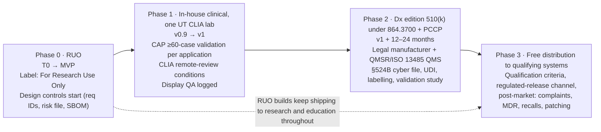

# Risks, compliance, security, licensing and open questions

Section 9 of the Stoipath WSI viewer development plan. Date 2026-10-24. Inputs: the decided architecture (`arch/recommended.md`, incl. the gap-5 amendment), research notes 01, 02, 07, 09, 10, 11-gap-2, 11-gap-3, 11-gap-6, 11-gap-7, the judge panel (`judge/ranking.json`, `judge/judgments.json`) and today's web verification of the regulatory facts note 09 left `[unverified]`. Tags as in the corpus: **[measured]**, **[model]**, **[estimate]**, **[verified]** (primary or near-primary source read today), **[unverified]**. Terminology follows `recommended.md` §5 (Engine contract, Edge Translator, Manifest, Dx mode, Rendering Complete flag, L0–L5, NTF%, TTS, G1–G13, M0–M5).

> **Scope note.** The programme context names a research note `11-gap-8-fda-pathway-and-free-distribution`. It does not exist in the corpus at the time of writing. This section therefore keeps regulation at risk-register and summary level, as tasked, and defers the full programme (QMS, legal manufacturer, predicate strategy, PCCP, validation study, labelling, UDI, post-market, qualification criteria, funding) to the section **"Regulatory pathway to FDA clearance and the free-distribution model"**. Where that section does not yet exist, the facts verified today (§3) are the baseline it must start from.

> **Date anchors.** Milestone dates below assume T0 = 2026-11-02 (first Monday after plan acceptance) **[assumption]**: Stage 0 exit 2026-11-13, M0 2026-11-30, M1 2027-01-29, MVP (month 6–7) 2027-05-31, v0.9 (month 12) 2027-10-29, v1 (month 18–20) 2028-06-30. The TSP abstract deadline carried in the programme tasks is 2026-10-29. Every date shifts with T0.

## 1. What this section protects, and for whom

Goal 1 (instant zoom) is a residency problem solved once in `stoi-core`; the risks that can take it away are not renderer bugs but *contract* decisions made elsewhere: a tile-auth transport that adds a CORS preflight per cold zoom step, a CDN cache key that fragments per user or per embedding origin, a Dx-mode rule that forbids the cross-level blend, a licence that keeps the one bit-identical decoder out of the client. Goal 2 (reach) dies on licensing and embedding hygiene: one LGPL object in the wasm bundle or one third-party cookie dependency and the SDK is unshippable inside Epic Hyperdrive, an iOS XCFramework or a vendor LIS. Goal 3 (versatility) and the three pillars (clinical, research, education) each carry their own compliance regime: CLIA/CAP and FDA for clinical, IRB/de-identification and provenance for research, LTI/ACCME/ADA for education. The long-term aim (an FDA-cleared platform given free to qualifying hospital systems) means that every decision below must be made as if a Design History File will one day cite it; the research-use-only phase is the cheapest time to build that habit and the most expensive time to skip it (note 10 §1.10: ~10 % overhead now, prohibitive to retrofit).

Owners are the humans accountable at gates, since AI agents implement. Abbreviations: **PO** product owner; **TL** tech lead; **GL** graphics lead; **SL** systems/Rust lead; **BL** backend/infra lead (also security lead until a dedicated hire); **PQ** performance/QA engineer; **RA** regulatory/quality lead (0.5 FTE from v0.9, per `recommended.md` §8); **LC** legal counsel (external); **PA** pathologist advisor; **AO** agent-pipeline orchestrator (owner of the execution loop); **DR** DevRel.

## 2. Risk register

Likelihood **L** and impact **I** on 1–5; score = L × I; ≥ 12 is tracked at every gate review. Early-warning indicators are written so an agent can evaluate them from repository artefacts wherever possible (a metric, a CI check, a dated external event). Items marked `(= R§10 #n)` restate `recommended.md` §10 risk *n* with owners and indicators added; nothing in §10 is contradicted.

### 2.1 Technical

| ID | Risk | L | I | Early-warning indicator | Mitigation | Owner / gate |
|---|---|---|---|---|---|---|
| T1 (= R§10 #1) | Compositor floor, per-tile upload cost on iOS Safari / Mali-G52 and A55 WASM decode are unmeasured; §4.4 tables a frame optimistic | 3 | 5 | G11–G13 results differ from `recommended.md` §4.4 by > 1 frame on any class | No external latency claim before WALT/camera numbers; recalibrate all gates at M0 | PQ / Stage 0 |
| T2 (= R§10 #2) | 128 MiB phone L0 does not close at DPR 2 with two levels + ring + prefetch | 3 | 5 | M2 soak: peak > 60 % of measured kill threshold, or any jetsam in 30 min | §4.2 corrections (Pinned Base ≤ 2048²), eviction before pressure, dynamic budgets from OS signals | GL / M2 |
| T3 (= R§10 #3) | Floor module > 1.0 MB gz or cold start > 300 ms on floor Android; embedders reject weight | 3 | 3 | G1/G2; `size-limit` budget in CI breached | Separate decoder modules, streaming compile, dual-wasm (WebGPU-only 0.21 MB gz [measured gap-2]) | TL / Stage 0, M4 |
| T4 (= R§10 #4) | Destination predictor mis-predicts (34 % of zoom bursts < 2.3 levels) and wastes metered bandwidth | 3 | 3 | Prefetch waste > 50 % at Stage 1; predicted-vs-actual logged from M0 | Confidence gating (≥ 2 consistent samples), L\*+1 window first, reader study (gap-1 F9) | GL, PA / M1 |
| T5 (= R§10 #5) | wgpu quarterly majors (28→30 in 8 months) and Safari WebGPU regressions | 4 | 3 | Any G3/G4/G10 failure on a wgpu bump; new Safari-major WebGPU issue in `gfx-rs/wgpu` | wgpu native-only until v1, vendored and pinned, two-week upgrade window gated on G3/G4/G10; Safari WebGL2 default, per-major allow-list, "Restart with WebGL2" | GL / every release |
| T6 (= R§10 #7) | Android native driver fragmentation (Adreno u32 #5318, PowerVR #7669) | 4 | 3 | Golden suite failure on any of four GPU families per wgpu bump; `VK_ERROR_DEVICE_LOST` rate in beta telemetry | GLES retry, device allow/deny list, workarounds upstream | GL / M3 |
| T7 (= R§10 #8) | Dx determinism undermined by browser decoders (Safari ImageIO is a black box) or lossy HTJ2K (0.002 % samples differ across OpenJPH builds [measured gap-2]) | 2 | 5 | G7 < 1,000/1,000; G8 matrix shows a drift on a browser build previously allow-listed | libjpeg-turbo everywhere; `createImageBitmap` only after per-build self-certification, never on Safari in Dx; one pinned OpenJPH; reversible HTJ2K only in Dx; Rendering Complete flag from day one | SL / Stage 0, every release |
| T8 (= R§10 #10, #11) | > 4 GB DICOM levels: EOT/Concatenation support uneven across VNAs; EOT (≈ 0.8 MB at base) slows client-direct readers at open | 3 | 3 | VNA matrix at M1 shows any archive refusing EOT or decompressing despite `transfer-syntax=*`; > 1 RTT penalty at open in the M1 prototype | Per-level EOT-vs-concatenation at ingest; ≤ 2 GB instance fallback; translator proxies non-conformant archives; Manifest published beside instances | BL / M1 |
| T9 (= R§10 #12, #13) | QuPath/OMERO (Bio-Formats on jzarr 0.4.2) read no Zarr v3; codec-namespace fragmentation delays the upstream programme 12–24 months | 4 | 3 | QuPath 0.8 changelog without zarr-java; `zarr-extensions` registration PR unmerged at v0.9 | DICOM + OME-TIFF export for QuPath at MVP; fund OMEZarrReader → zarr-java; URI codec id meanwhile; experiment holds no customer data | SL / v0.9 |
| T10 (= R§10 #14) | Lazy-tiler write into a live shard/instance on S3/R2 (no atomic append) corrupts concurrent reads | 3 | 3 | Any CRC/hash mismatch in the F9 prototype concurrency test | Write-new-object + Manifest pointer swap; synthesised levels as new instances | BL / M1 |
| T11 (= R§10 #15, #16) | HTJ2K decode too slow on W-4G (openjphjs) or absent in customers' cleared viewers; Cloudflare 6-connection fan-out limit and 1 MiB-aligned origin ranges amplify small reads | 3 | 3 | W-4G HTJ2K decode > 2× JPEG in the M0–M1 prototype; translator p99 > 10 ms hot | JPEG baseline stays brightfield default; translator transcodes HTJ2K→JPEG where needed; bundles ≤ 4 shard ranges; regional-origin fallback | BL / M1 |
| T12 | Safari ITP deletes OPFS and Cache API data after 7 days without interaction, `persist()` notwithstanding [verified gap-3] | 5 | 2 | L2 miss rate on returning iPad users ≈ cold | L2 is a refillable cache, never a store of record; Manifest re-validation + cheap refill | TL / M2 |
| T13 | Tile-identity / stale-tile bugs under throttled networks (endemic even in Mapbox 3.34-rc, OpenLayers 10.10/10.11 [verified note 07]) | 3 | 4 | Golden gesture replay with recorded byte-arrival times diverges between platforms; fiducial decode in Tier 1 shows a wrong (level,x,y) | Fiducial synthetic slides decode every drawn tile's identity in CI; replay with network record/replay (mitmproxy) on every PR | PQ / M0 |
| T14 | Regulatory stance on client-side filtering (mipmaps, cross-level blend, transient bicubic) in a Dx viewer is unknown (note 03 Q6, note 07 Q7) | 3 | 4 | Pre-submission feedback or a design partner's RA objects to any resampling at rest | Dx mode = deterministic settled frame, documented resampler, no sharpening at rest; Nav mode is explicitly "navigation image" (PCoIP precedent) | RA, PA / v0.9 |

### 2.2 Delivery and programme (agent-executed)

| ID | Risk | L | I | Early-warning indicator | Mitigation | Owner / gate |
|---|---|---|---|---|---|---|
| D1 (= R§10 #6) | Graphics seniors (wgpu/WGSL/Metal) and Rust systems hires slip; shells need Swift and Kotlin too | 3 | 5 | Two graphics seniors not in seat by M0; shell LOC > 5 kLOC | Hire graphics and PQ first; shells ≤ 3–5 kLOC over core view-models; UniFFI; iPad before Android | PO, TL / M0 |
| D2 | Effort under-estimate: 55–65 PM to MVP, 150–170 PM to v1 are the delivery judge's synthesis numbers; C's 62 PM was judged ≥ 30 % low | 3 | 4 | Burn-down at M1 shows < 40 % of MVP scope at > 50 % of budget | Monthly re-estimate against gates, scope cuts pre-agreed (fluorescence ≤ 8 ch, annotations GeoJSON only at MVP) | PO / M1 |
| D3 | Device lab and WALT rig not funded or not hosted; perf gates then run on cloud farms, whose timing is noise | 3 | 5 | No lab PO by M0; any gate "measured" on BrowserStack | Lab (~USD 8–12k capex + 0.2 FTE [unverified pricing]) in the first budget; farms for compatibility only | PO, PQ / M0 |
| D4 | iPad shell slips from month 12 to B's 18–20; "instant on iPad" is a native-shell promise | 3 | 4 | XCFramework spike not green by v0.9 − 3 months | Spike at MVP; D's present recipe pre-verified (gap-4); UniFFI Swift generated from the core | TL / v0.9 |
| D5 | Agent-produced figures or claims leak into external documents without verification (every FDA/EU statement in note 09 was `[unverified]` at writing) | 4 | 4 | CI grep finds `[unverified]`/`[estimate]` in `docs/external/**`; a claim without a `[measured]`/source tag | Claims-verification discipline: every quantitative statement tagged; external docs built only from tagged sources; a human (PO or RA) signs each external release | AO, RA / every release |
| D6 | Agents introduce copyleft or proprietary code into the client core (a `cargo add`, a vendored snippet) | 3 | 5 | `cargo deny check licenses` or `license-checker` fails; SBOM diff shows a new licence family in `stoi-*` client crates | Allow-list per crate class (§5.3) enforced in CI; SBOM diff is a required PR check; licence-review queue for "unknown" | SL, LC / every PR |
| D7 | Secret or token leakage via agent logs, CI artefacts, or tile URLs with tokens in referrers | 3 | 5 | Secret scanning alert; a `?t=` token in any stored log | OIDC trusted publishing (no long-lived tokens), GitHub secret scanning + push protection, `Referrer-Policy: no-referrer`, log scrubbing tests | BL / every PR |
| D8 | Agent cost and time are not accounted, so the TSP cost comparison cannot be made and budgets cannot be forecast | 4 | 3 | Any merged PR without a provenance record (model, tokens, wall time, human review minutes) | Provenance ledger committed with each PR (`provenance/*.json`), aggregated weekly; budget alarms | AO / M0 |
| D9 | Human review becomes the bottleneck of the agent loop, or rubber-stamps | 4 | 3 | Median PR review latency > 2 working days; approvals with zero comments on > 80 % of PRs | Gates define what needs a human (architecture, licence, regulatory, external claims, releases); everything else merges on green machine checks; sampled deep reviews | AO, TL / M1 |
| D10 | Repository and plan drift (plan says X, code does Y) | 3 | 3 | Requirement IDs in the plan without a linked test; tests without requirement IDs | Repo is the single source of truth: plan sections live in-repo, requirement IDs on tests, traceability report generated per release | AO, RA / M1 |

### 2.3 Market and adoption

| ID | Risk | L | I | Early-warning indicator | Mitigation | Owner / gate |
|---|---|---|---|---|---|---|
| M1 | Integration burden, not rendering, decides adoption: ~15 % of US practices use WSI for primary diagnosis; cost and integration are the top barriers (CAP 2025, L.E.K. 2026 [snippet, gap-7]) | 4 | 4 | No UT lab has a signed Beaker launch-context test plan by v0.9 | MVP = IID-style launch + SSO + DICOMweb + iframe; v1 = HL7 status sync used for prefetch; everything LIS-specific in an integration service | PO / v0.9 |
| M2 | Incumbents erode the differentiators: Proscia's Aug 2026 PCCP clearance allows new scanners, formats and displays without a new 510(k) [verified trade press]; OSD/OL slowly fix stale-tile handling | 3 | 3 | A competitor publishes TTS-class latency numbers; OSD merges a direct-WebGL mode | Publish our harness and numbers first (note 07 R1); compete on openness and in-house verifiability, not on features | PO, DR / MVP |
| M3 | Epic distribution gating (Showroom review, Hyperdrive iframe quirks) | 3 | 3 | First in-house Hyperdrive embed fails cookie/COOP assumptions | Iframe-safe, no third-party cookies, no COOP/COEP from day one; first deployment in-house, not via Showroom | BL / v0.9 |
| M4 | Education content licensing stalls (most curated collections are non-commercial or bespoke) | 4 | 4 | Fewer than 200 CC-BY/CC0 teaching slides curated by MVP | Seed from IDC CC-BY and CAMELYON CC0; licence registry per slide; negotiate DAPA/Leeds early | PO, PA / MVP |
| M5 | Hospital procurement demands SOC 2 / ISO 27001, VPAT and a BAA even for free software | 4 | 3 | First IT security questionnaire returned with blocking items | Design to the HIPAA NPRM anyway (§4); WCAG 2.2 AA in MVP; third-party VPAT before any UT procurement; SOC 2 Type II for any hosted offering | BL, PO / v0.9 |
| M6 | "Free" is read as "unsupported"; hospitals will not run clinical software without an SLA | 3 | 4 | Qualification conversations stall on support, not features | Define the qualification criteria and the support/service model in the regulatory section; a funded service entity, not volunteers | PO / v1 |
| M7 | Standards drift: OME-NGFF 0.6 (2026-09-14), Zarr codec registration, DPOW TI (Nov 2026), FHIR R5/R6 `ImagingSelection` | 3 | 2 | Conformance suite fails against a new upstream release | Standards as façades over the Manifest; conformance corpus published; connectathon participation within 12 months | SL / v1 |

### 2.4 Regulatory, legal and compliance

| ID | Risk | L | I | Early-warning indicator | Mitigation | Owner / gate |
|---|---|---|---|---|---|---|
| R1 | "Free" does not mean outside FDA: giving a viewer to another institution for primary diagnosis is device distribution; the 510(k) and all post-market duties attach to intended use, not price. 21 CFR 807.3(b) defines commercial distribution as "held or offered for sale" [verified eCFR text]; FDA's interpretation for no-charge distribution is in CPG Sec. 300.600 (fda.gov unreachable today) **[unverified]** | 4 | 5 | Any distribution of a Dx-labelled build outside the first CLIA lab before clearance | Counsel reads CPG 300.600 and advises in writing (OQ-01); RUO labelling on every non-Dx build; in-house use at one UT lab under CLIA/CAP validation first (FDA LDT rule rescinded 2025-09-19 [snippet, gap-7]) | LC, RA / M1 |
| R2 | Predicate and pairing problem: PSY clearances name scanners and displays (PathPresenter K250968: one scanner + one Barco display; Barco MDPC-8127 lists six pairings [snippet]); tablets and consumer displays cannot carry a Dx claim | 5 | 4 | Pre-sub feedback requires a pairing per scanner/display | PCCP from the first Dx submission (Proscia precedent, Aug 2026); display QA module with logged status; Dx mode disabled outside validated displays | RA / v1 |
| R3 | Design-controls debt: requirements traceability, ISO 14971 risk file, IEC 62304 lifecycle evidence and IEC 62366 usability file cannot be reconstructed later | 3 | 5 | Traceability report shows requirements without tests, or tests without requirement IDs, at M1 | Requirement IDs on every test from M0; risk file opened at M1; usability engineering file started with gap-1 findings; archived evidence per release | RA, PQ / M1 |
| R4 | No legal manufacturer entity or QMS when clinical distribution is wanted (QMSR, ISO 13485:2016-based, in force since 2026-02-02 [verified]) | 3 | 5 | No entity decision by v0.9 | Decide entity form (UT System unit, 501(c)(3), spin-out) by v0.9; eQMS selected and procedures drafted before v1 | PO, LC / v0.9 |
| R5 | Cybersecurity obligations: FD&C §524B (SBOM, vulnerability plan, secure development) for cyber devices [verified]; FDA premarket cybersecurity guidance final 2025-06-27, with a revision reported 2026-02-03 **[vendor sources only; unverified]**; EU CRA reporting duties since 2026-09-11, full obligations 2027-12-11 [verified secondary], and an RUO viewer is *not* exempt | 4 | 4 | SBOM missing from a release; CVE in a parser (OpenSlide 4.0.1 fixed two [verified]) without a patch inside the disclosure window | §4.5: SBOM per release, OSV monitoring, sandboxed parsers, CVD policy, signed updates | BL, RA / MVP |
| R6 | HIPAA Security Rule NPRM (Jan 2025: mandatory encryption, MFA, 72-hour restore, annual pen test) now slated for July 2027 [verified secondary]; design uncertainty | 2 | 2 | Final rule published | Design to the NPRM now; nothing in the architecture depends on the outcome | BL / v1 |
| R7 | CLIA remote-review conditions shift (cytology discretion ended 2026-03-23; Oct 2026 proposed rule) | 3 | 3 | Final rule text differs from QSO-23-15 | Mode-specific policy engine (dx/ruo/edu per launch context); cytology excluded from remote modes until the rule is final | RA, PA / v1 |
| R8 | PHI leakage through label, macro, barcode, filename, scan dates, scanner serial — not through tissue tiles | 3 | 5 | Any Tier 2 object with a CDN cache hit; any PHI field in RUM payloads | Three PHI tiers (§4.3); Tier 2 never cached at the edge; de-identification writes a new object; PHI-free telemetry by construction, tested | BL / M1 |
| R9 | IP: Philips iSyntax patents and SDK EULA vs `libisyntax` (BSD-2, IP unassessed); LGPL static linking in wasm/iOS; Bio-Formats GPL boundary in on-prem bundles | 2 | 5 | Counsel has not signed off before a copyleft or iSyntax component ships | §5: permissive-only client; LGPL/GPL process-isolated server-side; libisyntax gated on counsel review; Glencoe commercial licence as fallback | LC, SL / MVP |
| R10 | EU IVDR Class C (notified body, 12–18 month queues) if the Dx edition is ever distributed in the EU; no transitional relief for a new device **[unverified]** | 2 | 4 | Any EU hospital in the qualification pipeline | US-first; IVDR only with a European partner; keep the technical file IVDR-shaped | RA / v1 |
| R11 | Accessibility is a legal gate for UT (ADA Title II WCAG 2.1 AA; Texas TAC 206/213) [verified via university pages, gap-6] | 3 | 4 | VPAT with any "does not support" on core navigation | WCAG 2.2 AA in MVP; keyboard pan/zoom; text alternative for region items; CVD remap LUT | TL / MVP |
| R12 | AI-overlay liability: a rendering change alters an algorithm's appearance; EU AI Act high-risk obligations for AI vendors we host (2 Aug 2027, Digital Omnibus pending) **[unverified]** | 2 | 4 | Vendor refuses to validate on our renderer | Deterministic overlay path; layer provenance `{producer, version, inputHash, regulatoryStatus}`; vendor validation contract | SL, RA / v1 |
| R13 | Re-identification in teaching sets (rare cases, dated narratives) and research exports | 2 | 5 | Teaching-set stage bypassed; dates finer than year in an export | Teaching-set pipeline stage with logged determination; year-only dates; withdrawal hook per slide | PA, RA / MVP |
| R14 | Post-market obligations (complaint handling, MDR reporting, recalls, security patching, UDI) are unfunded because the product is free | 3 | 5 | No post-market budget line in the v1 plan | Service model and funding in the regulatory section; UDI as plain text at startup and in a menu for stand-alone software (21 CFR 801.50 [verified]) designed in now | PO, RA / v1 |
| R15 | TSP abstract overclaims: a viewer alone cannot show patient-care impact; no diagnostic-equivalence claim without a validation study | 3 | 4 | Abstract draft contains "diagnostic", "equivalent", "saves" without a cited measurement | Abstract limited to measured latency vs baselines on de-identified public slides, provenance and cost accounting, and the in-house-verifiability argument; PA and RA review | PO, PA / 2026-10-29 |

## 3. Compliance roadmap (summary)

The posture is note 09 option D: an **Apache-2.0 RUO core** shipped now, carrying design controls from day one, and a **Dx edition** that is a frozen, validated build of the same core released through a regulated channel later. Gap-7 adds the middle step that makes the free-distribution aim reachable without a 510(k) first: a single UT CLIA laboratory may validate and use a non-cleared in-house viewer for primary diagnosis under CAP's WSI guideline (≥ 60 cases per application, ≥ 2-week washout, the whole system incl. display and network, revalidation on material change) because FDA's LDT rule was rescinded on 2025-09-19 and enforcement discretion continues for lab-developed tools used within one laboratory **[snippet, gap-7; counsel to confirm the lab-tool analogy]**. Distribution to *other* institutions for diagnosis is 21 CFR 864.3700 territory (Class II, product code PSY, special controls incl. component- and system-level bench tests, a reader study and labelling with a pathologist-responsibility statement [verified via mirrored 510(k) records]).

| Area | Phase 0 (RUO, now → MVP) | Phase 1 (one CLIA lab, v0.9 → v1) | Phase 2–3 (Dx edition, post-v1) | Machine-checkable evidence |
|---|---|---|---|---|
| Intended use and labelling | "For Research Use Only. Not for use in diagnostic procedures." on every build, splash and SDK README; `mode` ∈ {dx, ruo, edu} in the launch-context contract | Lab's own validated-system labelling; Dx mode enabled only on validated displays at that site | 510(k)-cleared labelling naming scanner/display pairings or a PCCP; UDI plain text at startup and menu | CI asserts the RUO string in every artefact; Dx mode refuses to start without a display-QA record |
| Software lifecycle (IEC 62304, assume Class B) | Requirement IDs on tests; architecture and SOUP list (the SBOM) | Problem-resolution process; release records archived | Full lifecycle file; SOUP risk assessment per dependency | Traceability report per release: 0 untraced requirements, 0 untagged tests |
| Risk management (ISO 14971) | Hazard list opened at M1 from gap-1 (blur at ≥ 20×, pop-in, stale tile identity, PHI leak) | Risk controls verified in the device lab (NTF%, blank-pixel frames = 0, fiducial identity) | Risk/benefit and residual-risk report in the submission | Each hazard ID maps to ≥ 1 gate metric with a threshold |
| Usability (IEC 62366-1) | Pathologist paths in the camera-path DSL; gap-1 human-factors findings as use-specification inputs | Formative evaluations during the CAP study | Summative usability study on the Dx edition | Formative reports stored under requirement IDs |
| Cybersecurity (§524B; CRA for RUO) | SBOM (SPDX/CycloneDX) per release; OSV; sandboxed parsers; CVD policy; signed releases | Pen test; vulnerability-management plan exercised | Premarket cyber file (threat model, SBOM, patch plan) | SBOM present in every release; `cargo audit`/`cargo deny` green; CVE-to-patch time logged |
| DICOM conformance | Client conformance statement (PS3.2) with the first DICOMweb release: VL WSI Storage, Microscopy Bulk Simple Annotations, transfer syntaxes JPEG/HTJ2K/JXL, QIDO/WADO-RS incl. `frames/{list}`, STOW-RS | DPIA Image Display actor; connectathon within 12 months | Conformance statement frozen per cleared version | Third-party-reader CI smoke tests (wsidicom, pydicom, Orthanc, dcm4chee; zarr-python, zarrs, zarrita, tensorstore) per `recommended.md` §3.1 step 3 |
| De-identification | Three PHI tiers at ingest (§4.3); `wsidicomizer --no-label --no-overview`; own Apache-2.0 reimplementation of `anonymize-slide` logic | Tier policy audited per site; teaching-set stage | PS3.15 Annex E profile documented in labelling | CI: no Tier 2 object has a public cache header; export fuzz for dates finer than year |
| Clinical validation | None claimed; MSK < 250 ms median FOV is the public baseline we measure against | CAP study tooling in-product (blinded re-review, sampling, washout, concordance export) | Analytical and clinical validation study per special controls | Study data exported with provenance from the event bus |

Everything else — QMS procedures, legal-manufacturer form, predicate selection, PCCP scope, reader-study design, labelling, UDI issuance, post-market surveillance, qualification criteria, licence terms of the regulated channel, liability/indemnification and funding — belongs to the section **"Regulatory pathway to FDA clearance and the free-distribution model"**.

## 4. Security architecture summary

### 4.1 Identity and launch

OIDC against the hospital or university IdP (Entra ID / InCommon SAML bridged to OIDC) for the first-party apps; **SMART App Launch 2.2.0** adapter for EHR-embedded launch; **LTI 1.3** for LMS launch (identity travels in the launch JWT); IHE IID-style context URL plus an opaque `launch` token for LIS worklists. The SDK always accepts an externally supplied token so LIS, PACS and Jupyter hosts keep their own login, and exchanges it for tile capability tokens (§4.2). Authorisation is decided once, at token issuance, at slide/study/collection grain (RBAC or Cedar/OPA), and encoded as scope; per-slide ACLs then cost nothing on the hot path, and sharing is a capability link with expiry.

### 4.2 Tile authorisation: the latency decision

The Fetch standard keys the CORS-preflight cache per URL and `Authorization` is not a CORS-safelisted header [verified note 09], so a cross-origin bearer-token tile fetch pays one preflight per distinct tile URL. On HTTP/2 the preflights parallelise, so the cost is ≈ 1 RTT per *cold zoom step*: 20–60 ms at a CDN edge, 50–150 ms on mobile **[model, note 09]** — larger than the whole W-BB TTS budget (≤ 100 ms p50). Cookies avoid the preflight but die in third-party embedding (Safari blocks, Chrome partitions). Per-tile signed URLs defeat the shared cache unless the signature is stripped after validation. Hence:

| Transport | Extra RTT on a cold zoom step | Shared-cache hit across users | Works embedded (iframe, WebView, Hyperdrive) | Revocation | Verdict |
|---|---|---|---|---|---|
| Session cookie to same-origin proxy | 0 | Yes if edge strips cookie from key | **No** | Server-side kill | First-party web app only |
| `Authorization: Bearer` (IUA / DICOMweb pattern) | **+1 RTT** cross-origin | Only with `public`/`s-maxage` and edge stripping; most DICOMweb servers send `private` | Yes | Token TTL | Keep for "talk to someone else's PACS" through a same-origin proxy |
| Per-tile HMAC-signed URL | 0, but +1 RTT per batch to fetch the URL list | No unless signature excluded from key | Yes | TTL | Rejected |
| **Prefix-scoped capability token in the query** (`?t=…` covering `/slides/{id}/**`), ES256 JWT or macaroon, validated at the edge (Worker / Caddy / nginx), stripped from a **path-only cache key**, `Origin` excluded | **0** | **Yes** (first viewer warms the edge for everyone) | Yes (no cookies, no custom headers) | TTL 5–15 min + silent refresh; optional edge KV deny-list ≈ 1 ms | **Adopted** (ADR-012) |
| Client-side AES-GCM decryption of publicly cached ciphertext | 0 | Fully public cache | Yes | Key rotation | Roadmap: untrusted CDNs and offline packs |

Consequences baked into the URL scheme now: `Referrer-Policy: no-referrer` on every page that holds a token; token scrubbing in CDN and translator logs (tested); never PHI in a path; `Timing-Allow-Origin` and `Server-Timing` on tiles so RUM can attribute latency without request headers; no `traceparent` on the tile path (it reintroduces the preflight). Note 02's "never query-string signatures" and note 09's capability token agree once the token is excluded from the cache key; the Edge Translator's path-only key is the reconciliation.

### 4.3 PHI tiers and what the CDN sees

| Tier | Contents | Storage and access | Edge cacheable |
|---|---|---|---|
| 2 — direct identifiers | Label image, macro/overview image, barcode, original filename, free-text metadata, DICOM Patient/Study/Specimen modules | Separate bucket/prefix, own ACL and audit; role-gated layer in the viewer; vendor originals cold under this ACL | **Never** |
| 1 — Safe-Harbor-adjacent | Scan date/time finer than year, scanner serial, operator | Metadata store; shifted/truncated on de-identified export | No |
| 0 — pixel pyramid | Brightfield canonical (DICOM WSI `TILED_FULL`+EOT) and multichannel canonical (OME-Zarr 0.5 shards); linked but not identifying | L5 object store; served by the Edge Translator | Yes (L3/L4) |

De-identification is an ingest stage producing a new object, never an in-place edit. Teaching sets add a review stage (narratives, rare cases, year-only dates, logged determination, withdrawal hook).

### 4.4 Audit

HIPAA §164.312(b) wants audit controls, not per-tile logs. Audit records derive from the typed event bus (`slideOpened`, `viewChanged` sampled, `annotationCreated`, `aiResultAccepted`, `caseStatusChanged`, `shareCreated`, `displayQaStatus`, break-glass) and are emitted as FHIR `AuditEvent` / IHE ATNA with purpose-of-use. Logged: token issuance (who, which slides, from which app), session open/close, a sampled viewport trail (level, centre, time), display-QA status at Dx-mode entry. The trail doubles as research-reproducibility and RUM data. CDN access logs are infrastructure logs with tokens scrubbed, not the audit trail. Retention is policy-driven (1–6 years typical; ACCME needs 6 years for CME participation records). Whether compliance officers accept a *sampled* trail for sign-out cases is OQ-13.

### 4.5 Product and supply-chain security

| Threat | Control | Evidence an agent can check |
|---|---|---|
| Malicious slide bytes (parser RCE; OpenSlide CVE-2026-48977/-54604 [verified]) | Client parsers run in wasm (sandboxed by construction); server ingest in gVisor/Firecracker with seccomp, one container per licence class; fuzz-first readers (cargo-fuzz + `arbitrary`, ClusterFuzzLite 60 s/PR, 24 h nightly; ASan/UBSan on C deps) | Fuzz target exists for every reader; 24 h zero-crash before a reader ships |
| Vulnerable dependency | SBOM (SPDX/CycloneDX) per release; `cargo audit`, `cargo deny`, OSV subscriptions; §524B/CRA vulnerability-management plan; CVD policy (`SECURITY.md`, 90-day window, `security.txt`) | SBOM attached to every release; CVE-to-patch time ≤ policy |
| Compromised release channel (seven channels: npm, PyPI, crates.io, SwiftPM, Maven, NuGet, OCI) | OIDC trusted publishing where GA (PyPI verified; npm CLI ≥ 11.5.0 `npm trust` verified; crates.io GA wording unverified), cosign signatures, SLSA provenance attestations, install-from-registry smoke tests | Unsigned artefact fails release validation |
| Token theft | Short TTL, prefix scope, optional DPoP-style binding, edge deny-list, `no-referrer`, log scrubbing | Scrubbing test in CI; TTL asserted in config |
| PHI in telemetry | PHI-free RUM by construction (slide IDs only), kill switch and air-gap mode as first-class settings, self-hosted RUM or BAA | Telemetry schema test rejects any PHI field |
| Lost or stolen tablet with offline packs | OS-encrypted storage, MDM remote wipe, device-bound tokens | Pack writer refuses unencrypted storage |
| Data in transit / at rest; MFA | TLS 1.3 (HTTP/3 at the CDN/Caddy, never in-process), encryption at rest, MFA via IdP; 72-hour restore drill; annual pen test; SOC 2 Type II / ISO 27001 for hosted offerings | Restore-drill record; pen-test report per year |
| Air-gapped sites | No external dependency at runtime (fonts, telemetry, OIDC → local IdP); media-based updates with signatures | Air-gap integration test in CI |

## 5. Licensing decisions

### 5.1 Project licence and the regulated-release channel

**Apache-2.0 for the core, SDKs and Edge Translator, with DCO sign-off** (ADR-010): the explicit patent grant with defensive termination matters in a field where Leica, Philips, Roche, Hamamatsu and 3DHISTECH hold scanner, viewer and codec patents; it is compatible one-way with GPLv3 (Bio-Formats is GPL-2.0-or-later); AGPL is on most hospital vendors' prohibited lists and contradicts Goal 2. A registered trademark with a usage policy protects the name of the cleared edition. A CLA is needed only if relicensing optionality is wanted; decide now (OQ-05).

> **Reviewer note (terminology, not architecture).** `recommended.md` §7 ends its QA row with "Apache-2.0 + DCO core and SDKs, **Dx edition and enterprise edge commercial**". That wording predates the owner's long-term aim of giving the cleared platform away free to qualifying hospital systems. It should read **"regulated-release channel"**: the Dx edition is the same Apache-2.0 code as a frozen, validated, signed build, distributed at no charge to systems that meet the qualification criteria under a regulated-release agreement (labelling and IFU, no-modification clause for the cleared binary, complaint and incident reporting duties, display-QA and training obligations, liability/indemnification). Commercial terms remain possible for OEM embedding by vendors and for systems that do not qualify, as a funding line, but they are not the default. Apache-2.0 permits all of this without a CLA. The regulatory section owns the agreement text.

### 5.2 Licence classes

| Class | Where it may run | Examples (versions and licences from `recommended.md` §7 and notes 01/09, verified 2026-10-24) | Why |
|---|---|---|---|
| **Permissive only** (MIT, Apache-2.0, BSD-2/3, ISC, Zlib, IJG, Unlicense) | `stoi-*` client crates, wasm bundle, XCFramework, AAR, PyO3 wheel, C ABI, Edge Translator | Rust toolchain, wgpu (MIT OR Apache-2.0), libjpeg-turbo (IJG + BSD-3 + zlib), OpenJPH (BSD-2), libjxl (BSD-3 + patent grant, if ever in the client), `tiff` 0.11.3 (MIT), `dicom-object` 0.10 (MIT OR Apache-2.0), `zarrs` 0.23.14 (MIT OR Apache-2.0), `turbojpeg` 1.5.1 (Unlicense OR MIT), `axum`/`hyper`/`tower-http` (MIT), Lit 3.3 (BSD-3), UniFFI/cbindgen (MPL-2.0 tooling; generated code unencumbered), anywidget (MIT) | Static linking into wasm and iOS is a static link; LGPL §6 relinking duties and App Store terms make copyleft unshippable in SDKs; proprietary embedders reject it from the SBOM |
| **LGPL, process- or dynamically-isolated, server only** | Ingest workers in their own container image | OpenSlide 4.0.1 (LGPL-2.1-only), libvips 8.18 (LGPL-2.1+), libCZI (LGPL-3 or commercial) | Decode-fallback for Tier D formats; never in a shipped SDK |
| **GPL, process-isolated, server only** | Own container, RPC boundary | Bio-Formats `formats-gpl` + bioformats2raw (GPL-2.0+), `jpegxl-rs` 0.16.0 (GPL-3.0-or-later [verified crates.io]), `anonymize-slide` (GPL-2; logic reimplemented, not linked) | "Mere aggregation" defence needs a genuine process/API boundary in on-prem bundles; counsel sign-off or Glencoe commercial licence (OQ-06) |
| **Proprietary, sealed** | Optional ingest worker, separate EULA, never redistributed | Philips Pathology SDK (openpathology.philips.com; reportedly forbids LGPL combination and redistribution [secondary]) | Validation oracle and emergency fallback for iSyntax only |
| **Content and specs** | Test corpora, teaching sets, façades | IDC (> 95 % CC-BY), CAMELYON (CC0), OpenSlide testdata (mostly CC0/PD [unverified]); vendor samples private, never in CI logs; Iris spec CC-BY-ND (façade only; MIT code) | Licence registry per slide with consent basis, de-identification record and withdrawal hook |

### 5.3 Dependency licence audit (machine-checkable)

`cargo deny check licenses` with an allow-list per workspace member (client crates: permissive only; server crates: + LGPL/GPL *only* in the `ingest-*` members); `license-checker` for npm with the same allow-list; `pip-licenses` for Python; a per-container-image SBOM so the licence class of every image is explicit. A PR fails if the SBOM diff introduces a new licence family into a client crate or an "unknown"/"NOASSERTION" entry anywhere; unknowns go to a human review queue (SL, then LC). Weekly OSV scan on every SBOM row. The audit runs on agent-authored PRs exactly as on human ones; it is the primary control for risk D6.

### 5.4 Vendor SDK and third-party component handling

| Component | Decision | Condition / re-open |
|---|---|---|
| Philips iSyntax | Prefer `libisyntax` (BSD-2) after a documented IP review (patents, SDK EULA field-of-use); Philips SDK only in a sealed worker as oracle | Counsel opinion (OQ-07) before any iSyntax ingest ships; Philips' move to DICOM output (2026 conformance statement lists JPEG XL [unverified product]) may shrink the problem |
| Zeiss CZI | libCZI (LGPL-3) isolated, or slideio (BSD-3) | Commercial libCZI licence if a mobile/desktop local-file CZI reader is ever required |
| Bio-Formats | GPL-isolated container for Bio-Formats-only sources; fund OMEZarrReader → zarr-java upstream | Glencoe commercial licence if counsel rejects process isolation for on-prem bundles |
| OpenSlide / libvips | Server-side decode fallback and converter; never in the client; `openslide-js` (LGPL, needs SAB) rejected for the client | A permissive raw-tile Rust reader (`wsi-rs` 0.8, MIT/Apache-2.0, maturity unverified) could replace OpenSlide for desktop local files after a corpus evaluation |
| wgpu | Vendored and pinned per release train | Upgrade window gated on G3/G4/G10 |
| Qt | `QQuickItem` sample over the C ABI only; the sample is not a dependency of the SDK | Qt commercial terms only if a customer host requires a shipped Qt component |
| Iris RESTful Server / IFE | Façade only (WADO-RS-shaped API); spec is CC-BY-ND, code MIT | Never canonical |

## 6. Cost model summary

All figures carry the corpus tags; the serving bill is small and storage-dominated, the people and the regulatory programme dominate, and agent compute is the one line nobody has measured yet.

| Line | Figure | Tag / source | Note |
|---|---|---|---|
| Storage, 10k slides at 2.5 GB, pyramid only (25 TB) | R2 $375/mo; S3 Standard $575/mo; Glacier Instant $100/mo; + originals cold ≈ +50–100 % | [verified list prices, note 02/09; model] | Vendor originals go cold after hash-verified canonical copy |
| Egress, 30k sessions/yr (3.5 TB) | R2 ≈ $4/yr; CloudFront ≈ $362/yr at 80 % hit | [model, note 02] | Zero-egress storage makes prefetch and cache warming free |
| Requests, 170M tiles/yr | R2 Class B $61 + Workers $48; Google Healthcare DICOM store $660 if every frame hits the API | [verified prices, note 09] | Per-frame pricing is why managed DICOM stores sit behind the translator |
| Edge Translator compute | JPEG passthrough ≈ 0.2 ms CPU/tile → ≈ $0.000006/session; 2-vCPU container or Workers Paid $5/mo | [model] | Latency, not compute, is the cost |
| Ingest conversion | 4 vCPU × 60–120 s ≈ $0.004–0.009/slide | [model] | Negligible |
| Device lab + WALT rig | ≈ USD 8–12k capex + 0.2 FTE ops | [unverified pricing, note 10] | Non-negotiable: hosted runners produce no gate-grade latency numbers |
| Hosted CI (GPU runner, macOS multiplier), farms for compatibility | Unpriced (vendor pages unreachable) | [unverified] | OQ-16 |
| Team | 9 FTE at MVP → 12–13 at v1; ≈ 55–65 PM to MVP, ≈ 150–170 PM to v1 | [estimate, delivery judge] | Dominant line; agents reduce implementation hours, not review, lab or clinical hours |
| Agent compute and review time | **Unmeasured**; provenance ledger from M0 (model, tokens, wall time, human minutes per PR) | — | Required for the TSP cost comparison and for budget alarms (D8) |
| Compliance and procurement artefacts | VPAT audit, annual pen test, SOC 2 Type II if hosted, 1EdTech LTI certification | [unverified pricing] | Procurement asks before regulators do |
| Dx edition programme | QMS (QMSR/ISO 13485), IEC 62304 B/C, ISO 14971, IEC 62366-1, §524B file, TPA bench tests, reader study: ≈ $0.5–2M, 12–24 months | [estimate, note 09] | Owned by the regulatory section; IVDR Class C would roughly double it |
| Post-market service | Complaint handling, MDR reporting, recalls, security patching, display-QA support for each qualifying system | Unpriced | Does not disappear because the product is free; funding and service model in the regulatory section |

What an in-house build replaces (gap-7 F7): the IMS/viewer/collaboration/AI-host licence lines only. Scanners, LIS, interface-engine labour, validated displays and 24/7 support remain, and interface maintenance is *added*. The TSP cost comparison must say so.

## 7. Decision log (ADR list)

Status: **A** accepted (in `recommended.md`), **P** proposed by this section for ratification at the next gate, **S** superseded. Every ADR records its re-open trigger so an agent can flag it.

| ADR | Date | Decision | Status | Source | Re-open trigger |
|---|---|---|---|---|---|
| 001 | 2026-10-24 | One Rust core (`stoi-core`) compiled to wasm and native; Engine contract `tick/on_bytes/on_decoded/set_budget`; single-threaded state machine; golden gesture replay as the definition of Goal 1 | A | `recommended.md` §1–§3 | Never while the replay passes on all platforms |
| 002 | 2026-10-24 | Web floor renderer is hand-written `web-sys` WebGL2 (`stoi-render-gl`); wgpu native-only until a WebGPU module is allow-listed in v1 | A | §2 item 3, gap-2 option C | wgpu promotes WebGL2 to supported, closes #4081, and `stoi-render-gl` costs > 1 PM/yr; or Stage 0 shows trampoline cost > 0.5 ms/frame (then TypeScript renderer) |
| 003 | 2026-10-24 | libjpeg-turbo (C) is the sole Dx decoder everywhere; `createImageBitmap` only after per-build self-certification, never on Safari in Dx; one pinned OpenJPH; reversible HTJ2K only in Dx | A | §2, gap-2 §2.3 | A Rust decoder passes G7 on all targets |
| 004 | 2026-10-24 | Dual-standard, single-copy canonical store: DICOM WSI `TILED_FULL`+EOT (brightfield), OME-Zarr 0.5 sharded core codecs (multichannel), one Manifest; vendor files indexed in place during ingest | A | §3.1 (gap-5 amendment) | OME-Zarr-with-JPEG returns as canonical only when a `jpeg`/`htj2k` codec is registered in `zarr-extensions` *and* shipped in zarr-python, zarrs, zarrita *and* QuPath reads Zarr v3; first annual review |
| 005 | 2026-10-24 | Build the Edge Translator in Rust from crates; adopt or fork no existing tile server; HTTP/3 terminated at CDN/Caddy, never in-process | A | §3.1 | A maintained server ships Zarr shard + DICOM EOT passthrough with bundles and a published p99 ≤ 10 ms |
| 006 | 2026-10-24 | Server first (months 0–3): passthrough tiers A–C, two-pass ingest, ≤ 100 KB Manifest, stateless edge, path-only cache keys | A | §2 (from C) | — |
| 007 | 2026-10-24 | Dx mode = deterministic settled frame with Rendering Complete flag; the moving image is navigation | A | §2 (from E) | Regulator rejects the framing (T14) |
| 008 | 2026-10-24 | iPad shell beta at month 12, GA v1; Android shell v1; Capacitor/Tauri-mobile webviews never | A | §2 item 4, §9 | — |
| 009 | 2026-10-24 | Stage 0 gates G1–G13 binding; G7 failure stops the plan | A | §8 | — |
| 010 | 2026-10-24 | Apache-2.0 + DCO for core, SDKs and Edge Translator; trademark registered; Dx edition through a **regulated-release channel** (free to qualifying systems) rather than "commercial" | **P** (wording amendment to §7) | note 09 R1; this section §5.1 | Owner decides a CLA is wanted (then CLA, not DCO) |
| 011 | 2026-10-24 | Licence classes: permissive-only client; LGPL and GPL process-isolated server-side; proprietary SDKs sealed; CI allow-lists per crate class | A (§7) + P (CI mechanics) | note 09 R2; §5.2–5.3 | Counsel rejects process isolation for on-prem GPL (then Glencoe licence or format cut) |
| 012 | 2026-10-24 | Tile auth = prefix-scoped capability token in the query, edge-validated, stripped from a path-only cache key, `Origin` excluded; same-origin proxy mode for bearer-token archives; encrypted tiles on the roadmap | A (§2 "path-only cache key") + P (token format) | note 09 F5/R3; §4.2 | Target hospitals require sub-minute revocation (then edge deny-list, +≈ 1 ms) |
| 013 | 2026-10-24 | Three PHI tiers at ingest; de-identification writes a new object; Tier 2 never at the edge | P | note 09 F4/R4; §4.3 | — |
| 014 | 2026-10-24 | Regulatory posture: RUO core with design controls from M0 → one-lab CLIA/CAP use → Dx edition 510(k) with PCCP; IEC 62304 Class B assumed | P | note 09 R5, note 10 R8, gap-7 F6; §3 | Pre-sub feedback assigns Class C, or a design partner with cleared scanners appears earlier |
| 015 | 2026-10-24 | Telemetry PHI-free by construction, kill switch and air-gap mode first-class; audit via FHIR `AuditEvent`/ATNA with a sampled viewport trail | P | note 09 F7/R6–R7; §4.4 | A customer requires full navigation logs (OQ-13) |
| 016 | 2026-10-24 | Edge component (token validation + L4 cache + origin fetch) is part of the product in every topology incl. on-prem and air-gapped | A | §3.1 deployment table; note 09 F6 | — |
| 017 | 2026-10-24 | Monorepo: Cargo workspace + pnpm 12 + Turborepo 2.11; Bazel only at > 3 teams or when hermetic builds become a compliance need | P | note 10 F2 | Team grows past three squads |
| 018 | 2026-10-24 | Perf gates only from owned bare-metal lab devices; hosted CI for correctness and instruction counts; cloud farms for compatibility | P | note 10 F3–F4 | — |
| 019 | 2026-10-24 | Education ships as a separate package over public core APIs (state, events, annotations, geometry); LTI 1.3 Advantage first, QTI export, SCORM as CME export; no ACCME accreditation of our own | P | gap-6 R1–R6 | — |
| 020 | 2026-10-24 | Clinical integration: MVP = IID-style launch + SSO + DICOMweb client + iframe; v1 = HL7 status sync used for prefetch, SMART adapter, FHIR façade, STOW-RS write-back; LIS specifics never in the engine | P | gap-7 R1–R5 | — |
| 021 | 2026-10-24 | Agent execution loop: machine checks merge; humans decide at gates (architecture, licence, regulatory, external claims, releases); provenance ledger per PR; repository is the single source of truth | P | programme context; §2.2 | — |
| 022 | 2026-10-24 | TSP abstract claims limited to measured latency vs baselines on de-identified public slides, provenance and cost accounting; no diagnostic claim | P | §2.4 R15 | A CAP validation study completes |

## 8. Open questions

Each question names the human who must answer and the gate by which the answer is needed; an unanswered question past its date is itself a tracked risk.

| ID | Question | Why it matters | Owner | Answer by |
|---|---|---|---|---|
| OQ-01 | Does no-charge distribution of a Dx-labelled viewer to other institutions constitute "commercial distribution" / introduction into interstate commerce requiring a 510(k)? Read CPG Sec. 300.600 and 21 CFR 807.3(b) | Decides whether the free model needs clearance before *any* external clinical use (it is assumed yes) | LC | 2027-01-29 (M1) |
| OQ-02 | Does FDA accept a display-agnostic viewer clearance via PCCP, and what evidence did Proscia's Aug 2026 PCCP require? | Whether tablets can ever carry a Dx claim; scope of the first submission | RA | 2027-10-29 (v0.9), via pre-sub |
| OQ-03 | Will CAP accept a non-cleared in-house viewer for primary diagnosis after the ≥ 60-case validation (GEN.52900/52920 wording), and does UT compliance accept the lab-tool analogy post-LDT-rule rescission? | Phase 1 of the roadmap depends on it | RA, LC, PA | 2027-05-31 (MVP) |
| OQ-04 | Which legal form hosts the manufacturer and the QMS: UT System unit, 501(c)(3), spin-out? | Gates QMS procurement, liability and funding | PO, LC | 2027-10-29 (v0.9) |
| OQ-05 | DCO only, or CLA for relicensing optionality? | Every external contribution depends on it; cannot be changed retroactively | PO, LC | 2026-11-30 (M0) |
| OQ-06 | Does counsel accept process isolation as the GPL boundary for on-prem bundles containing Bio-Formats, or do we buy a Glencoe licence / limit formats? | Format coverage (VSI, CZI fluorescence) and on-prem packaging | LC, SL | 2027-05-31 (MVP) |
| OQ-07 | `libisyntax` vs Philips patents and SDK EULA; current openpathology.philips.com terms | Largest single IP exposure; Philips sites are the heaviest clinical install base | LC | 2027-05-31 (MVP), before any iSyntax ingest ships |
| OQ-08 | LGPL in wasm bundles and iOS static frameworks: counsel's position (in case any LGPL component is ever proposed for the client) | Settles D6 policy with a legal opinion rather than a convention | LC | 2027-01-29 (M1) |
| OQ-09 | Capability-token revocation requirement at target hospitals: is 5–15 min TTL acceptable, or do break-glass scenarios require edge deny-lists? | Adds ≈ 1 ms per token check and a KV dependency | BL, PO | 2027-01-29 (M1) |
| OQ-10 | Which deployments permit Tier 0 tile caching at a third-party edge (BAA, data residency DE/FR/NL/UK/CA)? | Whether edge caching is universal or per-tenant; multi-region SaaS in v1 or not | PO, LC | 2027-05-31 (MVP) |
| OQ-11 | Is the FDA premarket cybersecurity guidance revision dated 2026-02-03 real, and what changed vs 2025-06-27? | §524B file structure; fda.gov unreachable from the research sandbox | RA | 2026-11-30 (M0) |
| OQ-12 | EU CRA: manufacturer or open-source steward for an RUO SDK distributed by a university-affiliated entity; support period and conformity route from 2027-12-11 | Vulnerability-reporting duties already apply since 2026-09-11 if "manufacturer" | LC | 2027-01-29 (M1) |
| OQ-13 | Do UT compliance offices accept a *sampled* viewport audit trail for sign-out cases? | Storage, PHI-minimisation and event-bus design | RA, PO | 2027-05-31 (MVP) |
| OQ-14 | Outcome of the Oct 2026 CMS proposed rule on remote review (comments due 2026-12-07); any Texas conditions | Remote/mobile mode policy engine | RA, PA | 2027-05-31 (MVP) |
| OQ-15 | Which IMS/LIS pairs run at UT Southwestern, UT Health San Antonio, UT Health East Texas; exact Beaker FDI/Hyperdrive launch mechanics; SMART embedded launch availability for AP | MVP launch contract and the first pilot site | PO | 2027-01-29 (M1) |
| OQ-16 | Pricing of GitHub GPU/macOS minutes and device farms; lab location (one site or EU/US pair) | Sizes the self-hosted vs hosted split (D3) | PQ, PO | 2026-11-30 (M0) |
| OQ-17 | Regulatory stance on client-side resampling (mipmaps, cross-level blend, bicubic transients) in a Dx viewer | Could force a pixel-faithful-at-≥1:1 mode and reshape the LOD policy | RA, PA | 2027-10-29 (v0.9), via pre-sub |
| OQ-18 | Which AI vendors will validate overlays on a third-party renderer, and under what provenance contract? | AI-host pillar; liability allocation (R12) | PO | 2027-10-29 (v0.9) |
| OQ-19 | UT System privacy office requirements for teaching sets derived from clinical material (consent, determination letter, retention) | Education pillar content pipeline (R13) | PA, RA | 2027-05-31 (MVP) |
| OQ-20 | Did the DOJ interim final rule of 2026-04-20 move ADA Title II compliance to April 2027, and will TAC 206/213 move to WCAG 2.1 or 2.2? | VPAT target and procurement gate (R11) | PO | 2026-11-30 (M0) |
| OQ-21 | Evidence package for the TSP abstract: which device classes can be measured by 2026-10-29, against which baselines (OSD 6, Slim, MSK < 250 ms), with what provenance and cost ledger? | Abstract credibility; R15 | PO, PQ | 2026-10-29 |
| OQ-22 | Which UT programme pilots education first (UTSW/Brightspace vs UTHealth/Canvas) and the earliest 1EdTech certification date | Education pillar schedule | PO | 2027-05-31 (MVP) |
| OQ-23 | Real-world DICOMweb archive behaviour (dcm4chee, Orthanc, Google, AWS HealthImaging, Sectra, Philips) for EOT, concatenation, `transfer-syntax=*`, HTJ2K frames | T8/T11 mitigations and the VNA matrix | BL | 2027-01-29 (M1) |
| OQ-24 | Format mix of the first UT sites (vendor share, iSyntax volume, fluorescence share) | Ingest priority and the size of the iSyntax investment | PO, PA | 2027-01-29 (M1) |
| OQ-25 | Qualification criteria for "requests/qualifies" (CAP validation capability, display QA, IT security posture, training) and who adjudicates | Defines the free-distribution model; belongs to the regulatory section but must be drafted before v1 planning | PO, RA | 2027-10-29 (v0.9) |

## 9. Reviewer notes on `recommended.md`

1. §7 QA row: "Dx edition and enterprise edge commercial" conflicts with the owner's free-distribution aim; proposed wording in §5.1 / ADR-010. No technical consequence.
2. §10 risks have no owners or early-warning indicators; §2 above adds them without changing any likelihood/impact judgement. Risks D5–D10 (agent-executed programme), M1–M7 and R1–R15 are new and do not alter the architecture.
3. The gap-8 research note the programme context relies on is absent; the facts verified today (QMSR in force 2026-02-02; 864.3700 Class II/PSY special controls; §524B SBOM duty; HIPAA Security Rule final action slipped to July 2027; CRA reporting live since 2026-09-11; Proscia PCCP clearance 2026-08-06; UDI plain text for stand-alone software) are the baseline the regulatory section must build on, and its author should re-verify the two items marked `[unverified]` (FDA cybersecurity guidance revision date; CPG 300.600 on no-charge distribution).

## References

Corpus: `arch/recommended.md` (§2, §3.1, §7, §8, §9, §10); `research/01-formats-readers.md` (F3, F5); `research/02-pyramid-storage-serving.md` (F6–F8); `research/07-sota-survey.md` (F6, F7); `research/09-compliance-security-ops.md` (F1–F9, §5 decisions table); `research/10-dev-process-testing.md` (F3, F6, F10, F11, §6); `research/11-gap-2-rust-wgpu-web-core-viability.md` (§2.3, §4); `research/11-gap-3-platform-facts-reverification.md` (items 8, 12b); `research/11-gap-6-education-modules.md` (F5–F8, Risks); `research/11-gap-7-clinical-integration.md` (F2, F6, F7, Risks); `judge/judgments.json` (delivery judge: effort and risk verdicts).

Verified today (2026-10-24):

- FDA QMSR page (effective 2026-02-02; ISO 13485:2016 incorporated by reference): https://www.fda.gov/quality-systems-regulation ; Ropes & Gray summary: https://ropesgray.com/en/insights/alerts/2024/02/top-10-takeaways-from-fdas-revised-quality-system-requirements-for-medical-devices
- 21 CFR 864.3700 / PSY classification and special controls as restated in mirrored 510(k) records: https://fda.innolitics.com/device/K241871 (Philips IntelliSite, 2024), https://510k.innolitics.com/device/K242783 (Roche Digital Pathology Dx), https://fda.innolitics.com/device/K233027 (Hamamatsu S360MD); eCFR text (unreachable from the sandbox): https://www.ecfr.gov/current/title-21/chapter-I/subchapter-H/part-864/subpart-D/section-864.3700
- FD&C §524B and the premarket cybersecurity guidance (final 2025-06-27): https://www.kslaw.com/insights/articles/fda-finalizes-premarket-cybersecurity-guidance-for-medical-devices ; https://bluegoatcyber.com/guides/section-524b-fdc-act ; reported 2026-02-03 revision (vendor source, unverified): https://bluegoatcyber.com/blog/fda-medical-device-cybersecurity-guidance-2026/ ; FDA page (unreachable today): https://www.fda.gov/regulatory-information/search-fda-guidance-documents/cybersecurity-medical-devices-quality-system-considerations-and-content-premarket-submissions
- HIPAA Security Rule NPRM (2025-01-06) and final action moved to July 2027: https://www.dwt.com/blogs/privacy--security-law-blog/2026/07/hhs-updates-hipaa-rulemaking-timeframes ; https://www.fiercehealthcare.com/health-tech/feds-push-back-hipaa-security-rule-overhaul-july-2027 ; https://www.crowell.com/en/insights/client-alerts/hhs-issues-new-hipaa-security-rule
- EU Cyber Resilience Act reporting from 2026-09-11, stewards from 2027-12-11: https://www.goodwinlaw.com/en/insights/publications/2026/09/alerts-lifesciences-technology-preparing-for-eu-cyber-resilience-act ; https://www.matheson.com/insights/the-eu-cyber-resilience-act-recap-reporting-obligations/ ; https://bootlin.com/blog/cyber-resilience-act-cra-obligations-for-manufacturers/
- Proscia Concentriq AP-Dx 510(k) with PCCP (2026-08-06): https://www.biospace.com/press-releases/proscia-receives-new-fda-510k-clearance-for-concentriq-ap-dx-with-predetermined-change-control-plan ; https://www.captodayonline.com/proscia-gets-new-clearance-for-concentriq-ap-dx/ ; https://clpmag.com/diagnostic-technologies/digital-pathology/fda-clears-proscia-concentriq-ap-dx-digital-pathology-platform-leica-scanner-pccp/
- 21 CFR 807.3(b) "commercial distribution" definition: https://www.ecfr.gov/current/title-21/chapter-I/subchapter-H/part-807/subpart-A/section-807.3 ; FDA CPG Sec. 300.600 (unreachable today): https://www.fda.gov/regulatory-information/search-fda-guidance-documents/cpg-sec-300600-commercial-distribution-regard-premarket-notification-section-510k
- UDI for stand-alone software, 21 CFR 801.50: https://www.law.cornell.edu/cfr/text/21/801.50 ; FDA UDI form-and-content guidance summary: https://www.raps.org/resource/fda-finalizes-long-awaited-udi-guidance.html
- FDA PCCP final guidance for AI-enabled device software functions (2024-12): https://ropesgray.com/en/insights/alerts/2024/12/fda-finalizes-guidance-on-predetermined-change-control-plans-for-ai-enabled-device ; https://www.foley.com/insights/publications/2025/01/fda-final-guidance-ai-device-software-predetermined-change-control-plan/

Carried from the corpus (read by the cited notes on 2026-10-24): WHATWG Fetch (preflight cache keying, safelisted headers) https://fetch.spec.whatwg.org/#cors-preflight-cache ; Cloudflare cache keys and `Authorization` handling https://developers.cloudflare.com/cache/how-to/cache-keys/ , https://developers.cloudflare.com/cache/concepts/cache-control/ ; R2 and Workers pricing https://developers.cloudflare.com/r2/pricing/ , https://developers.cloudflare.com/workers/platform/pricing/ ; Google Cloud pricing (Storage, CDN, Healthcare API, Cloud Run) https://cloud.google.com/storage/pricing , https://cloud.google.com/cdn/pricing , https://cloud.google.com/healthcare-api/pricing , https://cloud.google.com/run/pricing ; OpenSlide licence and CHANGELOG (LGPL-2.1-only; CVE-2026-48977/-54604) https://github.com/openslide/openslide.github.io/blob/main/license/index.md , https://github.com/openslide/openslide/blob/main/CHANGELOG.md ; libvips README https://github.com/libvips/libvips/blob/master/README.md ; Bio-Formats POMs https://github.com/ome/bioformats/blob/develop/components/formats-gpl/pom.xml , https://github.com/ome/bioformats/blob/develop/components/formats-bsd/pom.xml ; libjpeg-turbo LICENSE https://github.com/libjpeg-turbo/libjpeg-turbo/blob/main/LICENSE.md ; OpenJPH LICENSE https://github.com/aous72/OpenJPH/blob/master/LICENSE ; libjxl LICENSE/PATENTS https://github.com/libjxl/libjxl/blob/main/LICENSE ; libisyntax LICENSE https://github.com/amspath/libisyntax/blob/master/LICENSE.txt ; isyntax2raw README https://github.com/glencoesoftware/isyntax2raw ; anonymize-slide https://github.com/bgilbert/anonymize-slide ; wsidicomizer README https://github.com/imi-bigpicture/wsidicomizer ; jpegxl-rs 0.16.0 licence https://crates.io/api/v1/crates/jpegxl-rs/versions ; wgpu issues #3735 / #4081 / #10460 https://github.com/gfx-rs/wgpu ; WebKit ITP data types https://github.com/WebKit/WebKit/blob/main/Source/WebKit/NetworkProcess/Classifier/WebResourceLoadStatisticsStore.cpp ; npm `npm trust` https://github.com/npm/cli/blob/latest/docs/lib/content/commands/npm-trust.md ; PyPI trusted publishers https://docs.pypi.org/trusted-publishers/ ; ClusterFuzzLite https://github.com/google/clusterfuzzlite ; CMS QSO-23-15-CLIA (rev. 2025-09-23) https://www.cms.gov/files/document/qso-23-15-clia-revised-2025-09-23.pdf ; FDA LDT rule rescission coverage https://www.medtechdive.com/news/FDA-rescinds-LDT-final-rule/760645/ ; CAP WSI validation guideline (Evans et al. 2022) https://meridian.allenpress.com/aplm/article-pdf/146/4/440/3030324/i1543-2165-146-4-440.pdf ; PathPresenter K250968 https://www.510kdatabase.net/k250968/ ; Barco MDPC-8127 pairings https://assets.barco.com/m/f0419eda2f78645/original/MDPC-8127-en-Spec-sheet.pdf ; Schüffler et al. 2022 (MSK baseline) https://doi.org/10.5858/arpa.2021-0197-OA ; IHE IUA https://profiles.ihe.net/ITI/IUA/ ; IHE ATNA https://profiles.ihe.net/ITI/TF/Volume1/ch-9.html ; HL7 SMART App Launch 2.2.0 https://www.hl7.org/fhir/smart-app-launch/toc.html ; DICOM PS3.15 Annex E https://dicom.nema.org/medical/dicom/current/output/chtml/part15/chapter_E.html ; DICOM PS3.2 https://dicom.nema.org/medical/dicom/current/output/chtml/part02/PS3.2.html ; Regulation (EU) 2017/746 (IVDR) https://eur-lex.europa.eu/eli/reg/2017/746/oj ; Regulation (EU) 2024/2847 (CRA) https://eur-lex.europa.eu/eli/reg/2024/2847/oj ; HHS de-identification guidance https://www.hhs.gov/hipaa/for-professionals/special-topics/de-identification/index.html .
