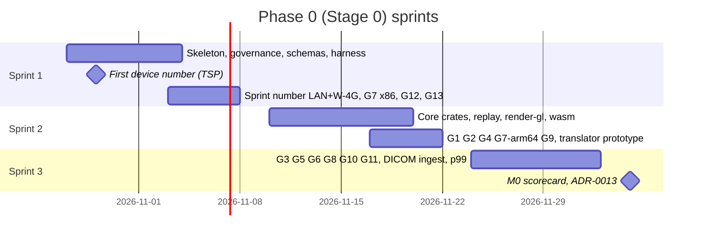

# Repository structure, developer environment and first sprints

Plan section for the Stoipath WSI viewer. Date 2026-10-24. Terminology, component names, gates (G1–G13), milestones (M0–M5), device classes (W-4G, W-iPad, …) and metrics (NTF%, TTS, I2P, REF) are those of `arch/recommended.md`; nothing here changes a §4 figure. Versions marked **[registry 2026-10-24]** were read today from crates.io, npm or PyPI; **[unverified]** means recollection to confirm before it is load-bearing. The repository `/home/user/Stoipath` already contains `wsi-viewer/stage0/` (a TypeScript WebGL2 spike, a Python pyramid builder and a 97.8 MB CAMELYON16-derived tile pyramid) and `wsi-viewer/docs/{research,architecture}`; this section builds around what exists rather than starting over.

## 1. Where the viewer lives inside the Stoipath monorepo

**Decision (ADR-0001).** One Git repository, several projects; each project is a self-contained build root. The repository root carries only governance (`LICENSE`, `DCO`, `CODEOWNERS`, `SECURITY.md`, `AGENTS.md`, `.github/`) and never a build tool, because Cargo workspaces cannot nest and a root-level `pnpm`/Turborepo graph would couple unrelated Stoipath projects. CI workflows live in the root `.github/workflows/` and are scoped with `paths: [wsi-viewer/**]` filters so a second project adds its own workflow file, not a conditional. Note 10 F2 ranks Cargo + pnpm 12 + Turborepo 2.11 as "adopt now" and Bazel 9 as "defer to >3 teams"; the layout below keeps Bazel possible (explicit inputs and outputs per package, no cross-package relative imports) without paying for it.

```
Stoipath/
├── LICENSE (Apache-2.0)  DCO  CODEOWNERS  SECURITY.md  AGENTS.md  README.md
├── .github/workflows/        wsi-ci.yml, wsi-nightly.yml, wsi-release.yml (paths-filtered)
└── wsi-viewer/                                   ← this project; one Cargo + pnpm + uv root
    ├── Cargo.toml  rust-toolchain.toml  deny.toml  about.toml  .cargo/config.toml  Cargo.lock
    ├── package.json  pnpm-workspace.yaml  pnpm-lock.yaml  turbo.json  biome.json  tsconfig.base.json
    ├── pyproject.toml  uv.lock                   ← uv workspace for python/*
    ├── AGENTS.md  Makefile                       ← `make check` == `cargo xtask check` (the one entry point)
    ├── crates/                                   ← engine (permissive-only; deny.toml enforces)
    │   ├── stoi-model  stoi-camera  stoi-sched  stoi-cache  stoi-draw  stoi-source  stoi-annot  stoi-telemetry
    │   ├── stoi-core            facade: Engine contract tick/on_bytes/on_decoded/set_budget
    │   ├── stoi-codec           libjpeg-turbo + OpenJPH FFI (native via turbojpeg; wasm via codecs/)
    │   ├── stoi-render-gl       web-sys WebGL2 draw-list executor (web floor)
    │   ├── stoi-render          wgpu 30 + WGSL (native; WebGPU module v1)
    │   ├── stoi-replay          golden gesture replay: recorded inputs + byte arrivals → requests, draw lists
    │   ├── stoi-wasm            wasm-bindgen glue → npm @stoipath/core
    │   ├── stoi-ffi (cbindgen)  stoi-uniffi  stoi-py (PyO3)         ← bindings, stubs until M2
    │   └── xtask                cargo xtask {setup,check,g7,trace,size,backlog,sbom}
    ├── server/                                   ← Edge Translator and ingest (note 10 licence classes)
    │   ├── stoi-manifest        TileIndex → (object, offset, length, codec, provenance) builder
    │   ├── stoi-translator      lib: Manifest→byte range, bundles, façades, L4 cache
    │   ├── stoi-translator-service (axum bin)  stoi-translator-worker (workers-rs bin)
    │   └── ingest/              Rust orchestrator + python workers (wsidicomizer, OpenSlide, Bio-Formats) in per-licence containers
    ├── codecs/                  pinned libjpeg-turbo 3.2 and OpenJPH sources, Emscripten build (-msimd128, no pthreads)
    ├── shaders/                 WGSL once; naga-cli emits GLSL ES 3.00 at build; goldens ≤1 LSB
    ├── packages/                                 ← TypeScript (pnpm workspace)
    │   ├── viewer               Lit <stoipath-viewer>, iframe RPC, PWA shell pieces
    │   ├── decode-worker        worker module wrapping codecs/ wasm (60–90 KB gz, separate from core)
    │   ├── harness              gesture DSL, CDP/Playwright executors, device runner, quality-record analysis
    │   └── schemas              JSON Schemas: quality record, gesture path, Manifest, backlog item, provenance log
    ├── apps/
    │   ├── ref-ts-spike         ← today's stage0/client, frozen after S1: comparator and TS exit candidate
    │   ├── ref-quad/web         CSS-transform REF page; later ref-quad/ios (Metal), ref-quad/android (Vulkan)
    │   ├── playground           paste-a-URL viewer with the performance HUD (M1)
    │   └── desktop  ios  android                 ← Tauri 2 / SwiftUI / Compose shells (M1+)
    ├── python/
    │   ├── stoipath             PyO3 wheel + anywidget (M1)
    │   ├── stoi-synth           fiducial synthetic-slide generator (note 10 F5)
    │   └── stoi-pyramid-tools   ← today's stage0/tools (build_pyramid.py, verify_pyramid.py, wsi_source.py)
    ├── testdata/                manifests + SHA-256 lists only; pixels in Git LFS or the public bucket; results/<device>/<date>/
    ├── backlog/                 one YAML per item (S1-01.yaml …); mirrored one-way to GitHub Issues
    └── docs/
        ├── research/  architecture/  plan/  adr/ (MADR 4.0)  evidence/  provenance/runs.jsonl
        ├── design-controls/     requirements.yaml (REQ-IDs), risk-register.yaml (ISO 14971 shape), trace matrix (generated)
        └── conformance/         third-party-reader smoke tests and statements
```

Three choices need stating. (1) **Crate boundaries follow §3 of the architecture exactly**, so the component diagram is also the dependency graph; `stoi-core` re-exports and nothing below it depends on anything above it (`cargo xtask check` runs `cargo-machete` and a layering test that parses `cargo metadata`). (2) **Licence classes are directories**: everything under `crates/` and `packages/` must be permissive (note 09 F9; `deny.toml` lists Apache-2.0, MIT, BSD-2/3, ISC, Zlib, Unicode, MPL-2.0 for tooling only, IJG for libjpeg-turbo); `server/ingest/` is the only place LGPL/GPL may appear and each such worker is its own container image, never linked. (3) **The existing spike is kept, not deleted.** `stage0/client` becomes `apps/ref-ts-spike`: it is the comparator the Rust engine must match on the golden replay (Sprint 2), the recorded TypeScript exit if Stage 0 shows wasm trampoline or debuggability cost (recommended.md §2 item 3), and the fastest route to the Sprint-1 device number. Its `MEASUREMENT_PROTOCOL.md` (device classes, cold/warm procedure, metric definitions, in-browser measurement limits, OpenSeadragon-defaults comparator) and `client/harness/{run,serve}.mjs` (Playwright headless run, static server with crude latency/bandwidth shaping) are the seed of `docs/evidence/stage0/` and `packages/harness`.

## 2. Package and crate list

| Unit | Responsibility (one line) | Depends on | Appears |
|---|---|---|---|
| `stoi-model` | Pyramid geometry, `TileIndex`, µm frame, affine; shared by client and server so shard/tile geometry agrees by construction | — | S2 |
| `stoi-camera` | Fixed-timestep camera, log-space zoom, inertia, One-Euro pan predictor; host supplies time | model | S2 |
| `stoi-sched` | L\* selection, priority queue `(tier, abs(level−L*), focus distance)`, prefetch rules, cancel-below-30 %, in-flight caps | model, camera | S2 |
| `stoi-cache` | L0 slot map (≤64-layer 512² arrays), L1 LRU ≤25 % of L0, L2 store trait, Pinned Base never evicted | model | S2 |
| `stoi-draw` | Draw list, fractional-LOD blend weights, ≤100 ms cross-fade, upload order and budget, per-frame quality record | model, cache | S2 |
| `stoi-source` | Manifest reader, tile URL builders, Zarr v3 shard index, DICOMweb `frames/{list}`, IIIF, DZI clients (bytes in, no I/O) | model | S2 (Manifest, DZI-shaped static), M1 rest |
| `stoi-annot` | GeoArrow geometry, Hilbert R-tree, MVT emit | model | M1 |
| `stoi-telemetry` | NTF%, BAT, TTS, CHS, BER, prefetch waste, I2P proxies in one schema (`schemas/quality-record`) | draw | S2 |
| `stoi-core` | The Engine contract; single-threaded, no threads/sockets/DOM; `serde` on every input/output for replay | all above | S2 |
| `stoi-codec` | libjpeg-turbo (sole Dx JPEG decoder) and pinned OpenJPH via FFI; hash-identity tests (G7) | — | S1 (wasm build), S2 (crate) |
| `stoi-render-gl` | Executes the draw list on WebGL2 through `web-sys`; texture arrays; no wgpu | draw | S2 |
| `stoi-render` | wgpu 30.0.1 + WGSL; `PresentSink`/`TileTextureStore` traits; native only until v1 | draw | S3 (lavapipe goldens), M1 |
| `stoi-replay` | Loads a gesture path and recorded byte-arrival timeline, drives `tick()` with a fake clock, emits request sequence and draw list; `insta` snapshots | core | S2 |
| `stoi-wasm` | wasm-bindgen exports, worker message types, `set_budget` from `deviceMemory`; size budget enforced (G1) | core, render-gl | S2 |
| `stoi-ffi`, `stoi-uniffi`, `stoi-py` | C ABI, Swift/Kotlin, Python bindings over `stoi-core` | core | stubs S2, real M1–M3 |
| `xtask` | Repo automation: toolchain install at pinned versions, `check`, `g7`, `size`, `trace`, `backlog`, `sbom` | — | S1 |
| `stoi-manifest` | Builds the Manifest from DICOM EOTs, Zarr shard indices, TIFF IFDs/`JPEGTables`, or a static tile directory | model, `tiff`, `dicom-object`, `zarrs` | S2 (static), S3 (DICOM EOT) |
| `stoi-translator` (+ service, worker) | Token check, Manifest → byte range, ≤4-range bundles, DICOMweb/IIIF/DZI façades, `moka` L4; p99 ≤ 10 ms hot target | manifest, model, source | S2 prototype, S3 gate |
| `server/ingest` | Two-pass ingest orchestration; wsidicomizer 0.31.0 passthrough to DICOM WSI `TILED_FULL`+EOT; isolated LGPL/GPL workers | — | S3 (CAMELYON slide) |
| `packages/viewer` | `<stoipath-viewer>` Lit 3.3 element, rAF driver, worker pool `clamp(hardwareConcurrency−1,1,3)`, OPFS L2 | core wasm, decode-worker | S2 (driver), M1 |
| `packages/decode-worker` | Worker holding one codec wasm instance; transferables only; self-certification of `createImageBitmap` (G8) | codecs | S1 |
| `packages/harness` | Gesture DSL executors (CDP `Input.*`, `gpuBenchmarking` where available), device runner over adb, CDP tracing → LatencyInfo, analysis with bootstrap CIs | schemas | S1 |
| `packages/schemas` | JSON Schema + generated TS/Rust/Python types for every artefact a script checks | — | S1 |
| `apps/ref-ts-spike` | Today's TS WebGL2 spike; produces the Sprint-1 number; frozen after S1 except harness hooks | — | exists |
| `apps/ref-quad/*`, `apps/ref-osd` | REF floors: CSS-transform page (S1), raw Metal and Vulkan quads (M2/M3); OpenSeadragon-defaults comparator (architecture §2: OSD as perf comparator) | — | S1 web |
| `python/stoi-synth` | Seeded fiducial slides (level/col/row barcodes, Siemens stars) to SVS-like TIFF, DICOM, OME-Zarr | tifffile 2026.10.15, wsidicomizer 0.31.0, zarr | S2 |
| `python/stoi-pyramid-tools` | Today's `build_pyramid.py`/`verify_pyramid.py`: CAMELYON region → static pyramid, deterministic, hash-verified | tifffile, imagecodecs | exists |

## 3. Tooling

| Concern | Choice (version **[registry 2026-10-24]** unless noted) | Why / rule |
|---|---|---|
| Rust | 1.99.1 stable (2026-10-15) in `rust-toolchain.toml`; targets `wasm32-unknown-unknown`, later `aarch64-apple-ios`, `aarch64-linux-android`; no nightly, no atomics, no SAB (gap-3 #12a) | Architecture §7; reproducible toolchain for every agent and runner |
| Rust test/bench | `cargo-nextest` 0.9.149, `insta` 1.49.0, `criterion` 0.8.2, `cargo-fuzz` 0.13.2 + `arbitrary`, `cargo-llvm-cov` 0.9.1 | Note 10 F4/F9/F10; nextest for per-test timeouts and JUnit for CI |
| Rust hygiene and supply chain | `cargo-deny` 0.20.2 (licences, advisories, bans, duplicate wgpu), `cargo-about` 0.9.2 (third-party notices), `cargo-cyclonedx` 0.5.9 + `@cyclonedx/cyclonedx-npm` 6.0.1 (SBOM, §524B/CRA), `cargo-auditable` 0.7.7, `cargo-semver-checks` 0.51.0, `cargo-machete` 0.9.2, `typos-cli` 1.51.1; `cargo-vet` 0.10.3 deferred to the Dx release train | SBOM and licence scans are machine gates from Sprint 1 (programme context) |
| wasm | `wasm-bindgen(-cli)` 0.2.129, `binaryen` 132.0.0 (`wasm-opt -Os`), `naga-cli` 30.0.1 for WGSL→GLSL; `wgpu` pinned `=30.0.1` with `Cargo.lock`, full `cargo vendor` only on the Dx train | gap-2 §2.1; "vendored and pinned" interpreted as exact pin + lock, see Reviewer note 2 |
| C codecs | libjpeg-turbo 3.2.x and OpenJPH as pinned source checkouts in `codecs/`; Emscripten SDK pinned in `codecs/emsdk.lock` (version to fix in S1-08 **[unverified]**); native via `turbojpeg` 1.5.1 | One codebase, measured bit-identical (gap-2 §2.3) |
| JS/TS | pnpm 12.15.0 (via corepack), Turborepo 2.11.10, Vite 8.3.5 (spike is on 7.3.7; upgrade with the move), Vitest 5.0.5, Playwright 1.64.1 (Chromium/Firefox/WebKit), Lit 3.3.3, TypeScript **5.9.3** pinned (7.0.2 is npm `latest`; adopt by ADR once Vite/Vitest/Lit tooling is verified), Biome 2.6.3 as the single linter+formatter, Changesets 3.0.3, size-limit 14.3.0, publint 0.3.25, `@arethetypeswrong/cli` 0.18.5, api-extractor 7.59.4, TypeDoc 0.28.20 | Note 10 F2/F11/F12; Biome replaces ESLint+Prettier to keep one config agents cannot misread |
| Python | uv 0.13.5 workspace, Python 3.13, ruff 0.17.2, mypy 2.4.0, pytest 9.1.1, maturin 1.15.0, anywidget 0.11.0, cibuildwheel 4.3.4; tifffile 2026.10.15, imagecodecs 2026.10.10, wsidicomizer 0.31.0, wsidicom 0.36.1, highdicom 0.28.2, pyvips 3.2.0, mitmproxy 12.3.0 | Oracles and synthetic data; the existing `bench-venv` becomes `uv sync` |
| Bindings | UniFFI 0.32.2, cbindgen 0.29.4, PyO3 0.30.1 | Architecture §7 |
| CI runners | GitHub-hosted `ubuntu-24.04`, `ubuntu-24.04-arm`, `windows-2025`, `windows-11-arm`, `macos-26` (arm64) [runner-images README read today]; self-hosted `lab-*` runners (Mac mini, Linux box with adb hub) for anything that yields a latency number | Note 10 F3 rule: hosted = correctness, owned hardware = truth |
| Perf tracking | Tier 0 instruction counts (CodSpeed simulation mode or self-hosted Bencher), Tier 1 deterministic headless Chrome (`HeadlessExperimental.beginFrame`), Tier 2–4 nightly on `lab-*` with N ≥ 10 and bootstrap CIs | Note 10 F4 |
| Docs | rustdoc, TypeDoc, Sphinx later; ADRs in MADR 4.0.0 (2024-09-17) | §6 |

**Developer and agent environment.** `.devcontainer/` (Ubuntu 24.04 image) installs exactly the versions above; `cargo xtask setup` installs the cargo tools with `--locked` at the pinned versions and `pnpm install --frozen-lockfile`, `uv sync --frozen`. `make check` runs: `cargo fmt --check`, `cargo clippy --all-targets -D warnings`, `cargo nextest run`, `cargo deny check`, `biome ci`, `tsc --noEmit`, `vitest run`, `ruff check`, `pytest`, `xtask trace`, `xtask backlog check`. The same command is the first CI job, so an agent that passes `make check` locally rarely fails CI for hygiene reasons. `AGENTS.md` (repo root and `wsi-viewer/`) is the machine-readable contract: the commands above, the directory rules of §1, the coding standards of §5, the gate classes of §7, and the sentence "never edit `Cargo.lock`, `pnpm-lock.yaml`, `uv.lock`, `deny.toml` or anything under `docs/adr/` without a backlog item that names that file". Device work needs a human: the `lab-android` runner is a Linux box with the floor phone on USB, Chrome remote debugging exposed with `adb forward tcp:9222 localabstract:chrome_devtools_remote`, and `tc qdisc netem` on a dedicated Wi-Fi bridge for the W-4G profile (45/200 ms RTT, 25/5 Mbps).

## 4. Branching, commits and releases

Trunk-based. `main` is protected: merge queue, required checks (`make check`, wasm size budget, licence/SBOM, semantic goldens, fuzz smoke 60 s), linear history by squash. Branches are `agent/<item-id>-<slug>` or `human/<name>/<slug>`, one backlog item per PR, deleted on merge. Commits follow Conventional Commits 1.0.0 with the scope equal to the crate or package (`feat(stoi-sched): …`) and carry trailers: `Backlog: S1-07`, `Signed-off-by:` (DCO; for agent-authored commits the sponsoring human signs when they approve the PR, which is the DCO act), `Co-authored-by:` the agent, `Agent-Run: <id>` pointing at `docs/provenance/runs.jsonl`. Releases: SDK family in lockstep semver via Changesets + release-plz 0.4.1 (`0.y.z` until M4, minor = breaking), server on its own train, tags `wsi-viewer/v0.y.z` because the monorepo may hold other projects' tags; signed artefacts and SLSA provenance via `actions/attest-build-provenance`, OIDC trusted publishing for npm (`npm trust`, CLI ≥ 11.5.0, verified gap-3 #12b) and PyPI, token fallback for crates.io until its GA terms are read. The Dx edition later gets `release/dx-x.y` branches with full `cargo vendor` and a frozen toolchain; nothing in Phase 0 creates one.

## 5. Coding standards (the ones a script checks)

| Rule | Enforcement |
|---|---|
| `tick()` is deterministic: no `Instant::now`, no `HashMap` iteration order, no `f32`/`f64` fast-math; all inputs/outputs `serde` | `stoi-replay` snapshot tests; clippy `disallowed_methods` for `Instant::now`, `SystemTime::now`, `rand::thread_rng` in `crates/` |
| Zero heap allocations per `tick()` after warm-up; no main-thread task > 8 ms during gestures | Counting `#[global_allocator]` in a nextest test; Tier 1 harness asserts long-task count = 0 |
| `#![forbid(unsafe_code)]` everywhere except `stoi-codec`, `stoi-ffi`, `stoi-render` (wgpu-hal hatches), each `unsafe` with a `// SAFETY:` line | clippy `undocumented_unsafe_blocks = deny`; grep in `xtask check` |
| No `unwrap`/`expect`/`panic!` in `crates/`; `panic = "abort"` on wasm; readers return typed errors | clippy `unwrap_used`, `expect_used`, `panic` = deny in crate `Cargo.toml` lints table |
| Every reader (`tiff`, DICOM, Zarr, Manifest, URL parsing) ships with a `cargo-fuzz` target and a seed corpus before merge | `xtask check` fails if `crates/stoi-source/fuzz/` lacks a target per public `parse_*` |
| Shaders written once in WGSL; GLSL is generated, never hand-edited | generated files carry a header; CI regenerates and diffs |
| TypeScript `strict` + `noUncheckedIndexedAccess` + `exactOptionalPropertyTypes` (the spike's `tsconfig`); no `any`; hot loops on typed arrays | `tsconfig.base.json`, Biome `noExplicitAny = error` |
| Python typed, `ruff` default + `I`, `B`, `UP`; scripts take paths as arguments and run with `-I` on untrusted inputs | ruff, mypy in `make check` |
| Every test that verifies a requirement names it: `#[test] fn req_g1_floor_module_size()` or `@pytest.mark.req("REQ-G1")` | `xtask trace` builds `docs/design-controls/trace.md`; fails on a requirement marked `verified_by: test` with no matching test |
| Public schemas change only with a schema version bump and a migration note | `packages/schemas` test loads every committed sample |

The design-controls folder is deliberately plain YAML and Markdown: it is the seed of a Design History File (IEC 62304 lifecycle, ISO 14971 risk register, IEC 62366 usability file) that *Risks, compliance, security, licensing and open questions* expands; what Phase 0 must guarantee is that requirement IDs, tests and evidence are linked from the first commit, because note 10 §1.10 and note 09 F1 both say this cannot be retrofitted.

## 6. Architecture Decision Records

ADRs use MADR 4.0.0 in `docs/adr/NNNN-slug.md` with status proposed → accepted → deprecated/superseded, and a `decision_makers` line. Agents draft ADRs; only humans accept them (gate H2 below). An ADR is mandatory for: a new dependency outside the permissive list; any change to the Engine contract, the Manifest tuple, a gate threshold, the canonical store, a platform target, the tile URL/token scheme, or a toolchain major. Sprint 1 seeds the record with the decisions already taken in `arch/recommended.md`, so they are visible and not re-litigated by the next agent: 0001 monorepo layout; 0002 Rust core as single home of the policy, Engine contract; 0003 direct `web-sys` WebGL2 renderer on the web floor, wgpu native-only until v1; 0004 libjpeg-turbo as sole Dx decoder, `createImageBitmap` self-certified, never on Safari in Dx; 0005 dual-standard single-copy canonical store; 0006 build the Edge Translator in Rust, adopt no server; 0007 Apache-2.0 + DCO, Dx edition and enterprise edge commercial; 0008 permissive-only client, LGPL/GPL isolated in ingest; 0009 prefix-scoped capability token in the query, path-only cache key; 0010 no SharedArrayBuffer/COOP/COEP, Service Worker off the hot path; 0011 design controls from the first commit; 0012 agent execution rules and gate classes; 0013 (Sprint 3) the Stage-0 B/C outcome.

## 7. How an agent executes a backlog item

Every item is a YAML file in `backlog/` validated against `schemas/backlog-item.json`: `id, title, sprint, touches[], depends_on[], dod[] (shell commands that must exit 0, plus artefact paths that must exist), gate, owner_role, status`. Agents pick items whose `status: ready` and whose dependencies are `done`, branch, implement, run `make check` plus the item's `dod` commands, open a PR that cites the item and attaches the command output, and request review. A second agent reviews for the §5 rules; the gate class then decides what a human does. Provenance, cost and time for every run are appended to `docs/provenance/runs.jsonl` (`task, agent, model, tokens_in/out, usd, wall_s, commit`) and `xtask backlog check` refuses a PR whose commits lack an `Agent-Run` trailer that resolves to a line there.

| Gate | Meaning | Who |
|---|---|---|
| **A** | Automatic: CI green + second-agent review → merge queue | none |
| **H1** | Human code review required before merge | the `owner_role` lead |
| **H2** | Human decision recorded in an ADR or a signed scorecard | PO + TL (+ RA where regulatory) |
| **D** | Device operator runs the stated command on named physical hardware and commits the results JSON | PQA operator; TL countersigns |


*Autonomous execution model and dissemination plan* owns the full description of the loop and of the TSP evidence; *Quality, testing and performance QA* owns the gate definitions and the device lab; *Roadmap, milestones, team and estimates* owns what follows M0. This section only fixes the parts the repository must encode.

## 8. The first three sprints (Phase 0 performance spike)

Phase 0 is Stage 0 of the architecture (G1–G13) scheduled over six weeks, each sprint ending with a demo and a scorecard; the gate thresholds themselves are specified in *Quality, testing and performance QA* and the device classes in *Requirements and platform matrix*. Owners are roles from the architecture's team (TL tech lead; GFX Rust/graphics; SYS Rust systems; WEB web/TS; BE backend; PQA performance/QA; PATH pathologist; RA regulatory/QA; PO product owner); agents implement, the owner role reviews. Calendar: S1 2026-10-27 → 11-07, S2 11-10 → 11-21, S3 11-24 → 12-05.

### Sprint 1 — "Measure the floor" (ends with a zoom-latency number on a real low-end Android)

The sprint's point is a *number*, not a pass: TTS per zoom burst and an input-latency proxy on a W-4G-class phone running the existing spike against the CAMELYON pyramid, under LAN and the 4G netem profile, with the CSS-transform REF page measured the same way, N ≥ 10 runs each. Two input-latency figures are reported and never conflated: the in-page **I2FC proxy** (first input `timeStamp` → the rAF that reflected it, as the protocol defines it; omits 1–2 compositor vsyncs) and **input-to-swap** from CDP `LatencyInfo` tracing (Chromium only); true input-to-photon waits for the Sprint-3 rig. The number calibrates the §4.4 tables (several of whose rows are **[unverified]**) and is the earliest evidence the TSP abstract can cite. Because the abstract is due 2026-10-29/30, a first device run with the spike as it stands is scheduled for days 2–3 (S1-07a) and repeated at sprint end with the hardened harness (S1-07b).

| ID | Item | Touches | Definition of done (checked by) | Owner | Gate |
|---|---|---|---|---|---|
| S1-01 | Workspace skeleton: Cargo workspace, `rust-toolchain.toml`, pnpm + turbo, uv workspace, `xtask check`, `.devcontainer`, root `.github/workflows/wsi-ci.yml` with paths filter on `ubuntu-24.04`/`windows-2025`/`macos-26` | `wsi-viewer/{Cargo.toml,package.json,turbo.json,pyproject.toml}`, `crates/xtask`, `.devcontainer/`, `.github/` | `make check` exits 0 on a clean container; CI green on the three OSes; `cargo xtask setup` idempotent (second run makes no changes) | TL | H1 |
| S1-02 | Governance: `LICENSE` Apache-2.0, `DCO`, `CODEOWNERS`, `SECURITY.md`, `CONTRIBUTING.md`, `AGENTS.md`, PR template with "DoD evidence" block, ADR-0001…0012 drafted from `arch/recommended.md` | repo root, `docs/adr/` | Files exist; `xtask backlog check` validates `AGENTS.md` commands exist; ADRs lint against the MADR template | PO, TL | H2 (licence and ADR acceptance) |
| S1-03 | Move `stage0/client` → `apps/ref-ts-spike`, `stage0/client/harness` → `packages/harness` (seed), `stage0/MEASUREMENT_PROTOCOL.md` → `docs/evidence/stage0/measurement-protocol.md`, `stage0/tools` → `python/stoi-pyramid-tools`, `stage0/data` → `testdata/camelyon16-tumor_014-15k/` (manifest + `hashes_final.txt` in git, tiles via LFS or bucket); `SOURCE.md` kept | `apps/ref-ts-spike`, `packages/harness`, `python/stoi-pyramid-tools`, `testdata/`, `docs/evidence/` | `pnpm --filter ref-ts-spike build` succeeds; `verify_pyramid.py --data … --hashes` matches the committed 1,210 SHA-256s; `git grep stage0/` returns only docs | WEB | A |
| S1-04 | Schemas v0, formalising what the spike's **Export JSON** already emits: quality record (per frame: input ts, present ts, L\*, level drawn at centre, sharp fraction, deficit cells, blank flag, pop-in, upload ms; per gesture: I2FC proxy, TTS per zoom burst, max blur duration, deficit-frame %, dropped-frame rate, bytes per burst), gesture path DSL (`pinch, pan, fling, wheel, jump, dwell`), device fingerprint (`GL_RENDERER`, UA, `hardwareConcurrency`, `deviceMemory`, refresh rate, build hash, `http_version`, `cache_state`, `network_condition`), results summary | `packages/schemas`, spike exporter | Schemas validate committed samples in `vitest`; spike's "Export JSON" emits a valid quality record for the standard path | WEB, PQA | A |
| S1-05 | REF page: CSS-transform image following the same gesture DSL, same record export; plus the OpenSeadragon-defaults comparator page the protocol §8 specifies (`openseadragon` 6.1.1, default settings, same pyramid as a DZI-shaped source) | `apps/ref-quad/web`, `apps/ref-osd` | Playwright test replays `paths/standard-pinch.json` on REF, OSD and spike; all records validate; REF has 0 tile logic (size ≤ 20 KB) | WEB | A |
| S1-06 | Device runner, extending `harness/run.mjs`: `pnpm harness device run --device <id> --path <file> --net {lan,w4g} --runs 10`: adb forward, Playwright `connectOverCDP`, CDP `Tracing.start` (`input`, `benchmark`, `cc`, `viz`, `latencyInfo`), gestures via CDP `Input.dispatchTouchEvent` (and `gpuBenchmarking` when the command-line flag is available **[unverified on current Chrome Android]**), writes `testdata/results/<device>/<date>/run-NN.json` + `summary.json` with p50/p95 and bootstrap CI | `packages/harness` | Smoke run against desktop headless Chromium in CI produces a valid `summary.json`; `--runs 10` enforced; refuses to summarise if fewer than 10 valid runs or the fingerprint is missing | PQA | A |
| S1-07a | **First device number (days 2–3)**: spike as-is on the floor phone following `MEASUREMENT_PROTOCOL.md` §5 (manual procedure; its 3-run minimum is acceptable for the abstract, 10 runs preferred), `lan-wifi` cold and warm, standard path plus the 60 s manual-gesture export for I2FC; results + fingerprint committed | `testdata/results/`, `docs/evidence/tsp-2026/` | `summary.json` present with TTS p50/p95, NTF% during gesture, frame p99, input-to-swap p95 (LatencyInfo), REF input-to-swap p95 on the same device | PQA (operator), TL | D |
| S1-07b | **Sprint number**: S1-06 runner, LAN and W-4G netem profiles, spike and REF, 10 runs each; report generated by `harness report` into `docs/evidence/stage0/sprint1.md` | same | Report lists device, Chrome version, both profiles, all metrics with CIs, and the REF delta; `xtask trace` links it to REQ-G11 (floor) and the §4.4 W-4G row | PQA, TL | D |
| S1-08 | G7 part 1: Emscripten build of libjpeg-turbo 3.2 (`-msimd128`, no pthreads) in `codecs/`; `packages/decode-worker` wraps it; `xtask g7` hashes 1,000 CAMELYON tiles decoded by wasm (Node) vs native `turbojpeg` (`JDCT_ISLOW`, fancy upsampling) | `codecs/`, `packages/decode-worker`, `crates/xtask` | `xtask g7 --arch x86_64` reports 1000/1000 identical; module ≤ 90 KB gz (`size-limit`) | SYS | H1 |
| S1-09 | G13: wasm libjpeg-turbo decode cost per 512² tile in a worker on the floor phone (A55-class core), 300 decodes after warm-up | harness + decode-worker | `results/<device>/…/g13.json` with p50/p95 ms; ratio to desktop x86 recorded | PQA, SYS | D |
| S1-10 | G12: per-tile upload cost on the floor phone, `texSubImage3D` from `ImageBitmap` vs `ArrayBuffer`, main-thread stall histogram | spike renderer + harness | `g12.json` with p50/p95 per path and max stall; both paths measured | GFX | D |
| S1-11 | Licence and security gates: `deny.toml` (permissive-only for `crates/`, `packages/`; separate policy for `server/ingest`), `cargo-about` notices, CycloneDX SBOM artefacts for Rust and npm, `typos`, GitHub secret scanning; a canary test that adds a GPL crate to a client crate must fail CI | `deny.toml`, `about.toml`, `.github/` | CI job `licence-sbom` green; canary PR (opened by the agent, then closed) shows the expected red | SYS, RA | A |
| S1-12 | Design-controls seed: `requirements.yaml` with REQ-G1…G13 (text = the Stage-0 gate, acceptance = its threshold), REQ-ZOOM-* from §4.1/§4.4, `risk-register.yaml` with the §10 risks; `xtask trace` | `docs/design-controls/` | `xtask trace` emits `trace.md`; CI fails on a REQ marked `verified_by: test` without a test; RA has reviewed wording | RA, TL | H1 |
| S1-13 | Provenance and cost log: `docs/provenance/runs.jsonl` schema, `xtask backlog check` trailer rule, weekly summary script (`usd`, `wall_s`, items done per sprint) | `docs/provenance`, `crates/xtask`, `packages/schemas` | Every commit on `main` after this item resolves to a log line; summary renders | TL | A |
| S1-14 | TSP evidence pack: `harness report --tsp` assembles device numbers, provenance totals, cost totals, the CC0 data statement and the limitations paragraph into `docs/evidence/tsp-2026/` | `docs/evidence/` | Pack regenerates deterministically from committed results; contains no claim without a results file | PO, PATH | H2 |

**Demo:** the floor phone and the REF page side by side on the lab bench; the generated Sprint-1 report with TTS p50/p95, NTF%, frame p99 and input-to-swap for LAN and W-4G. **Exit criteria (all machine-checked except the last):** `make check` and the three-OS CI green on `main`; `summary.json` for the floor device with N ≥ 10 under two profiles and a REF delta; G7 1000/1000 on x86; G12/G13 result files present; `deny` canary red; `trace.md` has no orphans; ADR-0001…0012 accepted (H2). What the number can and cannot say must be in the report: it measures a research prototype on public de-identified slides; it says nothing about diagnostic equivalence.

### Sprint 2 — "One engine, one replay"

| ID | Item | Touches | Definition of done | Owner | Gate |
|---|---|---|---|---|---|
| S2-01 | `stoi-model`, `stoi-camera`, `stoi-sched`, `stoi-cache`, `stoi-draw`, `stoi-telemetry`, `stoi-core`: port the spike's policy and constants (`constants.ts` has a source line per constant; keep it) behind the Engine contract | `crates/stoi-*` | Unit tests per crate; allocation counter test: 0 allocs per `tick` after warm-up; `cargo doc` with no warnings | GFX, SYS | H1 |
| S2-02 | `stoi-replay`: gesture + byte-arrival timeline → request sequence and draw list; `insta` snapshots for the standard paths; CLI `stoi-replay run <path> <timeline>` | `crates/stoi-replay` | Snapshots committed; running twice is byte-identical; a deliberate policy change fails the snapshot | SYS | A |
| S2-03 | Parity harness: record the TS spike's requests and draw lists for the same path and timeline; compare to the Rust replay; differences enumerated and each either fixed or listed in `docs/evidence/stage0/parity.md` | `packages/harness`, `apps/ref-ts-spike` | `harness parity` exits 0 with ≤ N documented differences (N set by TL in the item file) | GFX, WEB | H1 |
| S2-04 | `stoi-render-gl`: WebGL2 draw-list executor over `web-sys`; texture arrays; fractional-LOD blend; upload budget from `set_budget`; G4 test page writing distinct patterns into arrays of 1…64 layers | `crates/stoi-render-gl`, `shaders/` | Playwright on Chromium SwiftShader, Firefox, WebKit: G4 0 mismatches for every layer count; semantic goldens unchanged | GFX | H1 |
| S2-05 | `stoi-wasm` + `packages/viewer` driver: one rAF, worker pool, transferables, OPFS stub; G1 size budget | `crates/stoi-wasm`, `packages/viewer` | `size-limit`: floor module ≤ 1.0 MB gz (target 0.6), full ≤ 1.3 MB; viewer opens the CAMELYON pyramid in Chrome desktop and emits quality records | WEB, SYS | A |
| S2-06 | G1/G2/G4/G9 on the floor phone: cold compile + first frame, texture-array correctness, worker pool scaling (3 workers vs inline, 20 tiles) | harness | `g1g2.json` (compile+first frame ≤ 300 ms is the gate; value recorded either way), `g4.json` 0 mismatches, `g9.json` ≥ 1.8× | PQA, GFX | D |
| S2-07 | G7 part 2: arm64 identity (`macos-26` runner for native arm64, floor phone for wasm) on the same 1,000 tiles | `crates/xtask`, CI | `xtask g7 --arch aarch64` 1000/1000; CI job on `macos-26` green | SYS | A |
| S2-08 | `python/stoi-synth` v0: seeded 20k² fiducial slide (level/col/row barcodes, Siemens stars) to SVS-like TIFF; Tier-1 sharpness check decodes fiducials from screenshots | `python/stoi-synth`, harness | Two builds are byte-identical; a Playwright test decodes the fiducial of every visible tile and matches the quality record's drawn level | PQA | A |
| S2-09 | `stoi-manifest` (static tile directory and TIFF `JPEGTables` sources) + `stoi-translator` prototype as an axum service: per-tile, ≤4-range bundle, immutable headers, path-only cache key with query token stripped | `server/stoi-manifest`, `server/stoi-translator*` | Serves the CAMELYON pyramid; `harness load` (Rust client, 2-vCPU container) reports p50/p99 hot service time per endpoint; Manifest ≤ 100 KB for the 15k slide | BE | H1 |
| S2-10 | Tier-1 deterministic frame tests in CI: `HeadlessExperimental.beginFrame` with `--run-all-compositor-stages-before-draw`; asserts which level was drawn per frame on the standard path (semantic goldens via `insta`) | harness, CI | PR job `tier1` green; a forced one-level regression fails it | PQA | A |
| S2-11 | Fuzz-first readers: `cargo-fuzz` targets for Manifest, TIFF IFD/`JPEGTables`, URL parsing; ClusterFuzzLite 60 s per PR | `crates/stoi-source/fuzz`, CI | Targets build; 60 s smoke green; seed corpus from `testdata/` | SYS | A |

**Demo:** the Rust engine (`stoi-core` + `stoi-render-gl` in wasm) and the TS spike opened side by side on the CAMELYON pyramid in Chrome desktop and on the floor phone; `harness parity` output. **Exit criteria:** parity exits 0; G4 0 mismatches on three engines and the phone; G1 ≤ 1.0 MB gz floor module; G7 1000/1000 on x86 and arm64; G9 ≥ 1.8×; G2 measured (pass or recorded miss); translator p99 measured; Tier 1 gating PRs.

### Sprint 3 — "Gates, the iPad, and the B/C decision"

Procurement gate before this sprint (H2, PO): the lab must hold a 2020-class iPad (A12) and an iPhone 12 or equivalent, a Samsung Xclipse device, a Firefox Linux box, and a 240 fps camera or WALT rig (note 10 F6 list; ≈ USD 8–12k capex **[unverified]**).

| ID | Item | Touches | Definition of done | Owner | Gate |
|---|---|---|---|---|---|
| S3-01 | G3 and G5 on the floor Android and the iPad (Safari): 60 tiles, two levels, cross-level blend, DPR 3 → p99 frame time; per-tile upload paths ≤ 2 ms, no stall > 8 ms | harness, `stoi-render-gl` | `g3.json`, `g5.json` per device with p99 and max stall; gate thresholds evaluated by `harness gate` | GFX, PQA | D |
| S3-02 | G6 Safari soak: 500 reloads + 30 min pinch/pan with a 300 MB budget on iPhone/iPad; WebContent RSS via Safari Web Inspector / `safaridriver` | harness | `g6.json`: 0 tab terminations, RSS ≤ 300 MB | PQA | D |
| S3-03 | G8 self-certification matrix: `createImageBitmap(blob,{colorSpaceConversion:'none',premultiplyAlpha:'none'})` vs the G7 reference on Chrome desktop/Android, Firefox desktop/Android, Safari macOS/iOS, Android WebView | `packages/decode-worker`, harness | `g8.json` per browser build; the allow-list file `packages/decode-worker/allowlist.json` is generated from it, never hand-edited | SYS, PQA | D |
| S3-04 | G10 goldens: `stoi-render-gl` (Chromium SwiftShader) vs `stoi-render` wgpu (lavapipe Vulkan on Linux) rendering the same draw list from `stoi-replay`; ≤ 1 LSB per channel | `crates/stoi-render`, `shaders/`, harness | `pixelmatch` 8.0.0 diff ≤ 1 LSB on all golden frames in CI | GFX | H1 |
| S3-05 | G11 REF floors with the rig: input-to-photon of the CSS-transform page on the floor phone and iPad (240 fps camera; WALT if built), 30 trials each | `apps/ref-quad/web`, `docs/evidence/` | `g11.json` with p50/p95 and method; replaces the "**[unverified; Stage 0]**" compositor-floor row in a plan amendment PR | PQA, TL | D |
| S3-06 | Translator gate: `harness load` on a 2-vCPU container for (a) static-tile range, (b) DICOM EOT frame (from S3-07), (c) 15-tile bundle; `worker` 0.8.7 build compiles from the same crate graph | `server/*` | p99 ≤ 10 ms hot per path recorded (pass/miss); Worker build artefact produced in CI (deploy not required) | BE | H1 |
| S3-07 | gap-5 F9 start: ingest the CAMELYON slide (or its region) with wsidicomizer 0.31.0 passthrough to DICOM WSI `TILED_FULL` + Extended Offset Table; `stoi-manifest` from the EOT; frame bytes hash-match the vendor tiles; `wsidicom`/`pydicom` read-back smoke test in CI | `server/ingest`, `server/stoi-manifest`, `docs/conformance/` | `pytest` conformance job green; hash identity 100 %; EOT-at-open cost (bytes, RTTs) recorded | BE, SYS | H1 |
| S3-08 | Destination-predictor logging: predicted-vs-actual destination level and prefetch waste from every device run (architecture §4.2 item 4) | `stoi-telemetry`, harness | Fields present in the quality record; Sprint-3 report tabulates waste per profile | GFX | A |
| S3-09 | Pathologist path v0: PATH records three 60-second navigation sessions on the floor phone and desktop; converted to gesture DSL paths and added to the standard set (ISO 14971 usability input, gap-1 F9 precursor) | `packages/harness/paths/`, `docs/design-controls/` | Paths validate; replay snapshots exist; consent/no-PHI statement committed | PATH, PQA | H1 |
| S3-10 | **M0 scorecard and ADR-0013**: `harness gate` renders G1–G13 pass/miss/measured with links to result files; the decision B (continue `stoi-render-gl` + wgpu native) or the recorded exits (dual-wasm; TS web renderer; option C variants) | `docs/evidence/stage0/m0-scorecard.md`, `docs/adr/0013` | Scorecard generated, every cell links a results file; ADR accepted | PO, TL, RA | H2 |

**Demo:** the Rust engine on the iPad and the floor phone; the camera-rig REF measurement replayed on screen; the M0 scorecard. **Exit criteria:** G1–G13 each has a result file (pass, miss or measured) on the named devices; the translator p99 per path is recorded; the DICOM `TILED_FULL` instance reads in `wsidicom` with 100 % frame-byte identity; ADR-0013 accepted. A G7 miss stops the plan (architecture §8); G3–G5 misses are renderer bugs and open items for M1, not exits.



## 9. How the repository serves the three pillars from day one

| Pillar (see *Product pillars: clinical use, research and education*) | What Phase 0 already puts in the repository |
|---|---|
| Clinical | `docs/design-controls/` with REQ-IDs, risk register and generated trace matrix; SBOM and licence gates (§524B, CRA); DICOM WSI `TILED_FULL`+EOT ingest with third-party-reader conformance tests (S3-07); the quality record whose "Rendering Complete" semantics become the Dx-mode flag; a translator whose token/cache-key contract is the one every LIS/EHR launch will use |
| Research | Python workspace with the pyramid tools, synthetic-slide generator and the oracles (wsidicom, tifffile); the Manifest and `stoi-model` shared with the server so OME-Zarr shard geometry is tested by the same crates; public CC0 data, hashes and deterministic builds, so every number in `docs/evidence/` is reproducible by a third party |
| Education | the playground and offline pack depend on the same Manifest and `apps/ref-ts-spike` proves a static-file deployment (no server) works, which is the low-bandwidth classroom path; the gesture DSL and quality record are the instruments a later guided-tour or viewing-behaviour analytics feature reuses |

For the TSP abstract, the earliest demonstrable milestone is S1-07a/b: a measured TTS and input-to-swap on a named low-end phone, with REF deltas, the provenance log (agent runs, tokens, dollars, wall time) and the cost summary. That is evidence that AI-built, in-house-verifiable tooling can produce a measured artefact quickly and cheaply; it is not evidence about patient care, diagnostic equivalence or clinical adoption, and the pack (S1-14) must say so.

## 10. Reviewer notes

1. **Stage-0 duration.** `arch/recommended.md` §8 frames Stage 0 as "weeks 0–2" with the gates "re-targeted at our renderer". The renderer those gates target (`stoi-render-gl`) does not exist yet; the TypeScript spike does. I therefore spread G1–G13 over three sprints: device-only measurements that need no new renderer (G7, G11–G13) in Sprint 1, renderer-dependent gates in Sprints 2–3. This is a schedule stretch, not a change of criteria; if the owner wants the two-week reading, Sprint 1 alone is "Stage 0a" and Sprints 2–3 are the start of M0.
2. **"Vendored and pinned" wgpu.** I read §7's "wgpu 30.x + naga, vendored, pinned per release train" as an exact-version pin with `Cargo.lock` in Phase 0 and a full `cargo vendor` tree only on the Dx release branches; a vendored tree in `main` would slow every agent's checkout for no Phase-0 benefit.
3. **The existing spike is TypeScript.** The architecture chose Rust `web-sys` for the web floor renderer and names TypeScript as the recorded exit. Keeping the spike as `apps/ref-ts-spike` is consistent with that: it is the comparator and the exit candidate, and Sprint 2's parity harness is how the exit would be exercised. It must not grow features after Sprint 1 or it becomes a second engine.
4. **No `11-gap-8` note exists in the corpus** despite the brief naming it; the regulatory consequences encoded here (design controls from the first commit, SBOM, permissive client, RUO labelling) are taken from note 09 and the owner's brief and should be re-checked against that note when it lands.
5. **TypeScript 7.0.2 is npm `latest`**; the spike pins 5.9.3. I keep 5.9.3 until an ADR confirms Vite/Vitest/Lit tooling on the 7 line, because a toolchain surprise in Sprint 1 would cost the device number.

## References

- `arch/recommended.md` (§2–§8, amendment gap-5); research notes 02 (R1–R9), 04 (F8), 05 (F2, Recommendations), 09 (F1, F5, F9, §5 decisions), 10 (F2–F11, §4–§6), 11-gap-1 (F7, F9), 11-gap-2 (§2.1–§2.4, §4.2), 11-gap-3 (#12a/b), 11-gap-4 (§2.9, §4), 11-gap-5 (F6, F9); `judge/judgments.json` graft lists; existing repo files `wsi-viewer/stage0/tools/README.md`, `wsi-viewer/stage0/data/SOURCE.md`, `wsi-viewer/stage0/client/src/constants.ts`.
- Registry versions read 2026-10-24: crates.io `https://crates.io/api/v1/crates/<name>` (cargo-nextest, insta, cargo-fuzz, cargo-deny, cargo-about, cargo-cyclonedx, cargo-auditable, cargo-semver-checks, release-plz, cargo-vet, wasm-bindgen, wasm-bindgen-cli, wasm-pack, uniffi, cbindgen, pyo3, maturin, criterion, wgpu, naga-cli, turbojpeg, zarrs, dicom-object, tiff, axum, worker, typos-cli, cargo-llvm-cov, cargo-machete); npm `https://registry.npmjs.org/<name>/latest` (pnpm, turbo, vite, vitest, @playwright/test, lit, typescript, @biomejs/biome, @changesets/cli, size-limit, publint, @arethetypeswrong/cli, binaryen, typedoc, @microsoft/api-extractor, @cyclonedx/cyclonedx-npm, pixelmatch, odiff-bin); PyPI `https://pypi.org/pypi/<name>/json` (uv, ruff, mypy, pytest, maturin, anywidget, cibuildwheel, tifffile, imagecodecs, wsidicomizer, wsidicom, highdicom, pyvips, mitmproxy).
- Rust 1.99.1 (2026-10-15): https://github.com/rust-lang/rust/blob/master/RELEASES.md ; wasm32 atomics unstable: https://github.com/rust-lang/rust/blob/master/compiler/rustc_target/src/target_features.rs
- GitHub-hosted runner images (ubuntu-24.04/26.04 x64+arm64, windows-2025, windows-11-arm, macos-15/26): https://github.com/actions/runner-images/blob/main/README.md ; larger GPU runners: https://docs.github.com/en/actions/reference/runners/larger-runners
- MADR 4.0.0 (2024-09-17): https://github.com/adr/madr/blob/develop/CHANGELOG.md ; Conventional Commits 1.0.0: https://www.conventionalcommits.org/en/v1.0.0/ ; Developer Certificate of Origin 1.1: https://developercertificate.org/ ; Keep a Changelog: https://keepachangelog.com/
- Chrome DevTools Protocol (`HeadlessExperimental.beginFrame`, `Tracing.start`, `Input.dispatchTouchEvent`, `Network.emulateNetworkConditions`): https://chromedevtools.github.io/devtools-protocol/ ; Chromium `gpuBenchmarking` extension: https://source.chromium.org/chromium/chromium/src/+/main:content/renderer/gpu_benchmarking_extension.cc ; LatencyInfo components: https://source.chromium.org/chromium/chromium/src/+/main:ui/latency/latency_info.h
- Playwright `connectOverCDP` and Chromium tracing: https://playwright.dev/docs/api/class-browsertype#browser-type-connect-over-cdp , https://playwright.dev/docs/api/class-browser#browser-start-tracing ; Android remote debugging: https://developer.chrome.com/docs/devtools/remote-debugging/
- WALT latency timer: https://github.com/google/walt ; `tc-netem`: https://man7.org/linux/man-pages/man8/tc-netem.8.html
- wgpu v30 and WebGL2 texture-array issue #4081: https://github.com/gfx-rs/wgpu/blob/trunk/CHANGELOG.md , https://github.com/gfx-rs/wgpu/issues/4081 ; libjpeg-turbo: https://github.com/libjpeg-turbo/libjpeg-turbo ; OpenJPH: https://github.com/aous72/OpenJPH ; Emscripten: https://github.com/emscripten-core/emsdk
- cargo-deny: https://github.com/EmbarkStudios/cargo-deny ; cargo-about: https://github.com/EmbarkStudios/cargo-about ; CycloneDX Rust: https://github.com/CycloneDX/cyclonedx-rust-cargo ; ClusterFuzzLite: https://google.github.io/clusterfuzzlite ; cargo-nextest: https://nexte.st/ ; insta: https://insta.rs/
- npm trusted publishing (`npm trust`, CLI ≥ 11.5.0): https://github.com/npm/cli/blob/latest/docs/lib/content/commands/npm-trust.md ; PyPI trusted publishers: https://docs.pypi.org/trusted-publishers/ ; GitHub artifact attestations: https://github.com/actions/attest-build-provenance
- wsidicomizer 0.31.0 (`--offset-table extended`, `--add-missing-levels`): https://github.com/imi-bigpicture/wsidicomizer ; wsidicom: https://github.com/imi-bigpicture/wsidicom ; CAMELYON16 on AWS Open Data (CC0): https://registry.opendata.aws/camelyon/ , licence https://camelyon-dataset.s3.amazonaws.com/CAMELYON16/license.txt
- Biome: https://biomejs.dev/ ; Turborepo: https://turborepo.com/ ; pnpm: https://pnpm.io/ ; uv: https://docs.astral.sh/uv/ ; Lit: https://lit.dev/ ; Vite: https://vite.dev/
