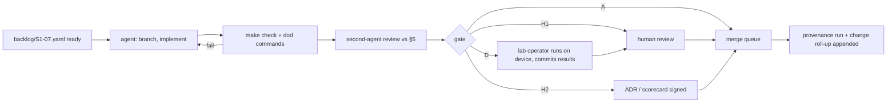
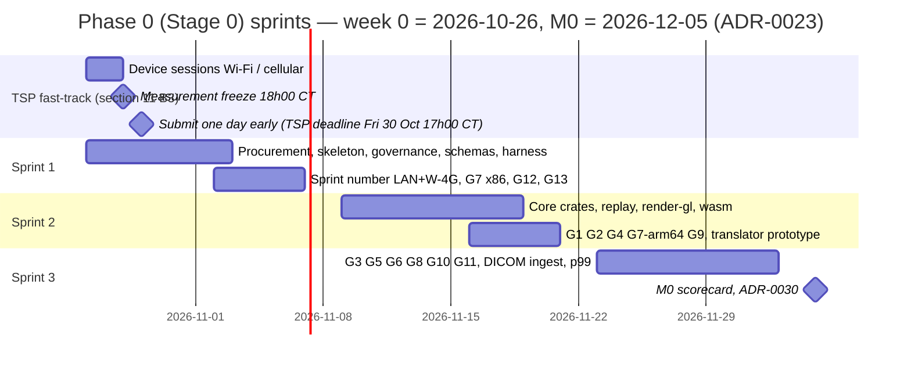

# Repository structure, developer environment and first sprints

Plan section for the Stoipath WSI viewer. Date 2026-10-24, revised 2026-10-25 against the critique (`critique/issues.json`) and the claims-verification report (`verify/README.md`, `verify/required-changes.json`); corrections are marked inline as **(verified)**, **(adjusted after verification: was X)** or **(unverified – Stage 0 gate)**. Terminology, component names, gates (G1–G13), milestones (M0–M5), device classes (W-4G, W-iPad, …) and metrics (NTF%, TTS, I2P, REF) are those of `arch/recommended.md`; nothing here changes a §4 figure. Versions marked **[registry 2026-10-24]** were read that day from crates.io, npm or PyPI; **[unverified]** means recollection to confirm before it is load-bearing.

**What this section owns.** Paths, file names, ID namespaces, the ADR register and the sprint calendar. *Autonomous execution model and dissemination plan* (section 11) owns the roles and semantics of the agent loop and the TSP facts; *Requirements* (section 02) owns requirement text and the FR-/NFR- namespace; *Quality, testing and performance QA* (section 08) owns gate definitions. Where another section names a different path (`provenance/runs/YYYY-MM.jsonl`, `requirements/REQ-*.yaml`, `risk/HAZ-*.yaml`, `gates/*.toml`, the `api/`/`shells/` layout of *System architecture* §12), the mapping in §1.1 below is authoritative and the other section is to be read as pointing here.

**Calendar (canonical for the whole plan, ADR-0023).** Week 0 = Monday 2026-10-26. Stage 0 runs as three two-week sprints: S1 2026-10-26 → 11-06, S2 11-09 → 11-20, S3 11-23 → 12-04; **M0 = 2026-12-05** (the anchor date every section uses; the H2 scorecard review is the last working day, Fri 2026-12-04, and ADR-0030 is dated 2026-12-05). `docs/plan/calendar.yaml` holds these dates and every later milestone so that no section restates a date by hand. This supersedes `recommended.md` §8 "Stage 0 (weeks 0–2)" and the 2026-11-20 / 2026-11-30 M0 dates in earlier drafts of sections 07 and 09 (critique: three incompatible calendars; the six-week reading is the only one that accounts for `stoi-render-gl` not existing yet).

**Repository state on 2026-10-25.** `/home/user/Stoipath` holds `README.md` and `wsi-viewer/` with `stage0/` (TypeScript WebGL2 spike: `client/src/{main,scripted-path,camera,lod,scheduler,frame-planner,renderer,decode-pool,decode-worker,metrics,…}.ts`, `client/harness/{run,serve,browser,check-metrics,screens}.mjs` with headless SwiftShader results from 2026-10-24/25 committed under `client/harness/results/`, `MEASUREMENT_PROTOCOL.md`, `tools/{build_pyramid,verify_pyramid,wsi_source,summarize_results}.py`, `data/` with the 97.8 MB CAMELYON16-derived pyramid and `SOURCE.md`, `results/` template) and `docs/`. This section builds around what exists rather than starting over; the statement in an earlier draft of section 11 B3 that `main.ts` and the harness "do not exist" is stale.

## 1. Where the viewer lives inside the Stoipath monorepo

**Decision (ADR-0017).** One Git repository, several projects; each project is a self-contained build root. The repository root carries only governance (`LICENSE`, `DCO`, `CODEOWNERS`, `SECURITY.md`, `AGENTS.md`, `.github/`) and never a build tool, because Cargo workspaces cannot nest and a root-level `pnpm`/Turborepo graph would couple unrelated Stoipath projects. CI workflows live in the root `.github/workflows/` and are scoped with `paths: [wsi-viewer/**]` filters so a second project adds its own workflow file, not a conditional. Note 10 F2 ranks Cargo + pnpm 12 + Turborepo 2.11 as "adopt now" and Bazel 9 as "defer to >3 teams"; the layout below keeps Bazel possible (explicit inputs and outputs per package, no cross-package relative imports) without paying for it.

```
Stoipath/
├── LICENSE (Apache-2.0)  DCO  CODEOWNERS  SECURITY.md  AGENTS.md  README.md
├── .github/workflows/        wsi-ci.yml, wsi-nightly.yml, wsi-release.yml (paths-filtered)
└── wsi-viewer/                                   ← this project; one Cargo + pnpm + uv root
    ├── Cargo.toml  rust-toolchain.toml  deny.toml  about.toml  .cargo/config.toml  Cargo.lock
    ├── package.json  pnpm-workspace.yaml  pnpm-lock.yaml  turbo.json  biome.json  tsconfig.base.json
    ├── pyproject.toml  uv.lock                   ← uv workspace for python/*
    ├── AGENTS.md  Makefile                       ← `make check` == `cargo xtask check` (the one entry point)
    ├── gates/                   one JSON per gate (metric, device class, network profile, threshold, N, statistic); waivers/ beside them
    ├── crates/                                   ← engine (permissive-only; deny.toml enforces)
    │   ├── stoi-model  stoi-camera  stoi-sched  stoi-cache  stoi-draw  stoi-source  stoi-annot  stoi-telemetry
    │   ├── stoi-core            facade: Engine contract tick/on_bytes/on_decoded/set_budget
    │   ├── stoi-codec           libjpeg-turbo + OpenJPH FFI (native via turbojpeg; wasm via codecs/)      [Class C]
    │   ├── stoi-render-gl       web-sys WebGL2 draw-list executor (web floor)                              [Class C: Dx path]
    │   ├── stoi-render          wgpu =30.0.1 + WGSL (native; WebGPU module v1)                             [Class C: Dx path]
    │   ├── stoi-replay          golden gesture replay: recorded inputs + byte arrivals + budget timeline → requests, draw lists
    │   ├── stoi-wasm            wasm-bindgen glue → npm @stoipath/core
    │   ├── stoi-ffi (cbindgen)  stoi-uniffi  stoi-py (PyO3)         ← bindings, stubs until M2
    │   └── xtask                cargo xtask {setup,check,g7,trace,size,backlog,sbom,gate}
    ├── server/                                   ← Edge Translator and ingest (note 10 licence classes)
    │   ├── stoi-manifest        Manifest (≤100 KB) + Range Index builders (ADR-0025)
    │   ├── stoi-translator      lib: Manifest → Range Index → byte ranges, bundles, façades, L4 cache
    │   ├── stoi-translator-service (axum bin)  stoi-translator-worker (workers-rs bin)
    │   └── ingest/              Rust orchestrator + python workers (wsidicomizer, OpenSlide, Bio-Formats) in per-licence containers;
    │                            also the libvips (LGPL) worker image for off-grid IIIF regions (never linked into stoi-translator)
    ├── codecs/                  pinned libjpeg-turbo 3.2 and OpenJPH sources, Emscripten build (-msimd128, no pthreads)
    ├── shaders/                 WGSL once; naga-cli emits GLSL ES 3.00 at build; goldens ≤1 LSB
    ├── packages/                                 ← TypeScript (pnpm workspace)
    │   ├── viewer               Lit <stoipath-viewer>, iframe RPC, PWA shell pieces
    │   ├── decode-worker        worker module wrapping codecs/ wasm (size target 60–90 KB gz [unverified for our -msimd128 build]; separate from core)
    │   ├── harness              gesture DSL, CDP/Playwright executors, device runner, quality-record analysis, `harness gate`
    │   ├── schemas              JSON Schemas: quality record, gesture path, Manifest, Range Index, gate file, backlog item, provenance run/change
    │   └── edu-*                (M1+) education product: separate package and product name over public core APIs (ADR-0019; not a mode flag)
    ├── apps/
    │   ├── ref-ts-spike         ← today's stage0/client, frozen after S1: comparator and TS exit candidate
    │   ├── ref-quad/web         CSS-transform REF page; later ref-quad/ios (Metal), ref-quad/android (Vulkan)
    │   ├── ref-osd              OpenSeadragon 6.1.1 comparator, default AND tuned profile pages
    │   ├── playground           paste-a-URL viewer with the performance HUD (M1)
    │   └── desktop  ios  android                 ← Tauri 2 / SwiftUI / Compose shells (M1+)
    ├── python/
    │   ├── stoipath             PyO3 wheel + anywidget (M1)
    │   ├── stoi-synth           fiducial synthetic-slide generator (note 10 F5)
    │   └── stoi-pyramid-tools   ← today's stage0/tools (build_pyramid.py, verify_pyramid.py, wsi_source.py)
    ├── testdata/                manifests + SHA-256 lists only; pixels in Git LFS or the public bucket; results/<device>/<date>/
    ├── backlog/                 one YAML per item (S1-01.yaml …); mirrored one-way to GitHub Issues
    └── docs/
        ├── plan/                calendar.yaml (ADR-0023), the plan sections, evidence index
        ├── research/  architecture/  adr/ (MADR 4.0)  evidence/  dissemination/tsp2027/
        ├── provenance/          runs.jsonl (append-only) + changes/<pr>.json (per-PR roll-up)
        ├── design-controls/     requirements/{FR,NFR}-*.yaml, hazards/HAZ-*.yaml (ISO 14971 shape), trace.md (generated)
        └── conformance/         third-party-reader smoke tests and statements
```

### 1.1 Path and identifier authority (for agents reading several sections)

| Canonical (this section) | Also written as (other sections) | Rule |
|---|---|---|
| `docs/design-controls/requirements/FR-*.yaml`, `NFR-*.yaml`; Stage-0 gates are **NFR-G01…NFR-G13**; the zoom/latency requirements are section 02's **NFR-P\*** | `REQ-G1`, `REQ-ZOOM-012`, `requirements/REQ-*.yaml` (earlier drafts of 08, 10, 11) | One namespace, section 02's; a test cites `FR-`/`NFR-` IDs only |
| `docs/design-controls/hazards/HAZ-*.yaml` | `risk/HAZ-*.yaml` (11), `risk-register.yaml` (earlier 10) | One file per hazard; register rendered by `xtask trace` |
| `gates/*.json` + `gates/waivers/*.json` | `gates/*.toml` (11 A5) | JSON, validated by `packages/schemas/gate.json`; 05 and 08 already say JSON |
| `docs/provenance/runs.jsonl` + `docs/provenance/changes/<pr>.json` | `provenance/runs/YYYY-MM.jsonl`, `provenance/changes/<pr>.json` (11 A6) | Field list is section 11 A6's (§7 below); file location is this one |
| `docs/adr/NNNN-slug.md`, register in §6 | `ADR-001…022` (3-digit form in earlier drafts of 09, 11 and 13), `ADR-0001…0020` (earlier 11 A6) | 09 §7's 0001–0022 are this register's 0001–0022 one-to-one and its 0023–0033 follow this register's numbering (aligned at assembly); 10's old 0001–0013 are renumbered here |
| `docs/dissemination/tsp2027/` | `dissemination/tsp2027/` (11 B3), `docs/evidence/tsp-2026/` (earlier 10) | TSP facts and schedule are section 11 B1/B3's |
| Layout above | `api/`, `shells/`, `server/{translator,ingest,integration,metadata,education}`, `sdk/python`, `qa/` (04 §12) | 04 §12 is to be replaced by a pointer to this §1 |

Five choices need stating. (1) **Crate boundaries follow §3 of the architecture exactly**, so the component diagram is also the dependency graph; `stoi-core` re-exports and nothing below it depends on anything above it (`cargo xtask check` runs `cargo-machete` and a layering test that parses `cargo metadata`). (2) **Licence classes are directories**: everything under `crates/` and `packages/` must be permissive (note 09 F9; `deny.toml` lists Apache-2.0, MIT, BSD-2/3, ISC, Zlib, Unicode, MPL-2.0 for tooling only, IJG for libjpeg-turbo); `server/ingest/` is the only place LGPL/GPL may appear and each such worker is its own container image, never linked. This includes the off-grid IIIF resampling slow path: it is a libvips (LGPL) worker image under `server/ingest/`, or a permissive Rust resampler inside the translator, never libvips linked into `stoi-translator` (critique: IIIF slow path vs the permissive-only edge class). (3) **The IEC 62304 segregation boundary is a crate boundary the layering test enforces** (ADR-0014, from research note 11-gap-8 and *Regulatory pathway, QMS and free distribution* §2.6/§3.4): the Class C set is, at minimum, `stoi-codec` and `stoi-dx` (Dx resampler + ICC LUT, Rendering Complete verifier, identity check, Dx gate) per `recommended.md` §3.2, extended to the Dx paths of `stoi-draw`, `stoi-render-gl` and `stoi-render`, slide/case identity in `stoi-model`/`stoi-source` (Manifest `sid`, DICOM UIDs) and the translator's pixel path; *Regulatory pathway* Decision 4 draws it around the whole deterministic engine core, and the extent is fixed by the ADR-0014 amendment at M1 and confirmed in the Pre-Sub (plan 01 §10 note 7); Class C crates may not depend on Class A/B crates (`stoi-annot`, `packages/edu-*`, collaboration), share no mutable state across the boundary, and carry `class: C` in their `Cargo.toml` metadata so the test can read it. Detailed design and unit-level verification records are required for the Class C crates only. (4) **Pillars are separate build artefacts, not a flag alone**: the RUO/research build, the education product (own package and name, no PHI) and, later, the in-house clinical build and the Dx edition come from one commit set but differ in name, labelling, feature set and claims (gap-8 F3: a `mode` flag by itself fails the RUO "totality of circumstances" test); the `mode: dx|ruo|edu` field of the launch context remains a runtime datum inside whichever build is running. (5) **The existing spike is kept, not deleted.** `stage0/client` becomes `apps/ref-ts-spike`: it is the comparator the Rust engine must match on the golden replay (Sprint 2), the recorded TypeScript exit if Stage 0 shows wasm trampoline or debuggability cost (recommended.md §2 item 3), and the source of the Sprint-1 and TSP device numbers. Its `MEASUREMENT_PROTOCOL.md` (device classes, cold/warm procedure, metric definitions, in-browser measurement limits, OpenSeadragon comparator) and `client/harness/{run,serve}.mjs` (Playwright headless run, static server with crude latency/bandwidth shaping) are the seed of `docs/evidence/stage0/` and `packages/harness`.

## 2. Package and crate list

| Unit | Responsibility (one line) | Depends on | Appears |
|---|---|---|---|
| `stoi-model` | Pyramid geometry, `TileIndex`, µm frame, affine, slide identity (`sid`, UIDs); shared by client and server so shard/tile geometry agrees by construction; per-level `tile` size (512 default; 240/256 allowed for passthrough levels pending ADR-0027) | — | S2 |
| `stoi-camera` | Fixed-timestep camera, log-space zoom, inertia, One-Euro pan predictor; host supplies time | model | S2 |
| `stoi-sched` | L\* selection, priority queue `(tier, abs(level−L*), focus distance)`, prefetch rules, cancel-below-30 %, in-flight caps paced by bytes (BDP-aware per *Instant zoom* revisions) | model, camera | S2 |
| `stoi-cache` | L0 slot map (512² RGBA8 texture arrays; layer count per array is a parameter, 16–64, because allocation is per array and two 64-layer arrays consume the whole 128 MiB phone budget **(verified)**), L1 LRU ≤25 % of L0, L2 store trait (OPFS shard file with kept-open `FileSystemSyncAccessHandle`: reads p50 ≤0.2 ms vs 1.0–1.2 ms open/read/close **(verified)**), Pinned Base never evicted | model | S2 |
| `stoi-draw` | Draw list, fractional-LOD blend weights, ≤100 ms cross-fade, upload order and budget (effective per-frame upload = min(byte cap, time box ÷ measured per-tile cost)), per-frame quality record | model, cache | S2 |
| `stoi-source` | Manifest reader, tile URL builders, Zarr v3 shard index, DICOMweb `frames/{list}`, IIIF, DZI clients (bytes in, no I/O) | model | S2 (Manifest, DZI-shaped static), M1 rest |
| `stoi-annot` | GeoArrow geometry, Hilbert R-tree, MVT emit (Class B) | model | M1 |
| `stoi-telemetry` | NTF%, BAT, TTS, CHS, BER, prefetch waste, I2P proxies, bytes per tile at L\* (so the byte model is re-fitted from telemetry, C14) in one schema (`schemas/quality-record`) | draw | S2 |
| `stoi-core` | The Engine contract; single-threaded, no threads/sockets/DOM; `serde` on every input/output for replay | all above | S2 |
| `stoi-codec` | libjpeg-turbo (sole Dx JPEG decoder) and pinned OpenJPH via FFI; hash-identity tests (G7). Identity already **(verified)** on 695 JPEGs (139 tiles × 5 tiers) across libjpeg-turbo 3.2.0 x86 SIMD/scalar, aarch64 NEON/scalar (qemu-user), jSquash/mozjpeg wasm and wasm-vips; real arm64 hardware still required for DHF evidence (S2-07). Lossy HTJ2K differs x86 vs aarch64 (3 px, max 1 LSB) and reversible HTJ2K is identical **(verified)** → only reversible HTJ2K in Dx | — | S1 (wasm build), S2 (crate) |
| `stoi-render-gl` | Executes the draw list on WebGL2 through `web-sys`; texture arrays; no wgpu. Size: a 64-layer-array floor renderer prototype is 13.7 KB gz **(verified)**, so G1 is governed by the core/format crates. Effort 3–5 kLOC, +3 PM as a floor **(adjusted after verification: was 2–3 kLOC)** | draw | S2 |
| `stoi-render` | wgpu `=30.0.1` + WGSL; `PresentSink`/`TileTextureStore` traits; native only until v1. `Device::create_texture_from_webgl_handle` (the B→C escape hatch) is **unreleased trunk code as of 2026-10-25, absent from 30.0.1 (verified)**; expect v31 ≈Q4 2026 at the observed 77–104-day cadence | draw | S3 (lavapipe goldens), M1 |
| `stoi-replay` | Loads a gesture path, the recorded byte-arrival timeline **and the `set_budget`/upload-budget timeline**, drives `tick()` with a fake clock, emits request sequence and draw list; `insta` snapshots on policy-level fields (TileKey, level, blend weight, request/cancel order); slot ids are per-platform snapshots, not cross-platform assertions | core | S2 |
| `stoi-wasm` | wasm-bindgen exports, worker message types, `set_budget` from `deviceMemory`; size budget enforced (G1) after wasm-bindgen + `wasm-opt` | core, render-gl | S2 |
| `stoi-ffi`, `stoi-uniffi`, `stoi-py` | C ABI, Swift/Kotlin, Python bindings over `stoi-core` | core | stubs S2, real M1–M3 |
| `xtask` | Repo automation: toolchain install at pinned versions, `check`, `g7`, `size` (post-bindgen, post-opt bytes), `trace`, `backlog`, `sbom`, `gate` | — | S1 |
| `stoi-manifest` | Builds the **Manifest** (≤100 KB: geometry, per-level object references, codecs, provenance, embedded offsets only for Base Bundle levels) and the **Range Index** (per-level tile → byte-range tables from DICOM EOTs, Zarr shard indices, TIFF IFDs/`JPEGTables`, static directories; edge-resident, published beside the instances) — ADR-0025; a single ≤100 KB per-tile table does not close arithmetically for a 100k² slide (≈0.6–0.8 MB per base level) | model, `tiff`, `dicom-object`, `zarrs` | S2 (static), S3 (DICOM EOT) |
| `stoi-translator` (+ service, worker) | Token check, Manifest → Range Index → byte range, bundles coalesced to one range per shard (≤4 for viewports ≤8 tiles wide; a 4K DPR-1 viewport reaches 6 shards **(verified)**), DICOMweb/IIIF/DZI façades, `moka` L4; **p99 ≤10 ms hot service time at a stated load (≤50 % utilisation) per path**; bundle path uses pooled buffers and per-tile `pread` with vectored writes — naive coalesce-read-slice-copy measured p99 8.7–9.2 ms, p999 14–48 ms **(verified)**; in the Worker build the hot hit is a Cache API hit, not L4 RAM | manifest, model, source | S2 prototype, S3 gate |
| `server/ingest` | Two-pass ingest orchestration; wsidicomizer 0.31.0 passthrough to DICOM WSI `TILED_FULL`+EOT; isolated LGPL/GPL workers (incl. libvips IIIF slow path) | — | S3 (CAMELYON slide) |
| `packages/viewer` | `<stoipath-viewer>` Lit 3.3 element, rAF driver, worker pool `clamp(hardwareConcurrency−1,1,3)` (Safari reports `hardwareConcurrency` 4 or 8 so the clamp is always 3 there; an hc=2 Android device gets 1 worker = offload only **(verified)**; a desktop exception is ADR-0029), OPFS L2 | core wasm, decode-worker | S2 (driver), M1 |
| `packages/decode-worker` | Worker holding one codec wasm instance; transferables only (tax 0.1–0.2 ms/tile measured **(verified)**); self-certification of `createImageBitmap` (G8) | codecs | S1 |
| `packages/harness` | Gesture DSL executors (CDP `Input.*`, `gpuBenchmarking` where available), device runner over adb, CDP tracing → LatencyInfo/EventLatency, `harness gate` over `gates/*.json`, analysis with bootstrap CIs | schemas | S1 |
| `packages/schemas` | JSON Schema + generated TS/Rust/Python types for every artefact a script checks (incl. `gate.json`, `provenance-run.json`, `provenance-change.json`, `calendar.json`) | — | S1 |
| `apps/ref-ts-spike` | Today's TS WebGL2 spike; produces the Sprint-1 and TSP numbers; frozen after S1 except harness hooks | — | exists |
| `apps/ref-quad/*`, `apps/ref-osd` | REF floors: CSS-transform page (S1), raw Metal and Vulkan quads (M2/M3); OpenSeadragon 6.1.1 comparator in **two profiles**: default and tuned (`maxTilesPerFrame 100`, `imageLoaderLimit` raised, `immediateRender true`) — defaults ration 10,5,3,2,1… tiles/frame and a 1.2 s spring, so any "X× faster than OSD" statement must cite the tuned profile **(verified)** | — | S1 web |
| `python/stoi-synth` | Seeded fiducial slides (level/col/row barcodes, Siemens stars) to SVS-like TIFF (512- and 256-px tile variants), DICOM, OME-Zarr; 100k² geometry (glass-dominant) for Manifest/Range Index sizing | tifffile 2026.10.15, wsidicomizer 0.31.0, zarr | S2 |
| `python/stoi-pyramid-tools` | Today's `build_pyramid.py`/`verify_pyramid.py`: CAMELYON region → static pyramid, deterministic, hash-verified | tifffile, imagecodecs | exists |

## 3. Tooling

| Concern | Choice (version **[registry 2026-10-24]** unless noted) | Why / rule |
|---|---|---|
| Rust | 1.99.1 stable (2026-10-15) in `rust-toolchain.toml`; targets `wasm32-unknown-unknown`, later `aarch64-apple-ios`, `aarch64-linux-android`; no nightly, no atomics (wasm `atomics` is `Unstable` in `target_features.rs` at 1.99.1 **(verified)**), no SAB (gap-3 #12a) | Architecture §7; reproducible toolchain for every agent and runner |
| Rust test/bench | `cargo-nextest` 0.9.149, `insta` 1.49.0, `criterion` 0.8.2, `cargo-fuzz` 0.13.2 + `arbitrary`, `cargo-llvm-cov` 0.9.1 | Note 10 F4/F9/F10; nextest for per-test timeouts and JUnit for CI |
| Rust hygiene and supply chain | `cargo-deny` 0.20.2 (licences, advisories, bans, duplicate wgpu), `cargo-about` 0.9.2 (third-party notices), `cargo-cyclonedx` 0.5.9 + `@cyclonedx/cyclonedx-npm` 6.0.1 (SBOM, §524B/CRA), `cargo-auditable` 0.7.7, `cargo-semver-checks` 0.51.0, `cargo-machete` 0.9.2, `typos-cli` 1.51.1; `cargo-vet` 0.10.3 deferred to the Dx release train | SBOM and licence scans are machine gates from Sprint 1 (programme context) |
| wasm | `wasm-bindgen(-cli)` 0.2.129, `binaryen` 132.0.0 (`wasm-opt -Os --strip-debug`), `naga-cli` 30.0.1 for WGSL→GLSL at build time (so no runtime naga cost in the floor's first frame); `wgpu` pinned `=30.0.1` with `Cargo.lock`, full `cargo vendor` only on the Dx train. **Sizes are measured only after wasm-bindgen + wasm-opt** — the corpus's raw cargo outputs overstated the dual build 1.3× and the WebGPU-only build 6.5× **(verified)** | gap-2 §2.1; "vendored and pinned" interpreted as exact pin + lock, see Reviewer note 2 |
| C codecs | libjpeg-turbo 3.2.x and OpenJPH as pinned source checkouts in `codecs/`; Emscripten SDK pinned in `codecs/emsdk.lock` (version to fix in S1-08 **[unverified]**); native via `turbojpeg` 1.5.1 | One codebase, measured bit-identical (gap-2 §2.3; 695/695 **(verified)**) |
| JS/TS | pnpm 12.15.0 (via corepack), Turborepo 2.11.10, Vite 8.3.5 (spike is on 7.3.7; upgrade with the move), Vitest 5.0.5, Playwright 1.64.1 (Chromium/Firefox/WebKit), Lit 3.3.3, TypeScript **5.9.3** pinned (7.0.2 is npm `latest`; adopt by ADR once Vite/Vitest/Lit tooling is verified), Biome 2.6.3 as the single linter+formatter, Changesets 3.0.3, size-limit 14.3.0, publint 0.3.25, `@arethetypeswrong/cli` 0.18.5, api-extractor 7.59.4, TypeDoc 0.28.20, `openseadragon` 6.1.1 (comparator) | Note 10 F2/F11/F12; Biome replaces ESLint+Prettier to keep one config agents cannot misread |
| Python | uv 0.13.5 workspace, Python 3.13, ruff 0.17.2, mypy 2.4.0, pytest 9.1.1, maturin 1.15.0, anywidget 0.11.0, cibuildwheel 4.3.4; tifffile 2026.10.15, imagecodecs 2026.10.10, wsidicomizer 0.31.0, wsidicom 0.36.1, highdicom 0.28.2, pyvips 3.2.0, mitmproxy 12.3.0 | Oracles and synthetic data; the existing `bench-venv` becomes `uv sync` |
| Bindings | UniFFI 0.32.2, cbindgen 0.29.4, PyO3 0.30.1 | Architecture §7 |
| CI runners | GitHub-hosted `ubuntu-24.04`, `ubuntu-24.04-arm`, `windows-2025`, `windows-11-arm`, `macos-26` (arm64) [runner-images README read 2026-10-24]; self-hosted `lab-*` runners (Mac mini, Linux box with adb hub) for anything that yields a latency number | Note 10 F3 rule: hosted = correctness, owned hardware = truth |
| Perf tracking | Tier 0 instruction counts (CodSpeed simulation mode or self-hosted Bencher), Tier 1 deterministic headless Chrome (`HeadlessExperimental.beginFrame`), Tier 2–4 nightly on `lab-*` with N ≥ 10 and bootstrap CIs; `gates/*.json` evaluated by `harness gate` | Note 10 F4; section 08 §1 item 7 |
| Docs | rustdoc, TypeDoc, Sphinx later; ADRs in MADR 4.0.0 (2024-09-17) | §6 |

**Developer and agent environment.** `.devcontainer/` (Ubuntu 24.04 image) installs exactly the versions above; `cargo xtask setup` installs the cargo tools with `--locked` at the pinned versions and `pnpm install --frozen-lockfile`, `uv sync --frozen`. `make check` runs: `cargo fmt --check`, `cargo clippy --all-targets -D warnings`, `cargo nextest run`, `cargo deny check`, `biome ci`, `tsc --noEmit`, `vitest run`, `ruff check`, `pytest`, `xtask trace`, `xtask backlog check`, `xtask size`. The same command is the first CI job, so an agent that passes `make check` locally rarely fails CI for hygiene reasons. `AGENTS.md` (repo root and `wsi-viewer/`) is the machine-readable contract: the commands above, the directory rules of §1, the coding standards of §5, the gate classes of §7, and the sentence "never edit `Cargo.lock`, `pnpm-lock.yaml`, `uv.lock`, `deny.toml`, `gates/`, `docs/plan/calendar.yaml` or anything under `docs/adr/` without a backlog item that names that file". Device work needs a human: the `lab-android` runner is a Linux box with the floor phone on USB, Chrome remote debugging exposed with `adb forward tcp:9222 localabstract:chrome_devtools_remote`, and `tc qdisc netem` on a dedicated Wi-Fi bridge for the W-4G profile (45/200 ms RTT, 25/5 Mbps p50/p95-low — **(verified)** as the class definition of `recommended.md` §4.3; the p95 RTT and the 5 Mbps p95-low remain **[unverified assumptions]** until the D8 radio measurements replace them). Because netem shapes a real kernel TCP stack, the lab path exercises TCP slow start, which CDP `Network.emulateNetworkConditions` does not (**(verified)**: ≈+90–110 ms p50, +450 ms at the 4G p95 condition per 1.6 MB burst from IW10 after a 0.5–2 s idle gap); the test server's `tcp_slow_start_after_idle` is set explicitly and recorded in the device fingerprint so that lab numbers and production behaviour match. Fractional RA/QA (0.2 FTE) is assumed from week 0 for S1-12 and S1-11 (section 07 §8 shows it after revision).

## 4. Branching, commits and releases

Trunk-based. `main` is protected: merge queue, required checks (`make check`, wasm size budget, licence/SBOM, semantic goldens, fuzz smoke 60 s, `harness gate` on Tier 1), linear history by squash. Branches are `agent/<item-id>-<slug>` or `human/<name>/<slug>`, one backlog item per PR, deleted on merge. Commits follow Conventional Commits 1.0.0 with the scope equal to the crate or package (`feat(stoi-sched): …`) and carry trailers: `Backlog: S1-07`, `Signed-off-by:` (DCO; for agent-authored commits the sponsoring human signs when they approve the PR, which is the DCO act), `Co-authored-by:` the agent, `Agent-Run: <run_id>` pointing at `docs/provenance/runs.jsonl`. Releases: SDK family in lockstep semver via Changesets + release-plz 0.4.1 (`0.y.z` until M4, minor = breaking), server on its own train, tags `wsi-viewer/v0.y.z` because the monorepo may hold other projects' tags; signed artefacts and SLSA provenance via `actions/attest-build-provenance`, OIDC trusted publishing for npm (`npm trust`, CLI ≥ 11.5.0, verified gap-3 #12b) and PyPI, token fallback for crates.io until its GA terms are read. The Dx edition later gets `release/dx-x.y` branches with full `cargo vendor`, a frozen toolchain and the configuration hash the Dx-mode gate checks (gap-8 F7); nothing in Phase 0 creates one. Measurement tags are immutable: `STAGE0_FREEZE` (policy constants frozen for the TSP device runs), `tsp2027-results`, `tsp2027-abstract` (section 11 B3).

## 5. Coding standards (the ones a script checks)

| Rule | Enforcement |
|---|---|
| `tick()` is deterministic: no `Instant::now`, no `HashMap` iteration order, no `f32`/`f64` fast-math; all inputs/outputs `serde`, including every `set_budget` call | `stoi-replay` snapshot tests; clippy `disallowed_methods` for `Instant::now`, `SystemTime::now`, `rand::thread_rng` in `crates/` |
| Zero heap allocations per `tick()` after warm-up; no main-thread task > 8 ms during gestures | Counting `#[global_allocator]` in a nextest test; Tier 1 harness asserts long-task count = 0 |
| `#![forbid(unsafe_code)]` everywhere except `stoi-codec`, `stoi-ffi`, `stoi-render` (wgpu-hal hatches), each `unsafe` with a `// SAFETY:` line | clippy `undocumented_unsafe_blocks = deny`; grep in `xtask check` |
| No `unwrap`/`expect`/`panic!` in `crates/`; `panic = "abort"` on wasm; readers return typed errors | clippy `unwrap_used`, `expect_used`, `panic` = deny in crate `Cargo.toml` lints table |
| Class C crates (`class = "C"` in `Cargo.toml` metadata) depend only on Class C crates; no Class A/B crate is reachable from a Dx code path | layering test in `xtask check` over `cargo metadata` (ADR-0014) |
| Every reader (`tiff`, DICOM, Zarr, Manifest, Range Index, URL parsing) ships with a `cargo-fuzz` target and a seed corpus before merge | `xtask check` fails if `crates/stoi-source/fuzz/` lacks a target per public `parse_*` |
| Shaders written once in WGSL; GLSL is generated, never hand-edited | generated files carry a header; CI regenerates and diffs |
| TypeScript `strict` + `noUncheckedIndexedAccess` + `exactOptionalPropertyTypes` (the spike's `tsconfig`); no `any`; hot loops on typed arrays | `tsconfig.base.json`, Biome `noExplicitAny = error` |
| Python typed, `ruff` default + `I`, `B`, `UP`; scripts take paths as arguments and run with `-I` on untrusted inputs | ruff, mypy in `make check` |
| Every test that verifies a requirement names it: `#[test] fn nfr_g01_floor_module_size()` or `@pytest.mark.req("NFR-G01")`, Playwright `test.info().annotations` `req: NFR-P2` | `xtask trace` builds `docs/design-controls/trace.md`; fails on a requirement marked `verified_by: test` with no matching test |
| Gate thresholds live only in `gates/*.json`; no literal threshold in test code | `harness gate` reads them; a grep in `xtask check` rejects magic thresholds beside a gate name |
| Public schemas change only with a schema version bump and a migration note | `packages/schemas` test loads every committed sample |

The design-controls folder is deliberately plain YAML and Markdown: it is the seed of a Design History File (IEC 62304 lifecycle, ISO 14971 hazards, IEC 62366 usability file) that *Regulatory pathway, QMS and free distribution* expands; what Phase 0 must guarantee is that requirement IDs, tests and evidence are linked from the first commit, because note 10 §1.10, note 09 F1 and gap-8 §3.2 all say this cannot be retrofitted.

## 6. Architecture Decision Records (the register)

ADRs use MADR 4.0.0 in `docs/adr/NNNN-slug.md` with status proposed → accepted → deprecated/superseded, a `decision_makers` line and a `reopen_trigger` line. Agents draft ADRs; only humans accept them (gate H2 below). An ADR is mandatory for: a new dependency outside the permissive list; any change to the Engine contract, the Manifest or Range Index schema, a gate threshold, the canonical store, a platform target, the tile URL/token scheme, a toolchain major, a `recommended.md` figure (an ADR superseding it, never an edit in place — section 11 A6), or the calendar. Sprint 1 seeds the register so decisions are visible and not re-litigated by the next agent. **Numbering is section 09 §7's 001–022 one-to-one** (so 09's and 13's citations resolve), followed by the decisions other sections asked this register to carry; the 0001–0013 numbering of this section's earlier draft is withdrawn.

| ADR | Decision (short) | Source | Status at S1-02 |
|---|---|---|---|
| 0001 | One Rust core (`stoi-core`) compiled to wasm and native; Engine contract `tick/on_bytes/on_decoded/set_budget`; single-threaded; golden gesture replay is the definition of Goal 1 | recommended §1–§3 | A |
| 0002 | Web floor renderer is hand-written `web-sys` WebGL2 (`stoi-render-gl`); wgpu native-only until a WebGPU module is allow-listed in v1; TypeScript renderer is the recorded exit. Re-open: wgpu promotes WebGL2 to supported and ships the WebGL interop API (unreleased trunk as of 2026-10-25 **(verified)**), or Stage 0 shows trampoline cost > 0.5 ms/frame | §2 item 3, gap-2 | A |
| 0003 | libjpeg-turbo (C) is the sole Dx decoder everywhere; `createImageBitmap` only after per-build self-certification, never on Safari in Dx; WebCodecs `ImageDecoder` excluded from the allow-list (660/695 tiles differed **(verified)**); one pinned OpenJPH; reversible HTJ2K only in Dx (lossy HTJ2K not cross-ISA identical **(verified)**) | §2, gap-2 §2.3, verify C12 | A |
| 0004 | Dual-standard, single-copy canonical store: DICOM WSI `TILED_FULL`+EOT (brightfield), OME-Zarr 0.5 sharded core codecs (multichannel); vendor files indexed in place during ingest | §3.1 (gap-5) | A |
| 0005 | Build the Edge Translator in Rust from crates; adopt or fork no existing tile server; HTTP/3 at CDN/Caddy, never in-process | §3.1 | A |
| 0006 | Server first (months 0–3): passthrough tiers A–C, two-pass ingest, stateless edge, path-only cache keys | §2 | A |
| 0007 | Dx mode = deterministic settled frame with Rendering Complete flag; the moving image is navigation; Dx refuses moving-tier (`enc=m`) and transcoded tiles (see 0028) | §2 | A |
| 0008 | iPad shell beta at month 12, GA v1; Android shell v1; Capacitor/Tauri-mobile webviews never | §2 item 4, §9 | A |
| 0009 | Stage-0 gates G1–G13 binding (as NFR-G01…G13); G7 failure stops the plan | §8 | A |
| 0010 | Apache-2.0 + DCO for core, SDKs and Edge Translator; trademark registered; the Dx edition is distributed through a **regulated-release channel at no charge to qualifying health systems**; commercial terms only as an optional funding line for OEM embedding or non-qualifying systems. Replaces the earlier draft's "Dx edition and enterprise edge commercial" | 09 §5.1, 13 §5.6 | **P → H2 owner decision at S1-02** |
| 0011 | Licence classes: permissive-only client; LGPL/GPL process-isolated server-side (incl. the libvips IIIF slow path); CI allow-lists per crate class | 09 §5.2 | A + P (CI mechanics) |
| 0012 | Tile auth = prefix-scoped capability token in the query, edge-validated, stripped from a path-only cache key, `Origin` excluded | 09 §4.2 | A + P (token format) |
| 0013 | Three PHI tiers at ingest; de-identification writes a new object; Tier 2 never at the edge | 09 §4.3 | P |
| 0014 | **Regulatory baseline (gap-8 / section 13)**: RUO core under design controls from the first commit → in-house clinical build (lab-validated labelling) → Dx edition 510(k) under product code **QKQ** (not PSY) with a viewer predicate and PCCP; **IEC 62304 Class C for the segregated pixel pathway and identity, A/B elsewhere**, with the crate boundary of §1 as the IEC 62304 §4.3 segregation; RUO, education, in-house clinical and Dx are separate builds and names, not a flag. Supersedes "Class B assumed" | gap-8 F1/F3/F4, 13 §2.6/§3.4 | **P → H2 at S1-02 (RA + PO)** |
| 0015 | Telemetry PHI-free by construction, kill switch and air-gap mode first-class; audit via FHIR `AuditEvent`/ATNA | 09 §4.4 | P |
| 0016 | Edge component (token validation + L4 + origin fetch) is part of the product in every topology incl. on-prem and air-gapped | §3.1 | A |
| 0017 | Monorepo: Cargo workspace + pnpm 12 + Turborepo 2.11, layout of §1; Bazel only at > 3 teams | this section, note 10 F2 | P |
| 0018 | Perf gates only from owned bare-metal lab devices; hosted CI for correctness and instruction counts | note 10 F3–F4 | P |
| 0019 | Education ships as a separate package and product over public core APIs; LTI 1.3 Advantage first | gap-6 | P |
| 0020 | Clinical integration staging: MVP = IID-style launch + SSO + DICOMweb client + iframe; later HL7 sync, SMART, FHIR façade, STOW-RS | gap-7 | P |
| 0021 | Agent execution loop: machine checks merge; humans decide at gates; provenance ledger per run and per PR; repository is the single source of truth (section 11 owns roles and semantics; this section owns paths and IDs) | programme context | P |
| 0022 | TSP abstract claims limited to measured latency vs baselines on de-identified public slides, provenance and cost accounting; no diagnostic claim | 09 §2.4, 11 B2 | P |
| 0023 | **Calendar**: week 0 = Mon 2026-10-26; Stage 0 = three two-week sprints; M0 = 2026-12-05; `docs/plan/calendar.yaml` is the only place dates are written; supersedes recommended §8 "weeks 0–2" and all other M0 dates | this section | P |
| 0024 | No SharedArrayBuffer / COOP / COEP (embeds must survive in plain hosts); Service Worker off the tile hot path by mechanism: no `fetch` handler at all, or Chromium Static Routing API (`addRoutes`, source `network`) where available; Tier-2 assertion that no tile request shows a service-worker timing span | gap-3 #12a, 04 critique | P |
| 0025 | **Manifest + Range Index** split (§2 `stoi-manifest`); amends recommended §3.1/§5 wording "one ≤100 KB Manifest" | 04 §5 reviewer note | P |
| 0026 | Colour in the Dx pathway: untagged passthrough tiles + a versioned, server-computed per-slide ICC→sRGB 33³ LUT applied in one shader; baking only for re-encoded/synthesised levels; filtering in gamma-space `Rgba8Unorm`; amends recommended §5 "server-baked ICC" | 05 §12 | P |
| 0027 | Tile geometry for byte-passthrough vendor frames (240/256 px): either ≤4 byte ranges per `TileKey` or per-level `levels[].tile` ≠ 512 with L\*/budget arithmetic per device-pixel area; decided from the S1-09/S1-10 measurements of 4×256² vs 1×512² decode + upload on the W-4G device | 03 §9.2, critique | P (open until measured) |
| 0028 | Moving tier (`enc=m`) and codec variants: generated at ingest as derived objects (H&E only, storage overhead quantified) **or** on first request and cached at L4/L3 with the translator gate split into passthrough and transcode rows; "no request-time transcoding" holds for the settled/Dx path; Dx refuses `enc=m` and HTJ2K→JPEG tiles | 01 §1, 04 §5, critique | P |
| 0029 | Decode-pool size rule: `clamp(hc−1,1,3)` on phone classes; whether desktop classes get `clamp(hc−1,1,6)`; G9 target re-derived from it | 05 §8 critique, verify C11/C18 | P |
| 0030 | **Stage-0 outcome** (Sprint 3, S3-10): B (continue `stoi-render-gl` + wgpu native) or a recorded exit (dual-wasm; TS web renderer; option C variants) | this section | reserved |
| 0031 | **W-4G / N-And TTS gate restated**: warm-settle TTS ≤ 250/700 ms on CHS hits + a cold-fill gate (≤ 650/2,900 ms at the DPR-2 settled fill) + CHS ≥ 85 % and BER ≥ 70 % floors, in `gates/*.json`; byte model per level from the measured Manifest (dense H&E 95–117 KB/tile at q85–90 4:4:4, not 80 KB) **(verified: C04, C14)** | 09 §7; 02 §3.1, 05 §15, 08 §9 | P |
| 0032 | **Fidelity tiers (N / W+ / W60 / W−), Stage 1/2/3 definitions and the slide-open metrics (TTFF, TTLS)** owned by 02 §5.1 and `recommended.md` §5; every other section cites them | 09 §7; 02, 05 | P |
| 0033 | **`recommended.md` Amendment 2 (2026-10-25)** records 0010, 0014, 0023–0032 and the gap-8 facts; any later divergence from the architecture is an ADR superseding it, never a reviewer note (section 11 A6) | 09 §7; 11 A6 | A (amendment applied) |

## 7. How an agent executes a backlog item

Every item is a YAML file in `backlog/` validated against `schemas/backlog-item.json`: `id, title, sprint, touches[], depends_on[], dod[] (shell commands that must exit 0, plus artefact paths that must exist), gate, owner_role, req_ids[], status`. Agents pick items whose `status: ready` and whose dependencies are `done`, branch, implement, run `make check` plus the item's `dod` commands, open a PR that cites the item and attaches the command output, and request review. A second agent in section 11's Verifier/Reviewer roles reviews for the §5 rules; the gate class then decides what a human does. Provenance, cost and time for every run are appended to `docs/provenance/runs.jsonl` with section 11 A6's fields (`run_id, parent, role, model_id, model_version, prompt_template_sha, tooling_sha, inputs_sha[], outputs_sha[], commits[], ci_run_ids[], tokens_in, tokens_out, cost_usd, wall_clock_s, tool_calls, human_minutes, human_role, decision, req_ids[], risk_ids[], adr_ids[], waivers[], outcome`), every merged PR gets `docs/provenance/changes/<pr>.json`, and `xtask backlog check` refuses a PR whose commits lack an `Agent-Run` trailer that resolves to a `run_id` there.

| Gate | Meaning | Who |
|---|---|---|
| **A** | Automatic: CI green + second-agent review → merge queue | none |
| **H1** | Human code review required before merge | the `owner_role` lead |
| **H2** | Human decision recorded in an ADR or a signed scorecard | PO + TL (+ RA where regulatory) |
| **D** | Device operator runs the stated command on named physical hardware and commits the results JSON | PQA operator; TL countersigns |



*Autonomous execution model and dissemination plan* owns the full description of the loop and of the TSP evidence; *Quality, testing and performance QA* owns the gate definitions and the device lab; *Roadmap, milestones, team and estimates* owns what follows M0. This section only fixes the parts the repository must encode.

## 8. The first three sprints (Phase 0 performance spike)

Phase 0 is Stage 0 of the architecture (G1–G13) scheduled over six weeks, each sprint ending with a demo and a scorecard; the gate thresholds themselves are specified in *Quality, testing and performance QA* and in `gates/*.json`, the device classes in *Requirements and platform matrix*. Owners are roles from the architecture's team (TL tech lead; GFX Rust/graphics; SYS Rust systems; WEB web/TS; BE backend; PQA performance/QA; PATH pathologist; RA regulatory/QA, 0.2 FTE; PO product owner); agents implement, the owner role reviews. Calendar (ADR-0023): **S1 Mon 2026-10-26 → Fri 11-06, S2 11-09 → 11-20, S3 11-23 → 12-04, M0 2026-12-05.**

**Stage-0 device procurement is a week-0 purchase (S1-00, H2 PO), not a Sprint-3 gate.** Dated list (critique: devices were scheduled after the gates that need them): (a) on the bench for S1-07a on Mon 2026-10-26: whatever floor-class Android phone (3–4 GB, Mali-G52/G57 or Adreno 610, Android 12–13, 60 Hz) and iPad/iPhone the owner has on hand, plus a 240 fps phone camera; if no floor-class device is on hand, S1-07a runs on the laptop plus whatever phone/tablet exists, labelled by class, under section 11 B4's "insufficient runs" rule; (b) ordered in week 0 for delivery by Fri 2026-11-06 (S1-07b, G12, G13): a purchased floor-class Android of the note 10 F6 specification and a USB hub for `lab-android`; (c) delivered by Mon 2026-11-23 (Sprint 3: G3, G5, G6, G8, G11): 2020-class iPad (8th gen, A12, 3 GB) and iPhone 12 or equivalent, a Samsung Galaxy with Xclipse GPU, an Android 11 device (no WebGPU), a Firefox Linux box, a photodiode rig (Teensy + photodiode) and the 240 fps camera on a mount; (d) WALT by M1 (section 07 says WALT by M2; the plan needs its drag-latency measurement for the first external mobile claim, so M1 is the target and M2 the latest). Budget ≈ USD 8–12k capex **[unverified, note 10 F6]**. Sprint 3 keeps a check, not a gate: items (c) present on 2026-11-23 or the affected G-items are marked "device missing" on the scorecard.

### Sprint 1 — "Measure the floor" (ends with a zoom-latency number on a real low-end Android)

The sprint's point is a *number*, not a pass: TTS per zoom burst and an input-latency proxy on a W-4G-class phone running the existing spike against the CAMELYON pyramid, under LAN and the 4G netem profile, with the CSS-transform REF page measured the same way, N ≥ 10 runs each. Two input-latency figures are reported and never conflated: the in-page **I2FC proxy** (first input `timeStamp` → the rAF that reflected it, as the protocol defines it; omits 1–2 compositor vsyncs) and **input-to-swap** from CDP `LatencyInfo`/`EventLatency` tracing (Chromium only; it also splits input→tick from present, and wheel input is rAF-aligned at ≈16 ms p50 so wheel and pointer are reported separately **(verified)**); true input-to-photon waits for the Sprint-3 rig and is **not claimed** in Sprint 1 or in the TSP pack. The number calibrates the §4.4 tables (several of whose rows are **[unverified]** or **(adjusted after verification)** — web warm I2P typical ≈55–65 / 70–78 ms on W-4G and W-iPad rather than the 45/55 ms floor configuration) and is the earliest evidence the TSP abstract can cite.

**TSP facts and fast-track (owned by section 11 B1/B3; restated, not re-derived).** 106th TSP Annual Meeting 22–24 January 2027, Hyatt Regency Austin; the competition is the 41st Annual John R. Rainey, MD Residents'/Fellows' Seminar; abstract deadline **Friday 30 October 2026, 17:00 CT**, website submission only, ≤350 words, no author/co-author/institution names in the file; the owner is an eligible resident and submits as first author. Internal target: **submit Thursday 29 October (one day early)**. The operative day-by-day schedule is section 11 B3: device sessions Mon 26 (Wi-Fi) and Tue 27 (cellular), measurement freeze **Wed 28 18:00 CT**, submit Thu 29, Fri 30 contingency. S1-07a below is that schedule, not a separate one. Data freeze for the January presentation T1 = 2027-01-15: the talk carries M0 plus the Tier-2 nightly trend; M1 (2027-01-29) falls after the meeting, so no M1 figure is presented in January (section 11 B7).

| ID | Item | Touches | Definition of done (checked by) | Owner | Gate |
|---|---|---|---|---|---|
| S1-00 | **Procurement**: Stage-0 device set ordered per the dated list above; `docs/plan/devices.yaml` lists each device, class, order date, due date, bench date | `docs/plan/` | Orders placed by Wed 2026-10-28; `devices.yaml` validates; every S1/S3 D-gate item names a device ID from it | PO | H2 |
| S1-01 | Workspace skeleton: Cargo workspace, `rust-toolchain.toml`, pnpm + turbo, uv workspace, `xtask check`, `.devcontainer`, `docs/plan/calendar.yaml` (ADR-0023), `gates/` with the G1–G13 files, root `.github/workflows/wsi-ci.yml` with paths filter on `ubuntu-24.04`/`windows-2025`/`macos-26` | `wsi-viewer/{Cargo.toml,package.json,turbo.json,pyproject.toml}`, `crates/xtask`, `gates/`, `.devcontainer/`, `.github/` | `make check` exits 0 on a clean container; CI green on the three OSes; `cargo xtask setup` idempotent (second run makes no changes); `calendar.yaml` and every `gates/*.json` validate | TL | H1 |
| S1-02 | Governance: `LICENSE` Apache-2.0, `DCO`, `CODEOWNERS`, `SECURITY.md`, `CONTRIBUTING.md`, `AGENTS.md`, PR template with "DoD evidence" block, **ADR-0001…0029 and 0031–0033 drafted** from §6 (0030 reserved for the M0 outcome); ADR-0010 (regulated-release channel, no charge) and ADR-0014 (regulatory baseline, Class C boundary) presented to the owner and RA for decision | repo root, `docs/adr/` | Files exist; `xtask backlog check` validates `AGENTS.md` commands exist; ADRs lint against the MADR template; 0010 and 0014 carry a recorded owner decision (accepted, or deferred with date) | PO, TL, RA | H2 (licence, regulatory baseline and ADR acceptance) |
| S1-03 | Move `stage0/client` → `apps/ref-ts-spike`, `stage0/client/harness` → `packages/harness` (seed), `stage0/MEASUREMENT_PROTOCOL.md` → `docs/evidence/stage0/measurement-protocol.md`, `stage0/tools` → `python/stoi-pyramid-tools`, `stage0/data` → `testdata/camelyon16-tumor_014-15k/` (manifest + `hashes_final.txt` in git, tiles via LFS or bucket); `SOURCE.md` kept. **Lands only after the Wed 28 18:00 CT measurement freeze**; `STAGE0_FREEZE` and `tsp2027-results` tags stay resolvable and the moved build is byte-identical to the tagged one | `apps/ref-ts-spike`, `packages/harness`, `python/stoi-pyramid-tools`, `testdata/`, `docs/evidence/` | `pnpm --filter ref-ts-spike build` succeeds and its `dist/` hashes equal the `STAGE0_FREEZE` build; `verify_pyramid.py --data … --hashes` matches the committed 1,210 SHA-256s; `git grep stage0/` returns only docs | WEB | A |
| S1-04 | Schemas v0, formalising what the spike's **Export JSON** already emits: quality record (per frame: input ts, present ts, L\*, level drawn at centre, sharp fraction, deficit cells, blank flag, pop-in, upload ms, bytes per tile at L\*; per gesture: I2FC proxy, TTS per zoom burst, max blur duration, deficit-frame %, dropped-frame rate, bytes per burst), gesture path DSL (`pinch, pan, fling, wheel, jump, dwell`), device fingerprint (`GL_RENDERER`, UA, `hardwareConcurrency`, `deviceMemory`, refresh rate, build hash, `http_version`, `cache_state`, `network_condition`, `tcp_slow_start_after_idle`), results summary, **gate file**, **provenance run and change** | `packages/schemas`, spike exporter | Schemas validate committed samples in `vitest`; spike's "Export JSON" emits a valid quality record for the standard path; every `gates/*.json` validates | WEB, PQA | A |
| S1-05 | REF page: CSS-transform image following the same gesture DSL, same record export; plus the OpenSeadragon comparator the protocol §8 specifies in **two profiles** (`openseadragon` 6.1.1: default; tuned = `maxTilesPerFrame 100`, `imageLoaderLimit` raised, `immediateRender true`), same pyramid as a DZI-shaped source, canvas and WebGL drawers reported separately **(verified comparator protocol, C24)** | `apps/ref-quad/web`, `apps/ref-osd` | Playwright test replays `paths/standard-pinch.json` on REF, OSD-default, OSD-tuned and spike; all records validate; REF has 0 tile logic (size ≤ 20 KB); the report template prints OSD cold and warm frames per state | WEB | A |
| S1-06 | Device runner, extending `harness/run.mjs`: `pnpm harness device run --device <id> --path <file> --net {lan,w4g} --runs 10`: adb forward, Playwright `connectOverCDP`, CDP `Tracing.start` (`input`, `benchmark`, `cc`, `viz`, `latencyInfo`), gestures via CDP `Input.dispatchTouchEvent` (and `gpuBenchmarking` when the command-line flag is available **[unverified on current Chrome Android]**), writes `testdata/results/<device>/<date>/run-NN.json` + `summary.json` with p50/p95 and bootstrap CI; pointer and wheel reported separately | `packages/harness` | Smoke run against desktop headless Chromium in CI produces a valid `summary.json`; `--runs 10` enforced; refuses to summarise if fewer than 10 valid runs or the fingerprint is missing | PQA | A |
| S1-07a | **TSP device number (Mon 26–Tue 27 Oct, per section 11 B3/B4)**: spike as-is at the `STAGE0_FREEZE` tag on the devices on hand, following `MEASUREMENT_PROTOCOL.md` §5: Wi-Fi Mon 26, cellular Tue 27, cold and warm, standard path plus the 60 s manual-gesture export for I2FC, N ≥ 10 valid per cell (a cell with fewer is reported as "insufficient runs"); REF page and OSD (tuned and default) measured on the **same device the same day**; results + fingerprint committed; freeze Wed 28 18:00 CT | `testdata/results/`, `docs/dissemination/tsp2027/` | `summary.json` per device × network with TTS p50/p95, NTF% during gesture, frame p99, I2FC p95 and (Chromium only) input-to-swap p95, REF deltas; the pack names the device class actually measured and states that I2P is not claimed | PQA (operator = owner), TL | D |
| S1-07b | **Sprint number**: S1-06 runner on the purchased floor phone, LAN and W-4G netem profiles, spike and REF, 10 runs each; report generated by `harness report` into `docs/evidence/stage0/sprint1.md` | same | Report lists device, Chrome version, both profiles, all metrics with CIs, and the REF delta; `xtask trace` links it to NFR-G11 (floor) and section 02's W-4G NFR-P rows | PQA, TL | D |
| S1-08 | G7 part 1: Emscripten build of libjpeg-turbo 3.2 (`-msimd128`, no pthreads) in `codecs/` — the first measured `-msimd128` decode-only module (the corpus's wasm penalties 2.9–4.4× were measured on other builds **(adjusted after verification: was 2.1–2.9×)**); `packages/decode-worker` wraps it; `xtask g7` hashes the CAMELYON tiles decoded by wasm (Node) vs native `turbojpeg` (`JDCT_ISLOW`, fancy upsampling, block smoothing — the Blink and Gecko settings, **(verified)** at `jpeg_image_decoder.cc:548-551` and `nsJPEGDecoder.cpp:462-466`); the 695-file corpus from `verify/artifacts/C12/corpus` (139 tiles × 5 tiers) is imported into `testdata/` and extended to 1,000 tiles | `codecs/`, `packages/decode-worker`, `crates/xtask`, `testdata/` | `xtask g7 --arch x86_64` reports 1000/1000 identical; module size recorded and ≤ 90 KB gz (`size-limit`; target **[unverified for this build]**); OpenJPH reversible identical, lossy recorded as non-identical and excluded from Dx | SYS | H1 |
| S1-09 | G13: wasm libjpeg-turbo decode cost per 512² tile in a worker on the floor phone (A55-class core), 300 decodes after warm-up, dense H&E tiles at q85 and q90 4:4:4 (not the lighter IHC tile); expected band **10–24 ms/tile [estimate; no primary A55 source] (adjusted after verification: was 9–15)**, 20-tile wall 130–240 ms; `createImageBitmap` path alongside (expected 45–80 ms for 20 tiles); plus **4×256² vs 1×512²** decode cost for ADR-0027 | harness + decode-worker | `results/<device>/…/g13.json` with p50/p95 ms per path and tile size; ratio to desktop x86 recorded; the measured value, not the estimate, becomes the NFR-P10 reference (relative gate ≤1.2× the G13 p95) | PQA, SYS | D |
| S1-10 | G12: per-tile upload cost on the floor phone, `texSubImage3D` from `ArrayBuffer`, `ImageData`, `ImageBitmap` and canvas (source types differ 0.1–3.7 ms on x86 **(verified)**), **(a) into an idle array and (b) into an array bound by the previous frame's draws** (TBDR ghost-copy / pipeline-bubble cause; the gate is on (b)), 64-layer vs 16-layer arrays, 4×256² vs 1×512²; main-thread stall histogram | spike renderer + harness | `g12.json` with p50/p95 per path, array state and tile size, and max stall; p95 into an in-use array is the figure the *Instant zoom* §2 tables consume; both paths measured; also run on Adreno 610 and A12 Safari when those devices arrive (S3-01) | GFX | D |
| S1-11 | Licence and security gates: `deny.toml` (permissive-only for `crates/`, `packages/`; separate policy for `server/ingest`), `cargo-about` notices, CycloneDX SBOM artefacts for Rust and npm, `typos`, GitHub secret scanning; a canary test that adds a GPL crate to a client crate must fail CI; the Class C layering test | `deny.toml`, `about.toml`, `.github/`, `crates/xtask` | CI job `licence-sbom` green; canary PR (opened by the agent, then closed) shows the expected red; a second canary adding a `stoi-annot` dependency to `stoi-codec` is red | SYS, RA | A |
| S1-12 | Design-controls seed: `requirements/NFR-G01…G13.yaml` (text = the Stage-0 gate, acceptance = its `gates/*.json` file), section 02's FR-/NFR- IDs that Stage 0 touches (NFR-P\*, NFR-D2, NFR-D6), `hazards/HAZ-*.yaml` with the §10 risks of the architecture **plus HAZ-001 "wrong slide or patient displayed"** (controls: Tier-2 label image and launch-context identifiers shown by default in clinical/Dx builds; shell verifies `LaunchContext.slideIds`/`studyUID` against Manifest `sid` and DICOM UIDs before drawing and emits `identityMismatch`; contract test with mismatched pairs), HAZ for magnified tile at rest, stale tile identity, overlay misregistration, PHI leak; `xtask trace` | `docs/design-controls/` | `xtask trace` emits `trace.md`; CI fails on a requirement marked `verified_by: test` without a test; RA (0.2 FTE) has reviewed wording | RA, TL | H1 |
| S1-13 | Provenance and cost log: `docs/provenance/runs.jsonl` with section 11 A6's fields, `changes/<pr>.json` roll-up, `xtask backlog check` trailer rule, weekly summary script (`cost_usd`, `wall_clock_s`, `human_minutes`, items done per sprint); the planning pipeline's own runs back-filled from its logs | `docs/provenance`, `crates/xtask`, `packages/schemas` | Every commit on `main` after this item resolves to a log line; summary renders; unlogged runs are counted and reported as "unlogged" | TL | A |
| S1-14 | TSP evidence pack: `harness report --tsp` assembles device numbers (I2FC, input-to-swap, TTS, NTF%, REF and OSD-tuned deltas), provenance totals, cost totals, the CC0 data statement and the limitations paragraph into `docs/dissemination/tsp2027/`; a name/institution scan of the abstract file; the ≤350-word check | `docs/dissemination/` | Pack regenerates deterministically from committed results; contains no claim without a results file; states the device measured, that I2P is not claimed, that OSD comparisons use the tuned profile, and that nothing is said about diagnostic equivalence | PO, PATH | H2 |

**Demo:** the floor phone and the REF page side by side on the lab bench; the generated Sprint-1 report with TTS p50/p95, NTF%, frame p99 and input-to-swap for LAN and W-4G. **Exit criteria (all machine-checked except the last):** `make check` and the three-OS CI green on `main`; `summary.json` for the floor device with N ≥ 10 under two profiles and a REF delta; G7 1000/1000 on x86; G12/G13 result files present (incl. the in-use-array and 256-px variants); `deny` and Class C canaries red; `trace.md` has no orphans; `calendar.yaml` and `devices.yaml` present; ADR-0001…0022 accepted and 0023–0029, 0031–0033 accepted or explicitly deferred with owner and date (H2). What the number can and cannot say must be in the report: it measures a research prototype on public de-identified slides, with input-latency proxies rather than input-to-photon; it says nothing about diagnostic equivalence.

### Sprint 2 — "One engine, one replay"

| ID | Item | Touches | Definition of done | Owner | Gate |
|---|---|---|---|---|---|
| S2-01 | `stoi-model`, `stoi-camera`, `stoi-sched`, `stoi-cache`, `stoi-draw`, `stoi-telemetry`, `stoi-core`: port the spike's policy and constants (`constants.ts` has a source line per constant; keep it) behind the Engine contract; array layer count and per-level tile size are parameters | `crates/stoi-*` | Unit tests per crate; allocation counter test: 0 allocs per `tick` after warm-up; proptest "working set on a 128 MiB L0 at DPR 2 and DPR 3 ≤ 85 % of slots"; `cargo doc` with no warnings | GFX, SYS | H1 |
| S2-02 | `stoi-replay`: gesture + byte-arrival timeline + **budget timeline** (every `set_budget`/upload-per-frame change with its timestamp, recorded in the `.sgr`) → request sequence and draw list; `insta` snapshots on policy-level fields for the standard paths; slot ids as per-platform snapshots; CLI `stoi-replay run <path> <timeline>` | `crates/stoi-replay` | Snapshots committed; running twice is byte-identical; a deliberate policy change fails the snapshot; a budget-timeline change alters the draw list and is caught | SYS | A |
| S2-03 | Parity harness: record the TS spike's requests, draw lists and budget timeline for the same path and timeline; compare to the Rust replay; differences enumerated and each either fixed or listed in `docs/evidence/stage0/parity.md` | `packages/harness`, `apps/ref-ts-spike` | `harness parity` exits 0 with ≤ N documented differences (N set by TL in the item file) | GFX, WEB | H1 |
| S2-04 | `stoi-render-gl`: WebGL2 draw-list executor over `web-sys`; texture arrays with rotation so a layer is written only into an array not drawn in the last 2–3 frames (`cooling` slot state); fractional-LOD blend; upload budget from `set_budget`; G4 test page writing distinct patterns into arrays of 1…64 layers | `crates/stoi-render-gl`, `shaders/` | Playwright on Chromium SwiftShader, Firefox, WebKit: G4 0 mismatches for every layer count (the 1..64, 128, 256 sweep already passed with 0 bad layers on ANGLE/SwiftShader WebGL2 and WebGPU **(verified)**; the wgpu #4081 multiple-of-16 effect is Mali/Adreno-only and stays a device test, S2-06); semantic goldens unchanged | GFX | H1 |
| S2-05 | `stoi-wasm` + `packages/viewer` driver: one rAF, worker pool, transferables, OPFS stub; G1 size budget | `crates/stoi-wasm`, `packages/viewer` | `size-limit` after wasm-bindgen + `wasm-opt`: **G1 stated in decimal bytes — floor module ≤ 1,000,000 B gzip (target 600,000 B), full ≤ 1,300,000 B** (unit fixed here because 1,028,041 B passes "1.0 MiB" and fails "1.0 MB" **(verified)**); deployable reference points: wgpu dual build 0.80 MB gz, WebGL2-only 0.77 MB gz, WebGPU-only 34 KB gz, web-sys floor renderer 13.7 KB gz **(verified)**; viewer opens the CAMELYON pyramid in Chrome desktop and emits quality records | WEB, SYS | A |
| S2-06 | G1/G2/G4/G9 on the floor phone: cold compile + first frame (fresh profile, no code cache, then warm; lazy vs eager compile recorded), texture-array correctness, worker pool scaling (3 workers vs inline, 20 dense H&E tiles) while the page animates | harness | `g1g2.json` (compile+first frame ≤ 300 ms is the gate; **(unverified – Stage 0 gate)**: eager Liftoff of a 3 MB module is 87–118 ms single-thread on x86 → 180–1,200 ms phone estimate **(adjusted after verification: was 50–100 ms)**, so the floor module must stay far below 3 MB raw; value recorded either way), `g4.json` 0 mismatches, `g9.json` with the pool speed-up — gate ≥ 1.8× **(unverified – Stage 0 gate)**: 2.2× measured idle, 1.2–1.6× under core contention **(verified)**, so the item records pass/miss and the per-tile overhead (criterion ≤ 2–3 ms/tile **(adjusted after verification: was ≤ 1 ms)**) and feeds ADR-0029 | PQA, GFX | D |
| S2-07 | G7 part 2: arm64 identity (`macos-26` runner for native arm64, floor phone for wasm) on the same 1,000 tiles — real hardware, since the aarch64 NEON/scalar identity so far is functional-under-qemu **(verified)** | `crates/xtask`, CI | `xtask g7 --arch aarch64` 1000/1000; CI job on `macos-26` green | SYS | A |
| S2-08 | `python/stoi-synth` v0: seeded 20k² fiducial slide (level/col/row barcodes, Siemens stars) to SVS-like TIFF in **512-px and 256-px tile variants**, plus a 100k² glass-dominant geometry (pixels not required) for Manifest/Range Index sizing; Tier-1 sharpness check decodes fiducials from screenshots | `python/stoi-synth`, harness | Two builds are byte-identical; a Playwright test decodes the fiducial of every visible tile and matches the quality record's drawn level | PQA | A |
| S2-09 | `stoi-manifest` (static tile directory and TIFF `JPEGTables` sources; Manifest + Range Index per ADR-0025) + `stoi-translator` prototype as an axum service: per-tile, bundle coalesced to one range per shard, immutable headers, path-only cache key with query token stripped; serves the 256-px SVS fixture under ADR-0027's provisional rule | `server/stoi-manifest`, `server/stoi-translator*` | Serves the CAMELYON pyramid and the 256-px fixture; **Manifest ≤ 100 KB for the 100k² synthetic geometry (adjusted: was "for the 15k slide", which passes trivially at 1,210 tiles); Range Index size recorded per level**; `harness load` (Rust client, 2-vCPU container) reports p50/p99 hot service time per endpoint **at a stated load and utilisation** | BE | H1 |
| S2-10 | Tier-1 deterministic frame tests in CI: `HeadlessExperimental.beginFrame` with `--run-all-compositor-stages-before-draw`; asserts which level was drawn per frame on the standard path (semantic goldens via `insta`); `harness gate` evaluates `gates/*.json` on the Tier-1 output | harness, CI | PR job `tier1` green; a forced one-level regression fails it; a gate-file edit without the `test-change` label is blocked | PQA | A |
| S2-11 | Fuzz-first readers: `cargo-fuzz` targets for Manifest, Range Index, TIFF IFD/`JPEGTables`, URL parsing; ClusterFuzzLite 60 s per PR | `crates/stoi-source/fuzz`, CI | Targets build; 60 s smoke green; seed corpus from `testdata/` | SYS | A |

**Demo:** the Rust engine (`stoi-core` + `stoi-render-gl` in wasm) and the TS spike opened side by side on the CAMELYON pyramid in Chrome desktop and on the floor phone; `harness parity` output. **Exit criteria:** parity exits 0; G4 0 mismatches on three engines and the phone; G1 floor module ≤ 1,000,000 B gz; G7 1000/1000 on x86 and arm64; G9 measured (pass at ≥ 1.8× or recorded miss with overhead per tile); G2 measured (pass or recorded miss, lazy and eager); translator p99 measured at stated load; Tier 1 and `harness gate` gating PRs.

### Sprint 3 — "Gates, the iPad, and the B/C decision"

Device check at sprint start (Mon 2026-11-23): items (c) of the procurement list present per `docs/plan/devices.yaml`; a missing device marks its G-items "device missing" on the scorecard rather than blocking the sprint (the purchase decision itself was S1-00).

| ID | Item | Touches | Definition of done | Owner | Gate |
|---|---|---|---|---|---|
| S3-01 | G3 and G5 on the floor Android, Adreno 610 device and the iPad (Safari): 60 tiles, two levels, cross-level blend, DPR 3 → p99 frame time, plus a transient variant (ancestor magnification over 50 % of the viewport); per-tile upload **per named source type** (`ArrayBuffer` / `ImageData` / `ImageBitmap` / canvas) into an in-use array ≤ 2 ms, no stall > 8 ms. G5 is **marginal-to-failing on the 2020 A12 iPad by the one public data point** (WebKit 260460: ≈2.25 ms/MiB ⇒ ≈2.3 ms per 512² tile on an A13, iOS 16.6 **(verified)**), so the item records which path passes | harness, `stoi-render-gl` | `g3.json`, `g5.json` per device with p99, per-path p95 and max stall; gate thresholds evaluated by `harness gate`; the 8 ms stall tolerance is noted as 4× the per-tile criterion | GFX, PQA | D |
| S3-02 | G6 Safari soak: 500 reloads + 30 min pinch/pan on iPhone 12 and iPad; **memory measured as GPU Process + WebContent (or total) footprint** via Xcode Instruments, because iOS runs WebGL in the GPU Process by default (`ENABLE_GPU_PROCESS_WEBGL_BY_DEFAULT` **(verified)**) and a WebContent-only RSS cannot see the textures; arrays are **filled, not just allocated** (`texStorage3D` commits lazily, +7 MiB until filled **(verified)**); the kill threshold is measured per device | harness | `g6.json`: 0 tab terminations; peak ≤ 60 % of the measured kill threshold; the per-device RSS/nominal overhead factor recorded (1.3–1.8× on ANGLE **(verified)**). **(adjusted after verification: was "WebContent RSS ≤ 300 MB")** — W-iPad L0 256 MiB + L1 64 MiB = 320 MiB already exceeded that figure, so the W-iPad L0 is lowered to ≤ 192 MiB or the gate re-scoped by ADR from this measurement | PQA | D |
| S3-03 | G8 self-certification matrix: `createImageBitmap(blob,{colorSpaceConversion:'none',premultiplyAlpha:'none'})` vs the G7 reference on Chrome desktop/Android, Firefox desktop/Android, Safari macOS/iOS, Android WebView; `HTMLImageElement`→canvas alongside; WebCodecs `ImageDecoder` **excluded** (differed on 660/695 tiles **(verified)**; `createImageBitmap` ± `colorSpaceConversion` matched 695/695 on Chromium 153, per-browser confirmation still required) | `packages/decode-worker`, harness | `g8.json` per browser build; the allow-list file `packages/decode-worker/allowlist.json` is generated from it, never hand-edited | SYS, PQA | D |
| S3-04 | G10 goldens: `stoi-render-gl` (Chromium SwiftShader) vs `stoi-render` wgpu (lavapipe Vulkan on Linux) rendering the same draw list from `stoi-replay`; ≤ 1 LSB per channel | `crates/stoi-render`, `shaders/`, harness | `pixelmatch` 8.0.0 diff ≤ 1 LSB on all golden frames in CI | GFX | H1 |
| S3-05 | G11 REF floors with the rig: input-to-photon of the CSS-transform page on the floor phone and iPad (photodiode + 240 fps camera; WALT if built), 30 trials each, pointer drag, two-finger pinch and wheel separately; report the measured present-vsync count. When the Metal reference quad exists (M2), it also logs UIKit touch-delivery rate (60 vs 120 Hz) because that decides whether the N-iPad typical row is 25/33 or 33/42 ms **(verified: Apple states UIKit delivers touches at "around 60 Hz")** | `apps/ref-quad/web`, `docs/evidence/` | `g11.json` with p50/p95 and method; replaces the "**[unverified; Stage 0]**" compositor-floor row in a plan amendment ADR | PQA, TL | D |
| S3-06 | Translator gate: `harness load` on a 2-vCPU container (x86 and ARM, Graviton/Ampere) for (a) static-tile range, (b) DICOM EOT frame (from S3-07), (c) 15-tile bundle with the pooled-buffer / per-tile `pread` path (naive coalescing measured p99 8.7–9.2 ms, inside the gate only by margin **(verified)**); load stated as req/s and utilisation (gate holds at ≤ 50 % utilisation); `worker` 0.8.7 build compiles from the same crate graph and its hot hit is a Cache API hit | `server/*` | p99 ≤ 10 ms hot per path at the stated load recorded (pass/miss); Worker build artefact produced in CI (deploy not required) | BE | H1 |
| S3-07 | gap-5 F9 start: ingest the CAMELYON slide (or its region) with wsidicomizer 0.31.0 passthrough to DICOM WSI `TILED_FULL` + Extended Offset Table; `stoi-manifest` builds Manifest + Range Index from the EOT; frame bytes hash-match the vendor tiles; `wsidicom`/`pydicom` read-back smoke test in CI; record that raw range reads of > 512 MB DICOM level instances are uncacheable on Cloudflare below Enterprise **(verified)** as a topology constraint for the Worker build | `server/ingest`, `server/stoi-manifest`, `docs/conformance/` | `pytest` conformance job green; hash identity 100 %; EOT-at-open cost (bytes, RTTs) and Range Index size recorded | BE, SYS | H1 |
| S3-08 | Destination-predictor logging: predicted-vs-actual destination level and prefetch waste from every device run (architecture §4.2 item 4); pinch rate (levels/s) and burst gaps logged, since the ≈155 ms lead is a U(0, 300) ms distribution (p25 ≈ 75 ms) and 196 ms is a dataset minimum, not a typical lead **(verified)** | `stoi-telemetry`, harness | Fields present in the quality record; Sprint-3 report tabulates waste and lead distribution per profile | GFX | A |
| S3-09 | Pathologist path v0: PATH records three 60-second navigation sessions on the floor phone and desktop; converted to gesture DSL paths and added to the standard set (ISO 14971 usability input, gap-1 F9 precursor) | `packages/harness/paths/`, `docs/design-controls/` | Paths validate; replay snapshots exist; consent/no-PHI statement committed | PATH, PQA | H1 |
| S3-10 | **M0 scorecard and ADR-0030**: `harness gate` renders G1–G13 pass/miss/measured/device-missing with links to result files; the decision B (continue `stoi-render-gl` + wgpu native) or the recorded exits (dual-wasm; TS web renderer; option C variants); ADR-0027 and ADR-0029 closed from the S1-09/S1-10/S2-06 data | `docs/evidence/stage0/m0-scorecard.md`, `docs/adr/0030`, `0027`, `0029` | Scorecard generated, every cell links a results file; ADRs accepted (review Fri 2026-12-04, dated 2026-12-05) | PO, TL, RA | H2 |

**Demo:** the Rust engine on the iPad and the floor phone; the camera-rig REF measurement replayed on screen; the M0 scorecard. **Exit criteria:** G1–G13 each has a result file (pass, miss, measured or device-missing) on the named devices; the translator p99 per path at stated load is recorded; the DICOM `TILED_FULL` instance reads in `wsidicom` with 100 % frame-byte identity; ADR-0030 accepted. A G7 miss stops the plan (architecture §8); G3–G5 misses are renderer bugs and open items for M1, not exits; a G9 or G2 miss re-derives the pool rule and the module budget (ADR-0029, G1) rather than the architecture.



## 9. How the repository serves the three pillars from day one

| Pillar (see *Product pillars: clinical use, research and education*) | What Phase 0 already puts in the repository |
|---|---|
| Clinical | `docs/design-controls/` with FR-/NFR- IDs, HAZ register (incl. wrong-slide/patient display) and generated trace matrix; the Class C crate boundary enforced in CI (ADR-0014); SBOM and licence gates (§524B, CRA); DICOM WSI `TILED_FULL`+EOT ingest with third-party-reader conformance tests (S3-07); the quality record whose "Rendering Complete" semantics become the Dx-mode flag; a translator whose token/cache-key contract is the one every LIS/EHR launch will use; separate build artefacts so the later in-house clinical build and Dx edition are names and labels, not flags |
| Research | Python workspace with the pyramid tools, synthetic-slide generator and the oracles (wsidicom, tifffile); the Manifest/Range Index and `stoi-model` shared with the server so OME-Zarr shard geometry is tested by the same crates; public CC0 data, hashes and deterministic builds, so every number in `docs/evidence/` is reproducible by a third party |
| Education | the playground and offline pack depend on the same Manifest and `apps/ref-ts-spike` proves a static-file deployment (no server) works, which is the low-bandwidth classroom path (and installed Home-Screen web apps are exempt from Safari ITP deletion **(verified)**, so iPad offline packs are viable inside a PWA); the gesture DSL and quality record are the instruments a later guided-tour or viewing-behaviour analytics feature reuses; `packages/edu-*` is reserved as a separate product (ADR-0019) |

For the TSP abstract, the earliest demonstrable milestone is S1-07a (section 11 B3: Mon 26–Tue 27 Oct 2026, freeze Wed 28, submit Thu 29, deadline Fri 30 Oct 17:00 CT): measured TTS, NTF% and input-latency proxies (I2FC; input-to-swap on Chromium) on named devices labelled by class, with REF and tuned-OSD deltas, the provenance log (agent runs, tokens, dollars, wall time, human minutes) and the cost summary. That is evidence that AI-built, in-house-verifiable tooling can produce a measured artefact quickly and cheaply; it is not evidence about patient care, diagnostic equivalence or clinical adoption, and the pack (S1-14) must say so. For the January presentation (22–24 Jan 2027) the data freeze is T1 = 2027-01-15: M0 results plus the Tier-2 nightly trend; M1 (2027-01-29) falls after the meeting, so no M1 figure is presented in January.

## 10. Reviewer notes

1. **Stage-0 duration (now canonical).** `arch/recommended.md` §8 frames Stage 0 as "weeks 0–2" with the gates "re-targeted at our renderer". The renderer those gates target (`stoi-render-gl`) does not exist yet; the TypeScript spike does. G1–G13 are therefore spread over three sprints: device-only measurements that need no new renderer (G7, G12, G13) in Sprint 1, renderer-dependent gates in Sprints 2–3. The critique adopted this six-week calendar as the single one for the plan (M0 = 2026-12-05, ADR-0023); sections 07 and 09 re-derive their anchors from `docs/plan/calendar.yaml`, and the "weeks 0–2" wording elsewhere is superseded by that ADR rather than edited in place.
2. **"Vendored and pinned" wgpu.** §7's "wgpu 30.x + naga, vendored, pinned per release train" is read as an exact-version pin with `Cargo.lock` in Phase 0 and a full `cargo vendor` tree only on the Dx release branches; a vendored tree in `main` would slow every agent's checkout for no Phase-0 benefit. The verification pass adds that the WebGL interop API the B→C escape hatch relies on is trunk-only as of 2026-10-25, so that hatch means "pin trunk or wait for v31", not an additive step (ADR-0002 re-open trigger updated).
3. **The existing spike is TypeScript.** The architecture chose Rust `web-sys` for the web floor renderer and names TypeScript as the recorded exit. Keeping the spike as `apps/ref-ts-spike` is consistent with that: it is the comparator and the exit candidate, and Sprint 2's parity harness is how the exit would be exercised. It must not grow features after Sprint 1 or it becomes a second engine.
4. **Regulatory baseline.** Research note `11-gap-8-fda-pathway-and-free-distribution` and plan section *Regulatory pathway, QMS and free distribution* exist (the earlier draft's note that gap-8 was absent is withdrawn). Their consequences are encoded here as ADR-0014 (QKQ, Class C pixel pathway behind the crate boundary, separate builds not a flag), ADR-0010 (regulated-release channel at no charge) and the HAZ seed of S1-12; both ADRs go to the owner and RA at S1-02.
5. **TypeScript 7.0.2 is npm `latest`**; the spike pins 5.9.3. 5.9.3 is kept until an ADR confirms Vite/Vitest/Lit tooling on the 7 line, because a toolchain surprise in Sprint 1 would cost the device number.
6. **Gate units and at-risk gates.** G1 is stated in decimal bytes to remove the MiB/MB ambiguity the verification found at exactly the boundary. G2 (≤ 300 ms cold compile + first frame), G5 (≤ 2 ms per tile on the A12 iPad) and G9 (≥ 1.8× pool scaling) are kept as gates but carried as **(unverified – Stage 0 gate)** with the verification's evidence that each is at genuine risk; the sprint items record the measured value either way so a miss re-derives a budget or a pool rule, not the architecture.
7. **Staffing assumption.** RA/QA is assumed at 0.2 FTE from week 0 for S1-11/S1-12 (section 07 §8 is to show it); the device operator for every D-gate item in Sprint 1 is the owner, since the lab runner exists only from S1-07b.

## References

- `arch/recommended.md` (§2–§8, amendment gap-5); `verify/README.md` and `verify/required-changes.json` (claims C09–C15, C17–C19, C21, C22, C24 applied here); `critique/issues.json`; research notes 02 (R1–R9), 04 (F8), 05 (F2, Recommendations), 09 (F1, F5, F9, §5 decisions), 10 (F2–F11, §4–§6), 11-gap-1 (F7, F9), 11-gap-2 (§2.1–§2.4, §4.2), 11-gap-3 (#12a/b), 11-gap-4 (§2.9, §4), 11-gap-5 (F6, F9), 11-gap-8 (F1, F3, F4, F7, F8); plan sections 02 (FR-/NFR- namespace), 04 §5 (Manifest + Range Index), 05 §12 (colour LUT), 09 §7 (ADR 001–022), 11 A6/B1/B3/B4 (provenance fields, TSP facts and schedule), 13 §2.6/§3.4 (Class C boundary); `judge/judgments.json` graft lists; existing repo files `wsi-viewer/stage0/tools/README.md`, `wsi-viewer/stage0/data/SOURCE.md`, `wsi-viewer/stage0/client/src/constants.ts`, `wsi-viewer/stage0/client/harness/results/*.json`.
- Registry versions read 2026-10-24: crates.io `https://crates.io/api/v1/crates/<name>` (cargo-nextest, insta, cargo-fuzz, cargo-deny, cargo-about, cargo-cyclonedx, cargo-auditable, cargo-semver-checks, release-plz, cargo-vet, wasm-bindgen, wasm-bindgen-cli, wasm-pack, uniffi, cbindgen, pyo3, maturin, criterion, wgpu, naga-cli, turbojpeg, zarrs, dicom-object, tiff, axum, worker, typos-cli, cargo-llvm-cov, cargo-machete); npm `https://registry.npmjs.org/<name>/latest` (pnpm, turbo, vite, vitest, @playwright/test, lit, typescript, @biomejs/biome, @changesets/cli, size-limit, publint, @arethetypeswrong/cli, binaryen, typedoc, @microsoft/api-extractor, @cyclonedx/cyclonedx-npm, pixelmatch, odiff-bin, openseadragon); PyPI `https://pypi.org/pypi/<name>/json` (uv, ruff, mypy, pytest, maturin, anywidget, cibuildwheel, tifffile, imagecodecs, wsidicomizer, wsidicom, highdicom, pyvips, mitmproxy).
- Rust 1.99.1 (2026-10-15): https://github.com/rust-lang/rust/blob/master/RELEASES.md ; wasm32 atomics unstable: https://github.com/rust-lang/rust/blob/master/compiler/rustc_target/src/target_features.rs
- GitHub-hosted runner images (ubuntu-24.04/26.04 x64+arm64, windows-2025, windows-11-arm, macos-15/26): https://github.com/actions/runner-images/blob/main/README.md ; larger GPU runners: https://docs.github.com/en/actions/reference/runners/larger-runners
- MADR 4.0.0 (2024-09-17): https://github.com/adr/madr/blob/develop/CHANGELOG.md ; Conventional Commits 1.0.0: https://www.conventionalcommits.org/en/v1.0.0/ ; Developer Certificate of Origin 1.1: https://developercertificate.org/ ; Keep a Changelog: https://keepachangelog.com/
- Chrome DevTools Protocol (`HeadlessExperimental.beginFrame`, `Tracing.start`, `Input.dispatchTouchEvent`, `Network.emulateNetworkConditions`): https://chromedevtools.github.io/devtools-protocol/ ; Chromium `gpuBenchmarking` extension: https://source.chromium.org/chromium/chromium/src/+/main:content/renderer/gpu_benchmarking_extension.cc ; LatencyInfo components: https://source.chromium.org/chromium/chromium/src/+/main:ui/latency/latency_info.h ; Blink JPEG decoder settings: https://source.chromium.org/chromium/chromium/src/+/main:third_party/blink/renderer/platform/image-decoders/jpeg/jpeg_image_decoder.cc ; Service Worker Static Routing API: https://developer.chrome.com/blog/service-worker-static-routing
- Playwright `connectOverCDP` and Chromium tracing: https://playwright.dev/docs/api/class-browsertype#browser-type-connect-over-cdp , https://playwright.dev/docs/api/class-browser#browser-start-tracing ; Android remote debugging: https://developer.chrome.com/docs/devtools/remote-debugging/
- WALT latency timer: https://github.com/google/walt ; `tc-netem`: https://man7.org/linux/man-pages/man8/tc-netem.8.html ; Arm GPU best practices (volatile resource updates on TBDR): https://developer.arm.com/community/arm-community-blogs/b/mobile-graphics-and-gaming-blog/posts/mali-performance-6-efficiently-updating-dynamic-resources
- wgpu CHANGELOG (`## Unreleased`: WebGL interop) and WebGL2 texture-array issue #4081: https://github.com/gfx-rs/wgpu/blob/trunk/CHANGELOG.md , https://github.com/gfx-rs/wgpu/issues/4081 ; libjpeg-turbo: https://github.com/libjpeg-turbo/libjpeg-turbo ; OpenJPH: https://github.com/aous72/OpenJPH ; Emscripten: https://github.com/emscripten-core/emsdk ; WebKit bugs 234920, 235043, 260460 (iOS upload cost): https://bugs.webkit.org/ ; WebKit `PlatformEnableCocoa.h` (`ENABLE_GPU_PROCESS_WEBGL_BY_DEFAULT`): https://github.com/WebKit/WebKit/blob/main/Source/WTF/wtf/PlatformEnableCocoa.h
- cargo-deny: https://github.com/EmbarkStudios/cargo-deny ; cargo-about: https://github.com/EmbarkStudios/cargo-about ; CycloneDX Rust: https://github.com/CycloneDX/cyclonedx-rust-cargo ; ClusterFuzzLite: https://google.github.io/clusterfuzzlite ; cargo-nextest: https://nexte.st/ ; insta: https://insta.rs/
- npm trusted publishing (`npm trust`, CLI ≥ 11.5.0): https://github.com/npm/cli/blob/latest/docs/lib/content/commands/npm-trust.md ; PyPI trusted publishers: https://docs.pypi.org/trusted-publishers/ ; GitHub artifact attestations: https://github.com/actions/attest-build-provenance
- wsidicomizer 0.31.0 (`--offset-table extended`, `--add-missing-levels`): https://github.com/imi-bigpicture/wsidicomizer ; wsidicom: https://github.com/imi-bigpicture/wsidicom ; CAMELYON16 on AWS Open Data (CC0): https://registry.opendata.aws/camelyon/ , licence https://camelyon-dataset.s3.amazonaws.com/CAMELYON16/license.txt ; OpenSeadragon 6.1.1 defaults (`springStiffness`, `animationTime`, `maxTilesPerFrame`, `immediateRender`): https://github.com/openseadragon/openseadragon
- Texas Society of Pathologists annual meeting and abstract competition (facts verified by the owner on texpath.org, 2026-10-24; restated from section 11 B1): https://www.texpath.org/
- FDA product code QKQ (digital pathology image viewing and management software, 21 CFR 864.3700): https://www.accessdata.fda.gov/scripts/cdrh/cfdocs/cfpcd/classification.cfm?id=QKQ ; IEC 62304: https://www.iso.org/standard/38421.html ; ISO 14971: https://www.iso.org/standard/72704.html
- Biome: https://biomejs.dev/ ; Turborepo: https://turborepo.com/ ; pnpm: https://pnpm.io/ ; uv: https://docs.astral.sh/uv/ ; Lit: https://lit.dev/ ; Vite: https://vite.dev/
