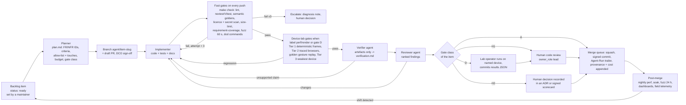

# Autonomous execution model and dissemination plan

Plan section 11 of the Stoipath WSI viewer development plan. Date 2026-10-24; revised 2026-10-25 after the four-critic review (`critique/issues.json`) and the claims-verification pass (`verify/README.md`, `verify/required-changes.json`). Terminology follows `arch/recommended.md` (Engine contract, `tick`, golden gesture replay, G1–G13, M0–M5, NTF%, BAT, TTS, I2P, REF, Dx mode, Edge Translator, Manifest, Pinned Base, Base Bundle). Evidence tags as in the corpus: **[measured]**, **[verified]**, **[snippet]** (search extract only), **[unverified]**; values changed by the verification pass carry "(verified)", "(adjusted after verification: was X)" or "(unverified – Stage 0 gate)" inline. Cross-references name the real section titles: 01 *Executive summary, vision, goals, non-goals and success metrics*; 02 *Requirements and platform matrix*; 07 *Roadmap, milestones, team and estimates*; 08 *Quality, testing and performance QA*; 09 *Risks, compliance, security, licensing and open questions*; 10 *Repository structure, developer environment and first sprints*; 12 *Product pillars: clinical use, research and education*; 13 *Regulatory pathway to FDA clearance and the free-distribution model*. Research note `11-gap-8-fda-pathway-and-free-distribution` and section 13 now exist; §A10 is aligned with them (the earlier "gap-8 not present" caveat is withdrawn).

**Ownership.** Section 10 owns repository paths, file names, ID namespaces, the backlog format, gate classes A/H1/H2/D and the ADR register; this section owns the *roles and semantics* of the agent loop, the autonomy metrics, the design-control mapping and the TSP dissemination plan, and uses section 10's names throughout. Section 09 §7 ADR-021 (agent execution loop) and ADR-022 (TSP abstract claims limited to measured latency, provenance and cost on de-identified public slides) are the decision records this section elaborates. The canonical calendar is section 10's sprint calendar: **week 0 = Monday 2026-10-26; Sprint 1 2026-10-27 → 11-07, Sprint 2 11-10 → 11-21, Sprint 3 11-24 → 12-05; M0 = 2026-12-05 (Saturday closing the six-week Stage 0; week 5 in the plan's week-0 numbering)**; M1 = 2027-01-29 (week 13) per section 07. This section's Part B owns the TSP facts (B1); sections 01, 07, 09 and 10 cite them and carry no independent dates.

Two parts. **Part A** is the operating model for a programme executed by AI coding agents with humans as reviewers and decision-makers. **Part B** is the dissemination plan for the Texas Society of Pathologists (TSP) abstract competition, fast track for Friday 30 October 2026.

---

## Part A — Operating model for AI-agent-driven development

### A1. Three rules that everything else follows from

1. **The repository is the only source of truth.** Requirements, acceptance gates, architecture decisions, test results, provenance logs, cost ledgers, SBOMs, the calendar and this plan live in `git`. If an agent or a human knows something the repository does not, the programme does not know it. Chat transcripts are evidence only when their content has been committed as a provenance record.
2. **Prose never passes a gate; artefacts do.** An agent saying "tests pass" is worth nothing. The Verifier reads CI artefacts (JUnit XML, gate JSON, golden diffs, SBOM, scan reports) produced by machines the agent did not control. This is also what makes the records usable as design-control evidence later (§A10).
3. **Every record is written as if a regulator will read it.** Requirement IDs on tests, an ADR per decision, a risk entry per hazard, a signature line where the QMS will later need one. Note 10 §1.10 prices this at ~10 % overhead from day one and "prohibitively expensive to retrofit"; section 13 decision 5 (design controls from week 0 as repository artefacts; formal IEC 62304 / ISO 14971 / IEC 62366 files written at v0.9 *on* those artefacts) only works if this starts at the first commit. The product boundary those records describe is section 13's: three named products from one commit set — **Stoipath Viewer** (RUO), **Stoipath Learn** (education, no PHI), the in-house lab-validated clinical build for CLIN-1, and later **Stoipath Dx** (the device) — distinguished by build, name and claims, not by a runtime flag.

### A2. Roles

| Role | Kind | Inputs | Outputs | May | May not |
|---|---|---|---|---|---|
| **Planner** | agent | Backlog item with `status: ready` (set only by a maintainer; mirrored to a GitHub issue labelled `agent-ready`), plan sections, `docs/design-controls/requirements.yaml`, ADR index | `plan.md` in the PR: FR-/NFR- IDs touched, acceptance criteria (which gates in `gates/*.json`, which thresholds), file allow-list (= the item's `touches[]`), token/time budget, risk entries affected, the item's gate class (A/H1/H2/D, §A4) | Split an item; open follow-up items; request an ADR | Change requirements, gate thresholds or budgets |
| **Implementer** | agent | `plan.md`, repository | Commits on the item branch; tests for every requirement touched; updated docs; `docs/provenance/runs.jsonl` lines | Edit code, tests and docs inside the allow-list; add tests | Touch files outside the allow-list; edit gate thresholds, lockfiles, `deny.toml`, CI workflows, `docs/adr/` or `docs/design-controls/` without a backlog item that names that file (section 10 §5; §A5 here) |
| **Verifier** | agent, different model or at least different prompt lineage from the Implementer | PR diff + CI artefacts only (never the Implementer's prose) | `verification.md`: per acceptance criterion → artefact → pass/fail; replication of one gate locally; list of claims in the PR description that the artefacts do not support | Re-run CI; run the headless harness; open a blocking comment | Approve; modify code |
| **Reviewer** | agent | Diff, `plan.md`, `verification.md`, ADRs, coding standards (section 10 §5) | Review with findings ranked by severity; a checklist of policy items (requirement coverage, licence, PHI, determinism, Dx pathway touched?, build/claim segregation) | Request changes; recommend a human gate | Merge |
| **Release** | agent | `main` at a tag candidate; release checklist | Changesets, SBOM (SPDX + CycloneDX), signed artefacts, provenance attestations, release notes incl. gate waivers, conformance-suite report | Cut release candidates; publish to registries via OIDC | Publish a release that carries an unsigned waiver or a failed gate |
| **Owner** | human (technical product owner) | Everything | Priorities, `status: ready`, budget caps, ADR approvals, release approval | Decide | Implement on `main` directly (owner edits go through the same loop) |
| **Domain reviewer** | human pathologist (0.5 FTE in `recommended.md` §8; the Owner at Stage 0) | Camera paths, perceptual constants, Dx-mode behaviour, education/clinical workflows | Sign-off on pathology-facing acceptance criteria; reader-study protocol (gap-1 F9) | Veto a behaviour change on clinical grounds | Approve code quality |
| **Graphics reviewer** | human graphics/GPU engineer (tech lead) | Renderer, shaders, upload budgets, golden diffs on real GPUs | Sign-off on renderer changes that alter pixels; perceptual-golden tolerance changes | Veto | — |
| **RA/QA** | human; **0.2 FTE from week 0** (reviews requirement wording and the design-controls seed, S1-11/S1-12 in section 10), 0.5 FTE from W39 / v0.9, 1.0 at v1 (section 13 §7) | Design-control records | QMS signatures (§A10) | Hold a release | — |

Section 10's "second-agent review" is this Verifier + Reviewer pair; for small class-A items one agent run with the two prompts in sequence is acceptable, for `perf`/`render`/Dx-path items the Verifier must be a separate lineage. The Verifier is deliberately not the Implementer re-reading its own work; independence of the verifier from the author is also what IEC 62304 §5.7 and ISO 13485 §7.3 expect of verification records.

### A3. The work loop

Step details that are not obvious from the diagram:

- **Item intake.** Only maintainers set `status: ready` (the mirrored GitHub label `agent-ready` is for visibility); issue bodies, docs, third-party PRs, fetched web pages and slide metadata are untrusted text and never instructions to an agent (prompt-injection guard). The Planner's `plan.md` is the contract for the PR; the Reviewer rejects any diff that exceeds the item's `touches[]`.
- **Branch and PR.** One item → one branch (`agent/<item-id>-<slug>`) → one PR. Commits follow section 10 §4: Conventional Commits, `Backlog:` and `Agent-Run:` trailers, DCO `Signed-off-by:` (for agent-authored commits the sponsoring human signs when approving the PR, which is the DCO act), `Co-authored-by:` the agent, GPG/SSH-signed by the agent's bot identity, so authorship is attributable in the provenance record.
- **Fast gates (per push, hosted runners, ≤15 min).** Correctness and instruction-count only (note 10 F3/F4 Tier 0–1): `make check` (section 10 §3) plus `cargo nextest`, Vitest, `insta` semantic goldens (draw lists per frame), exact-pixel goldens on SwiftShader/lavapipe, `cargo-deny`/licence scan, `gitleaks` + GitHub push protection, `size-limit` and wasm size budgets (NFR-G1, stated in MiB *and* MB because the floor module sits at the 1.0 MB/MiB boundary — C13 (verified)), CodSpeed simulation benchmarks, ClusterFuzzLite 60 s, requirement coverage (every FR-/NFR- ID in `plan.md` has at least one test tagged with it; `xtask trace`), the golden gesture replay on x86 wasm vs native, and the item's own `dod[]` commands.
- **Device-lab gates (self-hosted bare metal; on `perf`/`render` labels, gate-D items and nightly).** Tier 2 traced Chromium with `gpuBenchmarking` gestures and `Network.emulateNetworkConditions`; Tier 3 on the weakest device of each class (W-4G Mali-G52 phone, W-iPad A12); N ≥ 10 runs, distribution tests against the per-device baseline (Bencher thresholds), alert on shift not on single runs (note 10 F4 hygiene). The gate metrics are `recommended.md` §4.4 as corrected by `verify/required-changes.json` (TTS as a population statistic with the cold-miss share bounded by the NTF gate — C04; NTF%; blank-pixel frames = 0; warm I2P ≤ REF + 1 frame at p95, the relative gate that survived verification unchanged — C01) and the M0–M5 tables of note 10 §6 as restated in section 08 §9.
- **Verifier.** Reads the artefacts, replays one gate locally, and lists every sentence of the PR description that no artefact supports. A PR with an unsupported performance claim is blocked even if CI is green.
- **Gate class.** Each backlog item carries one of section 10's classes: **A** (CI green + Verifier + Reviewer → merge queue), **H1** (human code review by the `owner_role` lead), **H2** (human decision recorded in an ADR or a signed scorecard; PO + TL, + RA where regulatory), **D** (device operator runs the stated command on named hardware and commits the results JSON; TL countersigns). §A4 says which work falls in which class and how items move from H1/H2 to A. The human decision is a PR review with a reason; when it changes design intent it becomes an ADR.
- **Merge and telemetry.** Squash-merge; the provenance record (§A6) is appended in the same merge; post-merge nightlies and (opt-in, PHI-free) field telemetry feed shifts back as new backlog items.

### A4. Machine-checkable versus human decision, and how the list shrinks

| Area | Machine-checkable today (gate class A) | Needs a human decision today (H1/H2/D) | Promotion rule (human → machine) | Floor (never fully automated) |
|---|---|---|---|---|
| Correctness | Unit/property/fuzz, conformance suites, reader differential tests vs OpenSlide/tifffile/wsidicom | None | — | — |
| Zoom quality (goal 1) | NTF%, BAT, TTS, blank frames, pop-in, CHS, waste, I2P-vs-REF on named devices; semantic and pixel goldens; golden gesture replay | Perceptual-golden tolerance changes; any change to `tick` policy constants; moving-tier codec; every device measurement (class D) | After the gap-1 F9 reader study calibrates blur-ms, constant changes inside the calibrated band become machine-checked | Dx-mode pixel pathway (decoder, resampler, the server-computed client-applied ICC LUT, Rendering Complete semantics): graphics reviewer + RA signature always (H2) |
| Reach (goal 2) | Install-from-registry smoke on 7 channels; bundle budgets; embed without COOP/COEP; Safari allow-list soak (G6, measured on GPU Process + WebContent footprint, not WebContent alone — C09 (verified)) | Adding or dropping a platform or minimum OS/browser version | Never promoted (product decision) | Owner (H2) |
| Versatility (goal 3) | Conformance (DICOMweb, IIIF 3, OME-Zarr 0.5, DZI); third-party-reader CI smoke (wsidicom, pydicom, Orthanc, dcm4chee, zarr-python, zarrs, zarrita, tensorstore) per `recommended.md` §3.1 | New format reader (fuzz target present? IP review for iSyntax) | A reader class is promoted after 3 readers merged with zero post-merge CVEs | Licence/IP review of a reader (H2) |
| Security and licence | `cargo-deny`/`cargo-vet`, licence allow-list per workspace member (permissive-only in `crates/` and `packages/`), secret scan, SBOM diff, OSV alerts, pinned toolchains, reproducible-build check | New dependency in the client core; any GPL/LGPL addition anywhere; CVE triage severity | Dependencies with ≥ N months on the allow-list and OpenSSF Scorecard ≥ 7 [unverified threshold] can be bumped automatically within semver-compatible ranges | Licence policy changes; incident response (H2) |
| PHI | Dataset registry check (every slide referenced in repo/CI is on the allow-list with licence); header scanner refuses files with label/macro pages or patient tags; manifest redaction test (Stage-0 `SOURCE.md` pattern) | Adding a dataset to the registry | Never promoted | Owner + (later) privacy officer (H2) |
| Build and claim segregation | Per-artefact feature matrix test: the RUO Viewer build compiles in no HL7/FHIR write-back, no sign-out events and no Dx-mode gating; Learn has no PHI surfaces; the Dx build carries a configuration hash that the Dx-mode gate checks (section 13 decisions 3 and 8) | Any change to what a named product may contain; labelling text | Never promoted | RA (H2) |
| Process | Requirement coverage, ADR presence for `decision` label, provenance record completeness, cost within budget | Priorities; scope changes; waivers; phase-cap overruns (§A5) | Waiver *detection* is automatic; waiver *approval* is not | Owner (H2) |
| Clinical/education behaviour | Contract tests for the launch-context contract, LTI 1.3 conformance, event-bus schema | Workflow semantics (what "signed out" means; quiz scoring rules) | Never promoted | Domain reviewer (H1/H2) |

Promotion is itself an ADR: it states the evidence (how many consecutive human reviews agreed with the machine check, over what window, with zero false negatives), the new sampling rate for human audit (for example 10 % of merges in that category for the next quarter), and the trigger to demote (one escaped regression in the category). Regulated categories (Dx pixel pathway, PHI, licence, build/claim segregation) have no promotion path; the QMS requires a qualified human signature there regardless of how good the agents become (§A10).

### A5. Guardrails

| Guardrail | Mechanism | Enforced where |
|---|---|---|
| Never skip or weaken a test to go green | Changes to `tests/**`, golden baselines, gate thresholds (`gates/*.json`) or CI workflows require a backlog item that names the file, a stated reason in `plan.md`, and gate class H1 or H2; a PR that deletes or `#[ignore]`s a test while changing the code it covers is blocked by a CI rule; flaky tests are quarantined to a named owner with a 14-day expiry, never deleted; coverage and gate counts cannot decrease without a waiver | CI policy job + branch protection |
| Gate thresholds are realistic before they bind | A threshold that a Stage-0 or later measurement shows unreachable (the verification pass found several: the W-4G TTS p95 row, NFR-P10 decode ≤4 ms/worker, G5 ≤2 ms/tile on A12 — C04, C10, C11) is re-set by ADR *before* the milestone it gates (H2), with the measured value recorded; it is never waived *at* the milestone. Waived gates in a release note are a reportable autonomy metric (§A8) | ADR process; release checklist |
| Licence hygiene | `cargo-deny` (bans + allow-list per crate graph: permissive-only for `crates/` and `packages/`; LGPL/GPL only in `server/ingest/` as separate container images, never linked), `license-checker` for npm, REUSE/SPDX headers; SBOM diff on every PR; a canary test that adds a GPL crate to a client crate must fail CI (section 10 S1-11) | Fast gates |
| Secrets | `gitleaks` pre-commit and CI; GitHub secret-scanning push protection; OIDC trusted publishing on PyPI and npm (`npm trust`, verified gap-3 #12b), token fallback for crates.io until its GA terms are read (section 10 §4) so no long-lived publish tokens exist where OIDC is available | Pre-commit, CI, release |
| Dependency pinning and supply chain | Lockfiles committed; `rust-toolchain.toml` and `.nvmrc`/`packageManager` pinned; wgpu vendored and pinned per release train (`recommended.md` §7); Renovate with a 14-day cooldown; `cargo-vet` audits for new crates (deferred to the Dx release train per section 10 §3); SLSA-style provenance attestations on every artefact; cosign signatures | CI, release |
| No PHI | Only de-identified **public** slides (CAMELYON16 CC0, IDC, OpenSlide test data, synthetic fiducial slides) in repo, CI and demos; dataset registry with licence and checksum; header scanner (label/macro/barcode/patient tags, `sourceFilename` redaction as in `stage0/data/SOURCE.md`); telemetry schema has no free-text fields | CI, ingest |
| Build and claim segregation | The RUO Viewer, Learn, in-house clinical and Dx builds are separate artefacts from one commit set; a build-matrix test asserts per artefact which integration surfaces (HL7/FHIR write-back, `signoutRequested` events, Dx-mode gating, LIS launch) are compiled in; the Dx build is signed and its configuration hash is checked at start (section 13 §2.6, decision 8); labelling strings are generated from the product name, never hand-typed | CI, release |
| Reproducible builds | Containerised builders, `SOURCE_DATE_EPOCH`, deterministic wasm-opt; a nightly job rebuilds the release from source and compares hashes; the Stage-0 pyramid build already demonstrates the discipline (1,210/1,210 tiles byte-identical between URL and local builds [measured, `SOURCE.md`]) | Nightly, release |
| Scope control | File allow-list = the backlog item's `touches[]`; diff-size budget per item class; any file outside the list fails the Reviewer checklist | Reviewer, CI |
| Cost control | **Provisional caps, all [estimate, uncalibrated], to be recalibrated at M0 and M1 from the ledger:** per-item default budget in `plan.md` by size class S/M/L = US$25 / US$60 / US$120 of model usage across all roles and retries; **hard cap US$150 per PR** (Planner + ≤3 Implementer attempts + Verifier + Reviewer); phase caps **Stage 0 (weeks 0–6) US$12 k**, **Phase 1 (to M1) US$30 k**; monthly programme cap US$10 k; kill switch owned by the Owner. The price list used is itself a committed artefact (`docs/provenance/prices.yaml`: date, `model_id`, $/M input, $/M output, cache rates) and `cost_usd` is computed from it at the provider's list price on the run date. Burn vs cap is reported weekly by the section 10 S1-13 summary script; exceeding a phase cap is an H2 decision (raise, descope or stop) recorded as an ADR, and section 07 §3 treats it as a milestone-level decision point | Orchestrator; S1-13 summary; H2 |
| Untrusted inputs | Issue text, external PRs, fetched web pages and slide metadata are data, never instructions; agents act only on maintainer-readied backlog items | Agent system prompts, orchestrator |

### A6. Provenance and accounting

Every agent run appends one JSON line to `docs/provenance/runs.jsonl` (section 10 S1-13 owns the schema in `packages/schemas`; committed with the PR; machine-written, never edited by hand) and every merged PR gets a `docs/provenance/changes/<pr>.json` roll-up. `xtask backlog check` refuses a PR whose commits lack an `Agent-Run:` trailer that resolves to a line in the ledger. Human time is recorded by the reviewer's own timer entry on the PR (a comment of the form `/time 12m`), which the roll-up parses. The fields below are this section's required superset of section 10's minimum (`task, agent, model, tokens_in/out, usd, wall_s, commit`); they are merged into that schema in S1-13.

| Field | Content | Why it is needed later |
|---|---|---|
| `run_id`, `parent` (backlog item / PR), `role` | Planner / Implementer / Verifier / Reviewer / Release | Traceability of who produced which record |
| `model_id`, `model_version`, `prompt_template_sha`, `tooling_sha` | Exact agent configuration | Reproducibility; change control of the "software tool" under ISO 13485 §7.5.6 / IEC 62304 §5.1.4 (tools are configuration items) |
| `inputs_sha[]`, `outputs_sha[]`, `commits[]`, `ci_run_ids[]` | Hashes of files read and written; commit SHAs; CI run identifiers | Verification evidence linkage |
| `tokens_in`, `tokens_out`, `tokens_cached`, `cost_usd` (from `prices.yaml` at the run date; price row id recorded), `wall_clock_s`, `tool_calls` | Cost and time | TSP abstract and sustainability model; budget gates (§A5) |
| `human_minutes`, `human_role`, `decision` | Reviewer time and outcome | Autonomy metrics (§A8); QMS record of who decided; the honest "what free omits" line in the TSP evidence (B5 E5) |
| `req_ids[]` (FR-/NFR-), `risk_ids[]` (HAZ-), `adr_ids[]`, `waivers[]` | Links into `docs/design-controls/` and `docs/adr/` | Traceability matrix is generated, not maintained |
| `gate_ids[]`, `gate_outcome` | Which `gates/*.json` entries the run was meant to pass and whether it did | Cost-per-gate-pass metric (§A8) |
| `outcome` | merged / abandoned / escalated, with reason | Failure-mode statistics |

**ADR per decision.** `docs/adr/NNNN-slug.md` in MADR 4.0.0 form (status, context, decision, alternatives considered with scores where a judge panel was used, consequences, evidence links, `decision_makers`, approver and date). The register is owned by section 10 and seeded in Sprint 1 from the decision log in section 09 §7 (ADR 001–022; section 10's seed list 0001–0013 is reconciled to that single numbering at assembly, with 0007/010 reading "Apache-2.0 + DCO; the Dx edition through a regulated-release channel, free to qualifying systems", never "commercial"). This section does not number ADRs. Proposals A–E, the three judge outputs (`judge/judgments.json`) and `recommended.md` are attached as *evidence* to the seeded ADRs, not re-decided. **Any change to a `recommended.md` figure or decision (§4.2–4.4 budgets, §5 definitions, the corrections in `verify/required-changes.json`) is an ADR superseding the previous one — never an edit in place and never a reviewer note left in a plan section.** The reviewer notes accumulated across this plan (including §A10's) are converted at assembly into one batch of ADR proposals ("Amendment 2" to `recommended.md`), after which plan sections may only cite ADRs.

**Cost accounting rule.** Report three numbers per milestone, from the ledger only: model cost at list price, wall-clock from `status: ready` to merge (p50, p95), human minutes. Do not estimate; if a run was not logged it is reported as "unlogged" and counts against the programme's logging-completeness metric.

### A7. Escalation rules and failure modes

| Failure mode | Detection | Rule |
|---|---|---|
| Looping on a failing gate | 3 consecutive failed attempts on the same gate in one PR | Stop. Implementer writes a diagnosis note (what was tried, what the artefact shows). Owner or graphics reviewer decides: fix the code, split the item, or open a threshold-change item (H2). Never change the test in the same PR as the code. |
| Scope creep | Diff touches files outside `touches[]`; diff size > budget | Reviewer blocks; Planner either amends `plan.md` (small) or splits the item (large) |
| Silent regressions | Nightly Tier 2/3 distribution shift (bootstrap CI on p95; Mann–Whitney) against the device baseline; field telemetry shift | Auto-bisect over the merges since the last green nightly; open an item with the bisected commit; revert if the shift crosses a gate threshold |
| Flaky gates | Pass/fail alternation without code change | Quarantine with owner and expiry; a quarantined gate still runs and reports; expiry without fix escalates |
| Verifier captured by the Implementer's narrative | Verifier cites prose instead of artefacts | Verifier prompt forbids reading the PR description before the artefacts; audit 10 % of verifications by a second verifier model |
| Fabricated or unmeasured claims | A number in docs/PR without a `results/*.json` source | Claims ledger (`claims/*.yaml`: claim, source artefact, verification date, status) checked in CI; the plan's own load-bearing claims went through this ledger first (`verify/claims.json` → `verify/verdicts.json`: 24 claims, 4 supported, 16 adjusted, 4 contested-resolved, 0 refuted (verified 2026-10-25)) |
| Cost runaway | Per-PR cost > US$150 hard cap; weekly burn > phase cap pro rata | Hard stop on the PR; Owner raises budget, descopes or abandons (H2, ADR) |
| Supply-chain compromise | New dependency, lockfile change, publish-token use | `cargo-vet`, Renovate cooldown, OIDC-only publishing where available, Scorecard check; human gate for new client-core dependencies |
| Prompt injection via repository content | Agent proposes actions not traceable to a readied backlog item | Orchestrator rejects; incident logged |
| Device-lab drift (OS updates, thermal state) | REF floor measured in the same run moves | Gates are relative to REF (I2P ≤ REF + 1 frame); absolute shifts in REF open a lab-maintenance item, not a code item |
| Unreachable gate discovered late | A Stage-0/M0 measurement lands outside a threshold already in `requirements.yaml` | Threshold-change ADR before the gating milestone (§A5); the measured value replaces the model value with the "(adjusted after verification)" tag |

### A8. Autonomy metrics

Reported monthly on the public dashboard (note 10 F12) from the provenance ledger.

| Metric | Definition | Target M2 | Target v1 |
|---|---|---|---|
| Unassisted merge share | Merged PRs with zero human code edits ÷ merged PRs | ≥ 60 % | ≥ 85 % |
| Human minutes per merged change | Σ `human_minutes` ÷ merged PRs | ≤ 20 | ≤ 10 |
| Mean time to green | First push → all required gates green (p50 / p95) | ≤ 2 h / ≤ 24 h | ≤ 1 h / ≤ 8 h |
| Regressions caught by gates vs by humans vs in the field | Counts per month | ≥ 90 % by gates | ≥ 95 % by gates, 0 in the field for gate metrics |
| Gate escapes | Regressions found post-merge that an existing gate should have caught | ≤ 1/month | 0 |
| Waivers open | Gate waivers in release notes | ≤ 2 | 0 at a release |
| Logging completeness | Runs with a complete provenance record ÷ runs | 100 % | 100 % |
| Cost per merged change | Σ `cost_usd` ÷ merged PRs (reported, not targeted) | — | — |
| Cost per gate pass | Σ `cost_usd` of runs tagged with a gate ÷ gate passes; first-attempt pass rate alongside (reported; drives the M0/M1 recalibration of §A5 caps) | reported | reported |
| Burn vs cap | Weekly model spend ÷ phase cap pro rata; months over cap | 0 months over cap | 0 |
| Verifier disagreement rate | Verifier blocks ÷ PRs; and share later upheld by a human | reported | reported |

### A9. From the planning pipeline to the execution pipeline

This document was produced by a pipeline: research notes (18, eight of them gap-fills) → five architecture proposals → three judge agents scoring seven weighted criteria → synthesis (`recommended.md`) → thirteen plan sections → extraction and three-lens verification of 24 load-bearing claims (first-principles arithmetic, primary sources, on-machine experiments) → four-critic review → revision → assembly. Each stage becomes a recurring workflow:

| Planning stage | Execution workflow | Cadence / trigger | Outputs |
|---|---|---|---|
| Research notes | **Fact re-verification**: re-fetch every `[unverified]`/`[snippet]` fact and every pinned version in the plan and ADRs | Monthly; on any browser/wgpu/OS major | Updated notes with dated tags; items for plan deltas |
| Proposals + judges | **Scored decision** for architecture-grade questions: ≥ 2 proposals, ≥ 2 independent judge agents on the plan's weights, human approver | On `decision` label | ADR with alternatives and scores |
| Synthesis | **ADR acceptance** | On ADR PR | Signed ADR (H2) |
| Plan sections | **Living plan**: sections are files; every merged change that alters a figure updates the section in the same PR; **dates are never typed into sections but generated from one `docs/plan/calendar.yaml`** (week 0 = 2026-10-26; M0 = 2026-12-05; T1 = 2027-01-15; M1 = 2027-01-29; later milestones per section 07), proposed here and owned by sections 07/10, so the three incompatible Stage-0 calendars the critics found cannot recur | Continuous | Plan always matches code and calendar |
| Claim extraction + verification | **Claims ledger CI**: the three-lens discipline of `verify/README.md` (arithmetic re-derivation, primary source, reproducible experiment with artefact paths) applied to every new number | Every PR | Verified/adjusted/unverified status per claim |
| Critique | **Reviewer agent** (A2) | Every PR | Ranked findings |
| — | **Fast gates** | Every push | Correctness, licence, secrets, size |
| — | **Nightly** | Daily | Tier 2 perf on bare metal, 24 h fuzz, full conformance, reproducible-build check, dependency scan |
| — | **Weekly device lab** | Weekly | Tier 3 on all lab devices, 2 h soak per device, memory/jetsam (GPU Process + WebContent on iOS) |
| — | **Release train** | Every 4 weeks (SDKs lockstep; server/apps own trains) | Tier 4 WALT I2P, SBOM, licence audit, conformance corpus, install smoke on 7 channels, signed artefacts |
| — | **Quarterly review** | Quarterly | wgpu major upgrade window (G3/G4/G10 re-run), OSD/OpenLayers/Slim tracking, risk register review, autonomy metrics review, cap recalibration, promotion ADRs (§A4) |
| — | **Annual review** | Yearly | Canonical-store flip conditions (`recommended.md` §9), licence/trademark, device-floor redefinition |

### A10. The same artefacts as design-control records

The RUO phase is run so that the Design History File (DHF) for the later Dx edition is a *view* over the repository, not a second set of documents. Section 13 owns the regulatory programme (device, pathway, QMS, validation, manufacturer, distribution); this subsection owns only the mapping from loop artefacts to records. Clause references are from notes 09/10, gap-8 and section 13; items section 13 has verified are tagged so, the rest remain **[unverified]** until RA counsel confirms. The QMSR (21 CFR 820 incorporating ISO 13485:2016 by reference) is in force since 2026-02-02 **[verified per section 13 §3.1 / section 09 §3]**.

| Agent-loop artefact | Design-control record it becomes | Framework clause |
|---|---|---|
| `docs/design-controls/requirements.yaml` (FR-/NFR- IDs incl. NFR-G1…G13; text, rationale, verification method, pillar, risk links) | Design inputs; software requirements specification | ISO 13485 §7.3.3; IEC 62304 §5.2 |
| Tests tagged with FR-/NFR- IDs; requirement-coverage gate; `xtask trace` | Verification protocol and traceability matrix (generated per release) | ISO 13485 §7.3.6; IEC 62304 §5.5–5.7 |
| Gate results JSON, golden diffs, device-lab reports, WALT/photodiode runs | Verification evidence; bench performance per FDA's WSI technical-performance-assessment programme (viewer navigation/zoom, colour, response time) | 21 CFR 864.3700 (Class II, special controls), product code **QKQ** for software-only viewers (section 13 §2.1; PathPresenter K250968 **[verified record per section 13]**); IEC 62304 §5.7 |
| Golden gesture replay across platforms; G7 decoder hash identity; Rendering Complete flag tests | Evidence that the Dx pixel pathway is deterministic and frozen per version. Verification already shows libjpeg-turbo identity on 695/695 JPEGs across x86 SIMD/scalar, aarch64 NEON/scalar (qemu), jSquash and wasm-vips (verified); real arm64 hardware remains the DHF evidence (G7); WebCodecs `ImageDecoder` is excluded from the self-certification allow-list and lossy HTJ2K is not hash-identical across ISAs and stays out of Dx (C12, verified) | Note 09 F1/R5; section 13 §2.6 |
| ADRs (MADR, with judge scores where used) | Design review records; design-change records | ISO 13485 §7.3.5, §7.3.9 |
| `docs/design-controls/risk-register.yaml` (HAZ-* entries: hazard, cause, harm, severity, probability, controls → FR/NFR IDs → tests) | Risk management file | ISO 14971 |
| Reader study (gap-1 F9), formative usability sessions, HUD/latency complaints log | Usability engineering file | IEC 62366-1 |
| SBOM (SPDX/CycloneDX) per release, OSV monitoring, `SECURITY.md`, patch SLAs, threat model | Cybersecurity premarket file; postmarket vulnerability management | FD&C §524B; FDA *Cybersecurity in Medical Devices: Quality Management System Considerations and Content of Premarket Submissions*, 2026-02-03 edition superseding 2025-06-27 **[verified: FDA PDF title/date via search extract; RAPS — section 13 §3.6]** (adjusted after verification: this section previously cited "final 2023, revised 2025, 2026 revision unverified") |
| Provenance ledger (`docs/provenance/**`) | Development records; configuration management of tools (the agents and their prompts are configuration items; tool qualification record for the agent toolchain) | IEC 62304 §5.1.4, §8; ISO 13485 §4.2.5 |
| Release checklist, signed artefacts, install smoke, cleared-configuration register | Design transfer; release records | ISO 13485 §7.3.8; section 13 decision 8 |
| Gate suite + device classes + change categories | Draft content of the Predetermined Change Control Plan (which changes are verified by which gates without a new submission) | FD&C §515C; FDA grants viewer PCCPs now (Proscia, 2026-08-06 **[verified trade press, section 13 §2.2]**); general-device PCCP guidance still draft (FY2027 A-list, comments to 2026-11-30 **[verified secondary, section 13 §2.3]**) |
| Field telemetry (opt-in, PHI-free), issue tracker categories `complaint`, `safety` | Complaint handling and MDR inputs (process starts RUO, obligations bind at Dx) | 21 CFR 803/820 [unverified] |

**Steps that need a qualified human signature under the QMS** (electronic signatures meeting Part 11-style controls; agents may prepare, never sign): design input approval (requirement baseline per milestone); design review closure (ADR acceptance for architecture-grade and Dx-pathway changes); risk acceptance (every HAZ entry and the residual-risk statement); verification report approval per release; validation protocol and report (CAP-style study, reader study); release approval and labelling; **software safety classification — IEC 62304 Class C for the segregated Dx pixel pathway and case/slide identity, Class A/B elsewhere behind an architectural boundary (section 13 decision 4 / §3.4; this supersedes the "Class B assumed" of ADR-014 and of this section's first draft, and is confirmed in the Pre-Sub ≈W40, 2027-08)**; the Pre-Sub and 510(k) submissions themselves (section 13 OQ-26); CAPA and complaint dispositions; supplier/tool qualification (the agent toolchain itself); cybersecurity risk acceptance and SBOM release. These are the H2 gates of §A4 that never shrink. What agents cannot do is also listed in section 13 §7: be the manufacturer, file with FDA, run or sign CAP validations, negotiate agreements, attest display QA at a hospital.

**Proposed ADR amendments to `recommended.md`** (filed as "Amendment 2" proposals at assembly per §A6, not left as notes):

1. *Tile bytes, Base Bundle and Pinned Base.* `recommended.md` §4.3 prices a 20-tile destination fill at 20 × ~80 KB ≈ 1.6 MB and §4.2 budgets the Base Bundle (levels ≤ 4096 px) at 2–5 MB. The Stage-0 build of a 95 %-tissue 15,360² region measured **9.50 MB for 85 tiles at q85 4:2:0**, with coarser levels *heavier per tile* (105–123 kB) than level 0 (72 kB) because box filtering raises mid-frequency energy [measured, `stage0/data/SOURCE.md`]. The verification pass (C07, C14) places that measurement: it is the square, all-tissue worst case, not a typical slide. Corrected figures: (a) dense H&E 512² tissue tiles are **p50 95 KB at q85 4:4:4 (90 KB Huffman-optimised), 117 KB at q90 4:4:4**; 80 KB holds only for q85 4:2:0 (76 KB) or vendor q80 4:2:0 passthrough; a 20-tile fill is **1.85 / 1.95 MB p50/p90 at q85 4:4:4, 2.29 / 2.40 MB at q90** (adjusted after verification: was 1.6 MB), so the W-4G p50 transfer is 590–730 ms, not 510; (b) the Base Bundle is **≈1 MB for a typical 2:1 slide** (CAMELYON16 tumor_014, ≤4096 set = 32 tiles / 0.86 MB at q85 4:4:4), 2–3 MB for a square biopsy, ≤5 MB at ≤55 % tissue and **6.5–8 MB for tissue-dense square slides → budget slide-open prefetch at ≤8 MB worst case** (adjusted after verification: this section previously said "plan against ~10 MB, not 2 MB"); (c) the Pinned Base (max(w,h) ≤ 2048 px) is 11–22 tiles, ≈23 MiB RGBA8 only for square slides and 11–14 MiB typical (the Stage-0 client now pins exactly this set: 21 tiles, 26 MiB with mips, and treats the 3840-px level as an evictable warm base); the ≤4096 set is 35–85 tiles = 35–85 MiB (70 for a 100k² slide; 32 = 25 % of a 128 MiB L0 for the real 2.2:1 slide) (verified). Whole-slide coarse levels are mostly glass and compress ≈3× better per tissue tile than 20× tiles (27 KB p50 vs 95 KB), which is why the Stage-0 region overstates them. Per-viewport byte estimates must be per level and per codec tier, carried in the quality record as `bytes per tile at L*` so the model is re-fitted from telemetry.
2. *Stage-0 instrument versus product engine.* The Stage-0 client is TypeScript/WebGL2 with `createImageBitmap` decode. That is consistent with the decided architecture only as the **measurement instrument, policy oracle and recorded exit** (`recommended.md` §2 item 3 records TypeScript as the exit for the web floor renderer; gap-2 §4.3 restricts `createImageBitmap` to self-certified non-Dx use; section 10 keeps it as `apps/ref-ts-spike`, the comparator the Rust engine must match on the golden replay in Sprint 2). Part B must not describe Stage-0 numbers as the product's performance; the Rust core's golden replay must reproduce the Stage-0 request sequences before any later comparison is made.

---

## Part B — Dissemination: TSP 2027 abstract competition

### B1. Competition facts and the decision taken

**This is the plan's single TSP fact block; sections 01 §9, 07 §6, 09 and 10 cite it and carry no independent dates or eligibility caveats.** Facts verified by the owner on texpath.org on 2026-10-24 **[verified by owner; this sandbox cannot reach texpath.org or the TSP iMIS page — proxy 403 / DNS — so only search-engine extracts of the 2024-cycle rules page were corroborated here [snippet]]**: the 2027 competition is the **41st Annual John R. Rainey, MD Residents'/Fellows' Seminar** at the **106th TSP Annual Meeting, 22–24 January 2027, Hyatt Regency Austin**; submission deadline **Friday 30 October 2026, 17:00 CT**; website submission only; maximum **350 words**; **no author, co-author or institution names in the abstract file**; a resident or fellow may be first author on **one** submission; **the owner is an eligible resident and will submit as first author**. Categories: investigative abstract and case report. The 2024-cycle page additionally states a recommended structure (background, methods, results, discussion) and that medical students and non-Texas residents may submit but are not eligible for podium presentation or awards [snippet]; re-read the 2027 rules page before submitting and record any change in `dissemination/tsp2027/rules.md`. **Thursday 29 October 2026 is the programme's internal submit-one-day-early target (section 07 T0), not the deadline.**

Decision (owner, 2026-10-24): **option (i)** — submit by 30 Oct 2026, investigative category, owner as first author, with the Stage-0 prototype measured on real devices before the deadline; present M0 results in January (B7). **Option (ii)** (2028 cycle, expect a late-October 2027 deadline) is both the fallback if B3's measurement freeze is missed and, regardless, the carrier for M1/M2 evidence, which post-dates the January 2027 meeting (B7).

### B2. The claim the abstract can honestly make

**Claim:** AI coding agents, with humans as reviewers at defined gates, can produce in six days (planning) plus days (prototype) an open-source whole-slide viewer prototype whose zoom/pan quality is **measured on consumer devices with a published, reproducible instrument**, whose build has **complete provenance and cost accounting**, and whose licence and security posture are **machine-audited** — i.e. a capability-and-cost demonstration of in-house-verifiable open tooling. The planning pipeline's own claims-verification pass (24 load-bearing claims, 16 adjusted, 0 refuted) is part of the demonstration: the method catches its own errors before they reach a gate.

**Not claimed:** diagnostic equivalence, pathologist efficiency, patient outcomes, or that the prototype is the product. Only de-identified public slides are used (one CC0 CAMELYON16 slide region; `stage0/data/SOURCE.md`). Mobile is "measured for latency", not "validated for diagnosis" (gap-1 F5). **Input-to-photon is not claimed** (no photodiode or 240 fps rig before Sprint 3); the pack reports the in-page **I2FC proxy** (first input `timeStamp` → the rAF that consumed it; omits 1–2 compositor vsyncs) and **input-to-swap** from CDP `LatencyInfo` tracing (Chromium only) and names them as proxies, as section 10 S1-07a also states. **No latency threshold is called clinically validated:** the plan's 100 ms TTS p50 target is HCI-generic and the 196 ms inter-zoom gap is a dataset minimum used as a design deadline, not a pathology-derived requirement (C23, verified).

Evidence package (details in B5): (1) device measurements of the Stage-0 prototype vs OpenSeadragon 6.1.1 on the same tiles and devices, under the comparator protocol of B4 step (4), plus the published MSK figures (108–238 ms/FOV streaming pace across three vendor configurations [verified, Schüffler 2022]) cited as the published class of deployed-viewer performance, not head-to-head; (2) build cost and timeline from the provenance ledger; (3) licence/secret scan and SBOM results; (4) verification statistics of the planning pipeline; (5) a cost framing with two honest parts — the plan's own reference-team baseline (section 07 §9: ≈70–85 PM to MVP, ≈195–230 PM to v1 for platform + pillars + regulatory; platform-only ≈55–65 / ≈150–170 PM as a sub-line) and vendor subscription prices only where documented (gap-7 F7: none are public; the Proscia GSA schedule 47QTCA22D0089 price list is the one public document to try [snippet]) — otherwise the abstract states that vendor prices are undisclosed and reports our costs alone, **stating what "free" omits**: human review hours (valued at a stated loaded rate in the evidence table), devices, hosting and the post-market service entity section 13 §5.4 budgets at $350–700 k/yr.

### B3. Day-by-day schedule, Sunday 25 to Friday 30 October 2026

**This table is the operative late-October calendar**; section 10's S1-07a ("first device number, days 2–3") is executed on the Mon 26 – Tue 27 sessions below, and Sunday's work precedes Sprint 1 (which starts Tue 27 Oct). Policy constants are frozen at the commit used for the first device run (`STAGE0_FREEZE` tag); after that, agents may fix measurement-validity defects only, each as its own PR with the Verifier's note on what changed and why the earlier runs remain comparable (or are discarded).

| Day | Agents build / run | Owner measures / decides | End-of-day gate |
|---|---|---|---|
| **Sun 25** | Client, scripted path and headless harness exist (reviewed build 2026-10-25T13:44Z: `client/src/main.ts`, `scripted-path.ts` — absolute-zoom path starting at L\* = 3, five zoom-in bursts of +2/+1/+3/+2/+1 levels to L\* = 1 and L\* = 0 at s = 0.87, pans with flick, zoom-outs, fit; `harness/{run,serve,browser}.mjs`; headless results committed). Remaining: static deploy of `client/dist` + the 97.8 MB pyramid [measured] to a CDN-backed host with immutable tile cache headers; OpenSeadragon 6.1.1 comparator page over the same `tiles/{level}/{x}_{y}.jpg` with **two profiles** (default and tuned, B4 step 4) and a per-waypoint `fully-loaded-change` export; provenance roll-up script; licence/secret scan + SBOM job; `STAGE0_FREEZE` | Register on the submission site; read the 2027 rules page and record any change in `dissemination/tsp2027/rules.md`; list devices (model, OS, browser versions); e-mail the IRB for a "not human-subjects research" determination (B8); confirm mentor as co-author/domain reviewer; confirm the floor phone is on the bench (section 07/10 procurement list: floor phone + 240 fps camera before 2026-10-28) | Deploy URL live; OSD page live; `STAGE0_FREEZE` tagged; a scripted-path export from desktop Chrome on the deployed URL validates against `packages/schemas` |
| **Mon 26** | Headless runs: 4 network profiles (LAN / broadband-CDN / 4G-good / cellular-poor, note 10 F7) × cold/warm × N = 10, prototype and OSD comparator; results → `harness/results/*.json` and a generated table (**policy-logic and network-shaped transfer check only; SwiftShader numbers are never quoted as device latency**, protocol §7); claims-verification statistics and cost/time ledger for the planning phase; abstract skeleton with placeholders | **Evening session 1 (B4; = S1-07a day 1):** laptop, Android phone, iPad over Wi-Fi; REF CSS-transform page on each device in the same session; export JSON per run to `results/devices/`; note anomalies | ≥ 10 valid cold + 10 warm runs per device over Wi-Fi (protocol floor: 3; see B4 validity); headless tables generated |
| **Tue 27** | Ingest device JSON, compute p50/p95 per device × network with bootstrap CIs, flag invalid runs; fix validity defects only; draft abstract v1 with real numbers; evidence table v1 | **Session 2 (= S1-07a day 2):** cellular (phone, tablet); repeat any Wi-Fi device with < 10 valid runs; OSD comparator on each device (both profiles); review abstract v1; send v1 + evidence table to mentor | Cellular runs complete; abstract v1 ≤ 350 words |
| **Wed 28** | Regenerate tables after any re-runs; abstract v2; check every number in the abstract against a `results/*.json` path (claims ledger); word count; name/institution scan of the abstract file | Buffer: re-measure where needed; **measurement freeze 18:00 CT**; collect mentor comments | Final results JSON tagged `tsp2027-results`; v2 ready |
| **Thu 29** | Final abstract v3; `dissemination/tsp2027/` (= section 10 `docs/evidence/tsp-2026/`, S1-14) contains abstract text, evidence table, device protocol, results, provenance roll-up, scan reports, the device/REF statement of B4 | Final read with mentor; **submit on the website by evening (internal target T0, one day early)**; save confirmation to the repo | Submission confirmed; repo tagged `tsp2027-abstract` |
| **Fri 30** | Contingency only | Verify confirmation e-mail; if Thursday's submission failed, resubmit before **17:00 CT** | Deadline |

Risk to the schedule (state at this revision, 2026-10-25): the client, scripted path and harness exist and headless runs validate; what does not yet exist is the deployed URL, the OSD comparator page, the provenance roll-up and any device run. If Sunday's deploy gate is missed, Monday's device session slips to Tuesday and cellular to Wednesday; if the floor phone is not on the bench by Tue 27 the abstract reports laptop and tablet only and says so; if Wednesday's freeze is missed, fall back to option (ii) rather than submit unmeasured numbers.

### B4. Measurement protocol the owner follows on each device

The authority is `wsi-viewer/stage0/MEASUREMENT_PROTOCOL.md` (§2 devices, §3 networks, §4 cold/warm, §5 steps, §6 metrics, §7 limitations, §8 comparator); this subsection summarises what the abstract needs and adds the comparator rules the verification pass requires.

**Devices (fill in):** laptop (Chrome; `[model, OS, Chrome version]`); Android phone (Chrome; prefer the lowest-end available, `[model, RAM, GPU, Android version]`); iPad or iPhone (Safari; `[model, iPadOS/iOS version]`). Record exactly what the export's device fingerprint captures (`GL_RENDERER`, UA, `hardwareConcurrency`, `deviceMemory` where exposed, DPR, refresh rate, build id, `http_version`, `cache_state`, `network_condition`) plus a photo of the Settings → About screen. **The evidence pack states explicitly which device each number came from and that the REF CSS-transform page was measured on the same device in the same session** (section 10 S1-07a definition of done).

**Network conditions:** (a) Wi-Fi to the static host; (b) cellular (4G/5G; disable Wi-Fi). Before and after each session take a speed-test screenshot (download Mbps, latency) for context; record `navigator.connection.effectiveType` where the browser exposes it (Chrome Android only). Controlled throttling is done in the headless harness, not on phones.

**Pre-conditions per session:** battery > 50 % or charging; brightness fixed; no other apps; airplane mode off; auto-rotate off; device at room temperature; 1–2 minutes of idle between repetitions; abort a run and note it if the phone shows a thermal warning, the browser reloads, or the export shows `contextLosses > 0`.

**Procedure per repetition (protocol §4–§5):** (1) *Cold*: open the deploy URL in a **fresh private window** (empty HTTP cache), wait for `ready`, run the scripted path **once** (`P` or the panel button), do not touch the screen until it ends, export, save as `results/devices/<device>/<network>/cold-<nn>.json`, close the window. A rerun in the same tab is warm twice over (HTTP and GPU cache) and is never pooled as cold; the summariser drops `pathRun > 1` and cold runs with `cacheHitFraction > 0`. (2) *Warm*: after a completed cold run, **reload** the page, run the path once, export as `warm-<nn>.json`; reload again for the next warm run. (3) Repeat towards **N ≥ 10 valid cold and 10 valid warm** runs per device × network (≈ 25–35 minutes per device × network). (4) *Comparator*: once per device × network run the OpenSeadragon 6.1.1 page in **two profiles**, alternating viewers to spread thermal drift — **default** (as deployed: `springStiffness` 6.5, `animationTime` 1.2 s, `blendTime` 0, `immediateRender` false, `maxTilesPerFrame` 1, `imageLoaderLimit` 0; all verified from the 6.1.1 source, C24) and **tuned** (`maxTilesPerFrame` 100, `imageLoaderLimit` raised, `immediateRender` true). Any "X× faster than OpenSeadragon" statement cites the **tuned** profile, because the default's `maxTilesPerFrame` rationing (10, 5, 3, 2, 1 tiles/frame: 20 tiles in 4 frames) and the 1.2 s spring (50 % settled at 128 ms, 90 % at 425 ms, 99 % at 850 ms) would measure request rationing and animation, not rendering; the default profile is reported separately as the deployed experience; canvas and WebGL drawers are reported separately (C24, verified). The OSD page's `fully-loaded-change` per waypoint is an "all visible tiles drawn" proxy, not a sharpness record; a head-to-head sentence additionally requires the protocol §8 video spot-check.

**What is recorded (by the prototype, automatically; export format `stoipath-stage0-metrics/1`, protocol §6):** per zoom-in burst the headline **`ttsFromLastInputMs`** (TTS: last input → end of pop-in, fading cells counted as blurred, plus one display interval), `blurEndAfterInputMs`, `sharpAfterSettleMs` and `settleAfterInputMs` (quote both TTS-like numbers and say which is which; `timeToSharpMs` has a 150 ms floor and is never called TTS), deficit-frame %, max blur duration, dropped-frame rate, `bytes` and `cacheHitFraction` per burst, `pathRun`, `endMagnified`; per run frame p50/p95/p99, display interval histogram, upload ms, decode/fetch percentiles, `blankCells` (must be 0), `contextLosses`; the input→rAF proxy only from manual-gesture exports, split by input kind. The owner records nothing by hand except the device/network context and anomalies.

**Validity rules:** discard runs with interrupted gestures, thermal warnings, a background reload, `contextLosses > 0`, or a cold run with cache hits; report N valid per cell; report p50 and p95 with bootstrap 95 % CIs; a cell with **N ≥ 10** is a result; a cell with 3–9 valid runs (the protocol's and section 10 S1-07a's minimum) is reported **only** with its N and the word "preliminary"; below 3 it is "insufficient runs".

### B5. Evidence table the abstract cites (placeholders)

| # | Evidence | Source artefact | Placeholder in abstract | Baseline / comparator | Status |
|---|---|---|---|---|---|
| E1 | `ttsFromLastInputMs` p50/p95 after zoom bursts, cold and warm, per device × network | `results/devices/**` | `[p50/p95]` per device | OSD 6.1.1 tuned profile on the same device and tiles (E3); MSK 108–238 ms/FOV streaming pace [verified, Schüffler 2022] (deployed clinical system, different metric — stated as class, not head-to-head; the paper's own same-vendor comparison attributes +59–100 ms/FOV to decode/re-encode, not +130 — C22 (verified)) | to measure |
| E2 | Deficit-frame % (NTF%), BAT, blank cells (= 0), pop-in count | same | `[k]%`, `[0]` | OSD blur-then-pop follows from its verified defaults (`blendTime` 0, `maxTilesPerFrame` 1, `immediateRender` false, C24); issue #2906 [snippet — unreachable in verification] | to measure |
| E3 | Same-device comparator, default and tuned profiles, canvas and WebGL drawers | OSD page export; protocol §8 video spot-check | `[p50/p95]` | — | to build Sun 25 |
| E4 | Headless Chromium under emulated LAN / broadband-CDN / 4G-good / cellular-poor, N = 10 | `harness/results/*.json` | optional sentence (network-shaped transfer only; never device latency) | Google DICOM proxy ~150 ms/frame server-side [verified] as class reference | Mon 26 |
| E5 | Build cost and timeline, and what "free" omits | `docs/provenance/**` roll-up; `prices.yaml` | `[N] runs, [T] M tokens, US$[C], [H] human-hours, [D] days` | Plan's own reference-team baseline: ≈70–85 PM to MVP, ≈195–230 PM to v1 (section 07 §9; platform-only ≈55–65 / ≈150–170 PM sub-line); no comparable public figure for agent-built viewers | compile Mon 26 |
| E6 | Verification statistics | `verify/claims.json`, `verify/verdicts.json`, `verify/README.md`; judge outputs | `[V] of [W] claims`: today 24 load-bearing claims — 4 supported, 16 adjusted, 4 contested-resolved, 0 refuted (verified 2026-10-25); 5 proposals, 3 judges; 18 research notes | — | available; refresh Mon 26 if the ledger grows |
| E7 | Licence and security audit | `cargo-deny`/`license-checker`/`gitleaks` reports; SBOM | `[0]` non-permissive client deps; SBOM generated | — | Sun 25 |
| E8 | Reproducibility | `verify_pyramid.py --hashes` | 1,210/1,210 tiles identical [measured] | — | done |
| E9 | Cost framing vs vendor subscriptions | GSA Advantage price list for Proscia 47QTCA22D0089 if retrievable; otherwise "undisclosed"; our hosting cost from verified unit prices (note 09 F8: R2 $0.015/GB-month, zero egress [verified]) | `[US$/yr]` or "not public" | — | Tue 27 |
| E10 | Adoption/cost barrier context | CAP 2025 survey coverage (~15 % of practices use WSI for primary diagnosis) [snippet]; L.E.K. 2026 (cost and integration burden top barriers) [snippet] | Background sentence | — | verify before submission |

### B6. Draft abstract (investigative category; ≤ 350 words; no author, co-author, institution or project names)

**Title:** AI-agent-built, in-house-verifiable open-source whole-slide image viewing: a capability and cost demonstration on public de-identified slides

**Background:** Whole-slide imaging serves primary diagnosis in roughly 15 % of US practices; cost and integration burden are the leading barriers, and viewers are sold by subscription at undisclosed prices without published performance data. Published deployed-viewer latency is 108–238 ms per field of view. Can AI coding agents, with humans only as gate reviewers, produce an open-source viewer whose performance, provenance and cost a health system can verify itself?

**Design:** A multi-agent pipeline wrote 18 research notes, five architecture proposals scored by three independent judge agents, and a plan with machine-checkable gates; 24 load-bearing claims were independently re-derived. Agents built a web prototype (TypeScript/WebGL2) with an explicit level-of-detail, prefetch and never-blank rendering policy over a static tile pyramid from one CC0 CAMELYON16 slide (15,360² px, 1,210 JPEG tiles). It records per frame the level wanted versus drawn and per gesture the time-to-sharp. A scripted five-burst camera path ran (≥ 10 cold and 10 warm repetitions) on [n] consumer devices ([classes]) over Wi-Fi and cellular, in headless Chromium under emulated LAN, broadband and 4G, and against OpenSeadragon 6.1.1 (tuned profile) serving identical tiles. Every agent run logged tokens, list-price cost, wall-clock and human review minutes; tile builds were byte-identity checked.

**Results:** Over Wi-Fi, time-to-sharp after zoom bursts was [p50/p95] ms (laptop), [p50/p95] ms (Android phone) and [p50/p95] ms (tablet), versus [p50/p95] ms for OpenSeadragon on the same devices; [k] % of settled frames showed no coarser-level tile and blank frames were [0]. Warm revisits settled within [x] frames. Planning plus prototype consumed [N] agent runs, [T] million tokens, US$[C] and [H] human-hours over [D] days; [V] of 24 verified claims held unchanged, none were refuted. Licence scanning found [0] non-permissive client dependencies; a software bill of materials was generated.

**Conclusion:** An AI-agent-built open viewer reached [summary] on consumer devices for US$[C] of model usage, with machine-checkable provenance. This is a capability and cost demonstration on public de-identified data, not a diagnostic validation; clinical use requires CAP validation and distribution requires FDA clearance. Native-core milestone results will be presented.

Submission hygiene: the abstract file carries no names, affiliations, repository URL or project name (a repository URL would identify the author); those go in the form fields only. Replace every bracket from a `results/*.json` path; the claims ledger blocks submission otherwise. This draft is 333 words plus a 15-word title (348 total) at the placeholders (counted by script on 2026-10-25; whether TSP counts the title is unconfirmed, so the total is kept under 350); re-count after substitution, because bracketed placeholders are shorter than the numbers that replace them, and trim the Background first if the count exceeds 350.

### B7. Which milestone the abstract rests on, and whether the dates work

- **30 Oct 2026 submission** rests on the Stage-0 *measurement prototype* (not on G1–G13, which target the Rust renderer) plus the planning pipeline's provenance and verification record. The client, scripted path and harness exist (B3); the deployed URL, the OSD page and the device runs do not. Feasible if Sunday's deploy gate holds; two days of slack to the Wednesday freeze (B3).
- **January 2027 presentation (22–24 Jan, week 12)** rests on **M0 = 2026-12-05** (end of Sprint 3 and of the six-week Stage 0; section 10 S3-10 scorecard and ADR-0013): G1–G13 each with a result file on the named devices — including G7 decoder identity on real arm64 (plan-stopping if it fails), G11 REF floors with the photodiode/240 fps rig and G12/G13 upload and A55 decode costs — plus the Tier-2 nightly trend from M0 to the **presentation data freeze T1 = Friday 2027-01-15 (week 11, seven days before the meeting)**; sections 07 §3/§6 carry this T1. **M1 (2027-01-29, week 13) falls after the meeting, so no M1 figure can be presented in January**; the earlier draft's "M1 if green by 15 January" and "roughly 12 weeks of work against a Stage 0 budgeted at weeks 0–2" are withdrawn with the adoption of section 10's six-week Stage 0 as the single calendar. If M0 slips, the presentation shows the Sprint-1/2 device numbers (S1-07b, S2-06) and the M0 scorecard as it stands, labelled as such.
- **Option (ii)** (2028 cycle) is the carrier for M1 (web alpha, 2027-01-29), M2 (mobile web beta) and v0.9 (month 12: iPad shell beta, on-prem edge binary, WebGPU allow-list) evidence and for the first in-house RUO/education deployment at a UT site (gap-7 recommendation 6; section 13 CLIN-1 is non-diagnostic in-house use under the lab's own validation); it could also carry a CAP-style in-house validation if a lab chooses to run one, which would be the first evidence about clinical use.

### B8. IRB and ethics, authorship, disclosure

- **Human subjects.** The study is software-only on a public, CC0, de-identified challenge data set (CAMELYON16; the slide carries no patient identifiers, the macro photograph is never read, and the upstream slide label in the TIFF header is redacted from the manifest — `stage0/data/SOURCE.md`). There is no intervention or interaction with living individuals and no identifiable private information, so it is not human-subjects research under 45 CFR 46.102(e) [general knowledge; confirm locally]. Obtain a written **"not human-subjects research" determination** from the owner's IRB anyway (many programmes and journals require the letter; request Sunday 25 Oct, it usually does not block an abstract). The owner's own device measurements involve no participants. Any later reader study (gap-1 F9) or clinical pilot requires IRB review and, for clinical use, CAP validation (gap-7 F6; section 13 §4).
- **Data licence.** CC0 permits every use; cite the data set as its README requests. No vendor sample slides (redistribution often prohibited, note 10 F8).
- **Authorship.** Owner (eligible resident/fellow) first author, one submission only; faculty mentor/domain reviewer and any graphics reviewer as co-authors per ICMJE criteria. AI agents are not authors (ICMJE and COPE positions); their use is described in Design and acknowledged, with model identifiers and the provenance ledger cited as supplementary data at presentation.
- **Disclosure.** Open-source project (Apache-2.0 + DCO, ADR-010 in section 09 §7; section 13 decision 8: the later Dx edition through a regulated-release channel free to qualifying systems, never a commercial edition); no commercial sponsor; who paid for model usage; no financial relationship with any viewer vendor. Disclose AI-tool use explicitly even if the TSP form does not ask.
- **Scientific honesty rules baked into the text:** no diagnostic claim; devices "measured for latency", not "validated"; MSK figures are a different metric on a deployed clinical system and are cited as the published class of performance, not as a head-to-head result; OpenSeadragon comparisons cite the tuned profile (B4); no latency threshold is called clinically validated (B2); Stage-0 pixels are a second JPEG generation and no image-quality claim is made (`stage0/tools/README.md` honesty notes); Stage-0 numbers are the instrument's, not the product's (§A10 note 2).

### B9. January presentation plan (poster or platform, 22–24 Jan 2027; data freeze T1 = 2027-01-15)

Add to the abstract's content: (1) the **M0 scorecard** (2026-12-05) on the Rust core (`stoi-core` wasm + `stoi-render-gl`): golden gesture replay showing identical request sequences native vs wasm; G7 decoder hash identity on real arm64 (the verification pass's 695/695 identity across x86 SIMD/scalar and aarch64 NEON/scalar under qemu (verified) is the precursor, not the DHF evidence); G1/G2 deployable bundle size and cold start (stated in both MB and MiB; eager compile on the floor phone measured, since the earlier 50–100 ms estimate was lazy-validation only — C13 (verified)); (2) device-lab measurements with the REF floor (CSS-transform page) and, with the Sprint-3 rig, photodiode I2P on the iPad and mid-range Android (G11), reported as absolute values beside the relative gate I2P ≤ REF + 1 frame; (3) comparators extended to Slim/dicom-microscopy-viewer on the same tiles via a DICOMweb façade if the Edge Translator prototype exists (M0–M1; p99 ≤ 10 ms hot service time **at a stated load ≤ 50 % utilisation** per path, C22 (verified)); (4) the Tier-2 nightly trend M0 → T1 and the provenance of the first eleven weeks: cost per merged change, cost per gate pass, burn vs cap, unassisted-merge share, mean time to green, regressions caught by gates vs humans (§A8); (5) the licence/SBOM audit of the Rust crate graph; (6) one slide on the regulatory and free-distribution pathway as section 13 fixes it — three named products (Stoipath Viewer RUO, Stoipath Learn, Stoipath Dx), design controls from week 0, Pre-Sub ≈W40 (2027-08), Traditional 510(k) + PCCP under 864.3700/QKQ at DX-1 (2029-01-22), and the §6.1 qualification criteria that define "requests/qualifies" — and one on what the viewer cannot show about patient care (B10). Keep the honesty rules of B8 on the poster verbatim.

### B10. What a follow-up study would need to say anything about direct patient-care impact

A viewer alone can show latency, cost and provenance; it cannot show patient benefit. A follow-up would have to be a prospective study inside a CLIA laboratory after a CAP-guideline validation of the whole system (≥ 60 cases per application, ≥ 2-week washout, the real displays and network; gap-7 F6; section 13 §4), comparing the in-house viewer with the incumbent on pre-registered endpoints a health system actually feels: case turnaround time (frozen sections and routine), pathologist time per case and navigation metrics (gap-1 F1 variables), deferral and re-scan rates, consult access for rural sites, and realised cost offset (licence lines actually not renewed and where the money went, **net of** the human review time, devices, hosting and the post-market service entity that section 13 §5.4 budgets at $350–700 k/yr plus insurance). Diagnostic concordance is a validation prerequisite, not the outcome. Multi-site design across UT campuses, institutional finance data, and at least a year of post-deployment telemetry would be required before any statement about direct patient care; none of this is demonstrable by January 2027, and the abstract says so.

---

## References

Corpus: `arch/recommended.md` (§2 item 3, §3.1, §4.2–4.4, §5, §8, §9); `verify/README.md` and `verify/required-changes.json` (C01, C04, C07, C09–C14, C22–C24 as applied above); `critique/issues.json`; `judge/ranking.json`, `judge/judgments.json`; plan sections 07 (§3, §6, §9), 09 (§7 ADR 001–022), 10 (§1, §3–§5, §7–§8), 13 (decisions 1–10, §2.1–2.6, §3.1, §3.4, §3.6, §4, §5.4, §6.1, §7); research notes `05` (F1–F3), `07` (F6–F7), `09` (F1, F4, F5, F8, F9, R1–R6), `10` (F1–F13, §5, §6), `11-gap-1` (F1, F5, F7, F9), `11-gap-2` (§2.3, §4.2–4.3), `11-gap-3` (summary), `11-gap-6` (F2, recommendation 4), `11-gap-7` (F2, F6, F7), `11-gap-8` (F1–F4, F7, F8); repository `wsi-viewer/stage0/MEASUREMENT_PROTOCOL.md`, `wsi-viewer/stage0/data/SOURCE.md`, `wsi-viewer/stage0/tools/README.md`, `wsi-viewer/stage0/client/{README,CHANGES}.md`, `client/src/{metrics,constants,scripted-path,main}.ts`, `client/harness/{run,serve}.mjs` (read 2026-10-25, build 2026-10-25T13:44Z).

External:

- Texas Society of Pathologists — annual meeting and abstract competition: https://www.texpath.org/ (owner-verified 2026-10-24; unreachable from this sandbox); rules page (2024-cycle text corroborated via search extracts): https://imis.texmed.org/AMSiMis/TSPI/Events/Annual_Meeting/Abstract_Competition.aspx
- Schüffler PJ et al., *Efficient visualization of whole slide images in web-based viewers*, Arch Pathol Lab Med 2022: https://doi.org/10.5858/arpa.2021-0197-OA (figures re-verified from PMC10060618 in `verify/README.md` C22)
- OpenSeadragon 6.1.1 (npm 2026-09-09; defaults verified from source, `verify/README.md` C24): https://github.com/openseadragon/openseadragon/releases ; issue #2906 (WebGL drawer design flaw) [snippet; unreachable in verification]: https://github.com/openseadragon/openseadragon/issues/2906
- Google Digital Pathology DICOM Proxy README (~150 ms/frame, verified verbatim): https://raw.githubusercontent.com/GoogleCloudPlatform/medical-imaging/main/pathology/dicom_proxy/README.md
- Iris RESTful Server: 21 ms median at >5,000 req/s (arXiv 2508.06615); README now states <35 ms median at >7,500 req/s on an RK3588 (verified): https://doi.org/10.1016/j.jpi.2025.100530 ; https://arxiv.org/abs/2508.06615
- CAMELYON16 on AWS Open Data (CC0): https://registry.opendata.aws/camelyon/ ; licence: https://camelyon-dataset.s3.amazonaws.com/CAMELYON16/license.txt
- Brunyé TT et al., zoom behaviour, PLoS One 2023 (figures verified verbatim, PMC9997932): https://doi.org/10.1371/journal.pone.0282616 ; Wienert/Kayser 2009 navigation and prefetch statistics (PMC2654030): https://doi.org/10.1186/1746-1596-4-3 ; Krupinski 2006 (4.471 s to first zoom, verified)
- CAP 2025 digital pathology adoption coverage [snippet]: https://www.cap.org/podcast/how-many-practices-are-using-digital-pathology/ ; L.E.K. 2026 survey [snippet]: https://www.lek.com/insights/diagnostic-ancillary-provider-service/digital-pathology-demand-and-adoption-trends ; Proscia GSA MAS 47QTCA22D0089 [snippet]: https://www.highergov.com/idv/47QTCA22D0089
- CAP WSI validation guideline (Evans et al. 2022): https://meridian.allenpress.com/aplm/article-pdf/146/4/440/3030324/i1543-2165-146-4-440.pdf
- FDA QMSR final rule (effective 2026-02-02; incorporates ISO 13485:2016): https://www.federalregister.gov/documents/2024/02/02/2024-01709/medical-devices-quality-system-regulation-amendments [primary not reachable; corroborated by https://www.arnoldporter.com/en/perspectives/advisories/2024/02/fda-final-rule-medical-device-requirements-and-iso-13485 and https://www.nemko.com/blog/fda-qmsr-transition-what-u.s.-manufacturers-need-to-know ]
- FDA, *Cybersecurity in Medical Devices: Quality Management System Considerations and Content of Premarket Submissions*, 2026-02-03 edition (supersedes 2025-06-27; title/date verified via search extract and RAPS, section 13 §3.6): https://www.fda.gov/regulatory-information/search-fda-guidance-documents/cybersecurity-medical-devices-quality-system-considerations-and-content-premarket-submissions
- FDA PCCP: FD&C §515C; AI-enabled device PCCP guidance (Dec 2024) and general-device PCCP draft guidance (comments to 2026-11-30) [verified secondary, section 13]: https://www.fda.gov/medical-devices/software-medical-device-samd/artificial-intelligence-and-machine-learning-software-medical-device
- 21 CFR 864.3700 and product code QKQ (PathPresenter K250968) [verified records per section 13]: https://www.ecfr.gov/current/title-21/chapter-I/subchapter-H/part-864/subpart-D/section-864.3700 ; https://www.accessdata.fda.gov/scripts/cdrh/cfdocs/cfpcd/classification.cfm?id=QKQ
- IEC 62304 (2006 + AMD1:2015): https://www.iso.org/standard/38421.html ; ISO 14971:2019: https://www.iso.org/standard/72704.html ; IEC 62366-1:2015+AMD1:2020: https://www.iso.org/standard/63179.html ; ISO 13485:2016: https://www.iso.org/standard/59752.html
- 45 CFR 46.102 definitions (human subject): https://www.ecfr.gov/current/title-45/subtitle-A/subchapter-A/part-46/subpart-A/section-46.102
- ICMJE authorship and AI-assisted technology recommendations: https://www.icmje.org/recommendations/ ; COPE position on AI tools: https://publicationethics.org/cope-position-statements/ai-author
- Tooling: MADR ADR template https://adr.github.io/madr/ ; Developer Certificate of Origin https://developercertificate.org/ ; cargo-deny https://github.com/EmbarkStudios/cargo-deny ; cargo-vet https://github.com/mozilla/cargo-vet ; gitleaks https://github.com/gitleaks/gitleaks ; SLSA https://slsa.dev/ ; Sigstore cosign https://github.com/sigstore/cosign ; SPDX https://spdx.dev/ ; CycloneDX https://cyclonedx.org/ ; OpenSSF Scorecard https://github.com/ossf/scorecard ; Bencher https://github.com/bencherdev/bencher ; CodSpeed https://github.com/CodSpeedHQ/action ; ClusterFuzzLite https://google.github.io/clusterfuzzlite ; WALT latency timer https://github.com/google/walt ; Chrome DevTools Protocol (Network.emulateNetworkConditions, Tracing/LatencyInfo) https://chromedevtools.github.io/devtools-protocol/
