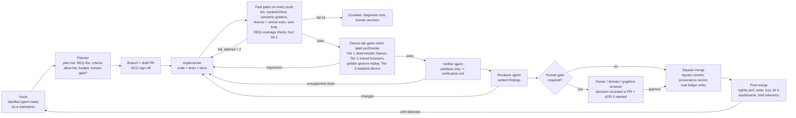

# Autonomous execution model and dissemination plan

Plan section 11 of the Stoipath WSI viewer development plan. Date 2026-10-24. Terminology follows `arch/recommended.md` (Engine contract, `tick`, golden gesture replay, G1–G13, M0–M5, NTF%, BAT, TTS, I2P, REF, Dx mode, Edge Translator, Manifest, Pinned Base, Base Bundle). Evidence tags as in the corpus: **[measured]**, **[verified]**, **[snippet]** (search extract only), **[unverified]**. Cross-references to other plan sections use descriptive titles (*Regulatory pathway and free distribution*, *Testing, QA and performance gates*, *Roadmap and milestones*, *Security, privacy and PHI*, *Clinical integration*, *Education modules*); reconcile at assembly. Research note `11-gap-8` (FDA pathway and free distribution) was **not present** in the corpus when this section was written; §A10 relies on notes 09, 10 and gap-7 and must be checked against gap-8 at assembly.

Two parts. **Part A** is the operating model for a programme executed by AI coding agents with humans as reviewers and decision-makers. **Part B** is the dissemination plan for the Texas Society of Pathologists (TSP) abstract competition, fast track for Friday 30 October 2026.

---

## Part A — Operating model for AI-agent-driven development

### A1. Three rules that everything else follows from

1. **The repository is the only source of truth.** Requirements, acceptance gates, architecture decisions, test results, provenance logs, cost ledgers, SBOMs and this plan live in `git`. If an agent or a human knows something the repository does not, the programme does not know it. Chat transcripts are evidence only when their content has been committed as a provenance record.
2. **Prose never passes a gate; artefacts do.** An agent saying "tests pass" is worth nothing. The Verifier reads CI artefacts (JUnit XML, gate JSON, golden diffs, SBOM, scan reports) produced by machines the agent did not control. This is also what makes the records usable as design-control evidence later (§A10).
3. **Every record is written as if a regulator will read it.** Requirement IDs on tests, an ADR per decision, a risk entry per hazard, a signature line where the QMS will later need one. Note 10 §1.10 prices this at ~10 % overhead from day one and "prohibitively expensive to retrofit"; note 09 F1 option D (RUO core now, Dx edition later) only works if this starts at the first commit.

### A2. Roles

| Role | Kind | Inputs | Outputs | May | May not |
|---|---|---|---|---|---|
| **Planner** | agent | Issue labelled `agent-ready` by a maintainer; plan sections; requirements registry; ADR index | `plan.md` in the PR: REQ IDs touched, acceptance criteria (which gates, which thresholds), file allow-list, token/time budget, risk entries affected, whether a human gate is required (§A4) | Split an issue; open follow-up issues; request an ADR | Change requirements, gate thresholds or budgets |
| **Implementer** | agent | `plan.md`, repository | Commits on the issue branch; tests for every REQ touched; updated docs; `provenance/runs/*.jsonl` entries | Edit code, tests and docs inside the allow-list; add tests | Touch files outside the allow-list; edit gate thresholds, lockfiles, licence policy, CI workflows or `requirements/` without the matching label (§A5) |
| **Verifier** | agent, different model or at least different prompt lineage from the Implementer | PR diff + CI artefacts only (never the Implementer's prose) | `verification.md`: per acceptance criterion → artefact → pass/fail; replication of one gate locally; list of claims in the PR description that the artefacts do not support | Re-run CI; run the headless harness; open a blocking comment | Approve; modify code |
| **Reviewer** | agent | Diff, `plan.md`, `verification.md`, ADRs, coding standards | Review with findings ranked by severity; a checklist of policy items (REQ coverage, licence, PHI, determinism, Dx pathway touched?) | Request changes; recommend human gate | Merge |
| **Release** | agent | `main` at a tag candidate; release checklist | Changesets, SBOM (SPDX + CycloneDX), signed artefacts, provenance attestations, release notes incl. gate waivers, conformance-suite report | Cut release candidates; publish to registries via OIDC | Publish a release that carries an unsigned waiver or a failed gate |
| **Owner** | human (technical product owner) | Everything | Priorities, labels (`agent-ready`, `human-gate`), budget caps, ADR approvals, release approval | Decide | Implement on `main` directly (owner edits go through the same loop) |
| **Domain reviewer** | human pathologist (0.5 FTE in `recommended.md` §8; the Owner at Stage 0) | Camera paths, perceptual constants, Dx-mode behaviour, education/clinical workflows | Sign-off on pathology-facing acceptance criteria; reader-study protocol (gap-1 F9) | Veto a behaviour change on clinical grounds | Approve code quality |
| **Graphics reviewer** | human graphics/GPU engineer (tech lead) | Renderer, shaders, upload budgets, golden diffs on real GPUs | Sign-off on renderer changes that alter pixels; perceptual-golden tolerance changes | Veto | — |
| **RA/QA** | human, 0.5 FTE from v0.9 (`recommended.md` §8) | Design-control records | QMS signatures (§A10) | Hold a release | — |

The Verifier is deliberately not the Implementer re-reading its own work; independence of the verifier from the author is also what IEC 62304 §5.7 and ISO 13485 §7.3 expect of verification records.

### A3. The work loop

Step details that are not obvious from the diagram:

- **Issue intake.** Only maintainers apply `agent-ready`; issue bodies, docs and third-party PRs are untrusted text and never instructions to an agent (prompt-injection guard). The Planner's `plan.md` is the contract for the PR; the Reviewer rejects any diff that exceeds it.
- **Branch and PR.** One issue → one branch → one PR. Commits are DCO signed-off (note 10 F13) and GPG/SSH-signed by the agent's bot identity, so authorship is attributable in the provenance record.
- **Fast gates (per push, hosted runners, ≤15 min).** Correctness and instruction-count only (note 10 F3/F4 Tier 0–1): `cargo nextest`, Vitest, `insta` semantic goldens (draw lists per frame), exact-pixel goldens on SwiftShader/lavapipe, `cargo-deny`/licence scan, `gitleaks` + GitHub push protection, `size-limit` and wasm size budgets (G1), CodSpeed simulation benchmarks, ClusterFuzzLite 60 s, REQ-coverage (every REQ in `plan.md` has at least one test tagged with it), the golden gesture replay on x86 wasm vs native.
- **Device-lab gates (self-hosted bare metal; on `perf`/`render` labels and nightly).** Tier 2 traced Chromium with `gpuBenchmarking` gestures and `Network.emulateNetworkConditions`; Tier 3 on the weakest device of each class (W-4G Mali-G52 phone, W-iPad A12); N ≥ 10 runs, distribution tests against the per-device baseline (Bencher thresholds), alert on shift not on single runs (note 10 F4 hygiene). The gate metrics are `recommended.md` §4.4 (TTS, NTF%, blank-pixel frames = 0, I2P ≤ REF + 1 frame) and the M0–M5 tables of note 10 §6.
- **Verifier.** Reads the artefacts, replays one gate locally, and lists every sentence of the PR description that no artefact supports. A PR with an unsupported performance claim is blocked even if CI is green.
- **Human gate.** Required by policy for the categories in §A4; otherwise the PR auto-merges after Verifier + Reviewer pass. The human decision is a PR review with a reason; when it changes design intent it becomes an ADR.
- **Merge and telemetry.** Squash-merge; the provenance record (§A6) is appended in the same merge; post-merge nightlies and (opt-in, PHI-free) field telemetry feed shifts back as issues.

### A4. Machine-checkable versus human decision, and how the list shrinks

| Area | Machine-checkable today (gate) | Needs a human decision today | Promotion rule (human → machine) | Floor (never fully automated) |
|---|---|---|---|---|
| Correctness | Unit/property/fuzz, conformance suites, reader differential tests vs OpenSlide/tifffile/wsidicom | None | — | — |
| Zoom quality (goal 1) | NTF%, BAT, TTS, blank frames, pop-in, CHS, waste, I2P-vs-REF on named devices; semantic and pixel goldens; golden gesture replay | Perceptual-golden tolerance changes; any change to `tick` policy constants; moving-tier codec | After the gap-1 F9 reader study calibrates blur-ms, constant changes inside the calibrated band become machine-checked | Dx-mode pixel pathway (decoder, resampler, ICC, Rendering Complete semantics): graphics reviewer + RA signature always |
| Reach (goal 2) | Install-from-registry smoke on 7 channels; bundle budgets; embed without COOP/COEP; Safari allow-list soak (G6) | Adding or dropping a platform or minimum OS/browser version | Never promoted (product decision) | Owner |
| Versatility (goal 3) | Conformance (DICOMweb, IIIF 3, OME-Zarr 0.5, DZI); third-party-reader CI smoke (wsidicom, pydicom, Orthanc, dcm4chee, zarr-python, zarrs, zarrita, tensorstore) per `recommended.md` §3.1 | New format reader (fuzz target present? IP review for iSyntax) | A reader class is promoted after 3 readers merged with zero post-merge CVEs | Licence/IP review of a reader |
| Security and licence | `cargo-deny`/`cargo-vet`, licence allow-list per workspace member (permissive-only in client crates), secret scan, SBOM diff, OSV alerts, pinned toolchains, reproducible-build check | New dependency in the client core; any GPL/LGPL addition anywhere; CVE triage severity | Dependencies with ≥ N months on the allow-list and OpenSSF Scorecard ≥ 7 [unverified threshold] can be bumped automatically within semver-compatible ranges | Licence policy changes; incident response |
| PHI | Dataset registry check (every slide referenced in repo/CI is on the allow-list with licence); header scanner refuses files with label/macro pages or patient tags; manifest redaction test (Stage-0 `SOURCE.md` pattern) | Adding a dataset to the registry | Never promoted | Owner + (later) privacy officer |
| Process | REQ coverage, ADR presence for `decision` label, provenance record completeness, cost within budget | Priorities; scope changes; waivers | Waiver *detection* is automatic; waiver *approval* is not | Owner |
| Clinical/education behaviour | Contract tests for the launch-context contract, LTI 1.3 conformance, event-bus schema | Workflow semantics (what "signed out" means; quiz scoring rules) | Never promoted | Domain reviewer |

Promotion is itself an ADR: it states the evidence (how many consecutive human reviews agreed with the machine check, over what window, with zero false negatives), the new sampling rate for human audit (for example 10 % of merges in that category for the next quarter), and the trigger to demote (one escaped regression in the category). Regulated categories (Dx pixel pathway, PHI, licence) have no promotion path; the QMS requires a qualified human signature there regardless of how good the agents become (§A10).

### A5. Guardrails

| Guardrail | Mechanism | Enforced where |
|---|---|---|
| Never skip or weaken a test to go green | Changes to `tests/**`, golden baselines, gate thresholds (`gates/*.toml`) or CI workflows require the `test-change` label, a stated reason in `plan.md`, and a human gate; a PR that deletes or `#[ignore]`s a test while changing the code it covers is blocked by a CI rule; flaky tests are quarantined to a named owner with a 14-day expiry, never deleted; coverage and gate counts cannot decrease without a waiver | CI policy job + branch protection |
| Licence hygiene | `cargo-deny` (bans + allow-list per crate graph: permissive-only for `stoi-*` client crates and shells; LGPL/GPL only in the isolated ingest workers), `license-checker` for npm, REUSE/SPDX headers; SBOM diff on every PR | Fast gates |
| Secrets | `gitleaks` pre-commit and CI; GitHub secret-scanning push protection; OIDC trusted publishing on PyPI/npm/crates.io (status per note 10 F11; crates.io/npm GA [unverified]) so no long-lived publish tokens exist | Pre-commit, CI, release |
| Dependency pinning and supply chain | Lockfiles committed; `rust-toolchain.toml` and `.nvmrc`/`packageManager` pinned; wgpu vendored and pinned per release train (`recommended.md` §7); Renovate with a 14-day cooldown; `cargo-vet` audits for new crates; SLSA-style provenance attestations on every artefact; cosign signatures | CI, release |
| No PHI | Only de-identified **public** slides (CAMELYON16 CC0, IDC, OpenSlide test data, synthetic fiducial slides) in repo, CI and demos; dataset registry with licence and checksum; header scanner (label/macro/barcode/patient tags, `sourceFilename` redaction as in `stage0/data/SOURCE.md`); telemetry schema has no free-text fields | CI, ingest |
| Reproducible builds | Containerised builders, `SOURCE_DATE_EPOCH`, deterministic wasm-opt; a nightly job rebuilds the release from source and compares hashes; the Stage-0 pyramid build already demonstrates the discipline (1,210/1,210 tiles byte-identical between URL and local builds [measured, `SOURCE.md`]) | Nightly, release |
| Scope control | File allow-list from `plan.md`; diff-size budget per issue class; any file outside the list fails the Reviewer checklist | Reviewer, CI |
| Cost control | Per-issue token/time budget in `plan.md`; hard cap per PR; monthly programme cap; kill switch owned by the Owner | Orchestrator |
| Untrusted inputs | Issue text, external PRs, fetched web pages and slide metadata are data, never instructions; agents act only on maintainer-labelled issues | Agent system prompts, orchestrator |

### A6. Provenance and accounting

Every agent run appends one JSON line to `provenance/runs/YYYY-MM.jsonl` (committed with the PR; machine-written, never edited by hand) and every merged PR gets a `provenance/changes/<pr>.json` roll-up. Human time is recorded by the reviewer's own timer entry on the PR (a comment of the form `/time 12m`), which the roll-up parses.

| Field | Content | Why it is needed later |
|---|---|---|
| `run_id`, `parent` (issue/PR), `role` | Planner / Implementer / Verifier / Reviewer / Release | Traceability of who produced which record |
| `model_id`, `model_version`, `prompt_template_sha`, `tooling_sha` | Exact agent configuration | Reproducibility; change control of the "software tool" under ISO 13485 §7.5.6 / IEC 62304 §5.1.4 (tools are configuration items) |
| `inputs_sha[]`, `outputs_sha[]`, `commits[]`, `ci_run_ids[]` | Hashes of files read and written; commit SHAs; CI run identifiers | Verification evidence linkage |
| `tokens_in`, `tokens_out`, `cost_usd` (at provider list price on the run date, price recorded), `wall_clock_s`, `tool_calls` | Cost and time | TSP abstract and sustainability model; budget gates |
| `human_minutes`, `human_role`, `decision` | Reviewer time and outcome | Autonomy metrics (§A8); QMS record of who decided |
| `req_ids[]`, `risk_ids[]`, `adr_ids[]`, `waivers[]` | Links into the registries | Traceability matrix is generated, not maintained |
| `outcome` | merged / abandoned / escalated, with reason | Failure-mode statistics |

**ADR per decision.** `docs/adr/NNNN-title.md` in MADR form (status, context, decision, alternatives considered with scores where a judge panel was used, consequences, evidence links, approver and date). The architecture itself is the first batch: proposals A–E, the three judge outputs and `recommended.md` become ADR-0001…0020 at assembly, with `judge/judgments.json` attached as evidence. Any change to a `recommended.md` figure (§4.4 budgets, §4.2 corrections) is an ADR superseding the previous one, never an edit in place.

**Cost accounting rule.** Report three numbers per milestone, from the ledger only: model cost at list price, wall-clock from first `agent-ready` label to merge (p50, p95), human minutes. Do not estimate; if a run was not logged it is reported as "unlogged" and counts against the programme's logging-completeness metric.

### A7. Escalation rules and failure modes

| Failure mode | Detection | Rule |
|---|---|---|
| Looping on a failing gate | 3 consecutive failed attempts on the same gate in one PR | Stop. Implementer writes a diagnosis note (what was tried, what the artefact shows). Owner or graphics reviewer decides: fix the code, split the issue, or open a `test-change` PR. Never change the test in the same PR as the code. |
| Scope creep | Diff touches files outside `plan.md` allow-list; diff size > budget | Reviewer blocks; Planner either amends `plan.md` (small) or splits the issue (large) |
| Silent regressions | Nightly Tier 2/3 distribution shift (bootstrap CI on p95; Mann–Whitney) against the device baseline; field telemetry shift | Auto-bisect over the merges since the last green nightly; open an issue with the bisected commit; revert if the shift crosses a gate threshold |
| Flaky gates | Pass/fail alternation without code change | Quarantine with owner and expiry; a quarantined gate still runs and reports; expiry without fix escalates |
| Verifier captured by the Implementer's narrative | Verifier cites prose instead of artefacts | Verifier prompt forbids reading the PR description before the artefacts; audit 10 % of verifications by a second verifier model |
| Fabricated or unmeasured claims | A number in docs/PR without a `results/*.json` source | Claims ledger (`claims/*.yaml`: claim, source artefact, verification date, status) checked in CI; the plan's own load-bearing claims go through this ledger first (the pipeline's "verify claims" stage) |
| Cost runaway | Per-PR cost > budget | Hard stop; Owner raises budget or abandons |
| Supply-chain compromise | New dependency, lockfile change, publish-token use | `cargo-vet`, Renovate cooldown, OIDC-only publishing, Scorecard check; human gate for new client-core dependencies |
| Prompt injection via repository content | Agent proposes actions not traceable to an `agent-ready` issue | Orchestrator rejects; incident logged |
| Device-lab drift (OS updates, thermal state) | REF floor measured in the same run moves | Gates are relative to REF (I2P ≤ REF + 1 frame); absolute shifts in REF open a lab-maintenance issue, not a code issue |

### A8. Autonomy metrics

Reported monthly on the public dashboard (note 10 F12) from the provenance ledger.

| Metric | Definition | Target M2 | Target v1 |
|---|---|---|---|
| Unassisted merge share | Merged PRs with zero human code edits ÷ merged PRs | ≥ 60 % | ≥ 85 % |
| Human minutes per merged change | Σ `human_minutes` ÷ merged PRs | ≤ 20 | ≤ 10 |
| Mean time to green | First push → all required gates green (p50 / p95) | ≤ 2 h / ≤ 24 h | ≤ 1 h / ≤ 8 h |
| Regressions caught by gates vs by humans vs in the field | Counts per month | ≥ 90 % by gates | ≥ 95 % by gates, 0 in the field for gate metrics |
| Gate escapes | Regressions found post-merge that an existing gate should have caught | ≤ 1/month | 0 |
| Waivers open | Gate waivers in release notes | ≤ 2 | 0 at a release |
| Logging completeness | Runs with a complete provenance record ÷ runs | 100 % | 100 % |
| Cost per merged change | Σ `cost_usd` ÷ merged PRs (reported, not targeted) | — | — |
| Verifier disagreement rate | Verifier blocks ÷ PRs; and share later upheld by a human | reported | reported |

### A9. From the planning pipeline to the execution pipeline

This document was produced by a pipeline: research notes (17, five of them gap-fills) → five architecture proposals → three judge agents scoring seven weighted criteria → synthesis (`recommended.md`) → twelve plan sections → extraction and three-lens verification of load-bearing claims → four-critic review → revision → assembly. Each stage becomes a recurring workflow:

| Planning stage | Execution workflow | Cadence / trigger | Outputs |
|---|---|---|---|
| Research notes | **Fact re-verification**: re-fetch every `[unverified]`/`[snippet]` fact and every pinned version in the plan and ADRs | Monthly; on any browser/wgpu/OS major | Updated notes with dated tags; issues for plan deltas |
| Proposals + judges | **Scored decision** for architecture-grade questions: ≥ 2 proposals, ≥ 2 independent judge agents on the plan's weights, human approver | On `decision` label | ADR with alternatives and scores |
| Synthesis | **ADR acceptance** | On ADR PR | Signed ADR |
| Plan sections | **Living plan**: sections are files; every merged change that alters a figure updates the section in the same PR | Continuous | Plan always matches code |
| Claim extraction + verification | **Claims ledger CI** | Every PR | Verified/unverified status per claim |
| Critique | **Reviewer agent** (A2) | Every PR | Ranked findings |
| — | **Fast gates** | Every push | Correctness, licence, secrets, size |
| — | **Nightly** | Daily | Tier 2 perf on bare metal, 24 h fuzz, full conformance, reproducible-build check, dependency scan |
| — | **Weekly device lab** | Weekly | Tier 3 on all lab devices, 2 h soak per device, memory/jetsam |
| — | **Release train** | Every 4 weeks (SDKs lockstep; server/apps own trains) | Tier 4 WALT I2P, SBOM, licence audit, conformance corpus, install smoke on 7 channels, signed artefacts |
| — | **Quarterly review** | Quarterly | wgpu major upgrade window (G3/G4/G10 re-run), OSD/OpenLayers/Slim tracking, risk register review, autonomy metrics review, promotion ADRs (§A4) |
| — | **Annual review** | Yearly | Canonical-store flip conditions (`recommended.md` §9), licence/trademark, device-floor redefinition |

### A10. The same artefacts as design-control records

The RUO phase is run so that the Design History File (DHF) for the later Dx edition is a *view* over the repository, not a second set of documents. Mapping (regulatory clause references are from notes 09/10 and general knowledge; **[unverified]** until RA counsel confirms; QMSR effective 2 Feb 2026 and incorporating ISO 13485:2016 by reference is corroborated by secondary sources, FDA primary text not reachable from this sandbox):

| Agent-loop artefact | Design-control record it becomes | Framework clause |
|---|---|---|
| `requirements/REQ-*.yaml` (ID, text, rationale, verification method, pillar, risk links) | Design inputs; software requirements specification | ISO 13485 §7.3.3; IEC 62304 §5.2 |
| Tests tagged with REQ IDs; REQ-coverage gate | Verification protocol and traceability matrix (generated per release) | ISO 13485 §7.3.6; IEC 62304 §5.5–5.7 |
| Gate results JSON, golden diffs, device-lab reports, WALT/photodiode runs | Verification evidence; bench performance per the FDA WSI technical-performance-assessment checklist (viewer navigation/zoom, colour, response time) | 21 CFR 864.3700 special controls [unverified]; IEC 62304 §5.7 |
| Golden gesture replay across platforms; G7 decoder hash identity; Rendering Complete flag tests | Evidence that the Dx pixel pathway is deterministic and frozen per version | Note 09 F1/R5 |
| ADRs (MADR, with judge scores where used) | Design review records; design-change records | ISO 13485 §7.3.5, §7.3.9 |
| `risk/HAZ-*.yaml` (hazard, cause, harm, severity, probability, controls → REQ IDs → tests) | Risk management file | ISO 14971 |
| Reader study (gap-1 F9), formative usability sessions, HUD/latency complaints log | Usability engineering file | IEC 62366-1 |
| SBOM (SPDX/CycloneDX) per release, OSV monitoring, `SECURITY.md`, patch SLAs, threat model | Cybersecurity premarket file; postmarket vulnerability management | FD&C §524B; FDA premarket cybersecurity guidance (final 2023, revised 2025 [secondary sources]; a 2026 revision is reported by one source [unverified]) |
| Provenance ledger (`provenance/**`) | Development records; configuration management of tools (the agents and their prompts are configuration items) | IEC 62304 §5.1.4, §8; ISO 13485 §4.2.5 |
| Release checklist, signed artefacts, install smoke | Design transfer; release records | ISO 13485 §7.3.8 |
| Gate suite + device classes + change categories | Draft content of the Predetermined Change Control Plan (which changes are verified by which gates without a new submission) | FDA PCCP guidance (Dec 2024) [unverified] |
| Field telemetry (opt-in, PHI-free), issue tracker categories `complaint`, `safety` | Complaint handling and MDR inputs (process starts RUO, obligations bind at Dx) | 21 CFR 803/820 [unverified] |

**Steps that need a qualified human signature under the QMS** (electronic signatures meeting Part 11-style controls; agents may prepare, never sign): design input approval (REQ baseline per milestone); design review closure (ADR acceptance for architecture-grade and Dx-pathway changes); risk acceptance (every HAZ entry and the residual-risk statement); verification report approval per release; validation protocol and report (CAP-style study, reader study); release approval and labelling; software safety classification (IEC 62304 Class B assumed, Class C argument documented [unverified]); CAPA and complaint dispositions; supplier/tool qualification (the agent toolchain itself); cybersecurity risk acceptance and SBOM release. These are the human gates of §A4 that never shrink.

**Reviewer notes on `recommended.md`** (not divergences; measured facts the plan should absorb):

1. *Base Bundle size.* `recommended.md` §4.2 budgets the Base Bundle (levels ≤ 4096 px) at 2–5 MB. The Stage-0 build of a 95 %-tissue 15,360² region measured **9.50 MB for 85 tiles at q85 4:2:0**, and coarser levels were *heavier per tile* (105–123 kB) than level 0 (72 kB) because box filtering raises mid-frequency energy [measured, `stage0/data/SOURCE.md`]. Whole-slide low levels include glass and will be lighter, but the open-time prefetch budget on cellular should be planned against ~10 MB, not 2 MB, and per-viewport byte estimates (§4.3 "20 tiles × ~80 KB") should be per level.
2. *Stage-0 instrument versus product engine.* The Stage-0 client is TypeScript/WebGL2 with `createImageBitmap` decode. That is consistent with the decided architecture only as the **measurement instrument and policy oracle** (`recommended.md` §2 item 3 records TypeScript as the exit for the web floor renderer, and gap-2 §4.3 restricts `createImageBitmap` to self-certified non-Dx use). Part B must not describe Stage-0 numbers as the product's performance; the Rust core's golden replay must reproduce the Stage-0 request sequences before any later comparison is made.

---

## Part B — Dissemination: TSP 2027 abstract competition

### B1. Competition facts and the decision taken

Facts as supplied by the harness on 2026-10-24 from texpath.org (**re-check the 2027 page before submitting; this sandbox cannot reach texpath.org or the TSP iMIS page — proxy 403 / DNS — so only search-engine extracts of the 2024-cycle rules page were corroborated here [snippet]**): the 2027 competition is the 41st Annual John R. Rainey, MD Residents'/Fellows' Seminar at the 106th TSP Annual Meeting, 22–24 January 2027, Hyatt Regency Austin; submission deadline **Friday 30 October 2026, 17:00 CT**; website submission only; 2026 rules: maximum 350 words, no author/co-author/institution names in the abstract file, residents and fellows may be first author on only one submission; categories investigative abstract and case report. The 2024-cycle page additionally states a recommended structure (background, methods, results, discussion) and that medical students and non-Texas residents may submit but are not eligible for podium presentation or awards [snippet].

Decision (owner, 2026-10-24): **option (i)** — submit by 30 Oct 2026, investigative category, owner (eligible resident/fellow) as first author, with the Stage-0 prototype measured on real devices before the deadline; present final v0.x results in January. **Option (ii)** (2028 cycle, expect a late-October 2027 deadline, full v1 evidence) remains the fallback if B3's measurement freeze is missed.

### B2. The claim the abstract can honestly make

**Claim:** AI coding agents, with humans as reviewers at defined gates, can produce in six days (planning) plus days (prototype) an open-source whole-slide viewer prototype whose zoom/pan quality is **measured on consumer devices with a published, reproducible instrument**, whose build has **complete provenance and cost accounting**, and whose licence and security posture are **machine-audited** — i.e. a capability-and-cost demonstration of in-house-verifiable open tooling.

**Not claimed:** diagnostic equivalence, pathologist efficiency, patient outcomes, or that the prototype is the product. Only de-identified public slides are used (one CC0 CAMELYON16 slide region; `stage0/data/SOURCE.md`). Mobile is "measured for latency", not "validated for diagnosis" (gap-1 F5). Input-to-photon is not claimed (no photodiode rig before January); software-measured input-to-frame proxies are reported as such.

Evidence package (details in B5): (1) device measurements of the Stage-0 prototype vs OpenSeadragon 6.1.1 on the same tiles and devices, plus the published MSK baseline (<250 ms median adjacent FOV; 108–238 ms/FOV [verified, Schüffler 2022]); (2) build cost and timeline from the provenance ledger; (3) licence/secret scan and SBOM results; (4) verification statistics of the planning pipeline; (5) a cost framing against vendor subscriptions using only documented prices (gap-7 F7: none are public; the Proscia GSA schedule 47QTCA22D0089 price list is the one public document to try [snippet]) — otherwise the abstract states that vendor prices are undisclosed and reports our costs alone.

### B3. Day-by-day schedule, Sunday 25 to Friday 30 October 2026

Policy constants are frozen at the commit used for the first device run (`STAGE0_FREEZE` tag); after that, agents may fix measurement-validity defects only, each as its own PR with the Verifier's note on what changed and why the earlier runs remain comparable (or are discarded).

| Day | Agents build / run | Owner measures / decides | End-of-day gate |
|---|---|---|---|
| **Sun 25** | Finish Stage-0 client (`main.ts`, scripted path = pathologist traversal from gap-1 F1: ~4.5 s overview, 3 ROIs, ≥5× zoom bursts, slow pans, zoom-out, revisit), `harness/run.mjs` + `serve.mjs` (headless Chromium, `HeadlessExperimental.beginFrame`, network profiles LAN/broadband-CDN/4G-good/cellular-poor from note 10 F7), static deploy of client + 97.8 MB pyramid to a CDN-backed host with immutable tile cache headers, OpenSeadragon 6.1.1 comparator page over the same `tiles/{level}/{x}_{y}.jpg`, `provenance/` roll-up script, licence/secret scan + SBOM job | Register on the submission site; read the 2027 rules page and record any change vs 2026 in `dissemination/tsp2027/rules.md`; list devices (model, OS, browser versions); e-mail the IRB for a "not human-subjects research" determination (B8); confirm mentor as co-author/domain reviewer | Prototype runs on desktop Chrome with HUD, scripted path, Export JSON; deploy URL live; `STAGE0_FREEZE` tagged |
| **Mon 26** | Headless runs: 4 profiles × cold/warm × N = 10, prototype and OSD comparator; results → `harness/results/*.json` and a generated table; claims-verification statistics and cost/time ledger for the planning phase; abstract skeleton with placeholders | Evening session 1 (B4): laptop, Android phone, iPad over Wi-Fi; export JSON per run to `harness/results/devices/`; note anomalies | ≥ 10 valid cold + 10 warm runs per device over Wi-Fi; headless tables generated |
| **Tue 27** | Ingest device JSON, compute p50/p95 per device × network, flag invalid runs (thermal, interruption); fix validity defects only; draft abstract v1 with real numbers; evidence table v1 | Session 2: cellular (phone, tablet); repeat any Wi-Fi device with < 10 valid runs; review abstract v1; send v1 + evidence table to mentor | Cellular runs complete; abstract v1 ≤ 350 words |
| **Wed 28** | Regenerate tables after any re-runs; abstract v2; check every number in the abstract against a `results/*.json` path (claims ledger); word count; name/institution scan of the abstract file | Buffer: re-measure where needed; **measurement freeze 18:00 CT**; collect mentor comments | Final results JSON tagged `tsp2027-results`; v2 ready |
| **Thu 29** | Final abstract v3; `dissemination/tsp2027/` contains abstract text, evidence table, device protocol, results, provenance roll-up, scan reports | Final read with mentor; **submit on the website by evening (one day early)**; save confirmation to the repo | Submission confirmed; repo tagged `tsp2027-abstract` |
| **Fri 30** | Contingency only | Verify confirmation e-mail; if Thursday's submission failed, resubmit before 17:00 CT | Deadline |

Risk to the schedule: the prototype's `main.ts` and harness do not exist at the time of writing (client `src/` has camera, LOD, scheduler, frame-planner, renderer, decode pool, metrics; `index.html` has HUD, "Run scripted path", "Export JSON"). If Sunday's gate is missed, Monday's device session slips to Tuesday and cellular to Wednesday; if Wednesday's freeze is missed, fall back to option (ii) rather than submit unmeasured numbers.

### B4. Measurement protocol the owner follows on each device

**Devices (fill in):** laptop (Chrome; `[model, OS, Chrome version]`); Android phone (Chrome; prefer the lowest-end available, `[model, RAM, GPU, Android version]`); iPad or iPhone (Safari; `[model, iPadOS/iOS version]`). Record exactly what the prototype's `DeviceInfo` export captures (userAgent, devicePixelRatio, renderDpr, hardwareConcurrency, deviceMemoryGiB, gpuRenderer/gpuVendor, protocol, workers, textureLayers, touch) plus a photo of the Settings → About screen.

**Network conditions:** (a) Wi-Fi to the static host; (b) cellular (4G/5G; disable Wi-Fi). Before and after each session take a speed-test screenshot (download Mbps, latency) for context; record `navigator.connection.effectiveType` where the browser exposes it (Chrome Android only). Controlled throttling is done in the headless harness, not on phones.

**Pre-conditions per session:** battery > 50 % or charging; brightness fixed; no other apps; airplane mode off; auto-rotate off; device at room temperature; 2 minutes of idle between repetitions; abort a run and note it if the phone shows a thermal warning or the browser reloads.

**Procedure per repetition:** (1) *Cold*: clear site data (Chrome: Site settings → Clear & reset; Safari: Settings → Safari → Advanced → Website Data → remove the host), open the deploy URL, wait for "base loaded", press **Run scripted path**, do not touch the screen until the path ends, press **Export JSON**, save the file as `results/devices/<device>/<network>/cold-<nn>.json`. (2) *Warm*: without reloading, press **Run scripted path** again, export as `warm-<nn>.json`. (3) Repeat until **N ≥ 10 valid cold and 10 valid warm** runs per device × network (≈ 25–35 minutes per device × network). (4) Once per device × network, run the OSD comparator page the same way (its page exports `fully-loaded-change` timings per waypoint).

**What is recorded (by the prototype, automatically):** per gesture `timeToSharpMs` (TTS: last input → first frame with NTF = 0), `settleAfterInputMs`, `sharpAfterSettleMs`, `framesWithDeficit`, `maxBlurMs`, `blurAreaTimeLevelS` (BAT), `droppedFrames`, `minSharpFraction`, `levelsZoomed`, `tilesRequestedTier0/Prefetch`, `bytes`; per run `droppedFramePct`, `uploadsPerFrameMax`, tile fetch/decode percentiles, `prefetchWastePct`, `blankFramesAfterBase` (must be 0), cache stats; `DeviceInfo`. The owner records nothing by hand except the device/network context and anomalies.

**Validity rules:** discard runs with `interrupted` gestures, thermal warnings, or a background reload; report N valid per cell; report p50 and p95 with bootstrap 95 % CIs; never report a cell with N < 10 as a result (report it as "insufficient runs").

### B5. Evidence table the abstract cites (placeholders)

| # | Evidence | Source artefact | Placeholder in abstract | Baseline / comparator | Status |
|---|---|---|---|---|---|
| E1 | TTS p50/p95 after zoom bursts, cold and warm, per device × network | `results/devices/**` | `[p50/p95]` per device | OSD 6.1.1 `fully-loaded-change` on the same device and tiles (E3); MSK <250 ms median adjacent FOV, 108–238 ms/FOV streaming pace [verified] (deployed clinical system, different metric — stated as class, not head-to-head) | to measure |
| E2 | NTF% of settled frames, BAT, blank frames (= 0), pop-in count | same | `[k]%`, `[0]` | OSD architecture-derived blur-then-pop (OSD #2906 [verified]) | to measure |
| E3 | Same-device comparator | OSD page export | `[p50/p95]` | — | to build Sun 25 |
| E4 | Headless Chromium under emulated LAN / broadband-CDN / 4G-good / cellular-poor, N = 10 | `harness/results/*.json` | optional sentence | Google DICOM proxy ~150 ms/frame server-side [verified] as class reference | Mon 26 |
| E5 | Build cost and timeline | `provenance/**` roll-up | `[N] runs, [T] M tokens, US$[C], [H] human-hours, [D] days` | — (no comparable public figure) | compile Mon 26 |
| E6 | Verification statistics | claims ledger; judge outputs | `[V] of [W] claims verified`; 5 proposals, 3 judges | — | Mon 26 |
| E7 | Licence and security audit | `cargo-deny`/`license-checker`/`gitleaks` reports; SBOM | `[0]` non-permissive client deps; SBOM generated | — | Sun 25 |
| E8 | Reproducibility | `verify_pyramid.py --hashes` | 1,210/1,210 tiles identical [measured] | — | done |
| E9 | Cost framing vs vendor subscriptions | GSA Advantage price list for Proscia 47QTCA22D0089 if retrievable; otherwise "undisclosed"; our hosting cost from verified unit prices (note 09 F8: R2 $0.015/GB-month, zero egress) | `[US$/yr]` or "not public" | — | Tue 27 |
| E10 | Adoption/cost barrier context | CAP 2025 survey coverage (~15 % of practices use WSI for primary diagnosis) [snippet]; L.E.K. 2026 (cost and integration burden top barriers) [snippet] | Background sentence | — | verify before submission |

### B6. Draft abstract (investigative category; ≤ 350 words; no author, co-author, institution or project names)

**Title:** AI-agent-built, in-house-verifiable open-source whole-slide image viewing: a capability and cost demonstration on public de-identified slides

**Background:** Whole-slide imaging serves primary diagnosis in roughly 15 % of US practices; cost and integration burden are the leading barriers, and viewer software is sold by subscription at undisclosed prices with no published performance data. The only published deployed-viewer latency is 108–238 ms per field of view. Can AI coding agents, with humans only as gate reviewers, produce an open-source viewer whose performance, provenance and cost a health system can verify itself?

**Design:** A multi-agent pipeline wrote [17] research notes, five architecture proposals scored by three independent judge agents, and a plan with machine-checkable gates. Agents then built a web prototype (TypeScript/WebGL2) implementing an explicit level-of-detail, prefetch and never-blank rendering policy over a static tile pyramid from one CC0 CAMELYON16 slide (15,360² px, 1,210 JPEG tiles). It records per frame the level wanted versus drawn and per gesture the time-to-sharp. A scripted pathologist-style camera path was run (≥ 10 cold and 10 warm repetitions) on [n] consumer devices ([classes]) over Wi-Fi and cellular, in headless Chromium under emulated LAN, broadband and 4G, and against OpenSeadragon 6.1.1 serving identical tiles. Every agent run logged tokens, list-price cost, wall-clock and human review minutes; tile builds were checked for byte identity.

**Results:** Over Wi-Fi, time-to-sharp after zoom bursts was [p50/p95] ms (laptop), [p50/p95] ms (Android phone) and [p50/p95] ms (tablet), versus [p50/p95] ms for OpenSeadragon on the same devices; [k] % of settled frames showed no non-target-level tile and blank frames were [0]. Warm revisits settled within [x] frames. Planning plus prototype consumed [N] agent runs, [T] million tokens, US$[C] and [H] human-hours over [D] days; [V] of [W] plan claims were independently verified. Licence scanning found [0] non-permissive client dependencies; a software bill of materials was generated.

**Conclusion:** An AI-agent-built open viewer reached [summary] on consumer devices for US$[C] of model usage, with machine-checkable provenance. This is a capability and cost demonstration on public de-identified data, not a diagnostic validation; clinical use requires CAP validation and distribution requires FDA clearance. First native-core milestone results will be presented.

Submission hygiene: the abstract file carries no names, affiliations, repository URL or project name (a repository URL would identify the author); those go in the form fields only. Replace every bracket from a `results/*.json` path; the claims ledger blocks submission otherwise. This draft is 332 words plus a 15-word title (347 total); re-count after substitution, because bracketed placeholders are shorter than the numbers that replace them.

### B7. Which milestone the abstract rests on, and whether the dates work

- **30 Oct 2026 submission** rests on the Stage-0 *measurement prototype* (not on G1–G13, which target the Rust renderer) plus the planning pipeline's provenance. It needs two things that do not yet exist on 2026-10-24: the client's `main.ts`/scripted path and the headless harness. Feasible if Sunday's gate holds; three days of slack (B3).
- **January 2027 presentation** should add M0 (renderer spike on the Rust core, note 10 §6: warm-cache deficit = 0, 0 pop-in, p99 frame ≤ 16.7 ms on the Intel-iGPU laptop) and the Stage-0 gates G1–G2, G7 (decoder identity, which `recommended.md` §8 calls plan-stopping) and G11 (REF floors with the photodiode rig) — roughly 12 weeks of work against a Stage 0 budgeted at weeks 0–2 and an M0 inside month 2. M1 (web alpha, broadband TTS p50 ≤ 100 ms) is borderline and should be presented only if its gates are green by 15 January.
- **Option (ii)** (2028 cycle) would rest on v0.9 (month 12: iPad shell beta, on-prem edge binary, WebGPU allow-list) and the first in-house RUO/education deployment at a UT site (gap-7 recommendation 6); it could also carry a CAP-style in-house validation if a lab chooses to run one, which would be the first evidence about clinical use.

### B8. IRB and ethics, authorship, disclosure

- **Human subjects.** The study is software-only on a public, CC0, de-identified challenge data set (CAMELYON16; the slide carries no patient identifiers, the macro photograph is never read, and the upstream slide label in the TIFF header is redacted from the manifest — `stage0/data/SOURCE.md`). There is no intervention or interaction with living individuals and no identifiable private information, so it is not human-subjects research under 45 CFR 46.102(e) [general knowledge; confirm locally]. Obtain a written **"not human-subjects research" determination** from the owner's IRB anyway (many programmes and journals require the letter; request Sunday 25 Oct, it usually does not block an abstract). The owner's own device measurements involve no participants. Any later reader study (gap-1 F9) or clinical pilot requires IRB review and, for clinical use, CAP validation (gap-7 F6).
- **Data licence.** CC0 permits every use; cite the data set as its README requests. No vendor sample slides (redistribution often prohibited, note 10 F8).
- **Authorship.** Owner (eligible resident/fellow) first author, one submission only; faculty mentor/domain reviewer and any graphics reviewer as co-authors per ICMJE criteria. AI agents are not authors (ICMJE and COPE positions); their use is described in Design and acknowledged, with model identifiers and the provenance ledger cited as supplementary data at presentation.
- **Disclosure.** Open-source project (Apache-2.0 intended, note 09 R1); no commercial sponsor; who paid for model usage; no financial relationship with any viewer vendor. Disclose AI-tool use explicitly even if the TSP form does not ask.
- **Scientific honesty rules baked into the text:** no diagnostic claim; devices "measured for latency", not "validated"; MSK figures are a different metric on a deployed clinical system and are cited as the published class of performance, not as a head-to-head result; Stage-0 pixels are a second JPEG generation and no image-quality claim is made (`stage0/tools/README.md` honesty notes).

### B9. January presentation plan (poster or platform, 22–24 Jan 2027)

Add to the abstract's content: (1) M0 results on the Rust core (`stoi-core` wasm + `stoi-render-gl`): golden gesture replay showing identical request sequences native vs wasm; G7 1,000/1,000 decoder hash identity incl. arm64; G1/G2 bundle and cold-start; (2) device-lab measurements with the REF floor (CSS-transform page) and, if the rig is built, photodiode I2P on the iPad and mid-range Android; (3) comparators extended to Slim/dicom-microscopy-viewer on the same tiles via a DICOMweb façade if the Edge Translator prototype (M0–M1, p99 ≤ 10 ms hot) exists; (4) three months of provenance: cost per merged change, unassisted-merge share, mean time to green, regressions caught by gates vs humans (§A8); (5) the licence/SBOM audit of the Rust crate graph; (6) one slide on the regulatory and free-distribution pathway (RUO now; design controls from day one; Dx edition later; what "requests/qualifies" will mean) and one on what the viewer cannot show about patient care (B10). Keep the honesty rules of B8 on the poster verbatim.

### B10. What a follow-up study would need to say anything about direct patient-care impact

A viewer alone can show latency, cost and provenance; it cannot show patient benefit. A follow-up would have to be a prospective study inside a CLIA laboratory after a CAP-guideline validation of the whole system (≥ 60 cases per application, ≥ 2-week washout, the real displays and network; gap-7 F6), comparing the in-house viewer with the incumbent on pre-registered endpoints a health system actually feels: case turnaround time (frozen sections and routine), pathologist time per case and navigation metrics (gap-1 F1 variables), deferral and re-scan rates, consult access for rural sites, and realised cost offset (licence lines actually not renewed and where the money went). Diagnostic concordance is a validation prerequisite, not the outcome. Multi-site design across UT campuses, institutional finance data, and at least a year of post-deployment telemetry would be required before any statement about direct patient care; none of this is demonstrable by January 2027, and the abstract says so.

---

## References

Corpus: `arch/recommended.md` (§2 item 3, §3.1, §4.2–4.4, §5, §8, §9), `judge/ranking.json`, `judge/judgments.json`, research notes `05` (F1–F3), `07` (F6–F7), `09` (F1, F4, F5, F8, F9, R1–R6), `10` (F1–F13, §5, §6), `11-gap-1` (F1, F5, F7, F9), `11-gap-2` (§2.3, §4.2–4.3), `11-gap-3` (summary), `11-gap-6` (F2, recommendations 4), `11-gap-7` (F2, F6, F7); repository `wsi-viewer/stage0/data/SOURCE.md`, `wsi-viewer/stage0/tools/README.md`, `wsi-viewer/stage0/client/src/metrics.ts`, `constants.ts`, `index.html` (read 2026-10-24).

External:

- Texas Society of Pathologists — annual meeting and abstract competition: https://www.texpath.org/ (harness-verified 2026-10-24; unreachable from this sandbox) ; rules page (2024-cycle text corroborated via search extracts): https://imis.texmed.org/AMSiMis/TSPI/Events/Annual_Meeting/Abstract_Competition.aspx
- Schüffler PJ et al., *Efficient visualization of whole slide images in web-based viewers*, Arch Pathol Lab Med 2022: https://doi.org/10.5858/arpa.2021-0197-OA
- OpenSeadragon issue #2906 (WebGL drawer design flaw): https://github.com/openseadragon/openseadragon/issues/2906 ; OpenSeadragon releases: https://github.com/openseadragon/openseadragon/releases
- Google Digital Pathology DICOM Proxy README (~150 ms/frame): https://raw.githubusercontent.com/GoogleCloudPlatform/medical-imaging/main/pathology/dicom_proxy/README.md
- Iris RESTful Server (21 ms median on Raspberry-Pi-class hardware): https://doi.org/10.1016/j.jpi.2025.100530
- CAMELYON16 on AWS Open Data (CC0): https://registry.opendata.aws/camelyon/ ; licence: https://camelyon-dataset.s3.amazonaws.com/CAMELYON16/license.txt
- Brunyé TT et al., zoom behaviour, PLoS One 2023: https://doi.org/10.1371/journal.pone.0282616 ; Wienert/Kayser 2009 navigation and prefetch statistics: https://doi.org/10.1186/1746-1596-4-3
- CAP 2025 digital pathology adoption coverage [snippet]: https://www.cap.org/podcast/how-many-practices-are-using-digital-pathology/ ; L.E.K. 2026 survey [snippet]: https://www.lek.com/insights/diagnostic-ancillary-provider-service/digital-pathology-demand-and-adoption-trends ; Proscia GSA MAS 47QTCA22D0089 [snippet]: https://www.highergov.com/idv/47QTCA22D0089
- CAP WSI validation guideline (Evans et al. 2022): https://meridian.allenpress.com/aplm/article-pdf/146/4/440/3030324/i1543-2165-146-4-440.pdf
- FDA QMSR final rule (effective 2026-02-02; incorporates ISO 13485:2016): https://www.federalregister.gov/documents/2024/02/02/2024-01709/medical-devices-quality-system-regulation-amendments [primary not reachable; corroborated by https://www.arnoldporter.com/en/perspectives/advisories/2024/02/fda-final-rule-medical-device-requirements-and-iso-13485 and https://www.nemko.com/blog/fda-qmsr-transition-what-u.s.-manufacturers-need-to-know ]
- FDA, *Cybersecurity in Medical Devices: Quality System Considerations and Content of Premarket Submissions* (final 2023; 2025 revision reported; 2026 revision reported by one source, unverified): https://www.fda.gov/regulatory-information/search-fda-guidance-documents/cybersecurity-medical-devices-quality-system-considerations-and-content-premarket-submissions ; FD&C §524B summary (secondary): https://www.kslaw.com/insights/articles/fda-finalizes-premarket-cybersecurity-guidance-for-medical-devices
- FDA PCCP guidance (Dec 2024) and AI-enabled device draft (Jan 2025) [unverified]: https://www.fda.gov/medical-devices/software-medical-device-samd/artificial-intelligence-and-machine-learning-software-medical-device
- 21 CFR 864.3700 [unverified]: https://www.ecfr.gov/current/title-21/chapter-I/subchapter-H/part-864/subpart-D/section-864.3700
- IEC 62304 (2006 + AMD1:2015): https://www.iso.org/standard/38421.html ; ISO 14971:2019: https://www.iso.org/standard/72704.html ; IEC 62366-1:2015+AMD1:2020: https://www.iso.org/standard/63179.html ; ISO 13485:2016: https://www.iso.org/standard/59752.html
- 45 CFR 46.102 definitions (human subject): https://www.ecfr.gov/current/title-45/subtitle-A/subchapter-A/part-46/subpart-A/section-46.102
- ICMJE authorship and AI-assisted technology recommendations: https://www.icmje.org/recommendations/ ; COPE position on AI tools: https://publicationethics.org/cope-position-statements/ai-author
- Tooling: MADR ADR template https://adr.github.io/madr/ ; Developer Certificate of Origin https://developercertificate.org/ ; cargo-deny https://github.com/EmbarkStudios/cargo-deny ; cargo-vet https://github.com/mozilla/cargo-vet ; gitleaks https://github.com/gitleaks/gitleaks ; SLSA https://slsa.dev/ ; Sigstore cosign https://github.com/sigstore/cosign ; SPDX https://spdx.dev/ ; CycloneDX https://cyclonedx.org/ ; OpenSSF Scorecard https://github.com/ossf/scorecard ; Bencher https://github.com/bencherdev/bencher ; CodSpeed https://github.com/CodSpeedHQ/action ; ClusterFuzzLite https://google.github.io/clusterfuzzlite ; WALT latency timer https://github.com/google/walt ; Chrome DevTools Protocol (HeadlessExperimental.beginFrame, Network.emulateNetworkConditions) https://chromedevtools.github.io/devtools-protocol/
