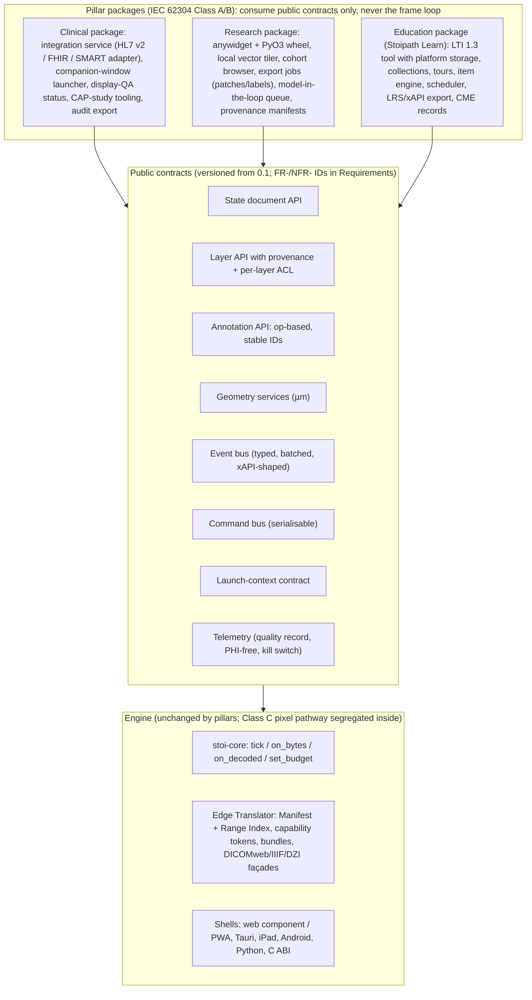
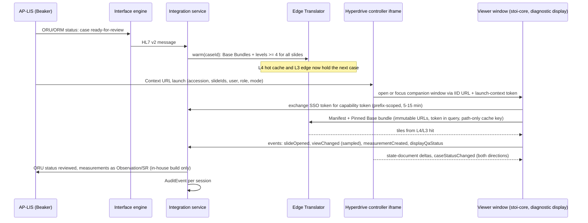
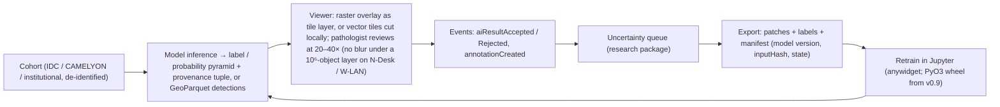

# Product pillars: clinical use, research and education

Plan section 12 of the Stoipath WSI viewer development plan. Date 2026-10-24; revised 2026-10-25 after the four-critic review (`critique/issues.json`) and the claims-verification pass (`verify/README.md`, `verify/required-changes.json`). Terminology follows `arch/recommended.md` §5 (stoi-core, Edge Translator, Manifest, brightfield/multichannel canonical, offline pack, Dx mode, Rendering Complete, PHI Tiers 0–2, L0–L5, NTF%, TTS, CHS, device classes W-LAN…N-And). Requirement IDs are those of "Requirements" (`FR-`/`NFR-`, the single namespace; Stage-0 gates are `NFR-G1…G13`). **Calendar:** week 0 = Monday 2026-10-26 and **M0 = 2026-12-05** (the six-week Stage 0 of "Repository structure and first sprints"); every other date (M1, M2, MVP 0.5, v0.7, v0.9, CLIN-1, v1, CAP-1, DX-0/1) is owned by "Roadmap, milestones, team and estimates" §3 and is cited here by milestone or release name, never restated as a month. Critique references of the form "critique item #N" are zero-based positions in `critique/issues.json`. Evidence tags as in the corpus: **[verified]**, **[snippet]**, **[estimate]**, **[unverified]**; verification marks: **(verified)**, **(adjusted after verification: was X)**, **(unverified – Stage 0 gate)**. Sources: research notes 08, 09, 10, 11-gap-1, 11-gap-6, 11-gap-7 and **11-gap-8** (`research/11-gap-8-fda-pathway-and-free-distribution.md`, present in the corpus; the earlier draft's statement that it was absent is withdrawn). The regulatory programme itself is owned by "Regulatory pathway to FDA clearance and the free-distribution model" (plan section 13); this section sets only the per-pillar boundary that section builds on.

**What changed in this revision (for the assembly pass).** (1) The legal separation of the pillars is no longer a `mode` flag but four build artefacts from one commit set (§2), aligned with section 13 Decision 3 and gap-8 F3; the mode field survives as a runtime policy input. (2) Product code QKQ, IEC 62304 Class C for the pixel pathway with the pillar packages at Class A/B, and the free regulated-release channel replace PSY, "Class B" and "commercial Dx edition" wherever this section touched them. (3) Release tags cite `FR-`/`NFR-` IDs and roadmap milestones; HL7/SMART, CAP tooling, the PyO3 wheel, display QA and LTI certification are re-tagged (§3.2, §4.2, §5.2) with a CLIN-0 precondition node for anything that needs a real Epic site. (4) TX-RAMP, the Hyperdrive companion-window pattern, cookieless LTI launch, a local vector tiler for the notebook loop and a derived 8-bit multichannel delivery tier are added. (5) Every performance number this section quoted is re-marked against the verification report: the W-4G/W-BB TTS gates are population statistics, the W-LAN 85 ms fill is unverified, the 10⁶-object and 8-channel gates are restricted to the device classes where they close. (6) The TSP evidence paragraph is rebuilt on the owner-verified dates (abstract 30 Oct 2026; meeting 22–24 Jan 2027, before M1).

## 1. Thesis: one engine, three thin products

The three pillars differ in their users, their data governance and the systems they plug into. They do not differ in how a tile is fetched, decoded, scheduled or drawn. Each pillar therefore ships as a **package over the public contracts of stoi-core and the Edge Translator**, never as a fork, and nothing a pillar adds may run inside the frame loop (note 08: "plugins add data, never frame work"). This is what keeps goal 1 (weight 0.35) intact as the product grows: the golden gesture replay that defines instant zoom is identical whether the viewer was launched from Epic Beaker, from a Jupyter cell or from a Canvas assignment.

The rule also carries the owner's long-term aim. The pixel pathway that an undergraduate uses in a histology lab is byte-for-byte the pathway the Dx edition will validate (note 09 R5); education and research traffic therefore generate verification evidence, usability data and field hours for the Design History File at no extra cost, and one codebase is the only shape under which a free, regulated release channel is affordable. The same boundary is the IEC 62304 §4.3 segregation that section 13 and gap-8 §3 require: the **Class C** set (stoi-codec, the Dx paths of stoi-draw/stoi-render(-gl), the Dx gate, slide/case identity, the Edge Translator pixel path) lives in named crates with no shared mutable state across the boundary; every pillar package is **Class A/B** on the far side of it, which is why a pillar may never import core internals (§1.1 enforcement). The class assignment itself is an ADR owned by section 13 (its Decision 4; confirmed in the Pre-Sub), not a choice this section makes.

### 1.1 What the engine must expose (so pillars never fork the core)

| Contract | Lives in | Clinical uses it for | Research uses it for | Education uses it for | Frozen by |
|---|---|---|---|---|---|
| **State document** `{slides[], views[]: {slide, center_um, scale, rotation, z, t, channels[], overlays[], sync}}` + compact URL form + `flyTo(state, transition)` | stoi-model / stoi-camera; shells expose as props, postMessage, traitlets, UniFFI | Bookmarks in the report, tumour-board packets, collaboration, reproducible AI runs, companion-window sync (§3.3) | Reproducible figures, notebook round-trip, registration views | Tour steps, deep links from the LMS, "jump to where the expert looked" | M1 (v0.1), semver thereafter |
| **Layer API** with provenance tuple `{producer, version, inputHash, createdAt, regulatoryStatus}` and per-layer ACL `{visible, hidden, revealOn(event), authorOnly}` | stoi-draw / stoi-annot; raster label and probability layers are tile layers through the same scheduler | AI overlays rendered deterministically in Dx mode; label/macro Tier 2 gated by role | Inference outputs, multiplex channels, label pyramids | Answer-key layers hidden until reveal; expert overlays | M1 (raster), v0.9 (vector tiles) |
| **Annotation API**: op-based CRUD, stable versioned IDs, adapters GeoJSON-QuPath / DICOM ANN / W3C; **local vector tiler** (same cutter crate as ingest, in the in-process translator) for GeoArrow/GeoParquet → MVT on demand; untiled-buffer ceiling ≤10⁵ features with a hard warning | stoi-annot (GeoArrow model, Hilbert R-tree); tiler in the in-process Edge Translator (wheel, Tauri) | Measurements and ROIs into SR TID 1500 / ANN via STOW-RS | Annotation at scale, active-learning labels, Paquo/QuPath exchange, per-iteration polygon sets without a server job (§4.2) | Hotspots, region-marking items, peer annotation | M1 (model), v0.9 (tiler), v1 (ANN/SR adapters) |
| **Geometry services**: point-in-polygon, polygon IoU, nearest distance in µm, visible-area coverage | stoi-annot (Rust), callable from JS/Python/Swift/Kotlin | Did the pathologist view the AI-flagged region (audit, CAP study) | Label QC, IoU against model output | Auto-scoring of region items, "did you look at the lesion" | M1 |
| **Event bus**: `slideOpened`, `viewChanged` (rAF-sampled), `tileSettled`, `annotationCreated/Updated/Selected`, `measurementCreated`, `aiResultArrived/Accepted/Rejected`, `caseStatusChanged`, `signoutRequested`, `shareCreated`, `displayQaStatus`, `itemAnswered`; batched per frame, versioned (FR-I12) | stoi-telemetry + shells; subscribers never block a frame | FHIR `AuditEvent`/ATNA derivation, LIS status write-back (**in-house clinical build only**, §2) | Viewing-trace datasets, experiment logging | 1:1 mapping onto xAPI statements, spaced-repetition signals | M1 (names), M4 (wire format) |
| **Command bus**: one serialisable dispatcher for keyboard, control surfaces, voice, remote presenter, test harness | shells over stoi-camera | Dictation co-existence (mic arbitration), 3D mouse, voice navigation | Scripted camera paths from Python | Presenter "follow me", keyboard-only path (WCAG) | M1 |
| **Launch-context contract** v1 `{accession, caseId, part, block, slideIds[], studyUID, seriesUIDs[], user, role, purposeOfUse, breakGlass, locale, mode: dx\|ruo\|edu}` reachable by IID-style URL, SMART adapter, postMessage, native `open(ctx)`; capability-token exchange (FR-I1). `mode` is a **runtime policy input**; the legal boundary is the build artefact (§2) | Web Shell + Edge Translator token endpoint | Beaker/Hyperdrive launch, consult links, companion-window handoff | Notebook `open(ctx)`, dataset deep links | LTI launch → signed state blob | MVP 0.5 (v1 of contract) |
| **Telemetry / quality record**: per-frame NTF%, BAT, TTS, CHS, prefetch waste, I2P; **bytes per tile at L\*** (so the byte model is re-fitted from the field, verification C14); viewport trail sampled; PHI-free; kill switch and air-gap mode (FR-R4) | stoi-telemetry; RUM endpoint optional | Sampled viewport audit trail; display QA status | Research instrument (viewing behaviour) | Learner analytics (heatmap vs expert, time-to-first-zoom, dwell) | M0 (record), M1 (export) |
| **Offline pack** (derived single-file bundle: pixels + annotations + items + media, FR-S6), PWA cache, OPFS L2 | Edge Translator export job; stoi-source reader | iPad consult packs under MDM encryption | Field datasets, air-gapped sites | Classroom edge, LMIC partners, CME enduring materials. On iPad the pack lives inside an **installed Home-Screen web app**, which WebKit exempts from ITP script-storage deletion; an ordinary Safari origin is deleted after 30 operating days without interaction, not 7 **(verified against WebKit trunk; shipping Safari 27 behaviour unconfirmed, C17)** | v1 (server row) |
| **Dx mode / Rendering Complete**, PHI Tier ACLs, colour: **per-slide server-computed ICC→sRGB 33³ LUT applied in-shader** for passthrough tiles (baking only for re-encoded/synthesised levels; the ADR adopting "Instant-zoom engineering design" §12 supersedes "server-baked ICC" in `recommended.md` §5 and FR-V8), CVD remap LUT | stoi-draw, stoi-codec, Edge Translator | Primary-diagnosis path, display checks | — | CVD-friendly remap, author-side CVD simulation | M1 (flag), MVP (LUT), Dx edition (validation) |

Enforcement is mechanical, in line with "Autonomous execution model and dissemination plan": pillar packages import only `@stoipath/sdk` (or `stoipath` on PyPI) and a CI lint fails any import of core internals; the same `cargo metadata` layering test that "Repository structure and first sprints" §1 runs is the Class C segregation check. A pillar feature that needs a core change is filed against the core backlog with an `FR-`/`NFR-` ID, so the traceability matrix in "Quality, testing and performance QA" stays whole.

## 2. Regulatory and data-governance boundary per pillar

**Four artefacts from one commit set, not one flag.** FDA judges RUO status on the totality of circumstances (marketing, features, customer base), so a product labelled "Not for use in diagnostic procedures" that carries LIS sign-out integration and Dx display gating is not RUO whatever its flag says (gap-8 F3 **[snippet, FDA 2013 RUO/IUO guidance]**; section 13 Decision 3). The pillars are therefore separated **legally by build, labelling and claims**, and only **operationally** by the launch-context `mode` field:

| Artefact | Who gets it | Labelling | What CI asserts about the build (build-flag matrix, `golden`/`scan`) |
|---|---|---|---|
| **Stoipath Viewer** (RUO distribution build) | Anyone: research groups, consult demos, the public npm/PyPI/Tauri channels | "For Research Use Only. Not for use in diagnostic procedures." **[unverified wording, 21 CFR 809.10(c)(2)(i)]** | No HL7/FHIR write-back, no `signoutRequested` emission, no Dx gate, no display-QA enforcement; RUO string present in every shell; distinct product name and website claims |
| **Stoipath Learn** (education product) | Students, faculty, LMS administrators, CME offices | "For educational use. Not a medical device. Contains no protected health information." | PHI-free by construction (teaching-set ingest stage only; Tier 2 never present); separate package over `@stoipath/sdk`; own name |
| **In-house clinical build** (one validating UT CLIA laboratory) | That lab only; never distributed to another institution | The laboratory's validated-system labelling under CLIA/CAP and FDA enforcement discretion for in-lab tools (LDT rule rescinded 2025-09-19 **[snippet, gap-7]**) | The only pre-clearance build with HL7/FHIR write-back and sign-out events; Dx mode capable, gated by display-QA record and configuration hash; CLIN-1 (non-diagnostic) and CAP-1 (primary diagnosis after ≥60-case validation) run on this build |
| **Stoipath Dx** (cleared device) | Qualifying hospital systems, free, via the regulated-release channel (section 13 §6) | 510(k) labelling with UDI; indications per section 13 §2.5 | Frozen, signed build; cleared-configuration hash; Class C evidence archive |

The `mode: dx|ruo|edu` field still drives the small policy engine in the shells and the Edge Translator (which surfaces are enabled, which PHI tiers are reachable, which telemetry is emitted), but a build that lacks a surface cannot be talked into exposing it by a launch parameter; that is the machine-checkable boundary critique item #64 asked for. Whether a flag inside the *in-house clinical build* may switch between RUO-style and Dx-style sessions is an open question for counsel (section 13 OQ-26/OQ-29); until answered, `ruo` sessions in that build are logged as such and never leave the lab.

| | Clinical | Research | Education |
|---|---|---|---|
| **Build artefact** | In-house clinical build (CLIN-1, CAP-1), later Stoipath Dx | Stoipath Viewer | Stoipath Learn |
| **Mode flag (runtime)** | `ruo` for consultation, tumour board, QA and frozen-section *preliminary* consult at the validating lab; `dx` only on validated displays after CAP-1, and in the cleared edition | `ruo` | `edu` |
| **Regulatory status** | Device class and code: software-only viewers are Class II under 21 CFR 864.3700, product code **QKQ** (adjusted: the earlier draft inherited "PSY" from note 09; QKQ is the software-only code, PSY the scanner-system code — **[verified via the K250968 record, gap-8 F1]**). Cleared QKQ viewers are indicated for FFPE surgical pathology and **exclude frozen sections and cytology** (PathPresenter K250968 **[verified 510kdatabase.net; FDA summary snippet]**), so a frozen-section Dx claim is a separate indication and a separate ≥60-case CAP application, never implied by the routine H&E validation. Until clearance: in-house use within one CLIA lab under enforcement discretion, with CAP validation of the whole system (≥60 cases per application, ≥2-week washout, real reading environment, revalidate on material change — Evans 2021/2022, GEN.52900/52920 **[snippet]**). Distribution to other institutions for diagnosis requires the cleared edition (section 13) | RUO labelling; no QMS obligation, but design controls run from week 0 anyway (§7) because every RUO release is DHF evidence | Not a device; FERPA-class learner records belong to the institution's LMS **[unverified: UT policy]**; ADA Title II / Texas TAC 206 & 213 make WCAG AA a procurement gate **[verified via university pages, gap-6]** |
| **IEC 62304 class of the package** | Class A/B (integration service, CAP tooling, audit export); it *consumes* the Class C pixel pathway and must not be able to alter it | Class A/B; the local tiler and export jobs touch pixels only through the public contracts | Class A/B |
| **Remote use** | CMS QSO-23-15-CLIA (rev. 2025-09-23): remote review under the primary lab's certificate; VPN counts as an extension of the lab; **cytology excluded since 2026-03-23**; Oct 2026 proposed rule would codify **[snippet]** | n/a | n/a |
| **Display** | Dx only on validated displays; tablets and phones are consultation/education until a PCCP display category is accepted (Proscia PCCP, Aug 2026, is the precedent **[snippet]**; section 13 §2.4). The Dx 1.0 platform set (one platform family, one topology, two scanners, two displays) is section 13's decision, not this section's | Any | Any |
| **Data class** | PHI Tiers 0–2; Tier 2 (label, macro, barcode, filename, free text) in its own prefix/ACL, never at the CDN | De-identified exports, IRB-governed cohorts, or public CC-BY/CC0 corpora; Tier 1 dates shifted/truncated at export | **No PHI by construction**: teaching sets are produced by a dedicated ingest stage; public corpora first (IDC >95 % CC-BY, CAMELYON CC0 **[verified]**) |
| **Consent / determination** | Treatment, payment, operations; break-glass mirrored from the EHR | IRB protocol or waiver; data-use agreements per cohort | Logged "education, not research" determination with the local privacy office/IRB; year-only dates; narrative review for rare-case re-identification (the "famous case" problem **[verified, gap-6 F7]**); per-slide withdrawal hook |
| **Audit** | FHIR `AuditEvent`/ATNA for token issuance, session open/close, sampled viewport trail (note 09 F5; FR-R2) | Provenance manifest per export | xAPI stream, aggregate-only cohort views, learner-visible data |
| **Hosting and Texas procurement (TX-RAMP)** | UT-operated infrastructure for every UT pilot (see below) | Any; UT cohorts on UT-operated or TX-RAMP-certified hosting | UT-operated infrastructure for the fall-2027 pilot; FERPA-class records are "confidential" for TX-RAMP purposes |
| **Licence** | Apache-2.0 core and packages; the Dx edition is distributed **free to qualifying systems through the regulated-release channel** (section 13 §5–§6; ADR wording "regulated-release channel, free to qualifying systems"). There is no commercial Dx or enterprise-edge edition (adjusted: the earlier draft said "commercial or regulated-release channel") | Apache-2.0; per-slide licence registry | Apache-2.0; licence registry per slide and per collection |

**TX-RAMP (new).** Texas Government Code §2054.0593 requires state agencies and institutions of higher education to contract only for cloud computing services that hold TX-RAMP certification (Level 2 for confidential or regulated data such as FERPA records or PHI), with a provisional path of up to 18 months **[snippet: DIR pages and the statute refuse this sandbox's proxy; corroborated only through secondary sources — Secureframe, SaltyCloud, D2L's provisional-certification notice — which also disagree on provisional durations (60 days vs 18 months by pathway)]**. The architecture's hosting default is Cloudflare (`recommended.md` §3.1); the fall-2027 education pilot (EDU-1) launches from UT LMSs and CLIN-1 runs at a UT site, both before the on-prem edge binary's v0.9 date. Consequences this section carries: (a) the **pilot topology is UT-operated infrastructure** (the regional Edge Translator binary on UT VMs with a UT object store), so TX-RAMP does not apply to the pilot; (b) the "same binary behind Caddy/nginx" packaging and docs are requested from the roadmap owner for MVP 0.5 rather than v0.9 (it is the same binary; only packaging moves); (c) if any Cloudflare/AWS path is used by a UT institution, TX-RAMP provisional status is filed by M2 and costed; (d) **OQ (section 13 register): confirm applicability and level with the UT ISO before M1.** Early-warning indicator for the risk register: *pilot topology not UT-hosted by W30*.

Teaching-set derivation is an **ingest stage**, not an export filter: strip Tier 2, truncate dates to year, remove scanner serials, review the narrative, record the determination and the licence, and emit a new object with a provenance record. It reuses the same two-pass ingest and PHI-tier bucket that the server work between M0 and M1 already builds ("System architecture" §3.1), so it costs a stage, not a pipeline. Cases that originate in the in-house clinical build reach Stoipath Learn only through this stage, which is how "no PHI by construction" survives the clinical-to-education flows of §6.

## 3. Pillar 1: clinical use

### 3.1 Personas and top workflows

| Persona | Top workflows | What they will judge us on |
|---|---|---|
| Sign-out pathologist (Beaker AP worklist) | Open case from worklist → review all slides on the **diagnostic display, not inside the Hyperdrive window** (§3.3 companion window) → measure/annotate → dictate (Dragon Medical One in Epic, Voicebrook) → synoptic → sign out; next case | Launch-to-sharp, no blur at 20–40×, keyboard/3D-mouse parity with the microscope, status back in Beaker without clicks |
| Frozen-section / intra-operative pathologist | View while scanning, remote read, preliminary note to the OR; MD Anderson made remote WSI frozen reads standard of care in 2025 **[snippet]**. Frozen reads run on the in-house clinical build under the lab's own validation; no cleared QKQ viewer carries a frozen-section indication (K250968 excludes it **[verified]**), so this is a separate CAP application and a separate future indication | Minutes of TAT; a blurry tile is logged as a defect (1,260 remote frozen reads logged "blurring" and "pixelated" as artefacts **[verified, gap-1]**) |
| Consulting pathologist (telepathology, second opinion) | Receive de-identified case by expiring link, review on laptop/iPad over VPN or 4G, write consult; UTHealth–HCMC ran 71 cases over 32 months on PathPresenter **[snippet]** | Works on W-BB/W-4G without pop-in; no PHI leak via label/macro |
| Tumour-board / MDT presenter | Build a packet of bookmarked regions, present with rad-path side by side, share view live over Teams/Zoom | Fly-to with no blur in front of 30 clinicians; 85.7 % of a lymphoma board preferred WSI over PowerPoint **[verified]** |
| QA director / peer reviewer | Sample cases, blinded re-review, record discrepancy, run the CAP validation study | Blinded mode, sampling, washout tracking, concordance export |
| Lab director / CLIA | Validation documentation, remote-review conditions, display inventory | Evidence the viewer produces for the CAP file |
| Epic analyst / interface engineer | Register the launch (FDI/Activity record), map HL7 feeds in the interface engine, test in the Beaker sandbox; **named by M1 (CLIN-0)** | Thin, versioned contract; contract tests they can run |
| AI vendor / informatics | Deliver overlays with provenance, get accepted results back into the LIS | Deterministic overlay rendering, DICOM-native results, write-back |

### 3.2 Feature set by release

Release authority is "Roadmap, milestones, team and estimates" §3 (MVP 0.5 = W30, v0.7 = W39, v0.9 = W52, v1 = W78–84, CLIN-1 = W52, CAP-1 after v1); requirement authority is "Requirements". Where the two disagreed in the first draft, the row below states the tag adopted here and the `FR-` it must be reconciled to.

| | MVP 0.5 (Stoipath Viewer; clinical contracts only) | v0.7 / v0.9 (in-house clinical build; CLIN-1 at v0.9) | v1 | Later |
|---|---|---|---|---|
| Launch | IID-style context URL + OIDC SSO + capability-token exchange (FR-I1); embedding **Hyperdrive-compatible by construction** (no third-party cookies, no COOP/COEP, iframe JSON-RPC; FR-I2) and **mock-verified** against a Hyperdrive-shaped harness; **companion-window launcher** (§3.3) | Verified inside a real Hyperdrive sandbox once CLIN-0 holds (named UT site, Epic analyst, open.epic access by M1) | **SMART App Launch 2.2.0 adapter** (FR-I7, v1; pulled to v0.9 only if the CLIN-0 interface-engine work order is signed by M2) | SMART Backend Services for prefetch and write-back; CDS Hooks 2.0.1 cards ("AI flagged this case"; FR-I8) |
| Worklist and case | Viewer never owns the worklist; case/slide tray from launch context; slide labels Tier 2 by role | **HL7 v2 case/status sync (ORM/ORU/ADT) via the integration service with prefetch on `ready-for-review`** warming L4/L3 for the next case: tagged **v1 per FR-I6**, with a conditional pull-forward to v0.9 if the CLIN-0 preconditions (site agreement, IT security review, interface-engine work order) are signed by M2 — this is the one integration that serves goal 1, so the roadmap keeps the slot open (adjusted: first draft said v0.9 unconditionally; 07 said v0.7; 02 says v1) | DPIA Image Display actor; Instance Availability consumption; FHIR façade (`ImagingStudy`, `ImagingSelection`, `AuditEvent`; FR-I6/FR-I8) | DPOW work orders (re-scan, Z-stack), stain orders from a region (OML^O21) |
| Review | Nav mode, measurements, annotations, bookmarks, snapshots with scale bar, brightfield + ≤8-channel IHC-IF; keyboard map; per-slide server-computed ICC→sRGB LUT in-shader for passthrough tiles (FR-V8 as amended by ADR) | Companion window on the diagnostic display; **display-QA status logging** (`displayQaStatus` event, per-display identity, logged pass/fail) at v0.9 because CLIN-1 depends on it (adjusted: FR-I10 carries v1 for the *full* module — ICC, test pattern, Dx-gate consult — and should be split into "logging v0.9 / module v1"); 3D-mouse/shuttle | Dx mode on validated displays (in-house clinical build, after CAP-1), multi-slide affine sync for serial sections, z-stack focus scrolling, Display-P3 output and CVD remap (FR-V8), dictation co-existence (FR-I9, v1) | Voice navigation over the command bus; rad-path side by side via DICOMweb to the radiology VNA |
| Consultation | Expiring share links on de-identified exports (Tier 0 only), W-4G and W-iPad tiers | iPad shell beta for consult packs (offline pack under MDM; M3-iPad at v0.9) | iPad GA, Android shell; mobile frozen-section preliminary note (consultation only; in-house build) | Consult `Task` into exchange networks; patient-facing explainer links |
| Tumour board | Bookmark galleries, presenter deep links | Presenter mode with shared view state (Yjs awareness), meeting-link join | Automatic packet from LIS/VNA query; Teams/Zoom app | SFU fan-out as a server-render mode (`recommended.md` §9, E as a mode) |
| QA and validation | — | **Blinded re-review mode** alone at v0.9 (it doubles as the Stage-1 reader-study harness, gap-1 F9, and serves CLIN-1 QA workflows) | **Full CAP-study tooling** (sampling from the LIS, washout tracking, intra-observer concordance export; FR-R1, v1) ahead of CAP-1 (adjusted: first draft said MVP; 02 and 07 say v1) | Discrepancy write-back to LIS |
| AI and CDS | Raster label/probability overlays with provenance tuple; accept/reject events (FR-A5; MVP, see §8 note 2) | Task queue (UPS-RS or own), overlays as DICOM SEG/Parametric Map read | STOW-RS write-back of ANN/SEG/SR TID 1500; accepted results to LIS via ORU/FHIR `Observation` (FR-I6) — in-house clinical build and Dx edition only | Embedding-based image search (research grade only) |
| Reporting hand-off | Measurements exported as GeoJSON/SR | `Observation`s linked to `ImagingSelection` | CAP eCC via IHE SDC on FHIR; Cancer Pathology Data Sharing IG | mCODE STU4 downstream |
| Audit and PHI | Token-issuance and session `AuditEvent`s, Tier 2 ACL, telemetry kill switch (FR-R2, FR-R4) | Sampled viewport trail, break-glass flag mirrored from EHR, RBAC via OIDC roles | ATNA export, 6-year retention policy hooks | — |

### 3.3 Integration map, the companion window, and the one integration that serves goal 1

Every clinical viewer is reached from the AP-LIS worklist by a context URL plus HL7 v2 status synchronisation; the viewer never owns the worklist **[snippet: gap-7 F2]**. All LIS-specific logic lives in a per-site **integration service** that normalises HL7 v2 and FHIR into the launch-context contract; the engine sees one JSON object.

**Companion window (new).** Epic launches external web apps inside the Hyperdrive (Chromium) client, usually in an iframe **[snippet, gap-7 F2]**, but a sign-out pathologist keeps the LIS on one monitor and the slide on a dedicated diagnostic display. An iframe is confined to the Hyperdrive window, and the Window Management API is Chromium-only, permission-gated and unavailable to a third-party iframe, so "multi-monitor placement" needs a mechanism: the Hyperdrive activity hosts a **thin controller iframe** that opens, or hands off to, the viewer as a **top-level window or the Tauri shell on the diagnostic display** through the IID URL; the two stay in sync through the launch-context token (same capability token, same case) and the event bus (`caseStatusChanged`, `signoutRequested`, state-document deltas over `BroadcastChannel`/postMessage or the integration service). Display identity and the display-QA record attach to the top-level window, never to the iframe. This goes into FR-I2/FR-I10, into the Beaker contract tests (launch, handoff, re-focus, close) and into the display-QA design, and is verified with the Epic analyst under CLIN-0 (OQ-15 of "Risks" becomes a gate, not a question).

**CLIN-0 (new precondition node).** Nothing that needs a real Epic environment is scheduled without it: a named UT site, an Epic analyst and open.epic access by **M1**; a signed site agreement, IT security review and interface-engine work order with a start date **≤ M2**. Hospital IT typically takes 6–12 months to schedule these, so they are lead items, not follow-ons. If unsigned by M2, HL7 sync and the SMART adapter stay at their FR-I6/FR-I7 tag (v1) and CLIN-1 slips with them; the MVP deliverable remains "Hyperdrive-compatible by construction, mock-verified".

Prefetch-on-status turns an HL7 feed into a performance feature: the cold-open path on W-LAN becomes a warm path because the case's Base Bundles and coarse levels are already in L4/L3 before the pathologist clicks. The W-LAN cold destination fill this draft quoted as ≈85/150 ms is **(unverified – Stage 0 gate)**: the verification pass could not demonstrate it on its x86 container (99–121 ms over HTTP/1.1 under load, 102 ms in one HTTP/2 run; C15), and it is measured at M0/M1 on the lab network. The server-side warm is sized from measured bundles, not the first draft's budget: a Base Bundle (levels ≤4096 px) is ≈1 MB for a typical 2:1 slide, 2–3 MB for a square biopsy and 6.5–8 MB for tissue-dense square slides at q85–90 4:4:4 **(adjusted after verification: was "2–5 MB"; C07)**, so NFR-O2's "≈10 MB/slide for levels ≥4" is re-derived by the requirements owner from per-level measured sizes. Prefetch-on-status is the single clinical integration most worth doing early (gap-7 §3), which is why this section asks the roadmap to keep a v0.9 slot open for it even though its committed tag is v1 (§3.2).

| Integration | Standard | Phase | Engine contract | Feasibility |
|---|---|---|---|---|
| Context URL launch + SSO; companion window | IHE RAD IID pattern; OIDC | MVP 0.5 (mock-verified); real Hyperdrive under CLIN-0 | Launch context, capability token, state document | High (mock); Medium (needs CLIN-0) |
| Iframe/web component in Hyperdrive and portals | postMessage JSON-RPC | MVP 0.5 | State document | High |
| DICOMweb client (QIDO/WADO-RS `frames`) incl. IDC, Orthanc, dcm4chee, cloud stores | DICOM PS3.18 | MVP 0.5 | stoi-source; Edge Translator façade | High |
| HL7 v2 case/status sync; prefetch on status | HL7 v2.5.1; DPOW when final | v1 (FR-I6); v0.9 if CLIN-0 signed by M2 | Event bus, Edge Translator warm API | High technically; gated by site paperwork |
| SMART App Launch adapter | SMART 2.2.0 **[snippet]** | v1 (FR-I7); v0.9 under the same condition | Launch context | Medium-High (Epic registration) |
| Display-QA logging; display-QA module; dictation co-existence | ICC; focus/text insertion | Logging v0.9 (CLIN-1 dependency); module and dictation v1 (FR-I10, FR-I9) | Command bus, telemetry, event bus | Medium |
| FHIR façade; STOW-RS write-back; DPIA actor + 2027 connectathon | FHIR R4/R5; Sup 222, SEG, SR; DPIA Rev 1.4 TI 2026-03-06 **[snippet]** | v1 | Layer API, annotation adapters | Medium |
| PACS/VNA co-existence; cloud DICOM stores as system of record behind the translator | DICOMweb `transfer-syntax=*` | v1 (FR-I11) | Edge Translator | High (never the hot tier: the Google Healthcare API DICOM proxy's own README states ~150 ms/frame **(verified, C22)**) |
| Synoptic hand-off | CAP eCC via SDC on FHIR; Cancer Pathology IG | Later | Annotation API, event bus | Medium (LIS cooperation) |
| CDS Hooks, voice navigation, rad-path, genomic overlay, re-scan work orders | CDS Hooks 2.0.1; command bus; DICOMweb; Genomics Reporting 3.0.0; DPIA/DPOW | Later | Command bus, layer API | Medium to Low |

### 3.4 Prioritised backlog

1. **Launch-context contract v1 and capability-token exchange** (MVP 0.5; FR-I1). Everything else hangs off it; a wrong contract is the one integration mistake that is expensive to undo.
2. **Hyperdrive-compatible embedding by construction, mock-verified, with the M1 gates inside the iframe harness** before any HL7 work (gap-7 R1). Instant zoom inside an iframe without cookies or COOP/COEP is the reach claim; the real Hyperdrive sandbox is a CLIN-0 deliverable.
3. **CLIN-0 preconditions as lead items**: named UT site, Epic analyst, open.epic access by M1; site agreement, IT security review and interface-engine work order by M2. This is paperwork the agents cannot do; it is a human gate in the roadmap.
4. **Companion-window pattern** (MVP 0.5 design, verified with the Epic analyst under CLIN-0). Without it the sign-out persona of §3.1 cannot use the product.
5. **Blinded re-review mode at v0.9, full CAP-study tooling at v1** (FR-R1). The first UT lab's ≥60-case study is the clinical pillar's first real milestone (CAP-1) and the viewer should run it; the blinded mode doubles as the Stage-1 reader-study harness of gap-1 F9.
6. **HL7 status sync with prefetch-on-status** (v1 per FR-I6; v0.9 if CLIN-0 is signed by M2). Serves goal 1 on the clinical cold path.
7. **Display-QA logging at v0.9, module at v1** (FR-I10 split); both are preconditions for sign-out use; neither is engine work.
8. **AI overlays with provenance, then write-back** (MVP raster overlays, FR-A5; v1 DICOM-native write-back, in-house build and Dx edition only). The host, not a marketplace.
9. **FHIR façade, STOW-RS, DPIA actor, connectathon** (v1). Credibility and interop at the cost of adapters only.
10. Synoptic hand-off, CDS cards, voice, rad-path, re-scan (later): each depends on a partner (LIS vendor, scanner vendor) that is not yet identified.

### 3.5 Success metrics (machine-checkable where possible)

| Metric | Target | How measured |
|---|---|---|
| CLIN-0 | Named UT site, Epic analyst and open.epic access recorded by M1; site agreement, IT security review and interface-engine work order signed by M2 | Programme log; human gate |
| Launch-inclusive open metric (worklist click incl. token exchange → first L\*-sharp frame, W-LAN) | **≤ 1.5 s p50, ≤ 3 s p95 [estimate]**; the owning definition and per-class values are the two open metrics "Instant-zoom engineering design" §15 / `recommended.md` §5 define (URL/launch → first frame drawing the Pinned Base; launch → first L\*-sharp frame), to which this row defers at M1 (critique item #10: three sections carried three differently named open metrics) | Playwright against the Beaker-shaped launch harness; `tileSettled` timestamps; real Hyperdrive under CLIN-0 |
| CHS at open with prefetch-on-status | ≥ 90 % of first-viewport tiles from L3/L4 | Edge Translator `Server-Timing` + stoi-telemetry |
| Goal-1 gates inside the Hyperdrive iframe and the companion window | M1 gates unchanged: on W-BB, **TTS p50 ≤ 100 ms and p95 ≤ 300 ms over all settles, with the cold-miss share bounded by the NTF/CHS gates (adjusted after verification: the first draft wrote "TTS ≤ 100/300 ms" as if every fill met it; a cold 20-tile W-BB fill is ≈200–230 ms p50 / ≈770–800 ms p95 and only the centre bundle lands inside the gesture lead, C04/C05)**; NTF% ≤ 20 % | Same golden replay, iframe and companion-window harnesses |
| Integration contract tests | 100 % pass against recorded Beaker sandbox ORM/ORU/ADT messages per release; companion-window launch/handoff/close cases included | CI |
| Build-flag matrix | Stoipath Viewer build emits no `signoutRequested`, has no write-back route and refuses `mode=dx`; in-house build logs display-QA status on 100 % of sessions | `golden`, `scan` in CI |
| Audit completeness | 100 % of sessions emit open/close `AuditEvent`; 0 PHI in telemetry payloads | CI scan + nightly log audit |
| Display QA coverage | 100 % of `dx`-mode sessions carry a logged display status and a matching configuration hash | Event bus |
| CAP validation | ≥ 1 UT lab completes a ≥60-case study per application with the built-in tooling (CAP-1); intra-observer concordance reported with CI | Study export |
| Frozen-section remote TAT | Non-inferior to the site's glass baseline (site-defined margin); in-house build, preliminary consult only | LIS timestamps |
| Adoption | Number of UT labs using the viewer for consultation/QA by v1; interface-maintenance hours per Beaker upgrade (cost-comparison input, gap-7 F7) | Programme log |

## 4. Pillar 2: research

### 4.1 Personas and top workflows

| Persona | Top workflows | Judges us on |
|---|---|---|
| Computational pathologist / ML engineer | Browse IDC/TCGA/CAMELYON or institutional cohorts; overlay inference outputs; review and correct; queue uncertain tiles for labelling; export patches and labels with provenance; re-run; **render this iteration's million detections from a local Parquet file without a server job** | Zero-copy interop (OME-Zarr, GeoArrow, DICOM), a Python API that does not re-render in Python, reproducible exports |
| Annotating pathologist or trainee | Annotate at scale (10⁴–10⁶ objects), class hierarchies, measurements; peer review | Pen/touch tools that stay sharp while zooming under a million-polygon overlay |
| Spatial biologist (multiplex IF, spatial omics) | Explore 8–40 channels with per-channel windows, overlay segmentation and cell tables, register serial sections | 16-bit channels composited on the client in one frame at settle, SpatialData read, napari/Viv parity |
| Cohort curator / data manager | Ingest, de-identify, tag, licence, version cohorts; share with collaborators | Teaching-set and de-id pipeline, licence registry, DICOMweb/OME-Zarr out |
| Core-facility manager | Serve many groups from one store; cost | Zero-egress storage, stateless edge, OME-Zarr read by every tool |

### 4.2 Feature set by release

| | MVP 0.5 (W30; **research pillar first usable**) | v0.7 / v0.9 | v1 | Later |
|---|---|---|---|---|
| Data access | OME-Zarr 0.5 (zarrs natively, zarrita on web), DICOMweb incl. IDC, IIIF 3, DZI, local TIFF-JPEG/DICOM in-process (Tauri; FR-S7 desktop); cloud DICOM stores behind the translator | On-prem edge binary; Iris façade (v0.9) | OME-NGFF 0.6 metadata once Viv/vizarr/ome-zarr-py read it; conformance corpus published | SpatialData/GeoParquet write |
| Python / Jupyter | `pip install stoipath`: **anywidget over the web bundle** (Jupyter, JupyterLab, Colab, VS Code, marimo); `open(state)`, `annotations` as GeoArrow/GeoJSON, `events` as a stream; scripted camera paths via the command bus (FR-I3 widget) | **PyO3 wheel** for headless tiles, numpy arrays, local-file open through the in-process core (FR-I3/FR-S7, **v0.9**; adjusted: the first draft put the wheel at MVP); export jobs from Python (regions, patches, labels; v0.7 per roadmap §7) | Batch tiling API over the Manifest for training-data loaders | Dask/Zarr-native patch sampler |
| Annotation at scale | GeoArrow model, Hilbert R-tree, QuPath-dialect GeoJSON import/export, W3C import, op-based edits; `layers.addVector({buffers})` with the **untiled ceiling ≤10⁵ features** and a hard warning | Vector tiles on the pixel grid; centroid LOD (v0.9); **local vector tiler** in the in-process translator (wheel, Tauri) cutting GeoArrow/GeoParquet to MVT on demand with the same cutter crate as ingest, so a model-development loop never round-trips through server ingest (critique item #81) | 10⁶-object layers within the frame budget on N-Desk and W-LAN (M5 gate; NFR-P15); DICOM ANN read/write; SpatialData read | Live collaboration (yrs/Yjs), groupwise registration display |
| Model-in-the-loop | Raster label and probability pyramids as layers (nearest sampling, LUT), provenance tuple, accept/reject events (FR-A5) | Uncertainty queue: `aiResultArrived` → review → `itemAnswered`-style label events; patch export of reviewed tiles | Active-learning hooks: queue API, label export with model version and input hash; DICOM SEG/Parametric Map read | Embedding search over archives (research grade; Top-5 F1 ≈ 40 % on TCGA **[snippet]**) |
| Multiplex / spatial omics | ≤8 channels per pass, 16-bit textures, per-channel window/colour/visibility, additive; `omero`-compatible settings document (FR-V7). **Delivery:** the multichannel canonical is 16-bit zstd (≈270 KB per 512² channel-tile, note 02 **[measured]**), so a 20-tile, 6-channel fill is ≈30 MB — ≈2.4 s on W-BB and ≈10 s on W-4G, 25× brightfield. The 16-bit path is therefore the **settle tier for analysis and Dx contexts only**; gestures and first paint use a **derived, never-canonical 8-bit windowed delivery tier** (per-channel 8-bit JPEG, or lossy HTJ2K/AVIF-12 where decoders allow — note 02 measured 12-bit AVIF q80 at ≈4 % of raw), generated **at ingest** from the `omero` default windows and served under `enc=m` with provenance, never by request-time transcoding (critique items #29 and #66; the first draft's "8-bit windowed first paint" named no source) | Multi-pass beyond 8 channels; z-stack focus scrolling; **phone policy** (W-4G, N-And): ≤3 visible channels, 8-bit composite only, 16-bit on settle for the centre tiles | Multi-slide affine sync; registration import (VALIS/wsireg → RFC-5 affine); overlay/curtain compare | Non-rigid displacement textures |
| Reproducibility | State document in every export; provenance manifest (Manifest version, codec, ICC LUT version, software versions) | Export byte-identity tests in CI (v0.7) | Published conformance corpus; third-party-reader CI (zarr-python, zarrs, zarrita/vizarr, tensorstore, wsidicom, pydicom, Orthanc, dcm4chee) | — |

### 4.3 Integrations

| Integration | Mechanism | Phase | Notes |
|---|---|---|---|
| OME-Zarr / OME-NGFF | Multichannel canonical is plain OME-Zarr 0.5 with core codecs: napari, Viv/vizarr, tensorstore, zarr-python, `zarrs` read it unchanged | MVP 0.5 | No image codec exists for Zarr v3; the JPEG-chunk experiment never holds customer data (`recommended.md` §9); the 8-bit delivery tier is a derived object with its own provenance, outside the canonical |
| DICOM / DICOMweb | Brightfield canonical is DICOM WSI `TILED_FULL`+EOT; wsidicom/pydicom read it; IDC as a cohort source; ANN via highdicom | MVP read, v1 ANN/SEG/SR | Conformance statement with the first DICOMweb release |
| **QuPath** | GeoJSON (QuPath dialect, property names verbatim) now; **DICOM and OME-TIFF export jobs**, not OME-Zarr, because QuPath 0.7.0's OMEZarrReader (jzarr 0.4.2) reads no Zarr v3 (`recommended.md` risk 12); fund Bio-Formats → zarr-java upstream | MVP 0.5 | Risk owner: research pillar |
| Python ecosystem | anywidget 0.11 (Jupyter, JupyterLab, Colab, VS Code, marimo) at MVP; PyO3 wheel at v0.9; Paquo, SpatialData, GeoPandas/shapely via GeoArrow | MVP / v0.9 / v1 | Vizarr is the architectural precedent **[verified, note 08]** |
| Local vector tiler | In-process Edge Translator (wheel, Tauri) cuts GeoArrow/GeoParquet to MVT on demand; same cutter crate as server ingest, so tiles are byte-identical either way | v0.9 | Documented untiled ceiling ≤10⁵ features; above it the tiler runs automatically |
| Cloud DICOM stores (Google Healthcare API, AWS HealthImaging, Azure) | System of record behind the Edge Translator; stored-syntax frames | v1 (FR-I11) | Per-frame pricing and the ~150 ms/frame class **(verified: Google DICOM proxy README, C22)** argue for the cache in front |
| Cohort tooling | Collections = ordered sets of (slide, state, annotations) with tags, licence and provenance; shared with the education package | MVP (store), v0.7 (UI, roadmap §7) | Same store serves teaching sets |
| Export | Patches/labels as OME-Zarr or PNG16 + GeoParquet/GeoJSON + manifest; regions as OME-TIFF; whole-slide DICOM ↔ OME-Zarr as on-demand jobs, never mirrors | v0.7 | Export is a Translator job; `recommended.md` §3.1 |

### 4.4 Prioritised backlog

1. **`pip install stoipath` (anywidget) meeting the M1 gates inside JupyterLab** at MVP 0.5 (M4-lite install smoke), the PyO3 wheel at v0.9 (M4 gate). Research adoption is decided in the notebook.
2. **Raster overlay layers with provenance at MVP** (FR-A5). They are the robust AI path (note 08 F3) and the first thing a model-development group asks for.
3. **QuPath interop via GeoJSON now and DICOM/OME-TIFF export jobs at MVP**, plus the upstream Bio-Formats → zarr-java work (gap-5 F8). Without it the multichannel canonical is invisible to the dominant desktop tool.
4. **The derived 8-bit multichannel delivery tier at ingest** (MVP for ≤8 channels). Without it the fluorescence promise does not close on any radio class (§4.2); it is a server stage, not engine work.
5. **Export jobs with provenance manifests and byte-identity CI** (v0.7). Reproducibility is the research pillar's regulatory analogue.
6. **Vector tiles, the local tiler and the 10⁶-object layer** (v0.9 → v1, M5 gate per NFR-P15). Deliberately after the raster path: it is where goal 1 is most at risk from an overlay.
7. **Uncertainty queue and active-learning export** (v0.9–v1). Thin once events and export exist.
8. **Multi-slide sync and registration import** (v1), then non-rigid display and collaboration (later).

### 4.5 Success metrics

| Metric | Target | How measured |
|---|---|---|
| Jupyter widget | Meets M1 gates inside JupyterLab (MVP 0.5; M4 gate at v1 with the wheel); install-from-registry smoke green | CI matrix |
| Local tiler (US-R2 acceptance row) | 1 M detections from a local Parquet file render within the frame budget on N-Desk / W-LAN without a server job; untiled-buffer warning fires at >10⁵ features | Golden replay; contract test |
| Third-party readability | 100 % of CI smoke tests pass on both canonical stores (zarr-python, zarrs, zarrita/vizarr, tensorstore; wsidicom, pydicom, Orthanc, dcm4chee STOW/WADO) | Nightly |
| QuPath round-trip | GeoJSON import/export lossless for QuPath property names; DICOM/OME-TIFF export opens in QuPath 0.7 | CI fixtures |
| Overlay at scale | 1 M-object layer within the 25 % overlay partition of the 60/25/15 frame budget **on N-Desk and W-LAN; centroid LOD on W-4G and N-iPad, pixels never stall** (adjusted: the first draft gated W-4G and N-iPad at full fidelity, contradicting NFR-P15; critique item #44) | Golden replay |
| Multiplex (M5, restated) | **8 visible 16-bit channels meet the M1/M2 gates on W-LAN, W-BB, N-Desk and N-iPad** with the 8-bit delivery tier during gestures and 16-bit at settle; **W-4G/N-And: ≤3 visible channels, 8-bit composite, 16-bit on settle for the centre tiles** (adjusted: the first draft and 08 §9 gated "8-channel 16-bit on the same devices", which the byte and residency arithmetic of critique items #29/#66 shows cannot close on phones; the per-class multichannel byte table is a Stage 0/M0 item for "Instant-zoom engineering design" §13 — **unverified – Stage 0 gate**) | Golden replay; byte table |
| Export reproducibility | Re-export from a provenance manifest is byte-identical | CI |
| Cohort use | Slides and annotations per active group per month; external datasets opened without conversion (IDC, CAMELYON) | Telemetry (opt-in) |

## 5. Pillar 3: education

### 5.1 Personas and audiences

| Persona / audience | Top workflows | Judges us on |
|---|---|---|
| Undergraduate and allied-health student (histology) | Curated collection with label toggles; guided tour; MCQ and select-point items inside an LMS assignment; blended glass + virtual lab (93.6 % prefer blended **[verified]**) | Loads fast on a phone (students "preferred certain viewers because of image loading speed" **[verified, Punjabi 2025]**); keyboard and screen-reader path |
| Medical student | PCME-tagged case modules (vignette → gross → H&E → IHC → reveal → compare to expert report); image MCQs; region-marking items with text alternative | Grade appears in Canvas/Brightspace/Blackboard without the instructor doing anything |
| Resident / fellow | Digitised unknown-slide conference archive with hidden diagnoses (RecutClub pattern); board-style **virtual microscopy exam mode** (ABPath examines on a WSI viewer at Pearson VUE, glass retired **[verified]**); spaced retrieval of missed cases; preliminary-vs-final feedback | Exam fidelity; it is free; their own viewing trace against the attending's |
| Faculty author | Record a tour from live navigation; one-click convert a sign-out annotation set into a teaching case; CSV/QTI bulk import; disclosure fields | ≤ 5 minutes per case; faculty time is the adoption bottleneck (Drobna 2026; Singapore survey **[verified]**) |
| Course / programme director | Cohort analytics: heatmap vs expert path, time-to-first-zoom, dwell on critical ROI; item statistics; Milestones-mapped portfolio export (formative only) | Aggregate-only views; export to the LMS gradebook |
| CME office (UT CME, EthosCE) | Joint providership; attestation, evaluation, certificate; PARS-compatible CSV; records kept 6 years | We never seek accreditation; we produce their records |
| LMS administrator | LTI 1.3 Dynamic Registration (Canvas, Moodle), developer-portal registration (Blackboard), Brightspace **[unverified]**; **launches must work with third-party cookies blocked** (iPad Safari, partitioned-cookie Chrome) | One tool, one placement type, certified; no "allow cookies" help-desk tickets |
| LMIC / rural partner instructor | Offline pack on a classroom edge or USB; low-res-first | Works with no internet (bandwidth was "the main challenge" in the Egyptian WSI study **[verified]**) |

### 5.2 Feature set by release

Release authority is the roadmap: **education API freeze at MVP 0.5 (W30); education package first usable at v0.7 (W39); fall-2027 pilot EDU-1 (W44); VPAT and 1EdTech certification at v0.9 (W52)**. "Requirements" tags FR-E1–E3, E7, E8, E12 "MVP" and FR-E4 "MVP (launch, AGS), v1 (certified)"; this section reads those "MVP" tags as "first pillar release = v0.7" and asks the requirements owner to re-tag them so (reconciliation item; critique items #7, #55, #76).

| | MVP 0.5 (contracts frozen) | v0.7 (first usable) → EDU-1 pilot | v0.9 | v1 | Later |
|---|---|---|---|---|---|
| Collections and labs | Collection store shared with research (§4.3) | Ordered collections of (slide, state, annotations) with PCME/organ/stain/difficulty tags, licence registry, label toggle layers; seeded from IDC CC-BY and CAMELYON CC0 (FR-E1) | Institutional teaching sets via the de-identification stage | Blended-lab mode (glass + virtual, same case), multi-institution shared unknowns | Multilingual narration |
| Tours and hotspots | State document + `flyTo` frozen | Step = state + highlighted annotation + text; fly-to with easing; autoplay/pause; **record-a-tour** from live navigation (FR-E2) | Audio/video attachments, branching ("what would you do next?") | Presenter mode with follow-me (Yjs awareness) | Patient-friendly explainer layer |
| Items and self-assessment | Geometry services and per-layer ACL frozen | MCQ, multi-select, **region-marking item** scored by µm geometry (point-in-polygon, IoU, zoom-gated credit) with keyboard and text alternatives; hidden answer-key layers (FR-E3) | Confidence ratings; item statistics (p-value, discrimination) | Spaced-retrieval scheduler (FSRS/SM-2 class) prioritising confidently-wrong items and Anki export (FR-E6, v1); virtual microscopy exam mode (timed, board-style; FR-E8); QTI 3.0 import of MCQs (FR-E3's QTI clause, v1; on the Roadmap's add-back list, §10 cut #8) | AI-drafted distractors with faculty review; adaptive sequencing by PCME objective |
| Case-based modules | — | Vignette → slide → reveal stepping; compare-to-expert (FR-E7) | Unknown-conference archive with hidden diagnoses | Preliminary-vs-final feedback via LIS link (Cao & Gondim pattern **[verified]**; in-house clinical build data through the teaching-set stage) | CertLink-style quarterly drills |
| Progress and analytics | xAPI-shaped event bus frozen | Per-learner completion | Heatmap vs expert, time-to-first-zoom, dwell share; cohort vs expert overlay | Milestones-mapped export (formative); research export (anonymised xAPI; FR-E10) | Caliper feed |
| LMS integration | Launch-context contract accepts the signed LTI state blob | **LTI 1.3 + Advantage** (Deep Linking, AGS, NRPS), one "assignment" placement holding a tour, quiz or case; Dynamic Registration where supported; **cookieless launch via LTI Platform Storage (postMessage) with a same-window/new-window fallback**; conformance tests pass against the 1EdTech reference platform (FR-E4) | **1EdTech certification filed** (membership budgeted, see §5.3) | QTI 3.0 MCQ export (FR-E3); SCORM 1.2 wrapper for CME LMSs; cmi5 package (FR-E5) | Caliper |
| CME | — | Disclosure fields and attestation hooks on the event bus (design only; FR-E9 is tagged v1) | Joint-providership agreement with a UT CME office negotiated (human gate) | Attestation + evaluation form, certificate PDF with activity ID, topic tags (ethics, opioid), 6-year record export (CSV/xAPI), PARS-compatible CSV (FR-E9, v1; the certificate PDF / PARS export is on the Roadmap's add-back list, §10 cut #8) | — |
| Accessibility | Keyboard path in the command bus; CVD LUT hook | WCAG 2.2 AA keyboard path (SC 2.5.7 drag alternative, 2.5.8 target size), live region, CVD remap LUT, author-side CVD simulation, never colour-only feedback | Third-party VPAT before UT procurement | — | — |
| Low bandwidth / offline | PWA cache, OPFS L2, moving tier on cellular | Installed Home-Screen PWA on iPad keeps its cache (ITP exemption, C17 **verified at WebKit trunk**) | — | Offline pack per collection (pixels + annotations + items + media), classroom edge cache (FR-E11, FR-S6) | — |

### 5.3 Integration tradespace

| Approach | Reach | Grade flow | Deep-zoom items | Verdict |
|---|---|---|---|---|
| **LTI 1.3 + Advantage, Dynamic Registration where supported, Platform Storage for cookieless launch** | Canvas (UTHealth Houston, UT Health San Antonio, UT Austin/Dell Med), Brightspace (UT Southwestern), Blackboard Ultra (UTMB), Moodle, Open edX **[verified except UTRGV]** | Automatic (AGS) | Yes | **Primary.** LTI 1.1 certification ended 30 June 2021; D2L removes it by Feb 2027, Blackboard by 30 Sept 2027 **[verified]** |
| QTI 3.0 export into LMS quiz engines | Partial; hotspot import unreliable (Canvas New Quizzes skips, Blackboard silently drops) **[verified]** | LMS-native | No | MCQ export only; the region-marking item cannot live in an LMS quiz engine |
| SCORM 1.2 package | Every CME LMS (SCORM still 92 % of SCORM Cloud launches **[verified]**) | Score/status | Yes (online launch or bundled offline pack) | CME distribution channel |
| xAPI (IEEE 9274.1.1-2023) / cmi5 to an LRS | Rare in UT **[unverified]** | Rich | Yes | Telemetry export, not a launch path |
| Caliper 1.2 | Brightspace, some Canvas | Analytics only | n/a | Later, on request |
| Native LMS plugins | One LMS each | Native | Yes | Avoid; LTI placements cover it |
| Plain links / iframe | Any | None | Yes | Fallback only |

**Cookieless launch (new; critique item #80).** LTI 1.3's OIDC third-party-initiated login keeps a `state`/`nonce` value between the login redirect and the launch, conventionally in a cookie; inside an LMS iframe that cookie is third-party and Safari (incl. iPad) blocks it by default, as does Chrome with partitioned cookies. 1EdTech published the LTI Platform Storage specification (postMessage-based storage held by the platform) in July 2022 for exactly this case, and Canvas documents the `lti.put_data`/`lti.get_data` messages **[verified: Canvas LTI launch overview; Unicon and Atomic Jolt write-ups]**. FR-E4 therefore gains: launches must succeed with third-party cookies blocked via Platform Storage, with a same-window or new-window fallback where the platform lacks it (Deep Linking selection cannot open in a new tab, so Platform Storage is the only fix there); a cookieless-WebKit launch joins the `contract` tests against the 1EdTech reference platform.

**Library choice.** Verified against the registries on 2026-10-24: `ltijs` 7.0.7 (Apache-2.0) was published 2026-10-06 and is maintained; `PyLTI1p3` last released 2.0.0 on 2022-11-20 and is not a safe base. Whether `ltijs` 7.0.7 implements LTI Platform Storage is **[unverified: its npm/GitHub README does not mention it and its documentation site refuses this sandbox's proxy]**; the first education sprint verifies it and, if absent, implements Platform Storage in our TypeScript service around `ltijs` (OIDC login, JWKS, nonce, Deep Linking, AGS, NRPS). Certification: "LTI Advantage Complete" for a tool requires core + at least two services **[verified]** and requires 1EdTech membership (Alliance minimum), which no budget line carried in the first draft; the amount is **[unverified]** and is added to the roadmap's non-labour costs. The tool issues a signed state blob to the viewer through the launch-context contract.

**Hosting for the pilot.** EDU-1 launches from UT LMSs into UT-operated infrastructure (§2, TX-RAMP); the pilot never points a UT Canvas/Brightspace placement at a non-certified cloud service.

### 5.4 Prioritised backlog

1. **The ten core requirements of gap-6 frozen in the v0.1 API** (annotation IDs + per-layer ACL, state document + fly-to, event bus, xAPI-shaped telemetry, geometry services, launch contexts, offline pack, PHI tiers, colour LUT hook, op-based annotations) by MVP 0.5. This is a core backlog item with `FR-` IDs, not education work.
2. **LTI 1.3 Advantage tool with cookieless launch and one assignment placement** (v0.7), conformance-tested against the 1EdTech reference platform and the Canvas, Brightspace and Blackboard Ultra sandboxes; **certification filed at v0.9** with membership budgeted (EDU-1 gate reworded to "conformance tests pass; certification filed"). Nothing else gets faculty to use it.
3. **Region-marking item with keyboard and text alternatives, scored by µm geometry** (v0.7). The signature assessment type no LMS can offer, and the accessibility risk, designed together.
4. **Record-a-tour and one-click sign-out-to-teaching conversion** (v0.7). Authoring under five minutes per case or the platform stays empty.
5. **WCAG 2.2 AA and CVD remap at v0.7; VPAT at v0.9.** ADA Title II (WCAG 2.1 AA; original deadline 24 Apr 2026, reportedly extended a year **[unverified: Federal Register not re-fetched]**) and Texas TAC 206/213 make this a gate.
6. **Virtual microscopy exam mode and the unknown-conference archive** (v0.9–v1). Cheap, high-affinity for residents, feeds the item bank and the TSP follow-up study.
7. **Spaced-retrieval scheduler and analytics views** (v0.9). Strongest causal evidence in medical education (Kerfoot 2010: 15.2 % vs 3.4 % long-term gain; ABFM d = 0.62 **[verified]**).
8. **CME records and joint providership** (v0.9). Records, attestation and export only; never accreditation.
9. **Offline pack and SCORM wrapper** (v1). Both ride on the server's derived offline pack, which is v1 in the roadmap; the installed-PWA cache covers iPad classrooms before then.

### 5.5 Success metrics

| Metric | Target | How measured |
|---|---|---|
| LTI | Conformance tests pass by v0.7 incl. a cookieless-WebKit launch; certification filed by EDU-1; 1EdTech LTI Advantage Complete (tool) by v0.9; launches succeed on Canvas, Brightspace, Blackboard Ultra with third-party cookies blocked | Certification record; conformance tests in CI |
| Grade sync | ≥ 99.5 % of completed items post to the gradebook within 60 s | AGS logs |
| Authoring time | Median ≤ 5 min from sign-out annotation set to published teaching case; ≤ 10 min for a 10-step recorded tour | Authoring telemetry |
| Accessibility | 0 WCAG 2.2 AA blockers in the axe + manual VoiceOver/TalkBack pass; keyboard-only completion of every item type in CI; VPAT published | QA pre-release |
| Classroom performance | M2 gates hold on W-4G in a 30-seat classroom profile: **TTS p50 ≤ 250 ms and p95 ≤ 700 ms over all settles with the cold-miss population bounded by the NTF gate, blank-pixel frames = 0 (adjusted after verification: the first draft wrote "TTS ≤ 250/700 ms" as a per-fill bound, which no cold fill meets at the p95 network — the centre 9 tiles alone take 1.0–1.3 s; C04)**. A synchronised 20-tile fill is 1.85–2.29 MB per seat at q85–90 4:4:4 **(adjusted after verification: was ≈1.6 MB; C14)**, i.e. 55–70 MB per classroom gesture, so the profile is run with the classroom edge cache and the pilot measures it on UT Wi-Fi; offline pack passes a zero-network CI test | Network emulation; CI; pilot telemetry |
| Learning | Item statistics computed for every item with n ≥ 30; pre/post or evaluation captured for 100 % of CME activities; completion rate per module | Item engine |
| Records | 6-year export (CSV/xAPI) reproduces every attestation; PARS CSV accepted by a UT CME office | Provider confirmation |
| Content | ≥ 500 curated public-licence slides tagged by PCME objective at v0.7; licence and provenance recorded for 100 % of slides | Licence registry |

## 6. Cross-pillar synergies

| Flow | From → to | Mechanism | Guard |
|---|---|---|---|
| Teaching sets from research cohorts | Research → Education | Same collection store; teaching-set ingest stage adds determination, year-only dates, licence | Licence registry; withdrawal hook |
| QA discrepancy and consult cases into education | Clinical → Education | `caseStatusChanged: discrepancy` or consult close → candidate teaching case through the de-identification ingest stage | Determination logged; narrative review for rare cases; Stoipath Learn never receives Tier 2 |
| Unknown-slide conference archive | Clinical → Education | Digitised weekly unknowns with hidden diagnoses (RecutClub pattern) | Tier 2 withheld by construction |
| Tumour-board bookmark galleries as teaching modules | Clinical → Education | Bookmark gallery → tour in one action | De-identification stage |
| Education telemetry as viewer usability data | Education → Core | Learner viewing traces (viewport rectangles with zoom and time) feed prefetch calibration and the gap-1 reader study; experience-stratified | Opt-in research export; aggregate cohort views |
| Viewing-trace research instrument | Education → Research | Walkowski needed only viewport logs (74,000 records); 140 pathologists' zoom/pan predicted accuracy with AUC 0.86 **[verified]**; our telemetry is that dataset by default | Anonymised xAPI stream |
| Blinded re-review and reader study share one harness | Clinical ↔ Research | Blinded mode (v0.9), then sampling, washout and concordance export (v1) serve both CAP-1 and gap-1 F9 | — |
| One offline pack | Core → all | Classroom, iPad consult under MDM, CME enduring material, air-gapped site | Device encryption; token lifetime |
| AI overlays reviewed by trainees | Research → Education → Research | Accept/reject events from supervised trainees become labels after attending confirmation | Provenance tuple records who accepted |
| Field hours as DHF evidence | Education + Research → Dx | Every RUO/Learn release runs under the same design controls and traceability (week 0 onward), so usage, defects and telemetry are verification and HF-formative inputs for section 13 | Requirement IDs on tests; archived evidence per release |

## 7. Roadmap dependencies and what is deliberately out of scope

| Pillar deliverable | Depends on | Section |
|---|---|---|
| Any pillar package | Stage 0 gates G1–G13 and the M0 quality record (M0 = 2026-12-05); public contracts v0.1 at M1 | "Instant-zoom engineering design", "Quality, testing and performance QA", "Repository structure and first sprints" |
| Clinical launch inside Hyperdrive; companion window | Web Shell iframe RPC without COOP/COEP; capability tokens, path-only cache key (server work M0 → M1); **CLIN-0** (named site, Epic analyst, open.epic by M1; agreements by M2) | "System architecture", "Cross-platform delivery plan", "Roadmap" (new CLIN-0 node requested) |
| Prefetch-on-status, SMART, display-QA logging, dictation | Integration service; CLIN-0 paperwork; on-prem edge binary (v0.9) — HL7/SMART committed at v1 (FR-I6/I7), v0.9 only under CLIN-0 | "Roadmap, milestones, team and estimates" |
| UT pilots (EDU-1, CLIN-1) | **UT-operated hosting** (regional Edge Translator binary on UT infrastructure) — the on-prem packaging/docs pulled from v0.9 into MVP 0.5 (requested); TX-RAMP applicability confirmed with the UT ISO before M1 (OQ) | "Risks" §2.3 (new row), section 13 OQ register |
| In-house clinical build and Dx mode in a UT lab | Four-artefact build matrix in CI (MVP 0.5); design controls from week 0 (ADR / Amendment 2 to `recommended.md`, not a reviewer note); display-QA logging (v0.9); **Pre-Sub drafted at M2, submitted by W30 (2027-05-28), written feedback ≈W40–44** (section 13); CAP-1 after v1 | "Regulatory pathway to FDA clearance and the free-distribution model" |
| Research Jupyter widget / wheel | Widget at MVP 0.5 (M4-lite); PyO3 wheel and local tiler at v0.9; M4 SDK gates at v1 | "Cross-platform delivery plan" |
| 10⁶-object overlays, DICOM ANN/SEG/SR, multi-slide sync, 8-channel settle tier | v0.9 vector tiles and local tiler; v1 adapters; M5 gate as restated in §4.5; multichannel byte table at M0 | "Roadmap", "Instant-zoom engineering design" §13 |
| Institutional teaching sets | PHI-tier bucket (M0 → M1 server work) for layout; de-id export tiers (v1) for the full pipeline | "System architecture" §3.1 |
| Offline pack, SCORM wrapper, iPad consult packs | Server v1 offline pack; iPad shell beta at v0.9 (M3-iPad), GA v1; installed-PWA cache in the interim | "Roadmap, milestones, team and estimates" |
| Hiring | Fractional RA/QA (0.2 FTE) from week 0 as "Repository structure and first sprints" assumes, 0.5 from W39, 1.0 at v1; +0.5 pathologist/clinical lead at MVP 0.5; cybersecurity 0.5 from W52 (section 13 §7); the education and clinical packages need a product/education engineer each, not graphics seniors (adjusted: the first draft said "+0.5 RA/QA by v1") | "Roadmap, milestones, team and estimates" §8 |

Deliberately out of scope for this plan horizon:

- **Owning the worklist, the LIS, a PACS or a reporting system.** The viewer launches from the LIS and hands evidence back; synoptic authoring stays in the LIS.
- **Primary diagnosis on tablets or phones**, and **remote cytology review**, until labelling and CMS policy allow it; **frozen-section diagnosis as a Dx claim** (separate indication; in-house preliminary consult only).
- **Any paid or commercial edition.** The Dx edition is free through the regulated-release channel; there is no enterprise-edge SKU.
- **ACCME accreditation, an LMS, a gradebook, or a content business.** Records, exports and LTI; content partnerships (DAPA, Leeds, ASCP) rather than item-bank authorship.
- **Developing AI models or running a marketplace.** The viewer is a host with provenance.
- **Scanner control and re-scan APIs** (no public scanner APIs found **[snippet]**) and **cross-case image search as a clinical feature** (research grade only).
- **An EU IVDR Class C launch** within this horizon (section 13 §5.6 decides).
- **Native per-LMS plugins, a service-worker tile path, server-side rendering as the viewer** (`recommended.md` §9).

### Evidence for the TSP abstract

**Dates (owner-verified from texpath.org on 2026-10-24; not inferred).** 106th TSP Annual Meeting, 22–24 January 2027, Hyatt Regency Austin; 41st Annual John R. Rainey, MD Residents'/Fellows' Seminar; abstract deadline **Friday 30 October 2026, 17:00 CT**, website submission only, ≤350 words, no author/co-author/institution names in the abstract file; a resident/fellow may be first author on one submission; the owner is an eligible resident and will submit. The internal target is 29 October (submit one day early). The meeting falls in **weeks 12–13, before M1** (whose roadmap date is 2027-01-29), so the earlier draft's "earliest demonstrable milestone is the education and research pillar at M1–M2" was wrong for the January talk and is corrected here (critique item #71; "Autonomous execution model and dissemination plan" B7).

**What each date can carry.** (a) *30 Oct 2026 abstract:* the Stage-0 measurement prototype on public CAMELYON16 slides, measured on the named floor devices in week 0–1 (Sprint 1 of "Repository structure and first sprints"), plus the planning pipeline's provenance. (b) *22–24 Jan 2027 presentation, data freeze T1 = 2027-01-15 (week 11):* **M0** (G1–G13 on the named devices, 2026-12-05) plus the Tier-2 nightly trend; M1 (2027-01-29) falls after the meeting, so no M1 figure is presented in January ("Autonomous execution model and dissemination plan" B7). (c) *The pillar demonstrations this section owns* — one recorded tour and one region-marking item on IDC CC-BY/CAMELYON CC0 slides, viewing-trace telemetry from a resident unknown-slide session, the anywidget in JupyterLab meeting the M1 gates — belong to M1–M2 and therefore to the **follow-up** (the 2028 TSP cycle or a journal paper), not to the January talk.

**Evidence rules the abstract and poster must obey.** (1) Device-measured TTS and NTF% against an OpenSeadragon baseline on the same slides and devices, with OSD in its **tuned profile** (`maxTilesPerFrame` 100, `imageLoaderLimit` raised, `immediateRender` true), cold and warm frames reported separately and the WebGL and canvas drawers reported separately — the default profile rations 10, 5, 3, 2, 1… tiles per frame and animates a 1.2 s spring, so a default-settings comparison measures request rationing, not rendering **(verified, C24)**. (2) Input-to-photon is **not** claimed until the G11 photodiode rig exists; before that the pack reports input-to-swap / first-contentful-frame proxies and says so (critique item #21). (3) The 100 ms TTS p50 target has **no pathology-specific evidence** (it is HCI-generic); the gap-1 F9 reader study is the only pathology-specific refutation path, and Brunyé 2023's 196 ms is a dataset minimum used as a deadline, not a typical lead **(verified, C23)**. (4) Provenance and cost accounting from the repository (agent-authored commits, review gates, agent-hours and dollars per feature; "Autonomous execution model and dissemination plan" §A8), and a licence-line comparison that counts interface labour and support (gap-7 F7), using the programme total of "Roadmap" §9 as the baseline with the platform-only figure as a sub-line. (5) What a viewer alone cannot show, stated verbatim: diagnostic equivalence (needs CAP-1 and the confirmatory reader study of section 13), patient outcomes or TAT effects (need a live LIS integration under CLIN-0), or cost savings on scanners, LIS, displays or validated-display procurement. Only de-identified public slides are used; no diagnostic-equivalence claim is made without a validation study.

## 8. Reviewer notes

1. **Design controls at v0.9 is too late — and the fix is an amendment, not a note.** `arch/recommended.md` §8 places "design controls start" in the v0.9 column while also stating "RUO with the Dx pathway versioned from day one" at MVP. Note 10 R8, gap-8 §4.3 and the owner's long-term aim require requirement IDs on tests and archived evidence per release from week 0 so that education and research field hours count toward the DHF; "Roadmap" §9 already starts lightweight design controls at week 0 and reserves v0.9 for the formal IEC 62304 process documents. Because `recommended.md` is declared canonical, this position must be recorded as an ADR / "Amendment 2" to the architecture before assembly (critique item #83) rather than survive as a plan-section reviewer note; this section's backlogs assume the week-0 start.
2. **Raster overlay layers must be in the MVP layer model.** `recommended.md` §8's MVP core row lists "brightfield + ≤8-channel fluorescence; QuPath GeoJSON" and defers "vector-tile annotations" to v0.9 and "10⁶-object layers, DICOM ANN/SEG/SR" to v1, which is right. Note 08 and FR-A5 list raster label/probability overlay layers as MVP, and the research pillar's model-in-the-loop and the clinical AI-host both need them at MVP. No architecture change is implied (they are tile layers through the same scheduler), but the roadmap's MVP row should name them (critique item #55 asks the same).
3. **Release-tag conflicts resolved here, pending owners.** HL7/SMART: 02 says v1, 07 said v0.7, the first draft said v0.9; adopted v1 with a conditional v0.9 under CLIN-0 (critique items #7 and #55 recommended different answers; the conditional satisfies both and item #58's paperwork dependency). CAP tooling: blinded re-review v0.9, full FR-R1 v1. PyO3 wheel: v0.9 per FR-I3. Display QA: logging v0.9 for CLIN-1, module v1 (FR-I10 split requested). LTI: conformance v0.7, certification v0.9 (FR-E4's "v1 (certified)" and the education "MVP" tags to be re-tagged by the requirements owner). Education first usable v0.7 per the roadmap.
4. **Mode flag replaced by build artefacts.** The first draft called the `mode` field "the one switch that separates the pillars legally"; gap-8 F3 and section 13 Decision 3 show that fails the RUO totality test. §2 now carries four artefacts from one commit set with a CI build-flag matrix; `mode` remains a runtime policy input. "Requirements" FR-R3 ("every build labelled RUO until a Dx edition exists") and "Roadmap" CLIN-1 ("RUO-labelled") should be rewritten to the in-house clinical build accordingly (critique items #64, #92, #123).
5. **No disagreement with the architecture itself.** The dual-standard store, the Edge Translator and the single-threaded core are what make three pillars over one engine credible; this section adds the launch-context contract, the four-artefact build matrix, the companion-window pattern, the derived 8-bit multichannel delivery tier (a server stage, consistent with "no request-time transcoding on the settled/Dx path") and the pillar-package lint as the product-side guarantees that the core is never forked.

## References

Architecture and corpus: `arch/recommended.md` (amended 2026-10-24); research notes 08 (features, annotation model, WCAG 2.2, integration surface), 09 (regulatory classes, PHI tiers, tile auth, licences), 10 (M0–M5 gates), 11-gap-1 (navigation dynamics, reader study), 11-gap-6 (education), 11-gap-7 (clinical integration), 11-gap-8 (FDA pathway, QKQ, Class C, RUO totality, free distribution); plan section 13 "Regulatory pathway to FDA clearance and the free-distribution model"; `verify/README.md` and `verify/required-changes.json` (claims C04, C05, C07, C14, C15, C17, C22, C23, C24 cited above); `critique/issues.json`.

Clinical integration and regulation (read as search extracts in gap-7/gap-8 unless noted):
- IHE PaLM DPIA Rev 1.4 TI 2026-03-06: https://www.ihe.net/uploadedFiles/Documents/PaLM/IHE_PaLM_Suppl_DPIA_Rev1-4_TI_2026-03-06.pdf ; DPOW draft: https://build.fhir.org/ig/IHE/PaLM.DPOW/ ; IHE RAD IID: https://www.ihe.net/Technical_Framework/upload/IHE_RAD_Suppl_IID_Rev1-1_TI_2013-06-11.pdf
- HL7 SMART App Launch 2.2.0: https://www.hl7.org/fhir/smart-app-launch/toc.html ; CDS Hooks 2.0.1: https://cds-hooks.hl7.org/changes.html ; FHIR ImagingSelection (R5): https://hl7.org/fhir/imagingselection.html ; Cancer Pathology Data Sharing IG: https://hl7.org/fhir/us/cancer-reporting ; mCODE STU4: https://build.fhir.org/ig/HL7/fhir-mCODE-ig/
- CMS QSO-23-15-CLIA revised 2025-09-23: https://www.cms.gov/files/document/qso-23-15-clia-revised-2025-09-23.pdf ; CMS/CDC proposed rule (Oct 2026): https://public-inspection.federalregister.gov/2026-20613.pdf ; ASCP on cytology: https://www.ascp.org/news/news-details/2025/10/15/cms-memo-revokes-remote-review-of-cytology-digital-images
- CAP WSI validation guideline (Evans et al. 2021/2022): https://meridian.allenpress.com/aplm/article-pdf/146/4/440/3030324/i1543-2165-146-4-440.pdf ; CAP FAQ GEN.52900/52920: https://documents.cap.org/documents/validating-whole-slide-imaging-faq.pdf
- FDA product code QKQ (software-only viewers) under 21 CFR 864.3700: https://www.accessdata.fda.gov/scripts/cdrh/cfdocs/cfpcd/classification.cfm?ID=QKQ ; https://www.510kdatabase.net/qkq-devices/ ; PathPresenter K250968 (QKQ; FFPE only; excludes frozen sections and cytology): https://www.510kdatabase.net/k250968/ ; https://www.accessdata.fda.gov/cdrh_docs/pdf25/K250968.pdf ; FDA LDT rule rescission: https://www.medtechdive.com/news/FDA-rescinds-LDT-final-rule/760645/ ; Proscia Concentriq AP-Dx with PCCP (Aug 2026): https://www.biospace.com/press-releases/proscia-receives-new-fda-510k-clearance-for-concentriq-ap-dx-with-predetermined-change-control-plan ; 21 CFR 864.3700: https://www.ecfr.gov/current/title-21/chapter-I/subchapter-H/part-864/subpart-D/section-864.3700 ; FDA RUO/IUO guidance (2013), commercial distribution 21 CFR 807.3: https://www.ecfr.gov/current/title-21/chapter-I/subchapter-H/part-807/subpart-A/section-807.3
- TX-RAMP (secondary sources; DIR pages and Gov. Code §2054.0593 refuse this sandbox's proxy): https://dir.texas.gov/information-security/texas-risk-and-authorization-management-program-tx-ramp/tx-ramp-eligibility ; https://www.utsouthwestern.edu/employees/information-security/tx-ramp/ ; https://secureframe.com/blog/tx-ramp ; https://www.saltycloud.com/blog/everything-about-tx-ramp-complete-guide/ ; https://www.d2l.com/newsroom/d2l-achieves-tx-ramp-provisional-certification/
- Epic Hyperdrive embedding (ServiceNow doc): https://www.servicenow.com/docs/r/AK18yGU6kuNpXDV4oOETsw/AwvHs45mAVpSqI1vmMbfow ; Proscia on Beaker integration: https://proscia.com/maximizing-your-epic-investment-why-deep-epic-beaker-integration-matters-for-digital-pathology/ ; Voicebrook VoiceOver PRO: https://www.captodayonline.com/voiceover-pro-now-integrates-with-multiple-dp-systems/
- MD Anderson remote frozen-section WSI (2025): https://www.mdanderson.org/newsroom/research-newsroom/2025/03/whole-slide-imaging-allows-real-time-remote-diagnosis-for-breast-cancer.html ; UTHealth Houston telepathology: https://arxiv.org/pdf/2412.10383 ; lymphoma tumour board WSI preference: https://doi.org/10.1093/ajcp/aqaf072
- Google Healthcare API digital pathology (DICOM proxy README, ~150 ms/frame): https://docs.cloud.google.com/healthcare-api/docs/how-tos/dicom-digital-pathology ; AWS HealthImaging pricing: https://aws.amazon.com/healthimaging/pricing

Research interop: OME-NGFF spec: https://github.com/ome/ngff-spec/blob/main/index.md ; zarr-extensions codec registry: https://github.com/zarr-developers/zarr-extensions/tree/main/codecs ; QuPath CHANGELOG: https://github.com/qupath/qupath/blob/main/CHANGELOG.md ; highdicom ANN: https://github.com/ImagingDataCommons/highdicom/blob/master/docs/ann.rst ; Slim: https://github.com/ImagingDataCommons/slim ; Viv: https://github.com/hms-dbmi/viv ; Vizarr: https://github.com/hms-dbmi/vizarr ; anywidget: https://github.com/manzt/anywidget ; Paquo: https://github.com/bayer-science-for-a-better-life/paquo ; SpatialData: https://github.com/scverse/spatialdata ; VALIS: https://github.com/MathOnco/valis ; wsireg: https://github.com/NHPatterson/wsireg ; IDC licensing: https://datacommons.cancer.gov/repository/imaging-data-commons ; CAMELYON17 (CC0): https://camelyon17.grand-challenge.org/Data/ ; zero-shot WSI retrieval: https://arxiv.org/abs/2409.04631 ; OpenSeadragon 6.1.1 defaults (comparator protocol, verify C24): https://github.com/openseadragon/openseadragon

Education, standards and evidence:
- `ltijs` on npm (7.0.7, Apache-2.0, 2026-10-06, **verified 2026-10-24/25**; README silent on Platform Storage): https://registry.npmjs.org/ltijs ; `PyLTI1p3` on PyPI (2.0.0, 2022-11-20, **verified**): https://pypi.org/pypi/PyLTI1p3/json
- LTI Platform Storage / cookieless launch: Canvas LTI launch overview (`lti.put_data`/`lti.get_data`): https://canvas.odu.edu/doc/api/file.lti_launch_overview.html ; Unicon, "The solution for third-party cookies in LTI 1.3 has arrived": https://www.unicon.net/insights/blogs/the-solution-for-third-party-cookies-in-lti-1.3-has-arrived ; Atomic Jolt on LTI challenges: https://blog.atomicjolt.com/unravelling-lti-solving-common-challenges-in-edtech-integration ; 1EdTech LTI Advantage certification: https://learn.1edtech.org/mod/glossary/showentry.php?eid=21 ; https://www.1edtech.org/certification/lti
- LTI 1.1 retirement, D2L: https://community.d2l.com/brightspace/kb/articles/25994-lti-1-1-deprecation-plan ; Blackboard: https://community.blackboard.com/home/blogs/retirement-of-lti-11-support-in-blackboard-lms-2026-08-27 ; Canvas Dynamic Registration: https://community.canvaslms.com/t5/The-Product-Blog/Installing-LTI-1-3-Tools-is-Easier-than-Ever-with-Dynamic/bc-p/604667
- QTI 3.0: https://www.1edtech.org/standards/qti/versions ; Canvas hotspot import report: https://community.canvaslms.com/t5/Admin-Group/Importing-Blackboard-tests-with-Hotspot-Questions/m-p/456180 ; Blackboard Ultra hotspot accessibility: https://eatsupport.tees.ac.uk/staff/knowledgebase/blackboard-ultra-hotspot-questions/
- xAPI IEEE 9274.1.1-2023: https://adlnet.gov/news/2023/11/22/xAPI-Officially-Becomes-a-Published-IEEE-Standard ; cmi5: https://github.com/AICC/CMI-5_Spec_Current ; SCORM Cloud data: https://rusticisoftware.com/blog/how-relevant-is-scorm-lets-check-the-scorm-cloud-data/
- ACCME PARS checklist: https://accme.org/wp-content/uploads/2025/02/947_20251211_annual_reporting_in_pars_checklist.pdf ; records retention: https://accme.org/rule/cme-activity-and-attendance-records-retention/ ; joint providership: https://accme.org/joint-providership ; ABPath CertLink: https://abpath.org/abpath-certlink-requirements/ ; ABPath virtual microscopy sample exam: https://vmdemo.abpath.org/
- UT System LMS: https://uth.edu/canvas ; https://www.uthscsa.edu/canvas ; https://tech.utexas.edu/services-tools/canvas ; https://d2l.utsouthwestern.edu/ ; https://www.utmb.edu/eclass ; UTSW CME (EthosCE): https://cme.utsouthwestern.edu/
- ADA Title II summaries: https://accessibility.arizona.edu/policies-governance/title-ii-brief ; Texas TAC 206/213: https://www.uttyler.edu/offices/information-technology/digital-accessibility/understanding-accessibility-rules/ ; WCAG 2.2 understanding docs: https://github.com/w3c/wcag/tree/main/understanding/22
- Pedagogy: Maity 2023 meta-analysis https://doi.org/10.3390/diagnostics13030558 ; Zhang 2024 blended lab https://doi.org/10.1152/advan.00058.2024 ; Kerfoot 2010 RCT https://doi.org/10.1016/j.jamcollsurg.2010.04.023 ; ABFM spaced repetition https://doi.org/10.1097/ACM.0000000000005856 ; Walkowski view-path tracking https://doi.org/10.1186/s13000-014-0208-6 ; viewing behaviour predicts accuracy (JAMIA 2024) https://doi.org/10.1093/jamia/ocad232 ; Brunyé 2023 zoom dynamics https://doi.org/10.1371/journal.pone.0282616 ; Cao & Gondim 2026 trainee feedback https://doi.org/10.5858/arpa.2025-0421-OA ; Punjabi 2025 trainee survey https://doi.org/10.1016/j.acpath.2025.100214 ; Dalton 2026 CVD-friendly H&E https://doi.org/10.1016/j.jpi.2026.100646 ; RecutClub https://doi.org/10.4103/jpi.jpi_72_16 ; Drobna 2026 authoring case study https://cescg.org/wp-content/uploads/2026/04/Drobna-Case-Study-on-User-Centered-Design-of-an-Annotation-Tool-for-Digital-Pathology-Education-2.pdf ; Egypt low-bandwidth WSI education https://www.ncbi.nlm.nih.gov/pmc/articles/PMC3849527/
- Texas Society of Pathologists abstract competition (facts owner-verified 2026-10-24): https://www.texpath.org/ ; https://imis.texmed.org/AMSiMis/TSPI/Events/Annual_Meeting/Abstract_Competition.aspx
