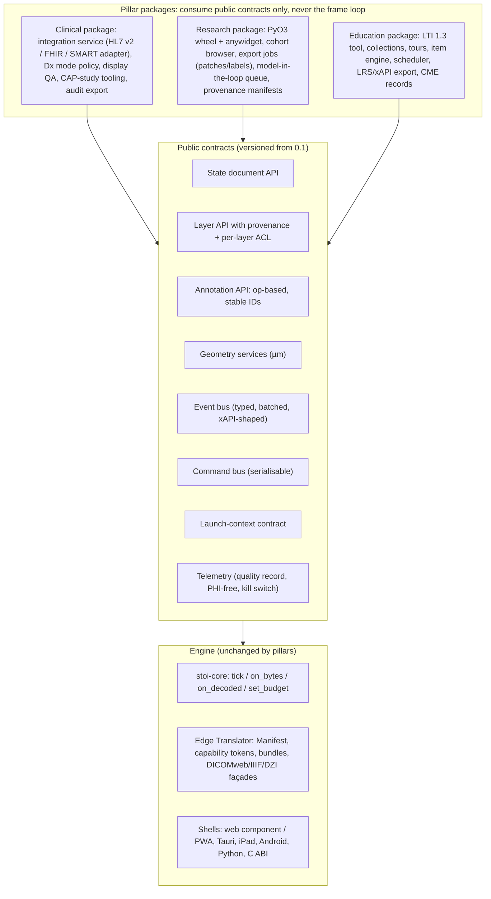
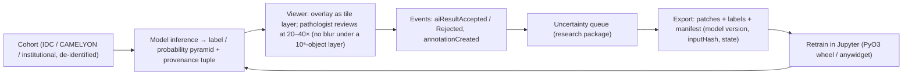

# Product pillars: clinical use, research and education

Plan section 12 of the Stoipath WSI viewer development plan. Date 2026-10-24. Terminology follows `arch/recommended.md` §5 (stoi-core, Edge Translator, Manifest, brightfield/multichannel canonical, offline pack, Dx mode, Rendering Complete, PHI Tiers 0–2, L0–L5, NTF%, TTS, CHS, device classes W-LAN…N-And, milestones M0–M5, releases MVP month 6–7 / v0.9 month 12 / v1 month 18–20). Evidence tags as in the corpus: **[verified]**, **[snippet]**, **[estimate]**, **[unverified]**. Sources: research notes 08, 09, 10, 11-gap-1, 11-gap-6, 11-gap-7. The note `11-gap-8-fda-pathway-and-free-distribution` named in the brief was **not present in the corpus** on 2026-10-24; regulatory facts below come from notes 09 and 11-gap-7, and the full pathway is left to "Regulatory pathway to FDA clearance and the free-distribution model".

## 1. Thesis: one engine, three thin products

The three pillars differ in their users, their data governance and the systems they plug into. They do not differ in how a tile is fetched, decoded, scheduled or drawn. Each pillar therefore ships as a **package over the public contracts of stoi-core and the Edge Translator**, never as a fork, and nothing a pillar adds may run inside the frame loop (note 08: "plugins add data, never frame work"). This is what keeps goal 1 (weight 0.35) intact as the product grows: the golden gesture replay that defines instant zoom is identical whether the viewer was launched from Epic Beaker, from a Jupyter cell or from a Canvas assignment.

The rule also carries the owner's long-term aim. The pixel pathway that an undergraduate uses in a histology lab is byte-for-byte the pathway the Dx edition will validate (note 09 R5); education and research traffic therefore generate verification evidence, usability data and field hours for the Design History File at no extra cost, and one codebase is the only shape under which a free, regulated release channel is affordable.



### 1.1 What the engine must expose (so pillars never fork the core)

| Contract | Lives in | Clinical uses it for | Research uses it for | Education uses it for | Frozen by |
|---|---|---|---|---|---|
| **State document** `{slides[], views[]: {slide, center_um, scale, rotation, z, t, channels[], overlays[], sync}}` + compact URL form + `flyTo(state, transition)` | stoi-model / stoi-camera; shells expose as props, postMessage, traitlets, UniFFI | Bookmarks in the report, tumour-board packets, collaboration, reproducible AI runs | Reproducible figures, notebook round-trip, registration views | Tour steps, deep links from the LMS, "jump to where the expert looked" | M1 (v0.1), semver thereafter |
| **Layer API** with provenance tuple `{producer, version, inputHash, createdAt, regulatoryStatus}` and per-layer ACL `{visible, hidden, revealOn(event), authorOnly}` | stoi-draw / stoi-annot; raster label and probability layers are tile layers through the same scheduler | AI overlays rendered deterministically in Dx mode; label/macro Tier 2 gated by role | Inference outputs, multiplex channels, label pyramids | Answer-key layers hidden until reveal; expert overlays | M1 (raster), v0.9 (vector tiles) |
| **Annotation API**: op-based CRUD, stable versioned IDs, adapters GeoJSON-QuPath / DICOM ANN / W3C | stoi-annot (GeoArrow model, Hilbert R-tree) | Measurements and ROIs into SR TID 1500 / ANN via STOW-RS | Annotation at scale, active-learning labels, Paquo/QuPath exchange | Hotspots, region-marking items, peer annotation | M1 (model), v1 (ANN/SR adapters) |
| **Geometry services**: point-in-polygon, polygon IoU, nearest distance in µm, visible-area coverage | stoi-annot (Rust), callable from JS/Python/Swift/Kotlin | Did the pathologist view the AI-flagged region (audit, CAP study) | Label QC, IoU against model output | Auto-scoring of region items, "did you look at the lesion" | M1 |
| **Event bus**: `slideOpened`, `viewChanged` (rAF-sampled), `tileSettled`, `annotationCreated/Updated/Selected`, `measurementCreated`, `aiResultArrived/Accepted/Rejected`, `caseStatusChanged`, `signoutRequested`, `shareCreated`, `displayQaStatus`, `itemAnswered`; batched per frame, versioned | stoi-telemetry + shells; subscribers never block a frame | FHIR `AuditEvent`/ATNA derivation, LIS status write-back | Viewing-trace datasets, experiment logging | 1:1 mapping onto xAPI statements, spaced-repetition signals | M1 (names), M4 (wire format) |
| **Command bus**: one serialisable dispatcher for keyboard, control surfaces, voice, remote presenter, test harness | shells over stoi-camera | Dictation co-existence (mic arbitration), 3D mouse, voice navigation | Scripted camera paths from Python | Presenter "follow me", keyboard-only path (WCAG) | M1 |
| **Launch-context contract** v1 `{accession, caseId, part, block, slideIds[], studyUID, seriesUIDs[], user, role, purposeOfUse, breakGlass, locale, mode: dx\|ruo\|edu}` reachable by IID-style URL, SMART adapter, postMessage, native `open(ctx)`; capability-token exchange | Web Shell + Edge Translator token endpoint | Beaker/Hyperdrive launch, consult links | Notebook `open(ctx)`, dataset deep links | LTI launch → signed state blob | MVP (v1 of contract) |
| **Telemetry / quality record**: per-frame NTF%, BAT, TTS, CHS, prefetch waste, I2P; viewport trail sampled; PHI-free; kill switch and air-gap mode | stoi-telemetry; RUM endpoint optional | Sampled viewport audit trail; display QA status | Research instrument (viewing behaviour) | Learner analytics (heatmap vs expert, time-to-first-zoom, dwell) | M0 (record), M1 (export) |
| **Offline pack** (derived single-file bundle: pixels + annotations + items + media), PWA cache, OPFS L2 | Edge Translator export job; stoi-source reader | iPad consult packs under MDM encryption | Field datasets, air-gapped sites | Classroom edge, LMIC partners, CME enduring materials | v1 (server row) |
| **Dx mode / Rendering Complete**, PHI Tier ACLs, colour LUT hook (CVD remap) | stoi-draw, stoi-codec, Edge Translator | Primary-diagnosis path, display checks | — | CVD-friendly remap, author-side CVD simulation | M1 (flag), Dx edition (validation) |

Enforcement is mechanical, in line with "Autonomous execution model and dissemination plan": pillar packages import only `@stoipath/sdk` (or `stoipath` on PyPI) and a CI lint fails any import of core internals; a pillar feature that needs a core change is filed against the core backlog with a requirement ID, so the traceability matrix in "Quality, testing and performance QA" stays whole.

## 2. Regulatory and data-governance boundary per pillar

The `mode` field of the launch-context contract drives a small policy engine in the shells and the Edge Translator; it is the one switch that separates the pillars legally.

| | Clinical | Research | Education |
|---|---|---|---|
| **Mode flag** | `ruo` (consultation, tumour board, QA, in-house CLIA-validated use) now; `dx` only in the Dx edition on validated displays | `ruo` | `edu` |
| **Regulatory status** | Until the Dx edition: in-house use within one CLIA lab under FDA enforcement discretion (LDT rule rescinded 2025-09-19 **[snippet, gap-7]**), with CAP validation of the whole system (≥60 cases per application, ≥2-week washout, real reading environment, revalidate on material change — Evans 2021/2022, GEN.52900/52920 **[snippet]**). Distribution to other institutions for diagnosis is 21 CFR 864.3700 territory (note 09 F1 **[unverified]**) and belongs to section 13 | RUO labelling "Not for use in diagnostic procedures"; no QMS obligation, but design controls run anyway (§7) | Not a device; FERPA-class learner records belong to the institution's LMS **[unverified: UT policy]**; ADA Title II / Texas TAC 206 & 213 make WCAG AA a procurement gate **[verified via university pages, gap-6]** |
| **Remote use** | CMS QSO-23-15-CLIA (rev. 2025-09-23): remote review under the primary lab's certificate; VPN counts as an extension of the lab; **cytology excluded since 2026-03-23**; Oct 2026 proposed rule would codify **[snippet]** | n/a | n/a |
| **Display** | Dx only on validated displays; tablets and phones are consultation/education until a display-agnostic clearance (Proscia PCCP, Aug 2026, is the precedent **[snippet]**) | Any | Any |
| **Data class** | PHI Tiers 0–2; Tier 2 (label, macro, barcode, filename, free text) in its own prefix/ACL, never at the CDN | De-identified exports, IRB-governed cohorts, or public CC-BY/CC0 corpora; Tier 1 dates shifted/truncated at export | **No PHI by construction**: teaching sets are produced by a dedicated ingest stage; public corpora first (IDC >95 % CC-BY, CAMELYON CC0 **[verified]**) |
| **Consent / determination** | Treatment, payment, operations; break-glass mirrored from the EHR | IRB protocol or waiver; data-use agreements per cohort | Logged "education, not research" determination with the local privacy office/IRB; year-only dates; narrative review for rare-case re-identification (the "famous case" problem **[verified, gap-6 F7]**); per-slide withdrawal hook |
| **Audit** | FHIR `AuditEvent`/ATNA for token issuance, session open/close, sampled viewport trail (note 09 F5) | Provenance manifest per export | xAPI stream, aggregate-only cohort views, learner-visible data |
| **Licence** | Apache-2.0 core; Dx edition and enterprise edge features commercial or regulated-release channel (section 13) | Apache-2.0; per-slide licence registry | Apache-2.0; licence registry per slide and per collection |

Teaching-set derivation is an **ingest stage**, not an export filter: strip Tier 2, truncate dates to year, remove scanner serials, review the narrative, record the determination and the licence, and emit a new object with a provenance record. It reuses the same two-pass ingest and PHI-tier bucket that the server work in months 0–3 already builds ("System architecture" §3.1), so it costs a stage, not a pipeline.

## 3. Pillar 1: clinical use

### 3.1 Personas and top workflows

| Persona | Top workflows | What they will judge us on |
|---|---|---|
| Sign-out pathologist (Beaker AP worklist) | Open case from worklist → review all slides → measure/annotate → dictate (Dragon Medical One in Epic, Voicebrook) → synoptic → sign out; next case | Launch-to-sharp, no blur at 20–40×, keyboard/3D-mouse parity with the microscope, status back in Beaker without clicks |
| Frozen-section / intra-operative pathologist | View while scanning, remote read, preliminary note to the OR; MD Anderson made remote WSI frozen reads standard of care in 2025 **[snippet]** | Minutes of TAT; a blurry tile is logged as a defect (1,260 remote frozen reads logged "blurring" and "pixelated" as artefacts **[verified, gap-1]**) |
| Consulting pathologist (telepathology, second opinion) | Receive de-identified case by expiring link, review on laptop/iPad over VPN or 4G, write consult; UTHealth–HCMC ran 71 cases over 32 months on PathPresenter **[snippet]** | Works on W-BB/W-4G without pop-in; no PHI leak via label/macro |
| Tumour-board / MDT presenter | Build a packet of bookmarked regions, present with rad-path side by side, share view live over Teams/Zoom | Fly-to with no blur in front of 30 clinicians; 85.7 % of a lymphoma board preferred WSI over PowerPoint **[verified]** |
| QA director / peer reviewer | Sample cases, blinded re-review, record discrepancy, run the CAP validation study | Blinded mode, sampling, washout tracking, concordance export |
| Lab director / CLIA | Validation documentation, remote-review conditions, display inventory | Evidence the viewer produces for the CAP file |
| Epic analyst / interface engineer | Register the launch (FDI/Activity record), map HL7 feeds in the interface engine, test in the Beaker sandbox | Thin, versioned contract; contract tests they can run |
| AI vendor / informatics | Deliver overlays with provenance, get accepted results back into the LIS | Deterministic overlay rendering, DICOM-native results, write-back |

### 3.2 Feature set by release

| | MVP (month 6–7; `ruo` only) | v0.9 (month 12) | v1 (month 18–20) | Later |
|---|---|---|---|---|
| Launch | IID-style context URL + OIDC SSO + capability-token exchange; iframe/web component safe inside Epic Hyperdrive (no third-party cookies, no COOP/COEP) | SMART App Launch 2.2.0 adapter (EHR launch, `launch` token) | SMART Backend Services for prefetch and write-back | CDS Hooks 2.0.1 cards ("AI flagged this case") |
| Worklist and case | Viewer never owns the worklist; case/slide tray from launch context; slide labels Tier 2 by role | HL7 v2 case/status sync (ORM/ORU/ADT) via the integration service; **prefetch on `ready-for-review`** warms L4/L3 for the next case | DPIA Image Display actor; Instance Availability consumption; FHIR façade (`ImagingStudy`, `ImagingSelection`, `AuditEvent`) | DPOW work orders (re-scan, Z-stack), stain orders from a region (OML^O21) |
| Review | Nav mode, measurements, annotations, bookmarks, snapshots with scale bar, brightfield + ≤8-channel IHC-IF; keyboard map | Multi-monitor placement, display QA module (ICC, test pattern, logged status), dictation co-existence (focus and mic arbitration), 3D-mouse/shuttle | Dx mode on validated displays (Dx edition track), multi-slide affine sync for serial sections, z-stack focus scrolling, ICC server-baked and shader LUT | Voice navigation over the command bus; rad-path side by side via DICOMweb to the radiology VNA |
| Consultation | Expiring share links on de-identified exports (Tier 0 only), W-4G and W-iPad tiers | iPad shell beta for consult packs (offline pack under MDM) | iPad GA, Android shell; mobile frozen-section preliminary note (consultation only) | Consult `Task` into exchange networks; patient-facing explainer links |
| Tumour board | Bookmark galleries, presenter deep links | Presenter mode with shared view state (Yjs awareness), meeting-link join | Automatic packet from LIS/VNA query; Teams/Zoom app | SFU fan-out as a server-render mode (recommended.md §9, E as a mode) |
| QA and validation | Blinded re-review mode, case sampling, concordance export (CAP-study tooling built in) | Washout tracking, intra-observer reports | Discrepancy write-back to LIS | — |
| AI and CDS | Raster label/probability overlays with provenance tuple; accept/reject events | Task queue (UPS-RS or own), overlays as DICOM SEG/Parametric Map read | STOW-RS write-back of ANN/SEG/SR TID 1500; accepted results to LIS via ORU/FHIR `Observation` | Embedding-based image search (research grade only) |
| Reporting hand-off | Measurements exported as GeoJSON/SR | `Observation`s linked to `ImagingSelection` | CAP eCC via IHE SDC on FHIR; Cancer Pathology Data Sharing IG | mCODE STU4 downstream |
| Audit and PHI | Token-issuance and session `AuditEvent`s, Tier 2 ACL, telemetry kill switch | Sampled viewport trail, break-glass flag mirrored from EHR, RBAC via OIDC roles | ATNA export, 6-year retention policy hooks | — |

### 3.3 Integration map and the one integration that serves goal 1

Every clinical viewer is reached from the AP-LIS worklist by a context URL plus HL7 v2 status synchronisation; the viewer never owns the worklist **[snippet: gap-7 F2]**. All LIS-specific logic lives in a per-site **integration service** that normalises HL7 v2 and FHIR into the launch-context contract; the engine sees one JSON object.

```mermaid
sequenceDiagram
  participant LIS as AP-LIS (Beaker)
  participant IE as Interface engine
  participant IS as Integration service
  participant ET as Edge Translator
  participant V as Viewer (stoi-core)
  LIS->>IE: ORU/ORM status: case ready-for-review
  IE->>IS: HL7 v2 message
  IS->>ET: warm(caseId): Base Bundles + levels ≥4 for all slides
  Note over ET: L4 hot cache and L3 edge now hold the next case
  LIS->>V: Context URL launch in Hyperdrive iframe (accession, slideIds, user, role, mode=ruo)
  V->>IS: exchange SSO token for capability token (prefix-scoped, 5–15 min)
  V->>ET: Manifest + Base Bundle (immutable URLs, token in query, path-only cache key)
  ET-->>V: tiles from L4/L3 hit
  V->>IS: events: slideOpened, viewChanged (sampled), measurementCreated
  IS->>LIS: ORU status: reviewed; measurements as Observation/SR
  IS->>IS: AuditEvent per session
```

Prefetch-on-status turns an HL7 feed into a performance feature: the cold-open path on W-LAN (≈85/150 ms destination fill, "Instant-zoom engineering design") becomes a warm path because the case's Base Bundles and coarse levels are already in L4/L3 before the pathologist clicks. It is the single clinical integration most worth doing early (gap-7 §3) and it is why HL7 status sync is v0.9, not "later".

| Integration | Standard | Phase | Engine contract | Feasibility |
|---|---|---|---|---|
| Context URL launch + SSO | IHE RAD IID pattern; OIDC | MVP | Launch context, capability token | High |
| Iframe/web component in Hyperdrive and portals | postMessage JSON-RPC | MVP | State document | High |
| DICOMweb client (QIDO/WADO-RS `frames`) incl. IDC, Orthanc, dcm4chee, cloud stores | DICOM PS3.18 | MVP | stoi-source; Edge Translator façade | High |
| HL7 v2 case/status sync; prefetch on status | HL7 v2.5.1; DPOW when final | v0.9 | Event bus, Edge Translator warm API | High |
| SMART App Launch adapter | SMART 2.2.0 **[snippet]** | v0.9 | Launch context | Medium-High (Epic registration) |
| Display QA, dictation co-existence | ICC; focus/text insertion | v0.9 | Command bus, telemetry | Medium |
| FHIR façade; STOW-RS write-back; DPIA actor + 2027 connectathon | FHIR R4/R5; Sup 222, SEG, SR; DPIA Rev 1.4 TI 2026-03-06 **[snippet]** | v1 | Layer API, annotation adapters | Medium |
| PACS/VNA co-existence; cloud DICOM stores as system of record behind the translator | DICOMweb `transfer-syntax=*` | v1 | Edge Translator | High (never the hot tier: ~150 ms/frame class) |
| Synoptic hand-off | CAP eCC via SDC on FHIR; Cancer Pathology IG | Later | Annotation API, event bus | Medium (LIS cooperation) |
| CDS Hooks, voice navigation, rad-path, genomic overlay, re-scan work orders | CDS Hooks 2.0.1; command bus; DICOMweb; Genomics Reporting 3.0.0; DPIA/DPOW | Later | Command bus, layer API | Medium to Low |

### 3.4 Prioritised backlog

1. **Launch-context contract v1 and capability-token exchange** (MVP). Everything else hangs off it; a wrong contract is the one integration mistake that is expensive to undo.
2. **Hyperdrive-safe embedding proven on W-LAN with the M1 gates** before any HL7 work (gap-7 R1). Instant zoom inside an iframe without cookies or COOP/COEP is the reach claim.
3. **CAP-study tooling** (blinded re-review, sampling, washout, concordance export) at MVP. The first UT lab's ≥60-case study is the clinical pillar's first real milestone and the viewer should run it; the same harness doubles as the Stage-1 reader study of gap-1 F9.
4. **HL7 status sync with prefetch-on-status** (v0.9). Serves goal 1 on the clinical cold path.
5. **Display QA and dictation co-existence** (v0.9). Both are preconditions for any sign-out use; neither is engine work.
6. **AI overlays with provenance, then write-back** (MVP raster overlays; v1 DICOM-native write-back). The host, not a marketplace.
7. **FHIR façade, STOW-RS, DPIA actor, connectathon** (v1). Credibility and interop at the cost of adapters only.
8. Synoptic hand-off, CDS cards, voice, rad-path, re-scan (later): each depends on a partner (LIS vendor, scanner vendor) that is not yet identified.

### 3.5 Success metrics (machine-checkable where possible)

| Metric | Target | How measured |
|---|---|---|
| Launch click → first L\*-sharp viewport (W-LAN, token exchange included) | ≤ 1.5 s p50, ≤ 3 s p95 **[estimate; set from M1 cold-open data]** | Playwright against a Beaker-shaped launch harness; `tileSettled` timestamps |
| CHS at open with prefetch-on-status | ≥ 90 % of first-viewport tiles from L3/L4 | Edge Translator `Server-Timing` + stoi-telemetry |
| Goal-1 gates inside the Hyperdrive iframe | M1 gates unchanged (TTS ≤ 100/300 ms W-BB; NTF% ≤ 20 %) | Same golden replay, iframe harness |
| Integration contract tests | 100 % pass against recorded Beaker sandbox ORM/ORU/ADT messages per release | CI |
| Audit completeness | 100 % of sessions emit open/close `AuditEvent`; 0 PHI in telemetry payloads | CI scan + nightly log audit |
| Display QA coverage | 100 % of `dx`-mode sessions carry a logged display status | Event bus |
| CAP validation | ≥ 1 UT lab completes a ≥60-case study per application with the built-in tooling; intra-observer concordance reported with CI | Study export |
| Frozen-section remote TAT | Non-inferior to the site's glass baseline (site-defined margin) | LIS timestamps |
| Adoption | Number of UT labs using the viewer for consultation/QA by v1; interface-maintenance hours per Beaker upgrade (cost-comparison input, gap-7 F7) | Programme log |

## 4. Pillar 2: research

### 4.1 Personas and top workflows

| Persona | Top workflows | Judges us on |
|---|---|---|
| Computational pathologist / ML engineer | Browse IDC/TCGA/CAMELYON or institutional cohorts; overlay inference outputs; review and correct; queue uncertain tiles for labelling; export patches and labels with provenance; re-run | Zero-copy interop (OME-Zarr, GeoArrow, DICOM), a Python API that does not re-render in Python, reproducible exports |
| Annotating pathologist or trainee | Annotate at scale (10⁴–10⁶ objects), class hierarchies, measurements; peer review | Pen/touch tools that stay sharp while zooming under a million-polygon overlay |
| Spatial biologist (multiplex IF, spatial omics) | Explore 8–40 channels with per-channel windows, overlay segmentation and cell tables, register serial sections | 16-bit channels composited on the client in one frame, SpatialData read, napari/Viv parity |
| Cohort curator / data manager | Ingest, de-identify, tag, licence, version cohorts; share with collaborators | Teaching-set and de-id pipeline, licence registry, DICOMweb/OME-Zarr out |
| Core-facility manager | Serve many groups from one store; cost | Zero-egress storage, stateless edge, OME-Zarr read by every tool |

### 4.2 Feature set by release

| | MVP | v0.9 | v1 | Later |
|---|---|---|---|---|
| Data access | OME-Zarr 0.5 (zarrs natively, zarrita on web), DICOMweb incl. IDC, IIIF 3, DZI, local TIFF-JPEG/DICOM in-process (Tauri, wheel); cloud DICOM stores behind the translator | On-prem edge binary; Iris façade | OME-NGFF 0.6 metadata once Viv/vizarr/ome-zarr-py read it; conformance corpus published | SpatialData/GeoParquet write |
| Python / Jupyter | `pip install stoipath`: anywidget over the web bundle + PyO3 wheel; `open(state)`, `annotations` as GeoArrow/GeoJSON, `events` as a stream; scripted camera paths via the command bus | Export jobs from Python (regions, patches, labels) | Batch tiling API over the Manifest for training-data loaders | Dask/Zarr-native patch sampler |
| Annotation at scale | GeoArrow model, Hilbert R-tree, QuPath-dialect GeoJSON import/export, W3C import, op-based edits | Vector tiles on the pixel grid; centroid LOD | 10⁶-object layers within the frame budget (M5 gate); DICOM ANN read/write; SpatialData read | Live collaboration (yrs/Yjs), groupwise registration display |
| Model-in-the-loop | Raster label and probability pyramids as layers (nearest sampling, LUT), provenance tuple, accept/reject events | Uncertainty queue: `aiResultArrived` → review → `itemAnswered`-style label events; patch export of reviewed tiles | Active-learning hooks: queue API, label export with model version and input hash; DICOM SEG/Parametric Map read | Embedding search over archives (research grade; Top-5 F1 ≈ 40 % on TCGA **[snippet]**) |
| Multiplex / spatial omics | ≤8 channels per pass, 16-bit textures, per-channel window/colour/visibility, additive; `omero`-compatible settings document | Multi-pass beyond 8 channels; z-stack focus scrolling | Multi-slide affine sync; registration import (VALIS/wsireg → RFC-5 affine); overlay/curtain compare | Non-rigid displacement textures |
| Reproducibility | State document in every export; provenance manifest (Manifest version, codec, ICC, software versions) | Export byte-identity tests in CI | Published conformance corpus; third-party-reader CI (zarr-python, zarrs, zarrita/vizarr, tensorstore, wsidicom, pydicom, Orthanc, dcm4chee) | — |

### 4.3 Integrations

| Integration | Mechanism | Phase | Notes |
|---|---|---|---|
| OME-Zarr / OME-NGFF | Multichannel canonical is plain OME-Zarr 0.5 with core codecs: napari, Viv/vizarr, tensorstore, zarr-python, `zarrs` read it unchanged | MVP | No image codec exists for Zarr v3; the JPEG-chunk experiment never holds customer data (recommended.md §9) |
| DICOM / DICOMweb | Brightfield canonical is DICOM WSI `TILED_FULL`+EOT; wsidicom/pydicom read it; IDC as a cohort source; ANN via highdicom | MVP read, v1 ANN/SEG/SR | Conformance statement with the first DICOMweb release |
| **QuPath** | GeoJSON (QuPath dialect, property names verbatim) now; **DICOM and OME-TIFF export jobs**, not OME-Zarr, because QuPath 0.7.0's OMEZarrReader (jzarr 0.4.2) reads no Zarr v3 (recommended.md risk 12); fund Bio-Formats → zarr-java upstream | MVP | Risk owner: research pillar |
| Python ecosystem | anywidget 0.11 (Jupyter, JupyterLab, Colab, VS Code, marimo), PyO3 wheel, Paquo, SpatialData, GeoPandas/shapely via GeoArrow | MVP / v1 | Vizarr is the architectural precedent **[verified, note 08]** |
| Cloud DICOM stores (Google Healthcare API, AWS HealthImaging, Azure) | System of record behind the Edge Translator; stored-syntax frames | v1 | Per-frame pricing and ~150 ms/frame class argue for the cache in front |
| Cohort tooling | Collections = ordered sets of (slide, state, annotations) with tags, licence and provenance; shared with the education package | MVP (store), v0.9 (UI) | Same store serves teaching sets |
| Export | Patches/labels as OME-Zarr or PNG16 + GeoParquet/GeoJSON + manifest; regions as OME-TIFF; whole-slide DICOM ↔ OME-Zarr as on-demand jobs, never mirrors | v0.9 | Export is a Translator job; recommended.md §3.1 |



### 4.4 Prioritised backlog

1. **`pip install stoipath` meeting the M1 gates inside JupyterLab** (M4 gate). Research adoption is decided in the notebook.
2. **Raster overlay layers with provenance at MVP.** They are the robust AI path (note 08 F3) and the first thing a model-development group asks for.
3. **QuPath interop via GeoJSON now and DICOM/OME-TIFF export jobs at MVP**, plus the upstream Bio-Formats → zarr-java work (gap-5 F8). Without it the multichannel canonical is invisible to the dominant desktop tool.
4. **Export jobs with provenance manifests and byte-identity CI** (v0.9). Reproducibility is the research pillar's regulatory analogue.
5. **Vector tiles and the 10⁶-object layer** (v0.9 → v1, M5 gate). Deliberately after the raster path: it is where goal 1 is most at risk from an overlay.
6. **Uncertainty queue and active-learning export** (v0.9–v1). Thin once events and export exist.
7. **Multi-slide sync and registration import** (v1), then non-rigid display and collaboration (later).

### 4.5 Success metrics

| Metric | Target | How measured |
|---|---|---|
| Jupyter widget | Meets M1 gates inside JupyterLab (M4 gate); install-from-registry smoke green | CI matrix |
| Third-party readability | 100 % of CI smoke tests pass on both canonical stores (zarr-python, zarrs, zarrita/vizarr, tensorstore; wsidicom, pydicom, Orthanc, dcm4chee STOW/WADO) | Nightly |
| QuPath round-trip | GeoJSON import/export lossless for QuPath property names; DICOM/OME-TIFF export opens in QuPath 0.7 | CI fixtures |
| Overlay at scale | 1 M-object layer renders within the 60/25/15 frame partition on W-4G and N-iPad (M5 gate) | Golden replay |
| Multiplex | 8-channel 16-bit blend meets M1/M2 gates (M5 gate) | Golden replay |
| Export reproducibility | Re-export from a provenance manifest is byte-identical | CI |
| Cohort use | Slides and annotations per active group per month; external datasets opened without conversion (IDC, CAMELYON) | Telemetry (opt-in) |

## 5. Pillar 3: education

### 5.1 Personas and audiences

| Persona / audience | Top workflows | Judges us on |
|---|---|---|
| Undergraduate and allied-health student (histology) | Curated collection with label toggles; guided tour; MCQ and select-point items inside an LMS assignment; blended glass + virtual lab (93.6 % prefer blended **[verified]**) | Loads fast on a phone (students "preferred certain viewers because of image loading speed" **[verified, Punjabi 2025]**); keyboard and screen-reader path |
| Medical student | PCME-tagged case modules (vignette → gross → H&E → IHC → reveal → compare to expert report); image MCQs; region-marking items with text alternative | Grade appears in Canvas/Brightspace/Blackboard without the instructor doing anything |
| Resident / fellow | Digitised unknown-slide conference archive with hidden diagnoses (RecutClub pattern); board-style **virtual microscopy exam mode** (ABPath examines on a WSI viewer at Pearson VUE, glass retired **[verified]**); spaced retrieval of missed cases; preliminary-vs-final feedback | Exam fidelity; it is free; their own viewing trace against the attending's |
| Faculty author | Record a tour from live navigation; one-click convert a sign-out annotation set into a teaching case; CSV/QTI bulk import; disclosure fields | ≤ 5 minutes per case; faculty time is the adoption bottleneck (Drobna 2026; Singapore survey **[verified]**) |
| Course / programme director | Cohort analytics: heatmap vs expert path, time-to-first-zoom, dwell on critical ROI; item statistics; Milestones-mapped portfolio export (formative only) | Aggregate-only views; export to the LMS gradebook |
| CME office (UT CME, EthosCE) | Joint providership; attestation, evaluation, certificate; PARS-compatible CSV; records kept 6 years | We never seek accreditation; we produce their records |
| LMS administrator | LTI 1.3 Dynamic Registration (Canvas, Moodle), developer-portal registration (Blackboard), Brightspace **[unverified]** | One tool, one placement type, certified |
| LMIC / rural partner instructor | Offline pack on a classroom edge or USB; low-res-first | Works with no internet (bandwidth was "the main challenge" in the Egyptian WSI study **[verified]**) |

### 5.2 Feature set by release

| | MVP | v0.9 | v1 | Later |
|---|---|---|---|---|
| Collections and labs | Ordered collections of (slide, state, annotations) with PCME/organ/stain/difficulty tags, licence registry, label toggle layers; seeded from IDC CC-BY and CAMELYON CC0 | Institutional teaching sets via the de-identification stage | Blended-lab mode (glass + virtual, same case), multi-institution shared unknowns | Multilingual narration |
| Tours and hotspots | Step = state + highlighted annotation + text; fly-to with easing; autoplay/pause; **record-a-tour** from live navigation | Audio/video attachments, branching ("what would you do next?") | Presenter mode with follow-me (Yjs awareness) | Patient-friendly explainer layer |
| Items and self-assessment | MCQ, multi-select, **region-marking item** scored by µm geometry (point-in-polygon, IoU, zoom-gated credit) with keyboard and text alternatives; hidden answer-key layers | Spaced-retrieval scheduler (FSRS/SM-2 class) prioritising confidently-wrong items; confidence ratings; item statistics (p-value, discrimination); QTI 3.0 import of MCQs | Virtual microscopy exam mode (timed, board-style); Anki export | AI-drafted distractors with faculty review; adaptive sequencing by PCME objective |
| Case-based modules | Vignette → slide → reveal stepping; compare-to-expert | Unknown-conference archive with hidden diagnoses | Preliminary-vs-final feedback via LIS link (Cao & Gondim pattern **[verified]**) | CertLink-style quarterly drills |
| Progress and analytics | xAPI-shaped events; per-learner completion | Heatmap vs expert, time-to-first-zoom, dwell share; cohort vs expert overlay | Milestones-mapped export (formative); research export (anonymised xAPI) | Caliper feed |
| LMS integration | **LTI 1.3 + Advantage** (Deep Linking, AGS, NRPS), one "assignment" placement holding a tour, quiz or case; Dynamic Registration where supported | 1EdTech certification; QTI 3.0 MCQ export | SCORM 1.2 wrapper for CME LMSs; cmi5 package | Caliper |
| CME | Disclosure fields, attestation + evaluation form, certificate PDF with activity ID, 6-year record export (CSV/xAPI) | Joint-providership workflow with a UT CME office; PARS-compatible CSV; topic tags (ethics, opioid) on certificates | — | — |
| Accessibility | WCAG 2.2 AA keyboard path (SC 2.5.7 drag alternative, 2.5.8 target size), live region, CVD remap LUT, author-side CVD simulation, never colour-only feedback | Third-party VPAT before UT procurement | — | — |
| Low bandwidth / offline | PWA cache, OPFS L2, moving tier on cellular | — | Offline pack per collection (pixels + annotations + items + media), classroom edge cache | — |

### 5.3 Integration tradespace

| Approach | Reach | Grade flow | Deep-zoom items | Verdict |
|---|---|---|---|---|
| **LTI 1.3 + Advantage, Dynamic Registration where supported** | Canvas (UTHealth Houston, UT Health San Antonio, UT Austin/Dell Med), Brightspace (UT Southwestern), Blackboard Ultra (UTMB), Moodle, Open edX **[verified except UTRGV]** | Automatic (AGS) | Yes | **Primary.** LTI 1.1 certification ended 30 June 2021; D2L removes it by Feb 2027, Blackboard by 30 Sept 2027 **[verified]** |
| QTI 3.0 export into LMS quiz engines | Partial; hotspot import unreliable (Canvas New Quizzes skips, Blackboard silently drops) **[verified]** | LMS-native | No | MCQ export only; the region-marking item cannot live in an LMS quiz engine |
| SCORM 1.2 package | Every CME LMS (SCORM still 92 % of SCORM Cloud launches **[verified]**) | Score/status | Yes (online launch or bundled offline pack) | CME distribution channel |
| xAPI (IEEE 9274.1.1-2023) / cmi5 to an LRS | Rare in UT **[unverified]** | Rich | Yes | Telemetry export, not a launch path |
| Caliper 1.2 | Brightspace, some Canvas | Analytics only | n/a | Later, on request |
| Native LMS plugins | One LMS each | Native | Yes | Avoid; LTI placements cover it |
| Plain links / iframe | Any | None | Yes | Fallback only |

Library choice, verified today against the registries: `ltijs` 7.0.7 (Apache-2.0) was published 2026-10-06 and is maintained; `PyLTI1p3` last released 2.0.0 on 2022-11-20 and is not a safe base. The LTI tool is therefore a small TypeScript service on `ltijs` (OIDC login, JWKS, nonce, Deep Linking, AGS, NRPS), certified with 1EdTech ("LTI Advantage Complete" for a tool requires core + at least two services **[verified]**), issuing a signed state blob to the viewer through the launch-context contract.

### 5.4 Prioritised backlog

1. **The ten core requirements of gap-6 frozen in the v0.1 API** (annotation IDs + per-layer ACL, state document + fly-to, event bus, xAPI-shaped telemetry, geometry services, launch contexts, offline pack, PHI tiers, colour LUT hook, op-based annotations). This is a core backlog item with requirement IDs, not education work.
2. **LTI 1.3 Advantage tool and one assignment placement** (MVP), certified in the first pass against Canvas, Brightspace and Blackboard Ultra. Nothing else gets faculty to use it.
3. **Region-marking item with keyboard and text alternatives, scored by µm geometry** (MVP). The signature assessment type no LMS can offer, and the accessibility risk, designed together.
4. **Record-a-tour and one-click sign-out-to-teaching conversion** (MVP). Authoring under five minutes per case or the platform stays empty.
5. **WCAG 2.2 AA and CVD remap in MVP; VPAT at v0.9.** ADA Title II (WCAG 2.1 AA; original deadline 24 Apr 2026, reportedly extended a year **[unverified: Federal Register not re-fetched]**) and Texas TAC 206/213 make this a gate.
6. **Virtual microscopy exam mode and the unknown-conference archive** (v0.9–v1). Cheap, high-affinity for residents, feeds the item bank and the TSP study.
7. **Spaced-retrieval scheduler and analytics views** (v0.9). Strongest causal evidence in medical education (Kerfoot 2010: 15.2 % vs 3.4 % long-term gain; ABFM d = 0.62 **[verified]**).
8. **CME records and joint providership** (v0.9). Records, attestation and export only; never accreditation.
9. **Offline pack and SCORM wrapper** (v1). Both ride on the server's derived offline pack, which is v1 in the roadmap.

### 5.5 Success metrics

| Metric | Target | How measured |
|---|---|---|
| LTI certification | 1EdTech LTI Advantage Complete (tool) by v0.9; launches succeed on Canvas, Brightspace, Blackboard Ultra | Certification record; conformance tests in CI |
| Grade sync | ≥ 99.5 % of completed items post to the gradebook within 60 s | AGS logs |
| Authoring time | Median ≤ 5 min from sign-out annotation set to published teaching case; ≤ 10 min for a 10-step recorded tour | Authoring telemetry |
| Accessibility | 0 WCAG 2.2 AA blockers in the axe + manual VoiceOver/TalkBack pass; keyboard-only completion of every item type in CI; VPAT published | QA pre-release |
| Classroom performance | M2 gates hold on W-4G in a 30-seat classroom profile (TTS ≤ 250/700 ms, blank-pixel frames = 0); offline pack passes a zero-network CI test | Network emulation; CI |
| Learning | Item statistics computed for every item with n ≥ 30; pre/post or evaluation captured for 100 % of CME activities; completion rate per module | Item engine |
| Records | 6-year export (CSV/xAPI) reproduces every attestation; PARS CSV accepted by a UT CME office | Provider confirmation |
| Content | ≥ 500 curated public-licence slides tagged by PCME objective at MVP; licence and provenance recorded for 100 % of slides | Licence registry |

## 6. Cross-pillar synergies

| Flow | From → to | Mechanism | Guard |
|---|---|---|---|
| Teaching sets from research cohorts | Research → Education | Same collection store; teaching-set ingest stage adds determination, year-only dates, licence | Licence registry; withdrawal hook |
| QA discrepancy and consult cases into education | Clinical → Education | `caseStatusChanged: discrepancy` or consult close → candidate teaching case (de-identified, reviewed) | Determination logged; narrative review for rare cases |
| Unknown-slide conference archive | Clinical → Education | Digitised weekly unknowns with hidden diagnoses (RecutClub pattern) | Tier 2 withheld by construction |
| Tumour-board bookmark galleries as teaching modules | Clinical → Education | Bookmark gallery → tour in one action | De-identification stage |
| Education telemetry as viewer usability data | Education → Core | Learner viewing traces (viewport rectangles with zoom and time) feed prefetch calibration and the gap-1 reader study; experience-stratified | Opt-in research export; aggregate cohort views |
| Viewing-trace research instrument | Education → Research | Walkowski needed only viewport logs (74,000 records); 140 pathologists' zoom/pan predicted accuracy with AUC 0.86 **[verified]**; our telemetry is that dataset by default | Anonymised xAPI stream |
| CAP-study tooling and reader study share one harness | Clinical ↔ Research | Blinded mode, sampling, washout, concordance export serve both the ≥60-case validation and gap-1 F9 | — |
| One offline pack | Core → all | Classroom, iPad consult under MDM, CME enduring material, air-gapped site | Device encryption; token lifetime |
| AI overlays reviewed by trainees | Research → Education → Research | Accept/reject events from supervised trainees become labels after attending confirmation | Provenance tuple records who accepted |

## 7. Roadmap dependencies and what is deliberately out of scope

| Pillar deliverable | Depends on | Section |
|---|---|---|
| Any pillar package | Stage 0 gates G1–G13 and M0 quality record; public contracts v0.1 at M1 | "Instant-zoom engineering design", "Quality, testing and performance QA" |
| Clinical launch inside Hyperdrive | Web Shell iframe RPC without COOP/COEP; capability tokens, path-only cache key (months 0–3 server work) | "System architecture", "Cross-platform delivery plan" |
| Prefetch-on-status, display QA, dictation | v0.9 integration service; on-prem edge binary | "Roadmap, milestones, team and estimates" |
| Dx mode in a UT lab | Dx edition track, design controls from M0–M1 (not v0.9; see Reviewer note), CAP study | "Regulatory pathway to FDA clearance and the free-distribution model" |
| Research Jupyter widget | M4 SDK gates; PyO3 wheel | "Cross-platform delivery plan" |
| 10⁶-object overlays, DICOM ANN/SEG/SR, multi-slide sync | v0.9 vector tiles; v1 adapters; M5 gate | "Roadmap, milestones, team and estimates" |
| Institutional teaching sets | PHI-tier bucket (months 0–3) for layout; de-id export tiers (v1) for the full pipeline | "System architecture" §3.1 |
| Offline pack, SCORM wrapper, iPad consult packs | Server v1 offline pack; iPad shell beta month 12, GA v1 | "Roadmap, milestones, team and estimates" |
| Hiring | +0.5 pathologist at MVP, +0.5 RA/QA by v1 (recommended.md §8); education and clinical packages need a product/education engineer each, not graphics seniors | "Roadmap, milestones, team and estimates" |

Deliberately out of scope for this plan horizon:

- **Owning the worklist, the LIS, a PACS or a reporting system.** The viewer launches from the LIS and hands evidence back; synoptic authoring stays in the LIS.
- **Primary diagnosis on tablets or phones**, and **remote cytology review**, until labelling and CMS policy allow it.
- **ACCME accreditation, an LMS, a gradebook, or a content business.** Records, exports and LTI; content partnerships (DAPA, Leeds, ASCP) rather than item-bank authorship.
- **Developing AI models or running a marketplace.** The viewer is a host with provenance.
- **Scanner control and re-scan APIs** (no public scanner APIs found **[snippet]**) and **cross-case image search as a clinical feature** (research grade only).
- **An EU IVDR Class C launch** within this horizon (section 13 decides).
- **Native per-LMS plugins, a service-worker tile path, server-side rendering as the viewer** (recommended.md §9).

### Evidence for the TSP abstract

The earliest demonstrable milestone is the **education and research pillar on public slides at M1–M2**: the web alpha meeting M1 gates on IDC CC-BY and CAMELYON CC0 slides, one recorded tour and one region-marking item, and viewing-trace telemetry from a resident unknown-slide session. The abstract can then show (a) device-measured TTS, NTF% and I2P against an OpenSeadragon baseline on the same slides and devices (the reference-floor method of "Quality, testing and performance QA"), (b) provenance and cost accounting from the repository (agent-authored commits, review gates, agent-hours and dollars per feature, from "Autonomous execution model and dissemination plan"), and (c) a licence-line comparison that counts interface labour and support (gap-7 F7). A viewer alone shows none of the following and the abstract must say so: diagnostic equivalence (needs the CAP study), patient outcomes or TAT effects (need a live LIS integration), or cost savings on scanners, LIS, displays or validated-display procurement.

## 8. Reviewer notes

1. **Design controls at v0.9 is too late.** `arch/recommended.md` §8 places "design controls start" in the v0.9 column while also stating "RUO with the Dx pathway versioned from day one" at MVP. Note 10 R8 and the owner's long-term aim require requirement IDs on tests and archived evidence per release from M0–M1 so that education and research field hours count toward the Design History File. This section's backlogs assume the M0–M1 start; the roadmap section should align.
2. **Raster overlay layers must be in the MVP layer model.** §8's MVP core row lists "brightfield + ≤8-channel fluorescence; QuPath GeoJSON" and defers "vector-tile annotations" to v0.9 and "10⁶-object layers, DICOM ANN/SEG/SR" to v1, which is right. Note 08 lists raster label/probability overlay layers as MVP, and the research pillar's model-in-the-loop and the clinical AI-host both need them at MVP. No architecture change is implied (they are tile layers through the same scheduler), but the roadmap text should name them.
3. **No disagreement with the architecture itself.** The dual-standard store, the Edge Translator and the single-threaded core are what make three pillars over one engine credible; this section adds the mode flag, the launch-context contract and the pillar-package lint as the product-side guarantees that the core is never forked.

## References

Architecture and corpus: `arch/recommended.md` (amended 2026-10-24); research notes 08 (features, annotation model, WCAG 2.2, integration surface), 09 (regulatory classes, PHI tiers, tile auth, licences), 10 (M0–M5 gates), 11-gap-1 (navigation dynamics, reader study), 11-gap-6 (education), 11-gap-7 (clinical integration).

Clinical integration and regulation (read as search extracts in gap-7 unless noted):
- IHE PaLM DPIA Rev 1.4 TI 2026-03-06: https://www.ihe.net/uploadedFiles/Documents/PaLM/IHE_PaLM_Suppl_DPIA_Rev1-4_TI_2026-03-06.pdf ; DPOW draft: https://build.fhir.org/ig/IHE/PaLM.DPOW/ ; IHE RAD IID: https://www.ihe.net/Technical_Framework/upload/IHE_RAD_Suppl_IID_Rev1-1_TI_2013-06-11.pdf
- HL7 SMART App Launch 2.2.0: https://www.hl7.org/fhir/smart-app-launch/toc.html ; CDS Hooks 2.0.1: https://cds-hooks.hl7.org/changes.html ; FHIR ImagingSelection (R5): https://hl7.org/fhir/imagingselection.html ; Cancer Pathology Data Sharing IG: https://hl7.org/fhir/us/cancer-reporting ; mCODE STU4: https://build.fhir.org/ig/HL7/fhir-mCODE-ig/
- CMS QSO-23-15-CLIA revised 2025-09-23: https://www.cms.gov/files/document/qso-23-15-clia-revised-2025-09-23.pdf ; CMS/CDC proposed rule (Oct 2026): https://public-inspection.federalregister.gov/2026-20613.pdf ; ASCP on cytology: https://www.ascp.org/news/news-details/2025/10/15/cms-memo-revokes-remote-review-of-cytology-digital-images
- CAP WSI validation guideline (Evans et al. 2021/2022): https://meridian.allenpress.com/aplm/article-pdf/146/4/440/3030324/i1543-2165-146-4-440.pdf ; CAP FAQ GEN.52900/52920: https://documents.cap.org/documents/validating-whole-slide-imaging-faq.pdf
- FDA LDT rule rescission: https://www.medtechdive.com/news/FDA-rescinds-LDT-final-rule/760645/ ; PathPresenter K250968: https://www.510kdatabase.net/k250968/ ; Proscia Concentriq AP-Dx with PCCP (Aug 2026): https://www.biospace.com/press-releases/proscia-receives-new-fda-510k-clearance-for-concentriq-ap-dx-with-predetermined-change-control-plan ; 21 CFR 864.3700 **[unverified]**: https://www.ecfr.gov/current/title-21/chapter-I/subchapter-H/part-864/subpart-D/section-864.3700
- Epic Hyperdrive embedding (ServiceNow doc): https://www.servicenow.com/docs/r/AK18yGU6kuNpXDV4oOETsw/AwvHs45mAVpSqI1vmMbfow ; Proscia on Beaker integration: https://proscia.com/maximizing-your-epic-investment-why-deep-epic-beaker-integration-matters-for-digital-pathology/ ; Voicebrook VoiceOver PRO: https://www.captodayonline.com/voiceover-pro-now-integrates-with-multiple-dp-systems/
- MD Anderson remote frozen-section WSI (2025): https://www.mdanderson.org/newsroom/research-newsroom/2025/03/whole-slide-imaging-allows-real-time-remote-diagnosis-for-breast-cancer.html ; UTHealth Houston telepathology: https://arxiv.org/pdf/2412.10383 ; lymphoma tumour board WSI preference: https://doi.org/10.1093/ajcp/aqaf072
- Google Healthcare API digital pathology: https://docs.cloud.google.com/healthcare-api/docs/how-tos/dicom-digital-pathology ; AWS HealthImaging pricing: https://aws.amazon.com/healthimaging/pricing

Research interop: OME-NGFF spec: https://github.com/ome/ngff-spec/blob/main/index.md ; zarr-extensions codec registry: https://github.com/zarr-developers/zarr-extensions/tree/main/codecs ; QuPath CHANGELOG: https://github.com/qupath/qupath/blob/main/CHANGELOG.md ; highdicom ANN: https://github.com/ImagingDataCommons/highdicom/blob/master/docs/ann.rst ; Slim: https://github.com/ImagingDataCommons/slim ; Viv: https://github.com/hms-dbmi/viv ; Vizarr: https://github.com/hms-dbmi/vizarr ; anywidget: https://github.com/manzt/anywidget ; Paquo: https://github.com/bayer-science-for-a-better-life/paquo ; SpatialData: https://github.com/scverse/spatialdata ; VALIS: https://github.com/MathOnco/valis ; wsireg: https://github.com/NHPatterson/wsireg ; IDC licensing: https://datacommons.cancer.gov/repository/imaging-data-commons ; CAMELYON17 (CC0): https://camelyon17.grand-challenge.org/Data/ ; zero-shot WSI retrieval: https://arxiv.org/abs/2409.04631

Education, standards and evidence:
- `ltijs` on npm (7.0.7, Apache-2.0, 2026-10-06, **verified today**): https://registry.npmjs.org/ltijs ; `PyLTI1p3` on PyPI (2.0.0, 2022-11-20, **verified today**): https://pypi.org/pypi/PyLTI1p3/json
- LTI Advantage certification: https://learn.1edtech.org/mod/glossary/showentry.php?eid=21 ; LTI 1.1 retirement, D2L: https://community.d2l.com/brightspace/kb/articles/25994-lti-1-1-deprecation-plan ; Blackboard: https://community.blackboard.com/home/blogs/retirement-of-lti-11-support-in-blackboard-lms-2026-08-27 ; Canvas Dynamic Registration: https://community.canvaslms.com/t5/The-Product-Blog/Installing-LTI-1-3-Tools-is-Easier-than-Ever-with-Dynamic/bc-p/604667
- QTI 3.0: https://www.1edtech.org/standards/qti/versions ; Canvas hotspot import report: https://community.canvaslms.com/t5/Admin-Group/Importing-Blackboard-tests-with-Hotspot-Questions/m-p/456180 ; Blackboard Ultra hotspot accessibility: https://eatsupport.tees.ac.uk/staff/knowledgebase/blackboard-ultra-hotspot-questions/
- xAPI IEEE 9274.1.1-2023: https://adlnet.gov/news/2023/11/22/xAPI-Officially-Becomes-a-Published-IEEE-Standard ; cmi5: https://github.com/AICC/CMI-5_Spec_Current ; SCORM Cloud data: https://rusticisoftware.com/blog/how-relevant-is-scorm-lets-check-the-scorm-cloud-data/
- ACCME PARS checklist: https://accme.org/wp-content/uploads/2025/02/947_20251211_annual_reporting_in_pars_checklist.pdf ; records retention: https://accme.org/rule/cme-activity-and-attendance-records-retention/ ; joint providership: https://accme.org/joint-providership ; ABPath CertLink: https://abpath.org/abpath-certlink-requirements/ ; ABPath virtual microscopy sample exam: https://vmdemo.abpath.org/
- UT System LMS: https://uth.edu/canvas ; https://www.uthscsa.edu/canvas ; https://tech.utexas.edu/services-tools/canvas ; https://d2l.utsouthwestern.edu/ ; https://www.utmb.edu/eclass ; UTSW CME (EthosCE): https://cme.utsouthwestern.edu/
- ADA Title II summaries: https://accessibility.arizona.edu/policies-governance/title-ii-brief ; Texas TAC 206/213: https://www.uttyler.edu/offices/information-technology/digital-accessibility/understanding-accessibility-rules/ ; WCAG 2.2 understanding docs: https://github.com/w3c/wcag/tree/main/understanding/22
- Pedagogy: Maity 2023 meta-analysis https://doi.org/10.3390/diagnostics13030558 ; Zhang 2024 blended lab https://doi.org/10.1152/advan.00058.2024 ; Kerfoot 2010 RCT https://doi.org/10.1016/j.jamcollsurg.2010.04.023 ; ABFM spaced repetition https://doi.org/10.1097/ACM.0000000000005856 ; Walkowski view-path tracking https://doi.org/10.1186/s13000-014-0208-6 ; viewing behaviour predicts accuracy (JAMIA 2024) https://doi.org/10.1093/jamia/ocad232 ; Brunyé 2023 zoom dynamics https://doi.org/10.1371/journal.pone.0282616 ; Cao & Gondim 2026 trainee feedback https://doi.org/10.5858/arpa.2025-0421-OA ; Punjabi 2025 trainee survey https://doi.org/10.1016/j.acpath.2025.100214 ; Dalton 2026 CVD-friendly H&E https://doi.org/10.1016/j.jpi.2026.100646 ; RecutClub https://doi.org/10.4103/jpi.jpi_72_16 ; Drobna 2026 authoring case study https://cescg.org/wp-content/uploads/2026/04/Drobna-Case-Study-on-User-Centered-Design-of-an-Annotation-Tool-for-Digital-Pathology-Education-2.pdf ; Egypt low-bandwidth WSI education https://www.ncbi.nlm.nih.gov/pmc/articles/PMC3849527/
- Texas Society of Pathologists abstract competition: https://imis.texmed.org/AMSiMis/TSPI/Events/Annual_Meeting/Abstract_Competition.aspx
