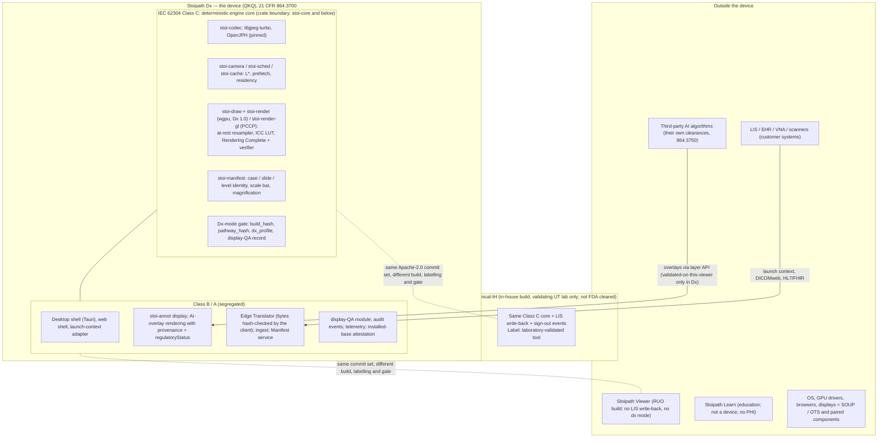
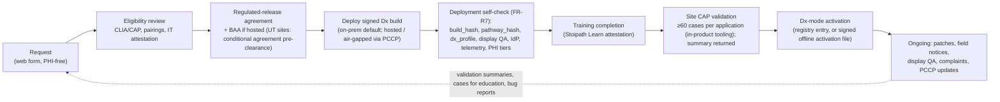
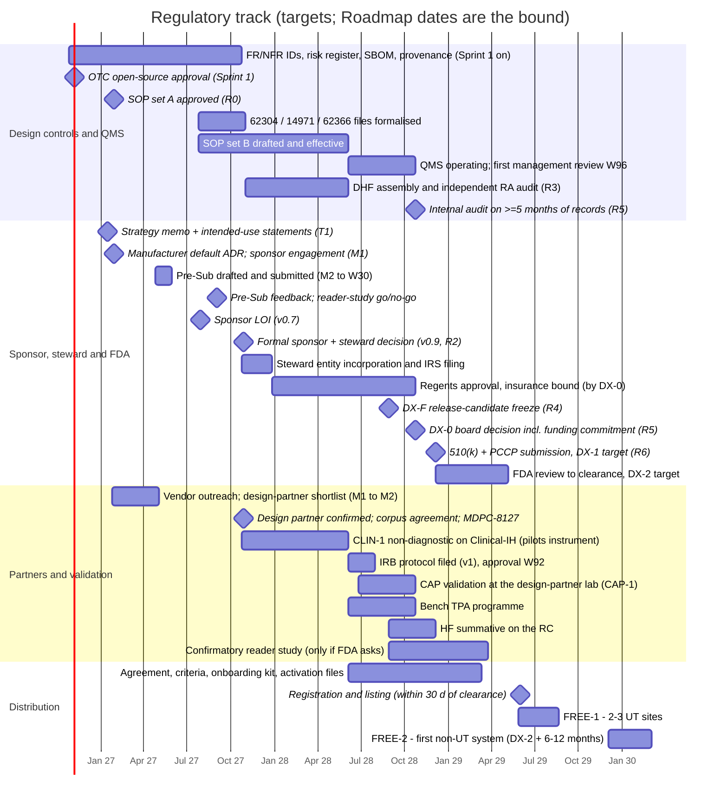

# Regulatory pathway to FDA clearance and the free-distribution model

Section 13 of the Stoipath WSI viewer development plan. Date 2026-10-24; revised 2026-10-25 against the four-critic review (`critique/issues.json`) and the claims-verification report (`verify/README.md`, `verify/required-changes.json`). Terminology is that of `arch/recommended.md` §5 (Engine contract, `stoi-*` crates, Edge Translator, Manifest, brightfield/multichannel canonical, Dx mode, Rendering Complete flag, L0–L5, NTF%, TTS, G1–G13, M0–M5) and the milestone IDs of "Roadmap, milestones, team and estimates" §3. **Calendar.** Week 0 = Monday 2026-10-26; **M0 = 2026-12-05 (week 6)** per the sprint calendar of "Repository structure and first sprints" §8, which is canonical for Stage 0; later milestones are cited by ID with the dates Roadmap §3 gives them today (M1 W13 2027-01-29, M2 W26 2027-04-30, MVP 0.5 W30 2027-05-28, v0.7 W39, v0.9 and CLIN-1 W52 2027-10-29, v1 W84 2028-06-09, CAP-1 W87–104, DX-0 W104 2028-10-23). Where this section asks for a Roadmap date to move, it says so in §7.6 and keeps the Roadmap date as the pessimistic bound; if the Roadmap re-derives Phase 1 from the six-week M0, this section follows the milestone IDs, not the dates. TSP facts are the owner's verified facts of 2026-10-24 (§4.3). Tags: **[verified]** read from a primary or near-primary source; **[snippet]** read from search-engine extracts of the named source (fda.gov, accessdata.fda.gov, ecfr.gov, govinfo.gov, hhs.gov, law.cornell.edu and innolitics.com refuse this sandbox's proxy, so no FDA primary text could be opened in full); **[unverified]** domain knowledge for counsel to confirm; **[model]** our estimate from stated inputs; **(verified)** / **(adjusted after verification: was X)** a number checked by the claims-verification pass; **(adjusted)** a change made in response to the review, with the first draft's position stated.

**What this section owns.** "Risks, compliance, security, licensing and open questions" §3 holds the compliance roadmap *summary* and defers the programme to this section; "Quality, testing and performance QA" §11 and "Autonomous execution model and dissemination plan" §A10 define how repository artefacts become design-control records; "Product pillars" §2 sets the per-pillar regulatory boundary; "Requirements" FR-R7 and FR-R8 are placeholders that §3.9 fills (together with FR-R0, FR-R9–FR-R11 and an FR-V4/NFR-D2 amendment). This section decides: the device, its pathway, claims and first-filing scope; the four build artefacts and their labels; the QMS and design-control programme with machine-checkable regulatory gates; the validation study; who the legal manufacturer and the steward are and how a free product pays for its post-market duties; the licence and the regulated-release channel; the qualification and onboarding programme; the phased roadmap with target and bound dates, costs and hires; the risks; and the list of edits other sections must take from it (Propagation list).

**Why it exists at all.** The owner's aim is a cleared viewing platform given free to any hospital system that qualifies. Clearance attaches to intended use and to a controlled build, not to price (21 CFR 807, 820, 803, 806 apply whether or not money changes hands); a free product therefore carries every obligation a sold one does, and must fund them before they attach (§5.3, §7 DX-0 gate). The programme is sized so that the research-use phase already produces the Design History File (DHF) as a *view over the repository*, because reconstructing design controls later costs more than the clearance itself (note 10 §1.10: ≈10 % overhead now, prohibitive to retrofit).

## 1. Decisions in one page

| # | Decision | Basis | Owner / gate |
|---|---|---|---|
| 1 | The Dx edition is its own Class II device under 21 CFR 864.3700, product code **QKQ** (software-only "digital pathology image viewing and management software"); pathway **Traditional 510(k)** with a viewer predicate (PathPresenter K250968 or Paige FullFocus K241273) and a **PCCP** for additional cleared scanners, file formats, displays and deployment topologies from the first submission. De Novo is not needed. One Pre-Sub, drafted at M2 and submitted by W30, carries the eight questions of §9 OQ-26 | §2.1–2.3; gap-8 F1–F2; Proscia 2026-08-06 PCCP **[verified trade press]** | RA, PO / Pre-Sub (W30), DX-0 |
| 2 | **Dx 1.0 is minimal (§2.7):** one platform family (signed Tauri native desktop shell on Windows 11, wgpu DX12/Vulkan, EDID display identity), one topology (on-prem Edge Translator), scanners Hamamatsu NanoZoomer S360MD (NDPI) and Leica Aperio GT 450 DX (SVS, DICOM) **or one of them if the design-partner lab owns only one** (the second enters via the PCCP), one named display (Barco MDPC-8127). Managed browsers under an MDM-pushed `dx_profile.json`, macOS, cloud and air-gapped topologies and further displays enter through the PCCP; tablets, phones and consumer displays stay outside the Dx label | §2.4, §2.7; every QKQ predicate paired with one of these two scanners **[snippet]**; review issues on display attestation and first-filing scope | RA, TL / Pre-Sub question 6, v0.9 |
| 3 | **Four build artefacts from one commit set**, not a flag: **Stoipath Dx** (cleared device; frozen, signed build), **Stoipath Clinical-IH** (in-house clinical build for the validating UT CLIA lab(s) only: Dx-mode capable, carries the LIS write-back and sign-out surfaces, labelled as a laboratory-validated tool, not FDA cleared), **Stoipath Viewer** (RUO distribution build: no LIS write-back, no sign-out events, no Dx gate, RUO string asserted by CI), **Stoipath Learn** (education; not a device; no PHI by construction). CLIN-1 and CAP-1 run on Clinical-IH, never on Viewer (adjusted: the first draft named three products and ran CLIN-1 on an "RUO-labelled in-house tool") | §2.5–2.6; FDA RUO/IUO guidance "totality of circumstances" **[snippet]**; gap-8 F3 | PO / MVP 0.5 (build-flag matrix test) |
| 4 | IEC 62304 **Class C for the whole deterministic engine core** (`stoi-core` and the crates beneath it: codec, camera, scheduler, cache, draw, Dx renderer, Manifest/identity, Dx gate, Rendering Complete verifier) as a crate boundary the layering test enforces; Class B/A for shells, annotation display, education, research adapters, telemetry and server management. FDA software documentation level **Enhanced** | §3.4; the narrow "Dx-mode paths only" boundary of the first draft is not a valid §4.3 segregation (review) | RA, TL / ADR at M1, confirmed in the Pre-Sub |
| 5 | Design controls run from Sprint 1 as repository artefacts (FR/NFR IDs on tests, `docs/design-controls/risk-register.yaml` seeded in S1-12, SBOM, signed evidence archive); **SOP set A** (document control, design control, software development) approved by M1 so every signature from MVP onward is valid; SOP set B W39–84; **QMS operating from v1 (W84)**, first management review W96, internal audit at DX-0 on ≥5 months of records; regulatory gates **R0–R7** with JSON evidence (§3.10) | §3, §3.10; "Quality" §11; "Autonomous execution" §A10 | RA / R0 (M1) … R7 |
| 6 | Validation for the Dx claim = bench programme per FDA's WSI technical-performance assessment + format-specific pairing verification + HF summative, all on the **DX-F release candidate frozen at W96**; the **confirmatory reader study is conditional on Pre-Sub feedback** (decision at W40–44): if FDA wants it, it runs W96–W126 on an investigational-labelled build and DX-1 moves to ≈W132; if not, the $150–400 k is cut. Case count is set by a clustered (reader × case) statistical analysis plan, 300–600 cases | §4; predicate designs **[verified PubMed]** | PA, RA / Pre-Sub feedback, DX-F |
| 7 | Legal manufacturer: a **UT System component institution** registers as specification developer and holds the first 510(k); the default is ratified as an ADR at **M1**, a signed letter of intent to act as specification developer by **v0.7 (W39)**, the formal institutional decision (fallback priced) by **v0.9 (W52)** as a hard DX-0 gate. A **UT-affiliated 501(c)(3)** (formed W52–60, insured by DX-0) stewards the Apache-2.0 code, signs distribution agreements, carries insurance and raises funds; the RACI by regulation is §5.2; 510(k) ownership may transfer to the nonprofit later. HeartSee (K202679 under McGovern Medical School) shows a UT institution *can* hold a 510(k); whether no-charge distribution is fee-exempt is OQ-26(5) | §5.1–5.2; 21 U.S.C. 379j **[verified statute text]**; HeartSee **[snippet]** | PO, LC / M1 ADR, W39 LOI, v0.9 decision |
| 8 | Licence stays **Apache-2.0 + DCO** (ADR-010 in "Risks"; 10's ADR-0007 to be reworded), with **campus OTC written approval by 2026-11-07** (repository private and LICENSE marked proposed until then). The cleared edition is a signed, reproducible build with a **two-level identity**: `pathway_hash` (frozen Class C pixel pathway and identity) and `build_hash` (whole artefact), both in a public **cleared-configuration register**; the Dx gate requires a registered `build_hash`, revalidation and register entries key on `pathway_hash`; security patches never change `pathway_hash`. Hospitals may modify anything except the Dx build they use clinically | §5.6; Tidepool, OsiriX MD, OHIF, Tempus consortium precedents **[snippet]** | LC, PO / Sprint 1 (OTC), v1 |
| 9 | "Qualifies" = CLIA certificate + CAP (or equivalent) AP accreditation; CAP WSI validation completed and its summary returned *before* Dx-mode activation; cleared or PCCP pairings only; display-QA programme; documented downtime/glass fallback procedure; IT-security and identity attestation; training; signed regulated-release agreement incl. complaint and adverse-event reporting; no payment, size or affiliation test. Hosted service for Texas public institutions requires TX-RAMP; on-prem is the FREE-1 default | §6.1; REDCap consortium-licence template **[snippet]**; Tex. Gov't Code §2054.0593 **[unverified]** | PO, RA / v0.9 (OQ-25) |
| 10 | Post-market duties are funded by a service entity, not volunteers: steady state **≈$1.2–2.0 M/yr [model]** = fixed post-market $0.5–0.95 M (people, insurance, pen test, eQMS, lab, fees) + engineering maintenance 35–60 PM/yr (§5.3 cadence table; adjusted: was "20–30 PM/yr", a mis-citation of Roadmap §9's period total). **DX-0 gate: committed funding for ≥24 months of the fixed post-market cost, or no filing.** Sources: NCI ITCR / CPRIT / ARPA-H grants, UT System programme budget, philanthropy with a cleared product, consortium dues ramping from FREE-1 + 12 months, cost-recovery services | §5.3–5.4; gap-8 F8 | PO / DX-0 |

## 2. Device classification, pathway and claims

### 2.1 What the device is

21 CFR 864.3700 (Class II, special controls; created by the Philips IntelliSite De Novo DEN160056, April 2017) covers "an automated digital slide creation, viewing, and management system intended as an aid to the pathologist to review and interpret digital images of surgical pathology slides" **[snippet]**. Two product codes sit under it: **PSY** for systems that include a scanner and **QKQ** for software-only viewing and management of scanned FFPE surgical-pathology slides **[snippet]**. AI that reads slides is a separate regulation, 864.3750, product code **QPN** (Paige Prostate DEN200080) **[snippet]**.

**Third-party AI overlays in Dx mode (adjusted).** Cleared AI devices are cleared *with a named viewer* (Paige Prostate with FullFocus), so rendering their output in Stoipath Dx is outside the AI vendor's cleared configuration unless the vendor validates and labels Stoipath Dx as a compatible viewer ("Risks" OQ-18, R12); the first draft asserted the opposite without rationale. Rule: in Dx mode an AI overlay renders only when its provenance tuple carries `regulatoryStatus: validated-on-this-viewer` under a vendor validation contract; otherwise the layer is suppressed in Dx mode or shown with a persistent "not validated for diagnostic use on this viewer" marker (FR-R11, §3.9; golden test on the tuple). This is Pre-Sub question 8 (OQ-26). Displaying validated overlays is image management under QKQ; "System architecture" §9's provenance tuple and deterministic Dx-mode overlay path are the mechanism.

The special controls, as restated in QKQ/PSY decision summaries **[snippet]**: indications must name the tissue type (FFPE) and the system components; component-level bench data "as appropriate" (for a viewer: the display); system-level bench data (colour reproducibility, spatial resolution, focus, tissue coverage, stitching, turnaround time); a reader study of major-discordance difference against sign-out "as appropriate"; a human-factors engineering process on the user interface; 21 CFR 809.10(b) labelling carrying the sentence "It is the responsibility of a qualified pathologist to employ appropriate procedures and safeguards to assure the validity of the interpretation of images obtained using this device." FDA's 2016 *Technical Performance Assessment of Digital Pathology WSI Devices* guidance is the bench checklist and already names viewer tests: navigation and zoom behaviour, colour, annotation, response time (note 09 F1). Goal 1's measurement stack is therefore regulatory evidence, not only engineering evidence. A frozen-section indication is a separate claim with its own CAP application and reader evidence (K250968 excludes frozen sections and cytology); Dx 1.0 does not carry it.

### 2.2 What the predicates teach

| Clearance (holder) | Date | Code | Pairings named | Clinical evidence | Lesson |
|---|---|---|---|---|---|
| IntelliSite DEN160056 (Philips) | 2017-04 | PSY | UFS scanner + Philips display | 1,992 cases, 16 readers, 4 sites, 4 % NI margin **[verified, Mukhopadhyay 2018]** | Sets the reader-study template and the 4 % margin |
| Aperio GT 450 DX K232202 (Leica) | 2024-04 | PSY | GT 450 DX + WebViewer DX, local *and remote* stations | 1,161 cases, 10 readers, 3 sites; remote 2.17 % vs local 2.61 % major discordance **[verified, Borowsky 2025]** | Internet viewing stations are validatable |
| FullFocus K241273 (Paige) | 2025-01 | QKQ | adds GT 450 DX (SVS, DICOM) and S360MD (NDPI); "wide set of monitors" **[snippet]** | Bench **[unverified]** | Two scanners and a display *set* in one viewer clearance |
| Clinical Viewer K250968 (PathPresenter) | 2025-06-20, 81 FDA days | QKQ | S360MD (NDPI) + Barco MDPC-8127; Rx only; FFPE; not frozen sections, cytology or non-FFPE **[verified 510kdatabase.net and FDA decision-summary snippet]** | None; bench + predicate **[snippet]** | A viewer clears in under three months with one scanner, one display, no reader study |
| Concentriq AP-Dx (Proscia) | 2026-08-06 | QKQ | adds GT 450 DX, cloud deployment, **PCCP** for additional FDA-cleared scanners, image formats *and displays* without a new 510(k) **[verified trade press: BioSpace, CLP, 360Dx]** | Reuse of earlier multi-site data | The pairing problem is now solved by PCCP, not by a display-agnostic claim |

Pattern: (i) a viewer is a device in its own right, so OEM embedding is optional; (ii) viewer-only sponsors have cleared without reader studies when paired with cleared scanners and displays and showing pixel-pathway equivalence; (iii) S360MD and GT 450 DX appear in nearly every pairing; (iv) FDA review of a viewer is short (MDUFA V goal 90 FDA days; FY2025 met for 97.9 % of 510(k)s; median total time ≈ 142–151 calendar days **[snippet, aggregators]**), so the critical path is our QMS, our evidence, the sponsor commitment and a scanner-owning design-partner lab, not FDA. §7 acts on that: all four start in Phases 1–3, not post-v1 (adjusted).

### 2.3 Pathway options

| Pathway | Fits when | FDA-side cost and time (FY2027 fees **[verified secondary: Registrar Corp, LexisNexis]**) | Verdict |
|---|---|---|---|
| **Traditional 510(k), QKQ, viewer predicate** | Our Dx edition with named pairings | $28,653 (small business $7,163; **$0 for a State entity unless "distributed commercially"**, 21 U.S.C. 379j(a)(2)(B)(iii) **[verified statute text via openjurist]**); 90 FDA days, ≈5–6 months total | **Adopted** |
| **+ PCCP** in the same submission | From the first filing, so each new scanner, format, display or deployment topology is a validation report in the DHF, not a submission | Adds a Pre-Sub cycle and a written modification protocol; general-device PCCP guidance still draft (A-list for FY2027 finalisation, comments to 2026-11-30 **[verified secondary]**), but FDA grants them now (Proscia) under FD&C §515C | **Adopted; scope confirmed in the Pre-Sub** |
| De Novo | Only for a genuinely novel claim (any consumer display; cytology; frozen sections) | $191,020 / $47,755; 150-day goal, 9–12+ months typical **[snippet]** | Avoid; QKQ predicates are dense |
| Special 510(k) | Our own later modification that changes the cleared device beyond the PCCP | Fee as Traditional; 30-day goal, 2025 median ≈30 days **[snippet]** | Occasional |
| Letter-to-file (2017 software-change guidance) | Changes that do not significantly affect safety or effectiveness or intended use, incl. every release that leaves `pathway_hash` unchanged | $0; internal memo + verification | **Daily mechanism** for the Dx release train |
| Third-party (3P510k) review | Only if QKQ is on the eligible list | Removes the FDA fee; reviewer charges | Eligibility **unverified** (list unreadable); low value given the fee exemption |
| Component of a partner's cleared system | A scanner vendor adopts the viewer | Partner-paid | Secondary channel, never the plan |
| Pre-Submission (Q-Sub) | Before every one of the above | Free; written feedback in ≈70 days **[snippet]** | **One Pre-Sub: drafted M2 (W26), submitted by W30 (2027-05-28; latest 2027-06-30), feedback ≈W40–44, with the eight questions of §9 OQ-26** (adjusted: was "submit ≈W40"; every input exists by M2 and the answers gate v0.x work) |

### 2.4 The pairing problem, the PCCP and the Dx-mode gate

No cleared viewer labels "any display" **[snippet]**; the furthest FDA has gone is Paige's "wide set of monitors" and Leica's remote stations, and the first crack in the triplet model is Proscia's PCCP. Our PCCP therefore has three modification categories, each with a protocol, acceptance criteria and a labelling-update procedure, and all three are exercised by evidence the device lab already produces:

| Category | Modification allowed under the plan | Verification protocol (all machine-run except the human-factors check) | Acceptance |
|---|---|---|---|
| **Scanner / file format** | Add an FDA-cleared scanner's native output (NDPI, SVS, DICOM WSI from Philips, 3DHISTECH, Roche DP 600, Epredia E1000 Dx). Transfer syntaxes: **reversible HTJ2K only, through the already-pinned OpenJPH build**; lossy HTJ2K is outside the PCCP (verified: lossy HTJ2K differs x86 vs aarch64 in 3 pixels of a test tile, 0.0011 %, max 1 LSB; reversible HTJ2K is identical, so hash identity holds only for the reversible form) | **Format-specific (adjusted).** (a) Served-unchanged formats (SVS, DICOM passthrough): frame-byte hash identity against the vendor tiles (`recommended.md` §3.1 step 3) plus G7-class decoder identity on the vendor corpus. (b) Re-tiled or re-muxed formats (NDPI restart-marker strips re-muxed in the DCT domain, tier C; any 240/256-px frame regrouped into a 512-px logical tile once that ADR lands): decoded-pixel identity ≤1 LSB against the vendor frames decoded by the reference pathway plus a lossless re-tiling proof. Both: colour-target and resolution-phantom slides scanned on the new device, rendered in Dx mode and compared to the reference pathway; golden gesture replay identical to the cleared build | ≤1 LSB on goldens; 0 identity failures; colour ΔE and resolution within the limits set in the first submission |
| **Display** | Add a display that meets a published **display class**: ≥8 MP (27″ 4K) IPS, ≥300 cd/m² calibrated, ≥1000:1, ≥100 % sRGB, 10-bit, pixel pitch range, with a QA programme (gap-1 F4, Xiong 2026 recommendations **[verified abstract]**) | Photometric and colorimetric characterisation; LUT-chain test (§3.7); display-QA module records pass; summative HF spot-check on critical tasks if the form factor changes | Within class limits; HF no new use errors |
| **Deployment** | Managed browser session (Chrome/Edge under MDM with a hospital-pushed `dx_profile.json`) on Windows; macOS native shell; cloud-hosted Edge Translator; air-gapped topology with signed media and offline activation (`recommended.md` §3.1 deployment table) | Same M1 suite behind each topology; capability-token and PHI-tier tests; latency gates per class (TTS, NTF = 0 at rest); for a browser surface the G8 self-certification matrix and the nightly browser/OS goldens | Gates pass; `pathway_hash` unchanged |

What stays *out* of the PCCP and would need a new 510(k): any change of intended use (frozen sections, cytology, non-FFPE, multichannel fluorescence as a Dx claim), a new decoder or resampler at rest (i.e. any change to `pathway_hash` beyond a pinned-version bump verified by the identity suite), lossy HTJ2K, and any display below the class. Tablets (W-iPad, N-iPad) and phones remain consultation, education and research surfaces.

**Dx delivery surfaces (adjusted).** A browser cannot identify the physical display it is on (no EDID; the Window Management API is Chromium-only and permission-gated; a Hyperdrive iframe exposes nothing), so display attestation by self-declaration cannot satisfy the pairing special control. Dx mode is therefore available only on (a) the native desktop shell, which enumerates monitors (EDID, ICC) and refuses Dx on an unpaired one, and (b) MDM-managed browser sessions whose `dx_profile.json` ("System architecture" §12) is delivered by the hospital and names the display IDs and scanner formats; the attestation source (`edid` | `mdm-profile`) is recorded in the quality record. Dx 1.0 files only (a) (§2.7); (b) enters via the PCCP Deployment category. The v0.9 native desktop window is therefore a Dx-edition prerequisite, not Roadmap cut #3 (§7.6). "Cross-platform delivery" §10 enforces the restriction through shell configuration keys delivered by MDM (not a `mode` field, as the first draft said).

**Dx-mode gate inputs (the one mechanism; replaces the overlapping vocabularies of 02 FR-V4/FR-I10, 04 §12 and the first draft of this section):**

| Input | Source | Check at session start |
|---|---|---|
| Build identity `build_hash` | Signed artefact; cleared-configuration register (§5.6) | Hash of the running artefact ∈ register and not past end-of-support; offline sites: signed activation file (§6.2) |
| Pathway identity `pathway_hash` | Same register; recomputed by the build from the Class C crates' pinned versions and shader/LUT constants | Equals the register entry for this `build_hash`; drives the site's revalidation flag |
| Site pairing profile `dx_profile.json` | Hospital-delivered (MDM or installer config) | Scanner formats of the opened slide and the attested display ID ∈ profile; profile signed by the site administrator |
| Display-QA record | Display-QA module (FR-I10) | Record for the attested display is fresher than the labelled cadence and passed |
| Render `mode` ∈ {`nav`, `dx`} | Per-session render mode **inside the Dx and Clinical-IH builds only** | `dx` requires all rows above; Viewer and Learn have no `dx` render mode |
| Launch-context product field | `LaunchContext.mode: dx\|ruo\|edu` (04 §8, 12 §2) | Re-specified as a **product identifier** that must match the running build's product; an RUO build refuses `dx` and emits `productMismatch` |

**Design consequence for goal 1.** The *frozen pixel pathway* (`pathway_hash`) is: `stoi-codec` (libjpeg-turbo 3.2, OpenJPH pinned), the at-rest resampler, the per-slide server-computed ICC→sRGB 33³ LUT applied in-shader on untagged passthrough tiles with `Rgba8Unorm` gamma-space filtering ("Instant-zoom engineering" §12; baking only for re-encoded or synthesised levels; adjusted: the first draft said "server-baked ICC", which byte-passthrough makes impossible), the Rendering Complete logic and its verifier, and case/slide/level identity. Dx mode refuses transcoded tiles: `enc=m` moving-tier tiles and the HTJ2K→JPEG fallback are never drawn in a settled Dx frame (FR-V4 amendment, §3.9). The scheduler, prefetch predictor, caches and transient blend (`stoi-sched`, `stoi-cache`, Nav-mode filtering) are *navigation* machinery inside the same Class C engine core (§3.4): changes there are Class C software changes verified by the golden gesture replay, unit tests and the M-gates and documented by letter-to-file, because the settled Dx frame they deliver is bit-identical by construction (ADR-007: the moving image is navigation; the Dx image is the settled frame) and `pathway_hash` does not move. This keeps instant-zoom engineering free to evolve for the life of the clearance at the cost of detailed-design records for those crates, not of a new submission. Whether FDA accepts the navigation/settled-frame framing (cross-level blend and bicubic transients outside the Rendering Complete state) is Pre-Sub question 7 (OQ-26; closes "Risks" OQ-17, which the first draft answered by assertion).

### 2.5 Intended use and indications (draft for the Pre-Sub)

> **Stoipath Dx** is software intended for viewing and managing digital whole slide images of formalin-fixed, paraffin-embedded (FFPE) surgical pathology tissue acquired by the FDA-cleared scanners listed in the labelling, displayed on the displays listed in the labelling, as an aid to the pathologist to review and interpret these images for primary diagnosis. It is not intended for use with frozen-section, cytology or non-FFPE specimens. It is the responsibility of a qualified pathologist to employ appropriate procedures and safeguards to assure the validity of the interpretation of images obtained using this device. Rx only.

Companion statements for the other artefacts (Decision 3):
- **Stoipath Clinical-IH** (in-house clinical build): "In-house laboratory-validated tool. Not FDA cleared. For use only within <laboratory> under its CLIA/CAP validation." Distributed only to the validating UT CLIA lab(s) named in `dx_profile.json`; the only pre-clearance build with HL7/FHIR write-back and sign-out events. CLIN-1 (non-diagnostic, W52) and CAP-1 (primary diagnosis at the validating lab, W87–104) run on it under the *laboratory's* validated-system labelling and CLIA/CAP, not under any Stoipath Dx claim (gap-7 F6; FDA LDT rule rescinded 2025-09-19 **[snippet]**). "Risks" OQ-01 (is no-charge distribution "commercial distribution") and OQ-03 (CAP/UT acceptance of the lab-tool analogy) are explicit predecessors of CAP-1.
- **Stoipath Viewer** (RUO): "For Research Use Only. Not for use in diagnostic procedures." (21 CFR 809.10(c)(2)(i) **[unverified wording]**); no LIS write-back, no sign-out events, no `dx` render mode; the CI build-flag matrix asserts the absence of those surfaces and the presence of the RUO string.
- **Stoipath Learn**: "For educational use. Not a medical device. Contains no protected health information."
- **Investigational study build** (only if the reader study runs, §4.2): "CAUTION — Investigational device. Limited by Federal law to investigational use." (21 CFR 812.5 **[unverified wording; counsel]**), sponsor = the manufacturer entity.

### 2.6 Device boundary

Segregation is an architectural fact, not a label: the Class C set is a crate boundary (`stoi-core` and everything beneath it) that "Repository structure" §1's layering test enforces per PR, with no shared mutable state across the boundary; the Dx-mode gate refuses to start without the inputs of §2.4; the education package is a separate package over public core APIs (ADR-019). The four artefacts are produced from one commit set by the build-flag matrix, and a CI test fails any Viewer or Learn artefact that links the LIS write-back, sign-out or `dx` render-mode features. The education and research products are not devices (FDA's device-software policy lists educational tools as non-device examples **[unverified]**; the January 2026 CDS revisions keep image-analysis software out of the CDS carve-out **[snippet]**, so no image-viewing function can shelter there).

### 2.7 Dx 1.0 scope (what the first filing contains)

| Dimension | Dx 1.0 (first 510(k)) | Enters later via | Why |
|---|---|---|---|
| Platform | Signed Tauri native desktop installer on **Windows 11**, `stoi-render` on wgpu (DX12 or Vulkan), EDID + ICC display identity, OS code-signing verifies the installer hash | PCCP Deployment: managed Chrome/Edge under MDM `dx_profile.json` (web-sys WebGL2 renderer, G8 self-certification); macOS native shell | One renderer and one OS family halves the Class C verification surface (goldens on four GPU families × browser/OS matrix) for a first-time sponsor; EDID is the only display attestation a browser cannot give |
| Topology | **On-prem Edge Translator** behind Caddy/nginx (the same binary as the regional build); served bundles carry a translator-signed manifest the client checks | PCCP Deployment: cloud-hosted translator; air-gapped signed media + offline activation | UT sites default to UT-operated infrastructure (TX-RAMP, §6.3) |
| Scanners / formats | S360MD (NDPI, tier C re-mux) and GT 450 DX (SVS passthrough, DICOM) — or the one the design-partner lab owns (§4.2) | PCCP Scanner/format | Pairings present in every QKQ predicate |
| Displays | **Barco MDPC-8127** (single named display; adjusted: the first draft's "one Dell medical display" named no model, and the only Dell in the predicate chain, Sectra's MR2416 at 2.3 MP, fails the §2.4 class) | PCCP Display class, or a second named pairing if the class is refused (candidate: the ≥8 MP 4K Dell paired in the GT 450 DX clearance, model to be verified against its 510(k) pairing list **[unverified]**, OQ-32) | One display is enough for the claim (K250968) |
| Specimens | FFPE surgical pathology, brightfield H&E and IHC | New 510(k) | Frozen, cytology, fluorescence are new indications |
| Verification matrix | Two GPU vendors on Windows (NVIDIA, Intel) + one AMD lab machine; one translator topology | Grows per PCCP report | Sized to the first filing, not to the platform's reach |

Pre-Sub question 6 asks FDA to confirm this scope and the format-specific pairing protocol (§2.4). "Requirements" §5.1's Tier-1 Dx column and "Cross-platform delivery" §10 are to be aligned (Propagation list).

## 3. QMS and design-control programme

### 3.1 QMS scope, tooling and stand-up sequence

Since 2026-02-02, 21 CFR 820 incorporates ISO 13485:2016 by reference (QMSR) and FDA inspects under Compliance Program 7382.850 **[verified, "Risks" §3 sources]**. The manufacturer is a *specification developer* that releases software; there is no production floor, so the QMS is small: quality manual and clause map; document and record control; management review; internal audit; training and competence; supplier controls (cloud providers, codec and crate suppliers, scanner and display vendors as data suppliers); design controls with a DHF per Dx release train; IEC 62304 lifecycle incl. SOUP; ISO 14971; IEC 62366-1; cybersecurity plan; production and release (reproducible signed builds, configuration manifests); complaint handling, MDR, corrections and removals, CAPA; UDI/GUDID; labelling; validation of the QMS software itself (§3.1a). ISO 13485 *certification* is not an FDA requirement but hospitals and any later IVDR/UKCA route ask for it; quotes for a <50-person organisation are $22–83 k initial **[snippet]**.

**Stand-up sequence (adjusted: the first draft drafted SOPs at W62–88, after the records they govern; gap-8 §4.3 item 3 says "stand up the QMS now").**

| Step | Content | When | Who |
|---|---|---|---|
| SOP set A | Document control, design control, software development lifecycle (IEC 62304 process document v0), record and e-signature conventions; drafted by agents from OpenRegulatory / Tidepool qmsOS templates, approved by the regulatory consultant | **By M1 (W13)** — so every design-input baseline and review signature from MVP (W30) onward is made under a valid procedure | RA/QA 0.2 FTE + consultant |
| SOP set B | Risk management, usability engineering, supplier control, training, CAPA, complaint handling, MDR/806, release and design transfer, cybersecurity, post-market surveillance | **W39–84** (RA/QA 0.5 FTE from W39) | RA/QA, security engineer |
| QMS operating | All SOPs effective; records accrue (complaints from CLIN-1, CAPA, supplier reviews, training) | **From v1 (W84)**; first management review **W96**; internal audit at **DX-0 (W104)** on ≥5 months of records | Management representative (§8 RX-14), RA |
| Tool validation | §3.1a | v1 (2–4 PM) | TL, RA |
| eQMS | Bought only when audit load justifies $10–30 k/yr **[snippet]** | DX-0 at the earliest | RA |

Tooling follows Tidepool's qmsOS, which is ISO 13485:2016-certified by TÜV SÜD America (April 2025) and runs on Google Workspace, Jira and Confluence **[verified Tidepool/BusinessWire]**: our equivalent is the repository itself, with controlled documents rendered from Markdown under `docs/qms/` and the record paths of "Repository structure" §1 (`docs/design-controls/requirements.yaml`, `docs/design-controls/risk-register.yaml`, `docs/design-controls/trace.md`, `docs/adr/`, `docs/provenance/runs.jsonl`, `gates/*.json`; adjusted from the first draft's `requirements/`, `risk/`, `provenance/`), and electronic signatures recorded per "Autonomous execution" §A10. `docs/qms/` and `docs/qms/ddp-<train>.md` are to be added to 10 §1's tree (Propagation list).

### 3.1a QMS software validation, electronic records and the agent toolchain

- **Validation of QMS software (ISO 13485 §4.1.6, retained by the QMSR).** The record system (GitHub hosting, CI runners, the DHF and traceability generators, the evidence-archive signer, the e-signature identity mechanism) gets a validation plan at v1: intended use, risk-based test cases (a trace generator that drops a requirement is a safety-relevant failure), re-validation on any major platform change; 2–4 PM, named in "Autonomous execution" §A10. Tidepool had to do the same for Jira/Confluence.
- **Durable, squash-immune records.** Design-control records are exported as signed tags plus a signed evidence archive mirrored off-platform (object store under the manufacturer's control) at every milestone and Dx train; history rewrites cannot alter a signed export. Retention follows device-record rules (design life + 2 years, ≥2 years **[unverified]**).
- **Part 11 position.** 21 CFR Part 11 controls (identity-bound signatures, audit trails, manifestation of signature meaning) apply to QMS records and to study data; the e-signature scheme of §A10 is implemented to that standard, and the alternative (document why Part 11 does not apply) is not taken.
- **Agent toolchain (adjusted: the first draft called the agent toolchain "a qualified tool").** Hosted LLM agents cannot be version-pinned and are therefore **not qualified tools whose output is trusted**. They are untrusted generators; their output is accepted only through qualified deterministic checks (goldens, golden gesture replay, G7 identity, trace gate, `cargo deny`, SBOM diff, the layering test) and human-signed reviews. The agent model, version and prompt hash are recorded in the provenance ledger (§A6) for reproducibility and audit, not as a qualification claim. The *deterministic* checks are the IEC 62304 §5.1.4 configuration items and the ISO 13485 §4.1.6 validated tools. This is the RX-11 mitigation; 11 A6/A10 wording to match (Propagation list).

### 3.2 Design inputs, outputs and traceability

The DHF is a generated view over repository artefacts ("Quality" §11; "Autonomous execution" §A10). What this section adds is the *baseline discipline* the Dx edition needs on top of the RUO flow:

| DHF element | Repository artefact | Exists from | Dx-edition addition |
|---|---|---|---|
| Design and development plan | `docs/qms/ddp-<train>.md` | v0.9 | Per Dx release train; names `pathway_hash` contents, the PCCP categories and the succession of the management representative |
| Design inputs (user needs, SRS) | `docs/design-controls/requirements.yaml` with pillar, risk links, verification method ("Requirements" §1; one FR-/NFR- namespace, Stage-0 gates as NFR-G1…G13) | Sprint 1 | **Design-input baseline** signed per train; the intended-use statements (§2.5) as the root requirement **FR-R0** (ID reserved in 02's FR-R series) |
| Design outputs | Signed artefacts, SBOM, configuration manifest (`build_hash`, `pathway_hash`), IFU | MVP 0.5 | Cleared-configuration register entry |
| Design review | ADRs (MADR) with approver and date in `docs/adr/` | Sprint 1 | Formal review minutes at baseline, pre-verification, pre-release |
| Design verification | FR/NFR-tagged tests; `gates/*.json`; goldens; device-lab and WALT runs; `docs/design-controls/trace.md` (≥90 % at M1 per "Quality" §11, ≥95 % at MVP 0.5 per Roadmap §3, **100 % for Dx**) | Sprint 1 | Verification report per train, signed |
| Design validation | CAP-1 concordance export; HF summative; reader study if required | CAP-1 | Validation report; residual-risk statement |
| Design transfer | Release checklist, install-from-registry smoke, Dx channel | MVP 0.5 | Signed-build custody, media and activation files for air-gapped sites |
| Design changes | ADR superseding ADR; letter-to-file memo; PCCP validation report | Sprint 1 | "Significant change" checklist from the 2017 software-change guidance **[snippet]**; CI refuses a Dx-train release whose `pathway_hash` changed without a signed change-assessment memo |

### 3.3 Risk management (ISO 14971)

The risk register is seeded in Sprint 1 ("Repository structure" S1-12) and formally baselined at M1 (adjusted: the first draft said "opens at M1"); it is the one artefact where goal 1 and the Dx claim meet: the hazards that matter are *rendering* and *identity* hazards, and the controls are the gate metrics. Risk acceptability: any hazard whose harm is "missed or wrong diagnosis" must have a control verified by an automatic test; residual risk is accepted only by the signing pathologist (the management representative, §8 RX-14) and RA. Requirement IDs refer to "Requirements" rows and to the rows this section supplies in §3.9.

| Hazard (HAZ-) | Cause | Harm | Control (REQ) | Verification (gate metric) |
|---|---|---|---|---|
| HAZ-1 Magnified, stale, moving-tier or transcoded tile presented as final image | LOD policy, slow network, cache, scheduler bookkeeping; `enc=m` or HTJ2K→JPEG fallback tile left in a settled frame | Missed small object (microorganism, mitosis) | Never-magnify-at-rest; Rendering Complete asserted only after the Class C verifier recomputes L* from the camera and checks each drawn slot's (TileKey, source-byte hash recorded at upload) against the Manifest; Dx mode refuses `enc=m` and fallback tiles (FR-V4 amended, NFR-D2) | NTF = 0 at rest on every replayed path; blank-pixel frames = 0; fault-injection test: an injected scheduler or cache fault must prevent Rendering Complete |
| HAZ-2 Wrong tile identity (level, x, y) under throttling | Scheduler/cancel bug (endemic in Mapbox/OL, "Risks" T13) | Tissue from the wrong region | Fiducial synthetic slides; replay with recorded byte-arrival; verifier of HAZ-1 (FR-V4) | 100 % fiducial identity in Tier-1 CI per PR |
| HAZ-3 Wrong slide or patient shown | Launch-context mismatch, LIS sync, cache | Diagnosis on another patient's slide | Clinical and Dx modes display the Tier-2 label image and the launch-context identifiers (accession, part, block, slide label text) by default via the `/assoc/label` token scope; the shell verifies `LaunchContext.slideIds`/`studyUID` against the Manifest `sid` and DICOM UIDs before drawing and emits `identityMismatch`; audit event (FR-R9) | Contract tests with mismatched launch/manifest pairs against Beaker-shaped messages; HF critical task |
| HAZ-4 Colour shift | LUT dropped or stale, display drift, decoder variance | Mis-graded stain, missed IHC | Per-slide server-computed ICC→sRGB LUT applied in-shader, versioned in `pathway_hash` (05 §12); libjpeg-turbo identity (G7); display-QA cadence (FR-I10) | ≤1 LSB goldens on the composited frame; G7 identity (verified 695/695 across x86 SIMD/scalar, aarch64 NEON/scalar under qemu, jSquash and wasm-vips; real arm64 hardware still required for DHF evidence, Stage-0 G7); display-QA record present |
| HAZ-5 Resolution loss across pyramid levels or resampling | Level synthesis, filter at rest | Information loss below ×10-equivalent (Zarella 2018) | Bicubic transients only; no sharpening at rest; synthesised levels mozjpeg q≥90 (NFR-D2) | Resolution-phantom bench test per release |
| HAZ-6 Scale bar / magnification wrong | DPR cap, display pitch, metadata | Measurement error, grading error | µm frame from metadata; display pitch from the EDID or `dx_profile.json` record (FR-R10) | Measurement accuracy test (µm) per display class |
| HAZ-7 Annotation or AI overlay misregistered or unvalidated | Affine, coordinate frame, version skew; vendor never validated on this viewer | Wrong region flagged or treated as negative | Layer provenance tuple incl. `regulatoryStatus`; deterministic overlay path; Dx suppression/marker rule (FR-R11) | Overlay golden per release; golden on the tuple; vendor validation contract |
| HAZ-8 Dx mode on an unattested or unvalidated display, or a modified or stale build | User, admin, hospital modification, surface without display identity | Diagnosis outside validated conditions | Dx gate inputs of §2.4 (FR-R7): registered `build_hash`, `dx_profile.json`, display-QA record, EDID or MDM attestation; end-of-support enforced after a grace period | Gate test; attestation telemetry (PHI-free) |
| HAZ-9 PHI exposure via label/macro/barcode | Tiering failure, cache header | Privacy breach | Three PHI tiers; Tier 2 never at the edge (NFR-S7) | CI asserts no public cache header on Tier 2 |
| HAZ-10 Unavailability (DoS, outage, expired token) | Infrastructure | Delayed diagnosis | Offline pack; glass remains available; RTO targets; downtime procedure in labelling (FR-R4) | Restore drill record |
| HAZ-11 SOUP failure (OS or GPU-driver update; browser auto-update on PCCP surfaces) | Platform change | Any of the above | Supported-platform list in labelling; nightly goldens on the matrix; anomaly monitoring (§3.4) | Matrix goldens; CVE/anomaly log |
| HAZ-12 Gate or registry outage blocks clinical use (new) | Manufacturer-controlled activation, registry or IdP unreachable, activation file expired | Delayed diagnosis | Gate decisions cached locally for ≥30 days after the last successful check; signed offline activation file for air-gapped sites; glass fallback and downtime procedure in labelling (FR-R7, FR-R8) | Contract test: registry unreachable → Dx continues within the cache window and warns; expiry → refuses with the labelled message |

### 3.4 IEC 62304: safety class, lifecycle and SOUP

**Class.** For a primary-diagnosis viewer the pathologist is the *user*, not an external risk control, and glass is by design not re-reviewed; a silent rendering or identity fault can therefore contribute to a missed carcinoma (serious injury). The **deterministic engine core is Class C**: `stoi-codec`, `stoi-camera`, `stoi-sched`, `stoi-cache`, `stoi-draw`, `stoi-render` (and `stoi-render-gl` once a browser surface enters via the PCCP), `stoi-manifest`/identity, the Dx gate and the Rendering Complete verifier — i.e. `stoi-core` and every crate beneath it, which is the boundary "Repository structure" §1's layering test already enforces. Rationale (adjusted from the first draft's "Dx-mode paths of stoi-draw/stoi-render only"): a software item cannot be half Class C, the layering test works at crate granularity, and HAZ-1's causes live in the scheduler and cache, so a Class B scheduler whose failure causes the Class C hazard would itself be Class C unless an independent Class C check existed. The verifier of HAZ-1 is added as defence in depth and as the argument, if FDA invites it in the Pre-Sub, for narrowing the set later; it does not carry the classification by itself. Class B or A with §4.3 segregation: shells, `stoi-annot` display, education and research packages, telemetry, Edge Translator (served bytes are hash-checked by the client against the Manifest) and server management. FDA's June 2023 software guidance replaced Level of Concern with Basic/Enhanced documentation **[snippet]**; expect **Enhanced**. The practical cost of Class C over Class B is detailed design and unit-level verification records for the core crates: a one-off ≈6–10 PM plus ≈1–2 PM per Dx train **[estimate]** (§7.3), which the golden tests, proptests and G7 already largely produce. The decision is recorded as an ADR at M1 (Propagation list: 10's ADR register; 01 §7.5, 02 NFR-D6, 08 §11, 09 ADR-014, 11 A10 currently say Class B).

**Lifecycle mapping** (IEC 62304 §5–§9): development planning (§5.1) = the design and development plan and the configuration-item list of deterministic tools (§3.1a; agents are not tools — §5.1.4 applies to the checks that accept their output); requirements (§5.2) = `docs/design-controls/requirements.yaml`; architecture (§5.3) = `recommended.md` and "System architecture" with the segregation argument; detailed design (§5.4) = crate-level docs for the Class C core; unit implementation and verification (§5.5) = nextest with FR/NFR tags, Criterion, fuzzing, proptests; integration and system testing (§5.6–5.7) = Tier 1–4 harness, device lab, gesture replay; release (§5.8) = signed artefacts, configuration manifest, residual-anomaly list; maintenance (§6) = Dx release train with letter-to-file and problem-resolution records; risk management (§7) = `docs/design-controls/risk-register.yaml`; configuration management (§8) = pinned, hashed dependencies, vendored wgpu, reproducible builds; problem resolution (§9) = issue tracker categories `complaint`, `safety`, `anomaly` feeding CAPA.

**SOUP and platform.** Everything not written by the project is SOUP or off-the-shelf software; FDA's August 2023 OTS guidance wants identification, hazard analysis, verification and a maintenance plan **[snippet]**. Agent-generated code is **not** SOUP: it is in-house code with full verification obligations (§3.1a).

| SOUP / platform item | Class exposure | Pinning and version control | Anomaly monitoring | Verification per bump |
|---|---|---|---|---|
| libjpeg-turbo 3.2, OpenJPH (one pinned version; reversible HTJ2K only in Dx), zstd | C | Vendored source, hash in SBOM; one build for native and wasm | Upstream issues, OSV, CVE | G7 identity suite (target 1,000/1,000; verified today on 695/695 incl. aarch64 under emulation; real arm64 hardware at Stage 0); goldens |
| Rust toolchain 1.99.1 (verified 2026-10-15), wasm-bindgen, wasm-opt, Emscripten | C (build tool) | MSRV N-2; toolchain file; reproducible build check | Rust security advisories | Full test suite; reproducibility diff |
| wgpu 30.0.1 + naga (verified latest release 2026-08-22; the `create_texture_from_webgl_handle` interop is trunk-only, not in 30.0.1) — **Dx 1.0 native renderer** | C | Vendored and pinned per train; upgrade window gated on G3/G4/G10 | `gfx-rs/wgpu` issues #4081, #3735, #10460 (states per gap-2 same-day read; not re-verified, GitHub blocked) | WGSL goldens ≤1 LSB on the Dx 1.0 GPU matrix (NVIDIA, Intel, AMD on Windows) |
| `web-sys` WebGL2 floor renderer and browsers (Chrome, Edge under MDM) — **PCCP Deployment surface, not Dx 1.0** (adjusted) | C once filed | Supported-browser list with minimum versions in the PCCP report; G8 self-certification per browser build (WebCodecs `ImageDecoder` excluded from the allow-list: verified 660/695 mismatches; `createImageBitmap` and `HTMLImageElement→canvas` matched 695/695 on Chromium 153) | Browser release notes; field anomaly rate | Nightly goldens on the browser/OS matrix; "Restart with WebGL2" |
| `tiff`, `dicom-object`/`dicom-pixeldata`, `zarrs`, `turbojpeg`, `axum`/`hyper` | B/C (identity and bytes) | Cargo.lock; `cargo deny`; SBOM diff is a required PR check | OSV weekly | Reader fuzz 60 s/PR, 24 h nightly; third-party-reader smoke |
| Windows 11, GPU drivers (Dx 1.0); macOS, WKWebView, Android later | C (platform, uncontrolled updates) | Supported-platform list in labelling with minimum versions; driver allow-list in `dx_profile.json` optional | OS release notes; field telemetry anomaly rate | Nightly goldens on the matrix; display-QA pattern check after driver change |
| Displays (paired) | Component of the device | Display class spec; QA cadence | Display-QA module logs | Photometric check per cadence; PCCP protocol |
| Edge Translator runtime (Caddy/nginx, MinIO/S3 on-prem; Cloudflare Workers later) | B (bytes passthrough is hash-checked) | Pinned images; cosign | Vendor advisories | M1 suite behind each topology |

### 3.5 Usability engineering (IEC 62366-1 and the 2026 HF guidance)

FDA finalised *Content of Human Factors Information in Medical Device Marketing Submissions* on 2026-05-29 (risk-based categories, a new Decision Point D weighing UI history of use, complexity and existing risk controls; eSTAR asks for the HF category from 2026-08-01) **[verified secondary: FDA Law Blog, NSF, Emergo]**, and 864.3700 independently requires an HF engineering process. The use specification comes from gap-1 (navigation dynamics, perceptual tolerance); critical tasks are: confirm slide and case identity (HAZ-3); know the current magnification and scale; recognise the Dx-mode and Rendering Complete indicators; see display-QA status; persist and attribute annotations; distinguish AI overlays from tissue and read their validation marker. Formative evaluation = the Stage-1 reader study (the M1→M2 window; gap-1 F9, n ≈ 8–12, with its IRB protocol filed by week 8 per Roadmap) plus gesture logs and CLIN-1/CAP-1 observation. **Summative validation runs on the DX-F release candidate (UI and labelling frozen at W96; the Class C pathway is frozen at v1/W84), W96–W110**: ≥15 pathologists per distinct user group (FDA's 2016 HF guidance convention **[unverified]**) on the critical tasks, on the paired display, with use-error root-cause analysis and the report closed ≥4 weeks before DX-1 (adjusted: the first draft ended the summative on the submission date, on a build that did not yet exist). Budget 3–4 months and $60–120 k with an HF consultant **[model]**.

### 3.6 Cybersecurity (§524B, February 2026 guidance)

FD&C §524B requires, for cyber devices, a cybersecurity plan with post-market vulnerability monitoring and coordinated disclosure, secure-development evidence and an SBOM. The governing guidance is *Cybersecurity in Medical Devices: Quality Management System Considerations and Content of Premarket Submissions*, dated 2026-02-03, superseding the 2025-06-27 version **[verified: FDA PDF title/date via search extract; RAPS]** — this closes "Risks" OQ-11. The security architecture of "Risks" §4 already produces most deliverables; the device-specific additions are:

| Deliverable | Content | Produced by | When |
|---|---|---|---|
| Security risk management report (separate from safety risk) | Threat model per architecture view (client, Edge Translator, ingest, LIS integration, update channel, activation files); CVSS-rated risks; controls | RA + security engineer | v1 (R3) |
| SBOM | SPDX and CycloneDX per artefact, with known-vulnerability assessment and support-status of each component | CI on every release | MVP 0.5 |
| Secure product development framework evidence | Fuzz-first readers, sandboxed parsers (wasm; gVisor/Firecracker on ingest), signed reproducible builds, SLSA provenance, OIDC publishing | CI | MVP 0.5 |
| Vulnerability management plan | OSV monitoring; triage ≤72 h; critical fix or compensating control ≤30 days; CVD policy with 90-day window; `security.txt`; ISAO membership (Health-ISAC) | Security engineer | v0.9 |
| Update and patch mechanism | Signed Dx channel; forced-update path for security patches that **never changes `pathway_hash`** (so no revalidation and a letter-to-file only); media updates and renewed activation files for air-gapped sites; installed-base registry | Release engineering | v1 (FR-R8) |
| Labelling | Security architecture summary, SBOM availability, supported-platform list, end-of-support dates | RA | DX-1 |
| Penetration test | Annual third-party test on the filed topology, then on each PCCP topology ($30–80 k/yr external **[estimate]**) | External | v1, then yearly |

The EU Cyber Resilience Act reaches even the RUO build (reporting duties since 2026-09-11, full obligations 2027-12-11 **[verified secondary]**), so these artefacts are not optional for Stoipath Viewer either ("Risks" OQ-12 on manufacturer-vs-steward status stays open).

### 3.7 Verification and validation strategy: lab evidence as regulatory evidence

| Special control or standard | V&V evidence | Where it already exists |
|---|---|---|
| Component bench: display | Photometric and colorimetric characterisation of the paired display; display class spec; QA cadence | Display-QA module (**v0.9**, since CLIN-1 requires display-QA logging; adjusted from v1); PCCP display protocol |
| System bench: colour reproducibility | Server-computed LUT path tested end-to-end to ≤1 LSB against a LittleCMS reference on the composited frame; ΔE2000 ≤1.0 on calibrated colour-target slides scanned on each paired scanner; passthrough/synthesised level-boundary ΔE; G7 decoder identity | Golden-image tests ("Quality" §4, to be re-pointed from served bytes to the LUT path); G7 |
| System bench: spatial resolution / no information loss | Resolution phantoms and synthetic fiducial slides across every pyramid level and the at-rest resampler; synthesised-level quality | Fiducial synthetic slides ("Quality" §3.1); mozjpeg q≥90 rule |
| System bench: navigation, zoom, response time | TTS, NTF%, blank-pixel frames, I2P vs REF, Rendering Complete timing per device class and network profile, on real devices with the WALT/photodiode rig | M1/M2 gates; device lab; "Instant-zoom engineering" §15 |
| Annotation and measurement fidelity | µm-aware geometry tests; overlay goldens; provenance tuple and `regulatoryStatus` checks | `stoi-annot` tests; education region-marking scorer |
| Slide/case identity integrity | Launch-context contract tests incl. mismatched pairs; fiducial identity; `identityMismatch` audit events | Clinical integration contract tests (FR-R9) |
| Determinism and configuration control | Golden gesture replay identical on every platform; `pathway_hash`/`build_hash`; reproducible build diff | ADR-001; release pipeline ("Cross-platform delivery" §7) |
| Human factors | Formative (reader study, CLIN-1) and summative reports on the DX-F candidate | §3.5 |
| Software V&V (IEC 62304) | Unit/integration/system tests with FR/NFR tags; traceability 100 %; anomaly list | "Quality" §11 |
| Clinical validation | CAP-1 concordance; conditional confirmatory reader study | §4 |
| Claims-verification discipline | Every quantitative statement in labelling and the submission carries a `[measured]`/source tag; `docs/external/**` CI check | "Risks" D5 |

Every row is an artefact an agent produces and a human signs; the Dx submission's performance section is the signed **verification evidence archive** of the DX-F train ("Quality" §11), re-run on the paired scanners' corpora and the paired display.

### 3.8 Labelling and UDI

Labelling (21 CFR 801, 809.10(b)): IFU with intended use (§2.5), the pathologist-responsibility sentence, named scanners/formats, the named display or the PCCP display class, the Dx 1.0 platform set of §2.7 (Windows 11 native shell; PCCP surfaces added by labelling update), display-QA cadence and acceptance limits, network requirements per device class (the §4.4 tables of `recommended.md`, as adjusted by verification, become the labelled performance envelope), downtime/glass fallback procedure, gate-cache window, security summary, Rx only, contraindications (frozen, cytology, non-FFPE), the cleared-configuration identifiers (`build_hash`, `pathway_hash`). UDI (21 CFR 801.50 **[verified, "Risks" §3]**): stand-alone software displays its UDI in plain text at start-up and in an About screen (FR-R8); the production identifier carries the version; one device identifier per Dx major with GUDID entries; the labeler is the manufacturer entity (§5.2 RACI). Clinical-IH carries the in-house label of §2.5 and the lab's own identifiers; Viewer and Learn carry version and SBOM identifiers but no UDI; a study build carries the investigational label.

### 3.9 Requirements this section supplies to "Requirements"

The namespace is 02's (FR-/NFR-); 02 owns final numbering. Verification kinds are 02's vocabulary.

| ID | Requirement (text for 02) | Priority / pillar | Release | Verification |
|---|---|---|---|---|
| FR-R0 | Intended-use statements for Stoipath Dx, Clinical-IH, Viewer and Learn (§2.5) are controlled requirements; every artefact ships the statement of its product and the CI build-flag matrix asserts product ↔ features (Viewer and Learn: no LIS write-back, no sign-out events, no `dx` render mode) | M / All | MVP 0.5 | scan, golden, human |
| FR-R7 | **Deployment self-check gating Dx-mode activation**: registered `build_hash` and matching `pathway_hash` (cleared-configuration register or signed offline activation file), site `dx_profile.json` (scanner formats, display IDs, lab identity) signed by the site administrator, display-QA record freshness (FR-I10), display attestation source (`edid` or `mdm-profile`), IdP reachability, telemetry endpoint or kill-switch state, PHI-tier configuration, training record; gate decisions cached ≥30 days; result logged PHI-free | M (for Dx) / C | v1 (Dx channel); Clinical-IH subset at v0.9 | contract, gate |
| FR-R8 | **Post-market hooks that survive a free licence**: UDI/version/hashes in plain text at start-up and in About; PHI-free start-up attestation to the installed-base registry (signed export for air-gapped sites) and an "unverified build" banner when the hash is unregistered; complaint intake (PHI-free form) from About; field-notice display keyed to `build_hash`/`pathway_hash`; signed forced-update channel for security patches; end-of-support enforcement after a grace period; version inventory per site | M (for Dx) / C | v1 | contract, scan |
| FR-R9 | **Slide/case identity echo**: clinical and Dx modes display the Tier-2 label image and the launch-context identifiers by default (`/assoc/label` scope); the shell verifies `LaunchContext.slideIds`/`studyUID` against Manifest `sid` and DICOM UIDs before the first draw and emits `identityMismatch` (blocking in Dx, warning elsewhere) as an `AuditEvent` | M / C | MVP (events), v0.9 (blocking) | contract, golden |
| FR-R10 | **Scale-bar and µm accuracy per display class**: physical pitch from EDID or `dx_profile.json`; measurement error ≤1 % at every level; indicator when the pitch source is unknown (no Dx) | M (for Dx) / C | v0.9 | golden, gate |
| FR-R11 | **AI-overlay regulatory status**: provenance tuple carries `regulatoryStatus ∈ {validated-on-this-viewer, research, unknown}`; Dx mode suppresses or marks anything but `validated-on-this-viewer`; marker text fixed by labelling | M (for Dx) / C | v0.9 | golden, contract |
| FR-V4 (amendment) | Dx mode: settled frames contain no `enc=m` moving-tier or HTJ2K→JPEG fallback tiles; Rendering Complete is asserted only after the Class C verifier recomputes L* from the camera and matches each drawn slot's (TileKey, source-byte hash) to the Manifest; colour via the server-computed per-slide LUT (05 §12), not "server-baked ICC"; refuses surfaces without display attestation (FR-R7) | M / C | MVP (flag), v0.9 (verifier) | golden, gate, fault-injection |
| NFR-D2 (amendment) | `pathway_hash` defined as the hash of the Class C crates' pinned versions, resampler, LUT generator version, blend policy and shader constants; any change is a re-verification event and, for the Dx train, requires a signed change-assessment memo (CI-enforced) | — | v0.9 | scan, gate |

### 3.10 Regulatory gates R0–R7 (machine-checkable)

Each gate is a JSON evidence file (`gates/reg/r<N>.json`, listed in Roadmap §3's milestone table and rendered on the dashboard) whose fields are artefact paths and check results an agent can produce and a Verifier can read; the human decision at each gate is a signature over that file (adjusted: the first draft's "must exist by the end of the phase" column was prose an agent could mark done without evidence).

| Gate (milestone) | Machine-checked evidence | Human signature |
|---|---|---|
| **R0 (M1, W13)** | FR-R0 statements present and signed; SOP set A approved (lint: approver, date, version on every `docs/qms/*.md`); OTC approval record present (dated ≤2026-11-07 or an exception ADR); risk register baselined with 0 orphan hazards; ADRs "regulatory baseline" (Class C core, four artefacts, manufacturer default) accepted; faculty co-owner named on the strategy memo | PO, RA, management representative |
| **R1 (MVP 0.5, W30)** | Class C crate boundary enforced by the layering test and `cargo deny` features; traceability ≥95 %; SBOM and signing on all channels; build-flag matrix proves Viewer/Learn have no clinical surfaces; Pre-Sub submitted (receipt in the archive) | PO, RA |
| **R2 (v0.9, W52)** | 62304/14971/62366 files generated from `docs/design-controls/` with 0 orphan hazards; Pre-Sub feedback filed and each answer mapped to an ADR or OQ; sponsor LOI (W39) and formal institutional decision present; design-partner lab confirmation with scanner inventory; corpus/loaner agreement or own-scanner plan; Barco MDPC-8127 purchased or loaned; display-QA module and CAP tooling released; SOP set B drafted | PO, LC, RA |
| **R3 (v1, W84)** | DHF generator output passes the independent RA audit checklist; security risk report; pen-test report; tool-validation records (§3.1a); FR-R7–FR-R11 verified; QMS declared operating; IRB protocol for the reader study filed (if the conditional path is live) | RA auditor (external), PO |
| **R4 (DX-F, W96)** | Release-candidate tag with `pathway_hash` unchanged since v1 and `build_hash` frozen; labelling draft; HF summative protocol approved; bench programme started on the RC; first management-review minutes | RA, PA |
| **R5 (DX-0, W104)** | QMS records ≥5 months; internal-audit report; management-review minutes; funding-commitment artefacts (≥24 months of fixed post-market cost); RACI signed; legal existence of the steward entity; PCCP draft; CAP-1 report | Board / institution |
| **R6 (DX-1, W110 target, W117 bound)** | eSTAR checklist 100 %; verification evidence archive hash referenced in the submission; HF summative report closed; bench reports; reader-study report or Pre-Sub record that none is needed | Counsel, RA, PO |
| **R7 (DX-2 / FREE-1)** | Registration and listing records; installed-base registry live; cleared-configuration register published; mock-recall record; first site activation record | Distribution committee |

## 4. Clinical and analytical validation for the Dx claim

### 4.1 What predicates needed versus what a viewer needs

Scanner-system sponsors ran 1,161–2,047-case, 10–19-reader, 3–5-site, randomised, blinded, crossover non-inferiority studies against the original sign-out, with adjudication of major versus minor discordance, a 4 % margin on the upper 95 % confidence bound of the WSI-minus-glass major-discordance difference, and washouts of ≥4 weeks (Philips 1,992 cases/16 readers/4 sites; Leica AT2 DX 2,045/19/5; Hamamatsu 2,000 cases/4 sites, 28 months; Leica GT 450 DX 1,161/10/3 incl. remote; Roche 2,047 plus a 23-feature precision study) **[verified PubMed; ClinicalTrials.gov NCT03991468]**. Viewer-only sponsors cleared on pixel-pathway equivalence to the predicate on named scanner formats and displays; PathPresenter's record shows bench testing only **[snippet]**. Our plan is the viewer plan, with the reader study held as a priced option rather than bought in advance.

### 4.2 Evidence plan

**Design partner (definition; adjusted — the first draft used the term without defining it and chose the partner at v1).** A UT CLIA laboratory that has an S360MD and/or a GT 450 DX in clinical service and agrees to host CLIN-1, CAP-1 and, if needed, the reader study. Scanner inventory is a site-selection criterion decided by **M2 (W26)** and confirmed at v0.9 (R2); if no UT lab has both scanners, Dx 1.0 pairs the one it has and the second enters via the PCCP. The partner is not a co-development vendor; the vendors (Hamamatsu, Leica, Barco) are approached in Phase 1 (from M1) for test slides, corpora and a display loan, and a signed corpus/loaner agreement or an own-scanner plan is a v0.9 gate, not a v1 early warning. "Which cleared scanners the validating UT lab(s) own" is added to OQ-29 and RX-4.

1. **CAP validation at one UT CLIA lab (CAP-1, W87–104), on Stoipath Clinical-IH.** ≥60 cases per application (routine H&E first; frozen and haematopathology are separate applications), glass vs Stoipath on the actual displays and network, ≥2-week washout, intra-observer concordance ≥95 %, revalidation triggers recorded (Evans et al. 2021/2022; GEN.52900/52920 **[snippet]**). Run with the in-product CAP tooling (FR-R1, **v0.9**). Predecessors: "Risks" OQ-01 (written position by M1) and OQ-03 (CAP/UT acceptance of the lab-tool analogy). Purpose: enables in-house primary diagnosis under enforcement discretion and is the IEC 62366 formative evaluation in the real environment. CAP-1 and the 510(k) are **independent paths**: the submission does not wait for CAP-1, and the reader-study instrument is piloted in CLIN-1 (W52–84), not in CAP-1 (adjusted; the first draft serialised CAP-1 → reader study → DX-1). Cost: 10–20 pathologist-hours per application, $10–25 k opportunity cost each **[model]**.
2. **Analytical bench programme (W84–104), on the v1 pathway and then the DX-F candidate.** §3.7 rows on the paired scanners' corpora (vendor-supplied test slides plus the public conformance corpus) and the paired display; latency envelope on the N-Desk class the Dx label will name (W-LAN once a browser surface is filed). $50–150 k incl. colour targets, phantoms, photometer and the MDPC-8127 **[model]**.
3. **HF summative (W96–W110)** on the DX-F candidate (§3.5).
4. **Confirmatory reader study — conditional (adjusted: the first draft bought it unconditionally and finished it ≥9 weeks after filing).** The decision is taken at Pre-Sub feedback (W40–44): if FDA indicates a reader study is needed with these pairings, it runs **W96–W126** on the DX-F candidate and DX-1 moves to the study report + 4 weeks (**≈W132, 2029-05**), an explicit trade of ≈22 weeks for the claim; if not, the $150–400 k is cut and DX-1 stays at the §7 target. Filing without the data and supplying them as an Additional Information response is the fallback only if FDA asks late, and the DX-2 estimate then carries the paused clock. Design if it runs:

| Element | Design | Rationale |
|---|---|---|
| Question | Major-discordance rate of Stoipath Dx reads vs glass reads, each against the original sign-out diagnosis as reference, adjudicated | Predicate convention; a cleared-viewer comparator arm is optional and adds cost without changing the claim |
| Hypothesis | Non-inferiority: upper bound of the two-sided 95 % CI of (Dx − glass) major discordance < 4 % | Predicate margin |
| Cases | **300–600 enriched FFPE surgical cases**, the number fixed by the statistical analysis plan; ≥6 organ systems incl. difficult categories; archival, de-identified; scanned on the paired scanner(s) | Enough for the primary endpoint; organ-level estimates are descriptive only |
| Readers and design | 4 board-certified pathologists, 2 sites (e.g. UTHealth Houston/Memorial Hermann and UT Southwestern; MD Anderson, UTMB or UT Health San Antonio as alternates); randomised, blinded crossover; each reader reads every case in both modalities; ≥4-week washout | Paired design; readers blind to prior results |
| Power **[model; to be replaced]** | Reads are clustered by case and by reader, so the unpaired approximation of the first draft ("≈300 reads per arm; 1,200–1,600 paired reads make 300–400 cases conservative") overstates the effective sample size (adjusted). The biostatistician's SAP computes power for the paired, clustered design (GEE or mixed model on reader × case) with ≈4 % discordance in both arms, a 4 % margin, one-sided α = 0.05 and 80 % power; the plan budgets 300–600 cases and prices the upper end | Predicates used ≈2,000 cases for organ-system subgroups and 4–5 sites, which a viewer does not need |
| Investigational build | A signed study build carrying the investigational label of §2.5 (21 CFR 812.5 wording **[unverified; counsel]**); sponsor = the manufacturer entity; site agreements and data-use agreements with both UT institutions; data never used for patient care | An exempt or NSR investigational device still needs investigational labelling; the Dx label would be wrong; "Risks" R1's early warning is amended to exclude IRB-approved investigational use (Propagation list) |
| Displays and environment | The paired display(s) in the readers' clinical reading rooms; display QA logged daily; TTS/NTF% logged per read (PHI-free) | Also yields the first efficiency data on the Dx edition |
| Reference and adjudication | Original sign-out; 2-pathologist adjudication panel, third for ties; major = would change patient management | Predicate practice |
| Ethics and IDE | IRB protocol filed at v1 (W84), approval targeted W92 (two IRBs or a reliance agreement); likely exempt or expedited as secondary research on de-identified archival material (45 CFR 46.104(d)(4)) **[unverified]**; IDE-exempt diagnostic-device study under 21 CFR 812.2(c)(3) since results do not affect patient care and are confirmed by the established diagnosis **[unverified; counsel to confirm]** (OQ-33 covers labelling and sponsor) | The pivotal WSI studies ran as IRB-approved retrospective reader studies |
| Timeline and cost **[model]** | 30 weeks incl. scanning and curation lead (2–4 months before first read); 2,400–4,800 reads × ≈5 min ≈ 200–400 pathologist-hours, adjudication ≈100–150 h, curation and scanning ≈300 h, biostatistics, data management: **$150–400 k** external, lower inside the department | Versus $2–5 M and 18–30 months for a pivotal scanner-class study |

5. **Precision/reproducibility (only if FDA asks in the Pre-Sub).** Intra- and inter-reader agreement on a 20–25-feature set (Roche's 89–90 % agreement, lower bound ≥85 % **[verified, Wharton 2025]**) using the same case set; +$50–100 k.

### 4.3 What the evidence can claim, and the TSP line

What the study can claim: non-inferiority of primary-diagnosis reads on the named pairings. What it cannot: display-agnostic or tablet performance, frozen-section or cytology use, efficiency gains (the field's data say digital remains ≈19 % slower per case than glass; gap-1 F2), or patient-care impact.

**TSP (facts verified by the owner on texpath.org, 2026-10-24):** 106th TSP Annual Meeting 22–24 January 2027, Hyatt Regency Austin; 41st John R. Rainey, MD Residents'/Fellows' Seminar; abstract deadline Friday 30 October 2026, 17:00 CT (internal target Thursday 29 October); ≤350 words; no author, co-author or institution names. The presentation data freeze is **T1 = 2027-01-15** (week 11), so the talk carries M0 (G1–G13 on named devices) and the Tier-2 nightly trend, not M1. What the abstract and talk may say about this section: "run under design controls from the first sprint" only if S1-12 (risk register) and S1-11 (FR/NFR IDs on tests) are merged before the abstract's data freeze; otherwise "designed to be run under design controls". The regulatory strategy memo and the four intended-use statements need no code and are therefore dated **by T1 (2027-01-15)**, not M1, so they can be shown as evidence of the regulated-release intent (adjusted; the first draft signed them at M1, five days after the meeting). Until the OTC approval of §5.6 lands, the abstract says "intended for open-source release". No diagnostic-equivalence, efficiency or patient-care claim is made before the studies exist ("Risks" R15); the honest comparison the abstract can carry is measured navigation performance against a tuned OpenSeadragon profile on public de-identified slides, with cost and provenance from the ledger.

## 5. Legal manufacturer, organisation, funding, liability, licence

### 5.1 Who holds the clearance

| Criterion | A. UT component institution | B. UT-affiliated 501(c)(3) | C. Independent multi-institution nonprofit | D. Commercial OEM holds it |
|---|---|---|---|---|
| Precedent | McGovern Medical School / UTHealth Houston holds HeartSee 510(k)s (K202679 under McGovern Medical School; K171303, K231731 lineage; later versions filed commercially by Bracco) **[snippet; K231731 applicant unconfirmed]** — evidence that a UT institution *can* hold a 510(k) (a single-lab research product), not that no-charge distribution is fee-exempt (adjusted) | Gradian Health Systems (CE); university foundations | Tidepool Loop K203689 (first FDA-cleared open-source AID app; nonprofit; ISO 13485 QMS) **[verified]** | Sectra, Paige, PathPresenter, Proscia |
| FDA fees | **$0** for 510(k) and establishment if not "distributed commercially" (379j) **[verified statute]**; applicability to no-charge distribution is OQ-26(5); else full | Small-business status for a non-tax-filer **unresolved** (OQ-27) | Same as B | Partner pays |
| Liability | Texas Tort Claims Act caps $250 k/person, $500 k/occurrence; information and computer output held not "tangible personal property" (*UTMB v. York*, *Sawyer*) **[snippet]**; **cannot indemnify** (Tex. Const. art. III §49) | Charitable Immunity and Liability Act caps ($500 k/$1 M) if insured ≥$1 M; may indemnify within insurance | Same as B; insurance $25–75 k/yr **[unverified]** | Partner carries |
| Public-funds doctrine | Distribution of a supported device to private hospitals must satisfy the public-purpose, control and return-benefit test of Tex. Const. art. III §§51–52 **[unverified; OGC]** | Not a State actor; the reason to route distribution through B if OGC so advises | Same as B | n/a |
| QMS and hiring | Compliance, IRB, CLIA lab, IT security exist; hiring slow | Build QMS from zero (qmsOS template); hiring fast; 6–9 months to form **[gap-8; lead time unverified]** | Multi-party governance overhead | Partner's QMS; we supply DHF components |
| IP and licence | Regents' Rule 90101: Board owns software; OSS release via campus technology-commercialisation procedure **[snippet]** | Needs assignment or licence from UT | Licence from UT; neutral steward | Partner controls cadence |
| "Free to any hospital" credibility | Credible; state contracting with out-of-state hospitals is slow | Credible; standard agreements | Most credible | Not credible unless bound |
| Verdict | **Hold the first 510(k) and the establishment registration** | **Steward code, agreements, insurance, fundraising; candidate later 510(k) holder** | Target state once ≥3 health systems commit | Opportunistic second channel only |

**Recommended hybrid and how it is obtained.** The UT component institution whose CLIA lab is the design partner registers as specification developer (21 CFR 807), lists the device and files the 510(k); a UT-affiliated 501(c)(3) (or a Linux-Foundation-style project) holds the trademark, stewards the Apache-2.0 repository, signs the regulated-release agreements, carries insurance and raises philanthropy; transfer of 510(k) ownership to the nonprofit is permitted by FDA with listing updates **[unverified]** and is the planned end state once dues and grants sustain it. Becoming a device manufacturer with national free distribution is a dean/president/OGC-level institutional commitment, not a project decision, so it is scheduled as a task, **"Institutional sponsor commitment"** (owner PO + LC; adjusted — the first draft supplied only a default): engagement with the candidate institution's regulatory/compliance office, OGC and the department chair starts at **M1 (W13)** with the matrix above and the HeartSee precedent; the default (A holds, B stewards) is ratified as an ADR at M1 so the Pre-Sub is drafted and filed under that sponsor; a signed **letter of intent** to act as specification developer by **v0.7 (W39)**; the **formal institutional decision**, with the fallback priced, by **v0.9 (W52)** as a hard DX-0 gate ("Risks" OQ-04 moves from v0.9 to M1-default/v0.9-latest). If the institution declines, the 501(c)(3) files as manufacturer (RX-13): entity formation 6–9 months, QMS stand-up without the institution's compliance infrastructure, fees $28,653 + $13,785/yr unless small-business status is obtained, insurance from day one, no sovereign immunity — and the Pre-Sub's fee answers become moot. **Steward entity formation** is scheduled regardless (§7): incorporation and IRS determination filing W52–60, Regents' affiliated-organisation approval and insurance bound by DX-0 (W104), trademark assignment or licence from UT by DX-2.

**"Free" is legally ambiguous; ask, do not assume.** 21 CFR 807.3(b) defines commercial distribution as distribution of a device "held or offered for sale" **[verified eCFR text, "Risks" §3]**, and CPG Sec. 300.600 (1987) lists the conditions FDA uses: offered for sale for a specific intended purpose without limitation, at least one purchase order accepted or ready to be accepted, not offered only for research or investigational use, with documentation **[verified via search extract of fda.gov listing]**. Nothing found addresses no-charge distribution. Two readings: (a) free distribution is not "commercial" — then the 379j fee exemption applies but, strictly, 510(k) would not be *required*, which is not the posture we want (we want the clearance, and the misbranding and QMSR duties attach to any device in interstate commerce regardless); (b) free distribution is "commercial" — then fees apply ($28,653 + $13,785/yr, or small-business rates if obtainable) and the exemption is lost. The plan assumes **we file regardless**, budgets the fees as a range ($0–45 k), and puts the question in the Pre-Sub ("Risks" OQ-01, owner LC, due M1 for the written position; FDA answer ≈W40–44). If FDA declines to review a voluntary 510(k) from a non-commercial State entity, the decision point for the RX-1 fallback (the 501(c)(3) files) is the Pre-Sub feedback, with the cost delta above.

### 5.2 Roles by regulation (RACI for the hybrid), registration and listing

All assignments **[unverified; OGC and FDA counsel]**, due as a signed table at DX-0 (R5). R = responsible, A = accountable, C = consulted.

| Obligation | UT component institution (manufacturer / specification developer) | UT-affiliated 501(c)(3) (steward) | Open question |
|---|---|---|---|
| 21 CFR 807 registration and listing; 510(k) holder; PCCP holder | R/A | C | OQ-26(5) fee status |
| 21 CFR 820 / ISO 13485 QMS owner: complaint file (§8.2.2), CAPA, management review, internal audit | R/A (management representative is a UT employee, §8 RX-14) | C; forwards every complaint received under the agreements within 1 business day | — |
| 21 CFR 803 MDR reporter (eMDR account) | R/A | C | Whether the steward, as the party delivering the build, is a "distributor" with 803.18(d) complaint-record duties (domestic distributors are generally exempt from registration but keep complaint files **[unverified]**) — OQ-35 |
| 21 CFR 806 corrections and removals filer | R/A | R for notifying signatory sites | — |
| 21 CFR 801 / UDI labeler; GUDID account | R/A | — | — |
| §524B cybersecurity plan owner; CVD policy | R/A | R for `security.txt`, ISAO membership, public register | — |
| Regulated-release agreement counterparty; trademark owner; code steward | C (UT standard terms for UT sites) | R/A | Public-funds doctrine (§5.1) may require B to be the counterparty for private hospitals |
| Insurance named insured (product liability, tech E&O, cyber, $5 M) | Self-insurance scope (OQ-29) | R/A | Can a non-manufacturer nonprofit insure a device whose 510(k) a State entity holds? — OQ-35 |
| Installed-base registry operator (PHI-free) | A | R | — |

**Registration and listing (stated once; adjusted — the first draft gave three dates):** the manufacturer entity's *legal existence and QMS* are the DX-0 criteria; **establishment registration and device listing happen within 30 days after DX-2 clearance and in any case before the first Dx distribution (FREE-1)** (FURLS/DRLM), avoiding an extra fiscal year of the $13,785 establishment fee if the exemption does not apply; renew annually (1 Oct–31 Dec); maintain GUDID records per device identifier; keep the Medical Device File (QMSR term for the DMR) current per Dx train.

### 5.3 Post-market obligations that a free product still carries, and what they cost

| Obligation | Rule | Product mechanism (FR-R8) | Cost driver |
|---|---|---|---|
| Complaint handling | 21 CFR 820 / ISO 13485 §8.2.2 | Complaint intake from each site's named administrator and from the About screen (PHI-free form), triage categories `complaint`/`safety`/`anomaly`, trending at management review | Support lead 0.5–1 FTE |
| Medical device reporting | 21 CFR 803 (30-day reportable malfunction/serious injury; 5-day; eMDR) | Safety-triage procedure; reportability decision tree; eMDR account | RA 0.3 FTE |
| Corrections and removals | 21 CFR 806 (report within 10 working days when a correction reduces a risk to health; routine cyber patches generally not **[unverified]**) | Installed-base registry lists affected versions and sites; field safety notice to registered contacts; Dx-mode notice banner keyed to `build_hash`/`pathway_hash` | Registry + release engineering |
| Recall | 21 CFR 7 | Forced-update channel for security; media and activation files for air-gapped sites; annual mock-recall drill | Drill 2 days/yr |
| CAPA, internal audit, management review | ISO 13485 §8.5, §8.2.4, §5.6 | Issue tracker → CAPA records; yearly audit | QA 0.5 FTE |
| Post-market cybersecurity | §524B; Feb-2026 guidance | §3.6 vulnerability plan; SBOM refresh per release; annual pen test | Security 0.5 FTE + $30–80 k/yr |
| Labelling and UDI maintenance | 21 CFR 801 | Per Dx release | RA |
| PCCP validations | FD&C §515C | Per new pairing or topology: protocol run, report filed in DHF, labelling update | 2–6 PM per pairing **[model]** |

**Fixed post-market cost [model].** Quality 0.5, RA 0.5–1.0, security 0.5, support 0.5–1.0, clinical affairs 0.25 FTE = 2.25–3.25 FTE at $180–220 k loaded ≈ $0.4–0.7 M; eQMS $10–30 k; establishment fee $0–13,785; pen test $30–80 k; device-lab and photometry upkeep 0.2 FTE + consumables ≈ $50 k; insurance $25–75 k; ISO 13485 surveillance (if certified) $10–20 k → **≈$0.5–0.95 M/yr**, largely independent of the number of hospitals until complaint and interface volume grows.

**Engineering maintenance cadence [estimate] (adjusted: the first draft borrowed "20–30 PM/yr" from Roadmap §9, which is that line's *period total* for W84–W143 incl. streaming mode and the upstream programme, not an annual maintenance rate; Roadmap to relabel it, Propagation list).**

| Item | Frequency | PM per event | PM/yr | Shared with RUO? |
|---|---|---|---|---|
| Dx release train: full regression on the GPU and OS matrix, letter-to-file memo, labelling/UDI/GUDID update, register entry | Quarterly | 1.5–2.5 | 6–10 | Dx-specific |
| RUO/platform train (bug fixes, format readers, SDKs the Dx train inherits) | Monthly | 0.75–1.25 | 9–15 | Shared |
| SOUP bumps: OS/driver monthly goldens (automated) and wgpu/naga quarterly with Class C re-verification | Monthly / quarterly | 0.25 / 1 | 7 | Mostly Dx-specific |
| Security fixes ≤30 days incl. CVE triage | Continuous | 0.5/month | 6 | Shared |
| PCCP pairing or topology validations | 1–3 per year | 2–6 | 2–18 | Dx-specific |
| Pen-test remediation | Yearly | 1–2 | 1–2 | Shared |
| Device-lab and photometry upkeep | Continuous | — | 2.4 (0.2 FTE) | Shared |
| **Total** | | | **≈35–60 PM/yr** (Dx-specific ≈15–35; shared ≈20–25) | |

At $15–20 k per loaded PM that is ≈$0.5–1.2 M/yr, less under agent execution for the implementation share only (verification, review and signatures stay human). **Steady state ≈$1.2–2.0 M/yr [model]** (adjusted: was ≈$1.0–1.6 M/yr), used in Decision 10, §5.4, §7 FREE-1 and RX-6.

### 5.4 Funding and sustainability

| Source | Mechanism | Scale | Fit |
|---|---|---|---|
| NCI ITCR | R21 / U01 / U24 (Emory's U24 funded the Digital Slide Archive, $3.5 M/5 yr) **[snippet]** | $0.2–0.75 M/yr direct | Best fit for the RUO core and sustained support |
| CPRIT (Texas) | SEED up to $3 M; TDDC "no maximum"; Core Facility Support $2–3 M/5 yr **[snippet]** | $0.5–20 M | Product-development awards need a Texas company → the 501(c)(3); CFSA suits a UT core |
| ARPA-H | INDEX-type pathology/radiology exchange programmes **[snippet]** | $1–20 M | Watch for the next solicitation |
| Philanthropy | Helmsley to Tidepool: $0.9 M + $0.3 M, $2 M, $3 M tranches **[snippet]** | $1–3 M tranches | Realistic for a nonprofit holder with a cleared product in hand (2029+) |
| Consortium dues | tranSMART-style tiers ($5–100 k/member/yr) **[snippet]** | Ramp: 5 members × $50 k in 2030, 10 in 2031, 20 in 2032 ≈ $0.25 → $1 M/yr (adjusted: the first draft assumed 20 members at FREE-1, when 2–3 sites exist) | Funds post-market and support from FREE-1 + 12 months; members get roadmap votes |
| Cost-recovery services | Hosting (BAA; TX-RAMP for Texas public institutions), integration engineering, validation support, training, premium SLA | Priced at cost; REDCap charges for Vanderbilt-hosted instances **[snippet]** | Keeps "free software" honest; the UT System itself is the anchor customer |
| UT System | Internal investment as the first beneficiary (licence lines replaced; gap-7 F7) | Programme budget | Owner's thesis: invest in care, not subscriptions |

**Funding calendar (cycle dates [unverified — confirm against the current NOFOs and RFAs at M0, OQ-30]; awards lag submission by 9–12 months, so applications for the v0.x–v1 regulatory staffing are due in late 2026 / early 2027):**

| Source | Cycle / due date | Amount sought | Funds which phase (§7) | Decision expected |
|---|---|---|---|---|
| UT System / department programme budget | UT fiscal year from 1 September; FY2027 request now, FY2028 request by 2027-03 | Stage 0–v0.9 human roster and device lab; Phase-3 RA/QA 0.5 FTE | Phases 0–3 | M0 (scenario A/B decision in Roadmap §8a), 2027-06 |
| NCI ITCR R21 or U01 | NIH standard cycles (≈Feb / Jun / Oct 2027) | $0.2–0.75 M/yr | Phase 4 RA/QA/cyber, DHF audit, bench | 2027-12 to 2028-06 |
| CPRIT Core Facility Support (UT core) or SEED/TDDC via the 501(c)(3) | FY2027–28 RFA cycles | $0.5–3 M | DX-0/DX-2 operations, reader study if required | 2028 |
| ARPA-H | Rolling / next solicitation | $1–20 M | Platform and interoperability work, not the Dx line | Opportunistic |
| Philanthropy | After DX-2 (a cleared product is the ask) | $1–3 M tranches | 2029–2031 post-market | 2029–2030 |
| Consortium dues | From FREE-1 + 12 months | ramp above | 2030+ | — |
| Cost-recovery services | From v1 (hosting, integration for UT sites) | At cost | Offsets support FTE | — |

**What funds 2029–2031 (the gap between clearance and dues):** the UT System as anchor services customer and avoided-subscription contributor, grant no-cost extensions, and philanthropy with the cleared product. **DX-0 gate (R5): committed funding — UT System MOU, grant award letters or philanthropy pledges — covering ≥24 months of the fixed post-market cost (§5.3), or the submission is not filed** (adjusted; the first draft checked funding only after the obligations attached).

Honest arithmetic **[model]**: steady state is ≈$1.2–2.0 M/yr (§5.3). An endowment covering that at a 4–5 % draw is $24–50 M, which is not realistic early; the realistic mix is grants for development, dues plus services for operations, and the UT System's own avoided subscription costs as the first and largest contributor. A funding cliff is risk RX-6 (§8), with its early warning moved to DX-0 − 6 months.

### 5.5 Liability, indemnification and Texas public law

A UT holder cannot indemnify hospitals (art. III §49) **[snippet]**; hospitals will therefore ask for insurance or a nonprofit counterparty — which is what the 501(c)(3) provides, with product liability + tech E&O + cyber at $5 M limits ($25–75 k/yr **[unverified]**; hospital contracts commonly demand $5–10 M **[snippet]**). The regulated-release agreement allocates risk the way CAP already does: the laboratory validates and is responsible for its use of the system; the manufacturer is responsible for conformity of the cleared build to its labelling; mutual limitation of liability; no warranty beyond labelling; hospitals report complaints and adverse events; a hospital that modifies the Dx build and uses it clinically is the manufacturer of its own device (the OsiriX/Horos warning **[snippet]**). **Public funds [unverified; OGC].** Tex. Const. art. III §§51–52 (no gift of public funds or things of value to private corporations) is the doctrine OGC will apply to a State institution giving a supported device to private non-profit hospitals; the agreement must recite the public-purpose findings, the controls that secure that purpose (qualification criteria, validation duty, complaint duty) and the return benefit (validation data, education cases, complaint intake), or distribution to private hospitals is routed through the 501(c)(3). **TX-RAMP [unverified].** Tex. Gov't Code §2054.0593 requires Texas institutions of higher education to buy only TX-RAMP-certified cloud services (Level 2 for PHI; 18-month provisional path), so any hosted Edge Translator a UT institution consumes, incl. our own §6.3 hosted service, needs TX-RAMP; UT-operated on-prem topology is the default for UT sites. Sovereign-immunity scope for out-of-state claims, the affiliated foundation's ability to indemnify, the public-funds findings and self-insurance of a distributed device are OGC questions (OQ-29, extended).

### 5.6 Open-source licence and the regulated-release channel

Apache-2.0 + DCO stays ("Risks" ADR-010; patent grant, hospital-procurement compatibility, one-way GPLv3 compatibility; AGPL rejected); "Repository structure" ADR-0007's "Dx edition and enterprise edge commercial" is reworded to the regulated-release channel at no charge, with commercial terms only an optional OEM-embedding funding line (Propagation list). **Campus OTC approval (Regents' Rule 90101) is a Sprint-1 item: the process starts in week 0, written approval is targeted by 2026-11-07, and until it lands the repository stays private and the LICENSE file is marked proposed; any public registry publish or public dashboard is gated on it** (adjusted; the first draft dated it M1 — the repository push, the public dashboard and the TSP abstract calling the project open-source are distribution acts under Rule 90101). Trademark filings for the Stoipath names need an owner now: UT via the OTC until the 501(c)(3) exists, with assignment or licence to the steward by DX-2.

Clearance attaches to the holder's device — a specific build, SBOM, configuration manifest and labelling — never to the code (Tidepool Loop; OsiriX MD K101342 vs the uncleared Lite/Horos; OHIF "not FDA cleared" yet the base of many cleared viewers; Tempus's IMS Open-Source Consortium with Yale New Haven and MSK, announced 2026-06-03, open-sourcing the Paige IMS incl. the cleared FullFocus viewer **[verified trade press]**; licence terms of that consortium are still unpublished, which argues for staying at Apache/MPL so we can consume or contribute).

| Mechanism | Technical | Legal |
|---|---|---|
| Controlled build | Reproducible builds; Sigstore/cosign signatures; SLSA provenance; SBOM; configuration manifest; **two-level identity: `pathway_hash` (Class C pixel pathway and identity, §2.4) and `build_hash` (whole artefact), both checked by the Dx-mode gate** (adjusted: the first draft had one undifferentiated "configuration hash", so every security patch would have forced a register entry and a site revalidation decision); About screen with UDI, version, both hashes | The agreement defines "Cleared Configuration" by `build_hash` and register entry; the lab's CAP revalidation decision keys on `pathway_hash` |
| Cleared-configuration register | Public page listing every cleared train: `build_hash`, `pathway_hash`, SBOM, labelling, pairings, supported platforms, end-of-support; **a release with unchanged `pathway_hash` is a letter-to-file and triggers no site revalidation; a changed `pathway_hash` is a new register entry with a site notice and a revalidation recommendation** | Labelling incorporates the register by reference |
| Attestation | PHI-free start-up attestation of `build_hash`, `pathway_hash` and display-QA status to the installed-base registry; signed export for air-gapped sites; Dx mode shows a persistent "unverified build" banner otherwise | Duty to run only signed builds for clinical use |
| What hospitals may do | Fork, modify, redistribute, embed the Apache-2.0 code; run modified builds in RUO/education; build adapters and integrations outside the device boundary; configure within labelled limits | Apache-2.0 |
| What they may not do under the agreement | Modify, recompile or patch the Dx build used clinically; disable the gate; use the trademark on unsigned builds; remove labelling | Trademark policy; agreement; FDA consequence (they become manufacturer) |
| Governance | Steering committee (clinical, engineering, security, regulatory, two member hospitals); public roadmap; public QMS procedures (Tidepool/ELISA pattern); CVD policy | Nonprofit bylaws |

### 5.7 International, later

EU IVDR 2017/746 would class a primary-diagnosis viewer as **Class C** (Annex VIII rule 3) with a notified body, no transitional relief for a new device, 12–18-month queues, $300–600 k one-off **[model, note 09]**; UKCA follows cheaply once IVDR exists; the CRA already binds the RUO build. Not before US clearance and not without a European partner ("Risks" R10).

## 6. The free-distribution programme

### 6.1 Qualification criteria ("requests / qualifies")

| Criterion | Evidence the hospital provides | How it is checked |
|---|---|---|
| Accredited anatomic-pathology laboratory | CLIA certificate; CAP (or Joint Commission/COLA) AP accreditation | Document upload; registry lookup (human) |
| CAP WSI validation completed | Named medical director; ≥60-case validation per application completed on the site's displays and network **before Dx-mode activation**; validation summary returned to the holder before activation and within 90 days of any revalidation (adjusted; was "within 90 days of go-live", which contradicted the activation gate) | Agreement clause; in-product CAP tooling export (machine) |
| Pairings | Scanners and displays within the cleared pairings or holder-approved PCCP class, listed in the site's `dx_profile.json` | Deployment self-check (FR-R7) reads scanner formats and display identity (machine) |
| Display QA programme | Class-conforming displays; QA cadence configured; first QA pass logged | Display-QA module (machine) |
| Downtime and glass fallback (new) | Documented procedure for viewer or gate unavailability (glass retrieval, read-only mode, who decides); exercised once before activation | Agreement; drill record (human) |
| IT security and identity | MFA; patch SLA; network segmentation; encryption at rest/in transit; HICP/405(d), SOC 2 or HITRUST attestation or equivalent self-assessment; OIDC/SAML IdP integration; audit log retention | Attestation + self-check probes (TLS, IdP reachability, telemetry endpoint) |
| Data governance | BAA if hosted; privacy officer sign-off; break-glass policy; PHI-tier configuration | Agreement; configuration check |
| Training | Pathologist and administrator training completed (Stoipath Learn modules with attestation) | LMS completion record (machine) |
| Support capability | Named local administrator; L1 helpdesk; interface-engine access for HL7/FHIR | Agreement |
| Agreement | Signed regulated-release agreement: no modification of the Dx build, complaint and adverse-event reporting, installed-base attestation (or signed export), audit cooperation, limitation of liability | Signature (human) |
| **Not required** | Payment; institution size or affiliation; scanner brand beyond pairings; US state | — |

If demand exceeds onboarding capacity, order of service is an owner/board decision made public in advance (e.g. UT System sites, Texas safety-net and rural systems, then others; OQ-34). Onboarding capacity is 2–3 sites per quarter per onboarding engineer **[estimate]**.

### 6.2 Onboarding pipeline, FREE-1 and FREE-2

**Activation.** Online sites: the registry entry opens the gate and the gate caches the decision for ≥30 days (HAZ-12). Air-gapped sites: a **signed activation file** bound to the site's `build_hash`, `pathway_hash`, `dx_profile.json` and display-QA records, renewed per Dx train and delivered with the signed media; the site returns a signed export at each update (adjusted; the first draft had no offline activation path).

**FREE-1 (target W135–147, bound W143–156) = 2–3 UT System sites** with conditional agreements signed pre-clearance under standard UT System terms and CAP validation starting the week of clearance; external hospitals cannot validate the uncleared Dx edition before DX-2 (that would be distribution of an uncleared device), so **FREE-2 (first non-UT system) is DX-2 + 6–12 months**: hospital contracting for a novel no-indemnity agreement from a State entity with a 501(c)(3) counterparty takes 3–6 months **[estimate]**, then IT attestation, interface work (a paid service), training and the ≥60-case validation with washout (adjusted; the first draft implied any qualifying system within 13 weeks of clearance). On-prem is the FREE-1 default.

### 6.3 Support model and service levels

| Tier | Who | What | Service level |
|---|---|---|---|
| Community | Anyone using Stoipath Viewer or Learn | Public issue tracker, docs, releases | None |
| Qualified clinical site (free) | Hospitals in the programme | Security advisories ≤72 h after triage; critical patch or compensating control ≤30 days; P1 (Dx unavailable or incorrect display) acknowledged ≤1 business day, workaround ≤5 business days against the site's documented glass fallback; quarterly Dx release train with letter-to-file memo; 24-month support window per Dx major with published end-of-support; business-hours channel; field notices | Hospital provides L1 and the local administrator |
| Paid services (cost recovery) | Optional for any site; the UT System is the anchor customer | Hosting with BAA and 99.9 % monthly availability (**TX-RAMP Level 2 certification or provisional status is a prerequisite before any Texas public institution may buy it; 18-month provisional path; application by M2 if the hosted path is pursued, cost in the hosting price [unverified]**); integration engineering (Beaker/HL7/SMART); validation support; on-site training; 24/7 P1 line | Priced at cost; revenue funds §5.3 |

### 6.4 Tracking deployments for recalls and updates

The **installed-base registry** (PHI-free) holds per site: legal entity and contacts, topology, Dx train, `build_hash`, `pathway_hash`, pairings in use, display-QA status, platform versions, last attestation or signed export, agreement version, activation-file expiry. It is fed by the start-up attestation and by the hosted control plane; air-gapped sites report by signed export at each update. It drives field notices (Part 806), targeted forced updates for security, PCCP labelling updates and the annual mock recall; an online site that stops attesting for 30 days is contacted; **an air-gapped site is contacted if no signed export arrives within one support-window quarter** (adjusted; the 30-day rule cannot apply to a site that by design does not attest). Retention follows device-record rules (design life + 2 years, ≥2 years **[unverified]**).

### 6.5 How a hospital contributes back

Validation data (CAP summaries, concordance exports, display-QA statistics) into the public evidence base; de-identified cases into Stoipath Learn through the teaching-set pipeline ("Product pillars" §2) under a data-use addendum; complaints and bug reports as QMS inputs; interface adapters and integration recipes as Apache-2.0 contributions under DCO; participation in the steering committee and in PCCP pairing validations (a hospital with a new scanner supplies the test corpus). None of this is a condition of receiving the software except the validation summary and the complaint duty; together they are also the return benefit the public-funds findings recite (§5.5).

## 7. Phased regulatory roadmap

### 7.1 Target versus bound

Roadmap §3's Phase-5 dates (DX-0 W104, DX-1 W117, DX-2 W135–143, FREE-1 W143–156) are the **pessimistic bound**; this section's **target** dates follow from acting on §2.2's critical path in Phases 1–3 rather than after v1 (adjusted; the first draft said "nothing there moves" and then started the QMS at W62, the design partner at v1 and vendor outreach at W30–52):

| Item | Target | Bound (Roadmap) | Lever |
|---|---|---|---|
| OTC open-source approval | 2026-11-07 (Sprint 1) | M1 | Start week 0 |
| Manufacturer default ratified (ADR); sponsor engagement begins; SOP set A | M1 (W13) | v0.9 | — |
| Vendor outreach (Hamamatsu, Leica, Barco) and design-partner shortlist | M1–M2 (W13–26) | v1 | — |
| Pre-Sub drafted / submitted / feedback | W26 / W30 / W40–44 | ≈W40 / ≈W50 | Inputs exist by M2 |
| Sponsor LOI | v0.7 (W39) | — | — |
| Design partner confirmed with scanner inventory; corpus/loaner agreement; MDPC-8127 in the lab; formal sponsor decision; steward decision | v0.9 (W52) | v1 (W84) | R2 |
| Steward entity incorporated, IRS filing | W52–60 | — | — |
| QMS operating; DHF audit; IRB protocol filed | v1 (W84) | DX-0 (W104) | SOP set B W39–84 |
| **DX-F** release-candidate freeze (UI + labelling; pathway frozen since v1) | W96 (2028-08-28) | — | New milestone |
| Bench programme | W84–104 | W93–113 | On the v1 pathway, then the RC |
| HF summative | W96–110 | W101–117 | On the RC |
| **DX-0** board decision to submit (QMS audit, funding commitment, RACI) | W104 (2028-10-23) | W104 | Unchanged |
| **DX-1** submission | **W110 (2028-12-04)**; ≈W132 if the reader study is required | W117 (2029-01-22) | HF report closed ≥4 weeks before filing |
| **DX-2** clearance [estimate] | W125–135 (2029-03 to 06) | W135–143 | 90 FDA days + one AI cycle |
| **FREE-1** (2–3 UT sites) | W135–147 | W143–156 | Conditional agreements pre-clearance |
| **FREE-2** (first non-UT system) | DX-2 + 6–12 months | — | §6.2 |

> **Reviewer note (DX-1 target).** One reviewer puts DX-1 at ≈W104–108 on the basis that bench, HF summative and eSTAR assembly can all run from v1 (W84). That requires the Dx UI to be frozen at v1; this section freezes the UI twelve weeks later (DX-F, W96) so that CAP-1's formative findings (W87–104) can still change critical-task surfaces before the summative, and therefore targets W110. W104–108 is reachable only by freezing the UI at v1 and accepting that CAP-1 findings become post-clearance changes.

### 7.2 Phase table (Roadmap's Phase numbers; every cost cell is a per-phase total)

| Roadmap phase (weeks, dates) | Product state | Regulatory posture | Must exist by the end of the phase (gate) | Roles | Cost **[model]**, per phase |
|---|---|---|---|---|---|
| **Phases 0–1: Stage 0 and Foundations** (W0–13; M0 2026-12-05, M1 2027-01-29) | Prototype, server, web alpha | None; RUO intent recorded | OTC approval by 2026-11-07; FR/NFR IDs on tests and risk register from Sprint 1; SBOM and signed builds in CI; provenance ledger; regulatory strategy memo and the four intended-use statements signed **by T1 (2027-01-15)**; SOP set A approved; manufacturer default ADR and Class C/four-artefact ADRs accepted; faculty co-owner named; sponsor engagement started; vendor outreach started; OQ-01 written position (**R0**) | PO; RA/QA 0.2 FTE from Sprint 1 (10's S1-11/S1-12 owner); fractional regulatory consultant 20–40 h; LC | $15–40 k |
| **Phase 2: MVP** (W13–30, to 2027-05-28) | Stoipath Viewer 0.5 (RUO) | RUO labelling on every artefact; education product named separately | Design-input baseline per train; Class C crate boundary enforced; build-flag matrix test; traceability ≥95 %; formative HF inputs from the Stage-1 reader study; SOUP list = SBOM; CRA-ready security; design-partner shortlist with scanner inventory (M2); **Pre-Sub drafted W26, submitted by W30** (**R1**) | RA/QA 0.2 FTE; consultant; security engineer shared | $35–60 k |
| **Phase 3: v0.x** (W30–52, to 2027-10-29) | v0.7, v0.9; **CLIN-1** non-diagnostic in-house use on Clinical-IH | Lab's in-house tool (lab labelling); CLIA remote-review conditions; cytology excluded | Pre-Sub feedback ≈W40–44 mapped to ADRs/OQs; reader-study go/no-go; sponsor LOI (W39); IEC 62304 process document, ISO 14971 file, IEC 62366 use specification formalised (W39–52) with the class known; SOP set B drafted; formal sponsor decision and steward decision; qualification criteria draft (OQ-25); design partner confirmed; corpus/loaner agreement or own-scanner plan; MDPC-8127 bought or loaned; display-QA module and CAP tooling released; Tempus consortium approached (**R2**) | RA/QA 0.5 FTE from W39; LC; FDA counsel | $120–250 k |
| **Phase 4: v1** (W52–84, to 2028-06-09) | v1.0; DHF assembled | Investigational/in-house use only | DHF passes independent RA audit; security risk report; penetration test; QMS tool validation; FR-R7–FR-R11; SOP set B effective, QMS operating; steward entity incorporated (W52–60); insurance quotes; distribution agreement draft reviewed by two prospective UT hospitals; IRB protocol filed (if the study is live) (**R3**) | RA 1.0, QA 0.5, clinical affairs 0.5, cyber 0.5 (2.5 FTE × 0.62 yr) | $400–700 k |
| **Phase 5a: CAP-1, DX-F, DX-0** (W84–104, to 2028-10-23) | Dx mode in use at the design-partner lab (Clinical-IH); Dx 1.0 RC | Enforcement discretion for in-lab tools; CAP validation | ≥60-case validations (routine; frozen/haem later); bench programme W84–104; **DX-F at W96**; first management review W96; HF summative started; QMS internal audit on ≥5 months of records; steward entity approved by the Regents and insured; funding commitment ≥24 months; RACI signed; PCCP drafted (**R4, R5**) | + support lead; biostatistician (consultant) if the study runs | $300–550 k |
| **Phase 5b: DX-1** (W104–110 target; W117 bound) | Frozen Stoipath Dx 1.0 | Traditional 510(k) + PCCP, Enhanced documentation | eSTAR package; verification evidence archive of the DX-F train; HF summative report closed; §524B file; labelling with UDI; (reader study only if required: W96–126, DX-1 ≈W132) (**R6**) | eSTAR consultant 200–400 h ($100–250 k; best case 100–200 h, $50–150 k; adjusted from the first draft's lower figures, which sized an experienced sponsor); FDA counsel $30–60 k; HF consultant | $350–700 k (+$150–400 k if the reader study runs) |
| **Phase 5c: DX-2** (W110–135; bound W135–143) | Cleared | Registration and listing within 30 days of clearance; post-market obligations active | MDR/806/CAPA procedures exercised; installed-base registry live; cleared-configuration register published; first PCCP pairing validation queued; mock recall (**R7**) | Steady-state team (§5.3) | $330–520 k (team run-rate during review, insurance, registration $0–13,785, eQMS) |
| **Phase 5d: FREE-1 / FREE-2** (W135–156; 2029–2030) | Dx 1.x at 2–3 UT sites, then the first non-UT system | Regulated-release channel | Qualification checklist, onboarding kit, SLAs, activation files; consortium dues programme announced for FREE-1 + 12 months | + onboarding engineer | ≈$1.2–2.0 M/yr steady state (§5.3) |
| **Scale** (2030+) | Dx 2.x; more pairings and surfaces via PCCP | Transfer 510(k) to the nonprofit if chosen; IVDR with a partner | Membership programme; services catalogue; IVDR technical file | + EU consultant | IVDR $300–600 k one-off |

**Totals [model].** Phase cells to clearance sum to **$1.55–2.8 M** without the reader study and **$1.7–3.2 M** with it, i.e. the headline **$1.5–3 M over 2.5–3 years** holds, of which FDA fees are $0–45 k; people dominate. This is above the $0.5–2 M range note 09 carried into "Risks" §6 and "Roadmap" §9 because it includes the QMS stand-up, HF summative, bench programme, tool validation and three years of RA/QA staffing; it is consistent with gap-8. It **excludes** the engineering of regulatory product features (display-QA module, CAP tooling, FR-R7–FR-R11, registry, Dx train pipeline), which sit in Roadmap §9's platform and clinical-integration lines.

### 7.3 Effort in PM and the Class C delta

| Phase | RA / QA | Clinical affairs | Cyber | External hours | Class C delta (one-off ≈6–10 PM; ≈1–2 PM per Dx train) |
|---|---|---|---|---|---|
| 0–1 (W0–13) | 0.2 FTE ≈ 0.6 PM | — | — | consultant 20–40 h | — |
| 2 (W13–30) | 0.2 FTE ≈ 0.8 PM | PATH 0.3 FTE (reader study; Roadmap) | shared | consultant 40–80 h (Pre-Sub) | layering test + crate docs skeleton ≈1 PM |
| 3 (W30–52) | 0.2 → 0.5 FTE ≈ 2 PM | 0.3 FTE | shared | 62304/14971/62366 formalisation 100–200 h; FDA counsel | detailed design for core crates ≈3–4 PM |
| 4 (W52–84) | 1.5 FTE ≈ 11 PM | 0.5 FTE ≈ 3.7 PM | 0.5 FTE ≈ 3.7 PM | RA auditor 40–80 h; pen test | unit-level verification records ≈2–4 PM; tool validation 2–4 PM |
| 5a–5c (W84–135) | 2.0 FTE ≈ 23 PM | 0.5–1.0 FTE ≈ 6–12 PM | 0.5 FTE ≈ 6 PM | eSTAR 200–400 h; HF consultant; biostatistician | per train ≈1–2 PM |
| **Regulatory line to clearance** | **≈37 PM** | **≈10–16 PM** | **≈10 PM** | ≈500–900 h | **≈8–13 PM** |

Roadmap §9's regulatory line (3–4 PM to MVP, 10–14 PM to v1, 30–45 PM after) was a Class-B estimate; the figures above (≈15 PM to v1 incl. the Class C delta, ≈45–55 PM after) are the replacement, and Roadmap §8 needs cyber 0.5 and QA 0.5 from W52 (Propagation list).

### 7.4 Hires and external roles

RA/QA lead (0.2 FTE from Sprint 1 → 0.5 at W39 → 1.5 at v1 → 2.0 post-v1); quality engineer (0.5 from v1); clinical affairs / pathologist clinical lead (0.3 → 1.0), who is also the **management representative (ISO 13485 §5.5) and faculty co-owner** named by M1 (§8 RX-14); cybersecurity engineer (0.5, shared with platform, from W52); support lead (DX-0); onboarding engineer (FREE-1); external: 510(k)/eSTAR consultant (Pre-Sub 40–80 h; submission 200–400 h, best case 100–200 h), HF consultant, biostatistician, FDA counsel ($30–60 k for the Pre-Sub position paper, PCCP and agreement review), Texas state-law and UT System OGC counsel, open-source/IP counsel, ISO 13485 auditor if certification is pursued. What agents cannot do: sign anything in §A10's human-signature list, be the manufacturer, file with FDA, run or sign CAP validations, negotiate agreements, attest display QA at a hospital, or be the institutional sponsor.

### 7.5 Gantt (target dates; week 0 = 2026-10-26)

### 7.6 Edits this section asks of "Roadmap, milestones, team and estimates"

Roadmap §2/§3/§5/§8/§9/§10 (owner: roadmap section; this section supplies the text): (1) §3: add DX-F (W96) and FREE-2; mark DX-1 W117 and DX-2/FREE-1 as bounds with the §7.1 targets; add gates R0–R7 to the milestone table; (2) §3 CLIN-1 row: "RUO-labelled" → "Stoipath Clinical-IH, lab-validated in-house build"; (3) §5 dependency graph: add nodes OTC (Sprint 1), sponsor ADR (M1), Pre-Sub (W30 → W40–44), design partner + corpus (v0.9), SOP set A (M1), QMS operating (v1), DX-F (W96), funding commitment (DX-0); drop the `INH --> K510` edge (CAP-1 and the 510(k) are independent paths); add OQ-01/OQ-03 before CAP-1; (4) §2 Phase 5: QMS and entity move to Phases 1–4 as above; "design partner chosen at v1" → confirmed at v0.9 with the §4.2 definition; (5) §8: RA/QA 0.2 FTE from Sprint 1; cyber 0.5 and QA 0.5 from W52; regulatory consultant 20–40 h in Phases 0–1; (6) §9: relabel the platform line's "20–30 PM" as a period total and add an "annual maintenance after clearance ≈35–60 PM/yr" line; replace the regulatory line with §7.3; replace the "$0.5–2 M" external cost with §7.2's total; (7) §10: withdraw cut #3 (native wgpu window) — it is the Dx 1.0 platform.

## 8. Risks specific to this aim

New entries continue the "Risks" §2.4 register (R1–R15 stand, with R1's early warning amended to exclude IRB-approved investigational use; RX- are additions); L and I on 1–5.

| ID | Risk | L | I | Early warning | Mitigation |
|---|---|---|---|---|---|
| RX-1 | FDA treats no-charge distribution by a State entity as non-commercial *and* therefore outside 510(k) scope, leaving the programme without a formal clearance to point to; or as commercial, removing the fee exemption | 3 | 3 | Pre-Sub feedback (W40–44); counsel memo (OQ-01) | File regardless; budget fees as a range; if FDA declines to review a voluntary 510(k) from a State entity, the 501(c)(3) files as manufacturer — decision at Pre-Sub feedback, consequences: entity formation 6–9 months (already scheduled W52–60), QMS stand-up without institutional compliance infrastructure, fees $28,653 + $13,785/yr, insurance from day one, no sovereign immunity (adjusted; the first draft stated the fallback without its cost) |
| RX-2 | FDA asks for a reader study despite viewer precedents, or for Class C documentation beyond the engine core | 3 | 3 | Pre-Sub feedback | Conditional study priced ($150–400 k, +≈22 weeks, §4.2); Class C already assumed for the whole engine core with crate-boundary evidence; Enhanced documentation planned |
| RX-3 | PCCP display or deployment category refused; every display and surface remains a named pairing | 3 | 3 | Pre-Sub; general PCCP guidance final text (FY2027) | Start with one named display and one surface; display class and managed-browser surface as PCCP proposals; tablets remain non-Dx regardless |
| RX-4 | No design-partner lab owns S360MD or GT 450 DX, or no vendor supplies test corpora or loaners; Barco display loan refused | 3 | 4 | No scanner inventory confirmed by M2; no signed corpus/loaner agreement or own-scanner plan by **v0.9** (adjusted from v1) | Public DICOM/SVS/NDPI corpora plus the lab's own scanner; pair one scanner in Dx 1.0 and add the second via PCCP; buy one MDPC-8127 at v0.9; Tempus consortium as a second route |
| RX-5 | Change velocity of an agent-executed programme collides with a frozen Dx pathway; letter-to-file memos pile up or are skipped | 4 | 4 | Dx train diverges from `main` by >1 quarter; a release without a change-assessment memo; `pathway_hash` changes outside a planned train | Frozen `pathway_hash` inside a Class C core whose navigation policy may still change under unit tests, goldens and replay; quarterly Dx train; "significant change" checklist as a CI-gated template; CI refuses a Dx release whose `pathway_hash` changed without a signed memo; machine-generated change-impact report from the traceability graph |
| RX-6 | Funding cliff after clearance: post-market and maintenance (≈$1.2–2.0 M/yr) outlive the grants | 4 | 5 | **No committed ≥24-month funding by DX-0 − 6 months (W78)**; no UT System MOU at v1 (adjusted from "by DX-2") | DX-0 gate (no commitment, no filing); UT System as anchor services customer; grant calendar in §5.4; philanthropy with a cleared product; dues from FREE-1 + 12 months; scale-down plan that keeps MDR/806/security duties funded before features |
| RX-7 | Liability friction: hospitals demand indemnity a UT holder cannot give; public-funds objection from OGC | 4 | 3 | First two prospective hospitals reject the draft agreement; OGC flags art. III §§51–52 at v0.9 | Nonprofit counterparty with $5 M insurance; CAP-style responsibility allocation; public-purpose findings in the agreement; standard UT System terms for in-system hospitals (FREE-1) |
| RX-8 | Hospitals run modified or stale Dx builds clinically | 3 | 4 | Attestation shows unknown `build_hash` or >24-month-old train; no signed export from an air-gapped site in a quarter | Gate banner; agreement duty; registry contact; end-of-support enforcement in the gate after a grace period (owner decision) |
| RX-9 | Part 806 reportability of signed security patches is read strictly, flooding the programme with reports | 2 | 2 | Counsel reading of the Feb-2026 cyber guidance | Documented reportability decision tree; patches never change `pathway_hash`; routine cyber patches classified per guidance; batch reporting where allowed |
| RX-10 | UT IP/OSS release process (Rule 90101) delays Apache-2.0 release or imposes GPL-only | 2 | 5 | **No OTC written approval by Sprint 1 end (2026-11-07)** (adjusted from M1) | Start the OTC process at week 0; repository private and LICENSE "proposed" until approval; cite UT Austin/UTSW OSS release procedures; fallback MPL-2.0 (never AGPL) |
| RX-11 | Agent-authored code is challenged by reviewers as unverifiable | 2 | 3 | Pre-Sub question on development process | Agents treated as untrusted generators; acceptance only through qualified deterministic checks (goldens, replay, G7, trace gate, layering test) and human-signed reviews; provenance ledger records model/prompt identity for audit (§3.1a) |
| RX-12 | Manufacturer decision slips past v0.9, delaying QMS ownership and the Pre-Sub sponsor | 3 | 4 | No ADR at M1; no LOI at v0.7; OQ-04 unanswered at v0.9 | Default ratified at M1 (UT institution holds; nonprofit stewards); LOI W39; board-level decision item at v0.9 with the fallback priced |
| RX-13 (new) | The candidate UT component institution declines to be the manufacturer (dean/president/OGC level) | 3 | 5 | No LOI by v0.7 (W39); OGC reservations on public funds or liability at the M1–W39 engagement | 501(c)(3) files as manufacturer: formation already scheduled W52–60; cost delta as in RX-1; a second UT institution approached in parallel from W39 if the first hesitates |
| RX-14 (new) | Owner / clinical champion leaves UT or loses protected time during the 3-year horizon (the owner is a resident) | 3 | 4 | No faculty co-owner on the M1 strategy memo; management representative not named in the quality manual | Named faculty PI / medical director as co-owner and ISO 13485 management representative by M1; departmental ownership of the QMS recorded in the quality manual; succession named in the design and development plan |

## 9. Open questions and decisions (continuing "Risks" §8)

| ID | Question | Owner | Answer by |
|---|---|---|---|
| OQ-26 | Pre-Sub package: (1) QKQ with a viewer predicate acceptable; (2) documentation level and 62304 class for the segregated engine core; (3) reader study needed with these pairings; (4) PCCP scope incl. a display *class* and a Deployment category (managed browser, cloud, air-gapped); (5) whether free distribution by a State entity is "commercial distribution" for 807.81 and 379j; (6) the Dx 1.0 platform/topology scope (§2.7) and the format-specific pairing protocol (§2.4); (7) acceptability of "moving image = navigation, settled frame = diagnostic image" with cross-level blend and bicubic transients outside the Rendering Complete state (closes "Risks" OQ-17; also OQ-02 via item 4); (8) AI-overlay display compatibility and the `regulatoryStatus` suppression rule | RA, LC | Draft M2 (W26); submit by W30 (2027-05-28; latest 2027-06-30); feedback ≈W40–44 |
| OQ-27 | Small-business status for a 501(c)(3) or university that files no income-tax return (July 2025 SBD guidance) | RA | v0.9 (needed for the RX-13 fallback price) |
| OQ-28 | Is QKQ on the Third-Party Review eligible list? | RA | v1 (low value) |
| OQ-29 | UT System OGC: registering a component institution as manufacturer; sovereign immunity for out-of-state claims; whether an affiliated foundation may indemnify; self-insurance of a distributed device; **public-funds doctrine (art. III §§51–52) findings required in the agreement; which cleared scanners the validating UT lab(s) own and will keep in clinical service through 2029** | PO, LC | Engagement from M1; LOI v0.7; decision v0.9 |
| OQ-30 | CPRIT eligibility of a Texas nonprofit for product-development awards; current ITCR ceilings, due dates and scope for sustained support (the §5.4 calendar) | PO | M0 (calendar), v1 (awards) |
| OQ-31 | Tempus consortium licence and governance terms; shared validation assets | PO | v0.9 |
| OQ-32 | Exact IFU wording of K250968 and K241273 for predicate alignment; whether Sectra/Paige included reader data; the display model(s) named in the GT 450 DX clearance | RA | Pre-Sub drafting (M2) |
| OQ-33 | IDE exemption and IRB category for the confirmatory reader study on archival de-identified slides; investigational labelling wording (812.5) and sponsor identity for the study build; reliance agreement between the two UT IRBs | PA, LC | v1 (protocol filing), if the study is required |
| OQ-34 | Order of service if demand exceeds onboarding capacity; adjudicating body | Owner/board | FREE-1 − 6 months |
| OQ-35 (new) | Can a non-manufacturer nonprofit obtain product-liability cover for a device whose 510(k) a State entity holds; does the hybrid make the 501(c)(3) a distributor/relabeler with its own 803.18(d) records or registration duties? | LC, RA | DX-0 (RACI) |
| OQ-36 (new) | TX-RAMP applicability to the hosted service and to any cloud topology a UT institution consumes; Level 2 vs provisional path, cost and timeline | PO, UT ISO | M1 (applicability), M2 (application if pursued) |

## Propagation list (replaces reviewer notes 1–3 of the first draft)

Edits other sections must take from this section; the owner of each row is that section's reviser.

| Section | Location | Current text | Replacement | Owner |
|---|---|---|---|---|
| 01 Executive summary | §7.5; reviewer note 1 | "IEC 62304 Class B"; PSY/QKQ conflict open | Class C engine core (§3.4); QKQ | 01 |
| 02 Requirements | §5.1 Tier-1 Dx column; FR-V4; FR-I10; FR-R1; FR-R3; FR-R7/FR-R8; NFR-D2; NFR-D6; US-C1 | Dx on W-LAN/W-BB browsers with FR-I10 pass; "server-baked ICC"; FR-I10 v1; FR-R1 v1; "every build labelled RUO until a Dx edition exists"; placeholders; "Class B assumed"; LIS sign-out in the RUO MVP | Dx only on attested surfaces (§2.4, §2.7); FR-V4 and NFR-D2 amendments (§3.9); FR-I10 and FR-R1 at v0.9; FR-R3 → four artefacts (§2.5); FR-R0, FR-R7–FR-R11 text (§3.9); Class C core; US-C1 runs on Clinical-IH | 02 |
| 04 System architecture | §8 `mode` field; §12 Dx row | `mode: dx\|ruo\|edu` as a switch; `dx_profile.json` alone | Product identifier matching the build + the gate-input table of §2.4 | 04 |
| 05 Instant-zoom engineering | §12 (LUT) | — | Cite as the Dx-pathway colour decision; `Rgba8Unorm` filtering in `pathway_hash` | 05 |
| 06 Cross-platform delivery | §10; desktop row | MDM configuration keys (correct); native window as polish | Dx surfaces of §2.4; v0.9 native window is the Dx 1.0 platform | 06 |
| 07 Roadmap | §2, §3, §5, §8, §9, §10 | See §7.6 | §7.6 items (1)–(7) | 07 |
| 08 Quality | §4 colour tests; §11 | "server transform against a LittleCMS reference" on served tiles; Class B | LUT path end-to-end on the composited frame (§3.7); Class C core | 08 |
| 09 Risks | §2.4 R1 early warning; R2 "PSY clearances"; §3 Phase 0/1 labels; §5.1/ADR-010; §6 "$0.5–2 M, 12–24 months"; §8 OQ-01/02/03/04/17/18/25 | "any distribution of a Dx-labelled build outside the first CLIA lab before clearance"; PSY; RUO for CLIN-1; cost range; OQ dates | Exclude IRB-approved investigational use; QKQ; Clinical-IH for Phase 1; keep ADR-010 and cite §5.6's two-level identity; $1.5–3 M to clearance + ≈$1.2–2.0 M/yr steady state; OQ-01/03 as CAP-1 predecessors, OQ-02/17 closed by OQ-26, OQ-04 M1-default/v0.9-latest, OQ-25 → §6.1 | 09 |
| 10 Repository structure | §1 tree; §6 ADR-0007; ADR register; S1-12 seed | No `docs/qms/`; "Dx edition and enterprise edge commercial"; no class/artefact ADR; hazard seed without HAZ-3 controls | Add `docs/qms/` and `docs/qms/ddp-<train>.md`; ADR-0007 → regulated-release channel at no charge; seed ADRs "Class C engine core", "four build artefacts", "manufacturer default"; `gates/reg/r*.json`; seed HAZ-1…HAZ-12 with the REQ IDs of §3.3 | 10 |
| 11 Autonomous execution | A2 RA row; A6; A10 | "RA/QA 0.5 FTE from v0.9"; "agent toolchain qualification"; "Part 11-style" | RA/QA 0.2 FTE from Sprint 1; agents as untrusted generators, deterministic checks as the qualified tools (§3.1a); Part 11 applied; QMS tool validation 2–4 PM at v1 | 11 |
| 12 Product pillars | §2 licence row; §2 mode row; CLIN-1 | "commercial or regulated-release channel"; mode flag as the legal switch; RUO-labelled clinical use | Regulated-release only; four artefacts; CLIN-1/CAP-1 on Clinical-IH | 12 |
| arch/recommended.md | §5 "server-baked ICC"; §7 "Dx edition and enterprise edge commercial"; §8 "design controls start" at v0.9 | as quoted | "server-computed, client-applied ICC LUT"; "regulated-release channel"; lightweight controls from Sprint 1, formal process at v0.9 — via the "Amendment 2" ADR the review asks for | arch |

## Reviewer notes

1. **"Free" status is unresolved** and could not be verified against CPG 300.600's full text from this sandbox; the plan files a 510(k) regardless and budgets fees as a range (OQ-26(5), RX-1).
2. **Manufacturer decision timing.** One reviewer places the steward decision at v0.9 "with OQ-04", two others move OQ-04 to M1. This section does both in sequence: default ratified by ADR at M1 (so the Pre-Sub has a sponsor), LOI at v0.7, formal institutional and steward decisions at v0.9 as the latest re-open.
3. **Second display.** Dropped to one named display for Dx 1.0 rather than naming an unverified Dell model; a second display enters via the PCCP class or as a named pairing once its predicate pairing is verified (OQ-32).
4. **Verification pass (C12).** The G7 decoder-identity claim is strengthened (695/695 across ISAs and wasm builds) and two exclusions are new: the WebCodecs `ImageDecoder` path is off the G8 allow-list, and lossy HTJ2K is outside Dx and the PCCP because it is not hash-identical across ISAs; both are reflected in §2.4 and §3.4. C19 (wgpu interop unreleased; issue states unverified) is reflected in the SOUP table.

## References

Corpus: `arch/recommended.md` (§2 item 25 Dx framing, §3, §3.1, §5, §7, §8, §10); `research/11-gap-8-fda-pathway-and-free-distribution.md` (F1–F8, §4); `research/09-compliance-security-ops.md` (F1, F2, F4, F9, §4–§5); `research/11-gap-7-clinical-integration.md` (F6, F7); `research/11-gap-1-pathologist-human-factors.md` (F4, F5, F9); `research/11-gap-6-education-modules.md` (F6); `research/10-dev-process-testing.md` (F11, §6); `verify/README.md` and `verify/required-changes.json` (C12, C19); `critique/issues.json`; plan sections "Executive summary" §7.5, "Requirements" §2.6, §5.1, "System architecture" §8, §12, "Instant-zoom engineering" §12, "Cross-platform delivery" §7, §10, "Roadmap" §1–§3, §5, §8–§10, "Quality" §4, §11, "Risks" §2.4, §3, §5, §7–§9, "Repository structure" §1, §6, §8, "Autonomous execution" §A6, §A10, Part B, "Product pillars" §2.

Verified 2026-10-24 via search extracts of the named sources (primary FDA hosts unreachable from the sandbox):
- PathPresenter K250968 (cleared 2025-06-20, 81 FDA days, QKQ, S360MD NDPI + Barco MDPC-8127, bench only, FFPE, not frozen/cytology): https://www.510kdatabase.net/k250968/ ; https://www.accessdata.fda.gov/cdrh_docs/reviews/K250968.pdf ; https://www.biospace.com/press-releases/pathpresenter-receives-fda-510k-clearance-for-digital-pathology-clinical-viewer ; https://fda.innolitics.com/device/K250968
- Proscia Concentriq AP-Dx 510(k) with PCCP for additional cleared scanners, formats and displays (2026-08-06): https://www.biospace.com/press-releases/proscia-receives-new-fda-510k-clearance-for-concentriq-ap-dx-with-predetermined-change-control-plan ; https://clpmag.com/diagnostic-technologies/digital-pathology/fda-clears-proscia-concentriq-ap-dx-digital-pathology-platform-leica-scanner-pccp/ ; https://www.360dx.com/cancer/proscia-gets-additional-510k-clearance-digital-pathology-software ; https://www.medtechdive.com/press-release/20260806-proscia-receives-new-fda-510k-clearance-for-concentriq-ap-dx-with-predete/
- FY2027 device user fees ($28,653 510(k); $7,163 small business; $13,785 establishment): https://www.registrarcorp.com/ko/blog/medical-devices/medical-device-registration/fda-medical-device-user-fees-fy-2027/ ; https://www.lexisnexis.com/community/life-sciences/b/blog/posts/mdufa-fy2027-medical-device-fees
- 21 U.S.C. 379j government-entity exemption "unless the device involved is to be distributed commercially": https://openjurist.org/21/usc/379-j ; https://www.law.cornell.edu/uscode/text/21/379j
- FDA *Cybersecurity in Medical Devices: Quality Management System Considerations and Content of Premarket Submissions* (2026-02-03, superseding 2025-06-27): https://www.fda.gov/media/119933/download ; https://connect.raps.org/dfw/discussion/an-overview-of-fdas-guidance-on-cybersecurity-in-medical-devices-1 ; https://bluegoatcyber.com/guides/fda-cybersecurity-guidance-summary-2026
- FDA *Content of Human Factors Information in Medical Device Marketing Submissions* final (2026-05-29; Decision Point D; implementation 2026-08-01): https://www.thefdalawblog.com/2026/06/fda-issues-final-guidance-for-content-of-human-factors-information-in-medical-device-submissions/ ; https://www.nsf.org/life-science-regulatory-news/fda-issues-final-guidance-on-human-factors-information-in-medical-device-submissions ; https://emergobyul.com/news/key-updates-final-fda-guidance-content-human-factors-information-medical-device-marketing
- CPG Sec. 300.600 commercial-distribution criteria (listing; full text unreadable): https://www.fda.gov/regulatory-information/search-fda-guidance-documents/cpg-sec-300600-commercial-distribution-regard-premarket-notification-section-510k ; 21 CFR 807.3: https://www.ecfr.gov/current/title-21/chapter-I/subchapter-H/part-807/subpart-A/section-807.3
- CDRH FY2027 guidance priorities (general-device PCCP final guidance on the A-list; comments to 2026-11-30): https://www.thefdalawblog.com/2026/10/cdrhs-fy-2027-proposed-guidances-shorter-lists-focused-on-software-and-ai/ ; https://www.emergobyul.com/news/us-fda-cdrh-announces-guidance-document-priorities-fiscal-year-2027 ; https://www.dqsglobal.com/en/explore/blog/fda-publishes-its-medical-device-guidance-priorities-for-fiscal-year-2027
- Tidepool qmsOS ISO 13485:2016 certification by TÜV SÜD America (2025-04): https://www.businesswire.com/news/home/20250418072247/en ; https://www.tidepool.org/blog/tidepools-open-source-qms-gets-iso-13485-certified ; Tidepool Loop K203689: https://www.accessdata.fda.gov/scripts/cdrh/cfdocs/cfPMN/pmn.cfm?ID=K203689
- Tempus IMS Open-Source Consortium with Yale New Haven and MSK (2026-06-03): https://www.businesswire.com/news/home/20260603416843/en ; https://www.biospace.com/press-releases/tempus-launches-open-source-digital-pathology-consortium-names-yale-new-haven-health-and-leading-cancer-center-as-founding-members
- HeartSee 510(k) lineage (K143664, K171303, K202679 under McGovern Medical School, K231731): https://510k.innolitics.com/device/K202679 ; https://fda.innolitics.com/device/K231731 ; https://510k.innolitics.com/device/K171303
- FDA 510(k) Third Party Review eligible-device lists (QKQ not found; unverified): https://www.accessdata.fda.gov/scripts/cdrh/cfdocs/cfThirdParty/current.cfm?panel=IM
- TSP 106th Annual Meeting and the 41st John R. Rainey, MD Residents'/Fellows' Seminar (owner-verified 2026-10-24): https://www.texpath.org/

Carried from the corpus (read by the cited notes on 2026-10-24): Mukhopadhyay et al. 2018 https://doi.org/10.1097/PAS.0000000000000948 ; Borowsky et al. 2020 https://doi.org/10.5858/arpa.2019-0569-OA ; Borowsky et al. 2025 https://doi.org/10.5858/arpa.2024-0204-OA ; Wharton et al. 2025 https://doi.org/10.1093/ajcp/aqaf052 ; NCT03991468 https://clinicaltrials.gov/study/NCT03991468 ; 21 CFR 864.3700 https://www.ecfr.gov/current/title-21/chapter-I/subchapter-H/part-864/subpart-D/section-864.3700 and final order https://www.govinfo.gov/content/pkg/FR-2018-01-02/pdf/2017-28255.pdf ; QKQ classification https://www.accessdata.fda.gov/scripts/cdrh/cfdocs/cfpcd/classification.cfm?ID=QKQ ; FDA Technical Performance Assessment of WSI devices (2016) https://www.fda.gov/regulatory-information/search-fda-guidance-documents/technical-performance-assessment-digital-pathology-whole-slide-imaging-devices ; Content of Premarket Submissions for Device Software Functions (2023) https://innolitics.com/articles/fda-guidance-content-of-premarket-submissions-for-device-software-functions/ ; software-change 510(k) guidance (2017), OTS guidance (2023), interoperability (2017) https://fda.gov/medical-devices/digital-health-center-excellence/guidances-digital-health-content ; RUO/IUO guidance (2013) https://www.fda.gov/regulatory-information/search-fda-guidance-documents/distribution-vitro-diagnostic-products-labeled-research-use-only-or-investigational-use-only ; investigational device labelling 21 CFR 812.5 https://www.law.cornell.edu/cfr/text/21/812.5 **[unverified]** ; CDS/General Wellness revisions (2026-01-06) https://www.kslaw.com/insights/articles/fda-updates-general-wellness-and-clinical-decision-support-guidance-documents ; QMSR https://www.fda.gov/quality-systems-regulation ; UDI 21 CFR 801.50 https://www.law.cornell.edu/cfr/text/21/801.50 ; Q-Submission programme https://www.fda.gov/media/194474/download ; MDUFA V commitment letter https://fda.gov/media/157074/download ; 510(k) review-time analyses https://www.510kdatabase.net/510k-review-time/ ; De Novo and 513(g) fees https://www.raps.org/resource/fda-unveils-fy-2027-user-fee-rates.html ; small-business determination https://www.fda.gov/medical-devices/premarket-submissions-selecting-and-preparing-correct-submission/reduced-medical-device-user-fees-small-business-determination-sbd-program ; IMDRF N90 PCCP (2026-08) https://www.imdrf.org/sites/default/files/2026-08/IMDRF%20SaMD%20WG%20N90%20Essential%20Principles%20and%20Content%20PCCPs.docx ; CMS QSO-23-15-CLIA (rev. 2025-09-23) https://www.cms.gov/files/document/qso-23-15-clia-revised-2025-09-23.pdf ; CAP WSI validation guideline https://www.cap.org/protocols-and-guidelines/cap-guidelines/current-cap-guidelines/validating-whole-slide-imaging-for-diagnostic-purposes-in-pathology ; FDA LDT rule rescission https://www.medtechdive.com/news/FDA-rescinds-LDT-final-rule/760645/ ; Texas Tort Claims Act §101.023 https://texas.public.law/statutes/tex._civ._practice_and_remedies_code_section_101.023 ; AG opinion MW-475 (no indemnity) https://ttuhscep.edu/fiscal/contracting/manuals/_documents/MW0475.pdf ; Tex. Const. art. III §§51–52 (public funds) https://statutes.capitol.texas.gov/Docs/CN/htm/CN.3.htm **[unverified]** ; TX-RAMP (Tex. Gov't Code §2054.0593) https://dir.texas.gov/information-security/texas-risk-and-authorization-management-program-tx-ramp/tx-ramp-eligibility ; https://www.utsouthwestern.edu/employees/information-security/tx-ramp/ **[unverified; from the review]** ; Charitable Immunity and Liability Act https://www.iiat.org/agency-operations/insurance-laws-regulations/insurance-laws-regulations-agency-operations/charitable-immunity ; Regents' Rule 90101 and OSS release procedures https://www.utsystem.edu/sites/default/files/offices/board-of-regents/files/historical-regents-rules-regulations/RulesComplete7-11-2023.pdf , https://tech.utexas.edu/sites/default/files/documents/releasing-software-as-open-source-policy.pdf , https://utsouthwestern.edu/about-us/administrative-offices/technology-development/agreements/open-source-release-of-software.html ; OsiriX MD K101342 https://fda.innolitics.com/device/K101342 ; OHIF FAQ https://docs.ohif.org/faq/ ; REDCap consortium licence https://projectredcap.org/about/faq/ ; tranSMART membership tiers https://www.genomeweb.com/informatics/transmart-foundation-launches-membership-program ; NCI ITCR / Emory U24 https://winshipcancer.emory.edu/about-us/newsroom/press-releases/2015/researchers-receive-nci-informatics-award ; CPRIT programmes https://cprit.texas.gov/funding-opportunities ; ARPA-H INDEX https://digitalpathologyassociation.org/accelerating-the-future-of-digital-pathology-the-imaging-data-exchange-index ; Helmsley grants to Tidepool https://helmsleytrust.org/grants/tidepool-project-22550507/ ; ISO 13485 and eQMS cost guides https://meddeviceguide.com/blog/iso-13485-certification-cost-guide , https://meddeviceguide.com/blog/best-eqms-software-medical-devices-2026-guide ; OpenRegulatory templates https://openregulatory.com/templates/ **[unverified]** ; insurance benchmarks https://foundershield.com/blog/digital-health-companies-insurance-guide ; EU CRA timeline https://www.goodwinlaw.com/en/insights/publications/2026/09/alerts-lifesciences-technology-preparing-for-eu-cyber-resilience-act ; IVDR https://eur-lex.europa.eu/eli/reg/2017/746/oj ; Xiong 2026 display recommendations and Zarella 2018 via `research/11-gap-1` F4 ; Brunyé et al. 2023 https://doi.org/10.1371/journal.pone.0282616 ; IEC 62304 https://www.iso.org/standard/38421.html ; ISO 14971 https://www.iso.org/standard/72704.html ; IEC 62366-1 https://www.iso.org/standard/63179.html ; ISO 13485:2016 (§4.1.6 software validation, §5.5 management representative) https://www.iso.org/standard/59752.html .
