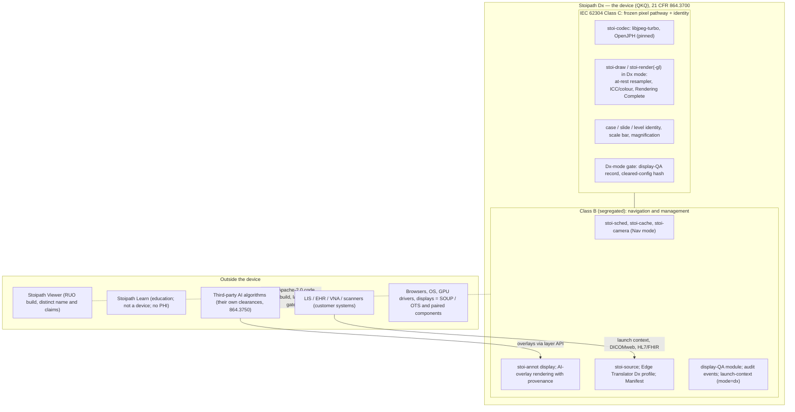
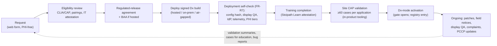
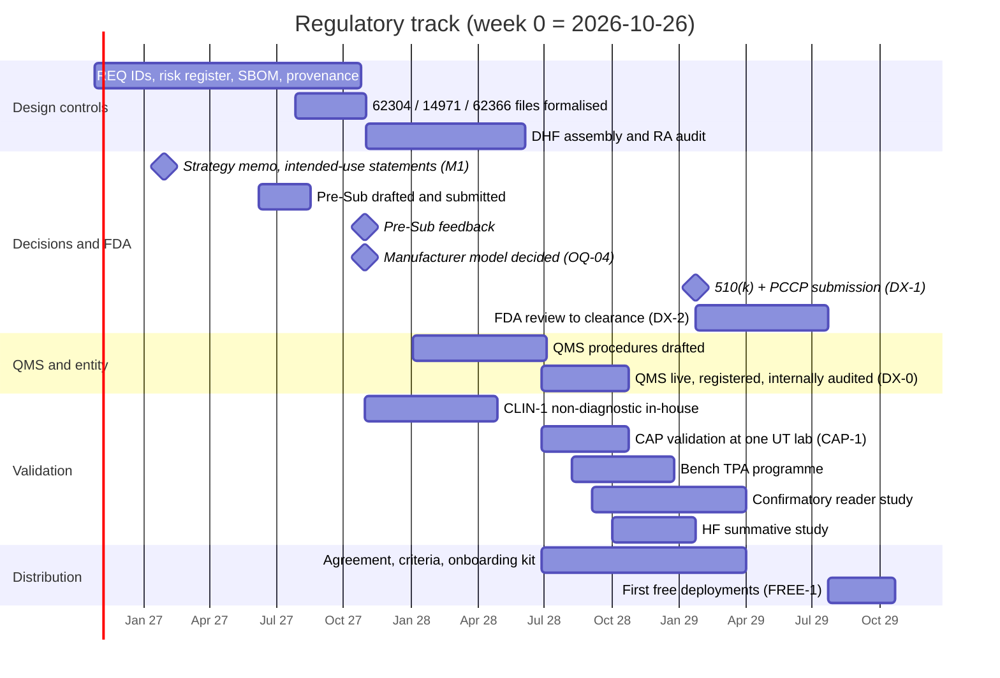

# Regulatory pathway to FDA clearance and the free-distribution model

Section 13 of the Stoipath WSI viewer development plan. Date 2026-10-24. Terminology is that of `arch/recommended.md` §5 (Engine contract, `stoi-*` crates, Edge Translator, Manifest, brightfield/multichannel canonical, Dx mode, Rendering Complete flag, L0–L5, NTF%, TTS, G1–G13, M0–M5) and the milestone IDs of "Roadmap, milestones, team and estimates" §3 (T0, M0, M1, M2, MVP 0.5, v0.7, EDU-1, v0.9, CLIN-1, v1, CAP-1, DX-0, DX-1, DX-2, FREE-1; week 0 = Monday 2026-10-26). Tags: **[verified]** read today from a primary or near-primary source; **[snippet]** read from search-engine extracts of the named source (fda.gov, accessdata.fda.gov, ecfr.gov, govinfo.gov, hhs.gov, law.cornell.edu and innolitics.com all refuse this sandbox's proxy, so no FDA primary text could be opened in full); **[unverified]** domain knowledge for counsel to confirm; **[model]** our estimate from stated inputs.

**What this section owns.** "Risks, compliance, security, licensing and open questions" §3 holds the compliance roadmap *summary* and defers the programme to this section; "Quality, testing and performance QA" §11 and "Autonomous execution model and dissemination plan" §A10 define how repository artefacts become design-control records; "Product pillars" §2 sets the per-pillar regulatory boundary; "Requirements" FR-R7 and FR-R8 are placeholders this section fills. This section decides: the device, its pathway and claims; the QMS and design-control programme; the validation study; who the legal manufacturer is and how a free product pays for its post-market duties; the licence and the regulated-release channel; the qualification and onboarding programme; the phased roadmap, costs and hires; the risks.

**Why it exists at all.** The owner's aim is a cleared viewing platform given free to any hospital system that qualifies. Clearance attaches to intended use and to a controlled build, not to price (21 CFR 807, 820, 803, 806 apply whether or not money changes hands); a free product therefore carries every obligation a sold one does, and must fund them. The programme below is sized so that the research-use phase already produces the Design History File (DHF) as a *view over the repository*, because reconstructing design controls later costs more than the clearance itself (note 10 §1.10: ≈10 % overhead now, prohibitive to retrofit).

## 1. Decisions in one page

| # | Decision | Basis | Owner / gate |
|---|---|---|---|
| 1 | The Dx edition is its own Class II device under 21 CFR 864.3700, product code **QKQ** (software-only "digital pathology image viewing and management software"); pathway **Traditional 510(k)** with a viewer predicate (PathPresenter K250968 or Paige FullFocus K241273) and a **PCCP** for additional cleared scanners, file formats and displays from the first submission. De Novo is not needed | §2.1–2.3; gap-8 F1–F2; Proscia 2026-08-06 PCCP **[verified trade press]** | RA, PO / DX-0 |
| 2 | First pairings: Hamamatsu NanoZoomer S360MD (NDPI) and Leica Aperio GT 450 DX (SVS, DICOM); Barco MDPC-8127 plus one Dell medical display. Tablets, phones and consumer displays stay outside the Dx label until a PCCP display category is accepted | §2.4; every QKQ predicate paired with one of these two scanners **[snippet]** | RA / Pre-Sub |
| 3 | Three named products on one codebase: **Stoipath Dx** (device; frozen, signed build), **Stoipath Viewer** (RUO; "For Research Use Only. Not for use in diagnostic procedures."), **Stoipath Learn** (education; not a device; no PHI by construction). Different names, builds and claims, not a flag | §2.6; FDA RUO/IUO guidance "totality of circumstances" **[snippet]** | PO / MVP 0.5 |
| 4 | IEC 62304 **Class C** for the segregated Dx pixel pathway and case/slide identity; Class B/A for everything else behind an architectural boundary a reviewer can see. FDA software documentation level **Enhanced** | §3.4; **Reviewer note 2** (ADR-014 assumed Class B) | RA, TL / v0.9 |
| 5 | Design controls run from week 0 as repository artefacts (REQ IDs on tests, risk register, SBOM, signed evidence archive); the formal IEC 62304 process document, ISO 14971 file and IEC 62366 file are written at v0.9 on those artefacts; the QMS (QMSR / ISO 13485:2016) is live and internally audited before DX-1 | §3; "Quality" §11; "Autonomous execution" §A10 | RA / v0.9, DX-0 |
| 6 | Validation for the Dx claim = bench programme per FDA's WSI technical-performance assessment + pairing verification + a **confirmatory reader study** (300–400 enriched cases, 4 readers, 2 UT CLIA sites, ≥4-week washout, 4 % non-inferiority margin on major discordance), run after CAP-1, budgeted $150–400 k and 6–9 months, not the $2–5 M pivotal scanner study | §4; predicate designs **[verified PubMed]** | PA, RA / DX-1 |
| 7 | Legal manufacturer: a **UT System component institution** registers as specification developer and holds the first 510(k) (fee-exempt as a State entity if the device is not "distributed commercially", precedent UTHealth/McGovern HeartSee); a **UT-affiliated 501(c)(3)** stewards the Apache-2.0 code, signs distribution agreements, carries insurance and raises funds; 510(k) ownership may transfer to the nonprofit later | §5.1; 21 U.S.C. 379j **[verified statute text]**; HeartSee K202679 under McGovern Medical School **[snippet]** | PO, LC / v0.9 (OQ-04) |
| 8 | Licence stays **Apache-2.0 + DCO** (ADR-010); the cleared edition is a signed, reproducible build whose configuration hash is checked by the Dx-mode gate and published in a **cleared-configuration register**; hospitals may modify anything except the Dx build they use clinically (doing so makes them the manufacturer of a new device) | §5.6; Tidepool, OsiriX MD, OHIF, Tempus consortium precedents **[snippet]** | LC, PO / v1 |
| 9 | "Qualifies" = CLIA certificate + CAP (or equivalent) AP accreditation; commitment to CAP WSI validation with a summary returned; cleared or PCCP pairings only; display-QA programme; IT-security and identity attestation; training; signed regulated-release agreement incl. complaint and adverse-event reporting; no payment, size or affiliation test | §6.1; REDCap consortium-licence template **[snippet]** | PO, RA / v0.9 (OQ-25) |
| 10 | Post-market duties are funded by a service entity, not volunteers: $350–700 k/yr fixed + insurance $25–75 k/yr + 20–30 PM/yr engineering maintenance; sources are NCI ITCR / CPRIT / ARPA-H grants, philanthropy, consortium dues and cost-recovery services (hosting, integration, validation support) | §5.4; gap-8 F8 | PO / v1 |

## 2. Device classification, pathway and claims

### 2.1 What the device is

21 CFR 864.3700 (Class II, special controls; created by the Philips IntelliSite De Novo DEN160056, April 2017) covers "an automated digital slide creation, viewing, and management system intended as an aid to the pathologist to review and interpret digital images of surgical pathology slides" **[snippet]**. Two product codes sit under it: **PSY** for systems that include a scanner and **QKQ** for software-only viewing and management of scanned FFPE surgical-pathology slides **[snippet]**. AI that reads slides is a separate regulation, 864.3750, product code **QPN** (Paige Prostate DEN200080) **[snippet]**. A viewer that *displays* a third-party algorithm's output is image management under QKQ; the algorithm's own clearance carries the rendering-fidelity obligation for its overlays, which is why "System architecture" §9 gives every overlay a provenance tuple and a deterministic Dx-mode path.

> **Reviewer note 1 (terminology; no technical consequence).** Research note 09, "Risks, compliance, security, licensing and open questions" §2.4/§3 and "Product pillars" §2 give the product code as **PSY**. Research note 11-gap-8 corrects this: software-only viewers carry **QKQ** (Sectra K193054 onward; PathPresenter K250968 is QKQ **[verified 510kdatabase.net record]**), and 864.3750 carries **QPN**, not QKQ. Those sections should be amended at assembly.

The special controls, as restated in QKQ/PSY decision summaries **[snippet]**: indications must name the tissue type (FFPE) and the system components; component-level bench data "as appropriate" (for a viewer: the display); system-level bench data (colour reproducibility, spatial resolution, focus, tissue coverage, stitching, turnaround time); a reader study of major-discordance difference against sign-out "as appropriate"; a human-factors engineering process on the user interface; 21 CFR 809.10(b) labelling carrying the sentence "It is the responsibility of a qualified pathologist to employ appropriate procedures and safeguards to assure the validity of the interpretation of images obtained using this device." FDA's 2016 *Technical Performance Assessment of Digital Pathology WSI Devices* guidance is the bench checklist and already names viewer tests: navigation and zoom behaviour, colour, annotation, response time (note 09 F1). Goal 1's measurement stack is therefore regulatory evidence, not only engineering evidence.

### 2.2 What the predicates teach

| Clearance (holder) | Date | Code | Pairings named | Clinical evidence | Lesson |
|---|---|---|---|---|---|
| IntelliSite DEN160056 (Philips) | 2017-04 | PSY | UFS scanner + Philips display | 1,992 cases, 16 readers, 4 sites, 4 % NI margin **[verified, Mukhopadhyay 2018]** | Sets the reader-study template and the 4 % margin |
| Aperio GT 450 DX K232202 (Leica) | 2024-04 | PSY | GT 450 DX + WebViewer DX, local *and remote* stations | 1,161 cases, 10 readers, 3 sites; remote 2.17 % vs local 2.61 % major discordance **[verified, Borowsky 2025]** | Internet viewing stations are validatable |
| FullFocus K241273 (Paige) | 2025-01 | QKQ | adds GT 450 DX (SVS, DICOM) and S360MD (NDPI); "wide set of monitors" **[snippet]** | Bench **[unverified]** | Two scanners and a display *set* in one viewer clearance |
| Clinical Viewer K250968 (PathPresenter) | 2025-06-20, 81 FDA days | QKQ | S360MD (NDPI) + Barco MDPC-8127; Rx only; FFPE; not frozen sections, cytology or non-FFPE **[verified 510kdatabase.net and FDA decision-summary snippet]** | None; bench + predicate **[snippet]** | A viewer clears in under three months with one scanner, one display, no reader study |
| Concentriq AP-Dx (Proscia) | 2026-08-06 | QKQ | adds GT 450 DX, cloud deployment, **PCCP** for additional FDA-cleared scanners, image formats *and displays* without a new 510(k) **[verified trade press: BioSpace, CLP, 360Dx]** | Reuse of earlier multi-site data | The pairing problem is now solved by PCCP, not by a display-agnostic claim |

Pattern: (i) a viewer is a device in its own right, so OEM embedding is optional; (ii) viewer-only sponsors have cleared without reader studies when paired with cleared scanners and displays and showing pixel-pathway equivalence; (iii) S360MD and GT 450 DX appear in nearly every pairing; (iv) FDA review of a viewer is short (MDUFA V goal 90 FDA days; FY2025 met for 97.9 % of 510(k)s; median total time ≈ 142–151 calendar days **[snippet, aggregators]**), so the critical path is our QMS, our evidence and a scanner partner, not FDA.

### 2.3 Pathway options

| Pathway | Fits when | FDA-side cost and time (FY2027 fees **[verified secondary: Registrar Corp, LexisNexis]**) | Verdict |
|---|---|---|---|
| **Traditional 510(k), QKQ, viewer predicate** | Our Dx edition with named pairings | $28,653 (small business $7,163; **$0 for a State entity unless "distributed commercially"**, 21 U.S.C. 379j(a)(2)(B)(iii) **[verified statute text via openjurist]**); 90 FDA days, ≈5–6 months total | **Adopted** |
| **+ PCCP** in the same submission | From the first filing, so each new scanner, format or display is a validation report in the DHF, not a submission | Adds a Pre-Sub cycle and a written modification protocol; general-device PCCP guidance still draft (A-list for FY2027 finalisation, comments to 2026-11-30 **[verified secondary]**), but FDA grants them now (Proscia) under FD&C §515C | **Adopted; scope confirmed in the Pre-Sub** |
| De Novo | Only for a genuinely novel claim (any consumer display; cytology; frozen sections) | $191,020 / $47,755; 150-day goal, 9–12+ months typical **[snippet]** | Avoid; QKQ predicates are dense |
| Special 510(k) | Our own later modification that changes the cleared device beyond the PCCP | Fee as Traditional; 30-day goal, 2025 median ≈30 days **[snippet]** | Occasional |
| Letter-to-file (2017 software-change guidance) | Changes that do not significantly affect safety or effectiveness or intended use | $0; internal memo + verification | **Daily mechanism** for the Dx release train |
| Third-party (3P510k) review | Only if QKQ is on the eligible list | Removes the FDA fee; reviewer charges | Eligibility **unverified** (list unreadable); low value given the fee exemption |
| Component of a partner's cleared system | A scanner vendor adopts the viewer | Partner-paid | Secondary channel, never the plan |
| Pre-Submission (Q-Sub) | Before every one of the above | Free; written feedback in ≈70 days **[snippet]** | **One Pre-Sub at v0.9 with the five questions in §9** |

### 2.4 The pairing problem and what the PCCP contains

No cleared viewer labels "any display" **[snippet]**; the furthest FDA has gone is Paige's "wide set of monitors" and Leica's remote stations, and the first crack in the triplet model is Proscia's PCCP. Our PCCP therefore has three modification categories, each with a protocol, acceptance criteria and a labelling-update procedure, and all three are exercised by evidence the device lab already produces:

| Category | Modification allowed under the plan | Verification protocol (all machine-run except the human-factors check) | Acceptance |
|---|---|---|---|
| **Scanner / file format** | Add an FDA-cleared scanner's native output (NDPI, SVS, DICOM WSI from Philips, 3DHISTECH, Roche DP 600, Epredia E1000 Dx) or a new transfer syntax (HTJ2K) | G7-class decoder hash identity on the vendor corpus; byte-passthrough proof (frame-byte hash against vendor tiles, `recommended.md` §3.1 step 3); colour-target and resolution-phantom slides scanned on the new device, rendered in Dx mode and compared to the reference pathway; golden gesture replay identical to the cleared build | ≤1 LSB on goldens; 0 identity failures; colour ΔE and resolution within the limits set in the first submission |
| **Display** | Add a display that meets a published **display class**: ≥8 MP (27″ 4K) IPS, ≥300 cd/m² calibrated, ≥1000:1, ≥100 % sRGB, 10-bit, pixel pitch range, with a QA programme (gap-1 F4, Xiong 2026 recommendations **[verified abstract]**) | Photometric and colorimetric characterisation; ICC chain test; display-QA module records pass; summative HF spot-check on critical tasks if the form factor changes | Within class limits; HF no new use errors |
| **Deployment** | Cloud (hosted Edge Translator), on-prem, air-gapped topology (`recommended.md` §3.1 deployment table) | Same M1 suite behind each topology; capability-token and PHI-tier tests; latency gates per class (TTS, NTF = 0 at rest) | Gates pass; no change to the pixel pathway |

What stays *out* of the PCCP and would need a new 510(k): any change of intended use (frozen sections, cytology, non-FFPE, multichannel fluorescence as a Dx claim), a new decoder or resampler at rest, and any display below the class. Tablets (W-iPad, N-iPad) and phones remain consultation, education and research surfaces; "Cross-platform delivery" §10 already enforces this through the `mode` field and the display-QA gate.

**Design consequence for goal 1.** The *frozen pixel pathway* is defined narrowly: `stoi-codec` (libjpeg-turbo 3.2, OpenJPH pinned), the at-rest resampler and colour transform in `stoi-draw`/`stoi-render`, the Rendering Complete logic, and case/slide identity. The scheduler, prefetch predictor, caches and transient blend (`stoi-sched`, `stoi-cache`, Nav-mode filtering) are *navigation* machinery: changes there are verified by the golden gesture replay and the M-gates and documented by letter-to-file, because the settled Dx frame they deliver is bit-identical by construction (ADR-007: the moving image is navigation; the Dx image is the settled frame). This keeps instant-zoom engineering free to evolve for the life of the clearance.

### 2.5 Intended use and indications (draft for the Pre-Sub)

> **Stoipath Dx** is software intended for viewing and managing digital whole slide images of formalin-fixed, paraffin-embedded (FFPE) surgical pathology tissue acquired by the FDA-cleared scanners listed in the labelling, displayed on the displays listed in the labelling, as an aid to the pathologist to review and interpret these images for primary diagnosis. It is not intended for use with frozen-section, cytology or non-FFPE specimens. It is the responsibility of a qualified pathologist to employ appropriate procedures and safeguards to assure the validity of the interpretation of images obtained using this device. Rx only.

Companion statements: Stoipath Viewer carries "For Research Use Only. Not for use in diagnostic procedures." (21 CFR 809.10(c)(2)(i) **[unverified wording]**); Stoipath Learn carries "For educational use. Not a medical device. Contains no protected health information." In-house clinical use before clearance (CLIN-1 non-diagnostic; CAP-1 primary diagnosis at the validating UT lab) runs under the *laboratory's* validated-system labelling and CLIA/CAP, not under any Stoipath Dx claim (gap-7 F6; FDA LDT rule rescinded 2025-09-19 **[snippet]**).

### 2.6 Device boundary

Segregation is an architectural fact, not a label: Class C code lives in named crates with no shared mutable state across the boundary, the Dx-mode gate refuses to start without a display-QA record and a matching configuration hash, and the education package is a separate package over public core APIs (ADR-019). The education and research products are not devices (FDA's device-software policy lists educational tools as non-device examples **[unverified]**; the January 2026 CDS revisions keep image-analysis software out of the CDS carve-out **[snippet]**, so no image-viewing function can shelter there).

## 3. QMS and design-control programme

### 3.1 QMS scope and tooling

Since 2026-02-02, 21 CFR 820 incorporates ISO 13485:2016 by reference (QMSR) and FDA inspects under Compliance Program 7382.850 **[verified, "Risks" §3 sources]**. The manufacturer is a *specification developer* that releases software; there is no production floor, so the QMS is small: quality manual and clause map; document and record control; management review; internal audit; training and competence; supplier controls (cloud providers, codec and crate suppliers, scanner and display vendors as data suppliers, **the agent toolchain as a qualified tool**); design controls with a DHF per Dx release train; IEC 62304 lifecycle incl. SOUP; ISO 14971; IEC 62366-1; cybersecurity plan; production and release (reproducible signed builds, configuration manifests); complaint handling, MDR, corrections and removals, CAPA; UDI/GUDID; labelling. ISO 13485 *certification* is not an FDA requirement but hospitals and any later IVDR/UKCA route ask for it; quotes for a <50-person organisation are $22–83 k initial **[snippet]**.

Tooling follows Tidepool's qmsOS, which is ISO 13485:2016-certified by TÜV SÜD America (April 2025) and runs on Google Workspace, Jira and Confluence **[verified Tidepool/BusinessWire]**: our equivalent is the repository itself (requirements, risk, ADRs, provenance ledger, evidence archive under `docs/qms/` and `requirements/`, `risk/`, `provenance/`), with controlled documents rendered from Markdown and electronic signatures recorded per "Autonomous execution" §A10. An eQMS ($10–30 k/yr entry **[snippet]**) is bought only when audit load justifies it, at DX-0 at the earliest.

### 3.2 Design inputs, outputs and traceability

The DHF is a generated view over repository artefacts ("Quality" §11; "Autonomous execution" §A10). What this section adds is the *baseline discipline* the Dx edition needs on top of the RUO flow:

| DHF element | Repository artefact | Exists from | Dx-edition addition |
|---|---|---|---|
| Design and development plan | `docs/qms/ddp-<train>.md` | v0.9 | Per Dx release train; names the frozen pixel pathway and the PCCP categories |
| Design inputs (user needs, SRS) | `requirements/REQ-*.yaml` with pillar, risk links, verification method ("Requirements" §1) | M0 | **Design-input baseline** signed per train; intended-use statement as REQ-0001 |
| Design outputs | Signed artefacts, SBOM, configuration manifest, IFU | MVP 0.5 | Cleared-configuration register entry |
| Design review | ADRs (MADR) with approver and date | M0 | Formal review minutes at baseline, pre-verification, pre-release |
| Design verification | REQ-tagged tests; gate JSON; goldens; device-lab and WALT runs; traceability matrix (≥90 % at M1, **100 % for Dx**) | M0 | Verification report per train, signed |
| Design validation | CAP-1 concordance export; reader study; summative usability | CAP-1 | Validation report; residual-risk statement |
| Design transfer | Release checklist, install-from-registry smoke, Dx channel | MVP 0.5 | Signed-build custody, media for air-gapped sites |
| Design changes | ADR superseding ADR; letter-to-file memo; PCCP validation report | M0 | "Significant change" checklist from the 2017 software-change guidance **[snippet]** |

### 3.3 Risk management (ISO 14971)

The risk file opens at M1 ("Quality" §11) and is the one artefact where goal 1 and the Dx claim meet: the hazards that matter are *rendering* hazards, and the controls are the gate metrics. Risk acceptability: any hazard whose harm is "missed or wrong diagnosis" must have a control verified by an automatic test; residual risk is accepted only by the signing pathologist and RA.

| Hazard (HAZ-) | Cause | Harm | Control (REQ) | Verification (gate metric) |
|---|---|---|---|---|
| Magnified or stale tile presented as final image | LOD policy, slow network, cache | Missed small object (microorganism, mitosis) | Never-magnify-at-rest; Rendering Complete flag; Dx mode refuses to show "complete" while NTF > 0 | NTF = 0 at rest on every replayed path; blank-pixel frames = 0; Rendering Complete asserted before any Dx-mode indicator |
| Wrong tile identity (level, x, y) under throttling | Scheduler/cancel bug (endemic in Mapbox/OL, "Risks" T13) | Tissue from the wrong region | Fiducial synthetic slides; replay with recorded byte-arrival | 100 % fiducial identity in Tier-1 CI per PR |
| Wrong slide or case shown | Launch-context mismatch, LIS sync | Diagnosis on another patient's slide | Accession/slide ID echoed and checked at open; audit event | Contract tests against Beaker-shaped messages; HF critical task |
| Colour shift | ICC dropped, display drift, decoder variance | Mis-graded stain, missed IHC | Server-baked ICC in Dx; libjpeg-turbo identity (G7); display-QA cadence | ≤1 LSB goldens; G7 1,000/1,000; display-QA record present |
| Resolution loss across pyramid levels or resampling | Level synthesis, filter at rest | Information loss below ×10-equivalent (Zarella 2018) | Bicubic transients only; no sharpening at rest; synthesised levels mozjpeg q≥90 | Resolution-phantom bench test per release |
| Scale bar / magnification wrong | DPR cap, display pitch, metadata | Measurement error, grading error | µm frame from metadata; display pitch from QA record | Measurement accuracy test (µm) per display class |
| Annotation or AI overlay misregistered | Affine, coordinate frame, version skew | Wrong region flagged or treated as negative | Layer provenance tuple; deterministic overlay path | Overlay golden per release; vendor validation contract |
| Dx mode on an unvalidated display or modified build | User, admin, hospital modification | Diagnosis outside validated conditions | Dx gate: display-QA record + cleared-config hash | Gate test; attestation telemetry (PHI-free) |
| PHI exposure via label/macro/barcode | Tiering failure, cache header | Privacy breach | Three PHI tiers; Tier 2 never at the edge | CI asserts no public cache header on Tier 2 |
| Unavailability (DoS, outage, expired token) | Infrastructure | Delayed diagnosis | Offline pack; glass remains available; RTO targets | Restore drill record |
| SOUP failure (browser auto-update, GPU driver) | Platform change | Any of the above | Supported-platform list in labelling; nightly goldens on the matrix; anomaly monitoring | Matrix goldens; CVE/anomaly log |

### 3.4 IEC 62304: safety class, lifecycle and SOUP

**Class.** For a primary-diagnosis viewer the pathologist is the *user*, not an external risk control, and glass is by design not re-reviewed; a silent rendering fault can therefore contribute to a missed carcinoma (serious injury). The pixel pathway and identity functions are **Class C**; with §4.3 segregation the navigation, annotation, management, education and research functions are Class B or A. FDA's June 2023 software guidance replaced Level of Concern with Basic/Enhanced documentation **[snippet]**; expect **Enhanced**.

> **Reviewer note 2 (classification, affects documentation volume, not architecture).** "Executive summary" §7.5, "Quality" §11 and "Risks" ADR-014 assume IEC 62304 **Class B** pending the Dx intended use. This section recommends **Class C for the segregated pixel pathway** and Class B/A elsewhere, which is what ADR-014's own re-open trigger ("Pre-Sub feedback assigns Class C") anticipates. The practical difference is detailed-design documentation and unit-level verification *for the Class C crates only* (`stoi-codec`, the Dx paths of `stoi-draw`/`stoi-render`, identity), which the golden tests and G7 already provide. Confirm in the Pre-Sub; until then plan for Class C.

**Lifecycle mapping** (IEC 62304 §5–§9): development planning (§5.1) = the design and development plan and the agent toolchain qualification (tools are configuration items, §5.1.4); requirements (§5.2) = `requirements/`; architecture (§5.3) = `recommended.md` and "System architecture" with the segregation argument; detailed design (§5.4) = crate-level docs for Class C only; unit implementation and verification (§5.5) = nextest with REQ tags, Criterion, fuzzing; integration and system testing (§5.6–5.7) = Tier 1–4 harness, device lab, gesture replay; release (§5.8) = signed artefacts, configuration manifest, residual-anomaly list; maintenance (§6) = Dx release train with letter-to-file and problem-resolution records; risk management (§7) = `risk/`; configuration management (§8) = pinned, hashed dependencies, vendored wgpu, reproducible builds; problem resolution (§9) = issue tracker categories `complaint`, `safety`, `anomaly` feeding CAPA.

**SOUP and platform.** Everything not written by the project is SOUP or off-the-shelf software; FDA's August 2023 OTS guidance wants identification, hazard analysis, verification and a maintenance plan **[snippet]**. Agent-generated code is **not** SOUP: it is in-house code with full verification obligations, with the agent model, version and prompt hash recorded in the provenance ledger ("Autonomous execution" §A6) because a reviewer will ask how a largely machine-written codebase was verified.

| SOUP / platform item | Class exposure | Pinning and version control | Anomaly monitoring | Verification per bump |
|---|---|---|---|---|
| libjpeg-turbo 3.2, OpenJPH (one pinned version), zstd | C | Vendored source, hash in SBOM; one build for native and wasm | Upstream issues, OSV, CVE | G7 1,000/1,000 identity incl. arm64; goldens |
| Rust toolchain 1.99, wasm-bindgen, wasm-opt, Emscripten | C (build tool) | MSRV N-2; toolchain file; reproducible build check | Rust security advisories | Full test suite; reproducibility diff |
| wgpu 30.x + naga; `web-sys` WebGL2 bindings | C (Dx render path) | Vendored and pinned per train; upgrade window gated on G3/G4/G10 | `gfx-rs/wgpu` issues (#4081, #3735, #10460) | WGSL↔GLSL goldens ≤1 LSB on four GPU families |
| `tiff`, `dicom-object`/`dicom-pixeldata`, `zarrs`, `turbojpeg`, `axum`/`hyper` | B/C (identity and bytes) | Cargo.lock; `cargo deny`; SBOM diff is a required PR check | OSV weekly | Reader fuzz 60 s/PR, 24 h nightly; third-party-reader smoke |
| Browsers (Chrome, Edge, Firefox, Safari), WKWebView, OS, GPU drivers | C (platform, uncontrolled updates) | Supported-platform list in labelling with minimum versions; Safari per-major allow-list | Browser release notes; field telemetry anomaly rate | Nightly goldens on the browser/OS matrix; `createImageBitmap` self-cert matrix (G8); "Restart with WebGL2" |
| Displays (paired) | Component of the device | Display class spec; QA cadence | Display-QA module logs | Photometric check per cadence; PCCP protocol |
| Edge Translator runtime (Cloudflare Workers, Caddy/nginx, MinIO/S3) | B (bytes passthrough is hash-checked) | Pinned images; cosign | Vendor advisories | M1 suite behind each topology |

### 3.5 Usability engineering (IEC 62366-1 and the 2026 HF guidance)

FDA finalised *Content of Human Factors Information in Medical Device Marketing Submissions* on 2026-05-29 (risk-based categories, a new Decision Point D weighing UI history of use, complexity and existing risk controls; eSTAR asks for the HF category from 2026-08-01) **[verified secondary: FDA Law Blog, NSF, Emergo]**, and 864.3700 independently requires an HF engineering process. The use specification comes from gap-1 (navigation dynamics, perceptual tolerance); critical tasks are: confirm slide and case identity; know the current magnification and scale; recognise the Dx-mode and Rendering Complete indicators; see display-QA status; persist and attribute annotations; distinguish AI overlays from tissue. Formative evaluation = the Stage-1 reader study (gap-1 F9, n ≈ 8–12, weeks 14–24) plus gesture logs and CLIN-1/CAP-1 observation; summative validation on the frozen Dx edition with ≥15 pathologists per distinct user group (FDA's 2016 HF guidance convention **[unverified]**) on the critical tasks, on paired displays, with use-error root-cause analysis. Budget 3–5 months and $60–120 k with an HF consultant **[model]**.

### 3.6 Cybersecurity (§524B, February 2026 guidance)

FD&C §524B requires, for cyber devices, a cybersecurity plan with post-market vulnerability monitoring and coordinated disclosure, secure-development evidence and an SBOM. The governing guidance is *Cybersecurity in Medical Devices: Quality Management System Considerations and Content of Premarket Submissions*, dated 2026-02-03, superseding the 2025-06-27 version **[verified: FDA PDF title/date via search extract; RAPS]** — this closes "Risks" OQ-11. The security architecture of "Risks" §4 already produces most deliverables; the device-specific additions are:

| Deliverable | Content | Produced by | When |
|---|---|---|---|
| Security risk management report (separate from safety risk) | Threat model per architecture view (client, Edge Translator, ingest, LIS integration, update channel); CVSS-rated risks; controls | RA + security engineer | v1 (DHF audit) |
| SBOM | SPDX and CycloneDX per artefact, with known-vulnerability assessment and support-status of each component | CI on every release | MVP 0.5 |
| Secure product development framework evidence | Fuzz-first readers, sandboxed parsers (wasm; gVisor/Firecracker on ingest), signed reproducible builds, SLSA provenance, OIDC publishing | CI | MVP 0.5 |
| Vulnerability management plan | OSV monitoring; triage ≤72 h; critical fix or compensating control ≤30 days; CVD policy with 90-day window; `security.txt`; ISAO membership (Health-ISAC) | Security engineer | v0.9 |
| Update and patch mechanism | Signed Dx channel; forced-update path for security patches; media updates for air-gapped sites; installed-base registry | Release engineering | v1 (FR-R8) |
| Labelling | Security architecture summary, SBOM availability, supported-platform list, end-of-support dates | RA | DX-1 |
| Penetration test | Annual third-party test on hosted and on-prem topologies | External | v1, then yearly |

The EU Cyber Resilience Act reaches even the RUO build (reporting duties since 2026-09-11, full obligations 2027-12-11 **[verified secondary]**), so these artefacts are not optional for Stoipath Viewer either ("Risks" OQ-12 on manufacturer-vs-steward status stays open).

### 3.7 Verification and validation strategy: lab evidence as regulatory evidence

| Special control or standard | V&V evidence | Where it already exists |
|---|---|---|
| Component bench: display | Photometric and colorimetric characterisation per paired display; display class spec; QA cadence | Display-QA module (v1); PCCP display protocol |
| System bench: colour reproducibility | ICC chain test with calibrated colour-target slides scanned on each paired scanner; ΔE limits; ≤1 LSB goldens; G7 decoder identity | Golden-image tests ("Quality" §4); G7 |
| System bench: spatial resolution / no information loss | Resolution phantoms and synthetic fiducial slides across every pyramid level and the at-rest resampler; synthesised-level quality | Fiducial synthetic slides ("Quality" §3.1); mozjpeg q≥90 rule |
| System bench: navigation, zoom, response time | TTS, NTF%, blank-pixel frames, I2P vs REF, Rendering Complete timing per device class and network profile, on real devices with the WALT/photodiode rig | M1/M2 gates; device lab; "Instant-zoom engineering" §15 |
| Annotation and measurement fidelity | µm-aware geometry tests; overlay goldens; provenance tuple checks | `stoi-annot` tests; education region-marking scorer |
| Slide/case identity integrity | Launch-context contract tests; fiducial identity; audit events | Clinical integration contract tests |
| Determinism and configuration control | Golden gesture replay identical on every platform; cleared-configuration hash; reproducible build diff | ADR-001; release pipeline ("Cross-platform delivery" §7) |
| Human factors | Formative (reader study, CLIN-1) and summative reports | §3.5 |
| Software V&V (IEC 62304) | Unit/integration/system tests with REQ tags; traceability 100 %; anomaly list | "Quality" §11 |
| Clinical validation | CAP-1 concordance; confirmatory reader study | §4 |
| Claims-verification discipline | Every quantitative statement in labelling and the submission carries a `[measured]`/source tag; `docs/external/**` CI check | "Risks" D5 |

Every row is an artefact an agent produces and a human signs; the Dx submission's performance section is the signed **verification evidence archive** of the frozen train ("Quality" §11), re-run on the paired scanners' corpora and displays.

### 3.8 Labelling and UDI

Labelling (21 CFR 801, 809.10(b)): IFU with intended use (§2.5), the pathologist-responsibility sentence, named scanners/formats/displays or the PCCP display class, supported platforms with minimum versions, display-QA cadence and acceptance limits, network requirements per device class (the §4.4 tables of `recommended.md` become the labelled performance envelope), security summary, Rx only, contraindications (frozen, cytology, non-FFPE), the "cleared configuration" identifier. UDI (21 CFR 801.50 **[verified, "Risks" §3]**): stand-alone software displays its UDI in plain text at start-up and in an About screen; the production identifier carries the version; one device identifier per Dx major with GUDID entries; the labeler is the manufacturer entity. The RUO and Learn builds carry version and SBOM identifiers but no UDI.

## 4. Clinical and analytical validation for the Dx claim

### 4.1 What predicates needed versus what a viewer needs

Scanner-system sponsors ran 1,161–2,047-case, 10–19-reader, 3–5-site, randomised, blinded, crossover non-inferiority studies against the original sign-out, with adjudication of major versus minor discordance, a 4 % margin on the upper 95 % confidence bound of the WSI-minus-glass major-discordance difference, and washouts of ≥4 weeks (Philips 1,992 cases/16 readers/4 sites; Leica AT2 DX 2,045/19/5; Hamamatsu 2,000 cases/4 sites, 28 months; Leica GT 450 DX 1,161/10/3 incl. remote; Roche 2,047 plus a 23-feature precision study) **[verified PubMed; ClinicalTrials.gov NCT03991468]**. Viewer-only sponsors cleared on pixel-pathway equivalence to the predicate on named scanner formats and displays; PathPresenter's record shows bench testing only **[snippet]**. Our plan is the viewer plan with cheap insurance.

### 4.2 Evidence plan

1. **CAP validation at one UT CLIA lab (CAP-1, W87–104).** ≥60 cases per application (routine H&E first; frozen and haematopathology are separate applications), glass vs Stoipath on the actual displays and network, ≥2-week washout, intra-observer concordance ≥95 %, revalidation triggers recorded (Evans et al. 2021/2022; GEN.52900/52920 **[snippet]**). Run with the in-product CAP tooling (FR-R1). Purpose: enables in-house primary diagnosis under enforcement discretion, is the IEC 62366 formative evaluation in the real environment, and pilots the reader-study instrument. Cost: 10–20 pathologist-hours per application, $10–25 k opportunity cost each **[model]**.
2. **Analytical bench programme (W90–W117).** §3.7 rows on the two paired scanners' corpora (vendor-supplied test slides plus the public conformance corpus) and the two paired displays; latency envelope on the W-LAN and N-Desk classes that the Dx label will name. $50–150 k incl. colour targets, phantoms, photometer and a borrowed Barco MDPC-8127 **[model]**.
3. **Confirmatory reader study (W95–W125, overlapping the submission build).**

| Element | Design | Rationale |
|---|---|---|
| Question | Major-discordance rate of Stoipath Dx reads vs glass reads, each against the original sign-out diagnosis as reference, adjudicated | Predicate convention; a cleared-viewer comparator arm is optional and adds cost without changing the claim |
| Hypothesis | Non-inferiority: upper bound of the two-sided 95 % CI of (Dx − glass) major discordance < 4 % | Predicate margin |
| Cases | 300–400 enriched FFPE surgical cases across ≥6 organ systems incl. difficult categories; archival, de-identified; scanned on S360MD and GT 450 DX (half each) | Enough for the primary endpoint; organ-level estimates are descriptive only |
| Readers and design | 4 board-certified pathologists, 2 sites (e.g. UTHealth Houston/Memorial Hermann and UT Southwestern; MD Anderson, UTMB or UT Health San Antonio as alternates); randomised, blinded crossover; each reader reads every case in both modalities; ≥4-week washout | Paired design; readers blind to prior results |
| Power **[model]** | With ≈4 % major discordance in both arms, a 4 % margin, one-sided α = 0.05 and 80 % power, an unpaired approximation needs ≈300 reads per arm; the paired crossover with 4 readers yields 1,200–1,600 paired reads, so 300–400 cases is conservative and leaves room for per-reader estimates | Predicates used ≈2,000 cases for organ-system subgroups and 4–5 sites, which a viewer does not need |
| Displays and environment | The two paired displays in the readers' clinical reading rooms; display QA logged daily; TTS/NTF% logged per read (PHI-free) | Also yields the first efficiency data on the Dx edition |
| Reference and adjudication | Original sign-out; 2-pathologist adjudication panel, third for ties; major = would change patient management | Predicate practice |
| Ethics and IDE | IRB approval, likely exempt or expedited as secondary research on de-identified archival material (45 CFR 46.104(d)(4)) **[unverified]**; IDE-exempt diagnostic-device study under 21 CFR 812.2(c)(3) since results do not affect patient care and are confirmed by the established diagnosis **[unverified; counsel to confirm]** | The pivotal WSI studies ran as IRB-approved retrospective reader studies |
| Timeline and cost **[model]** | 6–9 months; 2,400–3,200 reads × ≈5 min ≈ 200–270 pathologist-hours, adjudication ≈100 h, curation and scanning ≈300 h, biostatistics, data management: **$150–400 k** external, lower inside the department | Versus $2–5 M and 18–30 months for a pivotal scanner-class study |

4. **Precision/reproducibility (only if FDA asks in the Pre-Sub).** Intra- and inter-reader agreement on a 20–25-feature set (Roche's 89–90 % agreement, lower bound ≥85 % **[verified, Wharton 2025]**) using the same case set; +$50–100 k.

What the study can claim: non-inferiority of primary-diagnosis reads on the named pairings. What it cannot: display-agnostic or tablet performance, frozen-section or cytology use, efficiency gains (the field's data say digital remains ≈19 % slower per case than glass; gap-1 F2), or patient-care impact. This is also the line the TSP abstract must not cross before the study exists ("Risks" R15).

## 5. Legal manufacturer, organisation, funding, liability, licence

### 5.1 Who holds the clearance

| Criterion | A. UT component institution | B. UT-affiliated 501(c)(3) | C. Independent multi-institution nonprofit | D. Commercial OEM holds it |
|---|---|---|---|---|
| Precedent | McGovern Medical School / UTHealth Houston holds HeartSee 510(k)s (K202679 under McGovern Medical School; K171303, K231731 lineage) **[snippet; K231731 applicant unconfirmed]** | Gradian Health Systems (CE); university foundations | Tidepool Loop K203689 (first FDA-cleared open-source AID app; nonprofit; ISO 13485 QMS) **[verified]** | Sectra, Paige, PathPresenter, Proscia |
| FDA fees | **$0** for 510(k) and establishment if not "distributed commercially" (379j) **[verified statute]**; else full | Small-business status for a non-tax-filer **unresolved** | Same as B | Partner pays |
| Liability | Texas Tort Claims Act caps $250 k/person, $500 k/occurrence; information and computer output held not "tangible personal property" (*UTMB v. York*, *Sawyer*) **[snippet]**; **cannot indemnify** (Tex. Const. art. III §49) | Charitable Immunity and Liability Act caps ($500 k/$1 M) if insured ≥$1 M; may indemnify within insurance | Same as B; insurance $25–75 k/yr **[unverified]** | Partner carries |
| QMS and hiring | Compliance, IRB, CLIA lab, IT security exist; hiring slow | Build QMS from zero (qmsOS template); hiring fast | Multi-party governance overhead | Partner's QMS; we supply DHF components |
| IP and licence | Regents' Rule 90101: Board owns software; OSS release via campus technology-commercialisation procedure **[snippet]** | Needs assignment or licence from UT | Licence from UT; neutral steward | Partner controls cadence |
| "Free to any hospital" credibility | Credible; state contracting with out-of-state hospitals is slow | Credible; standard agreements | Most credible | Not credible unless bound |
| Verdict | **Hold the first 510(k) and the establishment registration** | **Steward code, agreements, insurance, fundraising; candidate later 510(k) holder** | Target state once ≥3 health systems commit | Opportunistic second channel only |

**Recommended hybrid.** The UT component institution whose CLIA lab runs CAP-1 registers as specification developer (21 CFR 807), lists the device and files the 510(k); a UT-affiliated 501(c)(3) (or a Linux-Foundation-style project) holds the trademark, stewards the Apache-2.0 repository, signs the regulated-release agreements, carries insurance and raises philanthropy; transfer of 510(k) ownership to the nonprofit is permitted by FDA with listing updates **[unverified]** and is the planned end state once dues and grants sustain it. Decide with UT System OGC and the campus OTC by v0.9 ("Risks" OQ-04).

**"Free" is legally ambiguous; ask, do not assume.** 21 CFR 807.3(b) defines commercial distribution as distribution of a device "held or offered for sale" **[verified eCFR text, "Risks" §3]**, and CPG Sec. 300.600 (1987) lists the conditions FDA uses: offered for sale for a specific intended purpose without limitation, at least one purchase order accepted or ready to be accepted, not offered only for research or investigational use, with documentation **[verified via search extract of fda.gov listing]**. Nothing found addresses no-charge distribution. Two readings: (a) free distribution is not "commercial" — then the 379j fee exemption applies but, strictly, 510(k) would not be *required*, which is not the posture we want (we want the clearance, and the misbranding and QMSR duties attach to any device in interstate commerce regardless); (b) free distribution is "commercial" — then fees apply ($28,653 + $13,785/yr, or small-business rates if obtainable) and the exemption is lost. The plan assumes **we file regardless**, budgets the fees as a range ($0–45 k), and puts the question in the Pre-Sub ("Risks" OQ-01, owner LC, due M1 for the written position; FDA answer by v0.9).

### 5.2 Establishment registration, listing and recurring obligations

Register and list before the first Dx distribution (FURLS/DRLM), renew annually (1 Oct–31 Dec), pay the establishment fee unless exempt, maintain GUDID records per device identifier, keep the Medical Device File (QMSR term for the DMR) current per Dx train.

### 5.3 Post-market obligations that a free product still carries

| Obligation | Rule | Product mechanism (FR-R8) | Cost driver |
|---|---|---|---|
| Complaint handling | 21 CFR 820 / ISO 13485 §8.2.2 | Complaint intake from each site's named administrator and from the About screen (PHI-free form), triage categories `complaint`/`safety`/`anomaly`, trending at management review | Support lead 0.5–1 FTE |
| Medical device reporting | 21 CFR 803 (30-day reportable malfunction/serious injury; 5-day; eMDR) | Safety-triage procedure; reportability decision tree; eMDR account | RA 0.3 FTE |
| Corrections and removals | 21 CFR 806 (report within 10 working days when a correction reduces a risk to health; routine cyber patches generally not **[unverified]**) | Installed-base registry lists affected versions and sites; field safety notice to registered contacts; Dx-mode notice banner keyed to the configuration hash | Registry + release engineering |
| Recall | 21 CFR 7 | Forced-update channel for security; media for air-gapped sites; annual mock-recall drill | Drill 2 days/yr |
| CAPA, internal audit, management review | ISO 13485 §8.5, §8.2.4, §5.6 | Issue tracker → CAPA records; yearly audit | QA 0.5 FTE |
| Post-market cybersecurity | §524B; Feb-2026 guidance | §3.6 vulnerability plan; SBOM refresh per release | Security 0.5 FTE |
| Labelling and UDI maintenance | 21 CFR 801 | Per Dx release | RA |
| PCCP validations | FD&C §515C | Per new pairing: protocol run, report filed in DHF, labelling update | 2–6 PM per pairing **[model]** |

Lean steady state: 0.5 FTE quality, 0.5–1.0 RA, 0.5 security, 0.5–1.0 support, shared engineering; **$350–700 k/yr** including tooling and fees, largely independent of the number of hospitals until complaint and interface volume grows **[model, gap-8]**. Engineering maintenance of the platform itself (security patches, platform SOUP bumps, pairing additions) adds 20–30 PM/yr ("Roadmap" §9), ≈$0.5–0.8 M/yr at loaded human rates, less under agent execution for the implementation share only.

### 5.4 Funding and sustainability

| Source | Mechanism | Scale | Fit |
|---|---|---|---|
| NCI ITCR | R21 / U01 / U24 (Emory's U24 funded the Digital Slide Archive, $3.5 M/5 yr) **[snippet]** | $0.2–0.75 M/yr direct | Best fit for the RUO core and sustained support |
| CPRIT (Texas) | SEED up to $3 M; TDDC "no maximum"; Core Facility Support $2–3 M/5 yr **[snippet]** | $0.5–20 M | Product-development awards need a Texas company → the 501(c)(3); CFSA suits a UT core |
| ARPA-H | INDEX-type pathology/radiology exchange programmes **[snippet]** | $1–20 M | Watch for the next solicitation |
| Philanthropy | Helmsley to Tidepool: $0.9 M + $0.3 M, $2 M, $3 M tranches **[snippet]** | $1–3 M tranches | Realistic for a nonprofit holder with a cleared product |
| Consortium dues | tranSMART-style tiers ($5–100 k/member/yr) **[snippet]** | 20 members × $50 k = $1 M/yr | Funds post-market and support; members get roadmap votes |
| Cost-recovery services | Hosting (BAA), integration engineering, validation support, training, premium SLA | Priced at cost; REDCap charges for Vanderbilt-hosted instances **[snippet]** | Keeps "free software" honest; the UT System itself is a customer |
| UT System | Internal investment as the first beneficiary (licence lines replaced; gap-7 F7) | Programme budget | Owner's thesis: invest in care, not subscriptions |

Honest arithmetic **[model]**: steady state is ≈$1.0–1.6 M/yr (post-market $0.35–0.7 M + maintenance $0.5–0.8 M + insurance). An endowment covering that at a 4–5 % draw is $20–40 M, which is not realistic early; the realistic mix is grants for development, dues plus services for operations, and the UT System's own avoided subscription costs as the first and largest contributor. A funding cliff is risk RX-6 (§8).

### 5.5 Liability and indemnification

A UT holder cannot indemnify hospitals (art. III §49) **[snippet]**; hospitals will therefore ask for insurance or a nonprofit counterparty — which is what the 501(c)(3) provides, with product liability + tech E&O + cyber at $5 M limits ($25–75 k/yr **[unverified]**; hospital contracts commonly demand $5–10 M **[snippet]**). The regulated-release agreement allocates risk the way CAP already does: the laboratory validates and is responsible for its use of the system; the manufacturer is responsible for conformity of the cleared build to its labelling; mutual limitation of liability; no warranty beyond labelling; hospitals report complaints and adverse events; a hospital that modifies the Dx build and uses it clinically is the manufacturer of its own device (the OsiriX/Horos warning **[snippet]**). Sovereign-immunity scope for out-of-state claims and the affiliated foundation's ability to indemnify are OGC questions (gap-8 Q8).

### 5.6 Open-source licence and the regulated-release channel

Apache-2.0 + DCO stays (ADR-010; patent grant, hospital-procurement compatibility, one-way GPLv3 compatibility; AGPL rejected). Clearance attaches to the holder's device — a specific build, SBOM, configuration manifest and labelling — never to the code (Tidepool Loop; OsiriX MD K101342 vs the uncleared Lite/Horos; OHIF "not FDA cleared" yet the base of many cleared viewers; Tempus's IMS Open-Source Consortium with Yale New Haven and MSK, announced 2026-06-03, open-sourcing the Paige IMS incl. the cleared FullFocus viewer **[verified trade press]**; licence terms of that consortium are still unpublished, which argues for staying at Apache/MPL so we can consume or contribute).

| Mechanism | Technical | Legal |
|---|---|---|
| Controlled build | Reproducible builds; Sigstore/cosign signatures; SLSA provenance; SBOM; configuration manifest; **configuration hash baked into the Dx-mode gate**; About screen with UDI, version, hash | The agreement defines "Cleared Configuration" by hash and register entry |
| Cleared-configuration register | Public page listing every cleared train: hash, SBOM, labelling, pairings, supported platforms, end-of-support | Labelling incorporates it by reference |
| Attestation | PHI-free start-up attestation of build hash and display-QA status to the installed-base registry; Dx mode shows a persistent "unverified build" banner otherwise | Duty to run only signed builds for clinical use |
| What hospitals may do | Fork, modify, redistribute, embed the Apache-2.0 code; run modified builds in RUO/education; build adapters and integrations outside the device boundary; configure within labelled limits | Apache-2.0 |
| What they may not do under the agreement | Modify, recompile or patch the Dx build used clinically; disable the gate; use the trademark on unsigned builds; remove labelling | Trademark policy; agreement; FDA consequence (they become manufacturer) |
| Governance | Steering committee (clinical, engineering, security, regulatory, two member hospitals); public roadmap; public QMS procedures (Tidepool/ELISA pattern); CVD policy | Nonprofit bylaws |

### 5.7 International, later

EU IVDR 2017/746 would class a primary-diagnosis viewer as **Class C** (Annex VIII rule 3) with a notified body, no transitional relief for a new device, 12–18-month queues, $300–600 k one-off **[model, note 09]**; UKCA follows cheaply once IVDR exists; the CRA already binds the RUO build. Not before US clearance and not without a European partner ("Risks" R10).

## 6. The free-distribution programme

### 6.1 Qualification criteria ("requests / qualifies")

| Criterion | Evidence the hospital provides | How it is checked |
|---|---|---|
| Accredited anatomic-pathology laboratory | CLIA certificate; CAP (or Joint Commission/COLA) AP accreditation | Document upload; registry lookup (human) |
| CAP WSI validation capability and commitment | Named medical director; plan to run ≥60-case validation per application before clinical use; validation summary returned to the holder within 90 days of go-live | Agreement clause; in-product CAP tooling export (machine) |
| Pairings | Scanners and displays within the cleared pairings or holder-approved PCCP class | Deployment self-check (FR-R7) reads scanner formats and display-QA records (machine) |
| Display QA programme | Medical-grade or class-conforming displays; QA cadence configured; first QA pass logged | Display-QA module (machine) |
| IT security and identity | MFA; patch SLA; network segmentation; encryption at rest/in transit; HICP/405(d), SOC 2 or HITRUST attestation or equivalent self-assessment; OIDC/SAML IdP integration; audit log retention | Attestation + self-check probes (TLS, IdP reachability, telemetry endpoint) |
| Data governance | BAA if hosted; privacy officer sign-off; break-glass policy; PHI-tier configuration | Agreement; configuration check |
| Training | Pathologist and administrator training completed (Stoipath Learn modules with attestation) | LMS completion record (machine) |
| Support capability | Named local administrator; L1 helpdesk; interface-engine access for HL7/FHIR | Agreement |
| Agreement | Signed regulated-release agreement: no modification of the Dx build, complaint and adverse-event reporting, installed-base attestation, audit cooperation, limitation of liability | Signature (human) |
| **Not required** | Payment; institution size or affiliation; scanner brand beyond pairings; US state | — |

If demand exceeds onboarding capacity, order of service is an owner/board decision made public in advance (e.g. UT System sites, Texas safety-net and rural systems, then others).

### 6.2 Onboarding pipeline

### 6.3 Support model and service levels

| Tier | Who | What | Service level |
|---|---|---|---|
| Community | Anyone using Stoipath Viewer or Learn | Public issue tracker, docs, releases | None |
| Qualified clinical site (free) | Hospitals in the programme | Security advisories ≤72 h after triage; critical patch or compensating control ≤30 days; P1 (Dx unavailable or incorrect display) acknowledged ≤1 business day, workaround ≤5 business days; quarterly Dx release train with letter-to-file memo; 24-month support window per Dx major with published end-of-support; business-hours channel; field notices | Hospital provides L1 and the local administrator |
| Paid services (cost recovery) | Optional for any site; the UT System is the anchor customer | Hosting with BAA and 99.9 % monthly availability; integration engineering (Beaker/HL7/SMART); validation support; on-site training; 24/7 P1 line | Priced at cost; revenue funds §5.3 |

### 6.4 Tracking deployments for recalls and updates

The **installed-base registry** (PHI-free) holds per site: legal entity and contacts, topology, Dx train and configuration hash, pairings in use, display-QA status, platform versions, last attestation, agreement version. It is fed by the start-up attestation and by the hosted control plane; air-gapped sites report by signed export at each update. It drives field notices (Part 806), targeted forced updates for security, PCCP labelling updates and the annual mock recall; a site that stops attesting for 30 days is contacted. Retention follows device-record rules (design life + 2 years, ≥2 years **[unverified]**).

### 6.5 How a hospital contributes back

Validation data (CAP summaries, concordance exports, display-QA statistics) into the public evidence base; de-identified cases into Stoipath Learn through the teaching-set pipeline ("Product pillars" §2) under a data-use addendum; complaints and bug reports as QMS inputs; interface adapters and integration recipes as Apache-2.0 contributions under DCO; participation in the steering committee and in PCCP pairing validations (a hospital with a new scanner supplies the test corpus). None of this is a condition of receiving the software except the validation summary and the complaint duty.

## 7. Phased regulatory roadmap

Aligned to "Roadmap" §1–§3; nothing there moves. The Pre-Sub is placed at v0.9 so that its answers (class, pairing scope, PCCP display category, "free" status, reader-study need) are in hand before the v1 DHF audit.

| Phase (weeks, dates) | Product state | Regulatory posture | Must exist by the end of the phase | Roles | Cost **[model]** |
|---|---|---|---|---|---|
| **Stage 0 → M1** (W0–13, to 2027-01-29) | Prototype, server, web alpha | None; RUO intent recorded | REQ IDs on tests from M0; risk register opened at M1; SBOM and signed builds in CI; provenance ledger; regulatory strategy memo and three intended-use statements (Dx/RUO/Edu) signed at M1; licence choice and OSS release approved by the campus OTC; OQ-01 written position | PO; fractional regulatory consultant 20–40 h; LC | $15–40 k |
| **MVP** (W13–30, to 2027-05-28) | Stoipath Viewer 0.5 (RUO) | RUO labelling on every artefact; education product named separately | Design-input baseline per train; Class C boundary defined in code (segregation review); traceability ≥95 %; formative HF inputs from the reader study; SOUP list = SBOM; CRA-ready security | RA/QA 0.2 FTE; security engineer shared | ≈10 % engineering overhead + $20–40 k consultant |
| **v0.x** (W30–52, to 2027-10-29) | v0.7, v0.9; **CLIN-1** non-diagnostic in-house use | Lab's RUO-labelled in-house tool; CLIA remote-review conditions; cytology excluded | IEC 62304 process document, ISO 14971 file, IEC 62366 use specification formalised (W39–52); **Pre-Sub submitted ≈W40 (2027-08), feedback ≈W50**; manufacturer-model decision (OQ-04); qualification criteria draft (OQ-25); approach Hamamatsu, Leica, Barco for test files and loaners; approach the Tempus consortium on licence alignment | RA/QA 0.5 FTE from W39; LC | $150–300 k |
| **v1** (W52–84, to 2028-06-09) | v1.0; DHF assembled | Design partner with cleared scanner chosen at v1 | DHF passes independent RA audit; security risk report; penetration test; display-QA module; CAP tooling; FR-R7/FR-R8 implemented; QMS procedures drafted (so the W104 audit is the second, not the first); insurance quotes; distribution agreement draft reviewed by two prospective hospitals | RA 1.0, QA 0.5, clinical affairs 0.5, cyber 0.5 | $500–900 k/yr |
| **CAP-1 and DX-0** (W84–104, to 2028-10-23) | Dx mode in use at one UT CLIA lab | Enforcement discretion for in-lab tools; CAP validation | ≥60-case validations (routine; frozen/haem later); QMS live and internally audited; manufacturer entity registered; PCCP drafted; bench programme under way; reader-study protocol IRB-approved | + support lead; biostatistician (consultant) | $0.6–1.0 M (people) + bench $50–150 k |
| **DX-1** (W117, 2029-01-22) | Frozen Stoipath Dx 1.0 | Traditional 510(k) + PCCP, Enhanced documentation | eSTAR package; verification evidence archive of the frozen train; reader study complete or near-complete (confirmatory); HF summative report; §524B file; labelling with UDI; registration and listing | Consultant 100–200 h for eSTAR assembly | Fees $0–28,653; consultant $50–150 k; reader study $150–400 k; HF $60–120 k; registration $0–13,785 |
| **DX-2** (W135–143, 2029-05 to 07) | Cleared | Post-market obligations active | MDR/806/CAPA procedures exercised; installed-base registry live; cleared-configuration register published; first PCCP pairing validation queued | Steady-state team (§5.3) | $350–700 k/yr + insurance $25–75 k |
| **FREE-1** (W143–156, 2029-07 to 10) | Dx 1.x at 2–5 qualifying systems | Regulated-release channel | Qualification checklist, onboarding kit, SLAs, mock recall; consortium dues programme | + onboarding engineer | $0.6–1.2 M/yr all-in |
| **Scale** (2030+) | Dx 2.x; more pairings via PCCP | Transfer 510(k) to the nonprofit if chosen; IVDR with a partner | Membership programme; services catalogue; IVDR technical file | + EU consultant | IVDR $300–600 k one-off |

**Totals [model].** Roughly **$1.5–3 M** from Stage 0 to clearance over 2.5–3 years, of which FDA fees are $0–45 k; people dominate. This is above the $0.5–2 M range note 09 carried into "Risks" §6 and "Roadmap" §9 because it includes the QMS stand-up, HF summative study, bench programme and three years of RA/QA staffing; it is consistent with gap-8. Compression: the viewer review itself is short (PathPresenter 81 FDA days), so DX-1 moves earlier only if the QMS, the scanner partner's test corpora and CAP-1 move earlier; the roadmap's W104 for DX-0 is the latest acceptable date, and drafting QMS procedures during v1 (W52–84) is the lever.

**Hires and external roles.** RA/QA lead (0.5 FTE at W39 → 1.0 at v1 → 2.0 post-v1, as "Roadmap" §8 already budgets); quality engineer (0.5); clinical affairs / pathologist clinical lead (0.5 → 1.0); cybersecurity engineer (0.5, shared with platform); external: 510(k)/eSTAR consultant (Pre-Sub 40–80 h; submission 100–200 h), HF consultant, biostatistician, FDA counsel, Texas state-law and UT System OGC counsel, open-source/IP counsel, ISO 13485 auditor if certification is pursued. What agents cannot do: sign anything in §A10's human-signature list, be the manufacturer, file with FDA, run or sign CAP validations, negotiate agreements, attest display QA at a hospital.

## 8. Risks specific to this aim

New entries continue the "Risks" §2.4 register (R1–R15 stand; RX- are additions); L and I on 1–5.

| ID | Risk | L | I | Early warning | Mitigation |
|---|---|---|---|---|---|
| RX-1 | FDA treats no-charge distribution by a State entity as non-commercial *and* therefore outside 510(k) scope, leaving the programme without a formal clearance to point to; or as commercial, removing the fee exemption | 3 | 3 | Pre-Sub feedback; counsel memo (OQ-01) | File regardless; budget fees as a range; if FDA declines to review a voluntary 510(k), the 501(c)(3) (a non-State entity) files as the manufacturer |
| RX-2 | FDA asks for a reader study despite viewer precedents, or for Class C documentation across the whole codebase | 3 | 3 | Pre-Sub feedback | Confirmatory study already budgeted ($150–400 k); segregation argument prepared with code evidence; Enhanced documentation planned |
| RX-3 | PCCP display category refused; every display remains a named pairing | 3 | 3 | Pre-Sub; general PCCP guidance final text (FY2027) | Start with two named displays; display class as a PCCP proposal; tablets remain non-Dx regardless |
| RX-4 | No scanner partner supplies test corpora or loaners (Hamamatsu, Leica); Barco display loan refused | 3 | 4 | No signed test-file agreement by v1 | Public DICOM/SVS/NDPI corpora plus UT-owned scanners at the validating lab; buy one MDPC-8127; Tempus consortium as a second route |
| RX-5 | Change velocity of an agent-executed programme collides with a frozen Dx pathway; letter-to-file memos pile up or are skipped | 4 | 4 | Dx train diverges from `main` by >1 quarter; a release without a change-assessment memo | Narrow frozen pathway (§2.4); quarterly Dx train; "significant change" checklist as a CI-gated template; machine-generated change-impact report from the traceability graph |
| RX-6 | Funding cliff after clearance: post-market and maintenance ($1.0–1.6 M/yr) outlive the grants | 4 | 5 | No signed dues or service revenue by DX-2 | Dues programme launched at v1; UT System as anchor services customer; philanthropy with a cleared product in hand; scale-down plan that keeps MDR/806/security duties funded before features |
| RX-7 | Liability friction: hospitals demand indemnity a UT holder cannot give | 4 | 3 | First two prospective hospitals reject the draft agreement | Nonprofit counterparty with $5 M insurance; CAP-style responsibility allocation; standard UT System terms for in-system hospitals |
| RX-8 | Hospitals run modified or stale Dx builds clinically | 3 | 4 | Attestation shows unknown hash or >24-month-old train | Gate banner; agreement duty; registry contact; end-of-support enforcement in the gate after a grace period (owner decision) |
| RX-9 | Part 806 reportability of signed security patches is read strictly, flooding the programme with reports | 2 | 2 | Counsel reading of the Feb-2026 cyber guidance | Documented reportability decision tree; routine cyber patches classified per guidance; batch reporting where allowed |
| RX-10 | UT IP/OSS release process (Rule 90101) delays Apache-2.0 release or imposes GPL-only | 2 | 5 | No OTC approval by M1 | Start the OTC process at week 0; cite UT Austin/UTSW OSS release procedures; fallback MPL-2.0 (never AGPL) |
| RX-11 | Agent-authored code is challenged by reviewers as unverifiable | 2 | 3 | Pre-Sub question on development process | Provenance ledger, human-signed reviews, deterministic oracles (goldens, replay, G7), tool qualification record for the agent toolchain |
| RX-12 | Manufacturer entity decision slips past v0.9, delaying QMS and registration | 3 | 4 | OQ-04 unanswered at v0.9 | Board-level decision item at v0.9 with a default (UT institution holds; nonprofit stewards) |

## 9. Open questions and decisions (continuing "Risks" §8)

| ID | Question | Owner | Answer by |
|---|---|---|---|
| OQ-26 | Pre-Sub package: (1) QKQ with a viewer predicate acceptable; (2) documentation level and 62304 class for the segregated pathway; (3) reader study needed with these pairings; (4) PCCP scope incl. a display *class*; (5) whether free distribution by a State entity is "commercial distribution" for 807.81 and 379j | RA, LC | Submit ≈W40 (2027-08) |
| OQ-27 | Small-business status for a 501(c)(3) or university that files no income-tax return (July 2025 SBD guidance) | RA | DX-0 |
| OQ-28 | Is QKQ on the Third-Party Review eligible list? | RA | v1 (low value) |
| OQ-29 | UT System OGC: registering a component institution as manufacturer; sovereign immunity for out-of-state claims; whether an affiliated foundation may indemnify; self-insurance of a distributed device | PO, LC | v0.9 |
| OQ-30 | CPRIT eligibility of a Texas nonprofit for product-development awards; current ITCR ceilings and scope for sustained support | PO | v1 |
| OQ-31 | Tempus consortium licence and governance terms; shared validation assets | PO | v0.9 |
| OQ-32 | Exact IFU wording of K250968 and K241273 for predicate alignment; whether Sectra/Paige included reader data | RA | Pre-Sub drafting |
| OQ-33 | IDE exemption and IRB category for the confirmatory reader study on archival de-identified slides | PA, LC | CAP-1 |
| OQ-34 | Order of service if demand exceeds onboarding capacity; adjudicating body | Owner/board | FREE-1 − 6 months |

## Reviewer notes

1. **Product code.** Notes 09, "Risks" and "Product pillars" say PSY; the software-only code is QKQ (gap-8 correction; K250968 record). Amend at assembly; no technical consequence.
2. **IEC 62304 class.** ADR-014 and sections 01/08 assume Class B; this section argues Class C for the segregated pixel pathway and keeps B/A elsewhere. Documentation volume for the Class C crates rises; nothing in `recommended.md` changes. Confirm in the Pre-Sub.
3. **Cost range.** Note 09's $0.5–2 M for the Dx track (carried into "Risks" §6 and "Roadmap" §9) understates the programme once QMS stand-up, HF summative, bench and three years of RA/QA staffing are included; $1.5–3 M to clearance plus $0.35–0.7 M/yr post-market is the figure to carry.
4. **`recommended.md` §7 "Dx edition and enterprise edge commercial"** should read "regulated-release channel", as "Risks" §5.1 / ADR-010 already proposes; commercial terms remain a funding option for OEM embedding, not the default.
5. **`recommended.md` §8 "design controls start" at v0.9** is read, as "Roadmap" §2 does, as the *formal* process documentation; lightweight controls run from week 0. Agreed, not contradicted.
6. **"Free" status is unresolved** and could not be verified against CPG 300.600's full text from this sandbox; the plan files a 510(k) regardless and budgets fees as a range.

## References

Corpus: `arch/recommended.md` (§2 item 25 Dx framing, §3, §3.1, §5, §7, §8, §10); `research/11-gap-8-fda-pathway-and-free-distribution.md` (F1–F8, §4); `research/09-compliance-security-ops.md` (F1, F2, F4, F9, §4–§5); `research/11-gap-7-clinical-integration.md` (F6, F7); `research/11-gap-1-pathologist-human-factors.md` (F4, F5, F9); `research/11-gap-6-education-modules.md` (F6); `research/10-dev-process-testing.md` (F11, §6); plan sections "Executive summary" §7.5, "Requirements" §2.6, "Cross-platform delivery" §7, "Roadmap" §1–§3, §8–§9, "Quality" §11, "Risks" §2.4, §3, §5, §7–§9, "Autonomous execution" §A6, §A10, "Product pillars" §2.

Verified today (2026-10-24) via search extracts of the named sources (primary FDA hosts unreachable from the sandbox):
- PathPresenter K250968 (cleared 2025-06-20, 81 FDA days, QKQ, S360MD NDPI + Barco MDPC-8127, bench only, FFPE, not frozen/cytology): https://www.510kdatabase.net/k250968/ ; https://www.accessdata.fda.gov/cdrh_docs/reviews/K250968.pdf ; https://www.biospace.com/press-releases/pathpresenter-receives-fda-510k-clearance-for-digital-pathology-clinical-viewer ; https://fda.innolitics.com/device/K250968
- Proscia Concentriq AP-Dx 510(k) with PCCP for additional cleared scanners, formats and displays (2026-08-06): https://www.biospace.com/press-releases/proscia-receives-new-fda-510k-clearance-for-concentriq-ap-dx-with-predetermined-change-control-plan ; https://clpmag.com/diagnostic-technologies/digital-pathology/fda-clears-proscia-concentriq-ap-dx-digital-pathology-platform-leica-scanner-pccp/ ; https://www.360dx.com/cancer/proscia-gets-additional-510k-clearance-digital-pathology-software ; https://www.medtechdive.com/press-release/20260806-proscia-receives-new-fda-510k-clearance-for-concentriq-ap-dx-with-predete/
- FY2027 device user fees ($28,653 510(k); $7,163 small business; $13,785 establishment): https://www.registrarcorp.com/ko/blog/medical-devices/medical-device-registration/fda-medical-device-user-fees-fy-2027/ ; https://www.lexisnexis.com/community/life-sciences/b/blog/posts/mdufa-fy2027-medical-device-fees
- 21 U.S.C. 379j government-entity exemption "unless the device involved is to be distributed commercially": https://openjurist.org/21/usc/379-j ; https://www.law.cornell.edu/uscode/text/21/379j
- FDA *Cybersecurity in Medical Devices: Quality Management System Considerations and Content of Premarket Submissions* (2026-02-03, superseding 2025-06-27): https://www.fda.gov/media/119933/download ; https://connect.raps.org/dfw/discussion/an-overview-of-fdas-guidance-on-cybersecurity-in-medical-devices-1 ; https://bluegoatcyber.com/guides/fda-cybersecurity-guidance-summary-2026
- FDA *Content of Human Factors Information in Medical Device Marketing Submissions* final (2026-05-29; Decision Point D; implementation 2026-08-01): https://www.thefdalawblog.com/2026/06/fda-issues-final-guidance-for-content-of-human-factors-information-in-medical-device-submissions/ ; https://www.nsf.org/life-science-regulatory-news/fda-issues-final-guidance-on-human-factors-information-in-medical-device-submissions ; https://emergobyul.com/news/key-updates-final-fda-guidance-content-human-factors-information-medical-device-marketing
- CPG Sec. 300.600 commercial-distribution criteria (listing; full text unreadable): https://www.fda.gov/regulatory-information/search-fda-guidance-documents/cpg-sec-300600-commercial-distribution-regard-premarket-notification-section-510k ; 21 CFR 807.3: https://www.ecfr.gov/current/title-21/chapter-I/subchapter-H/part-807/subpart-A/section-807.3
- CDRH FY2027 guidance priorities (general-device PCCP final guidance on the A-list; comments to 2026-11-30): https://www.thefdalawblog.com/2026/10/cdrhs-fy-2027-proposed-guidances-shorter-lists-focused-on-software-and-ai/ ; https://www.emergobyul.com/news/us-fda-cdrh-announces-guidance-document-priorities-fiscal-year-2027 ; https://www.dqsglobal.com/en/explore/blog/fda-publishes-its-medical-device-guidance-priorities-for-fiscal-year-2027
- Tidepool qmsOS ISO 13485:2016 certification by TÜV SÜD America (2025-04): https://www.businesswire.com/news/home/20250418072247/en ; https://www.tidepool.org/blog/tidepools-open-source-qms-gets-iso-13485-certified ; Tidepool Loop K203689: https://www.accessdata.fda.gov/scripts/cdrh/cfdocs/cfPMN/pmn.cfm?ID=K203689
- Tempus IMS Open-Source Consortium with Yale New Haven and MSK (2026-06-03): https://www.businesswire.com/news/home/20260603416843/en ; https://www.biospace.com/press-releases/tempus-launches-open-source-digital-pathology-consortium-names-yale-new-haven-health-and-leading-cancer-center-as-founding-members
- HeartSee 510(k) lineage (K143664, K171303, K202679 under McGovern Medical School, K231731): https://510k.innolitics.com/device/K202679 ; https://fda.innolitics.com/device/K231731 ; https://510k.innolitics.com/device/K171303
- FDA 510(k) Third Party Review eligible-device lists (QKQ not found; unverified): https://www.accessdata.fda.gov/scripts/cdrh/cfdocs/cfThirdParty/current.cfm?panel=IM

Carried from the corpus (read by the cited notes on 2026-10-24): Mukhopadhyay et al. 2018 https://doi.org/10.1097/PAS.0000000000000948 ; Borowsky et al. 2020 https://doi.org/10.5858/arpa.2019-0569-OA ; Borowsky et al. 2025 https://doi.org/10.5858/arpa.2024-0204-OA ; Wharton et al. 2025 https://doi.org/10.1093/ajcp/aqaf052 ; NCT03991468 https://clinicaltrials.gov/study/NCT03991468 ; 21 CFR 864.3700 https://www.ecfr.gov/current/title-21/chapter-I/subchapter-H/part-864/subpart-D/section-864.3700 and final order https://www.govinfo.gov/content/pkg/FR-2018-01-02/pdf/2017-28255.pdf ; QKQ classification https://www.accessdata.fda.gov/scripts/cdrh/cfdocs/cfpcd/classification.cfm?ID=QKQ ; FDA Technical Performance Assessment of WSI devices (2016) https://www.fda.gov/regulatory-information/search-fda-guidance-documents/technical-performance-assessment-digital-pathology-whole-slide-imaging-devices ; Content of Premarket Submissions for Device Software Functions (2023) https://innolitics.com/articles/fda-guidance-content-of-premarket-submissions-for-device-software-functions/ ; software-change 510(k) guidance (2017), OTS guidance (2023), interoperability (2017) https://fda.gov/medical-devices/digital-health-center-excellence/guidances-digital-health-content ; RUO/IUO guidance (2013) https://www.fda.gov/regulatory-information/search-fda-guidance-documents/distribution-vitro-diagnostic-products-labeled-research-use-only-or-investigational-use-only ; CDS/General Wellness revisions (2026-01-06) https://www.kslaw.com/insights/articles/fda-updates-general-wellness-and-clinical-decision-support-guidance-documents ; QMSR https://www.fda.gov/quality-systems-regulation ; UDI 21 CFR 801.50 https://www.law.cornell.edu/cfr/text/21/801.50 ; Q-Submission programme https://www.fda.gov/media/194474/download ; MDUFA V commitment letter https://fda.gov/media/157074/download ; 510(k) review-time analyses https://www.510kdatabase.net/510k-review-time/ ; De Novo and 513(g) fees https://www.raps.org/resource/fda-unveils-fy-2027-user-fee-rates.html ; small-business determination https://www.fda.gov/medical-devices/premarket-submissions-selecting-and-preparing-correct-submission/reduced-medical-device-user-fees-small-business-determination-sbd-program ; IMDRF N90 PCCP (2026-08) https://www.imdrf.org/sites/default/files/2026-08/IMDRF%20SaMD%20WG%20N90%20Essential%20Principles%20and%20Content%20PCCPs.docx ; CMS QSO-23-15-CLIA (rev. 2025-09-23) https://www.cms.gov/files/document/qso-23-15-clia-revised-2025-09-23.pdf ; CAP WSI validation guideline https://www.cap.org/protocols-and-guidelines/cap-guidelines/current-cap-guidelines/validating-whole-slide-imaging-for-diagnostic-purposes-in-pathology ; FDA LDT rule rescission https://www.medtechdive.com/news/FDA-rescinds-LDT-final-rule/760645/ ; Texas Tort Claims Act §101.023 https://texas.public.law/statutes/tex._civ._practice_and_remedies_code_section_101.023 ; AG opinion MW-475 (no indemnity) https://ttuhscep.edu/fiscal/contracting/manuals/_documents/MW0475.pdf ; Charitable Immunity and Liability Act https://www.iiat.org/agency-operations/insurance-laws-regulations/insurance-laws-regulations-agency-operations/charitable-immunity ; Regents' Rule 90101 and OSS release procedures https://www.utsystem.edu/sites/default/files/offices/board-of-regents/files/historical-regents-rules-regulations/RulesComplete7-11-2023.pdf , https://tech.utexas.edu/sites/default/files/documents/releasing-software-as-open-source-policy.pdf , https://utsouthwestern.edu/about-us/administrative-offices/technology-development/agreements/open-source-release-of-software.html ; OsiriX MD K101342 https://fda.innolitics.com/device/K101342 ; OHIF FAQ https://docs.ohif.org/faq/ ; REDCap consortium licence https://projectredcap.org/about/faq/ ; tranSMART membership tiers https://www.genomeweb.com/informatics/transmart-foundation-launches-membership-program ; NCI ITCR / Emory U24 https://winshipcancer.emory.edu/about-us/newsroom/press-releases/2015/researchers-receive-nci-informatics-award ; CPRIT programmes https://cprit.texas.gov/funding-opportunities ; ARPA-H INDEX https://digitalpathologyassociation.org/accelerating-the-future-of-digital-pathology-the-imaging-data-exchange-index ; Helmsley grants to Tidepool https://helmsleytrust.org/grants/tidepool-project-22550507/ ; ISO 13485 and eQMS cost guides https://meddeviceguide.com/blog/iso-13485-certification-cost-guide , https://meddeviceguide.com/blog/best-eqms-software-medical-devices-2026-guide ; insurance benchmarks https://foundershield.com/blog/digital-health-companies-insurance-guide ; EU CRA timeline https://www.goodwinlaw.com/en/insights/publications/2026/09/alerts-lifesciences-technology-preparing-for-eu-cyber-resilience-act ; IVDR https://eur-lex.europa.eu/eli/reg/2017/746/oj ; Xiong 2026 display recommendations and Zarella 2018 via `research/11-gap-1` F4 ; Brunyé et al. 2023 https://doi.org/10.1371/journal.pone.0282616 ; IEC 62304 https://www.iso.org/standard/38421.html ; ISO 14971 https://www.iso.org/standard/72704.html ; IEC 62366-1 https://www.iso.org/standard/63179.html .
