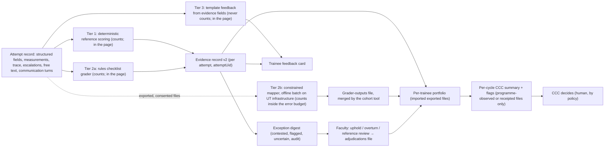

# Simulated independent practice: mechanics and EPA-aligned assessment

Plan section 14 of the Stoipath WSI viewer development plan. Date 2026-11-09, revision 2 (same day) after a programme-director/CCC-chair critique and an engineering critique; the review log in §16 records every item and what was done with it. Written after the owner asked (2026-11-09) whether the simulated sign-out's mechanics had been assessed as *simulated independent clinical practice* and as *a foundation for entrustable-professional-activity assessment*, and after two directives the same day: grading must cost attendings as little time as possible, ideally none, and every educational activity, not only the viewer, must be state of the art. Evidence base: research note **11-gap-9** (`research/11-gap-9-simulated-practice-and-epas.md`), which consolidates four research streams and two citation-check passes; notes 11-gap-6 and 11-gap-7; plan sections 12 (pillars) and 13 (regulatory; **FR-R0**: Learn never creates real sign-out events, LIS write-back or a diagnostic render mode); the L2 build specification `stage0/client/SIGNOUT.md` and the L1 specification `stage0/client/LEARN.md`. Terminology follows those documents (`Practice report`, `Practice worklist`, `CaseResult`, `cases.csv`, `nodes.csv`, `contentHash`, `rules`, `attempt`, `groupCode`, miss types `search` / `recognition` / `indeterminate`). **Calendar:** week 0 = Monday 2026-10-26; the Learn L1 and L2 pages are Stage-0 client builds published ahead of M0 (2026-12-05); later release names (v0.7 W39, EDU-1 W44 = 2027-08-30, v0.9 W52 = 2027-10-29, v1 W84 = 2028-06-09) are owned by section 07 and cited here by name. **Tags:** **[PM]** a PubMed record re-retrieved in a session that wrote this section (PMID given; abstract-level unless the gap-9 note or the critique says full text); **[note]** retrieved by the gap-9 note's streams and confirmed by their citation check, not re-retrieved here; **[crit]** retrieved (abstract or full text, as stated) by the PD/CCC critique pass of 2026-11-09 and not re-retrieved here; **[eng]** retrieved by the engineering critique pass (specification text or repository code); **[snippet]** search extract only; **[unverified]** not retrieved; **[repo]** read from SIGNOUT.md or the sign-out code; **[model]** our arithmetic from stated inputs; **[estimate]**; **[proposal]** our design, not a published or adopted standard. No AI product or model names appear in this file by project rule; two cited papers carry one in their title and are cited by author, journal and PMID.

**What this section decides (ten lines).**
1. The simulated sign-out becomes **simulated independent practice**: the trainee acts first (triage, order, consult or defer, compose, issue, communicate, amend) and is reviewed afterwards. That "act, then be reviewed" shape is the ACGME *oversight supervision* construct that none of 32 responding programmes (of 142 surveyed, 22.5 %) grants for final sign-out (Bryant et al. 2025, PMID 41049715 **[PM]**; 142 from the gap-9 full-text read).
2. Its output is **evidence for** an entrustment decision, never the decision. The UI, exports and grant text never say "entrustment level", "EPA rating", "readiness" or "validated" about it (§1.3).
3. **Grading is automated by default; routine per-case grading by attendings is zero.** Three tiers: deterministic reference scoring (counts); rules plus an optional constrained language-model mapper for free text, run offline and counting only inside a measured error budget; unscored, evidence-anchored template feedback (§5).
4. Attendings touch the system in four places only, all brief and all optional, sampled or exception-based: a one-click acknowledgement of an auto-generated summary per resident per CCC cycle; a weekly exception digest (contested, flagged, uncertain, plus a 4 % reproducible audit of Tier 2 items); a twice-yearly calibration set; one-off adjudication at authoring. Modelled steady-state faculty time for a 16-resident programme is **≈ 2.5 faculty-hours per month in total** (≈ 9 minutes per resident per month; ≈ 25 minutes per participating faculty member per month for a pool of six), of which about half is content work (authoring and two-reader adjudication) and the rest is the exception digest, the calibration set and summary acknowledgement (§5.7, **[model]**). No published pathology assessment system retrieved reports a lower faculty cost; the figure is measured by the tool's timestamps from SP-2a and reported against this estimate.
5. The entrustment and Milestones decisions stay with the Clinical Competency Committee by policy; automation feeds it a one-page, labelled, narrative-bearing summary, generated only from programme-observed or server-receipted files (§5.6, §7.3).
6. Every mechanic emits framework-agnostic evidence tags; a per-programme crosswalk maps them to CAP EPAs, ACGME Pathology Milestones 2.0, Royal College (Canada) EPAs or a partner's national framework as "evidence relevant to", with adoption status stated and Milestones codes version-tagged (§2).
7. Case authoring scales through a blueprint, authored simulated replies and attending notes, faculty adjudication by two raters calibrated on the AJCC small-volume criteria, item statistics from cohort data, and a teaching-set pipeline; TCGA/IDC is a later source (§6).
8. Exports grow from today's JSON + two CSVs to a per-attempt evidence record (closed schema `signout-results/2` with a stable `attemptUid`), a per-trainee portfolio built from exported files, a learner summary and a CCC one-pager, a residency-management CSV with a data dictionary, and an xAPI statement bundle; cmi5 is excluded by its own specification (§7).
9. A Kane-ordered validity programme and a UT pilot study are specified with sample sizes, a case pool that does not run out, and a pre-registered reliability decision rule (§9); standard setting is deferred until a faculty global rating exists.
10. Nine small phases (§12), each with a stated "requires" class: SP-1a foundations (schemas, append-only attempts, `attemptUid`, `scoringHash`, CSV v2); SP-1b act-with-limits mechanics; SP-1c work actions; SP-1d portfolio import and CCC one-pager; SP-2a reviewer, adjudication and rules grader; SP-2b case-type generalisation; SP-3 offline mapper calibration study; SP-4 identity, receipts, held-out cases, LTI; SP-5 the multi-institution evidence study.

---

## 1. Purpose and claims

### 1.1 What the activity is

A **practice worklist** of cases the trainee works as if alone: opens slides, decides what to order or whom to ask, composes and issues a practice report with a diagnosis line, communicates an urgent or unexpected finding when one exists, receives an attending note, issues a final report or an addendum, and sees a comparison with an adjudicated reference and with their own viewing trace. It is Stoipath Learn content (plan 12 §2: no PHI by construction, not a device, `edu` build), and nothing in it is a sign-out event, an LIS message or a diagnostic render (FR-R0). Learner-facing copy keeps SIGNOUT.md D1: the words are `Practice report`, `Practice worklist`, `Submit practice report`; `Sign out` is never a viewer action **[repo]**.

### 1.2 What the evidence lets it claim

| Tier | Claim | Status after each phase (§12) | What the claim needs |
|---|---|---|---|
| **T1** Feedback to the trainee | "You under-called a micrometastasis on node 4; it was in view at 20× for 6 s (recognition miss)" | Supported today **[repo]** | Content review by the owner (cases are `draft`) |
| **T2** Programme and curriculum evaluation | "Cohort A shows more major under-calls on ITC-stratum cases than cohort B" | After SP-1a–1c (blueprint fields, impact field, research-sharing field) | Difficulty stratification, small-cell suppression, consent to research use |
| **T3** One input among many to the CCC | "On N cases of K types resident R agreed with the adjudicated reference at rate P (CI), with Q major under-calls, calibration C and appropriate escalation E; trajectory rising" | CCC summary from `programme_observed` files after SP-1d and SP-2a; `server_receipt` after SP-4; the reliability and extrapolation evidence the label will cite after SP-5 | Generalisation (G-study with the §9.2 decision rule), extrapolation (association with training exposure, RISE, faculty ratings), adjudicated reference, file integrity and identity assurance |
| **T4** Entrustment of an activity at a supervision level | "R may report axillary sentinel nodes under indirect supervision" | **Never from this tool alone** | A supervisor's decision on real work; the simulation is corroborating evidence (ten Cate et al. 2021, PMID 33060399 **[PM]**; Andler et al. 2020, PMID 32322347 **[PM]**: simulation and clinical EPA ratings did not correlate, r −0.35 and 0.38) |

The tiering follows Kinnear et al.'s separation of purpose, stakes and process (PMID 34183603 **[note]**) and Cook and Hatala's rule that validation starts by naming the decision (PMID 29450000 **[PM]**). Formative versus summative: the activity is formative by default; a programme may use its evidence summatively only through its CCC, and the export says so.

### 1.3 Wording rules (UI, exports, grant)

- **Allowed:** "simulated practice", "practice report", "evidence relevant to [EPA / subcompetency]", "agreement with the adjudicated reference", "formative", "one data source for the programme's Clinical Competency Committee", "aligned with an emerging national direction toward competency-based assessment", "designed to exceed [precedent] on [named dimension]; measured in SP-5".
- **Forbidden without SP-5 evidence:** "measures entrustment", "EPA level", "entrustment level", "readiness for independent practice", "validated", "required by ACGME/ABPath", "endorsed by ABPath", "exceeds" without the "designed to" qualifier.
- Every summary carries the label line `Simulated practice · formative · N cases of K types · evidence relevant to [list, with framework and version] · not an entrustment decision · decision-maker: the programme's CCC · integrity: {programme-observed | server receipt} · selection: {programme-observed (all attempts in session) | trainee-selected} · built from N imported files` (§7.3). A `self_exported` file never produces a CCC summary (§7.3).
- Positioning: beside Toronto's Hot Seat Diagnosis (Han et al. 2022, PMID 34133708 **[PM]**), NYU's OSPE (Belovarac et al. 2021, PMID 33049036 **[PM]**), radiology's WIDI SIM (Sistrom et al. 2020, PMIDs 32376185, 32402787 **[PM]**; the programme site states the 2025 cycle is its last **[snippet]**), Louisville's preliminary-versus-final feedback system in real practice (Cao and Gondim, Arch Pathol Lab Med 2026;150(6):478–485, PMID 41571000 **[PM]**: 3,854 cases from 13 trainees; accuracy 68.8 %, 86.1 % with "mostly accurate"; per-trainee range 55.5–78.3 %; organ-system range from neuropathology 83.8 % to placenta 46 %, which is the real-practice range against which simulated agreement rates are read) and ABPath's announced breast simulated sign-out pilot (**[snippet]**; confirm on abpath.org before the grant is written). Distinct contributions: open, any-device, public CC0 slides, a viewing trace, automated scoring, and the independent-practice mechanics none of those has.

---

## 2. The EPA and Milestones map

### 2.1 Adoption status (what a grant may say)

| Item | Status | Source |
|---|---|---|
| ACGME Pathology Milestones (version 2, 21 subcompetencies) reviewed semi-annually by a CCC | **Adopted, required** (US) | Klutts et al. 2015, PMID 28725752 **[PM]**; Poljak et al. 2025, PMID 41541631 **[PM]** (21-milestone count); v2 dated by the 2021–22 pilot's mapping to Milestones 2.0 (Bryant et al. 2024, PMID 38560425 **[PM]**). Codes and wording **[unverified]** until the ACGME PDF is read (acgme.org unreachable from the writing sessions) |
| ACGME "oversight supervision" (the supervising physician reviews procedures or encounters with feedback after care is delivered) as a core requirement | **Adopted**, as reported by Bryant et al. 2025 (PMID 41049715 **[PM]**); the definition wording is from institutional policy pages **[snippet]**; ACGME text not read |
| CAP GME Committee's 19 pathology EPAs | **Proposed**; "an initial framework" | McCloskey et al. 2017, PMID 28725792 **[PM]**; EPA numbers and titles verified against the full text by the critique pass **[crit]** |
| APC/CAP national EPA pilot (4 EPAs, no sign-out EPA) | **Pilot**, completed; recommended simplifying to one or two scales and replacing rather than adding instruments | PMID 38560425 **[PM]**; recommendations from the full text **[crit]** |
| Pathology entrustment scales (procedure, clinical-management and **written-report** variants, aligned to the ACGME supervision definitions) | **Pilot instrument**; content, response-process and internal-structure evidence only | Bryant et al. 2024, PMID 38560424 **[PM]**; variants from the full text **[crit]** |
| Northwestern Preview/Sign-out EPA, built on the Royal College (RCPSC) Pathology EPA Guide | **Local** (US) | Felicelli et al. 2023, PMID 38025045 **[PM]**; RCPSC basis from the full text **[crit]**; Gama, Felicelli et al. 2024, PMID 39512707 **[PM]** |
| Royal College of Physicians and Surgeons of Canada Competence by Design, EPA-based, for anatomical pathology | **Adopted, mandatory** (Canada); Toronto moved to EPA-based CBME in 2019 | Xie et al. 2026, PMID 41571013 **[PM]**; EPA titles **[unverified]** (royalcollege.ca unreachable; owner question Q16) |
| ACGME-International Pathology Milestones 2.0 | **Published** for ACGME-I programmes | **[snippet]** only |
| ABPath CBA task force; breast simulated sign-out pilot | **Pilot / announced** | **[snippet]** only |
| ACGME requirement to use EPAs in pathology | **Not found** | **[unverified]** |

### 2.2 Mechanic → EPA → subcompetency

CAP EPA titles are the paper's verbatim titles in its table order (not an official numbering). Milestones names are version-2 names as printed in Poljak et al. 2025 (PMID 41541631 **[PM]**, full text read by the critique pass **[crit]**). **Every export and summary carries `milestonesVersion` (for example `ACGME Pathology Milestones 2.0, revision date as printed on the PDF`) and renders subcompetencies as `name (code, version)`, for example `Interpretation and Diagnosis (PC4, v2)`, because the same code names a different subcompetency in version 1 (v1 PC3 = Interpretation and diagnosis (AP), PC4 = Reporting (AP), PC1 = Consultation; McCloskey et al. 2017 Table 5, PMID 28725792, full text **[crit]**) and in version 2 (PC4 = Interpretation and Diagnosis, PC1 = Reporting; Poljak et al. 2025, PMID 41541631 **[crit]**). Codes appear in exports only after the current ACGME PDF has been read; until then names and version only** (owner question Q15). "Informs" means the mechanic produces evidence relevant to the subcompetency; it never computes a level.

| Mechanic (§3) | Evidence tag (§2.3) | CAP EPA (proposed) | Milestones v2 subcompetency (adopted; code to confirm) | Strength of the link | Exists today |
|---|---|---|---|---|---|
| Node calls, pN, size, discrepancy class | `interpretation` | 2 Compose a diagnostic report for surgical pathology specimens (interpretation component) | Interpretation and Diagnosis | Strong, direct | Yes **[repo]** |
| Diagnosis line, comment, recommendation; contradiction between prose and synoptic | `report-composition` | 2 (report composition) | Reporting | Direct once the free text is scored | Comment stored, unscored **[repo]** |
| Confidence and counterfactual disposition; defer / consult | `help-seeking`, `reasoning` | 2; 14 Provide patient care consultations (the asking side) | Self-awareness and help-seeking; Clinical Reasoning | Direct for help-seeking; reasoning only with a stated rationale | No |
| Ancillary requests with cost and simulated turnaround | `test-utilisation` | 2 (Core-stage sign-out at Northwestern includes initiating ancillaries, PMID 38025045 **[PM]**); 15 Optimize test utilization | Interpretation and Diagnosis; Systems-based practice (test utilisation) | Moderate; author-set appropriateness | No |
| Request for history; leading versus neutral history | `reasoning` | 2 (clinicopathologic correlation) | Clinical Reasoning | Moderate | No |
| Urgent / significant-unexpected diagnosis communication station | `urgent-communication` | 3 (call-back in the pilot's frozen-section EPA); 10 Evaluate and report critical values in the clinical laboratory, cited as the analogous CP activity, not the standard | Communication with Health Care Systems; standard: CAP/ADASP consensus on urgent and significant, unexpected diagnoses (Nakhleh et al. 2012, PMID 21992705 **[PM]**) | Direct for the scripted checklist | No |
| Quality traps (node count versus nodes received; label, slide, requisition mismatch) | `quality-safety` | 16 Improve quality and patient safety | Patient Safety and Quality Improvement | Moderate; the node-count check is the only SBP evidence the pilot case type can supply | No |
| Addenda and amendments typed by the Meier taxonomy | `amendment` | 2 | Reporting; Patient Safety and Quality Improvement | Moderate | No (`Start again` erases) **[repo]** |
| Triage and workload order | `workload` | 2 (Transition-to-Practice stage: manage the daily workload, PMID 38025045 **[PM]**) | Systems-based practice; Professionalism | Exploratory only; no simulation evidence found **[unverified]** | No |
| Reflection and error-cause tag after comparison | `reflection` | — | Reflective Practice and Commitment to Personal Growth | Direct once recorded **and read**: the reflection text is shown in the learner summary and, with the programme's assessment policy or research consent, quoted in the CCC summary narrative (§5.6 item 6) | No |
| Viewing trace (coverage, adequate-scale dwell, miss type) | `process` | 2 (the CAP paper's call to observe the microscopy process, PMID 28725792 **[PM]**) | Interpretation and Diagnosis (process) | Formative and research only; group-level predictor (Brunyé et al. 2024, PMID 38031453 **[PM]**), no individual marker (Brunyé et al. 2020, PMID 37476351 **[PM]**) | Yes **[repo]** |

### 2.3 Framework-agnostic evidence tags and the crosswalk file

Evidence tags are framework-agnostic: each mechanic emits `evidenceTags[]` (the tag column above) and a per-programme **crosswalk file** (`stoipath.learn.signout-crosswalk/1`, **[proposal]**) maps tags to the programme's framework: ACGME Pathology Milestones 2.0 (US), CAP EPAs (proposed), RCPSC Anatomical Pathology EPAs (Canada; adopted; titles to be confirmed from the Royal College EPA guide, royalcollege.ca, Q16), ACGME-I Pathology Milestones 2.0, or the partner's national curriculum. The summary renders the partner's own names and the framework's version. Every mapping is "evidence relevant to", never a level. The crosswalk ships with the US and CAP mappings of §2.2; partner programmes supply theirs, reviewed by their programme director.

---

## 3. The simulated-practice mechanics (trainee side)

The per-case state machine replaces SIGNOUT.md's Open → Review → Report → Compare with Open → Work (→ Pending) → Issue → Communicate → Review → Final → Compare → Reflect, and the worklist gains a triage layer above it. The Learn rail keeps its Phase ids: Open → `open`; Work and Pending → `examine`; Issue and Communicate → `decide`; Review, Final, Compare and Reflect → `complete`, with the sub-state shown as the rail's `sub` text, so Learn's Phase union is not widened **[proposal, eng]**. Scoring of calls, pN, size and trace is unchanged in meaning, so SP-1 data remain comparable with the pilot's for attempts without deferrals (§3.5) **[repo, proposal]**. The results and case schemas are new closed versions (§7.1), not additive extensions of the v1 schemas.

```mermaid
stateDiagram-v2
  [*] --> Worklist
  Worklist --> Open: triage order recorded
  Open --> Work: history shown (version drawn once, recorded)
  Work --> Pending: request levels / IHC / special / second opinion / history (authored reply, simulated turnaround)
  Pending --> Work: reply unlocked (two other cases opened, or next session)
  Pending --> Issue: issue preliminary without the reply (recorded)
  Work --> Issue: calls (or defer), measurements, diagnosis line, synoptic, comment, recommendation, confidence, disposition
  Issue --> Communicate: case carries an urgent or significant, unexpected finding
  Communicate --> Review
  Issue --> Review: preliminary report locked
  Review --> Final: attending note shown (authored now, faculty-written later)
  Final --> Compare: final report, addendum or amendment (Meier type), original kept; finalIssued event
  Compare --> Reflect: comparison, trace, consequence sentence, impact
  Reflect --> Worklist: reflection line and cause tag (optional)
```

### 3.1 Worklist, blueprint and unknown case types

- **Blueprint fields** on every case: `organ`, `task` (staging, tumour present/absent, classification, margin, grading…), `difficultyTier` (author-set, then recalibrated from item statistics, §6.2), `prevalenceSlot` (normal / low / high), `anchor: true|false`. A worklist declares its blueprint and a lint checks that the drawn cases satisfy it and that normals are present within a declared prevalence range **[proposal]**. Evidence: case difficulty explained 28.5 % of WIDI score variance against 5.3 % for the resident, so one case type cannot stand for sign-out and difficulty must be modelled (Sistrom et al. 2020, PMID 32402787 **[PM]**).
- **Unknown case type:** in a mixed worklist the task card says `Case {k} of {n}` and the organ only; the trainee learns the question from the requisition text. Until a second case type exists (SP-2b) the pilot stays a known-type worklist and the summary label says so.
- **Case order** is randomised within the blueprint per attempt; the draw happens once at first open and is persisted (`order {seed, position}`; `position` is also a CSV column), because WIDI found a fatigue effect over the last 13 of 65 cases (PMID 32376185 **[PM]**).
- **Equal `estimatedMinutes`** stays (no difficulty leak, SIGNOUT.md PE-5 **[repo]**).

### 3.2 Triage and prioritisation

- Worklist rows may carry a **priority** (`routine` / `urgent` with an authored clinical reason, e.g. "patient in clinic tomorrow") and an optional simulated deadline. The order in which the trainee opens cases, and whether urgent cases were handled first, are recorded as `triage {priority, orderIndex, urgentFirst | null, deadlineMet | null}` **[proposal]**.
- Scoring status: **exploratory measure, never a score** in any summary until a validation study exists; no simulation evidence for triage was found **[unverified]**. The practice-domain grounding is that after-hours and critical-value tasks are the ones residents most often get autonomy for (PMID 41049715 **[PM]**) and that case load and time management are first-year challenges (Katsakhyan et al. 2024, PMID 38180066 **[PM]**).

### 3.3 Time and workload

- The count-up timer, optional countdown that never forces submission, overrun recording and the accessible path stay (SIGNOUT.md D19; WCAG 2.2.1) **[repo]**.
- A **session budget** mode (optional, worklist-level) records `session {budget_s, withinBudget}`, cases completed within budget and the position effect; it is a workload rehearsal, not a score **[proposal]**. Carrying parked cases (§3.4) is part of that rehearsal.

### 3.4 Ancillary ordering with cost and simulated turnaround

- Per case and per node the trainee may `Request deeper levels`, `Request immunohistochemistry` (menu of stains the author lists), or `Request special stain`. Each request returns an **authored simulated reply** from the case file (text, optionally an image when a dataset supports it) and adds an **authored relative cost** unit; both are shown on the task card and recorded in `escalations[]` **[proposal]**.
- **Turnaround is simulated time only, never wall-clock waiting.** A request parks the case: it returns to the worklist as `pending (IHC, simulated 24 h)` and the reply unlocks after the trainee opens two other cases or at the next session, whichever comes first. The trainee may issue a preliminary report without the result, as in practice; both the wait and that decision are recorded (`escalations[].issuedBeforeReply`). The case clock is wall time plus the sum of simulated turnaround, persisted in `CaseProgress` so a reload resumes it; the task card shows both, and the optional countdown applies to wall time only **[proposal]**.
- Scoring: each request is compared with the author-set `appropriateRequests[]` and `unnecessaryRequests[]` for that case; the result is `appropriate` / `unnecessary` / `neutral`, tabulated per attempt and shown to the trainee with the author's one-sentence reason. Precedent: Hot Seat Diagnosis rated use of ancillary tests (PMID 34133708 **[PM]**); Northwestern's Core-stage sign-out includes initiating them (PMID 38025045 **[PM]**). No simulation of ordering with cost or delay was found **[unverified]**.
- On CAMELYON17 replies are text only (the dataset has no IHC or levels); real ancillary slides need licensed or locally scanned teaching sets (§6.4).

### 3.5 Consultation and the "recognise limits" option

- Per case, before issuing, the trainee records **confidence** (four levels) and a **counterfactual disposition**, worded so that no option reads as a sign-out act (D1, FR-R0) and so that it is realistic for US residents, who never issue final reports: `If this were mine to report alone, I would: issue it · issue it and ask for review · show an attending first` **[proposal]**. Per node a `Not sure: defer this node` call is allowed: the preliminary report may hold `null` for deferred nodes, listed in `deferred: NodeIndex[]`; the node class is `null`, `cases.csv` carries `node{k}_deferred = true`, and the entered pN is still required. The final report must give a call for every node. Pilot-comparable analyses restrict to attempts with no deferral, and the summary says so **[proposal, eng]**.
- `Request a second opinion` returns an authored colleague note (e.g. "I favour isolated tumour cells; see the cluster at the capsule") after a simulated turnaround (§3.4); the trainee then issues.
- Scoring: **confidence calibration** (confidence against correctness per case, reported as a small calibration table and an over/under-confidence index) and **escalation appropriateness** (the disposition and deferrals compared with the author-set `escalationReasonable` flag, which the adjudication panel confirms). `Show an attending first` on a case flagged reasonable is `appropriate`; on a case not flagged it is recorded `cautious`, **never wrong**, and it enters the exception digest only when a trainee's cautious rate exceeds the cohort's 90th percentile, and then as one digest item per trainee per month, not per case; the pattern appears in the summary as a description, not a score. `Issue it` on a flagged case is `over-confident`. Humility and honesty are named components of trust in the pathology scale paper (PMID 38560424 **[PM]**); the disposition mirrors the ten Cate supervision levels reproduced in the CAP paper's Table 2 (PMID 28725792 **[PM]**), whose mapping to training stages the paper left to programmes **[crit]**. This is the most EPA-relevant mechanic per unit of effort (gap-9 §5).

### 3.6 Incomplete information and requests for history

- Cases carry an authored **requisition** (the minimum a real requisition gives) and an optional **fuller history** released on `Request clinical history` through the parked-case mechanism of §3.4; whether it was requested, and when, is recorded **[proposal]**.
- Some cases carry two history versions (**leading** and **neutral**); the version is drawn once at first open, persisted in `CaseProgress` and never re-drawn on reload, recorded as `history {version, drawnAt, requestedAt | null}`, so the cohort tool can report whether the history shifted the call. The grounding is observational (leading histories were associated with more correct calls in WIDI, confounded with case; Sharma et al. 2021, PMID 33442781 **[PM]**); randomising it here is a new design that would produce the first controlled estimate.

### 3.7 Report composition and specimen context

- Each case carries `specimenContext {nodesReceived, fragments, intraoperativeResult | null, priorBiopsyDiagnosis, receptorStatus | null}`, shown on the requisition, because a sentinel-node report depends on the gross, any intraoperative result, the prior core diagnosis and receptor status **[proposal, crit]**. The report's node count is checked against `nodesReceived`; a mismatch is a **quality-trap discrepancy** (evidence relevant to Patient Safety and Quality Improvement) and is surfaced in the comparison.
- The practice report keeps today's synoptic structure (node calls, counts in CAP order, ENE row, largest deposit, pN with derived-pN consistency, generated preview; SIGNOUT.md §5.4 **[repo]**) and adds three free-text fields: a **diagnosis line** (≤ 300 characters), the existing **comment** (≤ 1,000), and a **recommendation** (≤ 300) **[proposal]**.
- Scoring (§5.3): the synoptic part deterministically as today; the free text against an author-set **checklist** of must-have and must-not items with a controlled vocabulary and synonym lists. **Checklist items target what the synoptic cannot hold:** the specimen and procedure header with laterality, the diagnosis statement in standard form, reference to the synoptic, a correlation or recommendation, and the absence of contradictions with the structured part (e.g. the prose says "no metastasis" while the synoptic counts one). Items that restate a structured field are not scored, so the free-text grader cannot inflate agreement by re-scoring structured content **[crit]**. The CAP EPA is composing the report (PMID 28725792 **[PM]**); OSPE scored staging-report information and Hot Seat rated reporting and clinical-implication comments (PMIDs 33049036, 34133708 **[PM]**); WIDI scores free text 0–10 by faculty (PMID 32376185 **[PM]**), which is exactly the workload this design removes.

### 3.8 Urgent and significant, unexpected diagnosis communication

- Cases flagged `urgentOrUnexpected: true` open a **scripted station** after issuing. The anatomic-pathology standard is the CAP/ADASP consensus, which says the critical-value concept is hard to apply to anatomic pathology, requires a policy separate from clinical-pathology critical values with a different time frame, and defines an **urgent diagnosis** (should be addressed as soon as possible) and a **significant, unexpected diagnosis** (clinically unusual or unforeseen; addressed at some point in the patient's course) (Nakhleh et al. 2012, PMID 21992705 **[PM]**). CAP EPA 10 (critical values, CP) is cited as the analogous CP activity, not as the standard **[crit]**.
- The station is a text-branching simulated clinician; the trainee's turns are chosen from short options plus one free-text line. The checklist is ours, author-set per case **[proposal]**: identifies self and the case, states the finding plainly, states certainty, offers a recommendation, confirms receipt (read-back), documents the call. Rule-scored; the free-text line goes through §5.3. Precedent: the OSPE frozen-section station with a role-played surgeon (PMID 33049036 **[PM]**); the national pilot's frozen-section EPA with call-back (PMID 38560425 **[PM]**).

### 3.9 Preliminary report → attending review → final report, and amendments

- Submission locks a **preliminary report** (irreversible, confirmed; D20 **[repo]**). **The v1 fields (`submitted`, `classes`, `cases.csv` v1 columns) always describe the preliminary report; the final report is graded into `reports.final {calls, pn, classes, submitted}`** **[eng]**. An **attending note** then appears: authored in the case file now (one to three sentences a reviewing attending would write for each discrepancy pattern, **including the match pattern**, which a lint rule requires so that the presence or absence of a note never leaks the result), written by a faculty reviewer later (SP-2a) where a programme chooses to. The trainee issues a **final report**: unchanged, or with an **addendum** (adds information without changing the diagnosis line; records only `reason`) or an **amendment** (changes the diagnosis line; typed by the Meier taxonomy: misinterpretation, misidentification, specimen defect, report defect; kappa 0.878 in the original validation, which was on amended reports, PMID 18628093 **[PM]**). Both reports are kept; the comparison is run on both and reports what the review changed **[proposal]**.
- A new bus event `finalIssued` gates the reference overlays, `Show me` and the dataset ids (D12); today's `caseSubmitted` must no longer load the reference. Under exam style (feedback after the worklist) the attending note and the final report come after the worklist is complete **[eng]**.
- **Storage.** SP-1a adds an append-only store `signout.attempt/<worklistId>/<caseId>/<attemptUid>` written at preliminary and final issue and never deleted by `Start again`. `ResultsStore.clearWorklist` becomes `archiveWorklist`, which clears in-progress drafts only; contract members `listAttempts(worklistId)` and `getAttempt(uid)` are added; a one-time migration copies any submitted `CaseProgress.result` into the new store. Attempts made before SP-1a exist only in exported files, and the portfolio imports them (§7.2) **[eng]**. `Start again` stays for clean re-practice (attempt n+1), because erasing submitted records removed the consequence of a wrong first report (gap-9 §5).
- Later worklist tasks may **re-open** an issued case ("the clinician asks for a re-look at node 4") to rehearse addenda under consequence.
- Grounding: Iowa's preliminary-diagnosis dual review (concordance 95.4 %, clinical major discrepancy 0.29 %; Weydert et al. 2005, PMID 15897747 **[PM]**); Louisville's resident-controlled preliminary-versus-final feedback (Cao and Gondim 2026, PMID 41571000 **[PM]**); oversight supervision is review and feedback after care (PMID 41049715 **[PM]**).

### 3.10 Feedback and the impact axis

- Immediate per-case comparison stays (Toronto residents valued verbal sign-out feedback above every EPA form; Xie et al. 2026, PMID 41571013 **[PM]**), with exam style as an option **[repo]**.
- Additions: a **consequence sentence** per discrepancy (how pN and so the management discussion would change; teaching only), an explicit **impact** field per discrepancy type, the escalation and calibration readouts, the communication checklist, the node-count quality trap, and an optional **reflection** line with an error-cause tag (search, recognition, reasoning, reporting, over-call) that is exported, because reflective practice is only evidenced if reflection is recorded and read **[proposal]**.
- **Impact is set per discrepancy against the current management consequence, not the stage change.** On the sentinel-node case type most ITC/micrometastasis discrepancies carry `impact: none | possible`, because axillary dissection is not supported for women with cT1–2 invasive breast cancer, no palpable adenopathy and one or two positive sentinel nodes treated with lumpectomy, whole-breast irradiation and systemic therapy (ACOSOG Z0011 10-year results, Giuliano et al. 2017, PMID 28898379 **[PM]**); `likely` is reserved for macrometastasis misses, miscounted positive nodes that change the pN category, and ENE errors. The headline row "major under-calls with likely impact" is therefore **expected to be rare on this case type** and is always reported with its denominator; it becomes informative with the second case type (SP-2b) **[crit]**.
- Template feedback text (Tier 3, §5.4) is labelled as generated from templates, quotes the evidence it used, and carries a one-tap "this was wrong or unhelpful", stored as `feedbackFlags[]` in the results file.

---

## 4. The faculty side

### 4.1 Principle: no per-case grading queue

Nothing routine waits for an attending. Every case is scored and fed back automatically; faculty see (a) a weekly exception digest, (b) a per-cycle summary to acknowledge, (c) a calibration set twice a year, (d) adjudication at authoring. The design target is near-zero routine work with brief, optional, sampled or exception-based input, as the owner directed. Faculty acceptance was the weakest link in the national pilot (programme directors and CCC members more favourable than faculty; every site fell back to paper; PMID 38560425 **[PM]**), and workflow friction and faculty engagement are the recurring barriers across specialties (PMID 42492437 **[note]**).

Faculty time is contested evidence: Northwestern faculty rated their EPA forms as not consuming significant time (4.63/5; PMID 38025045, full text **[crit]**), while the national pilot recommended replacing rather than adding instruments and an app-based platform (PMID 38560425, full text **[crit]**) and a 2026 three-programme coaching study names time investment as the limiting commodity (Schiffhauer et al. 2026, PMID 42827853 **[PM]**). Where a programme adopts the CCC summary it should **retire one existing rotation evaluation for the same construct**, following the pilot's recommendation that EPAs should not be just one more thing **[crit]**.

### 4.2 The exception digest

File-based in SP-2a (the programme's cohort tool lists flagged attempts from loaded files), a server inbox in SP-4. **The queue is delivered as a weekly digest to one rotating "assessment attending of the month" with a 14-day service target; nothing in it is time-critical because nothing in it is patient care. Handling minutes are logged against §5.7** **[crit]**. Triggers, each stated on the item:

| Trigger | Why it needs a human | Expected share **[estimate]** |
|---|---|---|
| Trainee contests a scored item (one tap + reason; `contests[] {itemRef, reason, t}` in the results file) | Appeal path, §5.5 | 1–3 % of cases |
| Major under-call with `impact: likely` where the trainee contested the reference | Reference quality at the borderline; safety | < 1 % |
| Free-text grader uncertainty (sampled runs disagree on a must-have item, or rules and mapper disagree; for rules alone: a must-have hit only inside a hedge, or a must-not term inside a negation window) | Error budget, §5.3 | 2–4 % of cases with free text, falling as the checklist matures |
| Reproducible random audit: attempts where `sha256(attemptUid + cycleSalt)` falls under the 4 % threshold, so every reviewer sees the same sample; **audits only Tier 2 items and reference-side fields** (Tier 1 is guarded by the `stages.csv` 100/100 CI fixtures, not by attendings) | Detects gross failure (a broken rule, a mis-keyed reference) and feeds a quarterly control chart (≈ 15 cases); **it is not powered to detect grader drift** (≈ 5 cases a month cannot see error rising from 5 % to 10 %), which is the job of the twice-yearly calibration set (§4.4) and the contest-rate trigger (§5.5) | 4 % of cases (Q7) |
| Cautious-disposition pattern (trainee above the cohort's 90th percentile, §3.5) | A teaching moment, not an error; optional | ≤ 1 digest item per trainee per month |

Each item shows the case, the practice report (both versions), the comparison, the trace summary and the trainee's reason; the reviewer picks `Uphold` / `Overturn` / `Reference needs review` and may add one sentence. Target handling time ≈ 3 minutes **[estimate]**. The reviewer view exports `stoipath.learn.signout-adjudications/1` records `{attemptUid, itemRef, outcome, raterCode, t, note}`; the cohort tool and the trainee's portfolio merge them on import by `attemptUid`; the original score is kept **[eng]**.

### 4.3 Optional rating on the national pilot's scale, and narrative

Where a programme wants a faculty global rating of simulated performance (SP-2a), the reviewer view uses the **national pilot's written-report entrustment scale verbatim** (Bryant et al. 2024, PMID 38560424 **[PM]**; the three variants and their alignment to the ACGME supervision definitions are in the full text **[crit]**; permission requested from the APC/CAP EPA Working Group, Q6), labelled `rating of a simulated performance on the pilot's report scale`, so ratings are comparable with workplace EPA data from the pilot sites and Northwestern (PMID 38025045 **[PM]**). **No new anchor wording is written**, because the pilot's own recommendation was to simplify to one or two scales (PMID 38560425, full text **[crit]**) and new anchors would destroy comparability. If permission is refused, the O-SCORE anchors are used unchanged (MacEwan et al. 2016, PMID 26787087 **[PM]**). The rating is never an entrustment level and is stored beside a `caseComplexity` field (the pilot's formative form carried one, PMID 38560425 **[PM]**). A two-line narrative (`one strength`, `one thing to improve`) follows the pilot's formative form. Evidence for the scale family: O-SCORE on a simulated bench station with blinded raters (PMID 26787087 **[PM]**); OCAT G = 0.92 in internal medicine (Halman et al. 2018, PMID 30236097 **[PM]**); none validated for interpretive pathology simulation.

### 4.4 Calibration and rater training

- **Frame-of-reference pack**, following the national pilot's faculty-development method (performance-dimension training, then level-2 and level-4 exemplar vignettes with discussion; PMID 38560424, full text **[crit]**) with practice reports substituted for vignettes, so programmes that ran the pilot recognise it: five exemplar practice reports with agreed checklist scores and scale ratings and the reasons; a reviewer records `raterCode` and `trained: true` once they have read it (≈ 20 minutes, once) **[proposal]**. Faculty report that such training improves observation and the use of entrustment as the standard (Kogan et al. 2015, PMID 26077217 **[note]**); rater training for a behavioural marker system failed to reach r > 0.7 in one study (Graham et al. 2010, PMID 20190257 **[note]**; not an entrustment scale), so training is necessary, not sufficient.
- **Calibration set** (twice a year): each participating reviewer scores the same 20 free-text reports (≈ 1.5 minutes each); the tool reports inter-rater ICC and rater-versus-grader agreement (§5.3 metrics) with intervals, which also re-validates the free-text grader. **This set, not the audit, is the drift detector.**
- Where human ratings enter any summary, at least a sample is double-rated and ICC is reported.

### 4.5 Reference adjudication at authoring

Before a case leaves `draft`, two faculty confirm each reference label, mark **acceptable alternatives** (generalising today's `borderline` flag), set `impact` per discrepancy type (§3.10) and `escalationReasonable`, and record agreement. Items they disagree on go to a third reader or are retired. One-off, ≈ 5 minutes per case per reader **[estimate]**. **Adjudicators calibrate on the AJCC small-volume criteria before adjudicating ITC/micrometastasis calls**, because expert agreement is poor untrained and good after criteria-based image training: six experienced breast pathologists reading 56 sentinel-node cases reached multirater kappa 0.487 before and 0.915 after a training programme illustrating the criteria (Turner et al. 2008, PMID 18182666 **[PM]**). A training set built on the same criteria is offered to trainees as Learn content. The algorithms in CAMELYON17 struggled most with ITCs (Bandi et al. 2019, PMID 30716025 **[PM]**), so ITC calls are a difficulty stratum and `borderline` cases are excluded from any pass/fail-style summary.

---

## 5. The automated assessment pipeline

### 5.1 Architecture: three tiers, two of which count

Model governance applies to any Tier 2b component: weights pinned by SHA-256, runtime name and version, decoding parameters, seed, prompt hash and checklist hash stored on every result; a fixed calibration set re-run on every change with the §5.3 metrics and an error taxonomy published; disagreement between sampled runs escalates; subgroup audits (§5.5). The literature's safeguards are the source (Sidali et al. 2026, PMID 42970784; Seneviratne and Manathunga 2025, PMID 40764994; Olvet et al. 2026, PMID 42438518; Cole et al. 2025, PMID 40865045 **[PM]**). **The mapper is never called from the page.** A static site cannot hold a key, trainee text sent to a hosted vendor would falsify the results file's privacy sentence and raise TX-RAMP and FERPA questions (plan 12 §2 classes FERPA-class records as confidential), and it would need a CSP change. The data steward runs the mapper as an **offline batch on UT-operated infrastructure**, over exported files whose trainee has research or programme consent, using an open-weights model pinned by weights SHA-256; it writes `stoipath.learn.signout-grader-outputs/1` records keyed by `attemptUid` and `itemRef`, which the cohort tool merges. Immediate trainee feedback uses rules only; mapper results reach the cycle summary. A hosted vendor model is used only under a TX-RAMP-certified contract and data-processing agreement. An in-browser model is not used (multi-gigabyte download, no iPad path, results vary across GPUs **[estimate]**) **[eng]**.

### 5.2 Tier 1: what is scored deterministically and how

| Evidence | Rule | Output | Status |
|---|---|---|---|
| Node calls | Exact match against the adjudicated label; `acceptableAlternatives` count as `agrees (alternative)`; classes `match` / `minor` / `major` with direction; node-level major = metastasis counted vs not (ITC counts as not); deferred nodes `null` in the preliminary report | per-node class, direction, borderline flag | Today **[repo]**; deferral SP-1b |
| pN | Entered pN versus reference; derived pN from the trainee's own calls; `inconsistent` flag when they differ | class with direction (`under-staged` / `over-staged`), `pnDistance`, consistency | Today **[repo]** |
| Largest deposit | Same AJCC size category as the reference's longest single annotated outline (primary); within ±20 % (secondary); node of measurement recorded | size agreement | Today **[repo]** |
| Completeness | `complete` (every node examined), `examined` per node (opened and ≥ 1 sharp settled view at ≤ 2 µm/px over tissue) | flags | Today **[repo]** |
| Viewing trace | Coverage of tissue at ≤ 2 µm/px; dwell at the label's adequate scale per deposit cluster; `missType` search / recognition / indeterminate at 2 s cumulative dwell | process fields, miss type | Today; **formative and research only**, never a score (gap-9 §4.3) **[repo]** |
| Node count versus `nodesReceived` | Report count equals the specimen context | quality-trap flag | SP-1c **[proposal]** |
| Escalations | Each request and the disposition against author-set flags | `appropriate` / `unnecessary` / `neutral`; `appropriate` / `cautious` / `over-confident` | SP-1b/1c **[proposal]** |
| Confidence | Confidence × correctness table; over/under-confidence index | calibration fields | SP-1b **[proposal]** |
| Triage | Order opened vs priority; deadline met | exploratory fields, unscored | SP-1c **[proposal]** |
| Communication station | Checklist items hit from the chosen turns | booleans | SP-2a **[proposal]** |
| Addenda and amendments | Kind; Meier class for amendments; whether the final report corrected the discrepancy | fields | SP-1b **[proposal]** |
| Impact | Author-set per discrepancy type, panel-confirmed | `impact` per discrepancy | SP-1b (field), SP-2a (panel) **[proposal]** |
| Blueprint and difficulty | Case fields; item statistics from cohort CSVs (proportion agreeing per case and node, discrimination against the rest of the worklist); anchor-case equating; recalibration on `scoringHash` change | per-case `p`, discrimination, difficulty tier | SP-1a (fields), SP-1d (statistics) **[proposal]** |

The former "synoptic completeness" row is deleted: the form cannot be submitted without those rows, so it carried no evidence **[eng]**. No composite score is computed (SIGNOUT.md Q5 **[repo]**): a mean would hide a single dangerous under-call. Major under-calls with `impact: likely` are reported separately and non-compensatorily in every summary, always with their denominator (§3.10).

### 5.3 Tier 2: free text by rules, then optionally by a constrained mapper

1. **Rules first, one implementation.** The rules grader **extends `learn/scoring/rubric.ts`** (Learn L1's `keywordMatches` with a negation window, `scoreRubric`, `TextRubric`), edited in the existing rubric editor; there is no second matcher **[eng]**. Additions: `mustNot` items, a `contradicted` result, a hedge list ("cannot exclude", "favour"), listed plurals and synonyms, a wider negation window, versioned as `rulesVersion`, with fixtures per checklist unit. Items hit, missed and contradicted are shown to the trainee with the matched phrase highlighted, so every automated judgement is visible and contestable. Rules alone give a conservative, auditable scorer; their recall is measured on the calibration set.
2. **Constrained mapper (optional, SP-3, offline).** A language model is asked only to map the free text onto the same checklist items (present / absent / contradicted, with the quoted span), never to grade holistically and never to look at the image. **The scoring run uses greedy decoding; k = 3 extra sampled runs serve only to detect uncertainty:** any disagreement on a must-have item sends the item to the digest and it is scored by rules meanwhile; otherwise items are combined by **majority vote per item**. Every raw prompt and output is stored in the grader-outputs file, which is the record of the score; re-scoring replays the stored outputs, re-validation re-runs the model. The `grader` block records `weightsSha256`, runtime name and version, decoding parameters, seed, `promptHash` and `checklistHash` **[eng]**. Grounding: categorical extraction from free-text reports is strong (balanced accuracy 0.82–0.96), counts weaker (0.66–0.80, improved by few-shot examples), on consultant-written reports, so it does not itself address trainee report grading (Mouheb et al. 2026, PMID 42613470 **[PM]**); itemised rubrics engineered iteratively against faculty scores reach weighted kappa 0.88–0.94, with two authors employed by the platform vendor (Olvet et al. 2026, PMID 42438518 **[PM]**).
3. **Error budget** (what lets Tier 2 count), on the calibration set (≥ 150 faculty-scored reports, two raters, §9.2) against the rater consensus: **per item**, sensitivity and specificity with Cohen's kappa, and Gwet's AC1 reported because of skewed prevalence, lower 95 % bound ≥ 0.75; **must-have false-negative rate** ≤ 5 % point estimate with Wilson 95 % upper bound ≤ 8 %; **per report**, QWK ≥ 0.85 (95 % CI lower bound ≥ 0.75) on the checklist total; **subgroup difference** reported with its CI, failing if the CI excludes 0 in the disfavoured direction and the point gap exceeds 0.05, with the calibration set sized for this criterion or the criterion declared descriptive (subgroups of 30–75 give kappa standard errors of roughly 0.06–0.10 **[estimate]**). Below budget the mapper's output is automatically demoted to an unscored suggestion and rules alone count; the demotion is visible in the summary label **[proposal, crit, eng]**. The human–human ceiling in the best available study is QWK 0.90–0.92 (Sidali et al. 2026, PMID 42970784 **[PM]**), so the budget asks for near that ceiling on a narrower, checklist task.
4. **Validation plan**: pre-registered; agreement reported with intervals and an error taxonomy (omission, synonym miss, negation, hallucinated item); re-run on every model, prompt or rubric change and at the twice-yearly calibration; published with hashes. No study validates automated grading of a trainee's pathology report (**[unverified: absence]**), so this would be the first and must be reported as such.
5. **Cost and compute** **[estimate]**: 16 residents × 8 cases × 3 fields × 4 runs ≈ 1,500 calls a month at about 2k input and 200 output tokens: minutes per month on one GPU VM, a few CPU-hours otherwise. The dominant cost is faculty calibration time (≈ 8–16 faculty-hours per calibration study), not compute.

### 5.4 Tier 3: template feedback

In SP-1 to SP-3, Tier 3 is **client-side templates filled from evidence fields**; no model writes text **[eng]**. Output is unscored, labelled as generated from templates, and cites the evidence fields it uses ("Your report states X; the adjudicated reference shows Y on node 3; your trace shows that deposit in view at 20× for 6 s"). A template cannot mention an image finding absent from the case's fact list by construction. A model-written paraphrase, if ever added, runs offline under §5.1 governance, never in the page, and never interprets the image: model-written feedback equalled expert feedback on text clinical-reasoning items but was worse on complex cases (RCT, 129 students; Çiçek et al. 2025, PMID 39656920 **[PM]**), and on chest radiographs general-purpose multimodal models localised findings at 39.1–49.7 %, a domain-specific model at 17.7 %, a CNN at 59.9 % and a radiologist at 80.1 % (Gosai et al. 2025, PMID 42231937 **[PM]**; extrapolation to WSIs). The trainee's "this was wrong or unhelpful" taps are stored as `feedbackFlags[] {templateRef, attemptUid, t}` in the results file and reviewed by the build team from collected files, not by attendings.

### 5.5 Adjudication triggers, appeal path and bias checks

- **Triggers** are §4.2's list. **Appeal:** the trainee taps `I disagree` on any scored item, writes one line, and a `contests[]` entry is written; the digest shows it; the outcome (`upheld` / `overturned` / `reference under review`) is written to the adjudications file with the adjudicator's `raterCode` and merged by `attemptUid`; the original score is kept, and the summary reports adjudication counts. A case whose contest rate exceeds 10 % of attempts triggers reference re-review; a changed reference changes `scoringHash` and recalibrates **[proposal]**.
- **Bias checks**, pre-registered: score distributions and grader-versus-human agreement by training year (`context.pgy`, optional, typed by the trainee, small-cell suppressed with the group code), programme, language background and, where a programme supplies it outside the tool, gender; small-cell suppression applies. **Language background is never written to the trainee file**; the steward collects it by survey and links it by trainee code **[eng]**. Human entrustment ratings showed a gender gap in a simulated randomised study (2.29 vs 2.54; Heath et al. 2024, PMID 38289461 **[PM]**), so the human baseline is itself audited; grader bias against non-native phrasing rests on a preprint (**[snippet]**) and is tested, not assumed.
- **Reference-side error budget:** two-reader adjudication with recorded agreement; `borderline` and `acceptableAlternatives` fields; contest-rate trigger as above; the 4 % audit as a gross-failure check only (§4.2).

### 5.6 Roll-up into the CCC summary

Once per CCC cycle (or on demand) the cohort tool generates a **one-page summary per trainee** from the portfolio, **only from files at `programme_observed` or `server_receipt` tier** (§7.3, §8.3), and only under the programme's written assessment policy (§8.1) **[proposal]**:

1. Label line (§1.3) with tier, purpose, decision-maker, integrity, selection and imported-file count.
2. Evidence counts by mechanic and by "evidence relevant to" subcompetency, **rendered as names with framework and version** (for example `Interpretation and Diagnosis (ACGME Pathology Milestones 2.0)`; codes only after Q15), with case types and difficulty tiers covered; partner programmes see their crosswalk's names (§2.3).
3. Agreement with the adjudicated reference per case type with a confidence interval; **major under-calls with likely impact listed individually with their denominator**; calibration index; escalation appropriateness; communication checklist rate; node-count quality traps; addendum and amendment behaviour.
4. **Trajectory:** a learning-curve fit (negative-exponential, as Nixon et al. 2026 found for EPA ratings, PMID 41812055 **[PM]**) with an interval, shown only when n ≥ 10 observations of a type; otherwise the words `insufficient evidence` (observation counts for reliable workplace ratings ranged from 9–11 to 25–63 depending on rater variance; Dunne et al. 2021, PMID 34561828; Ryan et al. 2021, PMID 33464735 **[PM]**; the count needed here is measured in SP-5 under the §9.2 decision rule).
5. Flags: outliers against the cohort, adjudications, contested items, any grader demotion, cautious-disposition pattern (description only).
6. Narrative: the template paragraph (labelled), the trainee's reflection lines (quoted under the programme's policy or research consent), and any faculty narrative or scale ratings (labelled as ratings of simulated performance on the pilot's report scale).
7. Acknowledgement: in SP-1 to SP-3 an exported `ack` file (`Acknowledged` / `Disagree (reason)`) or a CCC-minutes entry the coordinator records; the in-tool one-click acknowledgement arrives with SP-4 accounts **[eng]**.

Why this shape: CCCs weigh narrative and brevity over raw tables and report data overload (Erickson et al. 2026, PMID 41431334; Ekpenyong et al. 2017, PMID 28738746 **[PM]**); 28 % of CCC members in the pathology pilot found EPA summaries no help (PMID 38560425 **[PM]**). What stays human by policy: the supervision-level and Milestones decisions, advancement, remediation, and any use outside the simulation. Automated estimates of CCC output are only moderately accurate in the literature (NLP AUC 0.83–0.87; Abbott et al. 2021, PMID 34266789 **[PM]**) and the entrustment-and-AI framework applies entrustment to the tool, not the trainee (Gin et al. 2025, PMID 39761533 **[PM]**).

### 5.7 The attending touchpoints, with minutes

Assumptions for a mid-sized programme **[model]**: 16 residents; 8 simulated cases per resident per month (128 cases); a free-text field on every case from SP-2a; a faculty pool of 6 sharing the digest; two CCC cycles a year; 40 new cases authored a year; 7 % of cases reach the digest (≈ 3 % exceptions from §4.2's rows, which may run 4–8 % early, plus the 4 % audit).

| Touchpoint | Who | Frequency | Minutes per event | Minutes per month (pooled) |
|---|---|---|---|---|
| Routine per-case grading | nobody | — | 0 | **0** |
| Exception digest (7 % of 128 ≈ 9 cases) | assessment attending of the month | weekly digest | ≈ 3 | ≈ 27 |
| CCC-cycle summary acknowledgement (16 × 2 min, twice a year) | PD or CCC chair | semi-annual | 2 per resident | ≈ 5 (amortised) |
| Calibration set (6 raters × 20 reports × 1.5 min, twice a year) | participating faculty | semi-annual | 30 per rater per term | ≈ 30 (amortised) |
| Frame-of-reference pack | each new rater | once | 20 | ≈ 2 (amortised) |
| Reference adjudication (2 readers × 5 min × 40 new cases a year) | 2 faculty | at authoring | 5 per case per reader | ≈ 33 (amortised) |
| Case authoring (≤ 15 min × 40 cases a year, §6.3) | authoring faculty | at authoring | ≤ 15 per case | ≈ 50 (amortised) |
| Optional scale rating and narrative on sampled cases; optional faculty-written attending notes | faculty who opt in | sampled | +1 | optional, logged |
| **Steady-state total** | | | | **≈ 147 faculty-minutes ≈ 2.5 faculty-hours per month for the programme; ≈ 9 min per resident per month; ≈ 25 min per faculty member per month for a pool of six. About half (≈ 83 min) is content work (authoring, adjudication); ≈ 64 min is recurring assessment work (digest, calibration, acknowledgement)** |
| Calibration corpus for SP-3 (one-off) | 2 trained raters | once per calibration study | 150–300 reports × 1.5–2 min | ≈ 4–8 h per rater, one-off; not in the steady state |
| Programme coordinator (not faculty): file collection and merge, digest dispatch | coordinator | monthly | — | ≈ 30–60 **[estimate]** |
| Resident time | each resident | monthly | 8 cases × 25 min + reflection | ≈ 3.5 h per resident per month, all practice rather than paperwork; measured from timestamps |

For comparison, the only published pathology benchmark of assessment burden is the trainees' side (76 % of Toronto residents spent ≥ 30 minutes a week on EPA paperwork; PMID 41571013 **[PM]**), and the radiology reference simulation has faculty grade every free-text answer (PMID 32376185 **[PM]**). The target here is stated as a design goal, measured by the tool's own timestamps from SP-2a and reported against this table.

---

## 6. Case authoring at scale

### 6.1 Blueprint

A programme-level blueprint (organ systems × tasks × difficulty tiers × prevalence slots) declares target counts per cell; the authoring tool shows coverage and the worklist lint refuses a draw that violates it. Anchor cases (≈ 10 % of a worklist) repeat across sessions and cohorts for equating **[proposal]** (WIDI's mixed-model design is the precedent, PMID 32402787 **[PM]**).

### 6.2 Difficulty calibration, `scoringHash` and case versions

- Author-set tiers first; then item statistics from the cohort CSVs (agreement proportion per case and per node, discrimination, direction of discrepancy). A simple difficulty/ability model (Elo- or Glicko-like) may drive adaptive case selection in SP-4, with a random seeding phase because fully adaptive selection may degrade calibration under some item structures in psychometric simulation (Zhang et al. 2026, PMID 42920583 **[PM]**); IRT when the response matrix is large enough. None of these is an EPA standard; they are design choices **[proposal]**.
- A **`scoringHash`** covers the reference labels, acceptable alternatives, rules, checklists, impact and escalation flags. Stale marking of submitted results and recalibration of item statistics key on `scoringHash`; `contentHash` stays for provenance, so a typo fix in a vignette no longer resets statistics or marks results stale **[eng]**. Every case version is published content-addressed (`data/signout/cases/by-hash/<sha256>.module.json`, never deleted) and old grader versions stay runnable from the harness command line, so any results file can be re-graded later.

### 6.3 Faculty-authored cases from teaching sets

- **Workflow** (target ≤ 15 minutes per case of faculty time **[estimate]**; counted in §5.7): pick slides in the Learn library → the tool pre-fills the case skeleton (slides, neutral labels, blueprint fields) → the author enters the reference, acceptable alternatives, impact, `escalationReasonable`, appropriate and unnecessary requests, `specimenContext`, the requisition and fuller history (two versions where wanted), ancillary replies, an attending note per discrepancy pattern including match, a consequence sentence per discrepancy type and the free-text checklist → lint → `draft` → two-reader adjudication (§4.5) → `reviewed`. The one-click conversion of a sign-out annotation set into teaching layers (FR-E12, v0.7) feeds this pipeline through the teaching-set stage. The sign-out case editor in the Learn studio, listed as "later" in SIGNOUT.md §18 **[repo]**, is built in SP-2b.
- **Drafting aids**: a language model may draft the requisition text, the consequence sentence and distractor histories from the author's structured entries, offline and always with mandatory faculty edit and approval (FR-E12's rule for distractors); drafts are marked and never ship unreviewed **[proposal]**.
- **Lint** extends SIGNOUT.md §7.2: neutral labels, no "sign out", blueprint fields present, `specimenContext.nodesReceived` consistent with the slides, replies present for every requestable item, an attending note for every discrepancy pattern including match, checklist non-empty for any free-text field, prevalence within range, no reference text in the requisition.

### 6.4 Data sources and de-identification

- **Now:** CAMELYON17 (CC0, read by byte range, 10 pilot cases, labels public) **[repo]**. Public answer keys limit it to T1/T2 (§8.3).
- **Second case type (SP-2b):** needs public labelled WSIs of a different organ or task; candidates are IDC CC-BY collections with case-level diagnoses (TCGA slides are in IDC as DICOM; plan 12 §5.2) and other public challenge sets; GDC/TCGA hosts were blocked from this environment and are "a later phase" in SIGNOUT.md §18 **[repo]**. **Source decision (Q4, Q17):** the engine reads only `bigtiff-jpeg-range` sources (`range-source.ts` **[repo]**) and the IDC serves DICOM-WSI, so SP-2b needs either a DICOM-WSI range source (an engine wave) or pre-converted BigTIFF copies of CC-BY slides on the project's static bucket with attribution; either way `signout.html`'s CSP `connect-src` (today one host, `camelyon-dataset.s3.amazonaws.com` **[repo]**) changes and the change is listed in the deploy list **[eng]**.
- **Institutional teaching sets (SP-3 onward):** through plan 12 §2's teaching-set ingest stage (Tier 2 stripped, dates to year, scanner serials removed, narrative reviewed for rare-case re-identification, determination and licence recorded). Only this route can supply real IHC and levels for ancillary requests, multi-block cases, frozens and cytology.
- **Held-out cases for T3 (SP-4):** labels not public; server-held keys (FR-E8 secure exam mode is v1).

---

## 7. Data model and exports

### 7.1 Per-attempt evidence record (results schema v2) and the companion files

**Schemas.** Results schema `stoipath.learn.signout-results/2` and case schema `stoipath.learn.signout-case/2` are **new closed schemas** in `signout.schema.json` (every v1 schema is closed with `additionalProperties: false` and `parseResultsFile` rejects any schema id other than `/1` and any unknown key **[repo, eng]**, so "additive extension" was never possible). The v1 field set is unchanged in meaning and always describes the preliminary report (§3.9). `parseResultsFile` accepts `/1` and `/2`; the v1 reader is not expected to read `/2` files; the cohort tool reads both. `cases.csv` v2 is a superset of v1 and keeps v1 column order. SP-1a test: a `/1` file and a `/2` file load together into one cohort CSV, and v1 columns are byte-identical for `/1` inputs **[eng]**.

**Identity of an attempt.** `attemptUid` (`crypto.randomUUID()`, minted at first open, stored in `CaseProgress` and copied to every v2 record and CSV row) and `fileUid` per export. Neither is a device or installation id (D22). Duplicates are detected by `attemptUid`; the digest, contests, adjudications, the audit sample, grader outputs, server receipts, xAPI statement ids and portfolio merges all join on it **[eng]**.

**Key naming** follows `contracts.ts`: camelCase; lengths in µm unless the name says `_mm`; times in ms unless the name says `_s` (PE-20). No key may match SIGNOUT.md RES-1's forbidden pattern `/name|email|user|device|ip|zone/i` **[repo]**; note that `script`, `receipt`, `description`, `participant` and `multiple` all contain `ip`, so the station reference is `stationRef` and the collection reference `collectionRef`. **RES-1 changes from a regex to an allowlist of keys per schema version** (request to SIGNOUT.md, §15) **[eng]**.

New fields in the v2 record **[proposal]**:

`attemptUid` · `fileUid` · `blueprint {organ, task, difficultyTier, prevalenceSlot, anchor}` · `context {pgy?: 1|2|3|4|5, programmeCode?}` (optional, typed by the trainee, small-cell suppressed with the group code) · `order {seed, position}` · `history {version, drawnAt, requestedAt | null}` · `triage {priority, orderIndex, urgentFirst | null, deadlineMet | null}` · `session {budget_s | null, withinBudget | null}` · `escalations[] {kind: history | levels | ihc | special | secondOpinion | deferNode | showAttending, node | null, t, replyRef, turnaroundSim_s, costUnits, appropriateness, issuedBeforeReply}` · `deferred: NodeIndex[]` · `confidence {level, calibrationBucket}` · `disposition {choice, appropriateness}` · `reportText {diagnosisLine, comment, recommendation}` · `checklist[] {itemRef, must: have | not, result: hit | missed | contradicted, source: rules | mapper | adjudicated, span | null}` · `nodeCountMatchesReceived: bool | null` · `communication {stationRef, items[], freeLine} | null` · `reports {final {calls, pn, classes, submitted} | null, change {kind: addendum | amendment, typeMeier | null, reason, changedItems[]} | null, attendingNoteRef}` · `impact[] {discrepancyRef, level}` · `reflection {text | null, causeTag | null}` · `evidenceTags[]` · `grader {rulesVersion, checklistHash, scoringHash, demoted: bool}` · `contests[] {itemRef, reason, t}` · `feedbackFlags[] {templateRef, t}` · `consent {researchSharing: bool | null}` · `milestonesVersion` (from the crosswalk) · `schema: 'stoipath.learn.signout-results/2'`.

**Not in the trainee file:** `integrity` (derived by the cohort tool, §8.3), `adjudication` (companion file), mapper outputs (companion file), language background (§5.5). Everything already exported (classes with direction, miss types, trace summary, `rules`, `contentHash`, `attempt`, `groupCode`, build id, dataset node index) stays as is.

**Companion files**, each keyed by `attemptUid` **[proposal]**: `stoipath.learn.signout-adjudications/1` `{attemptUid, itemRef, outcome, raterCode, t, note}`; `stoipath.learn.signout-grader-outputs/1` `{attemptUid, itemRef, prompt, output, weightsSha256, runtime, decoding, seed, promptHash, checklistHash, runs[]}`; `stoipath.learn.signout-collection/1` (the coordinator's manifest, §8.3) `{fileUid, sha256, collectedAt, sessionRef, coordinatorCode}`; `stoipath.learn.signout-crosswalk/1` (§2.3); `stoipath.learn.signout-ack/1` (§5.6 item 7).

**Case file (`signout-case/2`) additions:** `blueprint`, `specimenContext`, `requisition`, `history {neutral, leading | null, fuller | null}`, `replies[]`, `attendingNotes[]` (one per discrepancy pattern including match), `checklists[]`, `appropriateRequests[]`, `unnecessaryRequests[]`, `escalationReasonable`, `impactByDiscrepancyType`, `acceptableAlternatives`, `urgentOrUnexpected`, `station | null`, `scoringHash`.

### 7.2 Per-trainee portfolio

**The portfolio is the set of results files the trainee exported.** A `My portfolio` mode reuses the cohort tool's parser to import them (and the adjudications and grader-outputs files a programme returns); the in-browser store is a cache only, because IndexedDB can be evicted and Safari deletes an ordinary origin's script-writable storage after 30 operating days without interaction (plan 12, verified there against WebKit trunk **[eng]**), and residents move between shared workstations and personal devices. The page calls `navigator.storage.persist()` and shows the result; at the end of every session it offers Export. Every portfolio and summary states `built from N imported files`. Derived series (agreement by case type over time, calibration over time, escalation appropriateness over time) are computed on import. In SP-4 a server record replaces the file set for programmes that opt in **[eng]**.

### 7.3 Learner summary, CCC summary and the label line

- At integrity tier `self_exported` the tool produces a **Learner portfolio summary** addressed to the trainee, which the trainee may choose to bring to a semi-annual review as a learner-curated portfolio; it is never addressed to a programme and never titled a CCC summary, because a file chosen and sent by the trainee with a self-typed code is not evidence about a named resident **[crit]**.
- The **CCC summary** (§5.6) is generated only from files at `programme_observed` or `server_receipt` tier, and its label line names the tier and the selection (`programme-observed (all attempts in session)` or `trainee-selected`). At `programme_observed` the identity field is entered by the coordinator in the collection manifest, not by the trainee; at `server_receipt` it comes from the launch (LTI `sub`).
- Both summaries exist as HTML and PDF plus a machine-readable JSON of the same figures; the label line is a required field, rendered on every page.

### 7.4 Residency-management export

- `cases.csv` v2 and `nodes.csv` with the new columns (`attemptUid`, `position`, `node{k}_deferred`, confidence, disposition, escalation counts, impact, change kind, evidence tags) appended before `duplicate`, free text excluded (SIGNOUT.md Q26 **[repo]**), and a published **data dictionary** with stable column names and a version. From SP-2b a long-format `findings.csv` (one row per target, any case type) accompanies the wide CAMELYON-shaped `cases.csv`.
- No vendor integration is built on assumption: MedHub publishes API specifications on request and New Innovations documents case-log imports; neither documents third-party assessment imports (**[snippet, unverified]**). The cohort tool produces a PDF summary and the CSV a programme coordinator can attach to a resident record; vendor import specifications are requested in SP-4 (owner question Q10).

### 7.5 Learning-record standard

- **xAPI statement bundle** (a JSON array file; later a Learning Record Store push through the Learn package): one statement per `caseSubmitted`, `finalIssued`, `escalationMade`, `communicationCompleted`, `itemAnswered`-class event, with the attempt record attached only to the `finalIssued` statement as `result.extensions`; free text excluded unless research consent is recorded; verbs and activity types published as a small profile **[proposal]**. **Actor rule:** xAPI requires `actor`, and an Agent must be identified by exactly one of `mbox`, `mbox_sha1sum`, `openid` or `account` (adlnet xAPI-Spec, xAPI-Data.md **[eng]**); the bundle uses `account {homePage: the programme's URL, name: traineeCode}`, and **no trainee code means no bundle**. Timestamps are UTC with a `Z` suffix (D22 forbids time zones). The event bus is already xAPI-shaped (plan 12 §1.1).
- **LTI 1.3 (SP-4):** a practice worklist may be launched from an LMS; **no AGS score passback**, completion status only, because a composite number in a gradebook contradicts Q5 and §1.3 (whether AGS allows omitting `scoreGiven` is **[unverified]**; imsglobal.org did not resolve). SIGNOUT.md §18's "LTI/AGS grade passback" is therefore narrowed (request in §15).
- **cmi5 is excluded**: its specification requires an LMS launch and says other launch environments are not implemented (**[github, read in full]**). **MedBiquitous Educational Achievement** is the standard that names entrustment decisions and milestone achievement (**[snippet]**); it is watched, not implemented, until a residency-management vendor imports it (**[unverified]**). QTI results reporting does not fit non-QTI items.

---

## 8. Governance and privacy

### 8.1 Trainee data and the per-resident policy

- Nothing leaves the browser without the trainee's action in SP-1–SP-3 (SIGNOUT.md D22 **[repo]**); the trainee code is the only identifier and only if typed. From SP-4 a server receipt and portfolio exist for programmes that opt in, hosted on UT-operated infrastructure for UT pilots (plan 12 §2, TX-RAMP).
- **Non-punitive default:** results belong to the trainee first; programme aggregation is by case type before by resident (the CAP/ADASP guideline recommends case-type-level agreement monitoring; Nakhleh et al. 2016, PMID 25965939 **[PM]**); radiology abandoned score-based peer review for peer learning because scores were seen as punitive (Parrott et al. 2023, PMID 37069021 **[PM]**). **Per-resident summaries are produced only under the programme's written assessment policy, of which trainees are told; without it, outputs stay at case-type level** **[eng]**.

### 8.2 Consent, IRB and FERPA

- **Two consents, separately recorded:** educational use within the programme (the use notice, already shown and recorded **[repo]**) and **research sharing** for the grant. **Consent of record is held by the study** (institutional e-consent); the file field `consent.researchSharing` only records the trainee's routing preference, and the steward checks it against the consent roster **[eng]**. An **honest-broker data steward** outside the training chain receives research files, because programme directors who collect files also assess the trainees (inference, gap-9 §3.7).
- **IRB determination per site before any research use.** Exemption (d)(1) covers normal educational practices, and SACHRP guidance says radically new practices and random assignment to curricula may not qualify (**[snippet]**), so the pilot study (§9) is submitted as human-subjects research with a single IRB where the UT partners allow.
- **FERPA is institution-specific:** one UT System institution excludes house staff from "student" (**[snippet]**); the GME office at each participating institution is asked which policy covers resident assessment data (owner question Q9). Minimisation (no name, optional code, no free text in CSVs, small-cell suppression with the steward's threshold, retention and deletion in the data-use agreement) applies either way.

### 8.3 Integrity tiers

| Tier | How | Supports |
|---|---|---|
| `self_exported` | Today's file, chosen and sent by the trainee; editable; selection-biased | T1; T2 (programme evaluation with the bias stated); learner portfolio summary only |
| `programme_observed` | A session run in a programme setting where a coordinator collects the files at the end and writes a **collection manifest** `{fileUid, sha256, collectedAt, sessionRef, coordinatorCode}` | T2, early T3; CCC summary |
| `institutional_receipt` (interim) | A file-upload survey system the institution already runs (e.g. REDCap; availability per site **[unverified]**) records the upload hash and time | T2, early T3 |
| `server_receipt` | SP-4: the server records a hash and timestamp of the attempt at submission, identity from the launch; held-out cases with server-held keys | T3 |

**The cohort tool never reads an integrity tier from a trainee file**, because a field in an editable file can be typed by anyone; it derives the tier from the collection manifest or from server receipts **[eng]**. Public answer keys (CAMELYON17 `stages.csv`) mean the pilot cases can never be a secure examination; the UI already says so (SIGNOUT.md D19, Q8 **[repo]**).

### 8.4 Multi-institution and international

De-identified, small-cell-suppressed cohort exports under a data-use agreement; pseudonymised codes are still personal data where a programme can re-link them; for EU partners the Data Privacy Framework status of the US recipient or standard contractual clauses, and GDPR Article 89 safeguards confirmed with each partner's data-protection officer (**[snippet]**; partner jurisdictions unknown, owner question Q11). Partner programmes supply their crosswalk (§2.3) and keep their framework's names in their summaries.

---

## 9. Validity argument and the pilot study (for the UT grant)

### 9.1 The argument, in Kane's order

| Inference | Evidence to collect | Phase |
|---|---|---|
| **Scoring** | Rules reproduce `stages.csv` 100/100 (today **[repo]**); two-reader adjudication with agreement after AJCC small-volume calibration (§4.5); acceptable alternatives; impact field; free-text grader calibration (§5.3) | SP-2a, SP-3 |
| **Generalisation** | Person × case (× attempt) G-study on pilot data; D-study projecting reliability for 10, 20, 40 cases per type; SEM reported; the "insufficient evidence" threshold set from it under the pre-registered decision rule (§9.2) | SP-5 |
| **Extrapolation** | Known-groups by training exposure (precedents: WIDI +2.2 points R1→R3, PMID 32376185 **[PM]**; Northwestern 2.4→4.6 over 14 blocks, PMID 39512707 **[PM]**; 19 % higher odds of accurate annotation per year, PMID 40441531 **[PM]**); association with RISE and with CCC Milestone levels framed as association, not decision; where a programme has a preliminary-report service, correlation with real preliminary-versus-final discrepancy rates (Louisville range 55.5–78.3 % per trainee, PMID 41571000 **[PM]**). A weak correlation is reported as a finding (Andler et al. 2020, PMID 32322347 **[PM]**) | SP-5 |
| **Implications** | How programmes use the summary; trainee interviews on perceived stakes and gaming (formative read as summative reduces learning; Watling and Ginsburg 2019, PMID 30073692 **[note]**); faculty time measured against §5.7 | SP-5 |

### 9.2 The pilot study (design, with sizes to be confirmed by a psychometrician)

- **Sites and sample:** 4–6 UT pathology programmes, ≈ 80–120 residents across PGY-1–4 **[estimate]**; one international partner programme as an exploratory arm if the governance of §8.4 is in place.
- **Content:** two case types with **≥ 45 reviewed cases each (≥ 10 % anchors), drawn so that no resident sees a non-anchor case twice within the study**; **6 monthly sessions of 10 cases (60 exposures, of which ≈ 6 are anchor repeats)**, or 9 sessions with ≥ 60 cases per type; randomised case order within the blueprint, history version randomised where authored **[crit]** (the earlier design of 9 sessions against 30 cases per type ran out of cases from session 6).
- **Primary outcomes:** agreement with the adjudicated reference by class and direction; major under-calls with likely impact (expected rare on the sentinel-node type, §3.10, reported with denominator); calibration index; escalation appropriateness; free-text checklist scores. **Secondary:** miss-type distribution; triage and time fields (exploratory); addendum and amendment behaviour; communication checklist; node-count quality traps.
- **Known-groups covariate:** months of surgical-pathology rotation completed (continuous), not PGY, because AP exposure depends on rotation order in combined AP/CP programmes; powered for the PGY-1 versus PGY-3/4 contrast only (d ≈ 0.5 needs ≈ 64 per group at α 0.05 and 80 % power, so adjacent-year contrasts with ≈ 20–30 per year are reported as estimates with intervals) **[crit, model]**.
- **Reliability sub-study:** G-study on the primary outcomes; target reliability ≥ 0.7 for a person-level estimate (the threshold Dunne and Ryan used, PMIDs 34561828, 33464735 **[PM]**); report the cases needed. **Decision rule, pre-registered: if the D-study projects person-level reliability < 0.70 at 40 cases of a type, or person variance is < 5 % of total variance (WIDI's resident share was 5.3 %, PMID 32402787 **[PM]**, and ceiling effects for seniors are likely on a staging task), the T3 label is withheld for that case type and the summary prints `insufficient reliability for individual inference`; T2 (cohort and curriculum) use continues** **[crit]**.
- **Grader calibration sub-study:** 150–300 practice reports with free text, two trained faculty raters, blinded (≈ 4–8 hours per rater); the §5.3 metrics with intervals, error taxonomy, subgroup audit; the error budget decides whether Tier 2b counts.
- **Learning sub-study (optional):** a randomised or stepped-wedge comparison of feedback conditions (with versus without the consequence sentence and template paragraph), with a delayed re-test at 4–8 weeks, because several adaptive pathology studies lacked retention tests (Parker 2017, PMID 28725787; Knapp 2022, PMID 36268109 **[PM]**).
- **Faculty-time outcome:** minutes logged per touchpoint against §5.7, including coordinator time.
- **Reporting:** pre-registration; effect sizes with intervals; conflicts of interest declared; rubric, checklist hashes, grader pins and audit results published.

### 9.3 Standard setting

No cut score in the pilot. If a programme later wants a threshold: a cross-institution faculty panel method (modified Angoff on the structured items; borderline regression once global ratings on the pilot's report scale exist, since it needs an examiner global rating per performance; Asmar et al. 2025, PMID 40474168 **[note]**); major under-calls with likely impact treated non-compensatorily; method citations remain **[unverified]** and are a psychometrician's call.

---

## 10. State-of-the-art benchmark, activity by activity

"Best published or deployed" is what the gap-6 and gap-9 notes could retrieve; platform rows rest on search snippets and are so tagged in the cell. "Exceeds" is a **design claim** until the measurement named in §9 exists; the grant wording is "designed to exceed; measured in SP-5". On mechanics breadth, automation and openness the design exceeds everything retrieved; on measurement it does not yet, because no reliability, extrapolation or consequence evidence exists for this tool.

| Activity | Best published / deployed system (evidence) | What it does | Stoipath design | Matches | Designed to exceed (claim) | Deliberately differs |
|---|---|---|---|---|---|---|
| **Learn modules** (collections, tours, items, region-marking) | PathPresenter library (35,000+ WSI, auto-scored quizzes **[snippet; features not confirmed on vendor pages]**); Pathomation PathoTrainer (MCQ, free-text, timed **[snippet; not confirmed]**); RCPath Portal (**[snippet; not confirmed]**); meta-analytic support for virtual microscopy (gap-6 F2 **[note]**) | Quizzes on WSIs, progress, LMS plugins | L1: region-marking item scored by µm geometry with keyboard and text alternatives; honest reveal; LTI 1.3 with cookieless launch at v0.7 (plan 12 §5) | Auto-scored MCQ, libraries | Geometry-scored region items with WCAG 2.2 AA path; instant-zoom rendering; open content and format | No content business; public-licence slides first |
| **Spaced and adaptive practice** | Spaced education RCT in 724 residents (+15.2 % vs +3.4 %, PMID 20800189 **[PM]**); PALM/NDER adaptive modules (pre/post gains, non-randomised, PMIDs 24524000, 28725787, 36268109 **[PM]**) | Static-image items, accuracy- and time-driven sequencing | FR-E6 scheduler (v1) over WSI items and missed practice cases, confidently-wrong first, delayed re-tests, random seeding before adaptive selection | The evidence-based schedule | WSI navigation inside spaced items; retention measured | No claim of transfer until measured |
| **Unknown conference** | RecutClub (1,366 cases, 77 conferences, PMID 28382224 **[PM]**); Hot Seat Diagnosis (PMID 34133708 **[PM]**) | Digitised unknowns with hidden diagnoses; recorded trainee diagnosis | FR-E8 archive (v0.7) with hidden keys by per-layer ACL, trainee diagnosis recorded, viewing trace, optional conversion of an unknown into a practice case | Hidden diagnoses, archive | Trace against the attending's path; items roll into the same portfolio | Not a quiz leaderboard |
| **Simulated sign-out / independent practice** | WIDI SIM (65 cases per 8-h session, dozens of programmes, faculty 0–10 free-text grading, variance components, PMIDs 32376185, 32402787, 39549206 **[PM]**; **the programme site states the 2025 cycle is the last [snippet]; confirm**); OSPE (PMID 33049036 **[PM]**); Hot Seat; Iowa and Louisville preliminary-vs-final in real practice (PMIDs 15897747, 41571000 **[PM]**: Louisville accuracy 68.8 %, per-trainee 55.5–78.3 %, by organ 46–83.8 %); ABPath breast pilot (**[snippet]**) | Diagnostic interpretation under volume; blind free text; error typing; preliminary-vs-final feedback in real practice | §3: blueprinted worklist, triage, ancillary and consult actions with authored replies and parked cases, confidence and counterfactual disposition, specimen context and node-count trap, free-text report with checklist scoring, urgent-communication station, preliminary → attending note → final/addendum, automated comparison and trace | Volume, normals, error typing, preliminary-vs-final | Zero routine faculty grading (WIDI grades by hand); escalation, ordering, communication and amendment mechanics (none of the precedents has them); open and any-device | Simulation stays a simulation (FR-R0); no composite score; non-punitive default |
| **EPA evidence collection** | National pathology EPA pilot on paper forms (PMID 38560425 **[PM]**); Northwestern 298 forms over 21 months (PMID 39512707 **[PM]**); Finland's national radiology framework (PMID 40471387 **[PM]**); automated QuAL scoring of EPA comments (PMIDs 38232079, 42715712 **[PM]**) | Supervisor-rated forms; feedback quality analytics | §5: automatic evidence record per attempt, framework-agnostic tags with a crosswalk, per-cycle CCC one-pager, exception digest, calibration; the pilot's own report scale reused verbatim where a rating is wanted | Supervisor rating on the pilot's scale (optional) | Evidence without forms; narrative-bearing summary sized for CCC use; faculty minutes measured | Never an automated entrustment level; CCC decides |
| **Analytics** | Viewport-feature classifier, AUC 0.86 in 140 pathologists (PMID 38031453 **[PM]**); 155-resident longitudinal study (PMID 40441531 **[PM]**); view-path tracking in student exams (gap-6 F2 **[note]**) | Research-grade viewing analytics on specific platforms | Trace capture by default (FR-E10), formative panels with uncertainty, 30-feature family as an opt-in research export, miss typing from the trace | The published feature families | Trace plus escalation plus report evidence in one record, at programme scale | Behaviour never scored as competence for an individual |
| **Authoring** | PathPresenter quiz authoring (**[snippet; not confirmed]**); user-centred annotation-tool case study (Drobna 2026, gap-6 **[note]**); faculty time as the adoption bottleneck (gap-6) | Manual quiz authoring | §6: ≤ 15-minute case pipeline from teaching sets, pre-filled skeletons, offline drafting aids with mandatory faculty approval, two-reader adjudication after AJCC calibration, lint, item statistics, content-addressed case versions | Quiz authoring | Adjudicated references with acceptable alternatives and impact; blueprint coverage view | No unreviewed generated clinical text |
| **AI feedback** | Model-written feedback equal to expert on text reasoning items, worse on complex cases (RCT, PMID 39656920 **[PM]**) | Free-text feedback | Tier 3: template text from evidence fields, quoted, unscored, labelled, with a wrong/unhelpful tap stored in the file | Feedback quality on text items | Grounding in deterministic evidence and the trace | No free image interpretation; no model in the page |

---

## 11. Building on the current sign-out build

| Mechanic in the build **[repo]** | Verdict | What changes |
|---|---|---|
| Irreversible, confirmed submission (D20) | **Keep** | Becomes the preliminary report; a final report, addendum or amendment follows (§3.9); `finalIssued` gates the reference |
| No reference before submission; neutral labels and ids (D12) | **Keep** | Reference now gated on `finalIssued`, not `caseSubmitted` |
| Discrepancy classes by N category with direction (D16) | **Keep** | Add the `impact` axis set against management consequence (§3.10) |
| Miss type from the viewing trace (D30) | **Keep** | Reported as formative and research instrumentation until validated (think-aloud sub-study in SP-5) |
| `complete` / `examined` flags (D32) | **Keep** | Resolve the two-threshold question (Q28) or state both as answering different questions |
| Derived vs entered pN, `inconsistent` (D15/D16) | **Keep** | — |
| `borderline` flag (D33) | **Extend** | Generalise to `acceptableAlternatives` set by the adjudication panel |
| No composite score (Q5) | **Keep** | Summaries list major under-calls with likely impact separately, with denominator |
| Automatic scoring of the objective parts | **Keep** | Tier 1 of §5; guarded by CI fixtures, not audited by attendings |
| Versioned data: `rules`, `contentHash`, `attempt`, `groupCode`, build id | **Keep** | Add `attemptUid`, `fileUid`, `scoringHash`, `grader` and `schema: 'stoipath.learn.signout-results/2'` |
| Closed schemas; `parseResultsFile` accepts `/1` only | **Change** | New closed `/2` schemas; parser accepts both; cohort tool reads both (§7.1) |
| Progress keyed per case; `Start again` clears submitted records (§5.8) | **Change** | Append-only attempt store; `archiveWorklist` clears drafts only; migration (§3.9) |
| Use statement and use notice (PE-13, PE-21) | **Extend** | Add the label line with tier, purpose, decision-maker, integrity, selection, file count |
| Synoptic structure and generated preview | **Keep** | Add diagnosis line and recommendation fields with checklist scoring on what the synoptic cannot hold; specimen context on the requisition |
| Immediate feedback with `Show me`; exam style optional (D19) | **Keep** | Add consequence sentence, calibration and escalation readouts, reflection; exam style defers the attending note |
| Equal `estimatedMinutes`; timer never forced | **Keep** | Session budget mode is optional and exploratory; simulated turnaround never waits on the wall clock |
| FR-R0 boundary; no "sign out" string (D1) | **Keep, no exception** | Every addition is a practice object; the disposition is counterfactual; lint keeps the string out |
| No PHI; trainee code only if typed; nothing leaves the browser (D22) | **Keep** | Research-sharing preference field; mapper offline on consented exports; server receipts only in SP-4 for programmes that opt in |
| RES-1 forbidden-key regex | **Change** | Allowlist of keys per schema version (§7.1) |
| Comment stored but unscored and absent from `cases.csv` (Q26) | **Change** | Scored by checklist (§5.3); still excluded from the CSV, present in the record |
| Every node must get one of four calls (§5.4) | **Change** | `Not sure: defer this node` is an honest option (`null` in the preliminary report), scored for appropriateness |
| One known case type with visible prevalence; CAMELYON17-literal contracts, one range source, one CSP host | **Change** | Blueprint fields now; case-type registry, generic targets, `findings.csv`, source decision and CSP change in SP-2b |
| Results chosen and sent by the trainee | **Change over time** | Integrity tiers derived from manifests and receipts (§8.3) |

---

## 12. Phased roadmap

Each phase is small enough to build as one Stage-0-style wave (SIGNOUT.md §16: at most three builders per wave) or one server sprint, and each ends with a named exit. The **Requires** column takes one of: `client-only`; `static-hosting/CSP change`; `institution systems` (IRB, e-consent, upload-receipt system, LMS); `offline compute on UT infrastructure`; `server`; `authenticated identity`.

| Phase | What it builds | Requires | Needs: people | Needs: content | Engineering **[estimate]** | Exit |
|---|---|---|---|---|---|---|
| **SP-1a Foundations** (no learner-visible change; next sign-out wave after S3) | Closed schemas `signout-results/2` and `signout-case/2`; parser accepts `/1` and `/2`; `attemptUid`, `fileUid`; append-only attempt store with migration and `archiveWorklist`; `scoringHash` and content-addressed case versions; `cases.csv` v2 with data dictionary; RES-1 allowlist; blueprint fields; `navigator.storage.persist()` | client-only | Owner | — | ≈ 2 builder-weeks | `/1` and `/2` files load into one cohort CSV with v1 columns byte-identical for `/1`; attempts survive `Start again`; gates green |
| **SP-1b Act with limits** | Confidence; counterfactual disposition; `Not sure: defer this node`; preliminary → authored attending note (every pattern incl. match) → final report, addendum or amendment with Meier types; `finalIssued` gating; reflection and cause tag; consequence sentence; impact field set per §3.10; Tier 3 templates with `feedbackFlags`; `contests[]` | client-only | Owner authors attending notes and impact for the 10 pilot cases; one faculty reviewer reads them | 10 pilot cases × (attending notes per pattern, consequence sentences, impact table) | ≈ 3 builder-weeks | Exam style defers the note; reference never visible before `finalIssued`; pilot-comparable subset reproduces v1 classes |
| **SP-1c Work actions** | Requests and replies with parked cases on a simulated clock; history versions drawn once; randomised order with recorded seed and position; `specimenContext` and node-count trap; triage and session-budget fields (exploratory); `context.pgy` | client-only | Owner | 10 pilot cases × (requisition, specimen context, 2 history versions optional, 3–6 replies) | ≈ 2 builder-weeks | Parked case resumes after reload with the same clock; `issuedBeforeReply` recorded |
| **SP-1d Portfolio and one-pager** | `My portfolio` import of exported files (and companion files); learner portfolio summary; CCC one-pager v1 with trajectory, `insufficient evidence` logic and item statistics, generated only from manifest-backed files; label line with selection and file count; `ack` file | client-only (coordinator manifest is a file) | Owner; a PD to read the one-pager | — | ≈ 2 builder-weeks | A programme-observed session yields a CCC one-pager; a self-exported set yields only a learner summary; a PD returns an acknowledgement file |
| **SP-2a Reviewed** (file-based; faculty) | Reviewer view in the cohort tool (weekly digest from loaded files, uphold/overturn, adjudications file, reproducible 4 % audit of Tier 2 items, optional rating on the pilot's report scale, narrative); calibration pack and rater fields; two-reader adjudication workflow with `acceptableAlternatives`, `impact`, `escalationReasonable` after AJCC small-volume calibration; rules grader extending `rubric.ts` with `mustNot`, `contradicted`, hedges; communication station (text branching) | client-only | 2–3 faculty (adjudication, calibration pack); owner; a psychometrician consulted on the G-study design | Communication scripts; checklists; frame-of-reference reports | ≈ 3 builder-weeks | Two-reader agreement reported on all pilot cases; grader recall on a 50-report hand-set reported; faculty and coordinator minutes per touchpoint logged |
| **SP-2b Case-type generalisation** | Case-type registry `rulesId → {parser, grader, report form, CSV columns}`; generic `targets[]` in place of the fixed five-node array; long-format `findings.csv`; source decision (DICOM-WSI range source as an engine wave, or pre-converted BigTIFF copies of CC-BY slides on the static bucket with attribution); CSP `connect-src` change in the deploy list; sign-out case editor in the Learn studio; **second case type** with its own rules id; mixed and unknown-type worklists | static-hosting/CSP change (+ an engine wave if DICOM) | Owner; 1–2 faculty for the second type's adjudication | ≥ 45 reviewed cases of a second type from a public labelled source (Q4, Q17) | ≈ 4 builder-weeks + engine wave if DICOM | A mixed worklist runs; `findings.csv` validates; the CAMELYON path is byte-identical |
| **SP-3 Offline mapper calibration study** | Mapper as an offline batch on UT infrastructure over consented exports; grader-outputs file; greedy scoring run + k = 3 uncertainty runs; calibration study (150–300 reports, two raters, ≈ 4–8 h each); §5.3 metrics and subgroup scripts; demotion logic in the cohort tool; no runtime server | offline compute on UT infrastructure; institution systems (consent roster) | Two trained faculty raters; data steward; build team | The calibration corpus (from SP-1/SP-2 attempts with consent) | ≈ 3 builder-weeks + the study | Error budget met or the mapper stays in suggestion mode; results published with hashes |
| **SP-4 Identity, receipts and LTI** (v0.9–v1 server; Learn package) | Authenticated identity via LTI 1.3 `sub` or institutional SSO on a server; server receipts (`server_receipt`); held-out cases with server-held keys (FR-E8); server portfolio; in-tool acknowledgement; xAPI bundle and LRS push with the actor rule; LTI launch of a practice worklist with completion status only; residency-management CSV import after vendor specifications; adaptive selection with random seeding | server; authenticated identity; institution systems (LMS) | Learn package engineer; UT hosting (TX-RAMP in scope through UT infrastructure) | Held-out cases from institutional teaching sets through the de-identification stage | ≈ 6 builder-weeks | A programme-observed session produces receipts; held-out worklist runs; xAPI bundle validates |
| **SP-5 Evidence** (grant period) | The pilot study of §9.2: IRB, data-use agreements, honest broker, G-study and D-study with the decision rule, known-groups by rotation exposure, concurrent validity, consequences interviews, faculty-time measurement, optional learning sub-study, international arm with crosswalk | institution systems (IRB, e-consent) | Site PIs at 4–6 UT programmes; psychometrician; data steward; partner DPO where EU | Two case types, ≥ 45 reviewed cases each | Analysis scripts over the cohort CSVs; reporting | Pre-registered results; the T3 label earned or withheld per case type under the §9.2 rule |

Dependencies: SP-1a–1d and SP-2a need no server and no engine change (the L2 engine wave S0 is done **[repo]**); SP-2b needs a hosting and CSP change and possibly an engine wave; SP-3 needs offline compute and a consent roster but **no runtime server and no v0.9 dependency**; SP-4 needs the v0.9 server and the Learn package (plan 12 §5.2); SP-5 needs SP-2 content and governance and is paced by the grant.

**Grant readiness.** Grant year 1 runs the pilot at `programme_observed` tier (coordinator-collected sessions with manifests) with T2 outcomes and the grader calibration study (SP-1, SP-2a, SP-3 deliverables); `server_receipt` and held-out cases (SP-4) arrive in year 2; T3 evidence (SP-5 analyses) is a year-3 outcome. The grant claims T2 now and T3 as an outcome (Q1 default) **[crit]**.

---

## 13. Risks

| Risk | Early warning | Mitigation |
|---|---|---|
| Overclaiming: a summary or grant sentence reads as entrustment or validation | Any export without the label line; "readiness" or an unqualified "exceeds" in a draft | Wording rules (§1.3) enforced by lint on strings and by the summary template; grant text reviewed against §1.2 |
| A self-exported per-trainee summary reaches a CCC anyway | A learner summary filed by a programme | Learner summary addressed to the trainee only; CCC summary refuses files without a manifest or receipt (§7.3) |
| Evidence loss from browser storage eviction | Imported-file count below attempts recorded | Portfolio from exported files; `storage.persist()`; export offered every session (§7.2) |
| Faculty do not adjudicate or calibrate | Cases stuck in `draft`; calibration set unscored | Keep the four touchpoints tiny and measured; adjudication folded into case authoring; SP-2a exit requires the minutes log; retire one evaluation form per adoption (§4.1) |
| Reference errors at the borderline | Contest rate > 10 % on a case; adjudication overturns | Two readers calibrated on AJCC criteria, `acceptableAlternatives`, contest trigger, `borderline` excluded from summaries |
| The headline impact outcome is empty on the pilot case type | Zero `likely` rows | Expected and stated (§3.10); second case type in SP-2b |
| Public answer keys undermine T3 | Agreement implausibly high in programme-observed sessions | T3 only with held-out cases and receipts (SP-4); labels state the integrity tier |
| Free-text grader drift or bias | Calibration metrics fall; subgroup gap opens; contest rate rises | Pinned weights and hashes, stored outputs, re-validation on change, automatic demotion; the audit is not relied on for drift |
| Trainee text leaves the institution | Any page-side network call to a model host | Mapper offline only; CSP unchanged for model hosts; privacy sentence tested in CI |
| Trainees read the tool as punitive or game it | Falling voluntary use; identical dispositions on every case | Non-punitive default; cautious never wrong; results trainee-held first; case-type-level aggregation; consequences interviews in SP-5 |
| IRB or FERPA blocks research use | A site cannot share files | Education-use route continues (T1/T2); research files via the honest broker only from consenting sites |
| No second case type with public labels, or no DICOM path | SP-2b slips | Q4/Q17; pre-converted BigTIFF copies as the fallback; institutional teaching sets through the de-identification stage |
| ABPath's simulated sign-out pilot overlaps | Pilot launches with similar design | Confirm status (Q14); position as complementary (open, international, different organ, trace); explore collaboration |
| CCC data overload: the summary is ignored | PDs do not return acknowledgement files | One page, narrative first, major under-calls first; measure acknowledgement rate |
| FR-R0 drift as mechanics grow (an "issue" that looks like sign-out) | Any string with "sign out"; any LIS-shaped export; a disposition option that reads as an act | Lint; counterfactual disposition wording; build-flag matrix (plan 12 §2); practice vocabulary on every surface |

---

## 14. Owner questions, with the defaults the design follows until answered

| # | Question | Default |
|---|---|---|
| Q1 | Which tier does the first grant claim for the simulated practice data? | T2 now; T3 promised only as an outcome of SP-5; year-1 pilot at `programme_observed` |
| Q2 | Approve SP-1a as the next sign-out wave (client-only; schemas, append-only attempts, `attemptUid`, `scoringHash`, CSV v2), followed by SP-1b? | Yes, after the S3 review-fix round and the §15 case review |
| Q3 | Should `Not sure: defer this node` be allowed on every node, or only once per case? | Every node; appropriateness is scored; pilot-comparable analyses exclude attempts with deferrals |
| Q4 | Second case type and source: an IDC CC-BY collection with case-level diagnoses, another public challenge set, or an institutional teaching set through the de-identification stage? | IDC CC-BY, if a labelled task can be defined; else institutional |
| Q5 | Will any programme want faculty ratings on the pilot's report scale and narrative on sampled cases, or is automation-only acceptable for the pilot? | Optional, sampled; automation-only is the default |
| Q6 | Request permission from the APC/CAP EPA Working Group to reproduce the written-report entrustment scale verbatim in the reviewer view? | Yes, before SP-2a; O-SCORE anchors unchanged if refused; no new anchors are written |
| Q7 | Exception-queue audit rate: 3 % or 5 %? | 4 %, reproducible by hash, Tier 2 items and reference-side fields only |
| Q8 | Use a constrained language-model mapper in SP-3 at all, or rules only? | Rules first; mapper only offline on UT infrastructure and only if the calibration study meets the error budget |
| Q9 | Which UT GME offices and IRBs are asked first, and is a single IRB acceptable to them? | The owner's institution first; single IRB sought |
| Q10 | Request import specifications from MedHub and New Innovations now, or wait for SP-4? | Ask now; build nothing on them until specifications arrive |
| Q11 | International partner countries and their data-protection regime? | Unknown; §8.4 assumes an EU partner as the hardest case |
| Q12 | Should the triage and session-budget fields be shown to trainees at all before validation? | Recorded and shown as exploratory, never scored |
| Q13 | Should the research-sharing preference be per session or once per trainee? | Once per trainee, revocable, recorded in every file; consent of record held by the study |
| Q14 | Confirm the ABPath simulated sign-out pilot's status on abpath.org before the grant draft? | Yes; the owner can reach the site |
| Q15 | Confirm the current ACGME Pathology Milestones 2.0 codes, wording and revision date before any export names a code? | Yes; until then exports carry names and version only |
| Q16 | Obtain the Royal College (RCPSC) Anatomical Pathology EPA guide and confirm titles for the Canadian crosswalk? | Yes, before any Canadian partner sees a summary; until then the crosswalk ships US and CAP mappings only |
| Q17 | SP-2b slide source: build a DICOM-WSI range source (engine wave) or publish pre-converted BigTIFF copies of CC-BY slides on the static bucket? | Pre-converted copies with attribution, unless the engine wave is scheduled anyway |
| Q18 | Will the owner's programme adopt a written assessment policy permitting per-resident CCC summaries from programme-observed sessions, and retire one rotation evaluation form in exchange? | Case-type-level outputs only until a policy exists |

---

## 15. Reviewer notes and requests to other sections

1. **Requirements (section 02):** register the new mechanics as `FR-E13` (simulated practice: escalation, confidence, counterfactual disposition, preliminary/final, addenda and amendments), `FR-E14` (automated assessment pipeline with error budget and governance; mapper offline only), `FR-E15` (learner and CCC summaries and portfolio exports), `FR-E16` (case authoring pipeline with adjudication and content-addressed versions), with verification methods `contract`, `human`, `study`; re-tag FR-E8's secure exam mode as the SP-4 dependency. The IDs here are proposals; 02 is the authority.
2. **Roadmap (section 07):** SP-1a–1d and SP-2a are Stage-0-era client waves and need no milestone; SP-2b needs a hosting/CSP entry and possibly an engine wave; SP-3 is an offline study with no server row; SP-4 rides the v0.9–v1 server rows; SP-5 is grant-paced. Please add an "SP" swimlane under Education.
3. **Pillars (section 12):** §5.2's "Preliminary-vs-final feedback via LIS link (v1)" and the unknown-conference archive should be cross-referenced to this section; the practice worklist is a Learn placement for the LTI tool; the mapper's offline-only rule belongs beside the TX-RAMP paragraph.
4. **Regulatory (section 13):** nothing here touches FR-R0; the practice vocabulary, the counterfactual disposition wording, the build-flag matrix and the absence of any LIS-shaped export are the machine-checkable guards. If counsel wants the "attending note" renamed to avoid any reading as clinical supervision, the string is a single constant.
5. **SIGNOUT.md (not edited here; another build is running):** requests for the next revision: RES-1 as an allowlist per schema version; `/2` schemas; `archiveWorklist`; `finalIssued`; the §18 "LTI/AGS grade passback" row narrowed to completion status; the CSP `connect-src` change and the sign-out case editor moved from "later" to SP-2b.
6. **Research README:** add the 11-gap-9 row; **plan README:** add section 14 to the contents table (not edited here).
7. **Evidence discipline:** every citation in this section was re-retrieved through PubMed in a writing session or is tagged **[note]**, **[crit]**, **[eng]**, **[snippet]** or **[unverified]**; platform claims in §10 must be confirmed on vendor pages before they appear in a funded document.

---

## 16. Review log (revision 2, 2026-11-09)

Two critiques were applied: a programme-director/CCC-chair critique (`scratchpad/epa/critic-pd-ccc/critique.md`; 7 high, 11 medium, 9 low) and an engineering critique read against `contracts.ts`, `signout.schema.json`, `results/file.ts`, `results/csv.ts`, `worklist/index.ts`, `range-source.ts`, `learn/scoring/rubric.ts` and `signout.html` (6 high, 14 medium, 3 low). Every high and medium item was applied; the lows are listed as applied or declined. Five new PubMed records introduced by the PD critique were re-retrieved before citing (28898379, 18182666, 21992705, 41571000, 42827853) and match the critique's readings; the engineering critique's code claims were spot-checked against the repository (closed schemas, `FORBIDDEN_KEY`, per-case progress key, `clearWorklist`, single-host CSP, `CAMELYON17` constant) and hold.

**PD critique, high (all applied).** H1 burden headline and model: lines 3–4 and §5.7 recomputed with authoring, calibration-corpus, coordinator and resident rows (≈ 147 min ≈ 2.5 h). H2 Milestones codes: version tagging in §2.2 and §7.1; §5.6 names only. H3 pilot case pool: §9.2 rewritten (≥ 45 cases per type, 6 sessions, rotation-months covariate, power statement). H4 impact and ITC reproducibility: §3.10 and §4.5 (Z0011, Turner 2008). H5 self-exported summaries: §7.3 learner summary versus CCC summary; §1.3 label; SP-1d exit. H6 PRSS removed: §4.3 uses the pilot's written-report scale verbatim; Q6 repurposed as the permission request. H7 international frameworks: §2.1 Canada and ACGME-I rows, new §2.3 crosswalk, Q16.

**PD critique, medium (all applied).** M1 urgent/unexpected standard (§3.8, §2.2; the checklist elements are stated as ours, since the retrieved abstract lists the definitions and the separate-policy requirement, not the elements). M2 audit power (§4.2, §4.4). M3 metrics (§5.3 item 3, merged with the engineering critique: kappa and AC1 per item, QWK per report, Wilson bound on the must-have false-negative rate). M4 parked cases (§3.4). M5 counterfactual disposition and cautious handling (§3.5). M6 specimen context (§3.7, §6.3, §7.1). M7 checklist examples (§3.7). M8 reliability decision rule (§9.2). M9 weekly digest (§4.2). M10 grant year-1 statement (§12). M11 burden counter-evidence and form retirement (§4.1, Q18).

**PD critique, low.** L1 ten Cate wording: applied (§3.5). L2 Cao and Gondim PMID and benchmark: applied (§1.3, §3.9, §9.1, §10). L3 survey denominator: applied (line 1 of the decisions). L4 frame-of-reference method: applied (§4.4). L5 reflection surfacing: applied (§2.2, §5.6). L6 WIDI last-cycle and platform snippet tags in cells: applied (§1.3, §10). L7 addendum versus amendment: applied (§3.9, §7.1 `change.kind`). L8 resident time: applied (§5.7). L9 oversight-supervision definition kept as a policy-page snippet with "ACGME text not read": applied (§2.1).

**Engineering critique, high (all applied).** Closed schemas and new `/2` ids (§7.1, §11, SP-1a). Append-only attempt store, `archiveWorklist`, migration (§3.9). `attemptUid` and `fileUid` (§7.1). Portfolio from exported files, `storage.persist()`, risk row (§7.2, §13). SP-2b case-type generalisation with source decision and CSP change (§6.4, §12, Q17). Mapper offline on UT infrastructure, never in the page (§5.1, §5.3, SP-3).

**Engineering critique, medium (all applied).** Reproducibility: greedy scoring run, k = 3 uncertainty runs, stored outputs, `grader` block (§5.3). Error-budget statistics (§5.3). Rules extend `rubric.ts`; rules-only uncertainty defined (§5.3, §4.2). Tier 3 as client templates with `feedbackFlags` (§5.4). Contests, adjudications file, reproducible hash audit of Tier 2 only (§4.2, §5.5). Integrity derived from the collection manifest, consent of record held by the study (§8.3, §8.2). `context.pgy`, `order {seed, position}`, `history.drawnAt`, language background outside the file (§7.1, §5.5, §3.1, §3.6). Key renames to camelCase and RES-1 allowlist (§7.1), with one correction: the proposed `scriptRef` and `receiptRef` still match `/ip/`, so `stationRef` and `collectionRef` are used instead. Preliminary/final semantics, `finalIssued`, attending-note lint, exam style (§3.9). Deferred nodes as `null` with CSV flag and comparability note (§3.5). `scoringHash` and content-addressed case versions (§6.2). Re-phasing into SP-1a–1d, SP-2a/2b, SP-3, SP-4 with the rail mapping and a Requires column (§3, §12). Simulated-time-only turnaround with persisted clock (§3.4). Faculty-time consistency, coordinator row, SP-3 rater hours 4–8 h (§5.7, §12). Selection label and per-resident policy (§1.3, §5.6, §8.1). SP-4 identity, xAPI actor rule, no AGS passback (§7.5, §12).

**Engineering critique, low.** Acknowledgement as an exported file until SP-4: applied (§5.6 item 7, SP-1d exit). Delete the constant synoptic-completeness row: applied (§5.2). Mapper cost statement: applied (§5.3 item 5).

**Declined or modified.** None declined outright. Two thresholds were reconciled rather than chosen: the must-have false-negative budget is ≤ 5 % as a point estimate (PD) with a Wilson upper bound ≤ 8 % (engineering). The engineering critique's line-9 wording ("≈ 60 routine faculty-minutes … ≈ 95 including adjudication") was superseded by the PD critique's fuller model, which adds authoring; both critiques agreed the earlier "under one faculty-hour" headline was wrong.

## References

Primary evidence is listed in `research/11-gap-9-simulated-practice-and-epas.md` (PubMed-confirmed references with PMIDs and DOIs; web-only items listed separately). Load-bearing records cited above: McCloskey 2017 (28725792); Bryant 2024 pilot (38560425) and scales (38560424); Bryant 2025 barriers (41049715); Felicelli 2023 (38025045); Gama 2024 (39512707); Klutts 2015 (28725752); Poljak 2025 (41541631); Xie 2026 (41571013); Miller 2024 (39381326); Katsakhyan 2024 (38180066); Schiffhauer 2026 (42827853); ten Cate 2021 (33060399); Andler 2020 (32322347); MacEwan 2016 (26787087); Halman 2018 (30236097); Rekman 2016 (27052202); Ekpenyong 2017 (28738746); Erickson 2026 (41431334); Belovarac 2021 (33049036); Han 2022 (34133708); Weydert 2005 (15897747); Cao and Gondim 2026 (41571000); Christensen 2017 (28382224); Sistrom 2020 (32376185, 32402787); Pierre 2024 (39549206); Sharma 2021 (33442781); Butt 2023 (36804272); Meier 2008 (18628093); Nakhleh 2012 (21992705); Nakhleh 2016 (25965939); Giuliano 2017 (28898379); Turner 2008 (18182666); Parrott 2023 (37069021); Cook and Hatala 2016 (29450000); Dunne 2021 (34561828); Ryan 2021 (33464735); Kelleher 2020 (31567170); Nixon 2026 (41812055); Heath 2024 (38289461); Bandi 2019 (30716025); Sidali 2026 (42970784); Seneviratne 2025 (40764994); Olvet 2026 (42438518); Cole 2025 (40865045); Mouheb 2026 (42613470); Spadafore 2024 (38232079); Willis 2026 (42715712); Gin 2025 (39761533); Abbott 2021 (34266789); Schumacher 2025 (40643399); Partin 2025 (40663416); Brunyé 2024 (38031453), 2025 (40441531), 2020 (37476351); Kerfoot 2010 (20800189); Maye 2026 (41601436); Krasne 2013 (24524000); Parker 2017 (28725787); Knapp 2022 (36268109); Zhang 2026 (42920583); Çiçek 2025 (39656920); Gosai 2025 (42231937); Patel 2026 (42957468); Hirvonen 2025 (40471387). Specification sources: adlnet xAPI-Spec `xAPI-Data.md` (actor and Agent identifier rules **[eng]**); cmi5 specification (**[github, read in full]**). Repository sources: `stage0/client/SIGNOUT.md` (D1, D12, D15–D20, D22, D30, D32, D33, §5–§7, §18, Q5, Q8, Q26, Q28, RES-1), `stage0/client/LEARN.md`, `stage0/client/signout.html` (CSP), `src/signout/contracts.ts`, `src/signout/results/file.ts`, `src/signout/results/store.ts`, `src/signout/worklist/index.ts`, `src/range-source.ts`, `learn/schema/signout.schema.json`, `learn/scoring/rubric.ts`; plan sections 02, 07, 12, 13; research notes 11-gap-6, 11-gap-7, 11-gap-9.
